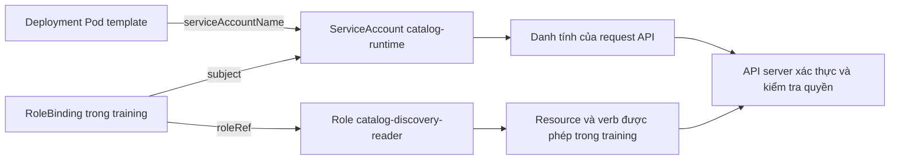

# Gắn ServiceAccount và các tài nguyên RBAC

Bài học thuộc chương **Manifest triển khai** của module **SPRING_CLOUD_KUBERNETES**. Mục tiêu là khai báo đúng danh tính cho Pod và cấp đúng quyền Kubernetes API cho những tính năng Spring thực sự sử dụng: DiscoveryClient, đọc ConfigMap/Secret, Spring Cloud LoadBalancer và Configuration Watcher.

Một Deployment chạy thành công không chứng minh ứng dụng đã có quyền API cần thiết. Ngược lại, một Role rất rộng có thể làm lỗi biến mất nhưng cấp nhiều quyền hơn chức năng yêu cầu. Ta cần nối được bốn điều: **Pod dùng danh tính nào, gọi API nào, trong namespace nào và với thao tác nào**.

## 1. Mục tiêu và tình huống xuyên suốt

Sau bài học, bạn có thể:

- Gắn ServiceAccount vào đúng Pod template của Deployment.
- Phân biệt vai trò của ServiceAccount, Role, ClusterRole, RoleBinding và ClusterRoleBinding.
- Viết quyền theo API group, resource, verb và phạm vi namespace.
- Tách quyền discovery, config, Secret và watcher thay vì cấp chung mọi quyền cho mọi ứng dụng.
- Dùng `kubectl auth can-i` và quan sát Pod thực để kiểm tra cả quyền cần có lẫn quyền cần bị từ chối.
- Phân biệt lỗi danh tính, lỗi RBAC, lỗi TLS/mạng và lỗi cấu hình Spring.

Tình huống chính: `catalog-service` chạy trong namespace `training`, dùng một DiscoveryClient gọi trực tiếp Kubernetes API trong namespace này. Bản lab ban đầu sử dụng đường `Endpoints`, không đọc ConfigMap hoặc Secret qua API. Các phần mở rộng sẽ bổ sung quyền theo từng nhu cầu, không tự động áp dụng tất cả vào manifest ban đầu.

## 2. Khi nào ứng dụng cần quyền Kubernetes API?

Không phải mọi ứng dụng Spring chạy trong Kubernetes đều cần quyền đọc API.

| Cách ứng dụng dùng nền tảng | Process ứng dụng có tự gọi Kubernetes API không? | Hệ quả với ServiceAccount/RBAC |
| --- | --- | --- |
| Gọi `http://inventory` qua Kubernetes Service và DNS | Không chỉ vì dùng DNS | Không cần quyền đọc Service chỉ để HTTP client phân giải tên |
| Đọc biến môi trường hoặc file ConfigMap/Secret đã được Pod cấp | Không chỉ vì đọc env/file | Không tự động cần quyền API `get secrets` hay `get configmaps` |
| Dùng DiscoveryClient dựa trên Fabric8/Kubernetes Java Client gọi API | Có | Cần danh tính và quyền đọc tài nguyên discovery tương ứng |
| Nạp ConfigMap/Secret qua Spring Cloud Kubernetes API integration | Có | Cần quyền trên đúng nguồn cấu hình, theo cách client truy vấn |
| Dùng LoadBalancer với nguồn instance từ DiscoveryClient trực tiếp | Phụ thuộc nguồn instance | Quyền thuộc đường lấy instance, không phát sinh từ tên LoadBalancer đơn thuần |
| Chạy Configuration Watcher | Có ở workload watcher | Watcher cần danh tính và quyền riêng theo phạm vi theo dõi |
| Ứng dụng dùng HTTP DiscoveryClient nói chuyện với DiscoveryServer | API thường do server truy cập | Đánh giá quyền của server và đường HTTP của client riêng biệt |

Quyền đọc API của ServiceAccount ứng dụng không phải cơ chế cấp quyền cho kubelet mount Secret vào Pod. Quyền tạo/cập nhật Pod của người triển khai vẫn cần được kiểm soát riêng, vì Pod có thể được cấu hình để sử dụng những dữ liệu hoặc danh tính khác.

Danh mục quyền Spring Cloud Kubernetes cần phải đối chiếu với starter, phiên bản, tính năng và cách đọc đang dùng. Tài liệu security mô tả các nhóm tài nguyên discovery và config, không có nghĩa mọi ứng dụng phải đọc cả hai nhóm. [Spring Cloud Kubernetes: security và ServiceAccount](https://docs.spring.io/spring-cloud-kubernetes/reference/security-service-accounts.html).

## 3. Chuỗi danh tính và phân quyền



### 3.1. Mỗi tài nguyên giải quyết việc gì?

| Tài nguyên | Phạm vi | Trách nhiệm |
| --- | --- | --- |
| ServiceAccount | Namespace | Danh tính workload có thể được gắn vào Pod |
| Role | Namespace | Tập quyền đối với tài nguyên trong một namespace |
| ClusterRole | Toàn cụm về nơi khai báo | Mẫu quyền có thể tái sử dụng; cũng có thể mô tả tài nguyên không thuộc namespace |
| RoleBinding | Namespace | Gắn Role hoặc ClusterRole cho subject, giới hạn quyền namespaced trong namespace của binding |
| ClusterRoleBinding | Toàn cụm | Gắn ClusterRole với phạm vi toàn cụm theo các rule của nó |

ServiceAccount không tự có toàn bộ quyền của namespace. Role không tự cấp quyền khi chưa có binding. ClusterRole cũng không tự mở quyền toàn cụm chỉ vì có chữ `Cluster`: cách binding quyết định phạm vi được cấp cho các tài nguyên namespaced.

Một danh tính có thể nhận quyền từ nhiều binding; RBAC cộng gộp các quyền cho phép, không có rule từ chối để ghi đè một quyền đã được cấp ở nơi khác. Vì vậy, thêm một Role hẹp không làm mất quyền rộng của binding cũ. [Kubernetes: các đối tượng RBAC và tính cộng gộp](https://kubernetes.io/docs/reference/access-authn-authz/rbac/).

### 3.2. Danh tính đầy đủ có cả namespace

ServiceAccount `catalog-runtime` trong `training` có tên người dùng API:

```text
system:serviceaccount:training:catalog-runtime
```

`catalog-runtime` trong namespace `shared` là danh tính khác. Khi đọc lỗi hoặc kiểm tra quyền, cần đối chiếu đầy đủ tên này với namespace của Pod và subject trong RoleBinding.

Pod không chỉ định ServiceAccount sẽ được gắn tài khoản `default` trong namespace. Khai báo tường minh giúp tránh phụ thuộc vào những binding có thể đã tồn tại trên `default`. [Kubernetes: ServiceAccount của Pod](https://kubernetes.io/docs/concepts/security/service-accounts/).

## 4. Thiết kế quyền từ thao tác API

### 4.1. API group, resource và verb

Ví dụ rule cho phép đọc dữ liệu discovery:

```yaml
rules:
  - apiGroups: [""]
    resources: ["services", "endpoints", "pods"]
    verbs: ["get", "list", "watch"]
```

Ý nghĩa:

- `apiGroups: [""]` là core API group, không phải chuỗi `v1`.
- `resources` sử dụng tên resource trong API, dạng số nhiều và chữ thường.
- `get` đọc một đối tượng, `list` lấy tập đối tượng và `watch` theo dõi thay đổi theo cơ chế API.

Không thể suy verb RBAC chỉ từ HTTP method. Nhiều request HTTP `GET` có thể được phân loại là `get`, `list` hoặc `watch` tùy endpoint và tham số. [Kubernetes: ánh xạ request sang verb phân quyền](https://kubernetes.io/docs/reference/access-authn-authz/authorization/).

| Tài nguyên | API group trong rule | Ghi chú |
| --- | --- | --- |
| `pods`, `services`, `endpoints`, `configmaps`, `secrets` | `""` | Core API group |
| `endpointslices` | `discovery.k8s.io` | Khác với resource `endpoints` |
| `deployments` | `apps` | Không tự cần quyền này để đọc danh sách instance |
| `leases` | `coordination.k8s.io` | Có thể dùng cho leader election, chỉ thêm khi thành phần thực sự cần |
| `roles`, `rolebindings` | `rbac.authorization.k8s.io` | Ứng dụng nghiệp vụ thường không cần tự quản lý quyền |

Quyền trên `pods` không đồng nghĩa có quyền trên `pods/log` hoặc `pods/exec`. Các subresource phải được xét riêng. Việc người vận hành cần xem log không phải lý do cấp `pods/log` cho ServiceAccount runtime.

### 4.2. Chọn namespace và tài nguyên trước khi viết YAML

Với tình huống chính, quyết định của lab là:

```text
Danh tính: system:serviceaccount:training:catalog-runtime
Phạm vi discovery: training
Đường discovery: Kubernetes API, chế độ Endpoints
Tài nguyên: services, endpoints, pods
Thao tác: get, list, watch
Đọc config/secret qua API: không
Ghi tài nguyên Kubernetes: không
```

Tập ba tài nguyên discovery trên bám theo nhóm quyền mà tài liệu Spring Cloud Kubernetes mô tả cho direct client. Đây là cấu hình lab đã chọn, không phải khẳng định mọi phiên bản hoặc tùy chọn đều cần quyền giống nhau. Khi triển khai thật, đối chiếu luồng gọi của chính client và bỏ quyền không dùng sau khi kiểm chứng.

Label selector trong ứng dụng giúp lọc dữ liệu được quan tâm; nó không tự biến Role namespace-wide thành quyền bị giới hạn theo label. Không dùng cấu hình lọc của client như một ranh giới bảo mật.

## 5. Manifest đầy đủ cho tình huống discovery trong một namespace

### 5.1. Giả định của ví dụ

Ứng dụng đã được đóng gói thành image, có direct Kubernetes DiscoveryClient phù hợp với bộ Spring Boot/Spring Cloud đang dùng và lắng nghe cổng `8080`. Image có entrypoint nhận được các đối số cấu hình Spring Boot trong trường `args`.

Các tên file trong bài là tên gợi ý cho dự án thực hành. Namespace `training` đã được tạo bởi người quản lý lab; manifest này không tạo namespace hoặc cấp quyền cho người triển khai.

Thay `registry.example.com/training/catalog-service:0.1.0` bằng image thật mà cụm kéo được. Role không giải quyết lỗi image registry, health endpoint hay chính sách mạng.

### 5.2. ServiceAccount, Role, RoleBinding và Deployment

```yaml
apiVersion: v1
kind: ServiceAccount
metadata:
  name: catalog-runtime
  namespace: training
automountServiceAccountToken: false
---
apiVersion: rbac.authorization.k8s.io/v1
kind: Role
metadata:
  name: catalog-discovery-reader
  namespace: training
rules:
  - apiGroups: [""]
    resources: ["services", "endpoints", "pods"]
    verbs: ["get", "list", "watch"]
---
apiVersion: rbac.authorization.k8s.io/v1
kind: RoleBinding
metadata:
  name: catalog-discovery-reader-binding
  namespace: training
subjects:
  - kind: ServiceAccount
    name: catalog-runtime
    namespace: training
roleRef:
  apiGroup: rbac.authorization.k8s.io
  kind: Role
  name: catalog-discovery-reader
---
apiVersion: apps/v1
kind: Deployment
metadata:
  name: catalog-service
  namespace: training
spec:
  replicas: 1
  selector:
    matchLabels:
      app: catalog-service
  template:
    metadata:
      labels:
        app: catalog-service
    spec:
      serviceAccountName: catalog-runtime
      automountServiceAccountToken: true
      containers:
        - name: app
          image: registry.example.com/training/catalog-service:0.1.0
          ports:
            - name: http
              containerPort: 8080
          args:
            - "--spring.cloud.kubernetes.discovery.all-namespaces=false"
            - "--spring.cloud.kubernetes.discovery.use-endpoint-slices=false"
            - "--spring.cloud.kubernetes.config.enabled=false"
            - "--spring.cloud.kubernetes.secrets.enabled=false"
          env:
            - name: SPRING_CLOUD_KUBERNETES_CLIENT_NAMESPACE
              valueFrom:
                fieldRef:
                  fieldPath: metadata.namespace
```

Manifest này không gắn quyền đọc Secret, ConfigMap, tạo Pod, chỉnh Deployment hay quản lý RBAC. Các tùy chọn discovery được viết rõ để cấu hình client và quyền cấp cho nó khớp với nhau.

Các điểm nối cần kiểm tra:

1. `spec.template.spec.serviceAccountName` trỏ tới ServiceAccount cùng namespace với Pod.
2. `subjects[].name` và `subjects[].namespace` trỏ đúng danh tính đó.
3. RoleBinding và Role cùng ở `training`; `roleRef.name` khớp tên Role.
4. `roleRef.apiGroup` là `rbac.authorization.k8s.io`. ServiceAccount là subject thuộc core group; nếu ghi `subjects[].apiGroup` thì giá trị tương ứng là chuỗi rỗng.
5. Namespace mà client thực sự truy vấn phù hợp với phạm vi Role.

Không đặt `serviceAccountName` trực tiếp dưới `Deployment.spec` hoặc trong `containers[]`. Nó thuộc Pod spec nằm bên trong template.

### 5.3. Vì sao ServiceAccount tắt automount nhưng Pod lại bật?

Ví dụ đặt mặc định `false` trên ServiceAccount, rồi bật tường minh trên Pod thực sự gọi API. Khi cả hai nơi có cấu hình, giá trị ở Pod được ưu tiên.

Đây là lựa chọn thể hiện rõ nhu cầu của workload; không phải cách rút quyền RBAC của danh tính. Một Pod khác có thể chủ động yêu cầu token theo quyền tạo Pod và chính sách admission áp dụng. [Kubernetes: gắn ServiceAccount và ưu tiên automount](https://kubernetes.io/docs/tasks/configure-pod-container/configure-service-account/).

Nếu ứng dụng chỉ dùng DNS và cấu hình mount, giữ `automountServiceAccountToken: false` trên Pod và không tạo các binding API không cần thiết. Tắt automount không tự xóa thông tin xác thực do bạn mount hoặc cấu hình riêng.

### 5.4. Token runtime không phải file trong image

Cụm Kubernetes hiện đại cấp token có thời hạn qua projected volume/TokenRequest cho Pod. Client phải sử dụng đúng CA, token và cơ chế cập nhật token của môi trường in-cluster; không đóng token hoặc kubeconfig cá nhân vào image.

Không tạo Secret token dài hạn để sửa lỗi “ServiceAccount không có Secret tự sinh”. Việc không thấy một Secret token gắn sẵn không có nghĩa Pod không thể nhận credential theo cơ chế hiện đại. [Kubernetes: quản lý credential ServiceAccount](https://kubernetes.io/docs/reference/access-authn-authz/service-accounts-admin/).

## 6. Nếu DiscoveryClient dùng EndpointSlice

`endpoints` và `endpointslices` là hai resource khác nhau, thuộc hai API group khác nhau. Bật tính năng trên client mà không cập nhật Role có thể làm discovery bị `Forbidden`.

Với phiên bản hỗ trợ tùy chọn sau, cấu hình ứng dụng có thể chọn:

```yaml
spring:
  cloud:
    kubernetes:
      discovery:
        use-endpoint-slices: true
```

Khi đó bổ sung rule phù hợp vào Role discovery:

```yaml
- apiGroups: ["discovery.k8s.io"]
  resources: ["endpointslices"]
  verbs: ["get", "list", "watch"]
```

Trong Deployment mẫu, phải đổi đối số đang đặt `use-endpoint-slices=false`; việc thêm một file cấu hình giá trị `true` có thể không thắng được giá trị đã truyền trên command line.

Giữ hoặc bỏ quyền `endpoints` theo đường API thực tế của phiên bản client và các tính năng đang bật. Không cấp cả hai mãi mãi chỉ vì chưa xác định client dùng đường nào. [Spring Cloud Kubernetes: discovery và quyền EndpointSlice](https://docs.spring.io/spring-cloud-kubernetes/reference/discovery-client.html).

EndpointSlice thuộc nhóm `discovery.k8s.io`; không đặt nó chung với `apiGroups: [""]` rồi mong rule có hiệu lực. [Kubernetes: EndpointSlices](https://kubernetes.io/docs/concepts/services-networking/endpoint-slices/).

## 7. Bổ sung quyền ConfigMap và Secret theo cách đọc

### 7.1. Không dùng quyền discovery để suy ra quyền config

Role discovery ở trên không đọc được ConfigMap hoặc Secret. Nếu ứng dụng chỉ nhận cấu hình qua env/volume thì không cần thêm quyền API chỉ để đọc giá trị đã được cung cấp.

Nếu ứng dụng nạp cấu hình qua Spring Cloud Kubernetes API integration, xác định nó đọc từng tên hay liệt kê cả tập tài nguyên. Cùng một `config.name` trong cấu hình chưa đủ chứng minh client chỉ gửi request `get` cho một tên.

### 7.2. Trường hợp chỉ đọc một ConfigMap lúc khởi động

Giả sử biến thể lab dùng API để đọc duy nhất ConfigMap `catalog-settings` trong `training`, không watch/reload, không dùng nguồn chọn theo label và không tìm thêm ConfigMap theo profile. Có thể tách quyền bằng Role và RoleBinding riêng:

```yaml
apiVersion: rbac.authorization.k8s.io/v1
kind: Role
metadata:
  name: catalog-config-getter
  namespace: training
rules:
  - apiGroups: [""]
    resources: ["configmaps"]
    resourceNames: ["catalog-settings"]
    verbs: ["get"]
---
apiVersion: rbac.authorization.k8s.io/v1
kind: RoleBinding
metadata:
  name: catalog-config-getter-binding
  namespace: training
subjects:
  - kind: ServiceAccount
    name: catalog-runtime
    namespace: training
roleRef:
  apiGroup: rbac.authorization.k8s.io
  kind: Role
  name: catalog-config-getter
```

Để rule này khớp với hành vi client, cần dùng chế độ đọc theo tên được phiên bản hỗ trợ. Tài liệu Spring Cloud Kubernetes 5.1 mô tả `SINGLE`, được giới thiệu từ 5.0.0-M3; `BATCH` mặc định cần quyền list rộng hơn.

Ví dụ cấu hình cho biến thể đáp ứng các giả định trên:

```yaml
spring:
  application:
    name: catalog-service
  config:
    import: "kubernetes:"
  cloud:
    kubernetes:
      config:
        enabled: true
        name: catalog-settings
        namespace: training
        read-type: SINGLE
        include-profile-specific-sources: false
      secrets:
        enabled: false
```

Chỉ dùng các thuộc tính và cơ chế import được phiên bản dự án hỗ trợ. Khi đổi từ Deployment mẫu, bỏ hoặc đổi đối số `--spring.cloud.kubernetes.config.enabled=false`; không để command line vô hiệu hóa nguồn cấu hình vừa bật.

Nếu vẫn dùng `BATCH`, nhiều nguồn config, profile-specific sources hoặc cơ chế watch khác, phải tính lại tập request và quyền tương ứng. [Spring Cloud Kubernetes: ConfigMap PropertySource và chế độ đọc](https://docs.spring.io/spring-cloud-kubernetes/reference/property-source-config/configmap-propertysource.html).

### 7.3. `resourceNames` không tự làm mọi request trở nên hợp lệ

Một request `get configmaps/catalog-settings` khác với `list configmaps` rồi lọc ở phía client. Khi dùng `resourceNames` cho `list` hoặc `watch`, request phải có field selector `metadata.name` phù hợp theo quy tắc RBAC và client phải thực sự gửi selector đó.

Do vậy, không đơn giản thêm `watch` vào Role rồi kết luận watcher theo label sẽ chạy được. Cần kiểm chứng đường đọc cụ thể; label selector thông thường không thay thế yêu cầu tên tài nguyên.

### 7.4. Khi ứng dụng thật sự cần đọc Secret qua API

Chỉ thêm rule riêng cho tên Secret cần dùng, chẳng hạn:

```yaml
- apiGroups: [""]
  resources: ["secrets"]
  resourceNames: ["catalog-credentials"]
  verbs: ["get"]
```

Đây là một rule để bổ sung có chủ đích vào Role thích hợp, không phải manifest độc lập. Cấu hình ứng dụng phải dùng đường đọc theo tên tương thích; không dùng rule này nếu client vẫn list toàn bộ Secret.

Quyền `get` cho một Secret cho phép đọc dữ liệu của đối tượng đó, không chỉ metadata hoặc một khóa trong `data`. Quyền `list`/`watch` Secret cũng có thể làm lộ nội dung Secret; không coi chúng là quyền chỉ xem danh sách tên. [Kubernetes: Secret và kiểm soát truy cập](https://kubernetes.io/docs/concepts/configuration/secret/).

Tách Secret khỏi những ConfigMap nghiệp vụ không nhạy cảm, không in token hoặc dữ liệu Secret trong lệnh chẩn đoán, và không cấp quyền tạo/cập nhật/xóa Secret khi ứng dụng chỉ cần đọc.

## 8. Khám phá dịch vụ ở namespace khác

### 8.1. Namespace của quyền khác namespace của danh tính

Giả sử `catalog-service` vẫn ở `training`, nhưng cần khám phá thêm `inventory` trong `shared`. Một phương án là tạo Role và RoleBinding trong namespace đích `shared`, với subject vẫn là ServiceAccount ở `training`.

```yaml
apiVersion: rbac.authorization.k8s.io/v1
kind: Role
metadata:
  name: catalog-discovery-reader
  namespace: shared
rules:
  - apiGroups: [""]
    resources: ["services", "endpoints", "pods"]
    verbs: ["get", "list", "watch"]
---
apiVersion: rbac.authorization.k8s.io/v1
kind: RoleBinding
metadata:
  name: catalog-reader-from-training
  namespace: shared
subjects:
  - kind: ServiceAccount
    name: catalog-runtime
    namespace: training
roleRef:
  apiGroup: rbac.authorization.k8s.io
  kind: Role
  name: catalog-discovery-reader
```

Namespace `shared` phải tồn tại. Role cùng tên trong `training` và `shared` là hai đối tượng khác nhau. RoleBinding trên tham chiếu Role ở `shared`, không tham chiếu Role ở `training`.

Cấu hình discovery cũng phải chỉ rõ tập namespace được phép, ví dụ trong cấu hình ứng dụng:

```yaml
spring:
  cloud:
    kubernetes:
      discovery:
        all-namespaces: false
        namespaces:
          - training
          - shared
```

Client cần thực hiện các request theo namespace tương ứng. Quyền cho từng namespace không đồng nghĩa một request list ở cấp toàn cụm được phép. Đừng bật `all-namespaces=true` chỉ để thay danh sách namespace hữu hạn.

### 8.2. Khi nào dùng ClusterRole?

Nếu nhiều namespace cần cùng một mẫu quyền, có thể định nghĩa ClusterRole rồi dùng RoleBinding trong từng namespace được phép. Cách này tái sử dụng rule mà không tự cấp quyền sang namespace chưa có binding.

| Cách gắn quyền | Phạm vi namespaced được cấp | Trường hợp phù hợp |
| --- | --- | --- |
| Role + RoleBinding trong `training` | `training` | Một workload chỉ đọc trong namespace này |
| ClusterRole + RoleBinding trong `shared` | `shared` | Tái sử dụng mẫu quyền cho namespace được chỉ định |
| ClusterRole + nhiều RoleBinding | Các namespace có binding | Danh sách namespace hữu hạn |
| ClusterRole + ClusterRoleBinding | Toàn cụm theo rule | Chỉ khi có nhu cầu và kiểm soát phạm vi phù hợp |

Tài nguyên không thuộc namespace, như Node, không được cấp hiệu lực toàn cụm chỉ bằng một RoleBinding namespaced. Ứng dụng discovery thông thường không cần đọc Node để giải quyết lỗi đọc Service.

## 9. Configuration Watcher cần danh tính riêng

Watcher là workload quan sát thay đổi, không phải mọi Pod ứng dụng đều phải mang quyền watch ConfigMap/Secret. Hãy tách:

- `catalog-runtime`: quyền ứng dụng nghiệp vụ thực sự dùng.
- `configuration-watcher`: quyền theo dõi, discovery hoặc leader election mà kiến trúc watcher thực sự cần.
- Danh tính triển khai: tạo/cập nhật Deployment, Role, RoleBinding theo chính sách quản trị.

Nếu bật theo dõi Secret cho watcher, quyền Secret thuộc về watcher và phải được xem xét riêng. Label lọc đối tượng giúp chọn sự kiện cần xử lý, nhưng standard RBAC không tự giới hạn quyền đọc theo label.

Với phiên bản Configuration Watcher có HA dùng Lease, tài liệu mô tả rule riêng:

```yaml
- apiGroups: ["coordination.k8s.io"]
  resources: ["leases"]
  verbs: ["get", "create", "update"]
```

Chỉ cấp cho thành phần leader election tương ứng. Không đưa quyền ghi Lease hay chỉnh Deployment vào Role của `catalog-service` nếu ứng dụng không làm những việc đó. [Spring Cloud Kubernetes: Configuration Watcher và HA](https://docs.spring.io/spring-cloud-kubernetes/reference/spring-cloud-kubernetes-configuration-watcher.html).

RBAC của Kubernetes API không cấp quyền gọi `/actuator/refresh`. Endpoint HTTP của ứng dụng cần cơ chế bảo vệ và kết nối mạng riêng. Quyền watch đúng cũng không chứng minh bean sẽ cập nhật: phải kiểm chứng chiến lược reload/refresh/rollout phù hợp với bộ thư viện và chế độ chạy.

## 10. Áp dụng và kiểm tra manifest

Các lệnh bên dưới là hướng dẫn để người học thực hiện trong cụm lab được cấp quyền. Ví dụ giả định manifest chính đã được lưu thành `catalog-rbac.yaml` trong dự án thực hành.

### 10.1. Kiểm tra trước khi áp dụng

```powershell
kubectl config current-context
kubectl get namespace training
kubectl apply --dry-run=server -f .\catalog-rbac.yaml
```

Server-side dry run kiểm tra request với API server và các chính sách liên quan, nhưng không chứng minh ứng dụng trong image chạy đúng hoặc đọc được API bằng token của Pod.

Người chạy lệnh apply dùng danh tính triển khai trong kubeconfig của họ, không phải ServiceAccount runtime vừa khai báo. Người đó cần quyền tạo/cập nhật các tài nguyên liên quan và phải đáp ứng cơ chế chống tự nâng quyền khi tạo Role hoặc binding. Không cấp quyền quản lý RBAC cho ứng dụng để giải quyết lỗi apply của người triển khai.

Sau khi đã kiểm tra image, namespace và nội dung:

```powershell
kubectl apply -f .\catalog-rbac.yaml
kubectl rollout status -n training deployment/catalog-service
kubectl get serviceaccount,role,rolebinding -n training
```

### 10.2. Kiểm tra danh tính được gắn vào Pod thực

```powershell
kubectl get deployment catalog-service -n training -o 'jsonpath={.spec.template.spec.serviceAccountName}'
kubectl get pods -n training -l app=catalog-service -o 'custom-columns=NAME:.metadata.name,SA:.spec.serviceAccountName'
kubectl describe rolebinding catalog-discovery-reader-binding -n training
```

Đối chiếu Pod mới sau rollout, không chỉ file YAML local hoặc template. Đổi `serviceAccountName` trên Deployment làm thay đổi Pod template và tạo lượt rollout; không sửa danh tính trên một Pod đang tồn tại như một thao tác cập nhật thông thường.

### 10.3. Kiểm tra quyền bằng impersonation

Dùng `kubectl auth can-i` để hỏi authorization cho danh tính ứng dụng. Để phản ánh các nhóm ServiceAccount chuẩn trong kiểm tra, có thể chuẩn bị đối số PowerShell:

```powershell
$identityArgs = @(
    '--as=system:serviceaccount:training:catalog-runtime',
    '--as-group=system:serviceaccounts',
    '--as-group=system:serviceaccounts:training',
    '--as-group=system:authenticated'
)

kubectl auth can-i list services -n training @identityArgs
kubectl auth can-i watch endpoints -n training @identityArgs
kubectl auth can-i get pods -n training @identityArgs
```

Người chạy kiểm tra cần quyền impersonate danh tính và các nhóm tương ứng. Nếu API server từ chối thao tác impersonation, đó chưa phải kết quả từ chối quyền discovery của `catalog-runtime`. Nhờ người quản trị hoặc pipeline có quyền kiểm tra phù hợp thực hiện; không nâng quyền ServiceAccount ứng dụng để cho lệnh này chạy qua.

Kiểm tra cả những quyền không cần có của manifest chính:

```powershell
kubectl auth can-i get secrets -n training @identityArgs
kubectl auth can-i list configmaps -n training @identityArgs
kubectl auth can-i create pods -n training @identityArgs
kubectl auth can-i patch deployments.apps -n training @identityArgs
kubectl auth can-i create rolebindings.rbac.authorization.k8s.io -n training @identityArgs
kubectl auth can-i list services -n shared @identityArgs
```

Với riêng manifest chính và không có binding khác cấp thêm quyền, kỳ vọng ba phép đọc discovery trả `yes`, các phép không cần có phía sau trả `no`. Sau khi áp dụng biến thể cross-namespace, phép list Service ở `shared` được kỳ vọng đổi thành `yes`.

Sau khi áp dụng biến thể đọc ConfigMap theo tên, kiểm tra chính xác tên:

```powershell
kubectl auth can-i get configmaps/catalog-settings -n training @identityArgs
kubectl auth can-i get configmaps/unrelated-settings -n training @identityArgs
kubectl auth can-i list configmaps -n training @identityArgs
```

Kỳ vọng lần lượt `yes`, `no`, `no` khi chỉ có quyền getter đã mô tả. Không thử đọc hoặc in dữ liệu Secret thật để chứng minh quyền.

Những kiểm tra này chỉ hỏi quyền của request được mô tả. Chúng không xác nhận token đang được mount vào Pod, CA đúng, mạng tới API server thông hoặc client đang gửi cùng loại request. [Kubernetes: `kubectl auth can-i`](https://kubernetes.io/docs/reference/kubectl/generated/kubectl_auth/kubectl_auth_can-i/).

### 10.4. Kiểm chứng bằng client thật

```powershell
kubectl logs -n training deployment/catalog-service
kubectl get pods -n training -l app=catalog-service
```

Tiếp tục gọi luồng nghiệp vụ hoặc điểm kiểm chứng discovery đã thiết kế trong lab. Quan sát rằng client lấy được instance đúng namespace, xử lý thay Pod và khôi phục watch theo yêu cầu.

`kubectl logs` ở đây dùng quyền của người vận hành, không đòi ứng dụng tự có quyền đọc log của chính nó. Probe HTTP do kubelet gọi cũng không tự yêu cầu ứng dụng có quyền `get pods`; chỉ thêm quyền API nếu health integration của ứng dụng thực sự gọi API.

Health endpoint trả `UP` chưa chứng minh mọi chức năng discovery/config đã được kiểm tra. Ngược lại, một health indicator liên quan Kubernetes có thể lỗi vì token, mạng hoặc quyền; đọc nguyên nhân trước khi thay đổi Role.

## 11. Đọc lỗi theo đúng lớp

Ví dụ lỗi phân quyền:

```text
User "system:serviceaccount:training:catalog-runtime" cannot list
resource "services" in API group "" in the namespace "shared"
```

Đọc lần lượt: danh tính, verb, resource, API group và namespace. Với manifest chính, lỗi ở `shared` phù hợp với giới hạn đã thiết kế; sửa cấu hình truy vấn namespace hoặc mở rộng quyền có chủ đích theo yêu cầu, không cấp `cluster-admin`.

| Triệu chứng | Lớp cần kiểm tra | Cách khoanh vùng |
| --- | --- | --- |
| `Forbidden`, thường HTTP 403 | Authorization | Đối chiếu danh tính, verb, resource, group và namespace trong lỗi |
| `Unauthorized`, thường HTTP 401 | Authentication | Token, thời hạn, audience, cơ chế nạp và làm mới credential |
| Lỗi certificate/SSL | TLS | CA, hostname và cấu hình client; không sửa bằng quyền RBAC |
| Connection timeout/refused | Mạng hoặc endpoint | API server address, DNS, routing, NetworkPolicy và proxy |
| Không có token ở đường dẫn client cần | Cấp credential | Automount ở Pod/ServiceAccount, projected volume và cấu hình client |
| Pod dùng `default` | Gắn danh tính | Vị trí `serviceAccountName`, template thực và lượt rollout |
| `endpointslices` bị từ chối | Sai resource/group | Rule cho `discovery.k8s.io`, không phải core group |
| Đọc được Service nhưng list ConfigMap bị từ chối | Thiếu quyền hoặc sai cách đọc | Tính năng config đã bật chưa, client dùng BATCH hay SINGLE? |
| Có quyền `get` nhưng informer lỗi | Thiếu loại request cần thiết | Client có gọi list/watch namespace-wide không? |
| Chỉ lỗi sau khi chạy lâu | Token hoặc kết nối dài hạn | Rotation credential, reconnect watch và hành vi của phiên bản client |
| Một quyền lẽ ra bị chặn lại trả `yes` | Quyền cộng gộp | Binding trực tiếp, binding theo group và ClusterRoleBinding đang áp dụng |
| Apply Role/Binding bị từ chối | Danh tính triển khai | Quyền của người apply và quy tắc bind/escalate, không phải quyền runtime |

Không dùng `trust-certs=true`, token cố định hoặc một ClusterRoleBinding rộng như cách chữa chung. Mỗi lớp lỗi có thông tin và giải pháp riêng.

## 12. Thay đổi quyền và bảo trì manifest

Role/RoleBinding là cấu hình authorization ở API server. Sửa một rule thường không yêu cầu thay image; client có thể cần retry/reconnect hoặc khởi tạo lại đường đã lỗi tùy cách triển khai. Đừng mặc định restart Pod là điều kiện để RBAC có hiệu lực.

Ngược lại, đổi ServiceAccount trong Pod template cần Pod mới. Nếu thay đổi đối tượng mà `roleRef` trỏ tới, cần lưu ý `roleRef` của binding là bất biến; lập thay đổi binding phù hợp thay vì cố patch trường đó tại chỗ.

Khi thu hẹp quyền:

1. Ghi rõ tính năng bị bỏ hoặc đường API đã đổi.
2. Kiểm tra mọi binding cấp quyền cho ServiceAccount và các group liên quan.
3. Thay rule/binding đúng nguồn quản lý và kiểm tra lại cả quyền cho phép lẫn quyền không mong muốn.
4. Kiểm chứng startup, gọi nghiệp vụ, watch/reconnect và các đường config đang dùng.

Không kết luận đã thu hồi quyền Secret chỉ vì bỏ một rule trong Role mới, nếu ClusterRoleBinding cũ vẫn cấp `get/list/watch secrets`. Cũng không tạo binding rộng cho `default` để dùng chung giữa nhiều ứng dụng có nhu cầu khác nhau.

Phân quyền tối thiểu cần dựa trên chức năng thực tế, đồng thời hạn chế các quyền tạo workload, quản lý RBAC hoặc sử dụng danh tính mạnh hơn. [Kubernetes: thực hành RBAC tốt](https://kubernetes.io/docs/concepts/security/rbac-good-practices/).

## 13. Bài thực hành và tiêu chí hoàn thành

Thực hiện trong namespace lab đã được cấp, với image có direct DiscoveryClient phù hợp:

1. Áp dụng manifest chính cho `catalog-service`; xác nhận Pod dùng `catalog-runtime`.
2. Kiểm tra quyền đọc discovery trong `training` và xác nhận không có quyền đọc Secret, list ConfigMap hoặc ghi workload.
3. Gọi luồng sử dụng discovery; phân biệt kết quả chức năng với health HTTP đơn thuần.
4. Trong một lượt thử có kiểm soát, dùng namespace đích chưa được cấp quyền và đọc đầy đủ lỗi. Khôi phục cấu hình hoặc bổ sung biến thể cross-namespace theo yêu cầu lab.
5. Nếu dùng EndpointSlice, đổi cấu hình client và bổ sung đúng API group; xác nhận không dựa vào quyền thừa từ thử nghiệm trước.
6. Thử biến thể ConfigMap theo tên nếu phiên bản hỗ trợ; xác nhận đọc được `catalog-settings` nhưng không được list cả namespace hoặc đọc tên khác.
7. Nếu thêm watcher, dùng ServiceAccount và Role riêng; không gộp quyền watcher vào runtime nghiệp vụ.
8. Ghi lại tập request được phép, các kiểm tra phải trả `no` và lý do cho mỗi quyền còn giữ lại.

Mẫu bảng bàn giao cho dự án thực hành:

| Danh tính | Namespace đích | Resource/API group | Verb | Tính năng cần quyền | Bằng chứng |
| --- | --- | --- | --- | --- | --- |
| `training:catalog-runtime` | `training` | `services`, `endpoints`, `pods` / core | `get`, `list`, `watch` | Direct discovery theo cấu hình lab | can-i và thử client thật |
| `training:catalog-runtime` | `training` | `configmaps` / core, tên `catalog-settings` | `get` | Biến thể đọc config theo tên, nếu áp dụng | Kiểm tra tên đúng và tên không được phép |
| Danh tính watcher riêng | Namespace được theo dõi | Theo cấu hình watcher thực tế | Theo thao tác cần thiết | Theo dõi và thông báo thay đổi | Watch/reconnect và đường nhận cập nhật |

Hoàn thành khi bạn giải thích được từng mối nối trong manifest, chứng minh quyền cần có hoạt động và kiểm tra được các quyền ngoài phạm vi không bị cấp thêm từ binding khác.

### Câu hỏi tự kiểm tra

1. Vì sao tạo ServiceAccount chưa đủ để DiscoveryClient đọc Service?
2. `serviceAccountName` phải nằm ở đâu trong Deployment, và vì sao sửa một Pod đang tồn tại không phải cách đổi danh tính thông thường?
3. RoleBinding ở `shared` có thể cấp quyền cho ServiceAccount ở `training` không? Nó tìm Role ở namespace nào?
4. ClusterRole được gắn bằng RoleBinding khác gì khi được gắn bằng ClusterRoleBinding?
5. Vì sao `get configmaps/catalog-settings` và `list configmaps` cần được kiểm tra riêng?
6. Label selector của watcher có giới hạn quyền đọc Secret bằng standard RBAC không?
7. Nếu `kubectl auth can-i` trả `yes` nhưng Pod báo `Unauthorized`, bạn kiểm tra lớp nào trước?
8. Vì sao thêm Role hẹp không thu hồi được quyền rộng đã có từ binding khác?
9. Khi chuyển từ Endpoints sang EndpointSlice, những phần nào của manifest và cấu hình client phải thay đổi?
10. Khi chỉ dùng Service DNS, file cấu hình được mount và probe HTTP, vì sao không nên mặc định cấp quyền API discovery?
