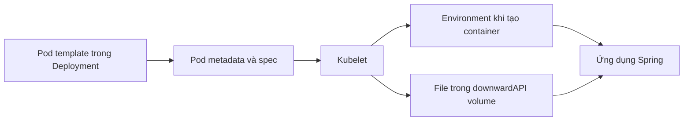

# Labels, annotations và dữ liệu Pod qua Downward API

Một ứng dụng Spring chạy trong Kubernetes thường cần biết nó đang ở namespace nào, thuộc bản phát hành nào và Pod nào đã tạo ra một dòng log. Không nên hard-code các giá trị này vào image, vì cùng image có thể chạy trong nhiều namespace và nhiều replica.

Kubernetes cung cấp labels, annotations và Downward API để nối metadata triển khai với tiến trình ứng dụng. Bài này thuộc chương **Manifest triển khai** của module **SPRING_CLOUD_KUBERNETES**, tập trung vào cách chọn metadata, đặt đúng vị trí trong Deployment và đưa dữ liệu Pod vào Spring mà không cần ứng dụng tự truy vấn Kubernetes API.

Sau bài học, bạn có thể:

- Phân biệt labels dùng để phân nhóm, lựa chọn đối tượng với annotations dùng để bổ sung thông tin.
- Phân biệt metadata của Deployment với metadata của Pod được tạo từ template.
- Dùng `fieldRef` và `resourceFieldRef` để truyền dữ liệu qua environment hoặc volume.
- Giải thích vì sao environment và file có hành vi cập nhật khác nhau.
- Kết hợp metadata với namespace của Spring Cloud Kubernetes, discovery, log và chẩn đoán vận hành.

## 1. Labels và annotations phục vụ hai nhu cầu khác nhau

| Tiêu chí | Labels | Annotations |
| --- | --- | --- |
| Mục đích chính | Nhận diện thuộc tính để tổ chức, phân nhóm, chọn tài nguyên | Lưu thông tin bổ sung cho người vận hành, công cụ hoặc controller |
| Ví dụ | Tên ứng dụng, instance, component, environment, version | Đội phụ trách, build ID, mô tả, tham số riêng của một controller |
| Dùng trong label selector | Có | Không |
| Giá trị | Chuỗi theo quy tắc ký tự và độ dài của label | Chuỗi có thể chứa khoảng trắng, Unicode hoặc dữ liệu có cấu trúc |
| Tự tạo hành vi nghiệp vụ | Không; cần có thành phần sử dụng label | Không; cần có thành phần hiểu annotation |

Ví dụ:

```yaml
metadata:
  labels:
    app.kubernetes.io/name: catalog
    app.kubernetes.io/instance: catalog-demo
    app.kubernetes.io/version: "1.0.0"
    app.kubernetes.io/component: backend
    platform.example.com/environment: lab
  annotations:
    platform.example.com/owner: "Nhóm nền tảng"
    platform.example.com/build-id: "build-0042"
```

Label `app.kubernetes.io/version` giúp công cụ nhận diện phiên bản, nhưng không tự thay image đang chạy. Annotation `platform.example.com/owner` giúp lưu thông tin phụ trách, nhưng không tự cấp quyền RBAC cho đội đó.

Một annotation chỉ có tác dụng đặc biệt khi một controller hoặc công cụ đã được cấu hình để đọc nó. Không mặc định annotation tự kích hoạt Spring refresh, service discovery hoặc thu thập metrics.

Kubernetes mô tả hai loại metadata trong [Labels and Selectors](https://kubernetes.io/docs/concepts/overview/working-with-objects/labels/) và [Annotations](https://kubernetes.io/docs/concepts/overview/working-with-objects/annotations/).

### 1.1. Quy ước tên giúp công cụ phối hợp

Một số label thường dùng:

| Label | Ý nghĩa nên giữ nhất quán |
| --- | --- |
| `app.kubernetes.io/name` | Tên ứng dụng |
| `app.kubernetes.io/instance` | Một bản cài đặt cụ thể của ứng dụng |
| `app.kubernetes.io/version` | Phiên bản ứng dụng được khai báo |
| `app.kubernetes.io/component` | Thành phần trong kiến trúc |
| `app.kubernetes.io/part-of` | Hệ thống lớn mà ứng dụng thuộc về |
| `app.kubernetes.io/managed-by` | Công cụ quản lý tài nguyên |

Đây là quy ước được Kubernetes khuyến nghị, không phải cơ chế tự đăng ký ứng dụng. Áp dụng nhất quán trên Deployment, Pod template, Service và ConfigMap khi chúng cùng thuộc một ứng dụng. Xem [Recommended Labels](https://kubernetes.io/docs/concepts/overview/working-with-objects/common-labels/).

### 1.2. Những giới hạn cần nhớ khi viết YAML

Key có thể gồm tiền tố DNS và phần tên, ví dụ `platform.example.com/owner`. Với label, giá trị dài tối đa 63 ký tự, có thể rỗng; nếu không rỗng phải bắt đầu và kết thúc bằng ký tự chữ hoặc số trong tập ký tự được hỗ trợ. Không dùng một câu tiếng Việt có khoảng trắng làm label value.

Giá trị annotation vẫn phải là **chuỗi** trong YAML:

```yaml
annotations:
  platform.example.com/build-number: "42"
  platform.example.com/feature-enabled: "true"
```

Dấu ngoặc kép giúp tránh việc YAML diễn giải giá trị thành number hoặc boolean. Dùng prefix do tổ chức quản lý cho metadata riêng; không tự tạo key trong các prefix dành riêng cho Kubernetes.

## 2. Metadata của Deployment không tự trở thành metadata của Pod

Một Deployment có ít nhất hai vị trí metadata cần phân biệt:

```yaml
apiVersion: apps/v1
kind: Deployment
metadata:
  name: catalog
  labels:
    app.kubernetes.io/name: catalog
  annotations:
    platform.example.com/owner: team-release
spec:
  selector:
    matchLabels:
      app.kubernetes.io/name: catalog
      app.kubernetes.io/instance: catalog-demo
  template:
    metadata:
      labels:
        app.kubernetes.io/name: catalog
        app.kubernetes.io/instance: catalog-demo
        app.kubernetes.io/version: "1.0.0"
      annotations:
        platform.example.com/owner: team-platform
    spec:
      containers:
        - name: app
          image: registry.example.com/training/catalog:1.0.0
```

Trong đoạn cấu trúc trên:

- `metadata.annotations` mô tả đối tượng Deployment.
- `spec.template.metadata.annotations` là mẫu metadata dành cho Pod mới.
- Downward API bên trong container đọc metadata của **Pod đang chứa container**, nên annotation `owner` của Pod là `team-platform`.
- `metadata.name` của Pod là tên Pod được tạo, không phải chuỗi `catalog` của Deployment.

Không suy tên Deployment bằng cách cắt chuỗi tên Pod. Các thành phần sinh tên có thể thay đổi; nếu cần tên ứng dụng hoặc instance, hãy khai báo label có ý nghĩa đó.

### 2.1. Chọn selector ổn định

Selector của Deployment phải khớp labels trong Pod template và không thể sửa tùy ý sau khi Deployment `apps/v1` đã được tạo. Version thay đổi theo từng bản phát hành nên thường nằm ngoài selector.

Một Service có thể chọn Pod bằng hai label ổn định:

```yaml
spec:
  selector:
    app.kubernetes.io/name: catalog
    app.kubernetes.io/instance: catalog-demo
```

Selector Service đối chiếu Pod labels, không đối chiếu annotation hoặc tên Deployment. Nếu muốn Service phục vụ nhiều phiên bản trong rollout, không đưa version thay đổi liên tục vào selector mà chưa thiết kế cách chuyển lưu lượng.

Thay đổi Pod template có thể kích hoạt rollout. Chỉ sửa metadata ở cấp Deployment không đồng nghĩa Pod template thay đổi. Xem [Kubernetes — Deployments](https://kubernetes.io/docs/concepts/workloads/controllers/deployment/).

## 3. Downward API đưa thông tin của chính Pod vào container

Luồng dữ liệu cơ bản:



Có hai cách sử dụng:

1. `env.valueFrom.fieldRef` hoặc `env.valueFrom.resourceFieldRef` để tạo biến môi trường.
2. `volumes[].downwardAPI.items` để tạo file, sau đó mount volume vào container.

Đây là cơ chế kubelet cung cấp dữ liệu cho workload. Bản thân việc đọc environment hoặc file Downward API không yêu cầu ứng dụng có Kubernetes client, token API hay quyền list/get Pod.

Downward API chỉ hỗ trợ một tập trường xác định. `fieldPath` không phải JSONPath tùy ý để đọc toàn bộ object graph. Không thể lấy trực tiếp annotation của Deployment, label zone của Node hoặc danh sách Pod khác bằng cách viết một đường dẫn bất kỳ.

### 3.1. Chọn kênh theo trường dữ liệu

| Trường Pod | Qua environment | Qua file Downward API |
| --- | --- | --- |
| `metadata.name` | Có | Có |
| `metadata.namespace` | Có | Có |
| `metadata.uid` | Có | Có |
| `metadata.labels['key']` | Có | Có |
| `metadata.annotations['key']` | Có | Có |
| `spec.nodeName` | Có | Không qua volume fieldRef |
| `spec.serviceAccountName` | Có | Không qua volume fieldRef |
| `status.podIP`, `status.hostIP` | Có | Không qua volume fieldRef |
| `metadata.labels`, toàn bộ map | Không | Có |
| `metadata.annotations`, toàn bộ map | Không | Có |

Danh sách có thể được mở rộng theo phiên bản; đối chiếu cluster đang dùng với [Kubernetes — Downward API](https://kubernetes.io/docs/concepts/workloads/pods/downward-api/).

Để lấy một label có prefix, dùng cú pháp truy cập key:

```yaml
- name: APP_VERSION
  valueFrom:
    fieldRef:
      fieldPath: metadata.labels['app.kubernetes.io/version']
```

Dấu chấm và dấu gạch chéo ở đây thuộc **tên key**, không phải các cấp thuộc tính cần duyệt tiếp.

## 4. Dữ liệu tài nguyên dùng resourceFieldRef

`fieldRef` chọn trường của Pod. `resourceFieldRef` chọn request hoặc limit của một container.

Ví dụ:

```yaml
env:
  - name: CPU_LIMIT_MILLICORES
    valueFrom:
      resourceFieldRef:
        containerName: app
        resource: limits.cpu
        divisor: 1m
  - name: MEMORY_LIMIT_MIB
    valueFrom:
      resourceFieldRef:
        containerName: app
        resource: limits.memory
        divisor: 1Mi
```

Với container `app` có:

```yaml
resources:
  requests:
    cpu: "250m"
    memory: "384Mi"
  limits:
    cpu: "500m"
    memory: "768Mi"
```

Các giá trị dự kiến:

| Tham chiếu | Divisor | Chuỗi nhận được |
| --- | --- | --- |
| `limits.cpu` | `1m` | `500` |
| `requests.cpu` | `1m` | `250` |
| `limits.memory` | `1Mi` | `768` |
| `requests.memory` | `1Mi` | `384` |

Divisor quy định đơn vị biểu diễn; dữ liệu trả về là chuỗi số, không tự kèm hậu tố. Đặt tên biến có đơn vị để tránh nhầm `500` là 500 CPU hoặc `768` là 768 byte.

Nếu không chỉ định divisor, giá trị mặc định là `1`, tương ứng CPU core hoặc byte bộ nhớ. Kết quả là số nguyên, vì vậy dùng `1m` khi cần biểu diễn CPU phân số theo millicpu. Đối với ví dụ trên, không dùng kết quả đã làm tròn theo core để suy ra container được cấp nguyên một core.

Cần hiểu thêm:

- `containerName` là tên trong `spec.containers[].name`, không phải tên image hay tên Deployment.
- Ví dụ khai báo rõ limit để phép đối chiếu có ý nghĩa. Nếu không khai báo CPU/memory limit, cơ chế fallback có thể phản ánh node allocatable; không coi đó là ngân sách đã dành riêng cho ứng dụng.
- Những trường này mô tả **cấu hình tài nguyên**, không phải usage CPU, RSS, heap hoặc độ trễ thực tế.
- Đưa limit vào environment không tự chỉnh `-Xmx` và không tự giới hạn thread pool.

Cách xuất tài nguyên thành file và vai trò divisor có trong [Expose Pod Information to Containers Through Files](https://kubernetes.io/docs/tasks/inject-data-application/downward-api-volume-expose-pod-information/).

## 5. Deployment thực hành có cả environment và volume

Ví dụ sử dụng ứng dụng `pod-context` trong namespace `spring-cloud-lab`. Mục tiêu là đọc cùng annotation `owner` qua hai kênh và quan sát hành vi khi annotation thay đổi.

Chuẩn bị một image ứng dụng Spring Boot có:

- Web server tại cổng `8080` và controller `/runtime` minh họa ở phần tiếp theo.
- Actuator với các health group liveness/readiness, base path mặc định `/actuator`, cùng cổng ứng dụng.
- Cấu hình JVM phù hợp limit `768Mi` và security cho phép gọi các path trong bài thực hành.
- Các tính năng cần trực tiếp gọi Kubernetes API chưa được bật.
- Nếu muốn chạy các lệnh `printenv` và `cat` trong ví dụ, image cần có các executable tương ứng; chúng không luôn có trong image tối giản.

Lưu manifest thực hành thành `pod-context.yaml`:

```yaml
apiVersion: apps/v1
kind: Deployment
metadata:
  name: pod-context
  namespace: spring-cloud-lab
  labels:
    app.kubernetes.io/name: pod-context
    app.kubernetes.io/instance: pod-context-demo
  annotations:
    platform.example.com/owner: team-release
spec:
  replicas: 1
  selector:
    matchLabels:
      app.kubernetes.io/name: pod-context
      app.kubernetes.io/instance: pod-context-demo
  template:
    metadata:
      labels:
        app.kubernetes.io/name: pod-context
        app.kubernetes.io/instance: pod-context-demo
        app.kubernetes.io/version: "1.0.0"
        app.kubernetes.io/component: backend
        platform.example.com/environment: lab
      annotations:
        platform.example.com/owner: team-platform
        platform.example.com/build-id: build-0042
    spec:
      automountServiceAccountToken: false
      containers:
        - name: app
          image: registry.example.com/training/pod-context:1.0.0
          ports:
            - name: http
              containerPort: 8080
          env:
            - name: SERVER_PORT
              value: "8080"
            - name: MANAGEMENT_ENDPOINT_HEALTH_PROBES_ENABLED
              value: "true"
            - name: MANAGEMENT_ENDPOINTS_WEB_EXPOSURE_INCLUDE
              value: health
            - name: POD_NAME
              valueFrom:
                fieldRef:
                  fieldPath: metadata.name
            - name: POD_NAMESPACE
              valueFrom:
                fieldRef:
                  fieldPath: metadata.namespace
            - name: POD_UID
              valueFrom:
                fieldRef:
                  fieldPath: metadata.uid
            - name: POD_IP
              valueFrom:
                fieldRef:
                  fieldPath: status.podIP
            - name: NODE_NAME
              valueFrom:
                fieldRef:
                  fieldPath: spec.nodeName
            - name: APP_VERSION
              valueFrom:
                fieldRef:
                  fieldPath: metadata.labels['app.kubernetes.io/version']
            - name: POD_OWNER
              valueFrom:
                fieldRef:
                  fieldPath: metadata.annotations['platform.example.com/owner']
            - name: CPU_LIMIT_MILLICORES
              valueFrom:
                resourceFieldRef:
                  containerName: app
                  resource: limits.cpu
                  divisor: 1m
            - name: MEMORY_LIMIT_MIB
              valueFrom:
                resourceFieldRef:
                  containerName: app
                  resource: limits.memory
                  divisor: 1Mi
          resources:
            requests:
              cpu: "250m"
              memory: "384Mi"
            limits:
              cpu: "500m"
              memory: "768Mi"
          volumeMounts:
            - name: podinfo
              mountPath: /etc/podinfo
              readOnly: true
          startupProbe:
            httpGet:
              path: /actuator/health/liveness
              port: http
            periodSeconds: 5
            timeoutSeconds: 2
            failureThreshold: 36
          readinessProbe:
            httpGet:
              path: /actuator/health/readiness
              port: http
            periodSeconds: 5
            timeoutSeconds: 2
            failureThreshold: 3
      volumes:
        - name: podinfo
          downwardAPI:
            items:
              - path: name
                fieldRef:
                  fieldPath: metadata.name
              - path: uid
                fieldRef:
                  fieldPath: metadata.uid
              - path: labels
                fieldRef:
                  fieldPath: metadata.labels
              - path: annotations
                fieldRef:
                  fieldPath: metadata.annotations
              - path: owner
                fieldRef:
                  fieldPath: metadata.annotations['platform.example.com/owner']
              - path: cpu-limit-millicores
                resourceFieldRef:
                  containerName: app
                  resource: limits.cpu
                  divisor: 1m
              - path: memory-limit-mib
                resourceFieldRef:
                  containerName: app
                  resource: limits.memory
                  divisor: 1Mi
```

Thay địa chỉ image minh họa bằng image thật. Các con số resources và probes là đầu vào thử nghiệm, cần điều chỉnh theo ứng dụng.

`volumes` nằm trong Pod spec, cùng cấp với `containers`. `volumeMounts` nằm trong container. `path: owner` tạo file `/etc/podinfo/owner` sau khi volume được mount vào `/etc/podinfo`.

Ví dụ tắt automount token vì chỉ dùng Downward API. Điều này không ngăn kubelet cung cấp dữ liệu Pod qua environment và volume. Nếu bổ sung client đọc ConfigMap/Secret hoặc discovery qua API, phải thiết kế lại danh tính, credential và RBAC cho tính năng đó; không sao chép nguyên quyết định tắt token sang mọi ứng dụng. Cơ chế ServiceAccount được trình bày trong [Kubernetes — Service Accounts](https://kubernetes.io/docs/concepts/security/service-accounts/).

## 6. Đọc dữ liệu trong ứng dụng Spring

Spring Boot có thể đọc environment qua `Environment` hoặc bind sang cấu hình có cấu trúc. Tên `POD_NAME` do manifest tự chọn không tự trở thành một tính năng đặc biệt của Spring Cloud Kubernetes.

Controller sau minh họa việc đọc environment và mở lại file `owner` ở mỗi request:

```java
package com.example.podcontext;

import java.io.IOException;
import java.nio.file.Files;
import java.nio.file.Path;
import java.util.Map;

import org.springframework.core.env.Environment;
import org.springframework.web.bind.annotation.GetMapping;
import org.springframework.web.bind.annotation.RestController;

@RestController
public class PodRuntimeController {

    private final Environment environment;
    private final Path ownerFile = Path.of("/etc/podinfo/owner");

    public PodRuntimeController(Environment environment) {
        this.environment = environment;
    }

    @GetMapping("/runtime")
    public Map<String, String> runtime() throws IOException {
        return Map.of(
            "podName", required("POD_NAME"),
            "podUid", required("POD_UID"),
            "namespace", required("POD_NAMESPACE"),
            "version", required("APP_VERSION"),
            "ownerFromEnv", required("POD_OWNER"),
            "ownerFromFile", Files.readString(ownerFile).strip(),
            "cpuLimitMillicores", required("CPU_LIMIT_MILLICORES"),
            "memoryLimitMiB", required("MEMORY_LIMIT_MIB")
        );
    }

    private String required(String key) {
        return environment.getRequiredProperty(key);
    }
}
```

Controller cần nằm trong component scan. Đây là endpoint chẩn đoán cho môi trường học; chỉ cung cấp những trường cần cho kiểm chứng và áp dụng kiểm soát truy cập phù hợp khi đưa vào hệ thống thật.

Điểm quan trọng của ví dụ:

- `Environment` đọc giá trị cấu hình được đưa vào tiến trình; trong bài không có nguồn khác ghi đè các key này.
- `Files.readString` mở lại đường dẫn file ở mỗi request, cho phép thấy nội dung được kubelet cập nhật.
- Chỉ mount file không tự tạo Spring property source.
- Nếu ứng dụng đọc file một lần rồi lưu trong bean, việc file đổi không tự thay giá trị đã cache.

Khi cần đặt tên cấu hình riêng của ứng dụng, có thể ánh xạ environment trong `application.yaml`:

```yaml
app:
  runtime:
    pod-name: ${POD_NAME:local}
    namespace: ${POD_NAMESPACE:local}
```

Giá trị mặc định `local` phục vụ chạy ngoài Kubernetes; trong kiểm chứng triển khai phải xác nhận giá trị thật được truyền vào. Các cách đọc và thứ tự ưu tiên nguồn cấu hình được mô tả trong [Spring Boot — Externalized Configuration](https://docs.spring.io/spring-boot/reference/features/external-config.html).

## 7. File metadata có định dạng và vòng đời riêng

Một volume trong ví dụ tạo các file:

```text
/etc/podinfo/
├── name
├── uid
├── labels
├── annotations
├── owner
├── cpu-limit-millicores
└── memory-limit-mib
```

File `owner` chứa giá trị riêng của annotation, ví dụ:

```text
team-platform
```

File `labels` và `annotations` chứa cả map theo định dạng từng dòng, ví dụ:

```text
app.kubernetes.io/name="pod-context"
app.kubernetes.io/version="1.0.0"
```

Giá trị trong map được escape; không giả định toàn bộ file là JSON hoặc YAML. Annotation còn có thể chứa dấu bằng, dấu nháy hoặc xuống dòng. Nếu chỉ cần một trường, xuất riêng trường đó thành một file sẽ dễ đọc và kiểm tra hơn việc tự parse toàn bộ map.

Metadata trong file không chỉ gồm những key bạn viết ban đầu: controller hoặc admission webhook có thể bổ sung key. Không đưa mật khẩu, token hoặc nội dung Secret vào annotation để tiện xuất qua Downward API. Khi ứng dụng chỉ cần vài key, chỉ chiếu những key đó trong cấu hình thực tế.

### 7.1. Mount cả thư mục nếu cần nhận cập nhật

Ví dụ dùng:

```yaml
volumeMounts:
  - name: podinfo
    mountPath: /etc/podinfo
    readOnly: true
```

Không thêm `subPath: owner` nếu mục tiêu là nhận cập nhật annotation qua volume. Downward API mount bằng subPath không nhận cập nhật như mount cả volume.

Kubelet dùng cơ chế thay thế dữ liệu qua các liên kết trong volume. Ứng dụng cần mở lại đường dẫn khi đọc; giữ một file descriptor cũ hoặc chỉ theo dõi sửa đổi trên inode cũ có thể không cho kết quả mong muốn. Xem [Expose Pod Information to Containers Through Files](https://kubernetes.io/docs/tasks/inject-data-application/downward-api-volume-expose-pod-information/).

## 8. Environment và volume khác nhau khi metadata đổi

| Tình huống | Environment của tiến trình hiện tại | File Downward API |
| --- | --- | --- |
| Container vừa được tạo | Nhận dữ liệu tương ứng lúc tạo | Được tạo từ dữ liệu Pod |
| Sửa annotation trên chính Pod, container không restart | Không tự đổi | Có thể cập nhật sau khi kubelet đồng bộ |
| Sửa label không thuộc selector trên chính Pod | Không tự đổi | File label hoặc map labels có thể cập nhật |
| Sửa metadata ở cấp Deployment | Không tự đổi | Không biến metadata Deployment thành metadata Pod |
| Sửa metadata trong Pod template, tạo Pod mới | Container mới nhận giá trị mới | Volume của Pod mới nhận dữ liệu mới |

Không coi cập nhật volume là tức thời. Cần phân biệt lúc API chấp nhận thay đổi, lúc kubelet cập nhật file và lúc ứng dụng đọc lại file.

Nếu cluster hỗ trợ thay đổi CPU/memory tại chỗ, hành vi cập nhật trường resource còn phụ thuộc tính năng và phiên bản đang dùng. Không kỳ vọng environment của tiến trình tự thay đổi khi container không được tạo lại. Đồng thời, JVM cũng không tự tính lại heap tối đa chỉ vì một file mô tả limit đã đổi.

## 9. Thực hành đối chiếu trên cùng một Pod

Các lệnh sau dùng PowerShell. Người chạy `kubectl` cần quyền thao tác tài nguyên trong môi trường thử nghiệm; quyền đó khác với quyền của ứng dụng trong Pod.

### 9.1. Tạo và quan sát workload

Tạo namespace nếu nó chưa tồn tại:

```powershell
kubectl config current-context
kubectl create namespace spring-cloud-lab
```

Kiểm tra rồi áp dụng manifest:

```powershell
kubectl apply --dry-run=server -f .\pod-context.yaml
kubectl apply -f .\pod-context.yaml
kubectl rollout status deployment/pod-context -n spring-cloud-lab --timeout=300s
kubectl get pods -n spring-cloud-lab -l app.kubernetes.io/instance=pod-context-demo --show-labels
```

Chọn đúng Pod đã Ready sau rollout. Trong các lệnh tiếp theo, thay tên minh họa bằng tên thật:

```powershell
$podName = "pod-context-thay-bang-ten-pod-thuc-te"
$uidBefore = kubectl get pod $podName -n spring-cloud-lab -o jsonpath='{.metadata.uid}'

kubectl get pod $podName -n spring-cloud-lab -o yaml
kubectl exec $podName -n spring-cloud-lab -c app -- printenv POD_NAME POD_NAMESPACE APP_VERSION POD_OWNER CPU_LIMIT_MILLICORES MEMORY_LIMIT_MIB
kubectl exec $podName -n spring-cloud-lab -c app -- cat /etc/podinfo/owner
kubectl exec $podName -n spring-cloud-lab -c app -- cat /etc/podinfo/labels
```

Nếu image không có `cat` hoặc `printenv`, dùng endpoint `/runtime` thay cho các lệnh đó.

Kết quả ban đầu cần đối chiếu:

| Dữ liệu | Giá trị mong đợi |
| --- | --- |
| Namespace | `spring-cloud-lab` |
| Version | `1.0.0` |
| Owner của Pod | `team-platform` |
| Owner ở cấp Deployment | `team-release`, không phải nguồn của file trong Pod |
| CPU limit theo millicpu | `500` |
| Memory limit theo MiB | `768` |
| Pod name và UID | Khớp dữ liệu của đúng Pod đang kiểm tra |

### 9.2. Gọi endpoint của chính Pod

```powershell
kubectl port-forward "pod/$podName" -n spring-cloud-lab 18080:8080
```

Giữ tunnel chạy. Trong cửa sổ PowerShell khác:

```powershell
curl.exe -fsS http://localhost:18080/runtime
```

Hai trường `ownerFromEnv` và `ownerFromFile` ban đầu đều phải là `team-platform`.

Port-forward vào đúng Pod giúp thí nghiệm không bị lẫn kết quả giữa các replica hoặc các revision. Nếu Pod bị thay thế hoặc container restart, phải kiểm tra lại đối tượng và điều kiện thí nghiệm.

### 9.3. Sửa annotation trên Pod hiện tại

Trong cửa sổ có biến `$podName`, chạy:

```powershell
kubectl annotate pod $podName -n spring-cloud-lab platform.example.com/owner=team-application --overwrite
kubectl get pod $podName -n spring-cloud-lab -o jsonpath='{.metadata.annotations}'
```

Gọi lại `/runtime` sau các lần đồng bộ. Không khởi động lại container trong bước này.

Kết quả mong đợi trên **cùng tiến trình**:

| Trường | Sau khi file đã cập nhật |
| --- | --- |
| `ownerFromEnv` | `team-platform` |
| `ownerFromFile` | `team-application` |
| `podUid` | Giữ nguyên |
| Restart count | Không tăng vì thao tác sửa annotation này |

Xác nhận lại UID và restart count:

```powershell
kubectl get pod $podName -n spring-cloud-lab -o jsonpath='{.metadata.uid}'
kubectl get pod $podName -n spring-cloud-lab -o jsonpath='{.status.containerStatuses[?(@.name=="app")].restartCount}'
```

Đối chiếu UID với `$uidBefore`. Nếu container đã restart vì một lỗi độc lập, environment mới có thể khác; khi đó không dùng kết quả này để kết luận về cập nhật trên tiến trình cũ.

### 9.4. Sửa metadata của Deployment rồi sửa template

Thử sửa annotation ở cấp Deployment:

```powershell
kubectl annotate deployment pod-context -n spring-cloud-lab platform.example.com/owner=team-release-new --overwrite
```

Thao tác này không tự cập nhật annotation `owner` của Pod đang thử nghiệm. Nó cũng không tạo rollout chỉ vì trường metadata ở cấp Deployment đổi.

Để thay đổi metadata cho các Pod được tạo về sau, sửa `spec.template.metadata.annotations` trong `pod-context.yaml`, ví dụ:

```yaml
spec:
  template:
    metadata:
      annotations:
        platform.example.com/owner: team-application-v2
```

Đây là phần minh họa vị trí cần sửa trong manifest đầy đủ, không phải một Deployment độc lập. Sau khi sửa tệp đầy đủ:

```powershell
kubectl apply -f .\pod-context.yaml
kubectl rollout status deployment/pod-context -n spring-cloud-lab --timeout=300s
kubectl get pods -n spring-cloud-lab -l app.kubernetes.io/instance=pod-context-demo
```

Pod mới có UID mới. Trên container mới, environment và file đều nhận `team-application-v2`. Chọn lại Pod và mở lại port-forward để kiểm tra.

Sửa trực tiếp Pod chỉ phục vụ thí nghiệm hoặc xử lý tình huống cụ thể; giá trị đó không trở thành mẫu cho các Pod thay thế. Trong quá trình thực hành, không sửa label thuộc selector của Pod để thử cập nhật động, vì có thể làm thay đổi việc Pod được controller hoặc Service lựa chọn.

## 10. Kết hợp với Spring Cloud Kubernetes đúng phạm vi

### 10.1. Truyền namespace mà không hard-code

Một ứng dụng có Kubernetes client có thể nhận namespace qua biến cấu hình trực tiếp:

```yaml
env:
  - name: SPRING_CLOUD_KUBERNETES_CLIENT_NAMESPACE
    valueFrom:
      fieldRef:
        fieldPath: metadata.namespace
```

Biến này cung cấp dữ liệu cho `spring.cloud.kubernetes.client.namespace`. Việc biết namespace không cấp quyền truy cập API. Nếu client cần đọc ConfigMap, Secret hoặc discovery data, vẫn phải có cấu hình xác thực và RBAC phù hợp.

Namespace riêng của nguồn cấu hình có thể được khai báo khác namespace mặc định của client. Không suy rằng chỉ có một biến namespace là mọi thành phần đều truy cập cùng phạm vi. Xem [Spring Cloud Kubernetes — Namespace resolution](https://docs.spring.io/spring-cloud-kubernetes/reference/property-source-config/namespace-resolution.html).

### 10.2. Label của Service và label của Pod không thay thế nhau

Nếu dùng `spring.cloud.kubernetes.discovery.service-labels` để lọc service, bộ lọc xét label của **Service**. Gắn label tương tự chỉ trên Pod chưa đủ để Service khớp bộ lọc.

Ví dụ một phần định nghĩa Service:

```yaml
metadata:
  name: catalog
  labels:
    platform.example.com/discovery-scope: internal
spec:
  selector:
    app.kubernetes.io/name: catalog
    app.kubernetes.io/instance: catalog-demo
```

`metadata.labels` của Service phục vụ việc nhận diện Service. `spec.selector` của Service lại chọn Pod. Hai map có thể dùng các key khác nhau vì chúng trả lời hai câu hỏi khác nhau. Tham khảo [Spring Cloud Kubernetes — DiscoveryClient for Kubernetes](https://docs.spring.io/spring-cloud-kubernetes/reference/discovery-client.html).

Spring Cloud LoadBalancer cũng không tự hiểu một annotation tự đặt trên Pod là quy tắc chọn instance. Metadata chỉ ảnh hưởng hành vi nếu thành phần sử dụng đã được cấu hình và hỗ trợ ý nghĩa đó.

### 10.3. File Pod metadata đổi không đồng nghĩa Spring configuration refresh

Configuration Watcher xử lý nhu cầu theo dõi nguồn cấu hình Kubernetes và kích hoạt cập nhật ứng dụng theo cơ chế được hỗ trợ. Nó không biến mọi file Downward API thành một nguồn Spring configuration có khả năng refresh.

Nếu cần cập nhật giá trị từ file Pod metadata trong nghiệp vụ, phải thiết kế cách đọc lại, kiểm tra dữ liệu và cập nhật trạng thái ứng dụng. Endpoint `/runtime` trong bài làm việc này bằng cách mở lại file mỗi request; một bean đã cache dữ liệu cần cơ chế khác. Xem [Spring Cloud Kubernetes Configuration Watcher](https://docs.spring.io/spring-cloud-kubernetes/reference/spring-cloud-kubernetes-configuration-watcher.html).

## 11. Dùng metadata cho quan sát vận hành

Các trường có ích trong log khởi động hoặc log có cấu trúc:

- Tên ứng dụng và version đã xác minh với image phát hành.
- Namespace, Pod name và Pod UID để đối chiếu đúng lần sống của Pod.
- Build ID hoặc release ID cần cho điều tra.
- Những thông tin định tuyến yêu cầu theo chính sách hệ thống.

Giữ các ý nghĩa riêng:

- Pod UID giúp phân biệt các Pod ngay cả khi tên được tái sử dụng; nó không phải danh tính nghiệp vụ ổn định.
- Pod IP và node name phản ánh vị trí chạy, không phải địa chỉ ổn định để client hard-code gọi dịch vụ.
- Một annotation được xuất ra environment không phải bằng chứng xác thực hoặc quyền truy cập.
- Dữ liệu nguồn do đội triển khai tự gắn cần được giữ nhất quán với image; label version không tự chứng minh nội dung image.

Không đưa mọi annotation và UID vào mọi nhãn metrics. Các trường thay đổi theo Pod hoặc có nhiều giá trị có thể làm số lượng time series tăng mạnh. Chọn tập trường theo mục đích log, metrics và tracing thay vì sao chép toàn bộ metadata sang mọi hệ thống.

## 12. Các lỗi thường gặp và cách kiểm tra

| Dấu hiệu | Nguyên nhân cần xem xét | Cách kiểm tra |
| --- | --- | --- |
| Annotation trong Pod không đúng giá trị mong đợi | Gắn ở metadata Deployment thay vì Pod template | So sánh hai object và `spec.template.metadata` |
| `fieldPath` bị từ chối | Chọn trường không được Downward API hỗ trợ hoặc sai cú pháp key | Đối chiếu trường, kênh env/volume và phiên bản cluster |
| Không lấy được toàn bộ labels vào một env | `metadata.labels` dạng map chỉ hỗ trợ qua file | Xuất một label cụ thể hoặc dùng volume |
| Giá trị env không đổi sau annotate | Environment là dữ liệu của lần tạo container | Đối chiếu UID, restart count và file |
| File không đổi sau cập nhật Pod | Chưa đồng bộ, mount subPath hoặc ứng dụng giữ dữ liệu cũ | Đọc lại đường dẫn trong container và kiểm tra volumeMount |
| File đã đổi nhưng bean vẫn giữ giá trị cũ | Ứng dụng chỉ đọc một lần hoặc cache | Kiểm tra vòng đời bean và cách đọc lại |
| CPU nhận được không đúng đơn vị | Divisor không phù hợp | Đối chiếu `1m` với CPU limit đã khai báo |
| Resource output lớn hơn dự kiến | Không khai báo limit, đọc nhầm container hoặc nhầm đơn vị | Kiểm tra Pod spec thực tế và `containerName` |
| Discovery không lọc đúng service | Label đặt trên Pod nhưng bộ lọc xét Service | Kiểm tra `Service.metadata.labels` |
| Bật API client rồi gặp lỗi xác thực | Giữ cấu hình tắt token của ví dụ Downward API | Xem ServiceAccount, credential và nhu cầu client thực tế |
| Kết quả kiểm chứng thay đổi bất thường | Đang đọc Pod khác, revision khác hoặc container đã restart | Đối chiếu Pod name, UID và restart count |

Một số lệnh đọc trạng thái:

```powershell
kubectl describe pod $podName -n spring-cloud-lab
kubectl logs $podName -n spring-cloud-lab -c app
kubectl get deployment pod-context -n spring-cloud-lab -o yaml
kubectl get pod $podName -n spring-cloud-lab -o yaml
```

Khi hoàn thành bài, cần chỉ ra được nguồn của từng giá trị: metadata trên đối tượng nào, trường nào được chiếu vào container, qua environment hay file, có thể đổi khi nào và ứng dụng đọc lại bằng cách nào. Đây là cơ sở để dùng metadata đúng mục đích mà không bổ sung Kubernetes API client hoặc quyền truy cập vượt nhu cầu.
