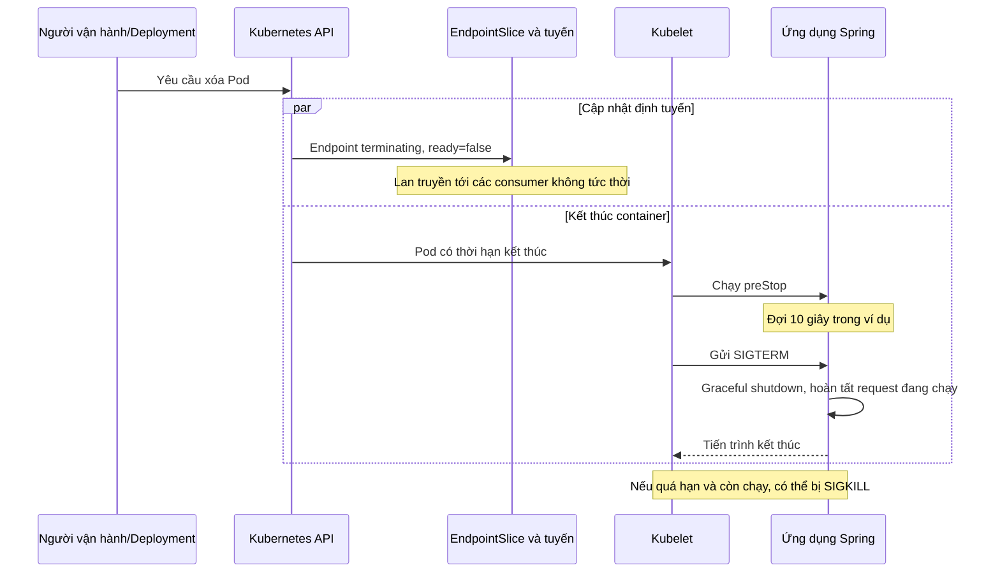

# Probe, chiến lược cập nhật và thời gian kết thúc

Một manifest triển khai tốt phải mô tả được ba thời điểm: khi ứng dụng bắt đầu nhận lưu lượng, khi bản sao mới thay thế bản sao cũ và khi bản sao cũ ngừng phục vụ. Chỉ khai báo image, cổng và số replica chưa đủ để bảo vệ request đang xử lý trong lúc cập nhật.

Bài học thuộc chương **Manifest triển khai** của **SPRING_CLOUD_KUBERNETES**. Ngữ cảnh là ứng dụng Spring tích hợp Kubernetes qua DiscoveryClient, có thể dùng ConfigMap, Secret, Spring Cloud LoadBalancer và Configuration Watcher. Ta sẽ ghép Actuator probe, Deployment RollingUpdate và graceful shutdown thành một vòng đời có thể kiểm chứng, đồng thời xác định những gì các thành phần này không tự bảo đảm.

## 1. Ba hợp đồng của vòng đời Pod

| Hợp đồng | Câu hỏi cần trả lời | Cơ chế chính |
| --- | --- | --- |
| Khởi động và nhận lưu lượng | Khi nào ứng dụng sống và khi nào đủ điều kiện phục vụ? | Startup probe, liveness, readiness |
| Thay thế phiên bản | Bản sao mới phải đạt điều kiện nào trước khi giảm bản sao cũ? | RollingUpdate, minReadySeconds, ngưỡng surge/unavailable |
| Kết thúc | Request đang chạy có đủ thời gian hoàn tất trước khi tiến trình bị buộc dừng? | EndpointSlice, preStop, SIGTERM, graceful shutdown, termination grace period |

Ví dụ xuyên suốt là API `orders` có ba bản sao. Chính sách mong muốn:

- Một bản sao mới chưa sẵn sàng không nhận lưu lượng thông thường qua Service.
- Bản sao mới phải ổn định trong một khoảng thời gian trước khi được Deployment tính là available.
- Rollout không chủ động làm giảm số bản sao available dưới ba khi hệ thống đang khỏe.
- Pod cũ được dành thời gian để thay đổi định tuyến lan truyền và xử lý request đang chạy.
- Bản phát hành mới không đạt readiness làm rollout dừng tiến triển, để người vận hành có thể khôi phục.

Đây là chính sách cần đo và kiểm chứng. Không có một trường YAML riêng lẻ nào bảo đảm không gián đoạn trong mọi sự cố mạng, node, ứng dụng hoặc dịch vụ phụ thuộc.

## 2. Chuẩn bị ứng dụng Spring Boot

Ví dụ sử dụng API cấu hình của Spring Boot 3.5 và Java 17. Chọn Spring Cloud BOM tương thích với phiên bản Spring Boot của dự án; không tự ghép các starter từ nhiều release train.

Ứng dụng cần `spring-boot-starter-web`, `spring-boot-starter-actuator` và Kubernetes discovery starter tương ứng nếu thực sự sử dụng DiscoveryClient. Các endpoint minh họa cho lab được bổ sung ở phần 8.

Cấu hình `application.yaml` trong image:

```yaml
server:
  port: 8080
  shutdown: graceful

spring:
  application:
    name: orders
  lifecycle:
    timeout-per-shutdown-phase: 20s

management:
  endpoints:
    web:
      exposure:
        include: health
  endpoint:
    health:
      show-details: never
      probes:
        enabled: true
        add-additional-paths: true
      group:
        liveness:
          include: livenessState
        readiness:
          include: readinessState

---
spring:
  config:
    activate:
      on-profile: rollout-lab

management:
  endpoint:
    health:
      group:
        readiness:
          include: readinessState,rolloutGate
```

Profile `rollout-lab` thêm contributor `rolloutGate` để chủ động tạo một bản sao không sẵn sàng trong thực hành. Khi không bật profile này, readiness chỉ chứa `readinessState`. Không tham chiếu contributor của lab trong cấu hình production nếu bean đó không tồn tại.

Các đường dẫn dùng trong manifest:

| Đường dẫn | Mục đích |
| --- | --- |
| `/livez` | Liveness trên cổng ứng dụng chính |
| `/readyz` | Readiness trên cổng ứng dụng chính |
| `/actuator/health/liveness` | Đường health group liveness |
| `/actuator/health/readiness` | Đường health group readiness |
| `/actuator/health` | Health tổng hợp phục vụ chẩn đoán |

Spring Boot hỗ trợ các health group và các đường probe bổ sung trên cổng ứng dụng. Nếu Actuator chạy trên một cổng quản trị riêng, dùng probe trên cổng phục vụ chính giúp tránh trường hợp cổng quản trị khỏe nhưng đường phục vụ ứng dụng đã lỗi. [Spring Boot: Kubernetes probes](https://docs.spring.io/spring-boot/3.5/reference/actuator/endpoints.html#actuator.endpoints.kubernetes-probes).

Nếu dự án dùng Spring Security, cho phép kubelet truy cập đúng endpoint probe theo chính sách của ứng dụng. HTTP 401, 403 hoặc redirect đăng nhập không chứng minh ứng dụng đã sẵn sàng phục vụ. Không cần mở toàn bộ endpoint Actuator để giải quyết việc này.

## 3. Chọn probe theo hành động mà Kubernetes sẽ thực hiện

### 3.1. Startup probe bảo vệ giai đoạn khởi động

Startup probe trả lời ứng dụng đã khởi động đủ để tiến hành các probe thường xuyên chưa. Khi startup probe được cấu hình, kubelet chưa chạy liveness và readiness cho tới khi startup probe thành công.

Ví dụ:

```yaml
startupProbe:
  httpGet:
    path: /livez
    port: http
  periodSeconds: 2
  timeoutSeconds: 2
  failureThreshold: 60
```

Ngân sách danh nghĩa là khoảng `60 × 2 = 120` giây. Đây là ước lượng thiết kế, không phải thời điểm chính xác. Hãy đo cold start thực tế dưới CPU limit, thời gian nạp lớp, khởi tạo kết nối và cấu hình để chọn ngân sách.

Dùng `/livez` cho startup không có nghĩa đã hoàn thành mọi warm-up nghiệp vụ. Những điều kiện bắt buộc trước khi nhận lưu lượng vẫn phải được phản ánh ở readiness.

### 3.2. Liveness chỉ nên dẫn tới restart khi restart có ý nghĩa

```yaml
livenessProbe:
  httpGet:
    path: /livez
    port: http
  periodSeconds: 10
  timeoutSeconds: 2
  failureThreshold: 3
```

Không đưa các phép kiểm tra Kubernetes API, database hoặc dịch vụ dùng chung vào liveness chỉ vì chúng có thể trả lỗi. Nếu lỗi nằm ngoài tiến trình, restart nhiều bản sao có thể làm hệ thống xấu thêm.

Health group `livenessState` cũng không tự phát hiện mọi deadlock hoặc sai lệch logic nghiệp vụ. Thiết kế endpoint và tài nguyên phục vụ probe phải phù hợp với kiểu lỗi cần phát hiện.

### 3.3. Readiness quyết định điều kiện nhận lưu lượng

```yaml
readinessProbe:
  httpGet:
    path: /readyz
    port: http
  periodSeconds: 5
  timeoutSeconds: 2
  failureThreshold: 2
  successThreshold: 2
```

Hai lần thất bại liên tiếp mới chuyển kết quả probe sang thất bại; hai lần thành công liên tiếp giúp ổn định khi phục hồi. Ngưỡng này làm thay đổi thời gian phát hiện và nhận lưu lượng trở lại.

Kubernetes phân biệt hành động của ba loại probe: startup hoặc liveness thất bại đủ ngưỡng có thể làm container bị khởi động lại, còn readiness thất bại khiến Pod không đủ điều kiện nhận lưu lượng thông thường qua Service. [Kubernetes: liveness, readiness và startup](https://kubernetes.io/docs/concepts/workloads/pods/probes/).

Đừng lấy `failureThreshold × periodSeconds` làm một assertion tuyệt đối. Pha của lần probe tiếp theo, timeout, lịch thực thi và thời gian cập nhật tuyến đều góp phần vào thời gian quan sát được.

Kubelet gửi HTTP probe tới Pod, không qua Service. Kết quả probe và việc client qua Ingress, service mesh hoặc DiscoveryClient ngừng chọn Pod là những quan sát liên quan nhưng không đồng nhất.

## 4. Thiết kế RollingUpdate có chủ đích

Với ba replica:

```yaml
replicas: 3
minReadySeconds: 10
progressDeadlineSeconds: 300
revisionHistoryLimit: 5
strategy:
  type: RollingUpdate
  rollingUpdate:
    maxSurge: 1
    maxUnavailable: 0
```

Ý nghĩa của lựa chọn này:

| Trường | Ý nghĩa trong ví dụ |
| --- | --- |
| `replicas: 3` | Số bản sao mong muốn trong lab |
| `maxSurge: 1` | Cho phép tạo thêm một bản sao khi cập nhật |
| `maxUnavailable: 0` | Không chủ động giảm dưới số bản sao available mong muốn trong rollout |
| `minReadySeconds: 10` | Bản sao phải Ready liên tục đủ 10 giây, không crash, trước khi được tính là available |
| `progressDeadlineSeconds: 300` | Báo thiếu tiến triển khi vượt khoảng thời gian này |
| `revisionHistoryLimit: 5` | Giữ lịch sử ReplicaSet cũ phục vụ rollback trong giới hạn cấu hình |

Điểm dễ bỏ sót: **minReadySeconds không trì hoãn việc Service bắt đầu gửi traffic tới một Pod đã Ready**. Nó trì hoãn việc Deployment tính Pod là available để quyết định tiến độ cập nhật. Nếu cần warm-up trước khi nhận bất kỳ request nào, readiness phải phản ánh warm-up.

Một diễn tiến minh họa:

```text
Ban đầu: 3 bản sao cũ available.
Tạo 1 bản sao mới.
Bản sao mới đạt Ready, sau đó thỏa minReadySeconds.
Controller có thể giảm bản sao cũ và tiếp tục tạo bản sao mới.
Lặp lại tới khi 3 bản sao mới available.
```

Không coi đây là thứ tự đồng bộ tuyệt đối giữa mọi sự kiện. Controller, kubelet và các lớp định tuyến cập nhật độc lập.

Nếu dùng phần trăm, `maxUnavailable` làm tròn xuống còn `maxSurge` làm tròn lên. Ví dụ ba replica và 25% lần lượt cho kết quả 0 và 1. Không được đặt đồng thời cả hai ngưỡng bằng 0. [Kubernetes: cập nhật Deployment](https://kubernetes.io/docs/tasks/run-application/update-deployment-rolling/).

### Capacity phải đủ cho bản sao tăng thêm

Với `maxSurge: 1`, scheduler cần chỗ cho ít nhất một Pod mới theo resource requests và các ràng buộc lịch chạy. Nếu quota, CPU, bộ nhớ, volume hoặc topology không cho phép, rollout có thể đứng dù YAML hợp lệ.

Pod đang Terminating vẫn có thể tiêu thụ tài nguyên. Vì vậy tổng số Pod còn tồn tại hoặc tổng tài nguyên dùng thực tế có thể vượt `replicas + maxSurge` trong lúc rollout. Không lấy con số bốn làm trần cứng cho toàn bộ footprint của ví dụ. [Kubernetes: terminating Pods trong Deployment](https://kubernetes.io/docs/concepts/workloads/controllers/deployment/#terminating-pods).

`maxUnavailable: 0` không ngăn được node hỏng, ứng dụng cũ tự lỗi hoặc phụ thuộc chung mất kết nối. Khi có HPA, cần phối hợp quyền quản lý `replicas` trong công cụ triển khai, tránh apply một con số cố định làm ghi đè ý định của autoscaler.

### Phát hiện kẹt không đồng nghĩa tự rollback

`progressDeadlineSeconds` đo thiếu tiến triển, không phải giới hạn tổng thời gian toàn bộ rollout. Nó phải lớn hơn `minReadySeconds` và đủ cho các bước khởi tạo bình thường trong môi trường thực.

Deployment báo condition `Progressing=False` với lý do `ProgressDeadlineExceeded` khi vượt deadline; Kubernetes không tự động rollback chỉ vì condition này. Pipeline hoặc người vận hành phải quyết định khôi phục. [Deployment: failed progress](https://kubernetes.io/docs/concepts/workloads/controllers/deployment/#failed-deployment).

`kubectl rollout status --timeout=...` là giới hạn thời gian chờ của lệnh CLI, khác với deadline trong đối tượng Deployment.

## 5. Ghép preStop, SIGTERM và graceful shutdown

### 5.1. Diễn tiến khi Pod được kết thúc bình thường



Đây là mô hình đơn giản cho một container ứng dụng. Nhánh cập nhật endpoint và nhánh kết thúc tiến trình diễn ra bất đồng bộ, không có cam kết toàn bộ client đã ngừng chọn Pod trước khi SIGTERM đến.

Endpoint đang kết thúc có `ready=false`; endpoint có thể chưa bị xóa ngay khỏi EndpointSlice. Các condition `terminating` và `serving` giúp consumer hỗ trợ draining hiểu thêm trạng thái. [Kubernetes: termination of Pods](https://kubernetes.io/docs/concepts/workloads/pods/pod-termination/).

Không bắt buộc phải chờ một readiness probe thất bại mới bắt đầu loại Pod đang bị xóa khỏi định tuyến. Tuy nhiên, độ trễ quan sát và hành vi kết nối cũ vẫn cần đo.

### 5.2. preStop không được cộng thêm vào grace period

Manifest mẫu:

```yaml
terminationGracePeriodSeconds: 45
containers:
  - name: orders
    lifecycle:
      preStop:
        exec:
          command: ["/bin/sleep", "10"]
```

Lệnh `sleep` chỉ cho thay đổi tuyến có thêm thời gian lan truyền trước khi ứng dụng bắt đầu đóng web server. Nó không tự bảo đảm drain hoàn tất và không tự thay đổi readiness của Spring.

Grace period bao gồm **cả thời gian preStop lẫn thời gian ứng dụng dừng**. Kubelet chờ preStop kết thúc trước khi gửi TERM theo quy trình này. [Kubernetes: container lifecycle hooks](https://kubernetes.io/docs/concepts/containers/container-lifecycle-hooks/).

Ngân sách minh họa:

```text
10 giây preStop
+ khoảng 20 giây cho pha graceful shutdown của web server
+ khoảng 15 giây dự phòng cho các bước kết thúc khác
= 45 giây grace period của Pod
```

Không diễn giải công thức thành bảo đảm rằng ứng dụng luôn dừng trong 30 giây. `spring.lifecycle.timeout-per-shutdown-phase` là timeout **mỗi pha**, không phải timeout toàn bộ tiến trình. Nhiều pha, callback, consumer nền hoặc thao tác đóng tài nguyên có thể làm tổng thời gian dài hơn; cần đo và điều chỉnh.

Không dựa vào khoảng gia hạn nhỏ mà kubelet có thể cấp cho hook quá hạn để thiết kế ngân sách thường xuyên.

### 5.3. Graceful shutdown cần nhận được tín hiệu

Ví dụ entrypoint phù hợp:

```dockerfile
ENTRYPOINT ["java", "-jar", "/app/app.jar"]
```

Nếu dùng script khởi động, chuyển tín hiệu đúng cách, thường bằng `exec java ...`. Không giả định JVM nhận được SIGTERM nếu shell trung gian giữ vai trò PID 1 mà không chuyển tín hiệu.

Image mẫu ở bài này phải có `/bin/sleep`. Với image distroless, lệnh đó có thể không tồn tại; dùng hook tương thích với image hoặc sleep action do kubelet thực hiện nếu phiên bản cluster hỗ trợ. Đừng thêm hook không chạy được vào manifest rồi chỉ kiểm tra bằng schema.

Spring Boot dùng graceful shutdown để cho request đang xử lý thời gian hoàn tất. Cách từ chối request mới phụ thuộc web server và kết nối: không phải lúc nào client cũng nhận đúng HTTP 503. [Spring Boot: graceful shutdown](https://docs.spring.io/spring-boot/3.5/reference/web/graceful-shutdown.html).

Trong pha này, trạng thái availability và khả năng truy cập HTTP probe không giống nhau: connector có thể đã ngừng nhận kết nối, nên không yêu cầu endpoint luôn trả được một JSON readiness cụ thể cho tới lúc JVM thoát.

## 6. Manifest mẫu hoàn chỉnh cho lab

Namespace của bài là `sck-rollout-lab`. Cấu hình Spring ở phần 2 được đóng trong image; profile lab và các giá trị thử nghiệm được cấp qua môi trường.

Lưu tài nguyên dưới đây thành `orders-manifests.yaml`. Thay image `registry.example.com/lab/orders-rollout:1.0` bằng image đã build. Trong triển khai cần tái lập chính xác, dùng digest hoặc chính sách tag bất biến phù hợp.

```yaml
apiVersion: v1
kind: ConfigMap
metadata:
  name: orders-runtime-v1
  namespace: sck-rollout-lab
data:
  DEMO_RELEASE: "v1"
  DEMO_ACCEPT_TRAFFIC: "true"
---
apiVersion: v1
kind: ServiceAccount
metadata:
  name: orders
  namespace: sck-rollout-lab
---
apiVersion: rbac.authorization.k8s.io/v1
kind: Role
metadata:
  name: orders-discovery-read
  namespace: sck-rollout-lab
rules:
  - apiGroups: [""]
    resources: ["pods", "services", "endpoints"]
    verbs: ["get", "list", "watch"]
  - apiGroups: ["discovery.k8s.io"]
    resources: ["endpointslices"]
    verbs: ["get", "list", "watch"]
---
apiVersion: rbac.authorization.k8s.io/v1
kind: RoleBinding
metadata:
  name: orders-discovery-read
  namespace: sck-rollout-lab
subjects:
  - kind: ServiceAccount
    name: orders
    namespace: sck-rollout-lab
roleRef:
  apiGroup: rbac.authorization.k8s.io
  kind: Role
  name: orders-discovery-read
---
apiVersion: v1
kind: Service
metadata:
  name: orders
  namespace: sck-rollout-lab
spec:
  selector:
    app.kubernetes.io/name: orders
  ports:
    - name: http
      port: 8080
      targetPort: http
---
apiVersion: apps/v1
kind: Deployment
metadata:
  name: orders
  namespace: sck-rollout-lab
spec:
  replicas: 3
  revisionHistoryLimit: 5
  minReadySeconds: 10
  progressDeadlineSeconds: 300
  strategy:
    type: RollingUpdate
    rollingUpdate:
      maxSurge: 1
      maxUnavailable: 0
  selector:
    matchLabels:
      app.kubernetes.io/name: orders
  template:
    metadata:
      labels:
        app.kubernetes.io/name: orders
    spec:
      serviceAccountName: orders
      terminationGracePeriodSeconds: 45
      containers:
        - name: orders
          image: registry.example.com/lab/orders-rollout:1.0
          ports:
            - name: http
              containerPort: 8080
          envFrom:
            - configMapRef:
                name: orders-runtime-v1
          env:
            - name: SPRING_PROFILES_ACTIVE
              value: rollout-lab
            - name: SPRING_CLOUD_KUBERNETES_DISCOVERY_ALL_NAMESPACES
              value: "false"
            - name: SPRING_CLOUD_KUBERNETES_CLIENT_NAMESPACE
              valueFrom:
                fieldRef:
                  fieldPath: metadata.namespace
          resources:
            requests:
              cpu: 250m
              memory: 512Mi
            limits:
              cpu: "1"
              memory: 768Mi
          startupProbe:
            httpGet:
              path: /livez
              port: http
            periodSeconds: 2
            timeoutSeconds: 2
            failureThreshold: 60
          livenessProbe:
            httpGet:
              path: /livez
              port: http
            periodSeconds: 10
            timeoutSeconds: 2
            failureThreshold: 3
          readinessProbe:
            httpGet:
              path: /readyz
              port: http
            periodSeconds: 5
            timeoutSeconds: 2
            failureThreshold: 2
            successThreshold: 2
          lifecycle:
            preStop:
              exec:
                command: ["/bin/sleep", "10"]
```

Resource requests/limits chỉ là số liệu minh họa cho lab, phải điều chỉnh theo ứng dụng và phép đo. Không sao chép thành cấu hình mặc định cho mọi dịch vụ Java.

Những điểm cần đọc đúng:

- `terminationGracePeriodSeconds` nằm trong Pod spec, không phải cạnh `strategy`.
- `lifecycle` và các probe nằm trong container tương ứng.
- Service dùng nhãn ổn định, không chọn riêng `v1` hay `v2`, để hai phiên bản có thể cùng được phục vụ khi rollout.
- Role là ví dụ quyền đọc discovery trong một namespace. Thu hẹp theo implementation; nếu không dùng DiscoveryClient thì không cần giữ tích hợp và quyền này chỉ để phục vụ probe.
- Role không cấp quyền đọc ConfigMap hoặc Secret qua API. `envFrom` ở đây được Kubernetes cấp cho container, không phải ứng dụng tự đọc API.
- Namespace cần tồn tại trước khi áp dụng và trước khi chạy server-side dry run.

PDB có thể bổ sung riêng cho các đợt eviction tự nguyện như drain node:

```yaml
apiVersion: policy/v1
kind: PodDisruptionBudget
metadata:
  name: orders
  namespace: sck-rollout-lab
spec:
  minAvailable: 2
  selector:
    matchLabels:
      app.kubernetes.io/name: orders
```

PDB không thay thế `maxUnavailable` của Deployment; rolling update của workload controller không bị giới hạn bởi PDB. Xóa trực tiếp Pod cũng không được PDB bảo vệ theo cách Eviction API được bảo vệ. [Kubernetes: disruptions và PDB](https://kubernetes.io/docs/concepts/workloads/pods/disruptions/).

## 7. Cập nhật cấu hình trong Spring Cloud Kubernetes

Phân biệt những cơ chế sau để không vô tình phá chiến lược rollout:

| Thay đổi hoặc cơ chế | Có tạo rollout Deployment không? | Điều cần chú ý |
| --- | --- | --- |
| Thay image hoặc env trong `spec.template` | Có | Pod template đổi, controller triển khai revision mới |
| Sửa nội dung ConfigMap đang cấp qua `envFrom` | Không tự tạo | Tiến trình hiện tại không tự nhận env mới |
| Sửa ConfigMap mount qua volume thông thường | Không tự tạo | File được cập nhật theo cơ chế đồng bộ; ứng dụng vẫn cần đọc lại |
| Thay tên ConfigMap tham chiếu trong Pod template | Có | Có thể dùng để gắn phiên bản cấu hình với rollout |
| Thay checksum annotation trong `spec.template.metadata` | Có | Công cụ build/render phải thực sự tính và ghi checksum mới |
| Configuration Watcher thực hiện refresh | Không phải rollout | Bean và cấu hình có hỗ trợ refresh hay không cần kiểm chứng |
| Watcher dùng chiến lược shutdown | Không phải chuỗi thay Pod do RollingUpdate điều phối | Có thể làm nhiều instance đóng ứng dụng cùng lúc |

ConfigMap cấp qua biến môi trường không tự cập nhật trong tiến trình. Volume mount thông thường có thể nhận thay đổi sau một khoảng trễ; mount bằng `subPath` không nhận cập nhật ConfigMap theo cách đó. [Kubernetes: ConfigMaps](https://kubernetes.io/docs/concepts/configuration/configmap/).

Đối với Secret, cũng phải phân biệt cách tiêu thụ, thời điểm áp dụng và cơ chế rotation. Không đặt dữ liệu nhạy cảm vào ConfigMap hoặc ghi giá trị Secret ra log để xác minh phiên bản.

Configuration Watcher có thể gửi thông báo refresh qua HTTP hoặc messaging; đó là cơ chế khác với Deployment thay thế Pod. Việc gọi shutdown các instance không được tự động chia thành từng đợt theo `maxSurge` và `maxUnavailable`. [Spring Cloud Kubernetes Configuration Watcher](https://docs.spring.io/spring-cloud-kubernetes/reference/spring-cloud-kubernetes-configuration-watcher.html).

Nếu cần kiểm soát cập nhật theo từng bản sao, chọn rollout cho thay đổi đó. Nếu dùng refresh, phải kiểm chứng tính tương thích khi các instance tạm có cấu hình khác nhau và bảo vệ endpoint quản trị phù hợp.

Rollback Deployment chỉ khôi phục Pod template, không phục hồi nội dung một ConfigMap hoặc Secret có tên cố định đã bị sửa. Với cấu hình có phiên bản như `orders-runtime-v1`, giữ lại phiên bản cũ còn được tham chiếu để rollback có thể tái lập đúng trạng thái.

## 8. Tạo tín hiệu kiểm chứng cho lab

### 8.1. HealthIndicator điều khiển readiness của bản sao mới

Thêm bean chỉ hoạt động trong profile lab:

```java
package example.rollout;

import org.springframework.beans.factory.annotation.Value;
import org.springframework.boot.actuate.health.Health;
import org.springframework.boot.actuate.health.HealthIndicator;
import org.springframework.context.annotation.Profile;
import org.springframework.stereotype.Component;

@Component("rolloutGate")
@Profile("rollout-lab")
public class RolloutGate implements HealthIndicator {

    private final boolean acceptTraffic;

    public RolloutGate(
            @Value("${demo.accept-traffic:true}") boolean acceptTraffic) {
        this.acceptTraffic = acceptTraffic;
    }

    @Override
    public Health health() {
        return acceptTraffic ? Health.up().build() : Health.down().build();
    }
}
```

Khi `DEMO_ACCEPT_TRAFFIC=false`, readiness của bản sao lab trả 503 theo mapping mặc định nhưng liveness vẫn độc lập. Cấu hình này cho phép thử rollout bị kẹt mà không làm JVM crash.

### 8.2. Endpoint có request dài và nhận diện Pod

```java
package example.rollout;

import java.util.Map;
import java.util.UUID;

import org.slf4j.Logger;
import org.slf4j.LoggerFactory;
import org.springframework.beans.factory.annotation.Value;
import org.springframework.context.annotation.Profile;
import org.springframework.web.bind.annotation.GetMapping;
import org.springframework.web.bind.annotation.RequestParam;
import org.springframework.web.bind.annotation.RestController;

@RestController
@Profile("rollout-lab")
public class RolloutLabController {

    private static final Logger log =
            LoggerFactory.getLogger(RolloutLabController.class);

    private final String release;
    private final String pod = System.getenv().getOrDefault("HOSTNAME", "local");

    public RolloutLabController(@Value("${demo.release:unknown}") String release) {
        this.release = release;
    }

    @GetMapping("/lab/work")
    public Map<String, Object> work(
            @RequestParam(defaultValue = "0") int delayMs)
            throws InterruptedException {

        int boundedDelay = Math.max(0, Math.min(delayMs, 60000));
        String requestId = UUID.randomUUID().toString();

        log.info("work-start requestId={} pod={} release={} delayMs={}",
                requestId, pod, release, boundedDelay);

        Thread.sleep(boundedDelay);

        log.info("work-end requestId={} pod={} release={}",
                requestId, pod, release);

        return Map.of(
                "requestId", requestId,
                "pod", pod,
                "release", release,
                "delayMs", boundedDelay);
    }
}
```

Endpoint này cố ý giữ một request servlet để quan sát shutdown; không phải mẫu xử lý công việc dài trong production. Giới hạn profile và môi trường lab. Trong hệ thống thật, bổ sung request nghiệp vụ, connection pool, consumer hoặc giao dịch cần được bảo vệ.

## 9. Kiểm tra manifest và dựng baseline

Các lệnh bên dưới dùng PowerShell, chạy trong thư mục bạn lưu manifest thực hành.

```powershell
kubectl create namespace sck-rollout-lab
kubectl apply --dry-run=server -f orders-manifests.yaml
kubectl diff -f orders-manifests.yaml
kubectl apply -f orders-manifests.yaml
kubectl -n sck-rollout-lab rollout status deployment/orders --timeout=360s
```

Nếu namespace đã tồn tại và đúng môi trường lab, bỏ qua lệnh tạo. `kubectl diff` trả mã 1 khi có khác biệt; điều này không đồng nghĩa manifest sai.

Server-side dry run giúp kiểm tra schema, admission và quyền áp dụng, nhưng không chứng minh image kéo được, `/bin/sleep` tồn tại, probe đúng hay graceful shutdown hoạt động.

Quan sát baseline:

```powershell
kubectl -n sck-rollout-lab get deployment/orders
kubectl -n sck-rollout-lab get pods -l app.kubernetes.io/name=orders -o wide
kubectl -n sck-rollout-lab get endpointslices -l kubernetes.io/service-name=orders -o yaml
kubectl -n sck-rollout-lab rollout history deployment/orders
```

Ghi lại release, revision, UID của Pod, image thực tế, restart count và trạng thái Ready/Available. Baseline cần đủ ba replica available và không có restart ngoài dự kiến.

Tạo một client trong cluster:

```powershell
kubectl -n sck-rollout-lab run rollout-client --image=curlimages/curl:8.10.1 --restart=Never --command -- sleep 3600
kubectl -n sck-rollout-lab wait --for=condition=Ready pod/rollout-client --timeout=90s
kubectl -n sck-rollout-lab exec rollout-client -- curl --connect-timeout 2 --max-time 5 -sS -i http://orders:8080/lab/work
```

Nếu môi trường đã có NetworkPolicy, bảo đảm client lab được phép tới Service. Probe thành công chưa chứng minh mọi đường Ingress hoặc service mesh đã được phép.

## 10. Ba phép thử cần thực hiện

### 10.1. Rollout khỏe trong khi vẫn có request

Tại một terminal, chạy vòng request mới qua Service:

```powershell
$clientLoop = @'
while true
do
  curl --connect-timeout 2 --max-time 3 -sS --write-out ' code=%{http_code} time=%{time_total}\n' 'http://orders:8080/lab/work?delayMs=100'
  sleep 1
done
'@

kubectl -n sck-rollout-lab exec rollout-client -- sh -c $clientLoop
```

Tại terminal khác, thay env của Pod template:

```powershell
kubectl -n sck-rollout-lab set env deployment/orders DEMO_RELEASE=v2
kubectl -n sck-rollout-lab rollout status deployment/orders --timeout=360s
```

Env khai báo trực tiếp ở container ghi đè giá trị cùng tên từ `envFrom`. Thay đổi này tạo rollout mới mà không cần build image thứ hai. Để thử cập nhật binary, dùng một image v2 đã build tương thích rồi thay trường image, nhưng thực hiện ở phép thử riêng để dễ giải thích kết quả.

Theo dõi đồng thời:

```powershell
kubectl -n sck-rollout-lab get pods -l app.kubernetes.io/name=orders -w
kubectl -n sck-rollout-lab get deployment/orders -w
kubectl -n sck-rollout-lab get replicasets -l app.kubernetes.io/name=orders
kubectl -n sck-rollout-lab get endpointslices -l kubernetes.io/service-name=orders -o yaml
```

Kỳ vọng:

- Response chuyển dần từ `v1` sang `v2`, có thời gian hai phiên bản cùng phục vụ.
- Bản sao mới được tính available sau khi đủ điều kiện ổn định.
- Không thấy lỗi HTTP hoặc transport trong chuỗi request thử nghiệm.
- ReplicaSet cũ giảm dần, mới tăng dần; không có restart bất thường.
- Log shutdown của Pod cũ phù hợp với quy trình kết thúc.

Lưu revision khỏe để dùng cho thử nghiệm lỗi:

```powershell
$healthyDeployment = kubectl -n sck-rollout-lab get deployment/orders -o json | ConvertFrom-Json
$goodRevision = $healthyDeployment.metadata.annotations.'deployment.kubernetes.io/revision'
```

Một client gửi tuần tự mỗi giây chỉ kiểm tra được một mẫu lưu lượng nhỏ. Muốn kết luận cho hệ thống thật, phải thử thêm lưu lượng đồng thời, keep-alive, Ingress, service mesh và các client discovery thực tế. Không thêm retry trong phép đo ban đầu vì retry có thể che lỗi rollout.

### 10.2. Request dài phải hoàn tất trong lúc một Pod kết thúc

Chọn một Pod đang Ready và chưa bị xóa:

```powershell
$podList = kubectl -n sck-rollout-lab get pods -l app.kubernetes.io/name=orders -o json | ConvertFrom-Json

$target = $podList.items | Where-Object {
    -not $_.metadata.deletionTimestamp -and
    ($_.status.conditions | Where-Object { $_.type -eq 'Ready' }).status -eq 'True'
} | Select-Object -First 1

$targetPod = $target.metadata.name
$targetIp = $target.status.podIP
$targetUid = $target.metadata.uid
$targetUrl = 'http://{0}:8080/lab/work?delayMs=15000' -f $targetIp
```

Trong terminal A, gán lại các biến cần thiết theo Pod đã chọn và chạy:

```powershell
kubectl -n sck-rollout-lab logs $targetPod -c orders -f
```

Trong terminal B, gửi request dài trực tiếp tới IP của đúng Pod:

```powershell
kubectl -n sck-rollout-lab exec rollout-client -- curl --connect-timeout 2 --max-time 40 -sS -i $targetUrl
```

Chỉ sau khi thấy `work-start` trong log, tại terminal C yêu cầu kết thúc:

```powershell
kubectl -n sck-rollout-lab delete pod $targetPod --wait=false
```

Terminal mới phải được gán lại `$targetPod` theo tên đã chọn. Không dùng `--force` hoặc `--grace-period=0` trong phép thử này.

Request được gửi thẳng tới Pod để biết chắc request đang chạy trên đối tượng bị kết thúc; đường này cố ý bỏ qua Service. Đây là phép thử request đang xử lý, không phải phép thử định tuyến request mới.

Với `preStop` 10 giây và request 15 giây, request còn thời gian chạy khi SIGTERM đến, nhưng thời gian còn lại dự kiến nhỏ hơn ngân sách graceful 20 giây. Cần quan sát thực tế, không chỉ suy luận từ con số.

Bằng chứng mong đợi:

- Cùng một `requestId` xuất hiện ở `work-start` và `work-end`.
- Client nhận response 200 hoàn chỉnh từ Pod đã chọn.
- Endpoint của Pod chuyển trạng thái kết thúc và không còn được chọn cho request thông thường sau khi tuyến hội tụ.
- Ứng dụng ghi nhận graceful shutdown; không bị cắt vì quá hạn.
- Deployment tạo bản sao thay thế và quay về trạng thái đủ replica.

Không dùng port-forward tới Pod làm bằng chứng duy nhất cho request dài: đường chuyển tiếp còn phụ thuộc API và phiên forwarding, có thể tạo lỗi khác với đường client trong cluster.

Exit code 137 có thể gợi ý SIGKILL nhưng cũng có thể liên quan OOM. Phải đọc reason, events, timestamp và log; không kết luận nguyên nhân chỉ từ exit code. Pod bị xóa nhanh có thể không còn trạng thái để đọc, nên cần thu log hoặc telemetry trong lúc thí nghiệm.

Có thể thử riêng request dài hơn ngân sách shutdown trong lab để quan sát giới hạn, nhưng không kỳ vọng mọi request 60 giây sẽ hoàn tất với ngân sách pha 20 giây và grace period 45 giây.

### 10.3. Bản sao mới không đạt readiness

Đảm bảo hệ thống khỏe sau các phép thử trước, rồi tạo một thay đổi Pod template duy nhất:

```powershell
kubectl -n sck-rollout-lab set env deployment/orders DEMO_RELEASE=bad DEMO_ACCEPT_TRAFFIC=false
kubectl -n sck-rollout-lab rollout status deployment/orders --timeout=360s
```

Quan sát:

```powershell
kubectl -n sck-rollout-lab describe deployment/orders
kubectl -n sck-rollout-lab get pods -l app.kubernetes.io/name=orders
kubectl -n sck-rollout-lab get replicasets -l app.kubernetes.io/name=orders
kubectl -n sck-rollout-lab get endpointslices -l kubernetes.io/service-name=orders -o yaml
```

Nếu baseline vẫn khỏe và không có sự cố khác, ba replica cũ được giữ; bản sao mới có liveness đạt nhưng readiness thất bại. Với `maxUnavailable: 0`, controller không tiếp tục giảm các bản sao cũ để thay bằng bản sao không available.

Sau khoảng thiếu tiến triển đủ dài, kiểm tra condition `ProgressDeadlineExceeded`. Đừng nhầm việc CLI hết thời gian chờ với chứng minh condition này đã xuất hiện.

Khôi phục về revision đã ghi:

```powershell
kubectl -n sck-rollout-lab rollout history deployment/orders
kubectl -n sck-rollout-lab rollout undo deployment/orders --to-revision=$goodRevision
kubectl -n sck-rollout-lab rollout status deployment/orders --timeout=360s
```

Kiểm tra lại response, Ready/Available và endpoint. Không chỉ tin thông báo lệnh undo thành công.

Các lệnh `set env` và `undo` dùng để thực hành. Trong triển khai có GitOps hoặc pipeline quản lý manifest, phải cập nhật nguồn cấu hình tương ứng; nếu không, bộ reconcile có thể ghi đè trạng thái vừa sửa.

## 11. Những giới hạn cần tính trong hệ thống thật

### Hai phiên bản phải sống chung được

RollingUpdate chủ động tạo thời gian đồng tồn tại phiên bản cũ và mới. API, schema dữ liệu, message và định dạng cache phải tương thích trong giai đoạn đó.

Không để một migration phá schema cũ trong khi Pod cũ còn phục vụ. Cân nhắc triển khai theo các bước mở rộng khả năng tương thích, chuyển đổi rồi mới loại bỏ phần cũ.

### Graceful web shutdown không quản lý mọi công việc nền

HTTP request chỉ là một phần của vòng đời. Consumer cần ngừng lấy việc mới và hoàn thành hoặc trả lại việc đang xử lý theo cơ chế acknowledgment. Scheduler, transaction và tác vụ nền cần chính sách dừng riêng.

Không đặt một công việc sao lưu dài, không có giới hạn, vào preStop rồi kỳ vọng Kubernetes đợi vô thời hạn. Hook cần có giới hạn và an toàn nếu được gọi lại.

### DiscoveryClient và LoadBalancer có thể giữ thông tin cũ

Client gọi trực tiếp instance qua DiscoveryClient hoặc Spring Cloud LoadBalancer không nhất thiết ngừng chọn Pod đúng cùng thời điểm kube-proxy cập nhật Service. Cache, watch, kết nối keep-alive và retry đều ảnh hưởng.

Đo cả hai đường: client gọi Service DNS và client dùng discovery thực tế. Không mặc định khoảng sleep 10 giây đủ cho mọi cache hoặc bộ cân bằng tải.

### Kết nối dài cần chính sách riêng

WebSocket, SSE, streaming hoặc job dài hơn cửa sổ kết thúc có thể bị gián đoạn dù request HTTP ngắn đều thành công. Cần cơ chế drain, thông báo reconnect, checkpoint hoặc chuyển việc phù hợp với giao thức.

Tăng grace period làm giảm nguy cơ cắt việc trong một số tình huống, đồng thời giữ tài nguyên Terminating lâu hơn và kéo dài thời gian bảo trì.

### Không áp dụng nguyên xi cho mọi sự cố

Quy trình trên giả định đường kết thúc bình thường hoạt động. Node mất điện, OOM kill, lỗi runtime hoặc xóa cưỡng bức có thể không cho ứng dụng cơ hội graceful shutdown.

Không biến việc mọi probe đều xanh thành bằng chứng rằng request nghiệp vụ, dữ liệu hoặc toàn bộ chuỗi cấu hình Kubernetes đều an toàn.

## 12. Khoanh vùng lỗi và tiêu chí nghiệm thu

| Hiện tượng | Điều cần kiểm tra |
| --- | --- |
| Pod mới cứ restart trước khi khởi động xong | Startup budget, CPU limit, lỗi khởi tạo và endpoint startup |
| Rollout đứng ở một Pod Pending | Resource requests, quota, node capacity và ràng buộc scheduler |
| Pod Ready nhưng chưa available | `minReadySeconds`, readiness dao động hoặc container crash |
| Lỗi 502/reset khi Pod cũ dừng | Độ trễ hội tụ tuyến, keep-alive, proxy/mesh và preStop |
| preStop báo lỗi | `/bin/sleep` có tồn tại và chạy được trong image hay không |
| Không có graceful shutdown trong log | Cấu hình Spring, entrypoint, đường truyền SIGTERM và log thu thập |
| Shutdown bị cắt giữa chừng | Tổng thời gian hook, các pha lifecycle, công việc nền và grace period |
| Rollout lỗi nhưng không tự về bản cũ | Deployment chỉ báo condition; chưa có chính sách rollback ở tầng điều phối |
| Undo image nhưng cấu hình vẫn sai | ConfigMap/Secret tên cố định đã bị sửa ngoài Pod template |
| PDB không ngăn cập nhật làm giảm Pod | Nhầm PDB với rollout strategy hoặc dùng xóa trực tiếp thay vì eviction |

Trước khi chấp nhận manifest, phải có bằng chứng rằng:

1. Probe trỏ đúng cổng ứng dụng và phản ánh đúng loại trạng thái.
2. Cold start bình thường không bị liveness giết sớm.
3. Cụm đủ capacity cho surge và tài nguyên của Pod đang kết thúc.
4. Rollout khỏe được thử với lưu lượng và có số liệu lỗi/độ trễ.
5. Bản sao mới không đạt readiness không làm mất các bản sao cũ khỏe ngoài chính sách.
6. Request đang xử lý được hoàn tất trong ngân sách đã công bố.
7. Rollback phục hồi được cả phiên bản ứng dụng và cấu hình cần thiết.
8. Các đường discovery, watcher, consumer và kết nối dài có kiểm chứng riêng khi được sử dụng.

Kết thúc lab bằng cách khôi phục revision khỏe, xác nhận đủ ba replica available, dừng vòng request và xóa client thử nghiệm:

```powershell
kubectl -n sck-rollout-lab rollout status deployment/orders --timeout=360s
kubectl -n sck-rollout-lab get deployment/orders
kubectl -n sck-rollout-lab delete pod rollout-client --ignore-not-found
```

Bộ ba probe, rolling update và thời gian kết thúc chỉ có ý nghĩa khi cùng phản ánh chính sách phục vụ của ứng dụng. Đọc YAML cho biết ý định; quan sát request, endpoint, log và tiến độ controller mới cho biết ý định đó có thành hiện thực hay không.
