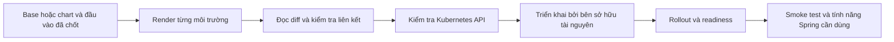

# Kustomize hoặc Helm để quản lý khác biệt giữa môi trường

Trong chương **Manifest triển khai** của module **SPRING_CLOUD_KUBERNETES**, bài học này trình bày hai cách quản lý manifest khi cùng một ứng dụng Spring chạy ở dev, staging và production: **Kustomize** với base và overlay, hoặc **Helm** với chart và values.

Mục tiêu là giữ được một cấu trúc triển khai có thể kiểm tra, trong khi các khác biệt về namespace, replica, tài nguyên và cấu hình được khai báo rõ ràng. Với Spring Cloud Kubernetes, còn phải giữ đúng tên Service, nguồn ConfigMap hoặc Secret, phạm vi discovery, ServiceAccount và Configuration Watcher khi chuyển môi trường.

## 1. Mục tiêu và nguyên tắc

Sau bài học, bạn có thể:

- Chọn Kustomize hoặc Helm dựa trên nhu cầu tái sử dụng thực tế.
- Tách phần chung của workload khỏi những khác biệt giữa dev và production.
- Render manifest trước khi triển khai và kiểm tra các liên kết giữa tài nguyên.
- Giải thích khi nào đổi ConfigMap tạo rollout và khi nào ứng dụng vẫn giữ giá trị cũ.
- Quản lý các tính năng Spring Cloud Kubernetes cùng quyền RBAC theo đúng môi trường.

Ba nguyên tắc xuyên suốt:

1. **Promote cùng artifact:** image đã kiểm chứng ở dev có thể được đưa sang production bằng cùng digest.
2. **Khai báo khác biệt có chủ đích:** tăng replica hoặc đổi timeout là lựa chọn vận hành, không phải hệ quả của việc sao chép một thư mục cũ.
3. **Đọc manifest đầu ra:** Kubernetes nhận tài nguyên đã render, không hiểu ý định trong một overlay hoặc một key values chưa được template sử dụng.

Các đoạn mã dưới đây là ví dụ để người học tạo trong dự án thực hành, không phải thông báo rằng chúng đã được tạo hoặc triển khai trong module này. Hai phương án là **lựa chọn thay thế**, không dùng đồng thời để quản lý cùng bộ Deployment và Service.

## 2. Xác định khác biệt trước khi chọn công cụ

Giả sử ứng dụng tên `orders-service`, phục vụ HTTP trên `8080` và được đưa ra trong cluster qua Service port `80`.

| Nội dung | Dev | Production | Nơi quản lý phù hợp |
| --- | --- | --- | --- |
| Image của một đợt phát hành | Digest đã kiểm chứng | Cùng digest khi promote | Overlay hoặc values phát hành |
| Namespace | `training-dev` | `training-prod` | Đích triển khai |
| Replica | 1 | 3 | Overlay hoặc values môi trường |
| Requests và limits | Mức dùng thử | Mức đã đo cho tải thực | Manifest workload |
| Lời chào minh họa | `Dev` | `Production` | ConfigMap |
| Timeout minh họa | 3000 ms | 1500 ms | ConfigMap và kiểm chứng nghiệp vụ |
| Thông tin xác thực | Secret riêng của dev | Secret riêng của production | Hệ quản lý bí mật và tham chiếu Secret |
| Discovery qua API | Chỉ bật khi cần | Chỉ bật khi cần | Cấu hình ứng dụng và RBAC tương ứng |

Không lấy bảng này làm cấu hình tối ưu cho mọi ứng dụng. Đặc biệt, production không mặc nhiên phải có timeout ngắn hơn dev; các con số chỉ giúp nhìn thấy nơi khai báo khác biệt.

Tách namespace giúp tái sử dụng tên Service giữa các môi trường trong cùng cluster. Namespace không tự tạo ra đầy đủ cách ly mạng hoặc quyền truy cập; các chính sách đó vẫn phải được thiết kế riêng.

## 3. Kustomize và Helm khác nhau ở đâu?

| Tiêu chí | Kustomize | Helm |
| --- | --- | --- |
| Cách biểu diễn phần chung | Manifest Kubernetes thông thường | Template kết hợp values |
| Cách biểu diễn khác biệt | Overlay, patch, generator, transformer | Values và logic trong template |
| Phù hợp khi | Các môi trường có cấu trúc tài nguyên gần nhau | Cần một gói triển khai có giao diện cấu hình cho nhiều bên |
| Mức độ lập trình | Thường ít logic sinh tài nguyên hơn | Có điều kiện, vòng lặp và helper trong template |
| Kiểm tra đầu ra | `kubectl kustomize` hoặc `kustomize build` | `helm template`, `helm lint` |
| Quản lý phiên bản triển khai | Thường dựa vào Git và công cụ điều phối | Có khái niệm chart version và release revision khi dùng Helm quản lý release |
| Rủi ro thường gặp | Patch nhầm đích, đổi selector ngoài ý muốn, tham chiếu tên chưa được biến đổi | Values không được dùng, kiểu YAML sai, template khó đọc, ghi đè cấu hình không rõ nguồn |

Kustomize không phải phép tìm và thay chuỗi toàn bộ YAML. Helm cũng không tự hiểu một key có tên `production` nghĩa là phải tăng bảo mật hoặc cấp đúng RBAC.

Một lựa chọn thực dụng:

- Dùng Kustomize khi nhóm muốn giữ manifest gần dạng Kubernetes và chỉ có một số khác biệt rõ ràng giữa môi trường.
- Dùng Helm khi cần phân phối một bộ tài nguyên thành gói, công bố tập tham số và quản lý các release của gói đó.
- Chỉ kết hợp hai công cụ khi có ranh giới và người chịu trách nhiệm rõ ràng cho từng bước render; không thêm nhiều tầng chỉ vì cả hai đều sẵn có.

## 4. Chuẩn bị ứng dụng dùng chung cho hai phương án

Ví dụ giả định:

- Ứng dụng web Spring Boot có Actuator, lắng nghe `0.0.0.0:8080`.
- Health probe dùng các path `/actuator/health/liveness` và `/actuator/health/readiness`.
- Ứng dụng đọc `demo.greeting` và `demo.request-timeout-ms` qua cơ chế cấu hình ngoài của Spring Boot.
- Các biến `DEMO_GREETING` và `DEMO_REQUEST_TIMEOUT_MS` được ánh xạ vào các thuộc tính đó.
- Ứng dụng được cấu hình và kiểm thử để chạy không cần trực tiếp gọi Kubernetes API trong ví dụ cơ sở.

Các thuộc tính health dùng trong ví dụ phù hợp với Spring Boot dòng `3.5.x`. Dự án phải chốt phiên bản Spring Boot, Spring Cloud và Spring Cloud Kubernetes tương thích, không suy từ phiên bản của công cụ manifest.

Ví dụ cơ sở dùng ConfigMap qua `envFrom` và gọi dịch vụ qua DNS. Vì vậy Pod không cần ServiceAccount token hoặc quyền đọc ConfigMap bằng API. Nếu image đã chứa các integration bắt buộc gọi API, phải cấu hình chúng phù hợp trước; manifest không tự loại dependency khỏi image.

Các giá trị `REPLACE_WITH_VERIFIED_DIGEST` phải được thay bằng digest thật dạng `sha256:` theo sau bởi đủ 64 ký tự hex. Repository `registry.example.com` cũng phải được thay bằng registry thực. Namespace `training-dev` và `training-prod` cần được chuẩn bị trong cluster đích.

## 5. Phương án A: Kustomize với base và overlay

### 5.1. Cấu trúc thư mục thực hành

```text
deploy/
  base/
    kustomization.yaml
    deployment.yaml
    service.yaml
  overlays/
    dev/
      kustomization.yaml
    prod/
      kustomization.yaml
      resources.yaml
```

Base chứa cấu trúc ứng dụng dùng chung. Overlay mô tả khác biệt của môi trường, không sao chép lại toàn bộ Deployment.

### 5.2. Deployment dùng chung

Nội dung `deploy/base/deployment.yaml`:

```yaml
apiVersion: apps/v1
kind: Deployment
metadata:
  name: orders-service
spec:
  replicas: 1
  selector:
    matchLabels:
      app.kubernetes.io/name: orders-service
      app.kubernetes.io/instance: orders
  template:
    metadata:
      labels:
        app.kubernetes.io/name: orders-service
        app.kubernetes.io/instance: orders
    spec:
      automountServiceAccountToken: false
      containers:
        - name: orders
          image: orders-image:placeholder
          ports:
            - name: http
              containerPort: 8080
          env:
            - name: SPRING_APPLICATION_NAME
              value: orders-service
            - name: SERVER_PORT
              value: "8080"
            - name: MANAGEMENT_ENDPOINT_HEALTH_PROBES_ENABLED
              value: "true"
          envFrom:
            - configMapRef:
                name: orders-config
          startupProbe:
            httpGet:
              path: /actuator/health/liveness
              port: http
            periodSeconds: 5
            timeoutSeconds: 2
            failureThreshold: 36
          readinessProbe:
            httpGet:
              path: /actuator/health/readiness
              port: http
            periodSeconds: 5
            timeoutSeconds: 2
          livenessProbe:
            httpGet:
              path: /actuator/health/liveness
              port: http
            periodSeconds: 10
            timeoutSeconds: 2
          resources:
            requests:
              cpu: 100m
              memory: 256Mi
            limits:
              cpu: "1"
              memory: 1Gi
```

`orders-image:placeholder` là tên đầu vào để overlay thay image; không dùng nguyên base này làm bản phát hành. Các giá trị tài nguyên và thời gian probe cần được đo lại theo ứng dụng thật.

### 5.3. Service dùng chung

Nội dung `deploy/base/service.yaml`:

```yaml
apiVersion: v1
kind: Service
metadata:
  name: orders-service
  labels:
    purpose: business
spec:
  type: ClusterIP
  selector:
    app.kubernetes.io/name: orders-service
    app.kubernetes.io/instance: orders
  ports:
    - name: http
      port: 80
      targetPort: http
```

Selector khớp nhãn trong Pod template. Nó không chứa môi trường hoặc version image; danh tính này được giữ ổn định trong mỗi namespace.

### 5.4. Kustomization của base

Nội dung `deploy/base/kustomization.yaml`:

```yaml
apiVersion: kustomize.config.k8s.io/v1beta1
kind: Kustomization
resources:
  - deployment.yaml
  - service.yaml
configMapGenerator:
  - name: orders-config
    literals:
      - DEMO_GREETING=Hello
      - DEMO_REQUEST_TIMEOUT_MS=2000
```

Kustomize sinh ConfigMap từ các literal và mặc định thêm hậu tố hash theo nội dung. Tham chiếu `configMapRef.name` thuộc các trường được công cụ nhận biết sẽ được cập nhật sang tên đã sinh.

Đây là trường hợp biến đổi có cấu trúc; đừng suy mọi chuỗi chứa `orders-config` ở bất kỳ đâu cũng được cập nhật. Xem [Kubernetes: Declarative Management Using Kustomize](https://kubernetes.io/docs/tasks/manage-kubernetes-objects/kustomization/).

### 5.5. Overlay dev

Nội dung `deploy/overlays/dev/kustomization.yaml`:

```yaml
apiVersion: kustomize.config.k8s.io/v1beta1
kind: Kustomization
namespace: training-dev
resources:
  - ../../base
images:
  - name: orders-image
    newName: registry.example.com/training/orders-service
    digest: sha256:REPLACE_WITH_VERIFIED_DIGEST
replicas:
  - name: orders-service
    count: 1
configMapGenerator:
  - name: orders-config
    behavior: merge
    literals:
      - DEMO_GREETING=Dev
      - DEMO_REQUEST_TIMEOUT_MS=3000
```

`behavior: merge` có chủ đích cập nhật generator đã có ở base. Nếu tạo trùng tên mà không chọn hành vi phù hợp, quá trình build có thể báo lỗi thay vì tự hiểu phải ghi đè.

`namespace` gán namespace vào tài nguyên liên quan; nó không tự tạo đối tượng Namespace.

### 5.6. Overlay production

Nội dung `deploy/overlays/prod/kustomization.yaml`:

```yaml
apiVersion: kustomize.config.k8s.io/v1beta1
kind: Kustomization
namespace: training-prod
resources:
  - ../../base
images:
  - name: orders-image
    newName: registry.example.com/training/orders-service
    digest: sha256:REPLACE_WITH_VERIFIED_DIGEST
replicas:
  - name: orders-service
    count: 3
configMapGenerator:
  - name: orders-config
    behavior: merge
    literals:
      - DEMO_GREETING=Production
      - DEMO_REQUEST_TIMEOUT_MS=1500
patches:
  - target:
      group: apps
      version: v1
      kind: Deployment
      name: orders-service
    path: resources.yaml
```

Nội dung `deploy/overlays/prod/resources.yaml`:

```yaml
apiVersion: apps/v1
kind: Deployment
metadata:
  name: orders-service
spec:
  template:
    spec:
      containers:
        - name: orders
          resources:
            requests:
              cpu: 500m
              memory: 768Mi
            limits:
              cpu: "2"
              memory: 1536Mi
```

Patch nhắm đúng Deployment và container `orders`. Với tài nguyên Kubernetes chuẩn này, cách merge theo cấu trúc giúp giữ lại image, probe và các trường không cần đổi. Không suy mọi danh sách trong mọi CRD đều có cùng quy tắc merge.

Digest production phải là digest đã được chấp nhận để promote. Khi dev đang thử một release mới còn production giữ release cũ, hai overlay có thể tạm thời khác digest một cách có chủ đích.

### 5.7. Render và kiểm tra

Tại thư mục chứa `deploy`:

```shell
kubectl kustomize deploy/overlays/dev
kubectl kustomize deploy/overlays/prod
kubectl apply --dry-run=server -k deploy/overlays/dev
kubectl diff -k deploy/overlays/prod
```

Kiểm tra đầu ra trước khi triển khai:

- Đúng namespace và image digest.
- Deployment và Service vẫn khớp selector.
- Đúng replica, resources và các path probe.
- ConfigMap có dữ liệu mong đợi, còn `configMapRef` trỏ đúng tên có hash.
- Không xuất hiện ServiceAccount token hoặc RBAC ngoài nhu cầu của ví dụ.

Sau khi chọn đúng context và namespace thực hành, lệnh triển khai là:

```shell
kubectl apply -k deploy/overlays/dev
kubectl -n training-dev rollout status deployment/orders-service
```

Kustomize tích hợp trong kubectl có thể khác phiên bản bản standalone. CI cần chốt công cụ sử dụng; đừng render bằng một bản khác rồi mặc nhiên coi đầu ra giống nhau.

## 6. Hậu tố hash của ConfigMap có tác dụng gì?

Giả sử ConfigMap thay từ `orders-config-OLD_HASH` thành `orders-config-NEW_HASH`. Kustomize cập nhật tên trong `envFrom` của Pod template. Khi Deployment nhận template mới, nó có cơ sở tạo rollout; Pod mới đọc các biến môi trường mới.

Điều đó khác với việc sửa nội dung của một ConfigMap tên ổn định trong khi Pod template không đổi.

| Cách đưa cấu hình vào | Khi dữ liệu nguồn đổi | Điều cần làm rõ |
| --- | --- | --- |
| ConfigMap có hash, tên tham chiếu trong Pod template đổi | Deployment nhận template mới khi apply | Theo dõi rollout và readiness |
| ConfigMap tên ổn định qua `envFrom` | Tiến trình đang chạy giữ biến môi trường cũ | Cần Pod mới để nhận giá trị mới |
| ConfigMap mount thành file | File có thể được cập nhật theo cơ chế Kubernetes | Ứng dụng có đọc lại và áp dụng không? |
| Spring Cloud Kubernetes đọc qua API | Phụ thuộc nguồn cấu hình, phiên bản và cơ chế reload | Cần quyền API và chiến lược refresh hoặc restart phù hợp |

Không bật `disableNameSuffixHash: true` chỉ để rút ngắn tên mà bỏ qua cơ chế đưa cấu hình mới vào tiến trình. Nếu chọn tên ổn định vì yêu cầu đọc qua API hoặc Watcher, phải thiết kế chiến lược cập nhật tương ứng.

Khi dùng hash, ConfigMap cũ có thể còn tồn tại sau `kubectl apply -k`. Cần chính sách thu hồi theo công cụ triển khai và khoảng rollback; xóa ConfigMap cũ quá sớm có thể làm một bản Pod template cũ không còn khởi động được. Không áp dụng prune rộng mà chưa xác định quyền sở hữu tài nguyên.

## 7. Phương án B: Helm với chart và values

### 7.1. Cấu trúc thư mục thực hành

```text
chart/
  Chart.yaml
  values.yaml
  templates/
    deployment.yaml
    service.yaml
    configmap.yaml
environments/
  values-dev.yaml
  values-prod.yaml
```

Ví dụ CLI dưới đây dùng cách gọi của Helm 3. Khi dùng major khác, cần đối chiếu các tùy chọn quản lý release của phiên bản đó. `apiVersion: v2` trong Chart.yaml là phiên bản định dạng chart, không phải Helm CLI 2 hay phiên bản Kubernetes API của Deployment.

Nội dung `chart/Chart.yaml`:

```yaml
apiVersion: v2
name: orders
description: Trien khai orders-service theo moi truong
type: application
version: 0.1.0
appVersion: "1.0.0"
```

`version` định danh gói chart. `appVersion` là metadata về ứng dụng; nó không tự chọn image nếu template không dùng nó. Image digest vẫn được khai báo rõ trong values.

### 7.2. Values mặc định

Nội dung `chart/values.yaml`:

```yaml
replicaCount: 1

image:
  reference: "registry.example.com/training/orders-service@sha256:REPLACE_WITH_VERIFIED_DIGEST"

service:
  port: 80

config:
  greeting: Hello
  requestTimeoutMs: 2000

resources:
  requests:
    cpu: 100m
    memory: 256Mi
  limits:
    cpu: "1"
    memory: 1Gi
```

Giữ toàn bộ image reference thành một giá trị giúp tránh kết hợp nhầm repository, tag và digest từ các nguồn ghi đè khác nhau. Giá trị placeholder phải được thay trước khi phát hành.

### 7.3. Template ConfigMap

Nội dung `chart/templates/configmap.yaml`:

```yaml
apiVersion: v1
kind: ConfigMap
metadata:
  name: {{ .Release.Name }}-config
  namespace: {{ .Release.Namespace }}
data:
  DEMO_GREETING: {{ .Values.config.greeting | quote }}
  DEMO_REQUEST_TIMEOUT_MS: {{ .Values.config.requestTimeoutMs | quote }}
```

Trong phương án Helm, ConfigMap giữ tên theo release. Các giá trị trong `data` phải là chuỗi, nên template dùng `quote`, kể cả timeout có ý nghĩa là một con số.

### 7.4. Template Deployment

Nội dung `chart/templates/deployment.yaml`:

```yaml
apiVersion: apps/v1
kind: Deployment
metadata:
  name: {{ .Release.Name }}
  namespace: {{ .Release.Namespace }}
spec:
  replicas: {{ .Values.replicaCount }}
  selector:
    matchLabels:
      app.kubernetes.io/name: {{ .Chart.Name | quote }}
      app.kubernetes.io/instance: {{ .Release.Name | quote }}
  template:
    metadata:
      labels:
        app.kubernetes.io/name: {{ .Chart.Name | quote }}
        app.kubernetes.io/instance: {{ .Release.Name | quote }}
      annotations:
        checksum/config: {{ include (print $.Template.BasePath "/configmap.yaml") . | sha256sum }}
    spec:
      automountServiceAccountToken: false
      containers:
        - name: orders
          image: {{ required "image.reference is required" .Values.image.reference | quote }}
          ports:
            - name: http
              containerPort: 8080
          env:
            - name: SPRING_APPLICATION_NAME
              value: {{ .Release.Name | quote }}
            - name: SERVER_PORT
              value: "8080"
            - name: MANAGEMENT_ENDPOINT_HEALTH_PROBES_ENABLED
              value: "true"
          envFrom:
            - configMapRef:
                name: {{ .Release.Name }}-config
          startupProbe:
            httpGet:
              path: /actuator/health/liveness
              port: http
            periodSeconds: 5
            timeoutSeconds: 2
            failureThreshold: 36
          readinessProbe:
            httpGet:
              path: /actuator/health/readiness
              port: http
            periodSeconds: 5
            timeoutSeconds: 2
          livenessProbe:
            httpGet:
              path: /actuator/health/liveness
              port: http
            periodSeconds: 10
            timeoutSeconds: 2
          resources:
{{ toYaml .Values.resources | indent 12 }}
```

Giải thích các điểm quan trọng:

- Release name được dùng nhất quán cho Deployment, ConfigMap, Service và tên ứng dụng.
- Chart name và release name tạo cặp selector ổn định; không đưa chart version hoặc image version vào selector quản lý.
- `required` chỉ bắt giá trị rỗng, không xác minh registry có image đó hoặc digest hợp lệ.
- `checksum/config` nằm trong Pod template. Khi nội dung ConfigMap đã render đổi, checksum đổi và Deployment có template mới để rollout.
- `resources` được chuyển thành YAML với đúng mức thụt lề. Chỉ một lỗi whitespace trong template cũng có thể làm đầu ra sai.

Checksum không phải cơ chế refresh trực tiếp trong JVM. Nó cũng không tự phát hiện một Secret bên ngoài chart vừa được đổi nội dung. Xem [Helm: Chart Development Tips and Tricks](https://helm.sh/docs/v3/howto/charts_tips_and_tricks/).

### 7.5. Template Service

Nội dung `chart/templates/service.yaml`:

```yaml
apiVersion: v1
kind: Service
metadata:
  name: {{ .Release.Name }}
  namespace: {{ .Release.Namespace }}
  labels:
    purpose: business
spec:
  type: ClusterIP
  selector:
    app.kubernetes.io/name: {{ .Chart.Name | quote }}
    app.kubernetes.io/instance: {{ .Release.Name | quote }}
  ports:
    - name: http
      port: {{ .Values.service.port }}
      targetPort: http
```

`port` và `replicas` cần là số trong manifest đầu ra; các giá trị của biến môi trường cần là chuỗi. Không thêm `quote` cho mọi thứ chỉ để template render được.

Nếu đổi tên chart trong một release đã tồn tại, selector sử dụng `.Chart.Name` cũng có thể đổi. Vì Deployment selector có ràng buộc bất biến, phải xem đây là thay đổi danh tính cần kế hoạch riêng, không phải đổi nhãn trang trí thông thường.

### 7.6. Values dev và production

Nội dung `environments/values-dev.yaml`:

```yaml
replicaCount: 1
config:
  greeting: Dev
  requestTimeoutMs: 3000
```

Nội dung `environments/values-prod.yaml`:

```yaml
replicaCount: 3
config:
  greeting: Production
  requestTimeoutMs: 1500
resources:
  requests:
    cpu: 500m
    memory: 768Mi
  limits:
    cpu: "2"
    memory: 1536Mi
```

Trong ví dụ này, image được giữ ở cấu hình phát hành chung của chart, nên hai môi trường dùng cùng image reference. Với pipeline promote độc lập, có thể tách image reference thành một values phát hành được quản lý riêng và truyền rõ thứ tự các file.

Không cần đặt namespace trong values chỉ để lặp lại tham số `--namespace`. Template đang dùng `.Release.Namespace`, giúp có một nguồn xác định đích triển khai.

### 7.7. Thứ tự ghi đè phải có thể giải thích

Với cách gọi thông thường của ví dụ:

```text
values mặc định của chart
    -> file -f thứ nhất
    -> file -f thứ hai nếu có
    -> tham số --set liên quan
```

Nguồn phía sau có ưu tiên cao hơn cho giá trị cùng key. Map được hợp nhất theo cấu trúc, trong khi không nên giả định list được nối tự động. Ví dụ một file ghi đè `extraEnv` dạng list có thể thay toàn bộ list trước đó.

Một key có trong values nhưng không được template sử dụng sẽ không thay đổi tài nguyên. Chẳng hạn, thêm `discovery.enabled: true` vào một file không tự cài starter hoặc cấp quyền API. Xem [Helm: Values Files](https://helm.sh/docs/v3/chart_template_guide/values_files/).

Khi giao chart cho nhiều nhóm sử dụng, bổ sung `values.schema.json` để ràng buộc kiểu dữ liệu, miền giá trị và các trường bắt buộc. Schema của chart kiểm tra dữ liệu values; nó không thay thế việc kiểm tra manifest với Kubernetes API. Xem [Helm: Charts và Schema Files](https://helm.sh/docs/topics/charts/).

### 7.8. Render, lint và triển khai

Kiểm tra từng môi trường:

```shell
helm lint ./chart -f environments/values-dev.yaml
helm lint ./chart -f environments/values-prod.yaml
helm template orders-service ./chart --namespace training-dev -f environments/values-dev.yaml
helm template orders-service ./chart --namespace training-prod -f environments/values-prod.yaml
```

Có thể đưa manifest đã render qua server dry-run:

```shell
helm template orders-service ./chart --namespace training-dev -f environments/values-dev.yaml | kubectl apply --dry-run=server -f -
```

Lệnh pipeline trên dùng context của kubectl. Nếu cấu hình Helm và kubectl nhắm các context khác nhau, kết quả kiểm tra không đại diện cho đích phát hành.

Khi triển khai bằng Helm vào namespace đã chuẩn bị:

```shell
helm upgrade --install orders-service ./chart --namespace training-dev -f environments/values-dev.yaml --wait --timeout 5m
helm status orders-service --namespace training-dev
```

`--wait` giúp chờ điều kiện tài nguyên mà Helm kiểm tra; nó không tự kiểm thử nghiệp vụ hoặc xác nhận mọi giá trị cấu hình đã được bean ứng dụng sử dụng đúng.

Nếu cần xem một lần upgrade mô phỏng với Helm 3:

```shell
helm upgrade --install orders-service ./chart --namespace training-prod -f environments/values-prod.yaml --dry-run=server --hide-secret
```

Dry-run vẫn có thể in dữ liệu cấu hình nhạy cảm ở các vị trí khác; `--hide-secret` không phải cơ chế che mọi bí mật tùy ý trong manifest. Cần quản lý log và đầu vào render theo dữ liệu thực sự chứa. Xem [Helm 3: helm upgrade](https://helm.sh/docs/v3/helm/helm_upgrade/).

## 8. Những liên kết Spring Cloud Kubernetes phải giữ đúng

### 8.1. Tên Service và tên ứng dụng

Nếu dùng `namePrefix` hoặc release name để đổi tên Service, cần xem các thành phần khác đang dùng tên đó:

- Client gọi DNS hoặc tên dịch vụ trong DiscoveryClient.
- `spring.application.name` khi thành phần cần xác định local service instance.
- Tên nguồn ConfigMap được quy ước theo ứng dụng.
- Annotation hoặc cấu hình đích của Configuration Watcher.

Kustomize không tự thay mọi chuỗi bên trong dữ liệu `application.yaml`, còn Helm chỉ thay những vị trí thực sự được template hóa. Một Service đã đổi tên không có nghĩa tất cả chuỗi tham chiếu trong ứng dụng cũng đổi theo.

Ví dụ Kustomize giữ cùng tên `orders-service` ở hai namespace để giảm số liên kết cần đổi. Ví dụ Helm dùng release name `orders-service` nhất quán trong từng namespace.

### 8.2. ConfigMap qua env hoặc volume khác với đọc qua API

Hai phương án ở bài dùng Kubernetes đưa ConfigMap vào biến môi trường. JVM không cần gọi API để làm việc đó.

Nếu chuyển sang Spring Cloud Kubernetes Config đọc qua API, cần khai báo hoặc quy ước đúng tên nguồn. Tên ConfigMap có hậu tố hash của Kustomize không mặc nhiên khớp tên mà ứng dụng tìm qua `spring.cloud.kubernetes.config.name` hoặc `config.sources`.

Có thể chọn tên ổn định và chiến lược refresh phù hợp, hoặc truyền tham chiếu đã biến đổi bằng một cơ chế rõ ràng. Không dựa vào việc `configMapRef` được sửa đúng để kết luận chuỗi tên bên trong cấu hình Spring cũng đã được sửa. Xem [Spring Cloud Kubernetes: ConfigMap PropertySource](https://docs.spring.io/spring-cloud-kubernetes/reference/property-source-config/configmap-propertysource.html).

### 8.3. Bật tính năng phải đi cùng danh tính và quyền

Khi một môi trường thực sự cần DiscoveryClient gọi Kubernetes API hoặc đọc nguồn cấu hình qua API, bổ sung đồng bộ:

1. Dependency và cấu hình tính năng trong ứng dụng.
2. ServiceAccount riêng cho workload.
3. Cấu hình nhận token hoặc danh tính phù hợp với client.
4. Role và RoleBinding trong phạm vi tài nguyên, namespace cần dùng.
5. Kiểm chứng request API bằng đúng danh tính của ứng dụng.

Ví dụ cơ sở đặt `automountServiceAccountToken: false` và chưa tạo các tài nguyên RBAC này. Chỉ đổi boolean đó sang `true` chưa làm một tính năng hoạt động; cấp quyền cho default ServiceAccount của cả namespace cũng không phải cách thay thế thiết kế danh tính riêng.

Nếu tạo RoleBinding, kiểm tra namespace của RoleBinding và namespace của subject ServiceAccount sau render. Quyền của bên deploy manifest khác với quyền runtime của Pod.

### 8.4. Configuration Watcher là một lựa chọn cập nhật riêng

ConfigMap thay tên theo hash để rollout và Watcher gọi refresh vào instance là hai chiến lược có hành vi khác nhau.

Nếu dùng Watcher, cần kiểm tra nhãn cấu hình được theo dõi, namespace, RBAC, cách tìm instance, cổng quản trị và quyền gọi endpoint refresh. Đổi một key values tên `watcherEnabled` không tự thiết lập những liên kết đó.

Ví dụ cơ sở không triển khai Watcher vì đã chọn nạp biến môi trường lúc Pod khởi động và rollout khi cấu hình thay đổi. Khi có nhu cầu refresh tại chỗ, cần kiểm chứng cả loại bean và nguồn cấu hình hỗ trợ, không chỉ sự kiện ConfigMap đã đổi. Xem [Spring Cloud Kubernetes: Configuration Watcher](https://docs.spring.io/spring-cloud-kubernetes/reference/spring-cloud-kubernetes-configuration-watcher.html).

## 9. Quản lý Secret theo môi trường

Không đưa mật khẩu production vào `values-prod.yaml` hoặc literal của `secretGenerator` trong Git thông thường. Base64 trong manifest Secret không phải mã hóa.

Một cách tổ chức phù hợp là để hệ quản lý bí mật tạo Secret ở từng namespace, còn manifest ứng dụng chỉ tham chiếu tên và key. Ví dụ trường env trong container:

```yaml
env:
  - name: SPRING_DATASOURCE_PASSWORD
    valueFrom:
      secretKeyRef:
        name: orders-db
        key: password
```

Secret `orders-db` có thể tồn tại ở cả dev và production với nội dung khác nhau. Trong cấu trúc khác, tên Secret có thể là tham số môi trường; phải xác nhận nó nằm cùng namespace với Pod cần tham chiếu.

Nếu đưa bí mật trực tiếp vào values rồi render thành Secret, chúng có thể xuất hiện trong đầu vào CI, output render hoặc dữ liệu release Helm. `quote`, `b64enc` và hậu tố hash không làm thông tin đó biến thành dữ liệu an toàn để công khai.

Secret ngoài chart đổi nội dung cũng không làm checksum của ConfigMap trong ví dụ thay đổi. Với secret qua biến môi trường, cần cơ chế đưa Pod mới vào hoạt động hoặc chiến lược xoay vòng đã được kiểm chứng. Xem [Kubernetes: Secrets](https://kubernetes.io/docs/concepts/configuration/secret/).

## 10. Render thành công chưa đủ để phát hành

Có thể chia quy trình thành các lớp:



| Lớp kiểm chứng | Phát hiện được ví dụ nào? | Điều chưa bảo đảm |
| --- | --- | --- |
| Render | Patch không tìm đúng đích hoặc template sai cú pháp | Tài nguyên chạy được |
| Lint hoặc schema values | Thiếu giá trị, sai kiểu theo ràng buộc của chart | Mọi trường Kubernetes hợp lệ |
| Server dry-run | API không chấp nhận tài nguyên hoặc policy liên quan từ chối | Image pull, endpoint hoặc nghiệp vụ hoạt động |
| Diff | Selector, quyền hoặc image đổi ngoài ý định | Bản cập nhật chắc chắn an toàn khi chạy |
| Rollout và readiness | Pod mới không khởi động hoặc chưa sẵn sàng | Client nhận đúng kết quả nghiệp vụ |
| Smoke test | Đường gọi quan trọng và cấu hình thực sự được dùng | Mọi tình huống tải và lỗi đều đã được kiểm thử |

Với manifest đầu ra của cả hai phương án, kiểm tra ít nhất:

- Service selector khớp Pod template trong đúng namespace.
- Named targetPort và các probe trỏ đúng listener.
- Không đổi selector bất biến của Deployment do một label môi trường hoặc version.
- Replica, resources và image reference đúng với đầu vào đã chốt.
- Tên ConfigMap, Secret và ServiceAccount được tham chiếu tồn tại hoặc sẽ được tạo bởi bên được xác định.
- Không mở toàn namespace discovery hoặc tăng RBAC ngoài nhu cầu.
- Dev và production không vô tình trỏ chung hệ thống dữ liệu hoặc nguồn bí mật.

Nếu có HPA quản lý replica, tránh để nhiều bên liên tục ghi đè cùng trường `replicas`. Giao diện overlay hoặc chart phải thể hiện rõ bên nào sở hữu quy mô workload.

## 11. Quyền sở hữu tài nguyên và rollback

### 11.1. Chọn một bên quản lý trạng thái mong muốn

Nếu Deployment được một Helm release quản lý, không dùng `kubectl apply -k` để cập nhật cùng Deployment đó bằng một định nghĩa khác. Nếu dùng GitOps, thay đổi cần đi qua nguồn trạng thái mà bộ điều khiển theo dõi.

`helm template` chỉ render chart; nếu lấy output rồi apply bằng kubectl, thao tác đó không tự tạo một Helm release để dùng lịch sử hoặc rollback Helm sau này. Dùng chart làm renderer và dùng Helm quản lý release là hai cách vận hành khác nhau.

### 11.2. Rollback phải gồm cả artifact và cấu hình cần thiết

Với Kustomize, thường quay lại commit hoặc bộ đầu vào được chấp nhận, render lại và triển khai theo quy trình sở hữu. Công cụ không tự tạo lịch sử release giống Helm.

Với Helm release, có thể xem lịch sử rồi chọn revision:

```shell
helm history orders-service --namespace training-dev
helm rollback orders-service REVISION --namespace training-dev --wait --timeout 5m
```

Thay `REVISION` bằng revision thực đã kiểm tra. Chart version, release revision và image digest là ba định danh khác nhau.

Rollback không tự đảo dữ liệu database, thay đổi ở hệ thống ngoài hoặc Secret được một bên khác quản lý. `kubectl rollout undo` cũng không khôi phục toàn bộ Service, RBAC và mọi ConfigMap của một đợt phát hành. Cần giữ bộ đầu vào phát hành và phụ thuộc cần thiết theo khoảng rollback đã chọn.

### 11.3. Lưu bằng chứng phát hành

Một bản phát hành có thể được mô tả bằng:

```text
commit mã nguồn ứng dụng
+ image digest
+ commit manifest hoặc chart version
+ đầu vào môi trường và thứ tự ghi đè
+ phiên bản công cụ render
+ đích cluster/namespace
+ kết quả rollout và kiểm tra nghiệp vụ
```

Không đưa nội dung bí mật vào bản ghi này. Lưu định danh hoặc phiên bản của nguồn bí mật theo cơ chế môi trường cho phép.

## 12. Lỗi thường gặp và hướng điều tra

| Hiện tượng | Điểm cần kiểm tra | Cách xử lý theo nguyên nhân |
| --- | --- | --- |
| Sửa overlay nhưng output không đổi | Đúng đường overlay chưa, patch có nhắm đúng kind/name/container không? | Render đúng đích và sửa selector của patch |
| Service mất backend sau khi thêm label môi trường | Transformer hoặc template đã đổi selector ra sao? | Đối chiếu selector với nhãn Pod trong output |
| App vẫn dùng timeout cũ | Nguồn thực là env, file hay API; Pod đã thay chưa? | Kiểm tra chiến lược nạp và rollout/refresh |
| ConfigMap đã có nhưng Spring không tìm được qua API | Tên có hash, namespace và tên nguồn Spring | Thống nhất cơ chế đặt tên và tham chiếu |
| Helm nhận key nhưng tài nguyên không đổi | Template có sử dụng key không? | Sửa giao diện chart hoặc bỏ tham số gây hiểu nhầm |
| Values đúng ở dev nhưng sai ở prod | Thứ tự các file và tham số dòng lệnh | Ghi rõ bộ đầu vào cuối cùng được render |
| API từ chối replicas hoặc env.value | Sai kiểu số/chuỗi hoặc thụt lề | Đọc YAML đã render, không chỉ template |
| Discovery trả `403` sau khi đổi môi trường | ServiceAccount, token, RoleBinding và namespace | Sửa quyền runtime theo nhu cầu thực |
| Rollback image xong app vẫn lỗi cấu hình | ConfigMap/Secret cũ còn không, cấu hình có tương thích không? | Khôi phục bộ phát hành cần thiết, không chỉ image |
| Helm upgrade và GitOps liên tục ghi đè nhau | Có nhiều bên sở hữu cùng tài nguyên | Thống nhất nguồn trạng thái mong muốn |
| Prod dùng image khác dù cùng tag | Tag có bị đổi nội dung không? | So sánh và promote theo digest đã chấp nhận |

Nếu kiểm tra manifest thấy đúng nhưng Pod vẫn không hoạt động, chuyển sang log, events, readiness, EndpointSlice và request từ client thật. Không tiếp tục thêm patch để chữa một vấn đề thực tế nằm ở ứng dụng hoặc hệ thống phụ thuộc.

## 13. Thực hành và tự đánh giá

Chọn **một** phương án, chuẩn bị namespace thử nghiệm và thay mọi placeholder:

1. Render dev và production; lập danh sách các khác biệt đúng theo bảng ở phần 2.
2. Xác nhận cùng một đợt phát hành dùng cùng image digest khi promote.
3. Triển khai dev và kiểm tra Service có backend ready.
4. Chỉ đổi `greeting` hoặc timeout. Render lại và chỉ ra thay đổi nào trong Pod template dẫn tới rollout.
5. Xác nhận ứng dụng thực sự đọc giá trị mới, không chỉ ConfigMap đã chứa dữ liệu mới.
6. Nếu bật một tính năng Spring Cloud Kubernetes qua API, bổ sung danh tính và quyền riêng rồi kiểm chứng bằng request thực.
7. Diễn tập quay lại một bộ đầu vào trước đó và ghi rõ các thành phần không được tự động khôi phục.

Bạn nắm được bài khi trả lời được:

- Vì sao sao chép cả thư mục dev sang production dễ tạo khác biệt ngoài ý định?
- Khi nào overlay đơn giản rõ ràng hơn một chart nhiều điều kiện?
- Một key values chưa được template dùng có tác dụng gì?
- Vì sao Kustomize sửa được `configMapRef` nhưng chưa chắc sửa được tên ConfigMap nằm trong dữ liệu cấu hình Spring?
- Vì sao ConfigMap tên ổn định cần thêm chiến lược cập nhật cho Pod dùng `envFrom`?
- Checksum trong Pod template làm gì, và nó không làm gì đối với Secret ngoài chart?
- Vì sao bật discovery phải xét cả dependency, namespace, token và RBAC?
- Khi dùng Helm chỉ để render rồi apply bằng công cụ khác, lịch sử release thuộc về bên nào?

Kết quả cần có là một bộ manifest có thể render lại từ đầu vào rõ ràng, thể hiện đúng khác biệt môi trường và giữ các liên kết của ứng dụng Spring hoạt động. Công cụ được chọn phải giúp nhóm đọc, kiểm chứng và duy trì những khác biệt đó trong suốt quá trình phát hành.
