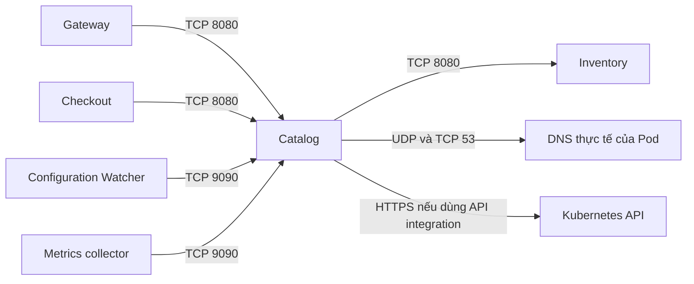

# NetworkPolicy cho API server, ứng dụng và endpoint quản trị

Bài học thuộc chương **Manifest triển khai** của module **SPRING_CLOUD_KUBERNETES**. Mục tiêu là xác định và khai báo những kết nối mà ứng dụng Spring thực sự cần: gọi Kubernetes API cho discovery/config, gọi dịch vụ nghiệp vụ, nhận thông báo từ Configuration Watcher và cung cấp endpoint quản trị cho bên được phép.

NetworkPolicy kiểm soát kết nối ở tầng IP, giao thức và cổng. Nó không thay thế ServiceAccount/RBAC, xác thực HTTP, TLS hoặc cấu hình endpoint Actuator. Một ứng dụng có đủ quyền đọc ConfigMap vẫn có thể không kết nối được API server; một Pod được mở cổng quản trị vẫn phải xác thực và phân quyền đúng ở ứng dụng.

## 1. Mục tiêu và mô hình thực hành

Sau bài học, bạn có thể:

- Lập ma trận kết nối trước khi viết policy và chỉ mở những đường cần thiết.
- Phân biệt ingress, egress, selector chọn Pod đích và selector chọn peer.
- Viết policy cho DNS, API server, HTTP nghiệp vụ và cổng management riêng.
- Nhận diện giới hạn khi API server hoặc DNS không phải Pod thông thường, đặc biệt với NAT và NodeLocal DNSCache.
- Kiểm chứng cả kết nối được phép và kết nối cần bị chặn từ đúng Pod nguồn.
- Phân biệt lỗi mạng với lỗi TLS, xác thực, RBAC và HTTP authorization.

Tình huống xuyên suốt dùng `catalog-service` trong namespace `training`. Ứng dụng lắng nghe nghiệp vụ tại TCP `8080`, management tại TCP `9090`, gọi `inventory` và dùng một số tích hợp Spring Cloud Kubernetes đã được lựa chọn.

Các namespace và label dưới đây là **quy ước lab**, phải đối chiếu với cụm thật trước khi áp dụng:

| Thành phần | Namespace | Label Pod trong lab | Vai trò |
| --- | --- | --- | --- |
| Catalog | `training` | `app: catalog-service` | Ứng dụng cần bảo vệ |
| Checkout | `training` | `app: checkout` | HTTP client nghiệp vụ được phép gọi catalog |
| Inventory | `training` | `app: inventory` | Dịch vụ catalog được phép gọi ra |
| Gateway | `ingress-system` | `app: ingress-gateway` | Proxy chuyển request nghiệp vụ vào catalog |
| Configuration Watcher | `platform-config` | `app: configuration-watcher` | Gửi thông báo HTTP quản trị khi kiến trúc sử dụng đường này |
| Metrics collector | `observability` | `app: metrics-collector` | Thu thập metrics qua management port |
| DNS của cụm | `kube-system` | `k8s-app: kube-dns` | Giả định CoreDNS thông thường trong ví dụ |

Giả định thêm: CNI hỗ trợ enforcement NetworkPolicy, các namespace đã tồn tại, các workload dùng Pod network thông thường và không có một policy khác đang cho phép mọi kết nối tới catalog. Các label DNS/gateway đặc biệt cần kiểm tra vì khác nhau giữa các bản phân phối.

## 2. Lập ma trận kết nối theo tính năng Spring

Trước hết xác định **process nào** tạo kết nối, không chỉ tên framework:

| Nguồn → Đích | Giao thức/cổng đích trong lab | Khi nào cần? |
| --- | --- | --- |
| Gateway → Catalog | TCP `8080` | Public route nghiệp vụ đi qua gateway |
| Checkout → Catalog | TCP `8080` | Giao tiếp nội bộ được cho phép |
| Catalog → Inventory | TCP `8080` | Gọi dependency nghiệp vụ |
| Catalog → DNS | UDP và TCP `53` | Phân giải Service hoặc tên miền cần dùng |
| Catalog → Kubernetes API | HTTPS; địa chỉ/cổng quan sát được phụ thuộc cụm | Direct DiscoveryClient hoặc đọc ConfigMap/Secret qua API |
| Watcher → Catalog | TCP `9090` | Cơ chế thông báo HTTP vào endpoint quản trị đã cấu hình |
| Metrics collector → Catalog | TCP `9090` | Scrape endpoint metrics đã bật |

Nếu chỉ dùng Kubernetes Service/DNS và cấu hình được mount vào Pod, catalog không tự động cần egress tới API server. Nếu dùng HTTP DiscoveryClient thông qua DiscoveryServer, đường gọi API có thể nằm ở server thay vì từng ứng dụng. [Spring Cloud Kubernetes: các loại DiscoveryClient](https://docs.spring.io/spring-cloud-kubernetes/reference/discovery-client.html).

Spring Cloud LoadBalancer cũng không tự quyết định một policy duy nhất. Nếu nó chọn IP Pod từ DiscoveryClient, lưu lượng nghiệp vụ có thể đi trực tiếp tới Pod được chọn; policy phải cho phép **đích thực tế**, không chỉ địa chỉ Service mà người viết cấu hình nhìn thấy.

Đọc ConfigMap và đọc Secret cùng đi qua API server nên có thể dùng chung đường mạng tới API. Phân biệt được phép đọc loại tài nguyên nào và namespace nào là việc của RBAC. Standard NetworkPolicy không diễn đạt được “cho phép get ConfigMap nhưng cấm get Secret”.



Đây là các kết nối được khởi tạo theo một hướng. Gói phản hồi của kết nối được cho phép được xử lý theo cơ chế kết nối; không cần mở một rule nghiệp vụ ngược chiều chỉ để cho response quay về.

## 3. Những quy tắc nền tảng cần hiểu

### 3.1. Policy chỉ có hiệu lực khi có thành phần thực thi

API server chấp nhận YAML không chứng minh CNI đã chặn hay cho phép đúng lưu lượng. Một cụm không có enforcement phù hợp có thể lưu NetworkPolicy nhưng lưu lượng vẫn đi qua. [Kubernetes: NetworkPolicy và điều kiện CNI](https://kubernetes.io/docs/concepts/services-networking/network-policies/).

Do vậy phải biết CNI của cụm, chế độ thực thi và các ngoại lệ của nền tảng. Kiểm chứng lưu lượng thực là một phần của bài triển khai, không chỉ chạy `kubectl apply`.

### 3.2. Ingress và egress được cô lập độc lập

Trong một NetworkPolicy:

- `spec.podSelector` chọn các Pod được policy bảo vệ trong namespace chứa policy.
- `policyTypes: [Ingress]` đặt phạm vi kiểm soát chiều vào.
- `policyTypes: [Egress]` đặt phạm vi kiểm soát chiều ra.
- `ingress[].from` và `egress[].to` chọn các peer được phép.
- `ports` chọn cổng đích và giao thức, không phải cổng ngẫu nhiên phía client.

Một kết nối Pod A → Pod B cần được chiều egress của A và ingress của B cho phép nếu hai phía đang bị cô lập. Mở ingress ở catalog không tự sửa egress đã bị chặn ở watcher hoặc checkout.

### 3.3. Các policy cho phép được cộng gộp

Policy không hoạt động như danh sách firewall ưu tiên từ trên xuống. Với standard NetworkPolicy, các allow rule áp dụng cùng chiều được hợp lại; một policy cô lập không ghi đè một policy khác đang cho phép rộng.

Nếu namespace có policy chọn mọi Pod và `ingress: [{}]`, việc thêm policy chỉ cho phép watcher không tự thu hẹp quyền truy cập management. Phải xem toàn bộ policy đang chọn Pod, không chỉ file vừa thêm.

### 3.4. Selector cùng peer là AND, các peer tách riêng là OR

Để chỉ cho phép Pod watcher **trong** namespace `platform-config`, hai selector phải nằm trong cùng một peer:

```yaml
from:
  - namespaceSelector:
      matchLabels:
        kubernetes.io/metadata.name: platform-config
    podSelector:
      matchLabels:
        app: configuration-watcher
```

Nếu tách chúng thành hai phần tử như sau, phạm vi sẽ rộng hơn:

```yaml
# Ví dụ dễ viết nhầm, không dùng để đạt mục tiêu ở trên.
from:
  - namespaceSelector:
      matchLabels:
        kubernetes.io/metadata.name: platform-config
  - podSelector:
      matchLabels:
        app: configuration-watcher
```

Phiên bản thứ hai cho phép tất cả Pod của `platform-config` **hoặc** Pod có label watcher trong namespace của policy. Peer chỉ có `podSelector` được hiểu trong namespace của policy; peer chỉ có `namespaceSelector` không tự giới hạn label Pod.

Ngoài ra, bỏ `ports` trong một allow rule có thể mở mọi cổng cho peer được chọn. [Kubernetes API: semantics của NetworkPolicy peer và rule](https://kubernetes.io/docs/reference/kubernetes-api/networking/network-policy-v1/).

Label namespace `kubernetes.io/metadata.name` giúp chọn tên namespace trong ví dụ. Vẫn phải kiểm tra label Pod và quyền thay đổi label/triển khai workload: standard NetworkPolicy không xác thực ServiceAccount của request HTTP. [Kubernetes: label namespace được nhận diện](https://kubernetes.io/docs/reference/labels-annotations-taints/).

## 4. Tách cổng nghiệp vụ và cổng quản trị của Spring Boot

### 4.1. Vì sao cổng riêng có ích?

Nếu nghiệp vụ và `/actuator/refresh` đều ở TCP `8080`, một policy cho gateway vào `8080` không thể chỉ cho `/api/**` và chặn `/actuator/**`. NetworkPolicy không xét HTTP path, method hay token.

Lab tách management sang `9090` để có ranh giới L4 rõ ràng. Cấu hình Spring Boot minh họa:

```yaml
server:
  port: 8080

management:
  server:
    port: 9090
  endpoints:
    web:
      exposure:
        include: health,prometheus
  endpoint:
    health:
      show-details: never
      probes:
        enabled: true
        add-additional-paths: true
```

`prometheus` chỉ có endpoint khi dự án có tích hợp metrics tương ứng; không cần metrics thì bỏ nó. Ví dụ chưa bật `refresh`. Chỉ thêm endpoint thay đổi trạng thái khi bộ thư viện hỗ trợ, kiến trúc thật sự dùng và đã cấu hình xác thực/phân quyền HTTP phù hợp.

`management.server.port` tạo listener quản trị riêng; khai báo `containerPort` hoặc Service không tự làm ứng dụng lắng nghe cổng này. Nếu cấu hình management chỉ bind loopback thì Pod khác sẽ không gọi được dù policy đã cho phép. [Spring Boot: đổi management port và địa chỉ](https://docs.spring.io/spring-boot/how-to/actuator.html).

### 4.2. Health probe vẫn kiểm tra cổng nghiệp vụ

`add-additional-paths` đưa nhóm health liveness/readiness ra `/livez` và `/readyz` trên cổng chính. Điều này giúp tránh trường hợp management server trả lời trong khi HTTP server nghiệp vụ gặp lỗi. [Spring Boot: probe trên cổng ứng dụng](https://docs.spring.io/spring-boot/reference/actuator/endpoints.html).

Phần Pod template liên quan có thể khai báo:

```yaml
spec:
  template:
    metadata:
      labels:
        app: catalog-service
    spec:
      containers:
        - name: app
          ports:
            - name: http
              containerPort: 8080
            - name: management
              containerPort: 9090
          startupProbe:
            httpGet:
              path: /livez
              port: http
            periodSeconds: 5
            failureThreshold: 30
          readinessProbe:
            httpGet:
              path: /readyz
              port: http
          livenessProbe:
            httpGet:
              path: /livez
              port: http
```

Đây là đoạn để hợp nhất vào Deployment hiện có, không phải toàn bộ Deployment. Nếu có Spring Security, cho phép tác nhân probe gọi đúng health path theo thiết kế; không mở toàn bộ Actuator để chữa lỗi `401`.

### 4.3. Service và đường vào public

Service nội bộ cho lab:

```yaml
apiVersion: v1
kind: Service
metadata:
  name: catalog-service
  namespace: training
  annotations:
    boot.spring.io/actuator: "http://:9090/actuator"
spec:
  type: ClusterIP
  selector:
    app: catalog-service
  ports:
    - name: http
      port: 8080
      targetPort: http
    - name: management
      port: 9090
      targetPort: management
```

Gateway/Ingress chỉ route nghiệp vụ tới port `http`; không tạo public route tới `management`. Annotation mô tả management location có thể được Configuration Watcher tương ứng sử dụng; nó không tự bật endpoint, mở policy hoặc cấp quyền HTTP.

Cấu hình Watcher phải thống nhất với port/path thực tế. Nếu chọn thông báo qua broker thay cho HTTP, ma trận kết nối phải đổi sang đường broker tương ứng. [Spring Cloud Kubernetes: Watcher và management port](https://docs.spring.io/spring-cloud-kubernetes/reference/spring-cloud-kubernetes-configuration-watcher.html).

Không công bố port `9090` trên Service không phải là biện pháp cô lập đầy đủ: Pod khác vẫn có thể tìm cách gọi Pod IP nếu mạng và policy cho phép. Ngược lại, có Service management không có nghĩa port đó phải được public.

## 5. Cô lập catalog và mở những nguồn ingress cần thiết

### 5.1. Policy nền cho đúng workload

Policy sau chọn catalog trong `training`, đặt cả ingress và egress vào trạng thái cô lập theo semantics của CNI:

```yaml
apiVersion: networking.k8s.io/v1
kind: NetworkPolicy
metadata:
  name: catalog-isolate
  namespace: training
spec:
  podSelector:
    matchLabels:
      app: catalog-service
  policyTypes:
    - Ingress
    - Egress
  ingress: []
  egress: []
```

Policy này không chọn checkout, inventory hay toàn bộ namespace. Một baseline cho cả namespace là lựa chọn quản trị khác và phải bao phủ nhu cầu của mọi workload được chọn. [Kubernetes: thực hành khai báo policy](https://kubernetes.io/docs/tasks/administer-cluster/declare-network-policy/).

### 5.2. Cho gateway và checkout vào cổng nghiệp vụ

```yaml
apiVersion: networking.k8s.io/v1
kind: NetworkPolicy
metadata:
  name: catalog-business-ingress
  namespace: training
spec:
  podSelector:
    matchLabels:
      app: catalog-service
  policyTypes:
    - Ingress
  ingress:
    - from:
        - namespaceSelector:
            matchLabels:
              kubernetes.io/metadata.name: ingress-system
          podSelector:
            matchLabels:
              app: ingress-gateway
        - namespaceSelector:
            matchLabels:
              kubernetes.io/metadata.name: training
          podSelector:
            matchLabels:
              app: checkout
      ports:
        - protocol: TCP
          port: 8080
```

Đây là quyền nhận kết nối từ các peer đã chọn, không phải quyền gọi một danh sách path HTTP cụ thể. Gateway cần hạn chế route ở L7, còn ứng dụng vẫn thực hiện authentication/authorization nghiệp vụ.

### 5.3. Chỉ mở cổng quản trị cho watcher và metrics collector

```yaml
apiVersion: networking.k8s.io/v1
kind: NetworkPolicy
metadata:
  name: catalog-management-ingress
  namespace: training
spec:
  podSelector:
    matchLabels:
      app: catalog-service
  policyTypes:
    - Ingress
  ingress:
    - from:
        - namespaceSelector:
            matchLabels:
              kubernetes.io/metadata.name: platform-config
          podSelector:
            matchLabels:
              app: configuration-watcher
        - namespaceSelector:
            matchLabels:
              kubernetes.io/metadata.name: observability
          podSelector:
            matchLabels:
              app: metrics-collector
      ports:
        - protocol: TCP
          port: 9090
```

Watcher và metrics collector cùng có kết nối tới `9090` nghĩa là NetworkPolicy không thể ngăn collector thử gọi path refresh cũng trên cổng này. Dùng danh tính HTTP và quyền theo endpoint/method để collector chỉ scrape metrics, watcher chỉ thực hiện hành động được cấp.

Không nhận một label như `app: configuration-watcher` làm bằng chứng xác thực HTTP. Kiểm soát ai được tạo Pod, sửa label hoặc triển khai vào namespace tin cậy là phần đi kèm của thiết kế.

## 6. Mở egress tới DNS và dịch vụ nghiệp vụ

### 6.1. DNS phải có cả đường UDP và TCP cần thiết

Khi cô lập egress, tên Service có thể không phân giải được dù policy tới ứng dụng đích đã đúng. Với giả định DNS là các Pod có label `k8s-app: kube-dns` trong `kube-system`, dùng:

```yaml
apiVersion: networking.k8s.io/v1
kind: NetworkPolicy
metadata:
  name: catalog-dns-egress
  namespace: training
spec:
  podSelector:
    matchLabels:
      app: catalog-service
  policyTypes:
    - Egress
  egress:
    - to:
        - namespaceSelector:
            matchLabels:
              kubernetes.io/metadata.name: kube-system
          podSelector:
            matchLabels:
              k8s-app: kube-dns
      ports:
        - protocol: UDP
          port: 53
        - protocol: TCP
          port: 53
```

Không mở UDP/TCP `53` tới mọi địa chỉ chỉ vì chưa xác định resolver. Kiểm tra DNS Service, EndpointSlice và cấu hình DNS của Pod; domain `cluster.local` trong bài là giả định, không phải hằng số của mọi cụm. [Kubernetes: DNS cho Service và Pod](https://kubernetes.io/docs/concepts/services-networking/dns-pod-service/).

Nếu DNS Pod cũng bị cô lập ingress, phía DNS phải cho phép nguồn tương ứng. Policy ở catalog chỉ quản lý chiều ra của catalog.

### 6.2. NodeLocal DNSCache là trường hợp khác

Pod có thể dùng một resolver node-local thay vì gọi trực tiếp CoreDNS Pod. Khi đó policy chỉ chọn CoreDNS bằng label có thể không mô tả đúng hop đầu tiên.

Xác định nameserver thực tế, cách CNI xử lý traffic node-local/host-network và policy nền tảng đã có. Có thể cần rule theo địa chỉ resolver hoặc cơ chế riêng của CNI; không sao chép một địa chỉ link-local từ cụm khác. [Kubernetes: NodeLocal DNSCache](https://kubernetes.io/docs/tasks/administer-cluster/nodelocaldns/).

### 6.3. Cho catalog gọi inventory

```yaml
apiVersion: networking.k8s.io/v1
kind: NetworkPolicy
metadata:
  name: catalog-inventory-egress
  namespace: training
spec:
  podSelector:
    matchLabels:
      app: catalog-service
  policyTypes:
    - Egress
  egress:
    - to:
        - namespaceSelector:
            matchLabels:
              kubernetes.io/metadata.name: training
          podSelector:
            matchLabels:
              app: inventory
      ports:
        - protocol: TCP
          port: 8080
```

Policy chọn các Pod inventory theo label, không chọn Kubernetes Service theo tên. Trong lab, Service inventory và Pod đích cùng dùng cổng `8080` để tránh nhầm giữa Service port và target port.

Nếu inventory cũng cần cô lập ingress và catalog là nguồn được phép trong lab, có thể khai báo phía nhận:

```yaml
apiVersion: networking.k8s.io/v1
kind: NetworkPolicy
metadata:
  name: inventory-from-catalog
  namespace: training
spec:
  podSelector:
    matchLabels:
      app: inventory
  policyTypes:
    - Ingress
  ingress:
    - from:
        - namespaceSelector:
            matchLabels:
              kubernetes.io/metadata.name: training
          podSelector:
            matchLabels:
              app: catalog-service
      ports:
        - protocol: TCP
          port: 8080
```

Policy này tác động tới inventory, không chỉ catalog. Nếu inventory còn có client khác, phải mô tả các nguồn cần thiết trước khi áp dụng việc cô lập nó.

## 7. Cho phép kết nối tới Kubernetes API server

### 7.1. Quyền mạng và quyền API là hai lớp khác nhau

Direct DiscoveryClient hoặc API config integration thường cần kết nối HTTPS đến API server. Để chức năng hoạt động cần đồng thời:

1. Có đường DNS/routing và policy cho phép tới địa chỉ/cổng thực tế.
2. Kiểm chứng certificate và hostname đúng bằng CA thích hợp.
3. Có credential hợp lệ của workload.
4. Có RBAC cho resource, verb và namespace mà client yêu cầu.

Policy mở TCP tới API không tự cấp quyền `list services`. Role cho phép `get configmaps` cũng không mở đường mạng.

Ứng dụng chỉ cần gọi API khi tính năng đã chọn yêu cầu điều đó. Các thành phần không cần API nên bỏ đường egress này và không tự động mount credential chỉ để khớp một template chung.

### 7.2. Không có một CIDR/cổng dùng được cho mọi cụm

Ứng dụng có thể nhìn thấy Service `kubernetes.default` ở cổng `443`, trong khi dataplane chuyển tới control-plane endpoint ở cổng khác, chẳng hạn `6443`. API server cũng có thể nằm ngoài Pod network hoặc là managed endpoint.

Thời điểm NAT so với enforcement NetworkPolicy không được standard API ấn định cho mọi tổ hợp CNI, Service implementation và nhà cung cấp. Vì vậy, một rule chỉ nhắm ClusterIP `:443` hoặc chỉ nhắm backend `:6443` không phải mẫu phổ quát.

Không chọn API server bằng `namespaceSelector`/`podSelector` chỉ vì tên của nó có chữ Kubernetes: control plane có thể không phải Pod thông thường, dùng `hostNetwork` hoặc nằm ngoài cụm.

### 7.3. Mẫu cho một endpoint đã được xác định

Policy sau chỉ minh họa trường hợp nền tảng đã xác nhận enforcement nhìn thấy API server ở **địa chỉ cụ thể, TCP 6443**. `192.0.2.10/32` là địa chỉ tài liệu, **phải thay trước khi áp dụng** bằng địa chỉ/cổng đã được kiểm chứng của cụm:

```yaml
apiVersion: networking.k8s.io/v1
kind: NetworkPolicy
metadata:
  name: catalog-apiserver-egress
  namespace: training
spec:
  podSelector:
    matchLabels:
      app: catalog-service
  policyTypes:
    - Egress
  egress:
    - to:
        - ipBlock:
            cidr: 192.0.2.10/32
      ports:
        - protocol: TCP
          port: 6443
```

Nếu cụm thực thi theo Service VIP, địa chỉ/cổng cần khớp với cách đó. Nếu có nhiều API endpoint hoặc dual-stack, phải bao phủ đúng các đường IPv4/IPv6 thực sự dùng; không chỉ mở endpoint đang tình cờ hoạt động tại thời điểm thử.

Standard `ipBlock` nhận CIDR, không nhận hostname. Với managed endpoint thay đổi IP, sử dụng cơ chế được nền tảng quản lý, hoặc policy mở rộng của CNI nếu có và đã được kiểm chứng. Một extension theo service/entity/FQDN của CNI không phải trường có thể đưa tùy ý vào `networking.k8s.io/v1 NetworkPolicy`.

Không mở `0.0.0.0/0` trên `443` hoặc toàn bộ node network như cách sửa chung. Phạm vi cho phép phải có nguồn dữ liệu vận hành và cách cập nhật khi endpoint thay đổi.

### 7.4. Thu thập thông tin để viết rule

Người vận hành có quyền khảo sát có thể kiểm tra:

```powershell
kubectl get service kubernetes -n default -o yaml
kubectl get endpointslices -n default -l kubernetes.io/service-name=kubernetes -o yaml
```

Không phải managed cluster nào cũng công bố đầy đủ backend qua các đối tượng này. Nếu dữ liệu không có hoặc không phản ánh enforcement, dùng thông tin từ đội nền tảng và quan sát dataplane/CNI. Chỉ thấy một IP trong Service chưa đủ chứng minh đúng cách viết policy.

Kiểm tra cả kết nối ban đầu và reconnect sau khi watch bị ngắt. Một kết nối watch đang giữ từ trước khi đổi policy có thể làm phép thử sai lệch; hành vi của kết nối đã tồn tại phụ thuộc implementation.

## 8. Chính sách ở phía watcher, metrics và gateway

Các policy ở trên chỉ quản lý catalog, ngoại trừ policy inventory được ghi rõ. Nếu watcher đã bị cô lập egress trong `platform-config`, cần thêm đường tới catalog TCP `9090` trong tập policy của watcher.

Ví dụ **rule để hợp nhất** vào cấu hình egress của watcher:

```yaml
egress:
  - to:
      - namespaceSelector:
          matchLabels:
            kubernetes.io/metadata.name: training
        podSelector:
          matchLabels:
            app: catalog-service
    ports:
      - protocol: TCP
        port: 9090
```

Đây không phải toàn bộ policy cho watcher. Watcher còn có thể cần DNS, Kubernetes API, discovery và broker theo kiến trúc thực tế. Tạo một policy Egress mới chỉ chứa rule này có thể cô lập watcher và làm hỏng những đường đó nếu chưa được cho phép ở policy khác.

Tương tự, metrics collector hoặc gateway đang bị cô lập chiều ra cần policy ở namespace của chúng cho phép đích tương ứng. Một allow ingress ở catalog không ghi đè deny egress của nguồn.

Cấu hình port/path của watcher, annotation trên Service, exposure của Actuator và HTTP authorization phải đồng bộ. Nếu báo `404`, `401` hoặc `403` từ ứng dụng, đã có một phản hồi HTTP; đừng tự động sửa NetworkPolicy thành rộng hơn.

Với Spring Cloud Bus, cần thiết kế đường tới broker, quyền broker và phạm vi nhận thông báo. Mở cổng management cho watcher không thay thế được đường messaging; giữ những rule mà kiến trúc đang dùng, bỏ rule không cần thiết.

## 9. Giới hạn cần tính đến cho health và control plane

### 9.1. Traffic từ node và `hostNetwork`

Standard NetworkPolicy không phải cơ chế cô lập toàn diện node khỏi Pod. Mô hình chuẩn có ngoại lệ cho traffic từ node nơi Pod chạy, và hành vi với `hostNetwork` phụ thuộc khả năng phân biệt của plugin.

Do đó, không dùng một phép thử từ node để kết luận Pod ngang hàng đã bị chặn. Nếu gateway hoặc monitoring agent dùng `hostNetwork`, các selector Pod trong ví dụ có thể không hoạt động như trường hợp Pod network thông thường.

Nếu cần kiểm soát host traffic, phải xét tính năng host policy/firewall của nền tảng và kiểm chứng riêng; không mô tả yêu cầu đó bằng một standard policy rồi mặc định đã đạt.

### 9.2. Probe, listener và đường kiểm tra

Kubelet thường gọi probe từ node tới Pod. Cần kiểm tra thực tế trên CNI và cấu hình của cụm, đặc biệt khi có lớp host policy bổ sung. Không mở ingress từ mọi namespace chỉ để probe chuyển sang xanh.

Probe trên management port có thể hoạt động trong khi listener nghiệp vụ lỗi; ví dụ dùng `/livez` và `/readyz` trên `8080` nhằm kiểm tra đúng HTTP server chính. Liveness không nên phụ thuộc cứng vào một hệ thống ngoài khiến mọi Pod bị restart khi API server hoặc database gặp sự cố.

### 9.3. Những đường không được phép dùng làm bằng chứng duy nhất

- `kubectl port-forward` đi qua đường điều khiển/stream khác; truy cập thành công qua đó không chứng minh policy từ một Pod client thật đúng.
- Gọi từ máy cá nhân hoặc node không thay thế được test từ namespace và label nguồn cần kiểm soát.
- `kubectl auth can-i` hỏi authorization của Kubernetes API, không hỏi khả năng kết nối mạng.
- Image pull do kubelet thực hiện không phải egress HTTP do process catalog khởi tạo; `ImagePullBackOff` cần điều tra đường registry tương ứng.

Standard NetworkPolicy cũng không tự tạo TLS, không phân quyền theo HTTP path, không chọn ServiceAccount làm peer và không cung cấp log allow/drop theo một định dạng chuẩn. Dùng khả năng quan sát của CNI khi cần bằng chứng dataplane.

## 10. Áp dụng có kiểm soát trong lab

Các lệnh dưới đây là hướng dẫn cho người học trên cụm thử nghiệm đã được cấp quyền; bài học không giả định chúng đã được chạy.

### 10.1. Kiểm tra đầu vào

```powershell
kubectl config current-context
kubectl get namespaces --show-labels
kubectl get pods -n training --show-labels
kubectl get pods -n platform-config --show-labels
kubectl get pods -n observability --show-labels
kubectl get pods -n ingress-system --show-labels
kubectl get pods -n kube-system -l k8s-app=kube-dns --show-labels
kubectl get networkpolicy -n training
```

Đối chiếu CNI, DNS thực tế, các policy cấp cụm hoặc extension đang áp dụng và quyền quản lý namespace/label. Không kết luận chỉ vì lệnh cuối không có đối tượng thì toàn bộ nền tảng không có chính sách khác.

Trước khi thực thi, hoàn thiện địa chỉ/cổng API server và điều chỉnh rule DNS theo cụm. Giả sử những policy đã được điều chỉnh được lưu thành `catalog-networkpolicy.yaml` trong dự án lab:

```powershell
kubectl apply --dry-run=server -f .\catalog-networkpolicy.yaml
kubectl diff -f .\catalog-networkpolicy.yaml
kubectl apply -f .\catalog-networkpolicy.yaml
kubectl describe networkpolicy -n training
```

Server-side dry run kiểm tra cấu trúc và request API, không mô phỏng enforcement CNI. Apply cả tập cấu hình cần thiết theo quy trình quản lý của lab, tránh để một baseline cô lập tồn tại kéo dài mà các đường DNS/API cần thiết chưa được khai báo.

Thực thi policy là bất đồng bộ; có thể có giai đoạn kết nối chưa phản ánh trạng thái cuối. Quan sát kết nối mới và khả năng retry của ứng dụng thay vì chỉ kiểm tra một TCP session đã mở.

### 10.2. Chuẩn bị nguồn kiểm thử đúng danh tính mạng

Trong lab, dùng Pod client thật hoặc diagnostic container được cấp phép chia sẻ network namespace của Pod cần kiểm tra. Một Pod debug bất kỳ có namespace/label khác không chịu cùng tập policy.

Các lệnh mẫu sau giả định Pod nguồn đã có `curl` và `nslookup` qua image/chẩn đoán được đội nền tảng cho phép. Không cài thêm công cụ vào image production chỉ để hoàn thành bài.

```powershell
$catalogPod = kubectl get pods -n training -l app=catalog-service -o 'jsonpath={.items[0].metadata.name}'
$checkoutPod = kubectl get pods -n training -l app=checkout -o 'jsonpath={.items[0].metadata.name}'
$watcherPod = kubectl get pods -n platform-config -l app=configuration-watcher -o 'jsonpath={.items[0].metadata.name}'
```

Nếu có nhiều replica, chọn rõ Pod và node của từng phép thử; lặp lại khi cần để phát hiện khác biệt giữa node. Xác nhận biến đã chứa tên Pod hợp lệ trước khi chạy tiếp.

### 10.3. Kiểm tra DNS và dependency

```powershell
kubectl exec -n training $catalogPod -- nslookup inventory.training.svc.cluster.local
kubectl exec -n training $catalogPod -- curl --connect-timeout 2 --max-time 5 -sS http://inventory.training.svc.cluster.local:8080/api/ping
```

`/api/ping` là endpoint GET kiểm chứng do ứng dụng lab cung cấp; thay bằng endpoint phù hợp nếu dự án dùng đường khác. Kiểm thử DNS cần bao phủ cả UDP và TCP bằng công cụ DNS phù hợp; một lần `nslookup` thành công chưa chứng minh mọi đường DNS cần thiết.

Nếu DNS thất bại nhưng kết nối tới địa chỉ đích đã xác định hoạt động, điều tra resolver trước. Nếu DNS thành công nhưng TCP timeout, kiểm tra policy hai đầu, port và đường Service/Pod. [Kubernetes: chẩn đoán DNS](https://kubernetes.io/docs/tasks/administer-cluster/dns-debugging-resolution/), [chẩn đoán Service](https://kubernetes.io/docs/tasks/debug/debug-application/debug-service/).

### 10.4. Kiểm tra ingress nghiệp vụ và management

```powershell
kubectl exec -n training $checkoutPod -- curl --connect-timeout 2 --max-time 5 -sS http://catalog-service.training.svc.cluster.local:8080/api/ping
kubectl exec -n training $checkoutPod -- curl --connect-timeout 2 --max-time 5 -sS http://catalog-service.training.svc.cluster.local:9090/actuator/health
kubectl exec -n platform-config $watcherPod -- curl --connect-timeout 2 --max-time 5 -sS http://catalog-service.training.svc.cluster.local:9090/actuator/health
```

Phép thử checkout → `8080` cần tới được endpoint nghiệp vụ. Checkout → `9090` cần bị từ chối ở tầng mạng trong mô hình lab và không có allow rule khác. Watcher → `9090` cần kết nối được; mã HTTP cuối còn phụ thuộc security của endpoint.

Không kết luận `401` hoặc `403` là NetworkPolicy đã chặn cổng: chúng thường cho thấy server đã nhận request và trả lời ở tầng HTTP. Với endpoint quản trị có tác dụng thay đổi trạng thái, dùng danh tính hợp lệ theo cơ chế của lab và kiểm chứng quyền đúng hành động; không bỏ security để làm test xanh.

### 10.5. Kiểm tra API server bằng đường thật

Nếu Pod thực sự dùng API integration và có CA được mount theo cấu hình in-cluster, có thể dùng một request không mang token để tách kiểm tra TLS/kết nối khỏi RBAC:

```powershell
kubectl exec -n training $catalogPod -- curl --connect-timeout 2 --max-time 5 --cacert /var/run/secrets/kubernetes.io/serviceaccount/ca.crt -sS https://kubernetes.default.svc/version
```

Một phản hồi HTTP, kể cả bị từ chối do anonymous access, giúp xác định request đã đi tới endpoint qua TLS hợp lệ. Kết quả này không chứng minh client dùng token đúng hoặc có RBAC discovery/config. Sau đó kiểm chứng bằng chính Kubernetes client của ứng dụng, không in token ra terminal và không dùng `-k` để bỏ kiểm tra certificate.

## 11. Ma trận kiểm chứng cho phép và từ chối

Điền kết quả thực tế cùng CNI, thời điểm, Pod/node nguồn và địa chỉ đích. Tạo kết nối mới cho từng phép thử sau khi policy đã hội tụ.

| Kết nối | Kỳ vọng trong lab | Nếu khác kỳ vọng, xem trước |
| --- | --- | --- |
| Checkout → Catalog `8080` | Được kết nối | Label nguồn/đích, ingress catalog, egress checkout và listener |
| Gateway → Catalog `8080` | Được kết nối | Namespace/label gateway, hostNetwork và đường proxy |
| Checkout → Catalog `9090` | Bị chặn ở L3/L4 | Allow rule khác, selector bị tách OR hoặc policy chưa được thực thi |
| Gateway → Catalog `9090` | Bị chặn ở L3/L4 | Cổng public/management bị mở chung hoặc policy khác cấp rộng |
| Watcher → Catalog `9090` | Được kết nối, HTTP theo quyền | Ingress catalog, egress watcher, port/path và HTTP identity |
| Metrics collector → Catalog `9090` | Được kết nối, chỉ endpoint được cấp ở L7 | Registry/exposure metrics và authorization |
| Pod không được tin cậy → Catalog | Bị chặn với kết nối Pod network thuộc phạm vi kiểm soát | Label, namespace, các policy cộng gộp và enforcement |
| Catalog → Inventory `8080` | Được kết nối | Egress catalog và ingress inventory |
| Catalog → DNS thực tế | DNS hoạt động theo các giao thức cần dùng | CoreDNS/NodeLocal, port 53 và phía nhận |
| Catalog → Kubernetes API | Chỉ cần khi có API integration; TLS và chức năng phải đạt | NAT, endpoint thực, CA, token và RBAC |
| Catalog → đích kiểm thử ngoài allowlist do lab sở hữu | Bị chặn trong phạm vi policy | Policy egress khác, host exception và CNI extension |

Metrics collector và watcher cùng vào được một cổng không tự có quyền HTTP giống nhau. Bổ sung phép thử collector bị từ chối hành động refresh ở L7 nếu kiến trúc có endpoint đó.

Đừng chỉ chứng minh những đường được phép. Một bài triển khai chỉ có test thành công có thể bỏ sót policy đang cho phép mọi traffic.

## 12. Phân biệt lỗi và điều tra theo lớp

| Triệu chứng | Lớp có khả năng liên quan | Điều cần đối chiếu |
| --- | --- | --- |
| `UnknownHostException`/DNS timeout | DNS | Nameserver thật, UDP/TCP, CoreDNS/NodeLocal và resolver config |
| TCP timeout | Mạng/dataplane | Policy hai đầu, routing, listener và flow quan sát được |
| Connection refused | Listener/đích hoặc cơ chế từ chối mạng | Process có lắng nghe, targetPort đúng, endpoint và hành vi CNI |
| TLS handshake/certificate error | TLS | CA, hostname, proxy và truststore |
| HTTP `401` từ API | Xác thực API | Token, thời hạn, audience và cơ chế nạp credential |
| HTTP `403` với thông báo không được list/get/watch | Authorization API | ServiceAccount, RBAC, namespace và resource |
| HTTP `401/403` từ Actuator | Security ứng dụng | Danh tính HTTP và quyền endpoint/method, kể cả chính sách chống CSRF liên quan |
| HTTP `404` ở management | Exposure/path/port | Endpoint có tồn tại, được expose, đúng base path và listener không? |
| Readiness xanh nhưng request nghiệp vụ lỗi | Phạm vi health | Probe đang kiểm tra listener nào và startup/dependency thực tế |
| Watch vẫn chạy sau khi đổi policy | Kết nối đã tồn tại | Tạo kết nối mới; hành vi xử lý session hiện có của CNI |
| Apply thành công nhưng mọi nguồn vẫn truy cập được | Enforcement hoặc allow rule khác | CNI, selector, policy cấp rộng, hostNetwork và nguồn thử |

HTTP error đã có phản hồi không có nghĩa toàn bộ mạng luôn đúng, nhưng đủ lý do để không mặc định mở thêm CIDR/cổng. Thu thập địa chỉ/cổng thực, log client và flow của CNI trước khi đổi thiết kế.

Khi rollback trong lab, phục hồi tập manifest đã biết hoạt động và kiểm tra lại chức năng. Xóa một allow rule trong khi giữ baseline cô lập có thể tiếp tục làm ứng dụng mất kết nối; thêm một allow-all để chữa tạm cũng có thể để lại quyền rộng bị quên.

## 13. Bài thực hành và tiêu chí hoàn thành

Thực hiện trên môi trường lab được quản lý:

1. Chốt CNI, Pod/namespace label, DNS resolver và đường API server thực tế.
2. Viết ma trận kết nối cho chức năng Spring Cloud Kubernetes đã chọn; bỏ API/watcher/broker nếu ứng dụng không sử dụng.
3. Tách listener nghiệp vụ và management, cấu hình probe cùng HTTP security phù hợp.
4. Điều chỉnh và áp dụng tập policy cô lập, ingress và egress; không dùng CIDR tài liệu làm cấu hình thật.
5. Kiểm tra từ đúng Pod nguồn, bao gồm DNS, API, HTTP nghiệp vụ, watcher/metrics và các đường phải bị chặn.
6. Gây một lần reconnect/watch hoặc tạo Pod mới có kiểm soát để kiểm chứng sau thay đổi mạng.
7. Lưu bằng chứng kết nối và phân loại lỗi theo DNS, TCP, TLS, authentication, RBAC hoặc authorization HTTP.
8. Đọc lại toàn bộ policy chọn workload để chắc rằng không còn allow rule rộng làm vô hiệu mục tiêu thu hẹp.

Mẫu bàn giao cho dự án thực hành:

```text
Workload/namespace/label được chọn: ...
CNI và chế độ enforcement: ...
DNS resolver thực tế: ...
API endpoint nhìn từ dataplane, cổng và nguồn thông tin: ...
Luồng nghiệp vụ cần cho phép: ...
Luồng management cần cho phép và quyền HTTP tương ứng: ...
Policy hoặc ngoại lệ cấp nền tảng liên quan: ...
Phép thử được phép: ...
Phép thử bị chặn: ...
Giới hạn hostNetwork/node/NAT và kết nối hiện có: ...
Phương án cập nhật endpoint hoặc rollback: ...
```

Hoàn thành bài khi bạn giải thích được vì sao mỗi luồng được mở, chứng minh các luồng ngoài phạm vi bị kiểm soát đúng và biết lớp bảo vệ nào chịu trách nhiệm cho IP/cổng, TLS, RBAC và quyền endpoint quản trị.

### Câu hỏi tự kiểm tra

1. Vì sao ServiceAccount có quyền `list services` vẫn có thể không gọi được Kubernetes API?
2. Nếu chỉ cho DNS UDP `53`, trường hợp nào còn cần kiểm tra đường TCP hoặc resolver khác?
3. Hai selector namespace và Pod nằm trong cùng peer khác gì khi tách thành hai peer?
4. Vì sao policy chỉ chọn API Service ClusterIP `:443` chưa chắc đúng trên mọi CNI?
5. Một policy cho gateway vào cổng `8080` có chặn được `/actuator/refresh` cũng ở `8080` không?
6. Vì sao metrics collector được vào `9090` vẫn phải bị giới hạn quyền HTTP riêng với watcher?
7. Vì sao `kubectl port-forward` hoặc một request từ node không phải bằng chứng đầy đủ cho kết nối Pod → Pod?
8. NetworkPolicy mới có chắc ngắt ngay một kết nối watch đang mở không?
9. Nếu thêm một policy hẹp mà nguồn không được phép vẫn kết nối được, bạn kiểm tra các policy cộng gộp như thế nào?
10. Khi chuyển từ direct DiscoveryClient sang DNS hoặc DiscoveryServer, ma trận kết nối cần thay đổi ở đâu?
