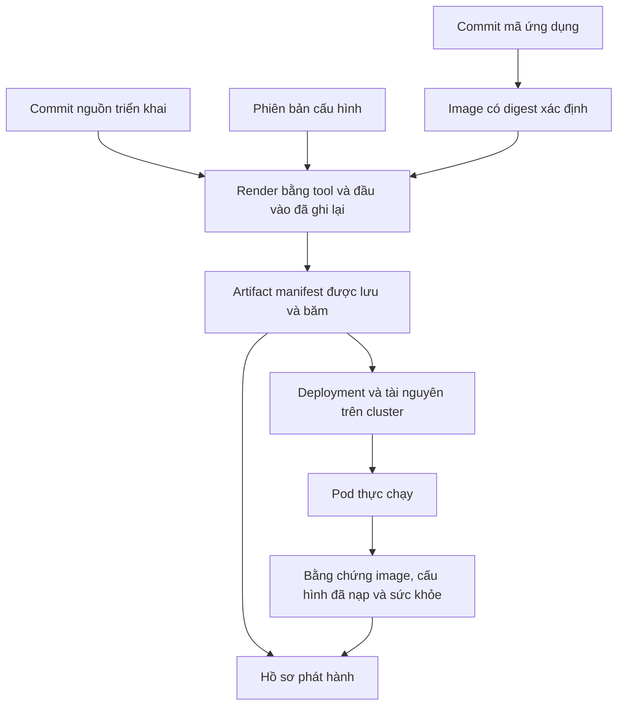

# Giữ cấu hình triển khai có thể truy vết về phiên bản nguồn

Khi một dịch vụ Spring gặp lỗi sau khi triển khai, câu hỏi đầu tiên thường là: “Pod này đang chạy mã nguồn nào và đã nạp cấu hình nào?”. Một image tag như `latest`, tên ConfigMap cố định hoặc dòng chú thích “đã deploy bản mới” không đủ để trả lời câu hỏi đó.

Trong chương **Manifest triển khai** của module **SPRING_CLOUD_KUBERNETES**, khả năng truy vết phải bao phủ cả mã ứng dụng, manifest, nguồn ConfigMap/Secret, quyền RBAC và trạng thái thực tế của Pod. Việc ứng dụng Ready chỉ cho biết một điều kiện vận hành; nó không tự chứng minh toàn bộ đầu vào khớp bản phát hành đã dự định.

Bài học xây dựng một chuỗi truy vết cụ thể cho ứng dụng `catalog`: từ phiên bản nguồn đến image, cấu hình, manifest đã render và các instance thực chạy.

Sau bài học, bạn có thể:

- Phân biệt Git commit, image digest, configuration revision và Deployment revision.
- Gắn metadata truy vết vào đúng đối tượng và Pod template.
- Giữ bản cấu hình có phiên bản, xác định rõ tên ConfigMap mà Spring sẽ đọc.
- Lưu đầu vào, đầu ra render và bằng chứng triển khai thành hồ sơ phát hành.
- Phát hiện drift, xử lý cập nhật động và xác định phạm vi rollback.

## 1. Truy vết cần một chuỗi liên kết, không chỉ một nhãn phiên bản

Giả sử đội triển khai ghi:

```text
Ứng dụng: catalog
Version: 1.4.2
Trạng thái: Ready
```

Thông tin này vẫn chưa trả lời được:

- `1.4.2` được build từ commit nào?
- Có phải mọi Pod đều chạy cùng nội dung image không?
- Manifest đã áp dụng đến từ branch hay commit nào?
- Overlay môi trường nào đã được dùng?
- ConfigMap đã bị sửa sau khi Pod khởi động chưa?
- Một Secret hoặc cấu hình ngoài cluster có thay đổi độc lập không?
- Có hotfix trực tiếp bằng `kubectl edit` hoặc một controller khác không?

Mô hình cần hướng tới:



Một mã phát hành, chẳng hạn `rel-20261124-01`, đóng vai trò liên kết các bằng chứng này. Nó không thay thế các định danh của từng lớp.

## 2. Không dùng lẫn các loại revision

| Định danh | Xác định điều gì? | Không thể thay thế |
| --- | --- | --- |
| Commit mã ứng dụng | Snapshot nguồn dùng để build | Nội dung image đã build |
| Image digest | Nội dung image hoặc image index được tham chiếu | Cấu hình bên ngoài image |
| Commit nguồn triển khai | Snapshot manifest/template/overlay trong repository | Các tham số CI nằm ngoài repository |
| Configuration revision | Một bản cấu hình được nhóm quản lý định danh | Kubernetes `resourceVersion` |
| Hash artifact manifest | Nội dung tệp đã đóng gói để triển khai | Bằng chứng mọi object đã áp dụng thành công |
| Deployment revision | Lịch sử Pod template trong Deployment | Git commit hoặc phiên bản toàn bộ hệ thống |
| Pod UID | Một lần tồn tại cụ thể của Pod | Danh tính ổn định của ứng dụng |
| Release ID | Khóa liên kết hồ sơ của một lần phát hành | Bằng chứng độc lập về từng đầu vào |

Kubernetes `resourceVersion` phục vụ quản lý phiên bản đối tượng trong API. Không diễn giải nó là Git SHA hoặc một version nghiệp vụ có thể mang nguyên sang cluster khác.

Deployment revision được tạo theo thay đổi Pod template, không phải mọi thay đổi ConfigMap, Service hoặc RBAC. Lịch sử revision cũng có giới hạn lưu giữ. Xem [Kubernetes — Deployments](https://kubernetes.io/docs/concepts/workloads/controllers/deployment/).

## 3. Giữ nguồn triển khai đủ rõ để dựng lại đầu ra

### 3.1. Xác định repository và đường dẫn nguồn

Nếu mã ứng dụng và manifest nằm ở hai repository khác nhau, ghi lại cả hai:

```text
app-source:
  repository: catalog
  revision: commit mã ứng dụng

deployment-source:
  repository: platform-config
  revision: commit cấu hình triển khai
  path: apps/catalog/overlays/lab
```

Nếu cùng repository, có thể dùng cùng commit nhưng vẫn cần biết đường dẫn build và đường dẫn render.

Một cấu trúc minh họa:

```text
apps/catalog/
├── base/
│   ├── deployment.yaml
│   ├── service.yaml
│   └── access.yaml
└── overlays/
    ├── lab/
    │   ├── kustomization.yaml
    │   └── config.yaml
    └── production/
        ├── kustomization.yaml
        └── config.yaml
```

Cấu trúc thư mục giúp tổ chức nguồn; khả năng truy vết còn phụ thuộc vào việc chốt đúng commit, đúng overlay và đúng tham số.

### 3.2. Ghi commit đầy đủ và trạng thái nguồn

Các lệnh minh họa sau chạy trong repository cấu hình đã checkout:

```powershell
git rev-parse --verify HEAD
git status --porcelain
kubectl version --client -o yaml
```

Commit đầy đủ là định danh chính. Branch và tag có thể giữ thêm để thuận tiện tra cứu, nhưng không dùng tên branch thay cho commit của lần render.

Nếu nguồn có thay đổi chưa commit hoặc file đầu vào chưa được quản lý, chỉ ghi `HEAD` là chưa mô tả đủ nguồn. Pipeline cần từ chối đầu vào không rõ ràng hoặc lưu lại snapshot bổ sung theo một quy trình xác định.

Ghi thêm những đầu vào có thể ảnh hưởng đầu ra:

- Phiên bản kubectl/Kustomize hoặc công cụ render đang dùng.
- Overlay và các tham số môi trường.
- Image digest được đưa vào.
- File values, patch hoặc tham số CI thực sự tham gia render.
- Phiên bản dependency render, remote base hoặc chart nếu có.
- Các tham chiếu tới nguồn cấu hình bên ngoài.

Chốt commit của repository chính nhưng vẫn dùng remote base theo branch động sẽ để lại một đầu vào chưa được chốt.

### 3.3. Tránh vòng lặp “commit chứa chính SHA của nó”

Không yêu cầu một tệp trong commit phải chứa SHA cuối cùng của chính commit đó. Khi sửa nội dung tệp để thêm SHA, commit được tạo lại sẽ có định danh khác.

Một cách làm rõ ràng là:

1. Checkout commit nguồn đã chốt.
2. Render từ snapshot đó.
3. CI bổ sung metadata về commit vào **artifact đầu ra**.
4. Lưu artifact và hồ sơ phát hành bên ngoài snapshot nguồn đang được định danh.

Commit nguồn và artifact đã bổ sung metadata là hai đối tượng khác nhau, được nối với nhau bằng hồ sơ phát hành.

## 4. Giữ image có thể đối chiếu với nguồn build

Manifest nên trỏ tới image bằng digest khi cần xác định chính xác nội dung:

```yaml
containers:
  - name: app
    image: registry.example.com/training/catalog@sha256:1111111111111111111111111111111111111111111111111111111111111111
```

Registry và digest trong bài là dữ liệu minh họa. Phải thay bằng địa chỉ và digest thật do quy trình build/push trả về; chuỗi toàn số `1` không đại diện một image đã được cung cấp.

Một tag có ý nghĩa như `1.4.2` vẫn có thể bị ghi đè nếu registry cho phép. `imagePullPolicy: Always` điều khiển hành vi kéo image, không biến tag thành định danh nội dung bất biến. Xem [Kubernetes — Images](https://kubernetes.io/docs/concepts/containers/images/).

Ở phía build, liên kết image digest với:

- Repository và commit mã ứng dụng.
- Build ID hoặc đường dẫn job CI.
- Những đầu vào build cần thiết để giải thích kết quả.
- Các kiểm tra và kết quả của build đó.

Có thể dùng metadata OCI như `org.opencontainers.image.source` và `org.opencontainers.image.revision` theo [OCI Image Specification — Annotations](https://github.com/opencontainers/image-spec/blob/main/annotations.md).

Các trường OCI và Pod annotations là thông tin do pipeline hoặc người dùng cung cấp. Cần đối chiếu chúng với artifact build thực tế; việc có một chuỗi Git SHA trong metadata không tự chứng minh nội dung image được build từ SHA đó.

## 5. Cấu hình bên ngoài image cũng cần được định danh

### 5.1. Tạo ConfigMap có tên phiên bản

Ví dụ một bản cấu hình `cfg0024`:

```yaml
apiVersion: v1
kind: ConfigMap
metadata:
  name: catalog-config-cfg0024
  namespace: spring-cloud-lab
  labels:
    app.kubernetes.io/name: catalog
  annotations:
    platform.example.com/config-revision: cfg0024
immutable: true
data:
  catalog.config-revision: cfg0024
  catalog.message: "Thông điệp của cấu hình cfg0024"
```

Khi nội dung thay đổi, tạo ConfigMap mới, ví dụ `catalog-config-cfg0025`, rồi cập nhật tham chiếu trong Pod template. Giữ bản cũ trong khoảng thời gian cần cho rollback.

`immutable: true` ngăn sửa `data` và `binaryData` của đối tượng hiện tại. Nó không ngăn một người có đủ quyền xóa rồi tạo lại object cùng tên. Vì vậy, quy ước không tái sử dụng tên phiên bản, quyền quản lý và bằng chứng nội dung vẫn cần được giữ nhất quán. Xem [Kubernetes — Immutable ConfigMaps](https://kubernetes.io/docs/concepts/configuration/configmap/).

`catalog.config-revision` trong data là một marker để ứng dụng báo bản đã nạp. Nó giúp phát hiện sai lệch, nhưng không phải phép băm chứng minh toàn bộ nội dung cấu hình.

### 5.2. Spring Cloud Kubernetes phải đọc đúng tên phiên bản

Ứng dụng đọc ConfigMap qua API cần trỏ rõ tới tên vừa tạo:

```yaml
env:
  - name: SPRING_APPLICATION_NAME
    value: catalog
  - name: SPRING_CONFIG_IMPORT
    value: "kubernetes:"
  - name: SPRING_CLOUD_KUBERNETES_CONFIG_NAME
    value: catalog-config-cfg0024
```

Không chỉ đổi tên Kubernetes object rồi giữ client đọc tên mặc định `catalog`. Cách lựa chọn tên nguồn được mô tả trong [Using a ConfigMap PropertySource](https://docs.spring.io/spring-cloud-kubernetes/reference/property-source-config/configmap-propertysource.html).

Ví dụ trong bài giả định chỉ có bản ConfigMap này cung cấp các thuộc tính nghiệp vụ đang kiểm chứng. Nếu dùng nhiều `sources`, profile-specific ConfigMap, Config Server hoặc nguồn khác, phải ghi lại từng nguồn và thứ tự ưu tiên.

Environment, system properties hoặc command-line arguments có thể ghi đè giá trị từ nguồn import. Đúng tên ConfigMap chưa đủ để kết luận đó là giá trị cuối cùng ứng dụng đang sử dụng. Xem [Kubernetes PropertySource implementations](https://docs.spring.io/spring-cloud-kubernetes/reference/property-source-config.html).

### 5.3. Không nhầm hash tên với việc client tự tìm được nguồn

Kustomize `configMapGenerator` có thể tạo tên kèm hash và cập nhật các tham chiếu Kubernetes được công cụ nhận diện. Hành vi này được mô tả trong [Declarative Management Using Kustomize](https://kubernetes.io/docs/tasks/manage-kubernetes-objects/kustomization/).

Tuy nhiên, một chuỗi `value` của biến `SPRING_CLOUD_KUBERNETES_CONFIG_NAME` không mặc nhiên là một tham chiếu ConfigMap mà mọi transformer đều tự sửa. Khi ứng dụng đọc qua API, phải kiểm tra manifest đã render để bảo đảm:

- Tên ConfigMap thực được tạo đã được xác định.
- Giá trị cấu hình của client trỏ đúng tên đó.
- Namespace và các nguồn bổ sung không làm thay đổi lựa chọn.
- Pipeline không vô tình tắt hash hoặc tái sử dụng tên để giữ một tham chiếu cũ hoạt động.

Bài này dùng tên phiên bản tường minh để làm rõ liên kết; không yêu cầu phải chọn một cơ chế generator cụ thể.

## 6. Đưa thông tin truy vết vào Pod template

Đoạn Deployment sau là ví dụ **đầu ra đã được render và bổ sung metadata phát hành**. Hai commit minh họa được phân biệt rõ: commit mã ứng dụng và commit nguồn triển khai.

Giả định trước khi triển khai:

- Namespace `spring-cloud-lab` đã tồn tại.
- ServiceAccount `catalog` và RBAC cho phép đọc ConfigMap theo cơ chế client thực dùng đã được chuẩn bị.
- Image có starter Config của Spring Cloud Kubernetes tương thích, web server, Actuator và logic kiểm chứng cấu hình ở phần 7.
- Image dùng cổng `8080`, các path probe mặc định được phép truy cập.
- Discovery, đọc Secret qua thư viện và Kubernetes Pod Health Contributor không được dùng trong ví dụ này.
- ConfigMap phiên bản đã được tạo trước workload.

```yaml
apiVersion: apps/v1
kind: Deployment
metadata:
  name: catalog
  namespace: spring-cloud-lab
  annotations:
    platform.example.com/release-id: rel-20261124-01
spec:
  replicas: 1
  selector:
    matchLabels:
      app.kubernetes.io/name: catalog
      app.kubernetes.io/instance: catalog-lab
  template:
    metadata:
      labels:
        app.kubernetes.io/name: catalog
        app.kubernetes.io/instance: catalog-lab
        app.kubernetes.io/version: "1.4.2"
        platform.example.com/release-id: rel-20261124-01
      annotations:
        platform.example.com/release-id: rel-20261124-01
        platform.example.com/app-revision: c4e9b2176d8a0f3b5c7e9d1a2b4c6d8e0f123456
        platform.example.com/manifests-revision: 8f2c4a6e0d1b3f597a9c2e4d6b8f0a1c3e5d7b90
        platform.example.com/config-revision: cfg0024
    spec:
      serviceAccountName: catalog
      containers:
        - name: app
          image: registry.example.com/training/catalog@sha256:1111111111111111111111111111111111111111111111111111111111111111
          ports:
            - name: http
              containerPort: 8080
          env:
            - name: SPRING_APPLICATION_NAME
              value: catalog
            - name: SPRING_CONFIG_IMPORT
              value: "kubernetes:"
            - name: SPRING_CLOUD_KUBERNETES_CLIENT_NAMESPACE
              valueFrom:
                fieldRef:
                  fieldPath: metadata.namespace
            - name: SPRING_CLOUD_KUBERNETES_CONFIG_NAME
              value: catalog-config-cfg0024
            - name: SPRING_CLOUD_KUBERNETES_CONFIG_FAIL_FAST
              value: "true"
            - name: SPRING_CLOUD_KUBERNETES_SECRETS_ENABLED
              value: "false"
            - name: SPRING_CLOUD_KUBERNETES_DISCOVERY_ENABLED
              value: "false"
            - name: MANAGEMENT_HEALTH_KUBERNETES_ENABLED
              value: "false"
            - name: SERVER_PORT
              value: "8080"
            - name: MANAGEMENT_ENDPOINT_HEALTH_PROBES_ENABLED
              value: "true"
            - name: MANAGEMENT_ENDPOINTS_WEB_EXPOSURE_INCLUDE
              value: health
            - name: RELEASE_ID
              valueFrom:
                fieldRef:
                  fieldPath: metadata.annotations['platform.example.com/release-id']
            - name: EXPECTED_CONFIG_REVISION
              valueFrom:
                fieldRef:
                  fieldPath: metadata.annotations['platform.example.com/config-revision']
          resources:
            requests:
              cpu: "250m"
              memory: "512Mi"
            limits:
              cpu: "1000m"
              memory: "1Gi"
          startupProbe:
            httpGet:
              path: /actuator/health/liveness
              port: http
            periodSeconds: 5
            timeoutSeconds: 2
            failureThreshold: 36
          readinessProbe:
            httpGet:
              path: /actuator/health/readiness
              port: http
            periodSeconds: 5
            timeoutSeconds: 2
            failureThreshold: 3
```

Các resources và thông số probe cần được kiểm chứng theo workload. Phần RBAC phụ thuộc client và cách đọc ConfigMap; không cấp quyền ghi cấu hình cho ứng dụng chỉ để hỗ trợ truy vết.

Các lựa chọn metadata:

- Release ID ở label giúp tìm Pod thuộc bản phát hành.
- Commit đầy đủ và thông tin giải thích đặt ở annotations.
- Selector chỉ dùng các label ổn định, không dùng release ID hoặc version thay đổi qua mỗi lần phát hành.
- Metadata cần xuất hiện trên Pod nằm trong `spec.template.metadata`. Annotation chỉ ở `Deployment.metadata` không tự truyền vào Pod.

Annotations có thể mang dữ liệu truy vết, nhưng Kubernetes không tự kiểm tra Git commit có tồn tại hay có khớp image không. Xem [Kubernetes — Annotations](https://kubernetes.io/docs/concepts/overview/working-with-objects/annotations/).

## 7. Xác nhận cấu hình đã nạp ở tầng ứng dụng

Manifest nói ứng dụng “nên đọc cfg0024”. Cần có bằng chứng ứng dụng thực sự đã nạp revision đó.

Một kiểm tra startup minh họa:

```java
package com.example.catalog;

import org.slf4j.Logger;
import org.slf4j.LoggerFactory;
import org.springframework.boot.ApplicationArguments;
import org.springframework.boot.ApplicationRunner;
import org.springframework.core.env.Environment;
import org.springframework.stereotype.Component;

@Component
public class ReleaseConfigurationVerifier implements ApplicationRunner {

    private static final Logger log =
        LoggerFactory.getLogger(ReleaseConfigurationVerifier.class);

    private final Environment environment;

    public ReleaseConfigurationVerifier(Environment environment) {
        this.environment = environment;
    }

    @Override
    public void run(ApplicationArguments args) {
        String expected =
            environment.getRequiredProperty("EXPECTED_CONFIG_REVISION");
        String loaded =
            environment.getRequiredProperty("catalog.config-revision");
        String releaseId =
            environment.getRequiredProperty("RELEASE_ID");

        if (!expected.equals(loaded)) {
            throw new IllegalStateException(
                "Loaded configuration revision differs from release expectation"
            );
        }

        log.info("releaseId={} loadedConfigRevision={}", releaseId, loaded);
    }
}
```

Marker được kiểm tra trước khi hoàn tất startup bình thường. Không thêm giá trị dự phòng làm hai phía luôn khớp dù ConfigMap không được đọc.

Kiểm tra này có giới hạn: nếu marker bị ghi sai cùng với nội dung hoặc bị một nguồn khác ghi đè, nó không tự phát hiện mọi khác biệt. Cần giữ marker nhất quán với artifact cấu hình đã quản lý và thực hiện kiểm tra nghiệp vụ thích hợp.

Có thể kết hợp build information hoặc Git information của Actuator nếu image đã tạo các tệp metadata tương ứng. Không mặc định Actuator tự suy ra Git commit chỉ vì ứng dụng đang chạy trong cluster. Xem [Spring Boot — Git Commit and Build Information](https://docs.spring.io/spring-boot/reference/actuator/endpoints.html).

Chỉ ghi các định danh không nhạy cảm cần cho đối chiếu. Không xuất toàn bộ environment, ConfigMap hoặc Secret để chứng minh cấu hình.

## 8. Lưu hồ sơ phát hành cùng artifact đã render

Một hồ sơ phát hành nên nối được các đối tượng sau:

```yaml
releaseId: rel-20261124-01
application: catalog
environment: lab

appSource:
  repository: https://git.example.com/team/catalog.git
  revision: c4e9b2176d8a0f3b5c7e9d1a2b4c6d8e0f123456

deploymentSource:
  repository: https://git.example.com/platform/platform-config.git
  revision: 8f2c4a6e0d1b3f597a9c2e4d6b8f0a1c3e5d7b90
  path: apps/catalog/overlays/lab

image:
  reference: registry.example.com/training/catalog
  digest: sha256:1111111111111111111111111111111111111111111111111111111111111111

configuration:
  revision: cfg0024
  configMapName: catalog-config-cfg0024
  namespace: spring-cloud-lab

render:
  artifact: rendered.yaml
  sha256: "REPLACE_WITH_ACTUAL_ARTIFACT_SHA256"
  toolVersionsArtifact: tool-versions.txt

deployment:
  targetCluster: training-cluster
  namespace: spring-cloud-lab
  workload: deployment/catalog
  executionId: "REPLACE_WITH_ACTUAL_PIPELINE_EXECUTION"
  result: "REPLACE_WITH_OBSERVED_RESULT"
```

Đây là **định dạng hồ sơ do bài học đề xuất**, không phải Kubernetes resource để đưa vào `kubectl apply`. Repository, cluster và các định danh minh họa cần được thay bằng dữ liệu của lần thực hành.

Sau triển khai, bổ sung hoặc liên kết tới bằng chứng:

- Thời điểm bắt đầu/kết thúc và người hoặc hệ thống thực hiện.
- Kết quả apply, rollout và kiểm tra nghiệp vụ.
- Pod UID, image/imageID quan sát được, revision cấu hình đã nạp.
- Những sai khác do admission hoặc controller khác bổ sung.
- Sự kiện triển khai thất bại, rollback hoặc hotfix liên quan.

Tách dữ liệu “dự kiến” và “đã quan sát”. Một job bắt đầu triển khai không có nghĩa release đã thành công.

### 8.1. Băm đúng artifact sẽ triển khai

Một tệp đã render cần được đóng băng trước khi tính hash và triển khai:

```powershell
$artifactPath = (Resolve-Path -LiteralPath .\release\rendered.yaml).Path
$artifactHash = (Get-FileHash -LiteralPath $artifactPath -Algorithm SHA256).Hash.ToLowerInvariant()

$artifactHash
```

Sau bước này, nếu nội dung tệp đổi thì phải tạo lại hash và cập nhật hồ sơ. Quy ước encoding, newline và phiên bản renderer giúp giải thích những khác biệt ở mức byte.

Không đặt hash của toàn bộ artifact vào chính artifact rồi tiếp tục tính lại cùng hash mà không có quy tắc loại trừ rõ ràng. Cách đơn giản trong bài là lưu hash ở hồ sơ bên ngoài artifact.

Hash giúp kiểm tra nội dung có trùng bản đã lưu không. Để tin được nguồn cung cấp hash, cần liên kết hồ sơ với lần chạy pipeline và nơi lưu artifact đáng tin cậy; không coi một giá trị tự nhập là bằng chứng độc lập.

## 9. Quy trình render và triển khai có điểm đối chiếu rõ ràng

Một quy trình thực hành có thể gồm:

1. Chốt commit mã ứng dụng và image digest đã build từ commit đó.
2. Chốt commit nguồn triển khai, overlay và các đầu vào bổ sung.
3. Tạo hoặc chọn bản ConfigMap theo phiên bản, giữ các nguồn ngoài image được định danh.
4. Render manifest; bổ sung metadata phát hành vào đúng Pod template.
5. Kiểm tra đầu ra cuối cùng, lưu artifact và tính hash.
6. Áp dụng chính artifact đã lưu.
7. Đọc trạng thái cluster và dữ liệu ứng dụng; ghi kết quả vào hồ sơ.

Với Kustomize, có thể xem đầu ra từ nguồn đã checkout bằng:

```powershell
kubectl kustomize .\apps\catalog\overlays\lab
```

Lệnh này thực hiện render theo cấu hình đầu vào hiện tại; nó không tự phát minh Git SHA, build ID hoặc hồ sơ phát hành. Nếu CI có bước bổ sung metadata sau render, kết quả của bước đó mới là artifact cuối cùng phải được lưu và băm.

### 9.1. Kiểm tra lại hash trước khi apply

Các lệnh dưới đây giả định namespace, ServiceAccount/RBAC cần thiết đã được chuẩn bị và `release/rendered.yaml` là bundle đã đóng băng chứa các tài nguyên của release.

```powershell
$artifactPath = (Resolve-Path -LiteralPath .\release\rendered.yaml).Path
$expectedHash = "REPLACE_WITH_HASH_FROM_RELEASE_RECORD"
$actualHash = (Get-FileHash -LiteralPath $artifactPath -Algorithm SHA256).Hash.ToLowerInvariant()

if ($actualHash -ne $expectedHash.ToLowerInvariant()) {
    throw "Artifact hash does not match the release record"
}

kubectl config current-context

kubectl apply --dry-run=server -f $artifactPath
if ($LASTEXITCODE -ne 0) {
    throw "Server dry-run failed"
}

kubectl diff -f $artifactPath
if ($LASTEXITCODE -gt 1) {
    throw "Unable to compare the release artifact with the cluster"
}

kubectl apply -f $artifactPath
if ($LASTEXITCODE -ne 0) {
    throw "Applying the release artifact failed"
}

kubectl rollout status deployment/catalog -n spring-cloud-lab --timeout=300s
if ($LASTEXITCODE -ne 0) {
    throw "Rollout did not complete within the observation window"
}
```

Điền hash thật trước khi chạy; placeholder cố ý không cho quy trình đi tiếp. Xác nhận context và namespace đúng môi trường mục tiêu trước thao tác ghi.

`kubectl diff` trả `0` khi không có khác biệt, `1` khi có khác biệt và giá trị lớn hơn `1` khi gặp lỗi. Việc có khác biệt không tự là lỗi triển khai. Xem [kubectl diff](https://kubernetes.io/docs/reference/kubectl/generated/kubectl_diff/).

Không render lại bằng nguồn mới hơn ngay trước apply mà vẫn giữ hồ sơ của artifact cũ. Nếu dùng `kubectl apply -k` trong một quy trình khác, phải bảo đảm các đầu vào thực sự giống lần render đã được lưu.

### 9.2. Bundle nhiều tài nguyên không phải giao dịch nguyên tử

Một lần apply có thể đã tạo ConfigMap nhưng chưa cập nhật Deployment thành công. Nếu bước sau thất bại, cần ghi rõ phần nào đã thay đổi và phần nào chưa.

Không đánh dấu toàn bộ release thành công chỉ vì một tài nguyên được tạo hoặc command đầu tiên trả về thành công. Không xóa ngay các bản ConfigMap cũ khi chưa biết chúng còn được Pod hoặc kế hoạch rollback tham chiếu hay không.

## 10. Đọc ngược từ Pod về hồ sơ phát hành

### 10.1. Tìm đúng Pod của release

```powershell
kubectl get pods -n spring-cloud-lab -l "app.kubernetes.io/name=catalog,platform.example.com/release-id=rel-20261124-01" --show-labels
kubectl get deployment catalog -n spring-cloud-lab -o yaml
kubectl rollout history deployment/catalog -n spring-cloud-lab
```

Trong rollout, có thể đồng thời có Pod thuộc release cũ và mới. Không lấy thông tin từ Pod bất kỳ rồi gán cho toàn bộ Deployment.

Chọn một Pod cụ thể để đối chiếu:

```powershell
$podName = "catalog-thay-bang-ten-pod-thuc-te"
$pod = kubectl get pod $podName -n spring-cloud-lab -o json | ConvertFrom-Json

$pod.metadata.uid
$pod.metadata.annotations.'platform.example.com/release-id'
$pod.metadata.annotations.'platform.example.com/app-revision'
$pod.metadata.annotations.'platform.example.com/manifests-revision'
$pod.metadata.annotations.'platform.example.com/config-revision'

$appSpec = $pod.spec.containers | Where-Object { $_.name -eq 'app' }
$appStatus = $pod.status.containerStatuses | Where-Object { $_.name -eq 'app' }

$appSpec.image
$appStatus.imageID
$appStatus.ready
$appStatus.restartCount
```

So sánh:

| Dữ liệu quan sát | Bằng chứng cần đối chiếu |
| --- | --- |
| Release ID | Hồ sơ phát hành |
| App revision | Hồ sơ build và nguồn tạo image |
| Manifests revision | Snapshot nguồn render |
| `spec.containers[].image` | Image reference trong artifact |
| `status.containerStatuses[].imageID` | Thông tin image của runtime/registry |
| Tên ConfigMap trong env | Cấu hình client trong artifact |
| Marker cấu hình ứng dụng đã nạp | Phiên bản cấu hình dự kiến và artifact cấu hình |

Định dạng `imageID` phụ thuộc runtime. Với image đa kiến trúc, cần hiểu mối liên hệ giữa image index và image cụ thể của nền tảng; không mặc định mọi chuỗi digest quan sát ở các lớp đều phải giống hệt nhau.

### 10.2. Đọc ConfigMap và xác nhận ứng dụng

Trong ví dụ, ConfigMap chứa dữ liệu không nhạy cảm:

```powershell
kubectl get configmap catalog-config-cfg0024 -n spring-cloud-lab -o yaml
kubectl logs $podName -n spring-cloud-lab -c app
```

Đối chiếu `immutable`, data, tên và namespace với bản cấu hình của release. Có thể lưu thêm UID/resourceVersion để nhận biết object đã quan sát, nhưng không dùng chúng thay thế định danh nguồn.

Log của `ReleaseConfigurationVerifier` phải thể hiện release và loadedConfigRevision tương ứng. Kết hợp với readiness và kiểm tra nghiệp vụ để xác nhận ứng dụng vận hành đúng trong phạm vi kiểm tra.

Không lưu nguyên `kubectl get deployment -o yaml` trở lại làm nguồn thay cho manifest đã quản lý. Output runtime có thể chứa status, UID, managed fields và giá trị được API/admission bổ sung. Nó hữu ích như bằng chứng trạng thái, nhưng khác nguồn triển khai có chủ đích.

## 11. Quản lý drift và thay đổi ngoài pipeline

Drift xảy ra khi trạng thái đang chạy khác nguồn hoặc artifact được xem là mong muốn. Ví dụ:

- Sửa image bằng `kubectl set image` nhưng chưa cập nhật nguồn.
- Sửa ConfigMap cùng tên mà không có configuration revision mới.
- Thay RBAC trực tiếp để xử lý lỗi `403` nhưng không ghi lại thay đổi.
- Controller khác thay Pod spec hoặc image.
- Một Secret được quay vòng mà hồ sơ release không ghi nguồn phiên bản đó.

Khi phát hiện sai khác:

1. Đọc bằng chứng của đúng workload, release và thời điểm.
2. Xác định ai hoặc hệ thống nào sở hữu trường đang khác.
3. Phân biệt thay đổi có chủ đích của controller với thay đổi thủ công ngoài quy trình.
4. Đưa hotfix hợp lệ về nguồn và tạo phiên bản/hồ sơ mới, hoặc khôi phục trạng thái mong muốn theo quy trình quản lý đang dùng.
5. Ghi rõ khoảng thời gian trạng thái runtime không khớp nguồn.

Nếu có GitOps controller, cần đi qua cơ chế quản lý của nó. Apply thủ công song song có thể bị controller ghi đè hoặc tạo ra hai nơi cùng điều khiển một trường.

`managedFields` và audit log có thể hỗ trợ điều tra, nhưng không tự tạo mối liên hệ đầy đủ với Git commit. Annotation chứa commit cũng có thể bị sửa trực tiếp; luôn nối lại với hồ sơ và artifact.

## 12. Configuration Watcher làm cấu hình thay đổi trong vòng đời Pod

Với thiết kế dùng ConfigMap bất biến và rollout, mỗi Pod được tạo với một tham chiếu cấu hình rõ ràng. Đây là một mô hình đơn giản để truy vết.

Nếu chọn Configuration Watcher và refresh cấu hình động, Pod có thể giữ nguyên UID và image nhưng trạng thái cấu hình đã thay đổi. Khi đó chỉ đọc annotation `config-revision` tại lúc Pod được tạo là chưa đủ.

Cần ghi nhận cho mỗi lần cập nhật động:

- Nguồn cấu hình, version được áp dụng và thời điểm.
- Pod/instance đích.
- Kết quả refresh và lỗi nếu có.
- Revision cấu hình mà ứng dụng xác nhận đang sử dụng.
- Nguồn của thay đổi trong hệ thống quản lý cấu hình.

Không sửa annotation để “nói rằng đã refresh” trước khi có bằng chứng ứng dụng áp dụng thành công. Metadata khai báo và trạng thái hiệu lực cần được phân biệt.

Configuration Watcher có cơ chế theo dõi và kích hoạt refresh riêng, được mô tả trong [Spring Cloud Kubernetes Configuration Watcher](https://docs.spring.io/spring-cloud-kubernetes/reference/spring-cloud-kubernetes-configuration-watcher.html). Chọn cập nhật động khi chức năng cần, đồng thời thiết kế quan sát và lịch sử cấu hình phù hợp.

Với Secret, ghi tham chiếu hoặc version không nhạy cảm của hệ thống quản lý bí mật. Không đưa giá trị Secret vào Git, annotation hoặc báo cáo phát hành; cũng không mặc định một checksum công khai của dữ liệu nhạy cảm là cách ghi nhận phù hợp.

## 13. Rollback phải khôi phục bộ đầu vào tương thích

Một release có thể được mô tả như bộ:

```text
R = (
  image digest,
  manifest artifact,
  configuration references,
  secret/provider versions cần thiết,
  những điều kiện tương thích bên ngoài
)
```

`kubectl rollout undo` chỉ quay lại Pod template trong lịch sử Deployment. Nó không tự khôi phục ConfigMap đã bị sửa, Secret đã quay vòng, RBAC thay đổi độc lập hoặc database migration.

Ví dụ rollback có thể thực hiện khi revision vẫn được giữ:

```powershell
kubectl rollout history deployment/catalog -n spring-cloud-lab
kubectl rollout undo deployment/catalog -n spring-cloud-lab --to-revision=2
kubectl rollout status deployment/catalog -n spring-cloud-lab --timeout=300s
```

Trước khi dùng, phải xác định revision `2` tương ứng release nào và các tham chiếu còn hợp lệ. Không dùng số revision như một định danh nguồn độc lập.

Để rollback có thể kiểm chứng:

- Giữ image digest cũ còn truy cập được.
- Giữ ConfigMap phiên bản cũ trong thời gian cần thiết.
- Giữ artifact và hồ sơ của release cũ.
- Kiểm tra sự tương thích với Secret, dịch vụ phụ thuộc và dữ liệu hiện tại.
- Ghi rollback như một hành động triển khai mới có kết quả quan sát được.

Một annotation checksum trên Pod template có thể giúp kích hoạt rollout khi cấu hình đổi, nhưng không lưu lại nội dung ConfigMap mutable đã bị ghi đè. Checksum không thay thế snapshot hoặc tham chiếu cấu hình có phiên bản.

## 14. Bài thực hành và tiêu chí hoàn thành

Trong môi trường thử nghiệm:

1. Chuẩn bị image và hai bản cấu hình bất biến `cfg0024`, `cfg0025` với marker khác nhau.
2. Tạo release A trỏ image digest và `catalog-config-cfg0024`; lưu nguồn, artifact và hash.
3. Triển khai A rồi đọc ngược từ Pod tới commit, image và cấu hình đã nạp.
4. Tạo release B thay cấu hình sang `catalog-config-cfg0025`, cập nhật metadata và lưu artifact riêng.
5. Quan sát giai đoạn Pod A/B cùng tồn tại; kiểm tra từng Pod theo release ID.
6. Thực hiện quy trình quay lại bộ đầu vào A, rồi kiểm tra lại image và marker cấu hình.
7. Giải thích dữ liệu nào là khai báo, dữ liệu nào là bằng chứng runtime và những gì rollback không khôi phục.

Bài thực hành đạt mục tiêu khi người khác có thể dùng hồ sơ để trả lời:

- Pod cụ thể này thuộc release nào?
- Image của nó được liên kết với commit mã ứng dụng nào?
- Manifest đã áp dụng được render từ nguồn và đầu vào nào?
- Artifact hiện có có đúng nội dung đã triển khai theo hash không?
- Ứng dụng xác nhận đã nạp configuration revision nào?
- Có thay đổi ngoài nguồn hoặc cập nhật động nào sau đó không?
- Có thể quay lại một bộ đầu vào đã biết trong phạm vi tương thích nào?

Khả năng truy vết đến từ việc giữ các liên kết này nhất quán qua cả phát hành, vận hành, cập nhật cấu hình và rollback.
