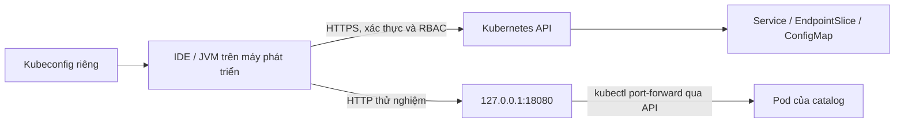

# Chạy ứng dụng ngoài cluster với kubeconfig riêng

## Mục tiêu và tình huống sử dụng

Trong chương **Phát triển cục bộ** của module **SPRING_CLOUD_KUBERNETES**, ta cần chạy JVM từ IDE để đặt breakpoint, trong khi Service và cấu hình thử nghiệm vẫn nằm trên Kubernetes. Thay vì đóng gói và triển khai lại sau mỗi lần sửa, ứng dụng local dùng một kubeconfig riêng để gọi Kubernetes API.

Sau bài này, bạn có thể:

- Chọn đúng cluster, danh tính và namespace mà không phụ thuộc kubeconfig mặc định của máy.
- Bật tích hợp Kubernetes cho ứng dụng chạy ngoài cluster và kiểm tra kết quả bằng `DiscoveryClient`.
- Phân biệt lỗi xác thực, RBAC, TLS, discovery và kết nối tới dịch vụ nghiệp vụ.
- Mở rộng sang đọc ConfigMap, hiểu điều kiện để dùng Secret, LoadBalancer và Configuration Watcher.
- Giải thích vì sao JVM local không có Pod riêng và vì sao kết quả health không thay thế kiểm tra kết nối.

Các ví dụ Spring dùng cơ chế Config Data và thuộc tính của Spring Cloud Kubernetes 3.3.x với Fabric8. Hãy dùng Spring Boot và Spring Cloud BOM tương thích với dự án; không lấy số phiên bản starter tùy ý để ghép vào một release train khác. [Bảng tương thích Spring Cloud](https://spring.io/projects/spring-cloud/) là nơi đối chiếu khi chuẩn bị dự án.

## 1. Hiểu hai đường kết nối khác nhau

Ứng dụng ngoài cluster có hai nhu cầu mạng độc lập:

| Đường kết nối | Mục đích | Điều kiện cần |
| --- | --- | --- |
| JVM → Kubernetes API | Đọc Service, EndpointSlice, ConfigMap hoặc Secret đã được cho phép | Địa chỉ API truy cập được, chứng chỉ CA đúng, credential hợp lệ và RBAC phù hợp |
| JVM → dịch vụ nghiệp vụ | Gọi HTTP tới ứng dụng như `catalog` | Có địa chỉ và đường mạng mà máy phát triển truy cập được |



Một kubeconfig hợp lệ giúp client biết cách truy cập API. Nó không cài DNS của cluster lên laptop, không tạo route tới Pod IP và không biến máy local thành một Kubernetes Node. Chẳng hạn, đọc được Service `catalog` không có nghĩa máy của bạn gọi được `catalog.dev-playground.svc.cluster.local` hoặc địa chỉ `10.244.1.23:8080` mà discovery trả về. Phạm vi truy cập của các loại Service được giải thích trong [tài liệu Kubernetes Service](https://kubernetes.io/docs/concepts/services-networking/service/).

Trong bài, bước đầu chỉ chứng minh **đọc dữ liệu discovery qua API**. Việc gọi dịch vụ được kiểm tra riêng bằng port-forward.

## 2. Chuẩn bị một môi trường có phạm vi rõ ràng

Dùng các giá trị minh họa sau và thay chúng theo môi trường được cấp:

| Thành phần | Giá trị dùng trong bài |
| --- | --- |
| Namespace thử nghiệm | `dev-playground` |
| Context trong kubeconfig riêng | `spring-cloud-dev` |
| Danh tính được API xác thực | `developer-sck` |
| Tên ứng dụng Spring | `local-k8s-demo` |
| Service có sẵn để quan sát | `catalog` |
| Cổng Service của catalog | `80`, chuyển tiếp tới cổng HTTP của Pod |
| Kubeconfig trên máy phát triển | `$env:USERPROFILE\.kube\spring-cloud-dev.yaml` |

Bạn cần JDK phù hợp với dự án, Maven hoặc Maven Wrapper, `kubectl`, quyền sử dụng namespace thử nghiệm và đường mạng tới API, chẳng hạn qua VPN. Namespace và Service `catalog` phải được người quản trị chuẩn bị; Service cần có Pod Ready để phần kiểm tra instance có dữ liệu.

Danh tính đọc discovery không cần quyền tạo namespace, tạo Pod hay sửa RBAC. Các manifest phân quyền dưới đây dành cho người có quyền quản trị phù hợp. Không dùng credential quản trị làm credential chạy ứng dụng chỉ để tránh lỗi `403`.

## 3. Kubeconfig riêng gồm những gì?

Một kubeconfig tổ chức thông tin thành ba phần:

- `clusters`: địa chỉ API và dữ liệu CA dùng để kiểm tra máy chủ.
- `users`: thông tin hoặc cơ chế lấy credential của client.
- `contexts`: ghép một cluster, một user entry và namespace mặc định.

`current-context` xác định context được chọn khi client không có cấu hình chọn context khác. Xem [cấu trúc và cách lựa chọn kubeconfig](https://kubernetes.io/docs/concepts/configuration/organize-cluster-access-kubeconfig/).

Ví dụ cấu trúc sau chỉ để đọc hiểu, **không phải credential có thể sử dụng ngay**:

```yaml
apiVersion: v1
kind: Config

clusters:
  - name: dev-cluster
    cluster:
      server: https://api.dev.example.internal:6443
      certificate-authority-data: <BASE64_CA_DUOC_CAP>

users:
  - name: dev-credentials
    user:
      client-certificate-data: <BASE64_CLIENT_CERT_DUOC_CAP>
      client-key-data: <BASE64_CLIENT_KEY_DUOC_CAP>

contexts:
  - name: spring-cloud-dev
    context:
      cluster: dev-cluster
      user: dev-credentials
      namespace: dev-playground

current-context: spring-cloud-dev
```

Tên `dev-credentials` là nhãn tham chiếu trong file. Nó không tự tạo Kubernetes user có tên đó. Với xác thực bằng client certificate, danh tính được API công nhận phụ thuộc nội dung certificate và cấu hình xác thực. Trong ví dụ RBAC tiếp theo, người quản trị xác nhận danh tính thật là `developer-sck`.

Một môi trường khác có thể dùng token ngắn hạn hoặc `exec` credential plugin thay cho certificate. Nếu dùng `exec`, chương trình plugin, PATH và phiên đăng nhập cần sẵn có trong môi trường khởi chạy JVM. Chỉ nhận kubeconfig từ nguồn tin cậy vì nó có thể chỉ định chương trình cần thực thi.

Lưu kubeconfig bên ngoài repository, giới hạn người đọc file và bảo vệ cả file khóa được tham chiếu nếu có. Dữ liệu Base64 không phải là mã hóa bảo mật. Không đưa `client-key-data`, token hoặc kết quả cấu hình có credential vào log và ảnh chụp hỗ trợ.

### Chọn file mà không đổi kubeconfig mặc định

Các lệnh thực hành bên dưới dùng PowerShell:

```powershell
$devKubeconfig = Join-Path $env:USERPROFILE '.kube\spring-cloud-dev.yaml'

if (-not (Test-Path -LiteralPath $devKubeconfig -PathType Leaf)) {
    throw 'Chưa có kubeconfig riêng do môi trường phát triển cấp.'
}

kubectl --kubeconfig "$devKubeconfig" config get-contexts
kubectl --kubeconfig "$devKubeconfig" config current-context
```

Kỳ vọng context hiện tại là `spring-cloud-dev`. Nếu file riêng có nhiều context và cần chọn lại:

```powershell
kubectl --kubeconfig "$devKubeconfig" config use-context spring-cloud-dev
kubectl --kubeconfig "$devKubeconfig" config set-context spring-cloud-dev --namespace dev-playground
```

Hai lệnh này chỉ cập nhật file đã chỉ định. Cách đơn giản nhất để chạy JVM có thể lặp lại là file riêng chỉ chứa context cần dùng, với `current-context` đã chọn đúng.

Có thể kiểm tra đích truy cập mà không in credential:

```powershell
kubectl --kubeconfig "$devKubeconfig" config view --minify -o 'jsonpath={.clusters[0].cluster.server}'
kubectl --kubeconfig "$devKubeconfig" config view --minify -o 'jsonpath={.contexts[0].context.namespace}'
```

Không dùng `--raw` để gửi bản dump cấu hình vào ticket. Nếu CA hoặc đường dẫn khóa được tham chiếu từ file khác, việc chép riêng kubeconfig sang máy hay container khác chưa chắc đã đủ.

## 4. Cấp RBAC theo tính năng thực sự dùng

Bài thực hành chọn EndpointSlice làm nguồn endpoint bằng thuộc tính `use-endpoint-slices=true`. Vì vậy, quyền đọc Service thuộc API group rỗng, còn EndpointSlice thuộc `discovery.k8s.io`. [DiscoveryClient của Spring Cloud Kubernetes](https://docs.spring.io/spring-cloud-kubernetes/reference/3.3/discovery-client.html) mô tả lựa chọn này.

Người quản trị áp dụng Role và RoleBinding sau trong namespace thử nghiệm:

```yaml
apiVersion: rbac.authorization.k8s.io/v1
kind: Role
metadata:
  name: local-discovery-reader
  namespace: dev-playground
rules:
  - apiGroups: [""]
    resources: ["services"]
    verbs: ["get", "list", "watch"]
  - apiGroups: ["discovery.k8s.io"]
    resources: ["endpointslices"]
    verbs: ["get", "list", "watch"]
---
apiVersion: rbac.authorization.k8s.io/v1
kind: RoleBinding
metadata:
  name: developer-local-discovery
  namespace: dev-playground
subjects:
  - kind: User
    name: developer-sck
    apiGroup: rbac.authorization.k8s.io
roleRef:
  kind: Role
  name: local-discovery-reader
  apiGroup: rbac.authorization.k8s.io
```

Quyền `list` dùng cho việc lấy tập tài nguyên và khởi tạo cache; `watch` phục vụ theo dõi thay đổi. Chỉ kiểm tra quyền `get` một Service chưa đủ để kết luận discovery sẽ khởi động được.

RoleBinding phải khớp danh tính đã xác thực. Nếu kubeconfig dùng credential của ServiceAccount, subject phải là `kind: ServiceAccount` với đúng `name` và `namespace`; không giữ nguyên subject User của ví dụ. Vai trò của Role và RoleBinding được trình bày trong [tài liệu RBAC](https://kubernetes.io/docs/reference/access-authn-authz/rbac/).

Cấu hình demo không lấy label hoặc annotation của Pod, cũng tắt Pod Health Indicator. Nếu sau này bật chức năng cần đọc Pod, phải xem lại quyền tương ứng. Nếu đổi về nguồn `Endpoints`, phải cấp quyền đọc `endpoints` thuộc API group rỗng; Role dành riêng cho EndpointSlice không thay thế quyền đó.

### Kiểm tra bằng chính credential sẽ chạy ứng dụng

```powershell
$devNamespace = 'dev-playground'

kubectl --kubeconfig "$devKubeconfig" auth can-i get services -n "$devNamespace"
kubectl --kubeconfig "$devKubeconfig" auth can-i list services -n "$devNamespace"
kubectl --kubeconfig "$devKubeconfig" auth can-i watch services -n "$devNamespace"

kubectl --kubeconfig "$devKubeconfig" auth can-i get endpointslices.discovery.k8s.io -n "$devNamespace"
kubectl --kubeconfig "$devKubeconfig" auth can-i list endpointslices.discovery.k8s.io -n "$devNamespace"
kubectl --kubeconfig "$devKubeconfig" auth can-i watch endpointslices.discovery.k8s.io -n "$devNamespace"

kubectl --kubeconfig "$devKubeconfig" get service catalog -n "$devNamespace"
kubectl --kubeconfig "$devKubeconfig" get endpointslices -n "$devNamespace" -l kubernetes.io/service-name=catalog
```

Các kiểm tra quyền phải trả về `yes`; hai lệnh cuối phải đọc được dữ liệu tương ứng. Nếu môi trường hỗ trợ, có thể dùng `kubectl --kubeconfig "$devKubeconfig" auth whoami` để xem danh tính API nhận diện.

`auth can-i` kiểm tra quyền của credential đang dùng, không chứng minh có endpoint Ready hay đường mạng tới Pod. Cách chỉ định resource và subresource có trong [tham chiếu kubectl auth can-i](https://kubernetes.io/docs/reference/kubectl/generated/kubectl_auth/kubectl_auth_can-i/).

## 5. Chuẩn bị ứng dụng Spring theo một client implementation

Trong dự án Spring Boot đã quản lý phiên bản bằng Spring Cloud BOM tương thích, thêm các dependency sau:

```xml
<dependencies>
    <dependency>
        <groupId>org.springframework.boot</groupId>
        <artifactId>spring-boot-starter-web</artifactId>
    </dependency>

    <dependency>
        <groupId>org.springframework.boot</groupId>
        <artifactId>spring-boot-starter-actuator</artifactId>
    </dependency>

    <dependency>
        <groupId>org.springframework.cloud</groupId>
        <artifactId>spring-cloud-starter-kubernetes-fabric8</artifactId>
    </dependency>
</dependencies>
```

Đây là đoạn dependency, không phải toàn bộ `pom.xml`. Dự án cần Spring Boot parent hoặc cơ chế dependency management tương đương, Spring Cloud BOM và Spring Boot Maven plugin để tạo executable JAR.

Chỉ dùng một họ starter: bài này dùng **Fabric8**. Không ghép thêm `spring-cloud-starter-kubernetes-client` hay `...-client-config`, vì chúng thuộc implementation Kubernetes Java Client khác. Starter `fabric8` phục vụ discovery; khi cần ConfigMap mới thêm `fabric8-config`. [Danh sách starter](https://docs.spring.io/spring-cloud-kubernetes/reference/getting-started.html) giúp chọn đúng tính năng mà không cần mặc định lấy starter `all`.

### Profile riêng cho JVM ngoài cluster

Tạo `application-local-k8s.yml` trong phần resources của **ứng dụng thực hành**:

```yaml
server:
  address: 127.0.0.1
  port: 8080

spring:
  application:
    name: local-k8s-demo
  main:
    cloud-platform: KUBERNETES
  cloud:
    kubernetes:
      client:
        namespace: ${DEV_K8S_NAMESPACE:dev-playground}
      discovery:
        enabled: true
        all-namespaces: false
        namespaces:
          - ${DEV_K8S_NAMESPACE:dev-playground}
        use-endpoint-slices: true
        include-not-ready-addresses: false
        metadata:
          add-pod-labels: false
          add-pod-annotations: false
      config:
        enabled: false
      secrets:
        enabled: false

management:
  endpoints:
    web:
      exposure:
        include: health
  health:
    kubernetes:
      enabled: false
```

Profile này có các quyết định rõ ràng:

- `spring.main.cloud-platform=KUBERNETES` kích hoạt điều kiện Kubernetes khi JVM không chạy trong Pod.
- Namespace của client và phạm vi discovery đều được khai báo, tránh phụ thuộc namespace mặc định của máy.
- `all-namespaces=false` giữ phạm vi đọc trong môi trường đã chọn.
- ConfigMap và Secret chưa tham gia vào lần chạy discovery đầu tiên.
- HTTP chỉ lắng nghe loopback; endpoint chẩn đoán không được mở ra mạng chung.

Từ Spring Cloud Kubernetes 3.x, không dùng thuộc tính cũ `spring.cloud.kubernetes.enabled` để bật nhận diện nền tảng. Việc đặt `cloud-platform` chỉ điều khiển auto-configuration; nó không tự cung cấp credential hay kết nối mạng. Xem [Kubernetes Ecosystem Awareness](https://docs.spring.io/spring-cloud-kubernetes/reference/3.3/kubernetes-awareness.html).

`local-k8s` là Spring profile do ta chủ động đặt, khác với tên context `spring-cloud-dev`. Đổi context trong kubeconfig không tự đổi Spring profile. Các thuộc tính discovery và metadata có thể đối chiếu trong [phụ lục cấu hình 3.3](https://docs.spring.io/spring-cloud-kubernetes/reference/3.3/appendix.html).

## 6. Viết endpoint quan sát discovery

Đặt lớp sau vào package của ứng dụng thực hành, ví dụ `com.example.localk8s`:

```java
package com.example.localk8s;

import java.net.URI;
import java.util.List;
import java.util.Map;

import org.springframework.boot.SpringApplication;
import org.springframework.boot.autoconfigure.SpringBootApplication;
import org.springframework.cloud.client.ServiceInstance;
import org.springframework.cloud.client.discovery.DiscoveryClient;
import org.springframework.cloud.client.discovery.EnableDiscoveryClient;
import org.springframework.context.annotation.Profile;
import org.springframework.core.env.Environment;
import org.springframework.web.bind.annotation.GetMapping;
import org.springframework.web.bind.annotation.PathVariable;
import org.springframework.web.bind.annotation.RequestMapping;
import org.springframework.web.bind.annotation.RestController;

@SpringBootApplication
@EnableDiscoveryClient
public class LocalKubernetesApplication {

    public static void main(String[] args) {
        SpringApplication.run(LocalKubernetesApplication.class, args);
    }

    @RestController
    @Profile("local-k8s")
    @RequestMapping("/local")
    static class LocalProbeController {

        private final DiscoveryClient discoveryClient;
        private final Environment environment;

        LocalProbeController(
                DiscoveryClient discoveryClient,
                Environment environment) {
            this.discoveryClient = discoveryClient;
            this.environment = environment;
        }

        @GetMapping("/services")
        List<String> services() {
            return discoveryClient.getServices();
        }

        @GetMapping("/instances/{serviceId}")
        Map<String, Object> instances(@PathVariable String serviceId) {
            List<InstanceView> result = discoveryClient
                    .getInstances(serviceId)
                    .stream()
                    .map(InstanceView::from)
                    .toList();

            return Map.of(
                    "serviceId", serviceId,
                    "count", result.size(),
                    "instances", result);
        }

        @GetMapping("/message")
        Map<String, String> message() {
            return Map.of(
                    "message",
                    environment.getProperty("demo.message", "local-default"));
        }
    }

    record InstanceView(String host, int port, URI uri) {

        static InstanceView from(ServiceInstance instance) {
            return new InstanceView(
                    instance.getHost(),
                    instance.getPort(),
                    instance.getUri());
        }
    }
}
```

Controller chỉ hiện diện khi profile `local-k8s` hoạt động. Endpoint trả về địa chỉ instance để quan sát, không tự gọi địa chỉ đó và không trả toàn bộ metadata hoặc cấu hình nhạy cảm. `/local/message` phục vụ phần ConfigMap phía sau.

Spring Cloud Kubernetes đọc các tài nguyên discovery đã có trên API. Nó không đăng ký JVM local thành Pod hay tự thêm địa chỉ laptop vào Service `catalog`.

## 7. Truyền kubeconfig vào đúng tiến trình JVM

Cờ `kubectl --kubeconfig ...` chỉ áp dụng cho lần gọi kubectl. JVM không biết gì về cờ đó. Với Fabric8, truyền đường dẫn bằng biến môi trường `KUBECONFIG` hoặc system property `kubeconfig`.

Trong cùng cửa sổ PowerShell sẽ khởi chạy ứng dụng:

```powershell
$devKubeconfig = Join-Path $env:USERPROFILE '.kube\spring-cloud-dev.yaml'
$env:KUBECONFIG = $devKubeconfig
$env:DEV_K8S_NAMESPACE = 'dev-playground'

# Đối chiếu lại đúng file vừa truyền cho tiến trình con.
kubectl --kubeconfig "$env:KUBECONFIG" config current-context

# Chạy tại thư mục ứng dụng thực hành có Maven Wrapper.
.\mvnw.cmd '-Dspring-boot.run.profiles=local-k8s' spring-boot:run
```

Trên Linux hoặc macOS, cách tương đương cho một lần chạy là:

```bash
KUBECONFIG="$HOME/.kube/spring-cloud-dev.yaml" \
DEV_K8S_NAMESPACE=dev-playground \
./mvnw -Dspring-boot.run.profiles=local-k8s spring-boot:run
```

Hoặc truyền system property trực tiếp khi chạy executable JAR, thay đường dẫn JAR bằng tên artifact đã build:

```powershell
java "-Dkubeconfig=$devKubeconfig" -jar '.\target\local-k8s-demo.jar' --spring.profiles.active=local-k8s
```

Đối số `-Dkubeconfig=...` nằm trước `-jar` để JVM nhận system property. Không thay nó bằng `--kubeconfig=...` rồi mong Fabric8 tự hiểu.

Fabric8 ưu tiên system property, tiếp theo biến môi trường, rồi dữ liệu kubeconfig và cấu hình ServiceAccount. Vì vậy, giá trị cũ như `-Dkubernetes.master=...`, `KUBERNETES_MASTER` hay credential override có thể khiến ứng dụng không dùng kết nối bạn dự kiến. Cơ chế và tên thuộc tính được nêu trong [cấu hình Fabric8 client](https://github.com/fabric8io/kubernetes-client#configuring-the-client).

Để dễ chẩn đoán, bài dùng một file `KUBECONFIG`, không dùng danh sách file ghép. Không suy luận rằng mọi quy tắc merge của kubectl luôn giống implementation và phiên bản Java client đang dùng.

### Khi chạy từ IDE

Thiết lập Run Configuration:

| Mục | Giá trị |
| --- | --- |
| Environment variable | `KUBECONFIG=<đường dẫn tuyệt đối tới file riêng>` |
| Environment variable | `DEV_K8S_NAMESPACE=dev-playground` |
| Program arguments | `--spring.profiles.active=local-k8s` |
| VM options, nếu dùng thay KUBECONFIG | `-Dkubeconfig=<đường dẫn tuyệt đối>` |

Trong ô biến môi trường, nhập giá trị đường dẫn theo cú pháp IDE; không thêm dấu nháy thành một phần của giá trị. Với VM options có khoảng trắng, dùng cú pháp quote mà IDE hỗ trợ.

IDE đã mở từ trước thường không nhận biến môi trường vừa đặt trong một terminal khác. Nếu `kubectl` chạy được nhưng IDE không chạy được, kiểm tra môi trường của Run Configuration, PATH tới credential plugin và phiên đăng nhập của chính tiến trình IDE.

Sau khi sửa kubeconfig, context hoặc credential, dừng và chạy lại JVM. Client đã khởi tạo không nhất thiết đọc lại toàn bộ cấu hình kết nối khi bạn chỉnh file.

## 8. Xác minh theo từng lớp

Mở terminal khác:

```powershell
Invoke-RestMethod 'http://127.0.0.1:8080/actuator/health'
Invoke-RestMethod 'http://127.0.0.1:8080/local/services'
Invoke-RestMethod 'http://127.0.0.1:8080/local/instances/catalog' |
    ConvertTo-Json -Depth 6
```

Ví dụ kết quả minh họa cho request cuối:

```json
{
  "serviceId": "catalog",
  "count": 1,
  "instances": [
    {
      "host": "10.244.1.23",
      "port": 8080,
      "uri": "http://10.244.1.23:8080"
    }
  ]
}
```

Địa chỉ và số lượng instance thực tế phụ thuộc cluster. Cổng instance có thể là cổng endpoint của Pod, khác cổng `80` được công bố trên Service.

Đối chiếu kết quả với:

```powershell
kubectl --kubeconfig "$devKubeconfig" get service catalog -n dev-playground
kubectl --kubeconfig "$devKubeconfig" get endpointslices -n dev-playground -l kubernetes.io/service-name=catalog -o yaml
```

Nếu không có instance, xem selector của Service, địa chỉ endpoint, cổng và `conditions.ready`. Cache discovery cần thời gian phản ánh thay đổi, nên không yêu cầu kết quả HTTP đổi đồng thời từng mili giây với thao tác trên cluster.

`/actuator/health` trả `UP` chỉ phản ánh các health contributor đang bật. Trong profile này, Pod Health Indicator đã tắt vì JVM không đại diện cho một Pod của ứng dụng. Việc tắt dùng `management.health.kubernetes.enabled=false` theo [tài liệu Pod Health Indicator](https://docs.spring.io/spring-cloud-kubernetes/reference/3.3/pod-health-indicator.html). Nó không tắt `DiscoveryClient` và không chứng minh API hay dịch vụ nghiệp vụ luôn truy cập được.

Nếu cần theo dõi sức khỏe Pod `catalog`, dùng dữ liệu trạng thái/probe của Pod với quyền đọc Pod phù hợp hoặc công cụ quan sát của cluster. Kubeconfig của JVM local không làm xuất hiện một Pod local để Kubernetes giám sát.

## 9. Gọi dịch vụ qua port-forward và hiểu giới hạn LoadBalancer

Để kiểm tra HTTP từ laptop mà chưa cần route tới mạng Pod, mở một terminal và giữ lệnh sau chạy:

```powershell
kubectl --kubeconfig "$devKubeconfig" -n dev-playground port-forward --address 127.0.0.1 service/catalog 18080:80
```

Từ terminal khác:

```powershell
# Thay "/" bằng đường dẫn thực tế của catalog nếu cần.
Invoke-WebRequest 'http://127.0.0.1:18080/'
```

Port `80` phía phải là cổng của Service; kubectl tìm Pod phù hợp và chuyển tiếp tới target port. Khi Pod được chọn biến mất, cần chạy lại phiên forward. Đây không phải phép thử phân phối tải giữa mọi replica. Xem [hướng dẫn port-forward](https://kubernetes.io/docs/tasks/access-application-cluster/port-forward-access-application-cluster/).

Role discovery ở trên chưa cấp quyền port-forward. Chức năng này cần quyền chọn/đọc Pod và quyền trên subresource `pods/portforward`; người quản trị cấp riêng khi bạn cần. Có thể kiểm tra trước:

```powershell
kubectl --kubeconfig "$devKubeconfig" auth can-i get pods -n dev-playground
kubectl --kubeconfig "$devKubeconfig" auth can-i list pods -n dev-playground
kubectl --kubeconfig "$devKubeconfig" auth can-i create pods --subresource=portforward -n dev-playground
```

Tùy giao thức và phiên bản client, người quản trị cũng cần đối chiếu request thực tế tới subresource, bao gồm quyền `get` nếu phiên bản sử dụng đường nâng cấp kết nối tương ứng. Không gộp quyền port-forward vào mọi credential chỉ dùng để đọc cấu hình.

Trong ứng dụng local, nếu muốn gọi qua đường forward, cấu hình một HTTP client bình thường với base URL `http://127.0.0.1:18080`. Không dùng client có `@LoadBalanced` cho URL loopback này, vì host có thể bị diễn giải là service ID.

Với Spring Cloud LoadBalancer dùng kết quả `DiscoveryClient`, việc chọn instance không tạo route tới địa chỉ được chọn. Nếu instance là Pod IP mà laptop không truy cập được, request vẫn lỗi. Tùy nhu cầu, bạn có thể dùng một URL local qua forward, địa chỉ Ingress được cấp, hoặc đường mạng phát triển cho phép truy cập cluster. Chọn giải pháp mạng trước khi mở rộng bài sang cân bằng tải.

## 10. Mở rộng có chủ đích: đọc ConfigMap bằng cùng kubeconfig

Sau khi discovery hoạt động, mới thêm starter cấu hình cùng họ Fabric8:

```xml
<dependency>
    <groupId>org.springframework.cloud</groupId>
    <artifactId>spring-cloud-starter-kubernetes-fabric8-config</artifactId>
</dependency>
```

Người quản trị hoặc người có quyền sửa cấu hình thử nghiệm chuẩn bị ConfigMap:

```yaml
apiVersion: v1
kind: ConfigMap
metadata:
  name: local-k8s-demo
  namespace: dev-playground
data:
  demo.message: "Cấu hình được đọc từ namespace dev-playground"
```

Bổ sung Role đọc cấu hình và binding dành riêng cho tính năng này:

```yaml
apiVersion: rbac.authorization.k8s.io/v1
kind: Role
metadata:
  name: local-config-reader
  namespace: dev-playground
rules:
  - apiGroups: [""]
    resources: ["configmaps"]
    verbs: ["get", "list"]
---
apiVersion: rbac.authorization.k8s.io/v1
kind: RoleBinding
metadata:
  name: developer-local-config
  namespace: dev-playground
subjects:
  - kind: User
    name: developer-sck
    apiGroup: rbac.authorization.k8s.io
roleRef:
  kind: Role
  name: local-config-reader
  apiGroup: rbac.authorization.k8s.io
```

Phần mở rộng chỉ đọc lúc khởi động nên không cấp `watch` cho ConfigMap. Quyền `list` cho phép đọc tập ConfigMap trong namespace; namespace thực hành cần được lựa chọn tương ứng với phạm vi dữ liệu mà người dùng được phép thấy.

Trong `application-local-k8s.yml`, thay block `spring.cloud.kubernetes.config` hiện có bằng:

```yaml
spring:
  config:
    import: "kubernetes:"
  cloud:
    kubernetes:
      config:
        enabled: true
        enable-api: true
        name: local-k8s-demo
        namespace: ${DEV_K8S_NAMESPACE:dev-playground}
        include-profile-specific-sources: false
        fail-fast: true
```

Đây là phần cấu hình cần **ghép vào các khóa hiện có**, không dán thêm một khóa `spring:` thứ hai trong cùng tài liệu YAML. Giữ phần discovery, secrets và cloud-platform từ profile ban đầu.

`spring.config.import` kích hoạt cơ chế Config Data. `fail-fast=true` yêu cầu thất bại khi xảy ra lỗi nạp cấu hình, giúp phát hiện lỗi kết nối/quyền thay vì lặng lẽ tiếp tục với giá trị mặc định. Nó không thay thế việc kiểm tra các khóa cấu hình bắt buộc của nghiệp vụ. Phần này không dùng `optional:kubernetes:`, cũng không kết hợp Config Data với `spring-cloud-starter-bootstrap`. Hai cơ chế phải được lựa chọn riêng theo [Kubernetes PropertySource implementations](https://docs.spring.io/spring-cloud-kubernetes/reference/3.3/property-source-config.html).

Kiểm tra quyền rồi khởi động lại ứng dụng:

```powershell
kubectl --kubeconfig "$devKubeconfig" auth can-i get configmaps -n dev-playground
kubectl --kubeconfig "$devKubeconfig" auth can-i list configmaps -n dev-playground

Invoke-RestMethod 'http://127.0.0.1:8080/local/message'
```

Kỳ vọng `message` là giá trị trong ConfigMap, không phải `local-default`. Tên `local-k8s-demo` được chỉ rõ để không phải đoán ConfigMap nào được nạp; xem [ConfigMap PropertySource](https://docs.spring.io/spring-cloud-kubernetes/reference/3.3/property-source-config/configmap-propertysource.html).

Để thực hành cập nhật, người có quyền ghi đổi `demo.message` thành một chuỗi mới, sau đó bạn dừng và chạy lại JVM rồi gọi `/local/message`. Trong cấu hình bài này chưa bật cơ chế reload; thay đổi ConfigMap không tự động cập nhật một tiến trình đang chạy.

## 11. Secret và Configuration Watcher: cần thêm điều kiện nào?

### Secret không tự đi theo quyền đọc ConfigMap

Giữ `spring.cloud.kubernetes.secrets.enabled=false` nếu bài thực hành không dùng Secret. Nếu cần đọc Secret qua API trong một lab khác, phải có quyết định riêng về `secrets.enabled`, `secrets.enable-api`, tên, namespace và quyền RBAC. Quyền `list secrets` cho phép xem giá trị Secret trong phạm vi được cấp, nên không thêm quyền này như một cách sửa chung mọi lỗi khởi động.

JVM ngoài cluster không có volume Secret do kubelet mount như Pod. Hãy chọn nguồn credential phát triển phù hợp và chỉ dùng dữ liệu thử nghiệm cần thiết; không đưa nội dung Secret vào endpoint `/local/message`. Mặc định đọc Secret qua API và các lựa chọn tích hợp được mô tả trong [Secrets PropertySource](https://docs.spring.io/spring-cloud-kubernetes/reference/3.3/property-source-config/secrets-propertysource.html).

### Watcher cần cả cơ chế thông báo và đường đi tới ứng dụng

Configuration Watcher có thể chạy trong cluster để theo dõi thay đổi và kích hoạt refresh qua HTTP hoặc Spring Cloud Bus. Nhưng JVM local không tự xuất hiện trong các Pod/Service mà watcher dùng để tìm ứng dụng. Ngoài ra, `127.0.0.1` nhìn từ Pod của watcher là loopback của chính Pod đó.

Port-forward ở phần trước tạo đường **laptop → cluster**. Nó không tạo đường **watcher → laptop**. Muốn thử refresh cho JVM local phải thiết kế đường thông báo hoặc bus riêng, bảo vệ endpoint quản trị và dùng bean/cấu hình hỗ trợ refresh. Bài này chọn khởi động lại JVM để việc quan sát thay đổi có thể lặp lại mà không cần mở rộng hạ tầng. Cơ chế watcher được mô tả trong [Configuration Watcher](https://docs.spring.io/spring-cloud-kubernetes/reference/3.3/spring-cloud-kubernetes-configuration-watcher.html).

## 12. Chẩn đoán theo triệu chứng

| Triệu chứng | Kiểm tra ưu tiên | Hướng xử lý |
| --- | --- | --- |
| `kubectl` chạy được nhưng JVM báo không kết nối được | KUBECONFIG, VM options, PATH/plugin và môi trường của Run Configuration | Truyền cùng file vào đúng JVM; bỏ override cũ trong cấu hình chạy |
| `UnknownHostException` với API hostname | DNS của máy và VPN | Khôi phục DNS/đường truy cập API, đối chiếu trường `server` |
| `Connection refused` hoặc timeout tới API | API có nghe ở địa chỉ đó, VPN, firewall, proxy và route | Kiểm tra từ đúng máy/WSL/container đang chạy JVM; không tăng timeout để che lỗi đích |
| `PKIX path building failed` hoặc hostname mismatch | CA, thời hạn certificate, hostname trong kubeconfig | Dùng CA/endpoint đúng hoặc credential được cấp lại; không tắt xác minh TLS |
| `401 Unauthorized` | Credential hết hạn, sai issuer hoặc plugin chưa đăng nhập | Làm mới credential qua cơ chế của môi trường |
| `403 Forbidden` | Resource, API group, namespace và verb trong thông báo lỗi | Chạy `auth can-i` bằng đúng file, sửa RoleBinding/Role đúng phạm vi |
| Lỗi `list/watch endpointslices` | Quyền ở group `discovery.k8s.io`, lựa chọn nguồn endpoint | Cấp quyền đúng cho EndpointSlice hoặc đổi nguồn và quyền tương ứng có chủ đích |
| Không có Kubernetes DiscoveryClient | Starter, profile, cloud-platform và cấu hình tắt discovery | Kiểm tra profile `local-k8s` cùng điều kiện auto-configuration |
| Có Service nhưng không có instance | EndpointSlice, selector, Ready condition, cổng và namespace | Sửa dữ liệu Service/Pod hoặc phạm vi truy vấn; không bật nhận endpoint chưa Ready để che lỗi |
| Discovery có IP nhưng HTTP timeout | Route tới Pod IP/ClusterIP | Dùng đường truy cập phù hợp như port-forward hoặc mạng phát triển |
| ConfigMap tồn tại nhưng message vẫn mặc định | Config starter, import, tên, namespace, quyền list và khóa cấu hình | Đối chiếu từng giá trị; khởi động lại sau khi thay cấu hình chạy |
| Watcher báo thay đổi nhưng JVM local không đổi | Đường gửi sự kiện, refresh và khả năng tìm JVM local | Thiết kế kênh phù hợp hoặc khởi động lại như luồng thực hành |

Nếu JVM chạy trong WSL hoặc container, `localhost`, đường dẫn kubeconfig, file certificate và credential plugin được hiểu trong môi trường đó. Kubeconfig truy cập được từ Windows không bảo đảm dùng nguyên trạng trong một Linux container; cần kiểm tra lại đường dẫn và endpoint từ nơi JVM thực sự chạy.

Khi gửi bằng chứng lỗi, chỉ cần context, namespace, loại tài nguyên, verb, thông báo đã loại credential và kết quả `auth can-i`. Không gửi toàn bộ kubeconfig, giá trị Secret hay header Authorization.

## 13. Bài thực hành và tiêu chí hoàn thành

Thực hiện theo thứ tự:

1. Nhận kubeconfig riêng, xác nhận context `spring-cloud-dev`, namespace `dev-playground` và danh tính được cấp.
2. Dùng file đó kiểm tra quyền `get/list/watch` cho Service và EndpointSlice, rồi đọc Service `catalog`.
3. Chạy Spring bằng profile `local-k8s`, truyền KUBECONFIG vào chính tiến trình JVM.
4. Gọi `/local/services` và `/local/instances/catalog`; đối chiếu dữ liệu với API.
5. Nếu được cấp quyền port-forward, gọi một endpoint của catalog qua `127.0.0.1:18080`.
6. Làm phần ConfigMap, đổi message bằng danh tính có quyền ghi, khởi động lại JVM và xác nhận giá trị mới.
7. Dừng JVM, dừng phiên forward bằng Ctrl+C; nếu đã sửa biến môi trường có sẵn trong terminal, khôi phục giá trị trước đó hoặc đóng terminal thực hành.

Bài hoàn thành khi bạn có thể chỉ ra bằng chứng riêng cho từng kết luận:

| Kết luận | Bằng chứng |
| --- | --- |
| Đúng đích truy cập | Context, API endpoint và namespace của file riêng đã được đối chiếu |
| Đúng quyền discovery | Các kiểm tra RBAC trả `yes` với chính credential ứng dụng sử dụng |
| JVM đọc được discovery | Endpoint local trả Service/instance phù hợp dữ liệu API |
| Máy gọi được nghiệp vụ | Request qua địa chỉ truy cập đã chọn có phản hồi HTTP đúng mong đợi |
| Đọc ConfigMap thành công, nếu làm mở rộng | `/local/message` trả giá trị trong ConfigMap sau khi khởi động lại |
| Hiểu giới hạn môi trường local | Giải thích được sự khác nhau giữa truy cập API, đường mạng tới Service và thông báo refresh |

Tự kiểm tra thêm:

- Vì sao `kubectl --kubeconfig ...` chạy thành công nhưng JVM vẫn có thể đọc kubeconfig khác?
- Vì sao `get service catalog` thành công chưa chứng minh informer có đủ quyền?
- Vì sao discovery trả Pod IP nhưng Spring Cloud LoadBalancer vẫn không gọi được?
- Vì sao bật `cloud-platform=KUBERNETES` không tạo Pod hoặc đăng ký laptop vào Service?
- Vì sao sửa ConfigMap không làm JVM local tự refresh trong cấu hình hiện tại?

Nếu trả lời được các câu hỏi này, bạn đã nắm cách dùng kubeconfig riêng để phát triển Spring Cloud Kubernetes ngoài cluster và biết khi nào chỉ cần một URL cấu hình thông thường, khi nào mới cần discovery hoặc cơ chế theo dõi cấu hình.

