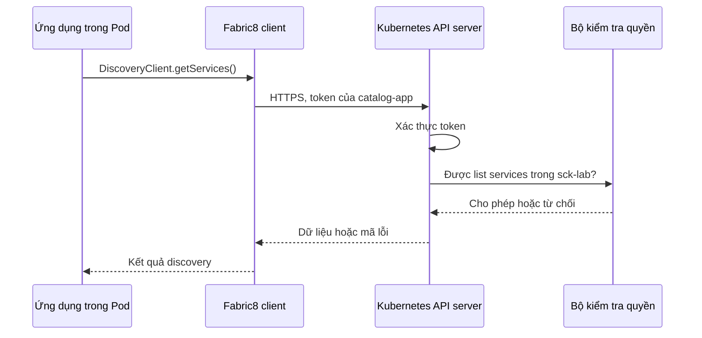

# Chạy ứng dụng trong cluster với ServiceAccount

## Mục tiêu và bối cảnh

Trong chương **Phát triển cục bộ** của module `SPRING_CLOUD_KUBERNETES`, đưa một ứng dụng Spring Boot vào cluster cục bộ giúp kiểm tra đúng môi trường thực thi: Pod dùng danh tính nào, client lấy thông tin xác thực ở đâu và Kubernetes cho phép ứng dụng đọc những tài nguyên nào.

Bài học dùng một dịch vụ `catalog-app` với hai replica trong namespace `sck-lab`. Ứng dụng dùng Spring Cloud Kubernetes `DiscoveryClient` để đọc danh sách Service và instance qua Kubernetes API. Một ConfigMap cung cấp thông điệp qua biến môi trường. Hai cơ chế này được đặt cạnh nhau để thấy rõ khi nào ServiceAccount cần quyền API.

Sau bài học, bạn có thể:

- Gắn một ServiceAccount riêng vào Pod do Deployment tạo ra.
- Phân biệt xác thực bằng token, phân quyền bằng RBAC và khả năng kết nối mạng.
- Viết Role/RoleBinding chỉ phục vụ chức năng discovery trong một namespace.
- Triển khai image cục bộ, quan sát readiness/liveness và xác minh kết quả discovery.
- Chọn cách nạp ConfigMap, Secret và cập nhật cấu hình phù hợp, thay vì bật mọi tính năng Spring Cloud Kubernetes.

Các đoạn mã minh họa dùng Java 21 và cấu hình Fabric8 thuộc dòng Spring Cloud Kubernetes 3.3.x, đi cùng Spring Boot 3.5.x và Spring Cloud 2025.0.x. Đây là phạm vi phiên bản của ví dụ; khi tạo dự án triển khai mới, chọn bộ phiên bản còn được hỗ trợ theo [bảng tương thích và chính sách Spring Cloud](https://github.com/spring-cloud/spring-cloud-release/wiki/Supported-Versions). Không tự gán một phiên bản Spring Cloud Kubernetes khác với phiên bản BOM quản lý.

## 1. Ba lớp cần kiểm tra riêng

Khi ứng dụng gọi Kubernetes API, có ba câu hỏi độc lập:

| Lớp | Câu hỏi | Thành phần liên quan |
| --- | --- | --- |
| Kết nối và TLS | Pod có đến được API server và xác minh chứng chỉ không? | DNS, định tuyến, NetworkPolicy, CA |
| Xác thực | Request đại diện cho danh tính nào? | Token của ServiceAccount |
| Phân quyền | Danh tính đó được làm gì với tài nguyên nào, ở đâu? | Role, RoleBinding và các quyền RBAC khác đang có |

Một ServiceAccount tên `catalog-app` trong namespace `sck-lab` được biểu diễn bằng danh tính:

```text
system:serviceaccount:sck-lab:catalog-app
```

ServiceAccount không tự cấp quyền đọc Service, ConfigMap hay Secret. Việc tạo tài khoản, gắn tài khoản vào Pod và cấp quyền là các thao tác khác nhau. Pod không chỉ định tài khoản sẽ dùng ServiceAccount `default` của namespace; điều đó không có nghĩa nó có quyền quản trị. Xem [mô hình ServiceAccount của Kubernetes](https://kubernetes.io/docs/concepts/security/service-accounts/).



ServiceAccount cũng không thay thế tài khoản người dùng của ứng dụng. Người gọi REST API của `catalog-app` vẫn cần cơ chế bảo vệ riêng khi ứng dụng được công khai.

## 2. Thông tin xác thực bên trong Pod đến từ đâu?

Với cơ chế mặc định trên Kubernetes hiện đại, Pod được gắn một projected volume chứa token có thời hạn, CA và namespace. Kubelet quản lý việc gia hạn token; không cần tạo một Secret chứa token tĩnh để bắt đầu bài thực hành. Các thành phần được mô tả trong [cơ chế bound ServiceAccount token volume](https://kubernetes.io/docs/reference/access-authn-authz/service-accounts-admin/).

Các đường dẫn thường gặp bên trong container là:

```text
/var/run/secrets/kubernetes.io/serviceaccount/token
/var/run/secrets/kubernetes.io/serviceaccount/ca.crt
/var/run/secrets/kubernetes.io/serviceaccount/namespace
```

Client hỗ trợ cấu hình trong cluster dùng các dữ liệu này cùng địa chỉ API server do môi trường cluster cung cấp. Không chép kubeconfig của máy phát triển vào image, không hard-code bearer token và không tắt xác minh TLS để chữa lỗi chứng chỉ.

Token có thể thay đổi trong vòng đời Pod. Giữ cơ chế quản lý thông tin xác thực của phiên bản client được BOM chọn; tránh tự đọc token một lần rồi lưu cố định trong biến cấu hình của ứng dụng.

Khi Pod thực sự cần gọi Kubernetes API, cho phép tự động mount token. Nếu Pod chỉ chạy HTTP thông thường và không cần danh tính này cho chức năng khác, cân nhắc `automountServiceAccountToken: false`. Giá trị trong Pod spec có ưu tiên hơn giá trị trong ServiceAccount. Quy tắc này được nêu trong [hướng dẫn cấu hình ServiceAccount cho Pod](https://kubernetes.io/docs/tasks/configure-pod-container/configure-service-account/).

## 3. Chuẩn bị bài thực hành

Bạn cần:

- Docker đang hoạt động, JDK 21, Maven hoặc Maven Wrapper.
- `kubectl` và một cluster cục bộ có RBAC; ví dụ dưới đây dùng kind với tên cluster `sck-lab`.
- Tài khoản triển khai có quyền tạo namespace, ServiceAccount, Role, RoleBinding, ConfigMap, Deployment và Service trong môi trường lab.
- Một dự án Maven Spring Boot có parent/plugin Spring Boot và Spring Cloud BOM tương thích như phạm vi phiên bản đã nêu.

Các tên tệp sau chỉ là cấu trúc dự án thực hành mà người học tạo; các đoạn cấu hình trong bài không tự tạo tài nguyên cluster:

```text
pom.xml
Dockerfile
src/main/java/example/catalog/CatalogApplication.java
src/main/java/example/catalog/LabController.java
src/main/resources/application.yml
src/main/resources/application-k8s.yml
lab-access.yaml
lab-workload.yaml
```

Nếu chưa có cluster kind, tạo cluster và kiểm tra context bằng PowerShell:

```powershell
kind create cluster --name sck-lab
kubectl config current-context
kubectl cluster-info
```

Với cluster vừa tạo, context thường là `kind-sck-lab`. Nếu đã có cluster thì chỉ kiểm tra context, không cần tạo lại. Mọi lệnh triển khai phía dưới phải nhắm đúng cluster lab.

## 4. Ứng dụng Spring dùng DiscoveryClient

### 4.1. Dependency

Trong dự án đã được quản lý phiên bản bằng Spring Boot parent và Spring Cloud BOM, thêm các dependency sau vào `pom.xml`:

```xml
<dependencies>
    <dependency>
        <groupId>org.springframework.boot</groupId>
        <artifactId>spring-boot-starter-web</artifactId>
    </dependency>
    <dependency>
        <groupId>org.springframework.boot</groupId>
        <artifactId>spring-boot-starter-actuator</artifactId>
    </dependency>
    <dependency>
        <groupId>org.springframework.cloud</groupId>
        <artifactId>spring-cloud-starter-kubernetes-fabric8</artifactId>
    </dependency>
</dependencies>
```

Đặt tên executable JAR cố định và dùng plugin Spring Boot trong phần build:

```xml
<build>
    <finalName>catalog-app</finalName>
    <plugins>
        <plugin>
            <groupId>org.springframework.boot</groupId>
            <artifactId>spring-boot-maven-plugin</artifactId>
        </plugin>
    </plugins>
</build>
```

Starter Fabric8 trên cung cấp discovery trực tiếp qua Kubernetes API. Starter `spring-cloud-starter-kubernetes-discoveryclient` là lựa chọn khác, dành cho mô hình có Discovery Server HTTP; không thay thế tùy tiện hai starter. Bài này không thêm starter ConfigMap/Secret vì cấu hình minh họa được Kubernetes đưa vào biến môi trường. Xem [các lựa chọn DiscoveryClient](https://docs.spring.io/spring-cloud-kubernetes/reference/3.3/discovery-client.html).

### 4.2. Mã Java

Tệp `CatalogApplication.java`:

```java
package example.catalog;

import org.springframework.boot.SpringApplication;
import org.springframework.boot.autoconfigure.SpringBootApplication;
import org.springframework.cloud.client.discovery.EnableDiscoveryClient;

@SpringBootApplication
@EnableDiscoveryClient
public class CatalogApplication {
    public static void main(String[] args) {
        SpringApplication.run(CatalogApplication.class, args);
    }
}
```

Tệp `LabController.java`:

```java
package example.catalog;

import java.util.List;
import java.util.Map;

import org.springframework.beans.factory.annotation.Value;
import org.springframework.cloud.client.discovery.DiscoveryClient;
import org.springframework.web.bind.annotation.GetMapping;
import org.springframework.web.bind.annotation.PathVariable;
import org.springframework.web.bind.annotation.RequestMapping;
import org.springframework.web.bind.annotation.RestController;

@RestController
@RequestMapping("/lab")
public class LabController {
    private final DiscoveryClient discovery;
    private final String podName;
    private final String namespace;
    private final String message;

    public LabController(
            DiscoveryClient discovery,
            @Value("${POD_NAME:unknown}") String podName,
            @Value("${POD_NAMESPACE:unknown}") String namespace,
            @Value("${lab.message:catalog-default}") String message) {
        this.discovery = discovery;
        this.podName = podName;
        this.namespace = namespace;
        this.message = message;
    }

    @GetMapping("/context")
    public Map<String, String> context() {
        return Map.of(
                "pod", podName,
                "namespace", namespace,
                "message", message);
    }

    @GetMapping("/services")
    public List<String> services() {
        return discovery.getServices();
    }

    @GetMapping("/instances/{serviceName}")
    public List<InstanceView> instances(@PathVariable String serviceName) {
        return discovery.getInstances(serviceName).stream()
                .map(instance -> new InstanceView(
                        instance.getServiceId(),
                        instance.getHost(),
                        instance.getPort()))
                .toList();
    }

    public record InstanceView(String serviceId, String host, int port) {
    }
}
```

Các endpoint `/lab` chỉ phục vụ quan sát bài thực hành và được truy cập bằng port-forward. Chúng không trả token, toàn bộ biến môi trường hay dữ liệu Secret.

### 4.3. Cấu hình cơ sở và profile trong cluster

Tệp `application.yml`:

```yaml
spring:
  application:
    name: catalog-app

server:
  port: 8080

management:
  endpoints:
    web:
      exposure:
        include: health
  endpoint:
    health:
      probes:
        enabled: true
      show-details: never
```

Tệp `application-k8s.yml`:

```yaml
spring:
  cloud:
    kubernetes:
      client:
        namespace: ${POD_NAMESPACE}
      discovery:
        enabled: true
        all-namespaces: false
        namespaces:
          - ${POD_NAMESPACE}
        use-endpoint-slices: true
        include-not-ready-addresses: false
        primary-port-name: http
      config:
        enabled: false
      secrets:
        enabled: false
```

Profile `k8s` sẽ được kích hoạt trong Deployment. Namespace lấy từ Downward API, không gắn cứng vào JAR. Discovery chỉ đọc namespace hiện tại và sử dụng EndpointSlice. Vì thế Role phải có quyền với `endpointslices` trong API group `discovery.k8s.io`; quyền với `endpoints` trong core API không thay thế được quyền đó. Xem [thuộc tính discovery và lựa chọn EndpointSlice](https://docs.spring.io/spring-cloud-kubernetes/reference/3.3/appendix.html).

Giữ `include-not-ready-addresses: false` để kết quả discovery thông thường không đưa instance chưa sẵn sàng vào danh sách. Không bật tùy chọn này chỉ để làm cho một danh sách instance rỗng có dữ liệu.

## 5. Tạo danh tính và quyền discovery trong namespace

Lưu nội dung sau thành `lab-access.yaml` trong dự án thực hành:

```yaml
apiVersion: v1
kind: Namespace
metadata:
  name: sck-lab
---
apiVersion: v1
kind: ServiceAccount
metadata:
  name: catalog-app
  namespace: sck-lab
automountServiceAccountToken: true
---
apiVersion: rbac.authorization.k8s.io/v1
kind: Role
metadata:
  name: catalog-discovery
  namespace: sck-lab
rules:
  - apiGroups: [""]
    resources: ["services", "pods"]
    verbs: ["get", "list", "watch"]
  - apiGroups: ["discovery.k8s.io"]
    resources: ["endpointslices"]
    verbs: ["get", "list", "watch"]
---
apiVersion: rbac.authorization.k8s.io/v1
kind: RoleBinding
metadata:
  name: catalog-discovery
  namespace: sck-lab
subjects:
  - kind: ServiceAccount
    name: catalog-app
    namespace: sck-lab
roleRef:
  apiGroup: rbac.authorization.k8s.io
  kind: Role
  name: catalog-discovery
---
apiVersion: v1
kind: ConfigMap
metadata:
  name: catalog-settings
  namespace: sck-lab
data:
  LAB_MESSAGE: catalog-v1
```

Cách đọc manifest:

- `Role` giới hạn quyền trong `sck-lab`; `RoleBinding` nối quyền đó với đúng ServiceAccount.
- `apiGroups: [""]` biểu thị core API. EndpointSlice thuộc một API group khác nên nằm ở rule riêng.
- `get` đọc một đối tượng, `list` lấy tập đối tượng, `watch` theo dõi thay đổi. Một client dùng cache/informer có thể cần `list` và `watch` ngay từ lúc khởi động.
- Bộ quyền đọc này phục vụ discovery và việc tra thông tin Pod của client. Nó không có quyền sửa Deployment, xóa Pod hay đọc Secret.

Đây là bộ quyền đọc theo chức năng và namespace, không phải khẳng định mọi phiên bản client đều dùng đủ từng verb trên từng tài nguyên. Có thể thu hẹp tiếp dựa trên hành vi của đúng phiên bản và cấu hình đang chạy. Khi chuyển sang chế độ Endpoints, phải điều chỉnh tài nguyên RBAC tương ứng; không thêm đồng thời mọi tài nguyên để che giấu cấu hình sai.

RBAC có tính cộng dồn: một Role hẹp không thu hồi quyền rộng đã cấp từ binding khác. `resourceNames` cũng không phải giải pháp chung cho một client cần list/watch nhiều đối tượng; việc giới hạn list/watch bằng tên đòi hỏi request phù hợp với bộ lọc tên. Các nguyên tắc này được giải thích trong [RBAC Authorization](https://kubernetes.io/docs/reference/access-authn-authz/rbac/).

ConfigMap ở trên không xuất hiện trong Role vì ứng dụng không đọc nó qua API. Kubelet đưa giá trị vào container theo Pod spec ở bước tiếp theo. Cũng không cần cấp `get secrets` cho ứng dụng chỉ để nó dùng token projected của chính Pod.

## 6. Đóng gói và chạy Pod với đúng ServiceAccount

### 6.1. Tạo image cho cluster cục bộ

Tệp `Dockerfile`:

```dockerfile
FROM eclipse-temurin:21-jre
WORKDIR /app
COPY target/catalog-app.jar /app/app.jar
USER 10001:10001
EXPOSE 8080
ENTRYPOINT ["java", "-jar", "/app/app.jar"]
```

Đóng gói bằng Maven Wrapper trên Windows, build image rồi nạp vào kind:

```powershell
.\mvnw.cmd clean package
if ($LASTEXITCODE -ne 0) { throw 'Maven build failed' }

docker build -t catalog-app:sa-lab-v1 .
if ($LASTEXITCODE -ne 0) { throw 'Docker build failed' }

kind load docker-image catalog-app:sa-lab-v1 --name sck-lab
if ($LASTEXITCODE -ne 0) { throw 'kind image load failed' }
```

Nếu dự án không có Wrapper, dùng `mvn clean package` với Maven đã cài. Kiểm tra rằng build tạo executable JAR `target/catalog-app.jar` trước khi build image.

Image trong Docker của máy phát triển chưa chắc có trong container runtime của node Kubernetes. Lệnh `kind load` giải quyết việc đó cho kind; minikube hoặc cluster dùng registry cần quy trình tương ứng. Dùng tag cụ thể và `imagePullPolicy: IfNotPresent` giúp node dùng image đã nạp. Xem [hướng dẫn nạp image của kind](https://kind.sigs.k8s.io/docs/user/quick-start/#loading-an-image-into-your-cluster).

### 6.2. Deployment và Service

Tệp `lab-workload.yaml`:

```yaml
apiVersion: apps/v1
kind: Deployment
metadata:
  name: catalog-app
  namespace: sck-lab
spec:
  replicas: 2
  selector:
    matchLabels:
      app: catalog-app
  template:
    metadata:
      labels:
        app: catalog-app
    spec:
      serviceAccountName: catalog-app
      automountServiceAccountToken: true
      securityContext:
        runAsNonRoot: true
        runAsUser: 10001
        runAsGroup: 10001
      containers:
        - name: app
          image: catalog-app:sa-lab-v1
          imagePullPolicy: IfNotPresent
          securityContext:
            allowPrivilegeEscalation: false
            capabilities:
              drop: ["ALL"]
          ports:
            - name: http
              containerPort: 8080
          env:
            - name: SPRING_PROFILES_ACTIVE
              value: k8s
            - name: POD_NAME
              valueFrom:
                fieldRef:
                  fieldPath: metadata.name
            - name: POD_NAMESPACE
              valueFrom:
                fieldRef:
                  fieldPath: metadata.namespace
            - name: LAB_MESSAGE
              valueFrom:
                configMapKeyRef:
                  name: catalog-settings
                  key: LAB_MESSAGE
            - name: JAVA_TOOL_OPTIONS
              value: "-XX:MaxRAMPercentage=70.0"
          resources:
            requests:
              cpu: 100m
              memory: 256Mi
            limits:
              cpu: "1"
              memory: 512Mi
          startupProbe:
            httpGet:
              path: /actuator/health/liveness
              port: http
            periodSeconds: 5
            timeoutSeconds: 2
            failureThreshold: 60
          readinessProbe:
            httpGet:
              path: /actuator/health/readiness
              port: http
            periodSeconds: 5
            timeoutSeconds: 2
            failureThreshold: 3
          livenessProbe:
            httpGet:
              path: /actuator/health/liveness
              port: http
            periodSeconds: 10
            timeoutSeconds: 2
            failureThreshold: 3
---
apiVersion: v1
kind: Service
metadata:
  name: catalog-app
  namespace: sck-lab
spec:
  selector:
    app: catalog-app
  ports:
    - name: http
      port: 8080
      targetPort: http
  type: ClusterIP
```

Điểm quyết định danh tính là `spec.template.spec.serviceAccountName`, không phải nhãn của Deployment, tên image hay `spring.application.name`. ServiceAccount phải tồn tại trong namespace của Pod. Khi cần thay ServiceAccount, thay Pod template và tạo Pod mới; không xem việc sửa đối tượng ServiceAccount là thao tác đổi danh tính của Pod đang chạy.

Các nhãn trong selector của Deployment, template và Service phải khớp nhau. `spring.application.name: catalog-app` không tự tạo Service Kubernetes; manifest Service thực hiện việc đó.

### 6.3. Triển khai theo thứ tự

```powershell
kubectl apply -f .\lab-access.yaml
if ($LASTEXITCODE -ne 0) { throw 'Access manifest apply failed' }

kubectl apply --dry-run=server -f .\lab-workload.yaml
if ($LASTEXITCODE -ne 0) { throw 'Workload validation failed' }

kubectl apply -f .\lab-workload.yaml
if ($LASTEXITCODE -ne 0) { throw 'Workload apply failed' }

kubectl -n sck-lab rollout status deployment/catalog-app --timeout=300s
kubectl -n sck-lab get pods -l app=catalog-app
```

Namespace, ServiceAccount, binding và ConfigMap được tạo trước workload. `--dry-run=server` giúp phát hiện lỗi schema/admission; nó không chạy ứng dụng, không chứng minh image có sẵn và không kiểm tra mọi quyền mà ứng dụng sẽ dùng lúc chạy.

Kết quả mong đợi là Deployment có hai replica sẵn sàng. Nếu rollout hết thời gian chờ, xem sự kiện và log trước khi tăng timeout.

## 7. Xác minh quyền và hành vi thực tế

### 7.1. Kiểm tra tài khoản được gắn vào Pod

```powershell
kubectl -n sck-lab get pods -l app=catalog-app -o custom-columns='NAME:.metadata.name,SA:.spec.serviceAccountName,PHASE:.status.phase'

$catalogPod = kubectl -n sck-lab get pods -l app=catalog-app -o jsonpath='{.items[0].metadata.name}'
kubectl -n sck-lab describe pod $catalogPod
```

Cột `SA` phải là `catalog-app`. Trong mô tả Pod, kiểm tra Service Account và volume/mount thông tin xác thực. Có thể kiểm tra khả năng đọc tệp mà không in token:

```powershell
kubectl -n sck-lab exec $catalogPod -- sh -c 'test -r /var/run/secrets/kubernetes.io/serviceaccount/token && echo token-readable'
kubectl -n sck-lab exec $catalogPod -- cat /var/run/secrets/kubernetes.io/serviceaccount/namespace
```

Hai lệnh lần lượt phải cho thấy token đọc được và namespace `sck-lab`. Chúng chỉ kiểm tra mount và quyền đọc tệp trong container, chưa chứng minh API đã chấp nhận token.

### 7.2. Kiểm tra các quyền được phép và bị từ chối

Chạy các lệnh sau bằng danh tính ServiceAccount cần kiểm tra:

```powershell
kubectl auth can-i list services -n sck-lab --as=system:serviceaccount:sck-lab:catalog-app
kubectl auth can-i watch endpointslices.discovery.k8s.io -n sck-lab --as=system:serviceaccount:sck-lab:catalog-app
kubectl auth can-i list pods -n sck-lab --as=system:serviceaccount:sck-lab:catalog-app

kubectl auth can-i get secrets -n sck-lab --as=system:serviceaccount:sck-lab:catalog-app
kubectl auth can-i get configmaps -n sck-lab --as=system:serviceaccount:sck-lab:catalog-app
kubectl auth can-i delete pods -n sck-lab --as=system:serviceaccount:sck-lab:catalog-app
kubectl auth can-i list services -n default --as=system:serviceaccount:sck-lab:catalog-app
```

Trong cluster lab không có binding bổ sung, ba lệnh đầu trả `yes`; bốn lệnh sau trả `no`. `no` là kết quả đúng của các phép kiểm tra giới hạn quyền, dù lệnh có thể trả exit code khác 0.

Tùy chọn `--as` yêu cầu người đang chạy `kubectl` có quyền impersonate danh tính đó. Nếu bị từ chối impersonation, chưa thể kết luận ServiceAccount thiếu quyền discovery. Nhờ người quản trị môi trường lab thực hiện phép kiểm tra này; không cấp quyền impersonate hay `cluster-admin` cho ứng dụng để khắc phục. Xem [cách dùng kubectl auth can-i](https://kubernetes.io/docs/reference/kubectl/generated/kubectl_auth/kubectl_auth_can-i/).

`kubectl get services` thành công trên máy phát triển chỉ chứng minh quyền của tài khoản trong kubeconfig. Nó không chứng minh quyền của Pod. Ngược lại, `can-i` cho biết quyết định phân quyền, không kiểm tra đường mạng hay token đang mount trong container.

### 7.3. Kiểm tra ứng dụng thật sự discovery được instance

Mở một cửa sổ PowerShell và giữ lệnh sau chạy:

```powershell
kubectl -n sck-lab port-forward service/catalog-app 18080:8080
```

Trong cửa sổ khác:

```powershell
Invoke-RestMethod http://localhost:18080/actuator/health/readiness
Invoke-RestMethod http://localhost:18080/lab/context
Invoke-RestMethod http://localhost:18080/lab/services
Invoke-RestMethod http://localhost:18080/lab/instances/catalog-app
```

Kỳ vọng:

| Request | Dữ liệu cần quan sát |
| --- | --- |
| `/actuator/health/readiness` | `status` là `UP` sau khi ứng dụng sẵn sàng |
| `/lab/context` | Namespace `sck-lab`, tên một Pod và message `catalog-v1` |
| `/lab/services` | Có Service `catalog-app` |
| `/lab/instances/catalog-app` | Sau khi cả hai Pod Ready và cache cập nhật, có hai instance với địa chỉ Pod và cổng `8080` |

Địa chỉ IP là dữ liệu động; không dùng IP ví dụ làm điều kiện cố định. Trong lúc rollout hoặc cache đang đồng bộ, số instance có thể thay đổi. Port-forward chọn một Pod để chuyển tiếp lưu lượng và không phải phép thử cân bằng tải giữa hai replica.

Đối chiếu dữ liệu Kubernetes:

```powershell
kubectl -n sck-lab get service catalog-app
kubectl -n sck-lab get pods -l app=catalog-app --show-labels
kubectl -n sck-lab get endpointslices -l kubernetes.io/service-name=catalog-app -o yaml
kubectl -n sck-lab logs $catalogPod --tail=150
```

EndpointSlice chứa địa chỉ, cổng và trạng thái của các endpoint. Danh sách instance rỗng cần được đối chiếu với selector, readiness và quyền API, thay vì kết luận ngay rằng ServiceAccount sai. Xem [mô hình EndpointSlice](https://kubernetes.io/docs/concepts/services-networking/endpoint-slices/).

## 8. Hiểu đúng sức khỏe Pod

`Running`, `Ready` và discovery thành công là ba tín hiệu khác nhau:

- `Running` cho biết Pod đã vào giai đoạn chạy; container vẫn có thể đang khởi động hoặc lỗi chức năng.
- Readiness quyết định Pod đã sẵn sàng nhận lưu lượng qua Service hay chưa.
- Liveness giúp phát hiện tình trạng ứng dụng không thể tự phục hồi và cần khởi động lại.
- Startup probe cho ứng dụng thời gian khởi động trước khi các probe còn lại hoạt động.

Ví dụ dùng các nhóm sức khỏe liveness/readiness của Actuator. Không lấy endpoint `/lab/services` làm liveness probe: một lỗi tạm thời ở control plane không nên tự động gây vòng lặp restart hàng loạt. Khi nghiệp vụ yêu cầu discovery phải hoạt động mới được nhận request, thiết kế readiness phù hợp và hiểu rõ tác động khi API server gián đoạn. Xem [Actuator health và Kubernetes probes](https://docs.spring.io/spring-boot/3.5/reference/actuator/endpoints.html).

Hai probe mặc định trong bài không phải bằng chứng đầy đủ về quyền discovery; vẫn phải gọi endpoint `/lab/instances/catalog-app`. Ngược lại, discovery lấy được danh sách Pod cũng không chứng minh những Pod đó xử lý đúng mọi nghiệp vụ.

## 9. ConfigMap, Secret và quyền của ứng dụng

### 9.1. Vì sao không có quyền đọc ConfigMap mà ứng dụng vẫn nhận cấu hình?

Trong Deployment, `configMapKeyRef` yêu cầu Kubernetes đưa `LAB_MESSAGE` vào môi trường của container. Chính mã Java không gửi request đọc ConfigMap. Vì vậy, kết quả `can-i get configmaps = no` vẫn phù hợp với việc `/lab/context` trả `catalog-v1`.

Nếu chuyển sang Spring Cloud Kubernetes đọc cấu hình qua API, đường đi thay đổi: cần starter config tương ứng, lựa chọn import như `spring.config.import: "kubernetes:"`, namespace/name nguồn cấu hình và quyền API phù hợp. Không sao chép cơ chế bootstrap cũ rồi đồng thời bật Config Data import. Xem [Kubernetes PropertySource](https://docs.spring.io/spring-cloud-kubernetes/reference/3.3/property-source-config.html).

| Cách cung cấp dữ liệu | Ứng dụng có tự gọi API để đọc dữ liệu không? | Hệ quả đối với RBAC của ứng dụng |
| --- | --- | --- |
| ConfigMap/Secret qua `env` hoặc volume của Pod | Không, nếu chỉ dùng dữ liệu Kubernetes đã cung cấp | Không cấp quyền đọc API chỉ vì đang dùng cách này |
| Spring Cloud Kubernetes đọc ConfigMap qua API | Có | Cấp quyền tương ứng cách tra cứu và theo dõi thực tế |
| Đọc Secret qua Kubernetes API | Có | Cần quyền Secret; phải giới hạn cẩn thận phạm vi và thao tác |
| Configuration Watcher chạy riêng | Watcher gọi API để quan sát cấu hình | Dùng danh tính/quyền cho Watcher riêng với ứng dụng |

Không nên thêm `secrets: [get, list, watch]` vào mọi Role discovery. `list` Secret có thể trả về nội dung nhạy cảm của nhiều Secret. Base64 trong trường `data` không phải cơ chế mã hóa bảo vệ bí mật. Secret dùng làm mật khẩu dịch vụ và token ServiceAccount dùng gọi API có mục đích khác nhau; xem [tài liệu Kubernetes Secrets](https://kubernetes.io/docs/concepts/configuration/secret/).

### 9.2. Thay đổi ConfigMap không đổi biến môi trường của tiến trình đang chạy

Thử cập nhật ConfigMap bằng tài khoản triển khai:

```powershell
kubectl -n sck-lab create configmap catalog-settings --from-literal=LAB_MESSAGE=catalog-v2 --dry-run=client -o yaml | kubectl apply -f -
```

Gọi lại `/lab/context` trên Pod cũ: message vẫn là `catalog-v1`. Biến môi trường được xác lập khi container được tạo; việc cập nhật ConfigMap không sửa môi trường của tiến trình đang sống. Xem [các cách dùng và cập nhật ConfigMap trong Pod](https://kubernetes.io/docs/tasks/configure-pod-container/configure-pod-configmap/).

Tạo Pod mới để nhận giá trị mới:

```powershell
kubectl -n sck-lab rollout restart deployment/catalog-app
kubectl -n sck-lab rollout status deployment/catalog-app --timeout=300s
```

Sau rollout, lệnh port-forward cũ có thể dừng vì Pod đích bị thay thế. Chạy lại port-forward rồi gọi `/lab/context`; kết quả mong đợi là `catalog-v2`.

Nếu dùng ConfigMap dạng volume, việc tệp được Kubernetes cập nhật và việc Spring nạp lại giá trị là hai bước riêng; mount bằng `subPath` còn có giới hạn cập nhật riêng. Configuration Watcher hoặc `/actuator/refresh` không thể sửa biến môi trường của tiến trình. Muốn refresh trực tiếp, phải thiết kế nguồn cấu hình và cơ chế binding/reload có hỗ trợ việc đó. Bài thực hành hiện tại dùng rollout, không bật Watcher hay mở endpoint refresh.

## 10. Chẩn đoán theo triệu chứng

| Triệu chứng | Điều cần kiểm tra trước | Hướng xử lý |
| --- | --- | --- |
| `ImagePullBackOff` hoặc `ErrImagePull` | Tag image, node đã có image chưa, chính sách pull | Nạp image vào đúng cluster hoặc kiểm tra registry; chưa liên quan đến Role discovery |
| `CreateContainerConfigError` | ConfigMap/key có tồn tại trong đúng namespace không? | Xem Events, sửa tham chiếu `catalog-settings`/`LAB_MESSAGE` |
| Pod không được tạo, báo ServiceAccount không tồn tại | Tên và namespace ServiceAccount | Apply phần access trước, đối chiếu `serviceAccountName` trong Pod template |
| HTTP `401 Unauthorized` từ API | Token thiếu, sai audience, hết hạn hoặc bị cấu hình ghi đè | Kiểm tra mount và cách client lấy credential; bỏ token/kubeconfig gắn cứng |
| HTTP `403 Forbidden` từ API | Danh tính, verb, resource, API group và namespace trong lỗi | Sửa đúng Role/RoleBinding cho thao tác cần thiết, không cấp quyền quản trị toàn cluster |
| Timeout, lỗi DNS hoặc TLS | Kết nối tới API server, NetworkPolicy, CA, proxy | Sửa đường mạng/chứng chỉ; thêm quyền RBAC không sửa được lỗi kết nối |
| Discovery cache không khởi tạo hoặc ứng dụng thoát khi khởi động | Log list/watch, phạm vi namespace, quyền EndpointSlice | Giải quyết request bị lỗi; tăng startup probe không chữa được ứng dụng tự thoát |
| Có Service nhưng instance rỗng | Selector, Pod Ready, EndpointSlice, chế độ discovery | Sửa selector/probe hoặc cấu hình tài nguyên đang đọc; chờ cache đồng bộ |
| Pod Running nhưng không Ready | Log ứng dụng và HTTP status của readiness probe | Kiểm tra cấu hình Actuator, đường dẫn/cổng probe và thời gian khởi động |
| `can-i` trả `yes` nhưng Pod vẫn lỗi | Đang kiểm tra đúng tài khoản chưa, Pod có dùng token đó không? | Đối chiếu Pod thật, config client, namespace và kết nối; `can-i` không kiểm tra toàn bộ đường đi |
| `can-i` trả `yes` cho thao tác lẽ ra bị cấm | Có binding khác cấp thêm quyền không? | Rà quyền cộng dồn của danh tính trong môi trường lab |

Các lệnh quan sát thường đủ để xác định bước bị lỗi:

```powershell
kubectl -n sck-lab get pods -l app=catalog-app
kubectl -n sck-lab describe deployment catalog-app
kubectl -n sck-lab get events --sort-by=.lastTimestamp
kubectl -n sck-lab get role catalog-discovery -o yaml
kubectl -n sck-lab get rolebinding catalog-discovery -o yaml
```

Nếu container đã restart, chọn lại tên Pod và xem log của lần chạy trước:

```powershell
$catalogPod = kubectl -n sck-lab get pods -l app=catalog-app -o jsonpath='{.items[0].metadata.name}'
kubectl -n sck-lab logs $catalogPod --previous --tail=150
```

`--previous` chỉ có dữ liệu khi container trong Pod đó đã có lần chạy trước. Trong thông báo `Forbidden`, ghi lại chính xác resource, verb, API group, namespace và danh tính; chúng là đầu vào để sửa quyền, không phải lý do thêm wildcard.

## 11. Chọn tính năng thực sự cần cho triển khai

ServiceAccount phục vụ các thao tác cần danh tính Kubernetes API. Việc một ứng dụng chạy trong Kubernetes không tự động tạo nhu cầu dùng mọi starter Spring Cloud Kubernetes.

| Nhu cầu | Lựa chọn phù hợp | Điều cần đánh giá |
| --- | --- | --- |
| Chỉ gọi một dịch vụ qua tên DNS ổn định | Kubernetes Service/DNS | Thường không cần ứng dụng đọc danh sách Pod qua API |
| Cần danh sách ServiceInstance trong mô hình Spring | Spring Cloud Kubernetes DiscoveryClient | Danh tính, RBAC, namespace và cache discovery |
| Cần thuật toán chọn instance ở phía ứng dụng | Spring Cloud LoadBalancer với nguồn instance phù hợp | Discovery chỉ cung cấp danh sách; nó không tự thực hiện mọi HTTP request |
| Chỉ nạp cấu hình khi tạo container | ConfigMap/Secret qua env hoặc volume | Cách cập nhật và vòng đời tiến trình |
| Cần đọc cấu hình bằng Kubernetes API | Starter config và nguồn cấu hình được cấu hình rõ | Quyền đọc, xử lý thiếu cấu hình và chính sách cập nhật |
| Cần phát hiện thay đổi cấu hình tập trung | Configuration Watcher riêng | Quyền của Watcher, đường gọi ứng dụng và bảo vệ endpoint quản trị |

Bài này chọn DiscoveryClient để thực hành quyền API, ConfigMap qua env để minh họa cấp dữ liệu và rollout để cập nhật cấu hình. Không cần thêm LoadBalancer hay Configuration Watcher để hoàn thành mục tiêu đó.

Với một ứng dụng chỉ dùng DNS và dữ liệu đã inject, có thể bỏ phần discovery, bỏ các endpoint phụ thuộc `DiscoveryClient`, bỏ Role/RoleBinding không còn cần và tắt tự mount token nếu không có nhu cầu danh tính khác. Với ứng dụng cần discovery nhiều namespace, mở rộng cấu hình và binding có chủ đích; bật `all-namespaces` không tự cấp quyền truy cập toàn cluster.

## 12. Bài thực hành tự kiểm tra

1. Chứng minh hai Pod dùng ServiceAccount `catalog-app`, thay vì chỉ nhìn YAML nguồn.
2. Ghi lại một phép kiểm tra `can-i` được phép và một phép bị từ chối; giải thích vì sao cả hai kết quả đều cần thiết.
3. Đối chiếu `/lab/instances/catalog-app` với EndpointSlice sau khi cả hai replica Ready.
4. Giải thích vì sao ứng dụng nhận `LAB_MESSAGE` dù không có quyền `get configmaps`.
5. Cập nhật message thành `catalog-v2`, quan sát Pod cũ rồi rollout và kiểm tra Pod mới.
6. Nêu những thành phần có thể bỏ nếu ứng dụng chỉ cần gọi dịch vụ bằng DNS.

Kết quả đạt yêu cầu gồm: image chạy được trong cluster lab, đúng danh tính ở Pod thật, discovery hoạt động trong `sck-lab`, các thao tác ngoài phạm vi bị từ chối và cách cập nhật cấu hình được giải thích đúng theo nguồn dữ liệu đang dùng.

Khi kết thúc thực hành, dừng cửa sổ port-forward bằng `Ctrl+C`. Nếu namespace `sck-lab` chỉ chứa tài nguyên của bài này, có thể dọn toàn bộ tài nguyên lab:

```powershell
kubectl delete namespace sck-lab
```

Lệnh trên xóa cả namespace và tài nguyên bên trong. Nó không xóa cluster kind hay image trong Docker của máy phát triển.
