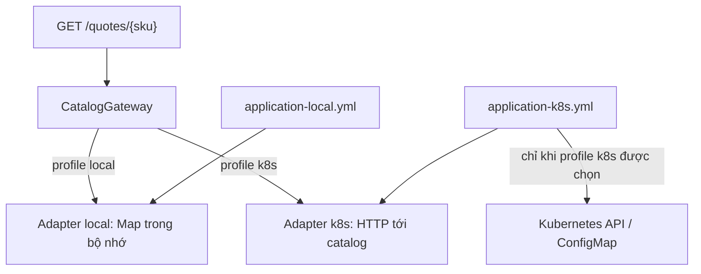

# Profile local không phụ thuộc Kubernetes

## Mục tiêu và tình huống sử dụng

Trong chương **Phát triển cục bộ** của module **SPRING_CLOUD_KUBERNETES**, không phải lần chạy nào cũng cần kết nối cluster. Khi sửa quy tắc tính giá, xử lý đầu vào hoặc giao diện HTTP, bạn nên có thể chạy ứng dụng từ IDE bằng dữ liệu thử nghiệm, ngay cả khi chưa cài kubectl, chưa có kubeconfig và chưa được cấp quyền Kubernetes.

Bài này xây dựng profile `local` cho một ứng dụng tính báo giá. Profile đó dùng cấu hình trong file và một danh mục sản phẩm trong bộ nhớ. Cùng mã nghiệp vụ có thể dùng adapter HTTP trong profile `k8s`, nhưng đường chạy local không khởi tạo discovery, không đọc ConfigMap/Secret qua API và không cần Configuration Watcher.

Sau bài học, bạn có thể:

- Phân biệt chạy ngoài cluster nhưng vẫn dùng Kubernetes với chạy local độc lập với Kubernetes.
- Tách cấu hình được nạp lúc khởi động khỏi các bean chỉ dành cho cluster.
- Chọn nguồn cấu hình và adapter local thay cho hạ tầng Kubernetes.
- Kiểm tra ứng dụng khi không có credential hoặc đường mạng tới cluster.
- Biết rõ những hành vi cần kiểm tra lại trong môi trường tích hợp Kubernetes.

Ví dụ dùng Spring Boot 3.5.x và cơ chế Config Data của Spring Cloud Kubernetes 3.3.x. Khi áp dụng cho dự án khác, dùng Spring Cloud BOM tương thích với Spring Boot của dự án, đồng thời đối chiếu thuộc tính theo phiên bản đang sử dụng.

## 1. Định nghĩa đúng “không phụ thuộc Kubernetes”

Một profile local đạt yêu cầu khi ứng dụng có thể khởi động và thực hiện luồng nghiệp vụ được chọn mà không cần:

- Kết nối Kubernetes API hoặc phân giải tên API server.
- Kubeconfig, ServiceAccount token hay chứng chỉ client của cluster.
- Quyền RBAC để đọc Service, Pod, ConfigMap hoặc Secret.
- DNS nội bộ dạng `catalog.namespace.svc.cluster.local`.
- Chạy `kubectl port-forward` tới một dịch vụ trong cluster.
- Controller Configuration Watcher gửi thông báo refresh.

Đây là phạm vi độc lập khi **chạy ứng dụng**. Lần build đầu vẫn có thể cần mạng để tải dependency Maven; nếu muốn build hoàn toàn offline, dependency phải được chuẩn bị riêng.

So sánh ba cách phát triển:

| Cách chạy | Nguồn cấu hình | Cách gọi dịch vụ phụ thuộc | Cần Kubernetes |
| --- | --- | --- | --- |
| JVM local dùng kubeconfig | Có thể đọc ConfigMap/Secret qua API | Discovery, Ingress, VPN hoặc port-forward | Có |
| Profile local dùng HTTP stub | File local và biến môi trường | URL loopback của stub chạy trên máy | Không cần cluster, nhưng cần tiến trình stub |
| Profile local dùng dữ liệu trong bộ nhớ | File local và dữ liệu mẫu | Gọi adapter trong cùng JVM | Không |

Bài thực hành chọn dòng cuối để có một đường chạy tối thiểu, dễ lặp lại. Khi cần kiểm tra hợp đồng HTTP, bạn có thể thay adapter bộ nhớ bằng HTTP stub mà vẫn giữ nguyên nguyên tắc tách Kubernetes.

## 2. Tách phụ thuộc ở hai thời điểm

Chỉ thêm `@Profile("k8s")` lên một service chưa chắc đã đủ. Có hai giai đoạn cần xử lý:

| Giai đoạn | Phụ thuộc có thể xuất hiện | Cách tách |
| --- | --- | --- |
| Nạp cấu hình sớm | `spring.config.import=kubernetes:`, bootstrap, file cấu hình ngoài | Đặt cấu hình chỉ dành cho cluster vào profile riêng |
| Tạo bean và chạy ứng dụng | `KubernetesClient`, `DiscoveryClient`, HTTP client dùng service ID, scheduled watcher | Tách adapter/bean theo profile và tắt tính năng không dùng |

Config Data được xử lý trước khi các bean nghiệp vụ được tạo. Nếu file cấu hình chung vẫn khai báo import Kubernetes, việc gắn profile lên controller không loại bỏ đường nạp cấu hình đó. Cơ chế import được mô tả trong [Externalized Configuration của Spring Boot](https://docs.spring.io/spring-boot/3.5/reference/features/external-config.html).

Thiết kế của ví dụ:



Controller phụ thuộc `CatalogGateway`, không phụ thuộc trực tiếp `DiscoveryClient` hay Kubernetes client. Chính adapter quyết định dữ liệu đến từ đâu.

## 3. Tổ chức file cấu hình

Trong ứng dụng thực hành, dùng cấu trúc:

```text
src/main/resources/
├── application.yml
├── application-local.yml
└── application-k8s.yml
```

Các đường dẫn và đoạn mã trong bài là hướng dẫn tạo ứng dụng mẫu. Chúng không yêu cầu sửa cấu hình hệ thống hoặc kubeconfig của máy.

### Cấu hình chung chỉ chứa giá trị dùng chung

Nội dung `application.yml`:

```yaml
spring:
  application:
    name: checkout-service

server:
  port: 8080

management:
  endpoints:
    web:
      exposure:
        include: health
```

File chung không chứa:

- `spring.config.import: "kubernetes:"`.
- URL dịch vụ chỉ có thể phân giải trong cluster.
- Token hoặc namespace bắt buộc cho lần chạy local.
- `spring.profiles.active: k8s` hoặc profile include tự kéo Kubernetes vào mọi môi trường.

Bài này yêu cầu chọn profile rõ ràng khi khởi chạy. Không đặt `local` làm cơ chế fallback ngầm cho một deployment cấu hình sai.

### Profile local khai báo đầy đủ những gì cần cho local

Nội dung `application-local.yml`:

```yaml
server:
  address: 127.0.0.1

spring:
  main:
    cloud-platform: NONE
  cloud:
    discovery:
      enabled: false
      client:
        health-indicator:
          enabled: false
        composite-indicator:
          enabled: false
    kubernetes:
      discovery:
        enabled: false
      config:
        enabled: false
      secrets:
        enabled: false
      reload:
        enabled: false

management:
  health:
    kubernetes:
      enabled: false

demo:
  message: "Dữ liệu thử nghiệm trong JVM local"
```

Các lớp kiểm soát có mục đích khác nhau:

| Thiết lập | Mục đích |
| --- | --- |
| `spring.main.cloud-platform=NONE` | Không coi lần chạy này là nền tảng Kubernetes trong các điều kiện auto-configuration liên quan |
| `spring.cloud.kubernetes.discovery.enabled=false` | Tắt implementation discovery của Spring Cloud Kubernetes nếu có trên classpath |
| `spring.cloud.discovery.enabled=false` | Tắt service discovery ở cấp Spring Cloud trong đường chạy không cần discovery |
| `config.enabled=false`, `secrets.enabled=false` | Tắt các PropertySource Kubernetes tương ứng |
| `reload.enabled=false` | Không dùng cơ chế reload trong ứng dụng của dòng phiên bản minh họa |
| Các health indicator tương ứng bằng `false` | Không để health của local phụ thuộc kiểm tra discovery hoặc thông tin Pod |
| `server.address=127.0.0.1` | Giới hạn máy chủ HTTP local ở loopback |

Từ Spring Cloud Kubernetes 3.x, thuộc tính cũ `spring.cloud.kubernetes.enabled` không còn là cách bật/tắt nhận diện Kubernetes. Dùng `spring.main.cloud-platform` theo [Kubernetes Ecosystem Awareness](https://docs.spring.io/spring-cloud-kubernetes/reference/3.3/kubernetes-awareness.html).

Công tắc discovery ở cấp Spring Cloud và các health indicator được mô tả trong [Spring Cloud Commons](https://docs.spring.io/spring-cloud-commons/reference/spring-cloud-commons/common-abstractions.html). Việc tắt Pod Health Indicator dùng `management.health.kubernetes.enabled=false` theo [tài liệu Pod Health Indicator](https://docs.spring.io/spring-cloud-kubernetes/reference/3.3/pod-health-indicator.html).

Những công tắc này điều khiển các tích hợp tương ứng. Chúng không ngăn mã tự viết gọi `new KubernetesClientBuilder().build()`, đọc kubeconfig hoặc mở kết nối mạng. Các bean tùy chỉnh vẫn cần được tách đúng profile.

### Profile k8s giữ riêng cấu hình dành cho cluster

Để đối chiếu, `application-k8s.yml` có thể chứa:

```yaml
spring:
  main:
    cloud-platform: KUBERNETES
  config:
    import: "kubernetes:"
  cloud:
    kubernetes:
      discovery:
        enabled: false
      config:
        enabled: true
        name: checkout-service
        namespace: ${K8S_NAMESPACE}
        include-profile-specific-sources: false
        fail-fast: true
      secrets:
        enabled: false
```

Đây là ví dụ triển khai chọn **ConfigMap qua API và gọi Service bằng DNS**. Nó không dùng DiscoveryClient nên discovery vẫn tắt. Nếu ứng dụng của bạn có nhu cầu discovery thật, hãy cấu hình và cấp quyền riêng cho tính năng đó.

Deployment phải chủ động chọn profile `k8s` và cung cấp `K8S_NAMESPACE`. Tên profile `k8s` là quy ước của ứng dụng, không phải từ khóa tự động bắt buộc của Spring. Spring Cloud Kubernetes có thể kích hoạt profile tên `kubernetes` khi ứng dụng chạy trong Pod; không giả định profile đó tự kích hoạt profile `k8s` do bạn đặt.

Import chỉ nằm trong file dành cho cluster, nên lần chạy `local` không cần nạp ConfigMap trước khi tạo bean. Cơ chế Config Data và cơ chế bootstrap cũ không được trộn lẫn; xem [Kubernetes PropertySource implementations](https://docs.spring.io/spring-cloud-kubernetes/reference/3.3/property-source-config.html).

## 4. Chọn dependency theo nhu cầu của artifact

Chuẩn bị một dự án Spring Boot đã có dependency management và Spring Cloud BOM tương thích. Ví dụ cần các dependency sau:

```xml
<dependencies>
    <dependency>
        <groupId>org.springframework.boot</groupId>
        <artifactId>spring-boot-starter-web</artifactId>
    </dependency>

    <dependency>
        <groupId>org.springframework.boot</groupId>
        <artifactId>spring-boot-starter-actuator</artifactId>
    </dependency>

    <dependency>
        <groupId>org.springframework.cloud</groupId>
        <artifactId>spring-cloud-starter-kubernetes-fabric8-config</artifactId>
    </dependency>
</dependencies>
```

Đoạn trên là phần dependency, không phải toàn bộ `pom.xml`. Dự án cần Spring Boot parent hoặc cấu hình tương đương, Spring Cloud BOM và Spring Boot Maven plugin nếu muốn tạo executable JAR.

Starter Kubernetes Config nằm trong artifact vì profile `k8s` dùng nó. Profile local vẫn chạy mà không gọi Kubernetes khi cấu hình và bean được tách đúng. Không cần loại dependency bằng một lần build khác chỉ để đổi môi trường chạy.

Nếu ứng dụng chỉ dùng file cấu hình được mount và DNS Service, nó có thể không cần starter Kubernetes Config hoặc DiscoveryClient. Nếu dự án có thêm discovery starter, các cờ local phía trên vẫn phải được kiểm tra theo implementation đang dùng. Không chọn starter `all` chỉ vì ứng dụng có thể triển khai trên Kubernetes.

## 5. Ví dụ hoàn chỉnh cho luồng nghiệp vụ local

Tạo lớp `CheckoutApplication.java` trong package `com.example.checkout` của ứng dụng mẫu:

```java
package com.example.checkout;

import java.math.BigDecimal;
import java.util.Map;
import java.util.Optional;

import org.springframework.beans.factory.annotation.Value;
import org.springframework.boot.SpringApplication;
import org.springframework.boot.autoconfigure.SpringBootApplication;
import org.springframework.context.annotation.Bean;
import org.springframework.context.annotation.Configuration;
import org.springframework.context.annotation.Profile;
import org.springframework.http.HttpStatus;
import org.springframework.web.bind.annotation.GetMapping;
import org.springframework.web.bind.annotation.PathVariable;
import org.springframework.web.bind.annotation.RequestParam;
import org.springframework.web.bind.annotation.RestController;
import org.springframework.web.server.ResponseStatusException;

@SpringBootApplication
public class CheckoutApplication {

    public static void main(String[] args) {
        SpringApplication.run(CheckoutApplication.class, args);
    }

    public record Product(String sku, BigDecimal unitPrice) {
    }

    public record Quote(
            String sku,
            int quantity,
            BigDecimal unitPrice,
            BigDecimal total,
            String message) {
    }

    public interface CatalogGateway {
        Optional<Product> findBySku(String sku);
    }

    @Configuration(proxyBeanMethods = false)
    @Profile("local & !k8s")
    static class LocalCatalogConfiguration {

        @Bean
        CatalogGateway localCatalogGateway() {
            Map<String, Product> products = Map.of(
                    "spring-book",
                    new Product("spring-book", new BigDecimal("120000.00")),
                    "kubernetes-book",
                    new Product("kubernetes-book", new BigDecimal("180000.00")));

            return sku -> Optional.ofNullable(products.get(sku));
        }
    }

    @RestController
    static class QuoteController {

        private final CatalogGateway catalogGateway;
        private final String message;

        QuoteController(
                CatalogGateway catalogGateway,
                @Value("${demo.message}") String message) {
            this.catalogGateway = catalogGateway;
            this.message = message;
        }

        @GetMapping("/quotes/{sku}")
        public Quote quote(
                @PathVariable("sku") String sku,
                @RequestParam(name = "quantity", defaultValue = "1")
                int quantity) {

            if (quantity < 1) {
                throw new ResponseStatusException(
                        HttpStatus.BAD_REQUEST,
                        "quantity phải lớn hơn hoặc bằng 1");
            }

            Product product = catalogGateway.findBySku(sku)
                    .orElseThrow(() -> new ResponseStatusException(
                            HttpStatus.NOT_FOUND,
                            "Không tìm thấy sản phẩm"));

            BigDecimal total = product.unitPrice()
                    .multiply(BigDecimal.valueOf(quantity));

            return new Quote(
                    product.sku(),
                    quantity,
                    product.unitPrice(),
                    total,
                    message);
        }
    }
}
```

Hai sản phẩm dùng giá minh họa theo VND; đây không phải bảng giá kinh doanh. Giá trị `BigDecimal` được tạo từ chuỗi để phép tính không phụ thuộc sai số biểu diễn số thực nhị phân.

Adapter local có dữ liệu cố định, không mở socket, không đọc tài nguyên Kubernetes và không cần tiến trình catalog khác. Controller vẫn xử lý request, kiểm tra số lượng, xử lý trường hợp không có sản phẩm và tính tổng tiền.

Biểu thức `@Profile("local & !k8s")` chỉ cho phép adapter này xuất hiện khi chọn local mà không chọn k8s. Cách dùng profile để chọn nhóm bean được trình bày trong [Environment Abstraction của Spring Framework](https://docs.spring.io/spring-framework/reference/core/beans/environment.html).

Không đặt adapter local thành `@Primary` để tự che việc thiếu adapter thật. Khi chưa chọn profile phù hợp, việc không tạo được `CatalogGateway` giúp phát hiện lỗi cấu hình thay vì chạy ngầm với dữ liệu mẫu.

## 6. Adapter dành cho Kubernetes nằm ở cấu hình riêng

Để hoàn chỉnh phần đối chiếu, tạo lớp `KubernetesCatalogConfiguration.java` trong cùng package của ứng dụng mẫu:

```java
package com.example.checkout;

import java.net.http.HttpClient;
import java.time.Duration;
import java.util.Optional;

import com.example.checkout.CheckoutApplication.CatalogGateway;
import com.example.checkout.CheckoutApplication.Product;

import org.springframework.beans.factory.annotation.Value;
import org.springframework.context.annotation.Bean;
import org.springframework.context.annotation.Configuration;
import org.springframework.context.annotation.Profile;
import org.springframework.http.client.JdkClientHttpRequestFactory;
import org.springframework.web.client.HttpClientErrorException;
import org.springframework.web.client.RestClient;

@Configuration(proxyBeanMethods = false)
@Profile("k8s & !local")
class KubernetesCatalogConfiguration {

    @Bean
    CatalogGateway kubernetesCatalogGateway(
            @Value("${catalog.base-url}") String baseUrl) {

        HttpClient httpClient = HttpClient.newBuilder()
                .connectTimeout(Duration.ofSeconds(2))
                .build();

        JdkClientHttpRequestFactory requestFactory =
                new JdkClientHttpRequestFactory(httpClient);
        requestFactory.setReadTimeout(Duration.ofSeconds(3));

        RestClient client = RestClient.builder()
                .requestFactory(requestFactory)
                .baseUrl(baseUrl)
                .build();

        return sku -> {
            try {
                Product product = client.get()
                        .uri("/products/{sku}", sku)
                        .retrieve()
                        .body(Product.class);
                return Optional.ofNullable(product);
            } catch (HttpClientErrorException.NotFound ex) {
                return Optional.empty();
            }
        };
    }
}
```

Adapter giả định catalog cung cấp `GET /products/{sku}` và trả JSON có các trường `sku`, `unitPrice`. HTTP 404 được chuyển thành kết quả không có sản phẩm; timeout, lỗi kết nối và lỗi máy chủ không được đổi thành dữ liệu mẫu.

Trong profile local, cấu hình này không được kích hoạt nên không tạo HTTP client nghiệp vụ. Việc dùng interface không có nghĩa là nuốt mọi lỗi của hệ thống thật để trả báo giá thành công.

`RestClient` ở đây là HTTP client thông thường, không có `@LoadBalanced`. Nó dùng URL được cấp; cơ chế client và xử lý phản hồi được mô tả trong [REST Clients của Spring Framework](https://docs.spring.io/spring-framework/reference/6.2/integration/rest-clients.html).

Một ConfigMap **dành cho lần triển khai k8s** có thể là:

```yaml
apiVersion: v1
kind: ConfigMap
metadata:
  name: checkout-service
  namespace: dev-playground
data:
  demo.message: "Cấu hình cho môi trường Kubernetes"
  catalog.base-url: "http://catalog"
```

Ví dụ giả định Service catalog ở cùng namespace và phục vụ HTTP cổng 80. Deployment chọn `SPRING_PROFILES_ACTIVE=k8s`, truyền `K8S_NAMESPACE=dev-playground` và dùng ServiceAccount có quyền đọc ConfigMap phù hợp. Các bước này thuộc môi trường tích hợp, không cần thực hiện để chạy phần local.

Bài không cấp quyền RBAC cho local vì local không gọi API. Không yêu cầu developer nhận credential cluster chỉ để khởi động luồng báo giá.

## 7. Chạy local với profile được chọn rõ ràng

Chạy tại thư mục ứng dụng mẫu đã có Maven Wrapper.

Trên Windows PowerShell:

```powershell
.\mvnw.cmd '-Dspring-boot.run.profiles=local' spring-boot:run
```

Trên Linux hoặc macOS:

```bash
./mvnw -Dspring-boot.run.profiles=local spring-boot:run
```

Nếu đã build executable JAR, dùng tên artifact thực tế của dự án:

```powershell
java -jar '.\target\checkout-service.jar' --spring.profiles.active=local
```

Trong IDE, đặt program argument:

```text
--spring.profiles.active=local
```

Không cần khai báo KUBECONFIG, token, namespace hay `KUBERNETES_SERVICE_HOST`. Tên `local` là Spring profile lúc chạy ứng dụng; `mvn -Plocal` là Maven build profile và không tự có cùng ý nghĩa nếu dự án chưa định nghĩa liên kết.

Quan sát log khởi động để xác nhận profile local đang hoạt động. Không chấp nhận tình huống profile `k8s` cũng được kích hoạt qua include, group hoặc cấu hình IDE. Hai adapter trong ví dụ cố ý loại trừ nhau bằng biểu thức profile.

Nếu bật đồng thời `local,k8s`, sẽ không có adapter phù hợp và ứng dụng không thể tạo `CatalogGateway`. Đây là cách phát hiện cấu hình mâu thuẫn ở tầng bean, không phải cơ chế ngăn import từ file `application-k8s.yml`; việc nạp cấu hình có thể đã xảy ra trước đó. Vì vậy, phải chọn profile đúng ngay từ lúc chạy.

## 8. Gọi API và quan sát hành vi nghiệp vụ

Sau khi ứng dụng khởi động, mở terminal khác:

```powershell
Invoke-RestMethod 'http://127.0.0.1:8080/actuator/health'

Invoke-RestMethod 'http://127.0.0.1:8080/quotes/spring-book?quantity=2' |
    ConvertTo-Json
```

Kết quả minh họa của báo giá:

```json
{
  "sku": "spring-book",
  "quantity": 2,
  "unitPrice": 120000.00,
  "total": 240000.00,
  "message": "Dữ liệu thử nghiệm trong JVM local"
}
```

Cách biểu diễn phần thập phân có thể khác giữa các công cụ đọc JSON; giá trị tiền và kết quả phép tính phải tương đương.

Kiểm tra thêm:

| Request | Kết quả mong đợi |
| --- | --- |
| `GET /quotes/kubernetes-book?quantity=3` | HTTP 200, tổng tiền 540000.00 |
| `GET /quotes/not-found?quantity=1` | HTTP 404 |
| `GET /quotes/spring-book?quantity=0` | HTTP 400 |
| `GET /quotes/spring-book?quantity=abc` | HTTP 400 do không chuyển được quantity sang số nguyên |
| `GET /actuator/health` | HTTP 200 khi các thành phần của ứng dụng mẫu đang hoạt động |

Các lỗi 400/404 là kết quả kiểm tra nghiệp vụ hoặc giao thức HTTP, không phải dấu hiệu cần bật Kubernetes trở lại.

Trong ứng dụng thật, nếu có datasource, message broker hoặc dịch vụ khác, chúng vẫn có thể ảnh hưởng health. Tắt health của Kubernetes không làm các phụ thuộc đó biến mất. Profile local cần có lựa chọn tương ứng cho từng phụ thuộc mà luồng thực hành thực sự sử dụng.

## 9. Chứng minh local không cần cluster

Khởi động thành công trên máy đang có kubeconfig chưa đủ để chứng minh tính độc lập. Có thể một đoạn mã vẫn âm thầm dùng credential có sẵn.

Nên kiểm tra theo các lớp sau:

### Không yêu cầu cấu hình Kubernetes để chạy

Khởi chạy bằng profile local trong môi trường không cung cấp namespace, token hoặc đường dẫn kubeconfig cho ứng dụng. Ứng dụng mẫu phải tạo được báo giá từ dữ liệu trong bộ nhớ.

Nếu muốn kiểm tra biến KUBECONFIG không đóng vai trò bắt buộc, có thể dùng một đường dẫn chưa tồn tại trong **terminal thử nghiệm riêng**:

```powershell
$previousKubeconfig = $env:KUBECONFIG

try {
    $missingKubeconfigName =
        'local-profile-' + [guid]::NewGuid().ToString('N') + '.yaml'

    $env:KUBECONFIG = Join-Path $env:TEMP $missingKubeconfigName

    if (Test-Path -LiteralPath $env:KUBECONFIG) {
        throw 'Đường dẫn thử nghiệm phải chưa tồn tại.'
    }

    .\mvnw.cmd '-Dspring-boot.run.profiles=local' spring-boot:run
} finally {
    if ($null -eq $previousKubeconfig) {
        Remove-Item Env:KUBECONFIG -ErrorAction SilentlyContinue
    } else {
        $env:KUBECONFIG = $previousKubeconfig
    }
}
```

Đoạn lệnh không tạo hoặc xóa file kubeconfig nào. Sau khi dừng ứng dụng bằng Ctrl+C, phần `finally` khôi phục biến môi trường trước đó.

Đây chỉ là một phép kiểm tra bổ sung. Nó không chứng minh tuyệt đối không có truy cập cluster: client có thể còn credential override, file mặc định hoặc nguồn thông tin khác nếu mã tích hợp vẫn được tạo.

### Chạy khi API không truy cập được

Để xác minh mạnh hơn, chạy artifact đã chuẩn bị dependency trong môi trường không có kubeconfig/ServiceAccount và không có đường truy cập Kubernetes API, chẳng hạn một môi trường CI cô lập. Với profile local:

- Ứng dụng vẫn khởi động được.
- Request báo giá vẫn trả kết quả đúng.
- Không có vòng lặp list/watch, reconnect hoặc chờ cache discovery.
- Không cần một phiên port-forward để request hoàn tất.

Việc cô lập kết nối phải áp dụng cho chính môi trường chạy JVM. Thay đổi kết nối của Windows không nhất thiết phản ánh kết nối của JVM đang chạy trong WSL, container hoặc máy từ xa.

### Đối chiếu bean và hoạt động thực tế

Có thể chạy thêm `--debug` để đọc báo cáo điều kiện auto-configuration. Tìm các cấu hình Kubernetes không được kích hoạt do thuộc tính hoặc nền tảng đã chọn.

Báo cáo điều kiện là bằng chứng hỗ trợ, không bao phủ các client được tạo thủ công. Với dự án có mã tích hợp tùy chỉnh, cần xem riêng các vị trí tạo client, constructor, `ApplicationRunner`, scheduled task và health contributor. Nếu môi trường có quan sát kết nối mạng, đối chiếu thêm rằng không phát sinh request tới API server.

Không thể kết luận “độc lập Kubernetes” chỉ từ việc log ít lỗi hơn hoặc `/actuator/health` chuyển sang `UP`.

## 10. Những cách sửa dễ tạo cảm giác độc lập giả

### Chỉ đổi import thành optional

Cấu hình:

```yaml
spring:
  config:
    import: "optional:kubernetes:"
```

vẫn khai báo một nguồn Kubernetes. `optional:` không đồng nghĩa tắt resolver, tắt client hay bảo đảm không có request mạng; cách xử lý lỗi còn phụ thuộc loại location và implementation. Nếu mục tiêu là local độc lập, không nạp tài liệu có import Kubernetes trong đường chạy đó.

Tương tự, `fail-fast=false` có thể thay đổi cách ứng dụng phản ứng với lỗi nạp cấu hình; nó không phải công tắc loại bỏ phụ thuộc.

### Chỉ đặt import rỗng trong application-local.yml

Không nên dựa vào việc ghi đè:

```yaml
spring:
  config:
    import: ""
```

để xóa tác động của một import đã được phát hiện ở tài liệu cấu hình khác. Hãy đặt import Kubernetes ngay trong tài liệu có điều kiện profile phù hợp thay vì làm cho local phải “gỡ” import từ file chung.

Nếu thích một file YAML nhiều tài liệu, có thể thay các file profile bằng cấu trúc sau:

```yaml
spring:
  application:
    name: checkout-service

---
spring:
  config:
    activate:
      on-profile: local
  main:
    cloud-platform: NONE
  cloud:
    kubernetes:
      config:
        enabled: false
      secrets:
        enabled: false

---
spring:
  config:
    activate:
      on-profile: k8s
    import: "kubernetes:"
  main:
    cloud-platform: KUBERNETES
```

Đây là đoạn minh họa cách đặt điều kiện, chưa bao gồm mọi thiết lập của ứng dụng mẫu. Chọn cách nhiều file hoặc nhiều tài liệu cho nhất quán, không giữ hai bản cấu hình đầy đủ rồi để chúng ghi đè khó kiểm soát.

### Tắt discovery nhưng mã vẫn bắt buộc inject DiscoveryClient

Ví dụ sau khiến tầng nghiệp vụ gắn chặt vào cơ chế discovery:

```java
// Ví dụ thiết kế cần xem lại cho đường chạy local.
public PricingService(DiscoveryClient discoveryClient) {
    // ...
}
```

Khi discovery bị tắt, bean có thể không tồn tại. Cách giải quyết là chọn abstraction nghiệp vụ và adapter phù hợp như `CatalogGateway` ở trên, hoặc chỉ tạo cấu hình cần discovery trong profile tích hợp.

Không tạo một Kubernetes client giả có quyền quá rộng chỉ để thỏa constructor. Cũng không bắt mọi lỗi rồi trả kết quả thành công, vì điều đó làm mất khả năng phân biệt môi trường sai với dữ liệu hợp lệ.

### Dùng client load-balanced với URL localhost

Nếu chọn biến thể local gọi một HTTP stub qua `http://127.0.0.1:18080`, dùng HTTP client thông thường. Client có `@LoadBalanced` có thể diễn giải host thành service ID và đi tìm instance thay vì gọi thẳng địa chỉ đó.

Trong biến thể này, profile local vẫn không cần Kubernetes nhưng cần stub local đang chạy. Phải ghi rõ điều kiện đó; đừng mô tả nó như adapter hoàn toàn trong bộ nhớ của bài chính.

### Chỉ tắt health indicator

`management.health.kubernetes.enabled=false` chỉ tắt contributor tương ứng. Nó không bảo đảm Config Data không gọi API, không tắt một informer tùy chỉnh và không vô hiệu hóa lệnh gọi Kubernetes trong `ApplicationRunner`.

Nếu health tốt lên nhưng ứng dụng vẫn cần kubeconfig để khởi động, profile local chưa đạt yêu cầu.

## 11. Kiểm soát cấu hình từ môi trường chạy

File `application-local.yml` là một nguồn cấu hình. Biến môi trường, system property, tham số chạy và file cấu hình ngoài có thể làm kết quả khác với bạn dự kiến.

Khi local bất ngờ gọi Kubernetes, kiểm tra các nguồn sau:

| Nguồn | Giá trị cần tìm |
| --- | --- |
| Program arguments trong IDE hoặc lệnh java | `--spring.profiles.active`, `--spring.config.import`, `--spring.main.cloud-platform` |
| Biến môi trường | `SPRING_PROFILES_ACTIVE`, `SPRING_PROFILES_INCLUDE`, `SPRING_CONFIG_IMPORT` |
| File cấu hình ngoài | `application.yml`, `application-local.yml` ở thư mục chạy hoặc đường dẫn bổ sung |
| Vị trí cấu hình tùy chỉnh | `SPRING_CONFIG_LOCATION`, `SPRING_CONFIG_ADDITIONAL_LOCATION` |
| Cấu hình JSON và JVM | `SPRING_APPLICATION_JSON`, VM options, `JAVA_TOOL_OPTIONS` |
| Kích hoạt profile gián tiếp | `spring.profiles.include`, profile group hoặc mã gọi `setAdditionalProfiles` |
| Bootstrap của dự án cũ | `spring-cloud-starter-bootstrap`, `spring.cloud.bootstrap.enabled`, cấu hình bootstrap còn nạp Kubernetes |

Chỉ xem các giá trị cần thiết; không dump toàn bộ environment hoặc cấu hình có credential vào log.

`spring.profiles.active` không được đặt bên trong `application-local.yml` để file tự kích hoạt chính nó. Tương tự, cần xem lại profile include/group ở cấu hình chung vì chúng có thể bổ sung profile ngoài giá trị bạn truyền khi chạy. Các quy tắc này nằm trong [Profiles của Spring Boot](https://docs.spring.io/spring-boot/3.5/reference/features/profiles.html).

Với dự án dùng bootstrap cũ, một cờ trong `application-local.yml` có thể không nằm ở giai đoạn đủ sớm để điều khiển nguồn bootstrap. Cần tách cấu hình bootstrap theo môi trường hoặc chuyển có chủ đích sang Config Data. Ví dụ chính của bài không bật bootstrap.

Không chữa lỗi bằng cách loại hàng loạt auto-configuration theo tên lớp lấy từ phiên bản khác. Trước tiên đối chiếu import, profile, cờ tính năng và bean tùy chỉnh; tên và cấu trúc auto-configuration có thể đổi theo release.

## 12. Giữ đúng ranh giới giữa local và kiểm thử Kubernetes

Profile local giúp kiểm tra một tập hành vi, không thay thế mọi kiểm thử tích hợp:

| Tính năng | Trong profile local của bài | Cần kiểm tra ở môi trường tích hợp |
| --- | --- | --- |
| DiscoveryClient | Tắt; adapter local không dùng service ID | Namespace, Service/EndpointSlice, lọc instance, RBAC list/watch |
| ConfigMap | Giá trị nằm trong file local | Tên/namespace, quyền đọc, thứ tự ưu tiên và dữ liệu được nạp |
| Secret | Không đọc từ API; không dùng credential thật | Nguồn Secret, quyền truy cập, cách cấp vào ứng dụng |
| Spring Cloud LoadBalancer | Không cần cho adapter bộ nhớ | Lựa chọn instance, cổng và đường mạng tới instance |
| Configuration Watcher | Không triển khai; đổi file rồi chạy lại JVM | Theo dõi tài nguyên, gửi sự kiện, refresh và kết nối tới ứng dụng |
| Pod Health Indicator | Tắt vì JVM local không đại diện cho Pod | Thông tin Pod, readiness/liveness và điều kiện vận hành thực tế |
| Quy tắc tính báo giá | Kiểm tra được bằng dữ liệu mẫu cố định | Kiểm tra tiếp với hợp đồng và dữ liệu hệ thống thật |

Nếu dùng cơ sở dữ liệu hoặc hàng đợi trong ứng dụng thật, có thể chọn adapter bộ nhớ, một tiến trình local hoặc container phục vụ riêng tính năng đó. Phải nêu đúng phần nào vẫn cần hạ tầng; một tên profile `local` không tự khiến mọi phụ thuộc biến mất.

Thay đổi `demo.message` trong file cấu hình local cần khởi động lại JVM theo luồng bài này. Configuration Watcher của Kubernetes không theo dõi file source trên laptop và không cần tham gia vào lần chạy local.

## 13. Chẩn đoán các lỗi thường gặp

| Triệu chứng | Nguyên nhân cần ưu tiên kiểm tra | Cách xử lý |
| --- | --- | --- |
| Local đòi namespace hoặc kubeconfig khi khởi động | Import Kubernetes/bean tích hợp vẫn được nạp | Tách tài liệu cấu hình và bean đúng profile |
| Có request tới `kubernetes.default.svc` | Auto-configuration hoặc client tùy chỉnh vẫn hoạt động | Kiểm tra cloud-platform, cờ tính năng và nơi tạo client |
| Dừng ở thông báo khởi tạo cache discovery | Discovery chưa tắt hoặc profile k8s bị kéo vào | Đối chiếu profile thực tế, include/group và cấu hình ngoài |
| Không tạo được `DiscoveryClient` | Bean nghiệp vụ vẫn bắt buộc phụ thuộc discovery | Tách adapter hoặc chỉ tạo bean đó trong profile cần discovery |
| Không tạo được `CatalogGateway` trong ví dụ | Không chọn local/k8s, hoặc chọn cả hai | Sửa profile lúc khởi chạy; không thêm fallback dữ liệu mẫu cho mọi môi trường |
| Không tìm thấy `demo.message` | File local không được nạp hoặc vị trí cấu hình đã thay đổi | Kiểm tra active profile và `spring.config.location` |
| Local có `503 No instances available` | Đang dùng service ID và client load-balanced | Dùng adapter local hoặc HTTP client thường với URL stub |
| Health vẫn `DOWN` | Có contributor khác như datasource/broker | Xem đúng thành phần lỗi và cấu hình phụ thuộc tương ứng |
| Chạy từ terminal được nhưng IDE không được | Run Configuration khác profile/biến môi trường/thư mục chạy | Đồng bộ cấu hình chạy, kiểm tra file ngoài được nạp |
| Đổi message nhưng response chưa đổi | JVM đang dùng cấu hình đã nạp lúc khởi động | Dừng và khởi động lại, hoặc thiết kế refresh riêng nếu thật sự cần |

Không sửa lỗi local bằng cách cấp `cluster-admin`, bỏ xác minh TLS hoặc yêu cầu mọi developer có credential cluster. Những thay đổi đó không giải quyết việc đường chạy local đang phụ thuộc nhầm vào hạ tầng.

## 14. Bài thực hành và tiêu chí hoàn thành

Thực hiện trên ứng dụng mẫu:

1. Tạo ba file cấu hình theo đúng vai trò: chung, local và k8s.
2. Thêm gateway và adapter bộ nhớ, chạy bằng profile local.
3. Gọi endpoint báo giá cho hai sản phẩm mẫu; kiểm tra cả trường hợp số lượng không hợp lệ và sản phẩm không tồn tại.
4. Chạy lại khi không cung cấp cấu hình Kubernetes, rồi xác minh trong môi trường không có quyền truy cập API.
5. Đổi `demo.message` trong file local, khởi động lại và quan sát response.
6. Thử bỏ lựa chọn profile hoặc bật cả local/k8s để thấy cấu hình sai không được che bằng adapter mẫu. Thực hiện phép thử có k8s chỉ trong môi trường thử nghiệm phù hợp vì import của profile đó có thể được xử lý sớm.
7. Dừng JVM; khôi phục các biến môi trường thử nghiệm nếu đã thay đổi.

Dùng bảng sau để tự đánh giá:

| Tiêu chí | Bằng chứng cần có |
| --- | --- |
| Local được chọn rõ ràng | Log khởi động thể hiện profile đúng; không kéo profile k8s vào |
| Không nạp cấu hình cluster | Không có import Kubernetes trong tài liệu cấu hình được chọn cho local |
| Nghiệp vụ hoạt động | Báo giá và các mã HTTP phù hợp dữ liệu/đầu vào của bài |
| Không cần credential hoặc API | Luồng chạy thành công trong môi trường không có credential và không truy cập được Kubernetes API |
| Tách bean đúng | Local dùng adapter bộ nhớ; adapter k8s không được tạo |
| Hiểu phạm vi kiểm tra | Phân biệt được kiểm tra nghiệp vụ local với kiểm tra RBAC, discovery, Pod và refresh ở cluster |

Một lần chạy local tốt cho phép bạn sửa và kiểm tra nghiệp vụ ngay trên máy, đồng thời giữ nguyên các điểm tích hợp để kiểm tra riêng khi triển khai Kubernetes. Mỗi tính năng Spring Cloud Kubernetes được bật ở nơi có nhu cầu và điều kiện vận hành tương ứng.
