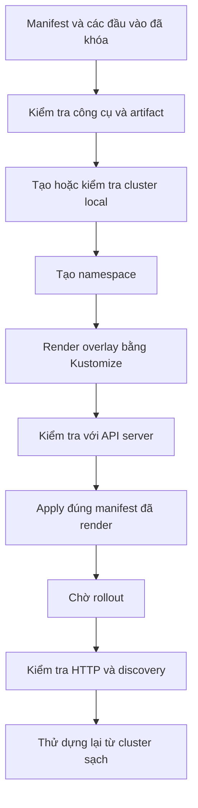

# Tái tạo môi trường từ manifest mà không phụ thuộc thao tác thủ công

## Mục tiêu và tình huống

Trong chương **Phát triển cục bộ** của module `SPRING_CLOUD_KUBERNETES`, một môi trường chỉ có thể chia sẻ đáng tin cậy khi người khác dựng lại được nó từ các đầu vào đã biết. “Máy tôi chạy được” chưa đủ nếu trước đó bạn đã tự tạo Secret, sửa ConfigMap trên dashboard, cấp RoleBinding bằng một lệnh quên ghi lại hoặc nạp một image khác vào node.

Bài học xây dựng một môi trường local cho `catalog-app`: cluster kind, namespace riêng, ServiceAccount/RBAC cho DiscoveryClient, hai replica, Service, ConfigMap, Secret mẫu và probe sức khỏe. Kustomize kết hợp manifest nền với cấu hình local; PowerShell thực hiện quy trình dựng môi trường và kiểm tra kết quả.

Sau bài học, bạn có thể:

- Xác định đầy đủ đầu vào để dựng lại một môi trường Spring trên Kubernetes.
- Tách manifest nền, biến thể môi trường và bước khởi tạo cluster.
- Tạo ConfigMap/Secret có tham chiếu nhất quán, không cần sửa tên bằng tay.
- Tự động hóa thứ tự render, kiểm tra, apply và chờ workload sẵn sàng.
- Kiểm chứng bằng một lần dựng lại từ cluster sạch, đồng thời nhận biết giới hạn đối với image, dữ liệu và dịch vụ bên ngoài.

## 1. Tái tạo được nghĩa là gì?

Mục tiêu thực tế là **cùng bộ đầu vào tạo ra cùng cấu hình mong muốn và cùng hành vi cần kiểm tra**. Tên Pod, UID, địa chỉ IP, thời điểm tạo và token ServiceAccount có thể khác sau mỗi lần dựng lại.

Có thể mô tả đầu vào như sau:

```text
Môi trường mong muốn
  = phiên bản manifest
  + phiên bản công cụ và cấu hình cluster
  + artifact image đã xác định
  + cấu hình môi trường
  + nguồn cấp Secret
  + các phụ thuộc và dữ liệu cần thiết
```

| Thành phần | Cần khai báo hoặc ghi nhận | Không nên phụ thuộc vào |
| --- | --- | --- |
| Cluster local | Phiên bản kind, node image, số node | Cluster đã được chỉnh trước nhưng không còn lịch sử |
| Image ứng dụng | Artifact, checksum hoặc digest, kiến trúc phù hợp | Tag `latest` hoặc một tag bị ghi đè âm thầm |
| Workload | Deployment, Service, replica, resource, probe | `kubectl run`, `expose`, `scale` rời rạc không được đưa lại vào nguồn cấu hình |
| Danh tính/quyền | ServiceAccount, Role, RoleBinding | Quyền của tài khoản kubectl trên máy người viết |
| ConfigMap | Nội dung nguồn và cách đưa vào Pod | Một lần `kubectl edit` không được lưu lại |
| Secret | Hợp đồng tên/key và quy trình cấp giá trị | Mật khẩu chỉ tồn tại trên máy một người |
| Phụ thuộc | Database, broker, CRD/operator, registry nếu có | Những dịch vụ “đã có sẵn” nhưng không được nêu |
| Kiểm chứng | Điều kiện sẵn sàng và phép kiểm tra hành vi | Chỉ nhìn trạng thái `Running` |

Manifest không phải bản sao lưu database. Nếu ứng dụng có PVC và dữ liệu nghiệp vụ, cần thêm quy trình backup/restore, migration hoặc seed dữ liệu. Bài thực hành dùng ứng dụng không lưu trạng thái để tập trung vào cấu hình và quyền.

## 2. Dùng khai báo làm nguồn cấu hình

Khi quản lý theo khai báo, bạn mô tả trạng thái mong muốn rồi dùng `kubectl apply` tạo hoặc cập nhật tài nguyên. Các sửa đổi cần duy trì phải quay lại manifest. Cơ chế này được mô tả trong [hướng dẫn quản lý đối tượng bằng tệp cấu hình](https://kubernetes.io/docs/tasks/manage-kubernetes-objects/declarative-config/).

Phân biệt hai loại thao tác:

- **Định nghĩa môi trường:** sửa tệp, thay image đã khóa, thay cấu hình, thay quyền; các thay đổi này phải được lưu và có thể xem xét lại.
- **Quan sát môi trường:** xem log, event, EndpointSlice hoặc port-forward để kiểm tra; các thao tác này không phải nguồn cấu hình của workload.

`kubectl apply` không phải giao dịch nguyên tử cho toàn bộ thư mục. Một số tài nguyên có thể đã được tạo trước khi một tài nguyên khác thất bại. Vì vậy quy trình phải dừng khi gặp lỗi, báo đúng bước và có thể chạy lại sau khi sửa nguyên nhân.



## 3. Cấu trúc ví dụ và điều kiện đầu vào

Dùng PowerShell 7, Docker đang hoạt động và một bộ công cụ thống nhất cho nhóm. Ví dụ cố định `kind v0.31.0`, `kubectl v1.35.0` cùng node Kubernetes `v1.35.0`. Đây là bộ phiên bản minh họa cụ thể, không phải yêu cầu dùng bản mới nhất. Kustomize tích hợp đi theo phiên bản kubectl.

Cấu trúc tệp của dự án thực hành:

```text
dev/
  kind.yaml
  image.lock.json
  Start-Local.ps1
  Test-Local.ps1
  bootstrap/
    namespace.yaml
  base/
    kustomization.yaml
    rbac.yaml
    deployment.yaml
    service.yaml
  overlays/
    local/
      kustomization.yaml
      app.env
      .secrets.env.example
      .secrets.env              # sinh cục bộ, không commit
.local/
  catalog-app.tar              # artifact nhận từ quy trình build
  rendered.yaml               # đầu ra render, không commit
.gitignore
```

Các đường dẫn trên mô tả bộ tệp mà người học tạo trong dự án thực hành. Các đoạn mã trong bài không tự chạy hoặc tự tạo tài nguyên cluster.

Manifest, script, `image.lock.json` và cấu hình không nhạy cảm được quản lý phiên bản. Image archive được phân phối qua nơi lưu artifact; không cần đưa binary lớn vào Git. Tệp Secret cục bộ và manifest đã render được bỏ qua:

```gitignore
/.local/
/dev/overlays/local/.secrets.env
```

### 3.1. Cấu hình cluster

Tệp `dev/kind.yaml`:

```yaml
kind: Cluster
apiVersion: kind.x-k8s.io/v1alpha4
nodes:
  - role: control-plane
    image: kindest/node:v1.35.0@sha256:452d707d4862f52530247495d180205e029056831160e22870e37e3f6c1ac31f
```

Digest trên thuộc node image được công bố cho [kind v0.31.0](https://github.com/kubernetes-sigs/kind/releases/tag/v0.31.0). Khóa cả phiên bản kind và node image giúp tránh việc tạo cluster hôm sau bằng mặc định khác. Máy chạy cần đáp ứng yêu cầu của Docker và node image, gồm kiến trúc và môi trường cgroup phù hợp.

Tên cluster là `sck-repro`; context được script sử dụng là `kind-sck-repro`. Mọi lệnh kubectl của quy trình đều chỉ định context, thay vì dựa vào context hiện tại của cửa sổ terminal.

### 3.2. Namespace khởi tạo riêng

Tệp `dev/bootstrap/namespace.yaml`:

```yaml
apiVersion: v1
kind: Namespace
metadata:
  name: sck-repro-local
  labels:
    app.kubernetes.io/part-of: sck-repro
```

Namespace được apply trước tài nguyên namespaced. Đặt `namespace:` trong Kustomize chỉ gán namespace cho tài nguyên; nó không tự tạo đối tượng Namespace. Tách bước này cũng tránh lỗi kiểm tra server-side trên một namespace chưa tồn tại.

## 4. Hợp đồng của image ứng dụng

Image `catalog-app:repro-001` là một đầu vào của bài thực hành. Nó được build từ một commit ứng dụng đã xác định, với Spring Boot/Spring Cloud BOM tương thích được khóa trong quy trình build. Không cần sửa mã ứng dụng mỗi lần dựng môi trường.

Image phải có:

- HTTP ở cổng `8080`, chạy được bằng người dùng không phải root.
- Spring Web, Actuator và `spring-cloud-starter-kubernetes-fabric8`.
- DiscoveryClient đọc đúng namespace hiện tại bằng EndpointSlice.
- Endpoint `/demo` để trả thông điệp, namespace, trạng thái đã cấp credential và tên Service được discovery.
- `/actuator/health/liveness` và `/actuator/health/readiness`.

Không dùng `spring-cloud-starter-kubernetes-discoveryclient` thay cho starter Fabric8 trong ví dụ này: starter đó dành cho mô hình Discovery Server HTTP. Các lựa chọn được trình bày trong [tài liệu DiscoveryClient](https://docs.spring.io/spring-cloud-kubernetes/reference/5.0/discovery-client.html).

Một controller tối thiểu, đặt trong package được ứng dụng Spring Boot quét:

```java
package example.catalog;

import java.util.Map;

import org.springframework.beans.factory.annotation.Value;
import org.springframework.cloud.client.discovery.DiscoveryClient;
import org.springframework.web.bind.annotation.GetMapping;
import org.springframework.web.bind.annotation.RestController;

@RestController
public class DemoController {
    private final DiscoveryClient discovery;
    private final String message;
    private final String namespace;
    private final boolean credentialConfigured;

    public DemoController(
            DiscoveryClient discovery,
            @Value("${lab.message}") String message,
            @Value("${POD_NAMESPACE}") String namespace,
            @Value("${demo.api-key}") String apiKey) {
        if (apiKey.isBlank()) {
            throw new IllegalArgumentException("Demo credential is required");
        }
        this.discovery = discovery;
        this.message = message;
        this.namespace = namespace;
        this.credentialConfigured = true;
    }

    @GetMapping("/demo")
    public Map<String, Object> demo() {
        return Map.of(
                "message", message,
                "namespace", namespace,
                "credentialConfigured", credentialConfigured,
                "services", discovery.getServices());
    }
}
```

Ứng dụng có lớp `@SpringBootApplication` và có thể khai báo `@EnableDiscoveryClient` theo cấu hình starter đã chọn. Giá trị credential không được đưa vào response; trường boolean chỉ chứng minh ứng dụng đã nhận một giá trị không rỗng, không phải phép thử xác thực với dịch vụ bên ngoài.

`application.yml` được đóng gói trong image:

```yaml
spring:
  application:
    name: catalog-app
  cloud:
    kubernetes:
      client:
        namespace: ${POD_NAMESPACE}
      discovery:
        enabled: true
        all-namespaces: false
        namespaces:
          - ${POD_NAMESPACE}
        use-endpoint-slices: true
        include-not-ready-addresses: false
      config:
        enabled: false
      secrets:
        enabled: false

server:
  port: 8080

management:
  endpoints:
    web:
      exposure:
        include: health
  endpoint:
    health:
      probes:
        enabled: true
      show-details: never
```

ConfigMap/Secret trong bài đi vào biến môi trường; ứng dụng không dùng Kubernetes Config Data import để đọc chúng qua API. Hai cơ chế này có yêu cầu quyền khác nhau.

## 5. Manifest nền: danh tính, workload và Service

### 5.1. Danh tính và RBAC

Tệp `dev/base/rbac.yaml`:

```yaml
apiVersion: v1
kind: ServiceAccount
metadata:
  name: catalog-app
automountServiceAccountToken: true
---
apiVersion: rbac.authorization.k8s.io/v1
kind: Role
metadata:
  name: catalog-discovery
rules:
  - apiGroups: [""]
    resources: ["services", "pods"]
    verbs: ["get", "list", "watch"]
  - apiGroups: ["discovery.k8s.io"]
    resources: ["endpointslices"]
    verbs: ["get", "list", "watch"]
---
apiVersion: rbac.authorization.k8s.io/v1
kind: RoleBinding
metadata:
  name: catalog-discovery
subjects:
  - kind: ServiceAccount
    name: catalog-app
roleRef:
  apiGroup: rbac.authorization.k8s.io
  kind: Role
  name: catalog-discovery
```

Overlay sẽ đặt namespace cho các đối tượng và subject ServiceAccount. Sau render phải kiểm tra subject trỏ đến `catalog-app` trong `sck-repro-local`.

Đây là bộ quyền đọc cho chức năng discovery và tra thông tin Pod, giới hạn trong namespace. Không cấp `cluster-admin`, wildcard hay quyền đọc Secret chỉ để discovery hoạt động. RBAC có tính cộng dồn; Role hẹp không hủy quyền rộng do binding khác cấp. Xem [RBAC Authorization](https://kubernetes.io/docs/reference/access-authn-authz/rbac/).

### 5.2. Deployment

Tệp `dev/base/deployment.yaml`:

```yaml
apiVersion: apps/v1
kind: Deployment
metadata:
  name: catalog-app
  labels:
    app.kubernetes.io/part-of: sck-repro
spec:
  replicas: 1
  revisionHistoryLimit: 3
  selector:
    matchLabels:
      app: catalog-app
  template:
    metadata:
      labels:
        app: catalog-app
    spec:
      serviceAccountName: catalog-app
      automountServiceAccountToken: true
      securityContext:
        runAsNonRoot: true
        runAsUser: 10001
        runAsGroup: 10001
      containers:
        - name: app
          image: catalog-app:base
          imagePullPolicy: IfNotPresent
          securityContext:
            allowPrivilegeEscalation: false
            capabilities:
              drop: ["ALL"]
          ports:
            - name: http
              containerPort: 8080
          envFrom:
            - configMapRef:
                name: catalog-settings
          env:
            - name: POD_NAMESPACE
              valueFrom:
                fieldRef:
                  fieldPath: metadata.namespace
            - name: DEMO_API_KEY
              valueFrom:
                secretKeyRef:
                  name: catalog-demo-secret
                  key: DEMO_API_KEY
          resources:
            requests:
              cpu: 100m
              memory: 256Mi
            limits:
              cpu: "1"
              memory: 512Mi
          startupProbe:
            httpGet:
              path: /actuator/health/liveness
              port: http
            periodSeconds: 5
            timeoutSeconds: 2
            failureThreshold: 60
          readinessProbe:
            httpGet:
              path: /actuator/health/readiness
              port: http
            periodSeconds: 5
            timeoutSeconds: 2
          livenessProbe:
            httpGet:
              path: /actuator/health/liveness
              port: http
            periodSeconds: 10
            timeoutSeconds: 2
```

Giới hạn bộ nhớ và cách JVM sử dụng bộ nhớ phải được kiểm tra với image thực tế. Các giá trị trên là điểm khởi đầu cho ứng dụng lab nhỏ, không phải cấu hình hiệu năng chung.

`serviceAccountName` nằm trong Pod template; nó là phần phải được tái tạo cùng Deployment. Token do Kubernetes cấp cho Pod, không được lưu vào Git hoặc đưa sẵn vào image.

### 5.3. Service và Kustomization nền

Tệp `dev/base/service.yaml`:

```yaml
apiVersion: v1
kind: Service
metadata:
  name: catalog-app
  labels:
    app.kubernetes.io/part-of: sck-repro
spec:
  type: ClusterIP
  selector:
    app: catalog-app
  ports:
    - name: http
      port: 8080
      targetPort: http
```

Tệp `dev/base/kustomization.yaml`:

```yaml
apiVersion: kustomize.config.k8s.io/v1beta1
kind: Kustomization
resources:
  - rbac.yaml
  - deployment.yaml
  - service.yaml
```

Base giữ các thành phần chung và chưa gắn namespace cụ thể. Nó cần overlay cung cấp ConfigMap, Secret và image phù hợp; không apply base một mình rồi bổ sung các phần còn thiếu bằng lệnh thủ công.

## 6. Overlay local và cấu hình có thể dựng lại

Tệp `dev/overlays/local/kustomization.yaml`:

```yaml
apiVersion: kustomize.config.k8s.io/v1beta1
kind: Kustomization
namespace: sck-repro-local
resources:
  - ../../base
images:
  - name: catalog-app
    newName: catalog-app
    newTag: repro-001
replicas:
  - name: catalog-app
    count: 2
configMapGenerator:
  - name: catalog-settings
    envs:
      - app.env
secretGenerator:
  - name: catalog-demo-secret
    type: Opaque
    envs:
      - .secrets.env
generatorOptions:
  disableNameSuffixHash: false
  labels:
    app.kubernetes.io/part-of: sck-repro
```

Tệp `dev/overlays/local/app.env`:

```dotenv
LAB_MESSAGE=manifest-v1
```

Tệp `dev/overlays/local/.secrets.env.example`:

```dotenv
DEMO_API_KEY=local-demo-only
```

Giá trị mẫu trên được công khai có chủ đích và không phải credential dùng cho hệ thống thật. Script local sao chép tệp mẫu khi chưa có `.secrets.env`, nên người học không phải nhớ tự chạy `kubectl create secret` trước mỗi lần dựng lại.

Với Secret thật, thay bước cấp giá trị bằng một nguồn đã xác định như secret manager, CI hoặc operator. Quy trình phải báo lỗi nếu thiếu giá trị bắt buộc; không âm thầm dùng credential mẫu trong môi trường thật. Không commit `.secrets.env` thật. Base64 trong Secret không phải mã hóa bảo vệ bí mật.

### Cơ chế hash giúp thay đổi cấu hình đi cùng rollout

Kustomize tạo tên có hậu tố hash từ nội dung và cập nhật các tham chiếu đã nhận biết trong Deployment. Ví dụ, `catalog-settings` được render thành một tên như `catalog-settings-<hash>`; bạn không tự gõ hậu tố đó vào manifest nền. Xem [Kustomize và các generator](https://kubernetes.io/docs/tasks/manage-kubernetes-objects/kustomization/).

Khi `app.env` thay đổi:

1. ConfigMap được render với tên mới.
2. Tham chiếu `envFrom.configMapRef.name` trong Pod template thay đổi.
3. Deployment tạo replica mới theo cấu hình đó.
4. Container mới nhận biến môi trường mới.

Secret generator có cách đặt tên tương tự; xem [quản lý Secret bằng Kustomize](https://kubernetes.io/docs/tasks/configmap-secret/managing-secret-using-kustomize/).

Cơ chế này tạo một bản cấu hình mới và rollout workload tham chiếu nó. Nó không sửa biến môi trường của container đang sống và không phải hot reload. Không tắt hậu tố hash chỉ để tên ConfigMap nhìn ngắn hơn rồi kỳ vọng Pod tự nhận cấu hình mới.

## 7. Khóa artifact image, không chỉ khóa tên tag

Manifest có tag cố định vẫn chưa đủ nếu tag đó bị ghi đè. Khi dùng registry, ưu tiên tham chiếu image bằng digest. Digest định danh nội dung image, còn tag có thể thay đổi; xem [tài liệu image của Kubernetes](https://kubernetes.io/docs/concepts/containers/images/).

Để ví dụ local không phụ thuộc registry riêng, phân phối image dưới dạng archive cùng tệp khóa. Trong quy trình tạo artifact, sau khi đã build đúng image `catalog-app:repro-001`, chạy từ thư mục gốc dự án:

```powershell
$ErrorActionPreference = 'Stop'
$labImageRef = 'catalog-app:repro-001'
New-Item -ItemType Directory -Path .\.local -Force | Out-Null

docker save --output .\.local\catalog-app.tar $labImageRef
if ($LASTEXITCODE -ne 0) { throw 'Image archive creation failed' }

$labImageId = docker image inspect --format '{{.Id}}' $labImageRef
if ($LASTEXITCODE -ne 0) { throw 'Image inspection failed' }

[ordered]@{
    schemaVersion = 1
    image = $labImageRef
    imageId = ([string]$labImageId).Trim()
    archiveSha256 = (Get-FileHash -LiteralPath .\.local\catalog-app.tar -Algorithm SHA256).Hash.ToLowerInvariant()
} | ConvertTo-Json | Set-Content -LiteralPath .\dev\image.lock.json -Encoding utf8
```

Commit `dev/image.lock.json` cùng phiên bản manifest; phân phối đúng archive cho người dựng môi trường. Checksum archive kiểm tra đúng tệp được phân phối; `imageId` kiểm tra image Docker sau khi nạp. `imageId` này không được coi là registry manifest digest để tự ghép vào trường `image:` của Kubernetes.

Người dựng lại chỉ cần đặt artifact đã nhận tại `.local/catalog-app.tar`. Script sẽ kiểm tra, nạp archive vào Docker rồi nạp vào node kind. Không có bước nhớ ngầm rằng image “đã nằm trong node từ hôm trước”. Cách nạp image được mô tả trong [kind Quick Start](https://kind.sigs.k8s.io/docs/user/quick-start/#loading-an-image-into-your-cluster).

Khi có bản ứng dụng mới, dùng tag mới, cập nhật overlay và tệp khóa cùng artifact. Không thay nội dung archive rồi giữ tệp khóa cũ. Quy trình này tái sử dụng một artifact đã xác định; nó không khẳng định mọi lần biên dịch lại từ cùng source sẽ tạo binary giống từng byte.

## 8. Script dựng môi trường có thể chạy lại

Tệp `dev/Start-Local.ps1`:

```powershell
#requires -Version 7.0
$ErrorActionPreference = 'Stop'
$PSNativeCommandUseErrorActionPreference = $false

function Invoke-Checked {
    param(
        [string]$Command,
        [string[]]$Arguments
    )
    & $Command @Arguments
    if ($LASTEXITCODE -ne 0) {
        throw "$Command failed with exit code $LASTEXITCODE"
    }
}

$projectRoot = Split-Path -Parent $PSScriptRoot
$clusterName = 'sck-repro'
$contextName = 'kind-sck-repro'
$namespaceName = 'sck-repro-local'
$overlayPath = Join-Path $PSScriptRoot 'overlays/local'
$kindConfig = Join-Path $PSScriptRoot 'kind.yaml'
$namespaceManifest = Join-Path $PSScriptRoot 'bootstrap/namespace.yaml'
$lockPath = Join-Path $PSScriptRoot 'image.lock.json'
$archivePath = Join-Path $projectRoot '.local/catalog-app.tar'
$renderedPath = Join-Path $projectRoot '.local/rendered.yaml'

foreach ($toolName in @('docker', 'kind', 'kubectl')) {
    Get-Command $toolName -ErrorAction Stop | Out-Null
}

$kindVersion = Invoke-Checked -Command kind -Arguments @('version')
if (($kindVersion -join ' ') -notmatch '^kind v0\.31\.0(\s|$)') {
    throw 'This lab requires kind v0.31.0'
}

$clientVersionText = Invoke-Checked -Command kubectl -Arguments @('version', '--client', '-o', 'json')
$clientVersion = ($clientVersionText -join "`n") | ConvertFrom-Json
if ($clientVersion.clientVersion.gitVersion -ne 'v1.35.0') {
    throw 'This lab requires kubectl v1.35.0'
}
Invoke-Checked -Command docker -Arguments @('info') | Out-Null

foreach ($requiredPath in @($kindConfig, $namespaceManifest, $lockPath, $archivePath)) {
    if (-not (Test-Path -LiteralPath $requiredPath -PathType Leaf)) {
        throw "Required input is missing: $requiredPath"
    }
}

$imageLock = Get-Content -LiteralPath $lockPath -Raw | ConvertFrom-Json
if ($imageLock.schemaVersion -ne 1 -or $imageLock.image -ne 'catalog-app:repro-001') {
    throw 'Image lock and local overlay must identify catalog-app:repro-001'
}
if ($imageLock.imageId -notmatch '^sha256:[0-9a-f]{64}$' -or
    $imageLock.archiveSha256 -notmatch '^[0-9a-f]{64}$') {
    throw 'Invalid image lock format'
}
$archiveHash = (Get-FileHash -LiteralPath $archivePath -Algorithm SHA256).Hash
if ($archiveHash -ne $imageLock.archiveSha256) {
    throw 'Image archive checksum does not match image.lock.json'
}

Invoke-Checked -Command docker -Arguments @('load', '--input', $archivePath) | Out-Host
$loadedImageId = Invoke-Checked -Command docker -Arguments @('image', 'inspect', '--format', '{{.Id}}', $imageLock.image)
if (($loadedImageId -join '').Trim() -ne $imageLock.imageId) {
    throw 'Loaded image ID does not match the lock'
}

$secretInput = Join-Path $overlayPath '.secrets.env'
if (-not (Test-Path -LiteralPath $secretInput -PathType Leaf)) {
    $secretExample = Join-Path $overlayPath '.secrets.env.example'
    Copy-Item -LiteralPath $secretExample -Destination $secretInput
}

$clusters = @(Invoke-Checked -Command kind -Arguments @('get', 'clusters'))
if ($clusters -notcontains $clusterName) {
    Invoke-Checked -Command kind -Arguments @('create', 'cluster', '--name', $clusterName, '--config', $kindConfig, '--wait', '180s') | Out-Host
}

Invoke-Checked -Command kubectl -Arguments @('--context', $contextName, 'wait', '--for=condition=Ready', 'nodes', '--all', '--timeout=180s') | Out-Host
$serverVersionText = Invoke-Checked -Command kubectl -Arguments @('--context', $contextName, 'version', '-o', 'json')
$serverVersion = ($serverVersionText -join "`n") | ConvertFrom-Json
if ($serverVersion.serverVersion.gitVersion -ne 'v1.35.0') {
    throw 'Existing cluster has an unexpected Kubernetes version'
}
$nodesText = Invoke-Checked -Command kubectl -Arguments @('--context', $contextName, 'get', 'nodes', '-o', 'json')
$nodes = ($nodesText -join "`n") | ConvertFrom-Json
if (@($nodes.items).Count -ne 1) {
    throw 'This lab expects exactly one node'
}

Invoke-Checked -Command kind -Arguments @('load', 'image-archive', $archivePath, '--name', $clusterName) | Out-Host
Invoke-Checked -Command kubectl -Arguments @('--context', $contextName, 'apply', '-f', $namespaceManifest) | Out-Host

Invoke-Checked -Command kubectl -Arguments @('kustomize', $overlayPath, '--output', $renderedPath)
Invoke-Checked -Command kubectl -Arguments @('--context', $contextName, 'apply', '--dry-run=server', '-f', $renderedPath) | Out-Host

& kubectl --context $contextName diff -f $renderedPath
$diffExit = $LASTEXITCODE
if ($diffExit -notin @(0, 1)) {
    throw "kubectl diff failed with exit code $diffExit"
}

Invoke-Checked -Command kubectl -Arguments @('--context', $contextName, 'apply', '-f', $renderedPath) | Out-Host
Invoke-Checked -Command kubectl -Arguments @('--context', $contextName, '-n', $namespaceName, 'rollout', 'status', 'deployment/catalog-app', '--timeout=300s') | Out-Host

& (Join-Path $PSScriptRoot 'Test-Local.ps1')
Write-Host 'LOCAL_ENVIRONMENT=READY'
```

Những quyết định quan trọng trong script:

- Kiểm tra đầu vào trước khi triển khai; archive sai checksum không được nạp vào cluster.
- Chỉ tạo cluster khi thiếu. Với cluster có sẵn, kiểm tra phiên bản server và số node; việc này chưa chứng minh mọi cấu hình cluster đều còn nguyên.
- Không đổi quyền ứng dụng bằng các lệnh rời rạc. ServiceAccount/RBAC nằm trong manifest được render.
- Render một lần rồi dùng cùng tệp cho kiểm tra và apply, tránh việc mỗi bước nhận một bản cấu hình khác nhau.
- Dừng khi lệnh native thất bại; riêng `kubectl diff` xử lý đúng quy ước: `0` không khác biệt, `1` có khác biệt, mã khác là lỗi. Xem [kubectl diff](https://kubernetes.io/docs/reference/kubectl/generated/kubectl_diff/).
- Chờ rollout rồi mới kiểm tra hành vi, thay vì dùng một khoảng sleep cố định và đoán ứng dụng đã lên.

`rendered.yaml` có cả dữ liệu Secret được mã hóa base64 và `kubectl diff` có thể hiển thị dữ liệu đó. Ví dụ chỉ dùng Secret giả; khi chuyển sang giá trị thật, phải kiểm soát tệp render và đầu ra diff, không đẩy chúng lên log công khai hoặc Git.

Một lần `apply --dry-run=server` thành công chỉ xác minh request với API/admission ở thời điểm đó. Nó không chạy image, không kiểm tra credential của ứng dụng khi gọi API và không thay thế smoke test.

## 9. Script kiểm chứng môi trường

Tệp `dev/Test-Local.ps1` dưới đây kiểm tra replica, ServiceAccount, giới hạn quyền và endpoint thực tế. Nó tự mở port-forward ở nền rồi đóng tiến trình do chính nó tạo, kể cả khi kiểm tra thất bại.

```powershell
#requires -Version 7.0
$ErrorActionPreference = 'Stop'
$PSNativeCommandUseErrorActionPreference = $false

$projectRoot = Split-Path -Parent $PSScriptRoot
$contextName = 'kind-sck-repro'
$namespaceName = 'sck-repro-local'
$accountName = 'system:serviceaccount:sck-repro-local:catalog-app'

$deploymentText = & kubectl --context $contextName -n $namespaceName get deployment catalog-app -o json
if ($LASTEXITCODE -ne 0) { throw 'Cannot read Deployment' }
$deployment = ($deploymentText -join "`n") | ConvertFrom-Json
if ($deployment.spec.replicas -ne 2 -or $deployment.status.readyReplicas -ne 2) {
    throw 'Expected two ready replicas'
}

$podsText = & kubectl --context $contextName -n $namespaceName get pods -l app=catalog-app -o json
if ($LASTEXITCODE -ne 0) { throw 'Cannot read Pods' }
$podList = ($podsText -join "`n") | ConvertFrom-Json
$activePods = @($podList.items | Where-Object { -not $_.metadata.deletionTimestamp })
if ($activePods.Count -ne 2) { throw 'Expected two active Pods' }
foreach ($pod in $activePods) {
    if ($pod.spec.serviceAccountName -ne 'catalog-app') {
        throw 'A Pod is using the wrong ServiceAccount'
    }
}

$allowResult = & kubectl --context $contextName auth can-i list services -n $namespaceName --as=$accountName
if ($LASTEXITCODE -ne 0 -or ([string]$allowResult).Trim() -ne 'yes') {
    throw 'ServiceAccount cannot list Services, or impersonation is unavailable'
}
$denyResult = & kubectl --context $contextName auth can-i get secrets -n $namespaceName --as=$accountName
$denyExit = $LASTEXITCODE
if ($denyExit -ne 1 -or ([string]$denyResult).Trim() -ne 'no') {
    throw 'Expected Secret API access to be denied'
}

$appEnvPath = Join-Path $PSScriptRoot 'overlays/local/app.env'
$messageLines = @(Get-Content -LiteralPath $appEnvPath | Where-Object { $_ -cmatch '^LAB_MESSAGE=' })
if ($messageLines.Count -ne 1) { throw 'Expected exactly one LAB_MESSAGE input' }
$expectedMessage = $messageLines[0].Substring('LAB_MESSAGE='.Length)

$stdoutPath = Join-Path $projectRoot '.local/port-forward.stdout.log'
$stderrPath = Join-Path $projectRoot '.local/port-forward.stderr.log'
$forwardProcess = $null
try {
    $forwardProcess = Start-Process -FilePath 'kubectl' -ArgumentList @(
        '--context', $contextName,
        '-n', $namespaceName,
        'port-forward', 'service/catalog-app', '18080:8080',
        '--address=127.0.0.1'
    ) -PassThru -WindowStyle Hidden -RedirectStandardOutput $stdoutPath -RedirectStandardError $stderrPath

    $deadline = [DateTime]::UtcNow.AddSeconds(30)
    $passed = $false
    $lastProbeError = 'No matching response received'
    do {
        if ($forwardProcess.HasExited) {
            throw "Port-forward exited; inspect $stderrPath"
        }
        try {
            $health = Invoke-RestMethod 'http://127.0.0.1:18080/actuator/health/readiness' -TimeoutSec 2
            $demo = Invoke-RestMethod 'http://127.0.0.1:18080/demo' -TimeoutSec 2
            if ($health.status -eq 'UP' -and
                $demo.namespace -eq $namespaceName -and
                $demo.message -ceq $expectedMessage -and
                $demo.credentialConfigured -eq $true -and
                $demo.services -contains 'catalog-app') {
                $passed = $true
                break
            }
            $lastProbeError = 'Response did not match manifest inputs'
        }
        catch {
            $lastProbeError = $_.Exception.Message
        }
        Start-Sleep -Milliseconds 500
    } while ([DateTime]::UtcNow -lt $deadline)

    if ($forwardProcess.HasExited) { throw 'Port-forward stopped during the test' }
    if (-not $passed) { throw "Smoke test failed: $lastProbeError" }
    Write-Host 'SMOKE_TEST=PASS'
}
finally {
    if ($null -ne $forwardProcess -and -not $forwardProcess.HasExited) {
        Stop-Process -Id $forwardProcess.Id -ErrorAction SilentlyContinue
    }
}
```

Script này nhắm Windows/PowerShell 7. Port `18080` cần đang trống. kind cung cấp kubeconfig quản trị cho cluster local, nên các phép kiểm tra impersonation có thể thực hiện trong lab. Trong môi trường hạn chế quyền, phải phân biệt lỗi không được impersonate với việc ServiceAccount không được truy cập tài nguyên.

Phép kiểm tra `get secrets = no` vẫn phù hợp với việc ứng dụng nhận `DEMO_API_KEY`: kubelet cung cấp Secret theo Pod spec, ứng dụng không tự đọc Secret bằng Kubernetes API. Kiểm tra HTTP ở đây chứng minh credential đã được cấp theo hợp đồng demo; nó không kiểm tra một API key có hợp lệ với dịch vụ thật hay không.

Liveness/readiness là tín hiệu vòng đời, còn `/demo` kiểm tra thêm cấu hình và DiscoveryClient. Không dùng việc control plane tạm thời lỗi làm lý do đưa truy vấn discovery vào liveness rồi restart toàn bộ ứng dụng.

Chạy quy trình từ thư mục gốc dự án:

```powershell
pwsh -NoProfile -File .\dev\Start-Local.ps1
```

Kết quả thành công phải có cả `SMOKE_TEST=PASS` và `LOCAL_ENVIRONMENT=READY`. Nếu thiếu artifact, sai công cụ, Secret không đủ key hoặc workload không sẵn sàng, quy trình phải dừng với lỗi, thay vì in một thông báo thành công chung chung.

## 10. Chạy lại và dựng lại là hai phép kiểm tra khác nhau

### 10.1. Chạy lại trên môi trường đang có

Chạy `Start-Local.ps1` lần thứ hai với cùng manifest, archive và đầu vào Secret. Kỳ vọng:

- Không tạo thêm cluster hoặc Deployment có tên khác.
- Không yêu cầu tự tạo lại Secret hay RoleBinding.
- Các tham chiếu ConfigMap/Secret không đổi nếu nội dung nguồn không đổi.
- Workload vẫn có hai replica sẵn sàng và smoke test vẫn đạt.

Có thể quan sát generation và replica trước/sau:

```powershell
kubectl --context kind-sck-repro -n sck-repro-local get deployment catalog-app -o custom-columns='NAME:.metadata.name,GENERATION:.metadata.generation,READY:.status.readyReplicas'
```

Không thêm timestamp ngẫu nhiên vào Pod template trong mỗi lần chạy chỉ để buộc restart. Làm như vậy khiến mọi lần apply đều tạo rollout dù đầu vào không đổi.

Tính chạy lại được không có nghĩa mọi câu lệnh chỉ đọc. Script vẫn hội tụ cấu hình bằng apply, nạp artifact và kiểm tra trạng thái; điều cần tránh là tạo thêm tác dụng phụ ngoài ý muốn hoặc cần con người vá một bước bị thiếu.

### 10.2. Dựng lại từ cluster sạch

Một cluster đã chạy lâu có thể đang che giấu tài nguyên còn thiếu trong manifest. Phép kiểm tra mạnh hơn là bỏ cluster lab rồi dựng lại từ các đầu vào đã lưu.

Chỉ thực hiện với cluster local `sck-repro` dành riêng cho bài này; lệnh sau xóa toàn bộ cluster đó và mọi dữ liệu bên trong:

```powershell
kind delete cluster --name sck-repro
if ($LASTEXITCODE -ne 0) { throw 'Local cluster deletion failed' }

pwsh -NoProfile -File .\dev\Start-Local.ps1
if ($LASTEXITCODE -ne 0) { throw 'Clean recreation failed' }
```

Tốt hơn nữa, dùng một checkout mới, bộ công cụ đã quy định và archive đúng checksum. Khi dùng Secret mẫu, script phải tự tạo đầu vào local từ tệp example. Khi dùng Secret thật, nguồn cấp Secret phải được cung cấp theo quy trình đã khai báo, không dựa vào tệp không ai biết trên máy cũ.

Kết quả cần so sánh là phiên bản image, replica, cấu hình, danh tính/quyền và hành vi HTTP/discovery. Không yêu cầu tên Pod, UID, IP hoặc giá trị token giống lần trước.

Script chỉ kiểm tra một số đặc điểm của cluster có sẵn. Nó không phát hiện mọi thay đổi thủ công với CNI, admission hay cấu hình node. Vì vậy “chạy lại thành công” không thay thế được “tạo lại từ cluster sạch thành công”.

## 11. Thay đổi cấu hình và xử lý sai lệch

### 11.1. Thay đổi qua nguồn cấu hình

Đổi tệp `dev/overlays/local/app.env` thành:

```dotenv
LAB_MESSAGE=manifest-v2
```

Chạy lại script. Kustomize tạo ConfigMap mới, Pod template trỏ tới tên mới và Deployment rollout. `Test-Local.ps1` đọc giá trị kỳ vọng từ chính `app.env`, nên kiểm tra được phiên bản thông điệp mới mà không có một bản cấu hình thứ hai phải sửa tay.

Không chỉ chạy `kubectl edit configmap` rồi gọi endpoint refresh. Biến môi trường của tiến trình đang chạy không tự đổi theo ConfigMap. Đây là đặc tính được nêu trong [tài liệu ConfigMap](https://kubernetes.io/docs/concepts/configuration/configmap/).

Nếu một thay đổi cần được dùng lâu dài, sửa nguồn, xem diff, triển khai và lưu phiên bản tương ứng. Bản render là đầu ra để kiểm tra; nó không thay thế tệp nguồn của overlay.

### 11.2. Thử tạo một sai lệch có chủ đích

Để hiểu điều gì xảy ra khi có người sửa live state, có thể làm một phép thử tạm trong cluster lab:

```powershell
kubectl --context kind-sck-repro -n sck-repro-local scale deployment/catalog-app --replicas=3
kubectl --context kind-sck-repro -n sck-repro-local get deployment catalog-app

pwsh -NoProfile -File .\dev\Start-Local.ps1
```

Ở đây thao tác `scale` là cách tạo sai lệch để thử nghiệm, không phải bước thiết lập chuẩn. Manifest local vẫn khai báo hai replica, nên lần apply kế tiếp đưa workload về cấu hình đó.

Apply không liên tục giám sát tệp Git. Giữa hai lần chạy quy trình, một thay đổi live có thể vẫn tồn tại. Nếu cần tự động phát hiện và hòa giải liên tục, dùng một quy trình GitOps hoặc bộ điều khiển phù hợp, đồng thời quy định rõ quyền sở hữu trường cấu hình. Không trộn nhiều công cụ cùng quản lý một trường mà không có chủ đích.

### 11.3. Tài nguyên đã bỏ khỏi manifest không tự biến mất

Khi ConfigMap/Secret đổi hash, các đối tượng cũ có thể vẫn còn trong namespace. `kubectl apply` thông thường không tự xóa mọi tài nguyên không xuất hiện trong đầu vào mới.

Hệ quả:

- Không coi một lần apply thành công là bằng chứng namespace không có tài nguyên thừa.
- Không giả định `kubectl delete -k` với overlay hiện tại biết hết mọi tên hash của các phiên bản cũ.
- Cần chính sách giữ bản cấu hình cũ, rollback và dọn tài nguyên theo inventory/quyền sở hữu.
- Với lab hoàn toàn riêng biệt, tạo lại cluster là một cách kiểm chứng sạch và loại bỏ phần dư. Với môi trường dùng chung, không thay bằng lệnh xóa hàng loạt thiếu phạm vi.

Nếu muốn xóa một workload vĩnh viễn, việc bỏ tệp nguồn phải đi kèm bước xóa có kiểm soát hoặc cơ chế reconciliation có quản lý inventory. Trước khi dùng prune, cần hiểu rõ phạm vi chọn và những tài nguyên nào thuộc quyền quản lý của quy trình.

## 12. Chọn tính năng Spring Cloud Kubernetes theo mục tiêu

| Thành phần | Quyết định trong ví dụ | Khi nào cần mở rộng? |
| --- | --- | --- |
| DiscoveryClient | Dùng Fabric8 và EndpointSlice trong một namespace | Khi ứng dụng cần danh sách ServiceInstance hoặc metadata Kubernetes |
| ConfigMap | Kustomize sinh từ tệp, đưa vào env | Chỉ cần API ConfigMap khi ứng dụng thực sự phải đọc nguồn qua API |
| Secret | Generator và `secretKeyRef`, credential giả cho local | Thay nguồn giá trị bằng cơ chế quản lý bí mật thật khi có yêu cầu |
| Spring Cloud LoadBalancer | Không thêm cho phép thử đọc danh sách Service | Cần khi chọn instance ở phía ứng dụng; phải mô tả nguồn instance và kiểm tra đường gọi |
| Configuration Watcher | Không triển khai; cập nhật bằng rollout | Cần khi thiết kế yêu cầu phát hiện thay đổi và refresh cấu hình đang chạy |
| Sức khỏe Pod | Startup, readiness và liveness được khai báo | Bổ sung điều kiện readiness theo nghiệp vụ, tránh restart do phụ thuộc tạm thời lỗi |

Nếu triển khai Configuration Watcher, nó cũng phải xuất hiện trong bộ mô tả môi trường: image, Deployment, ServiceAccount/RBAC, namespace/nhãn cần quan sát và đường thông báo tới ứng dụng. Chọn HTTP refresh hay Spring Cloud Bus còn kéo theo endpoint quản trị hoặc broker tương ứng. Xem [Configuration Watcher](https://docs.spring.io/spring-cloud-kubernetes/reference/spring-cloud-kubernetes-configuration-watcher.html).

Không triển khai Watcher chỉ vì đang dùng ConfigMap. Cơ chế rollout theo hash đã đủ cho mục tiêu cập nhật cấu hình của bài này. Tương tự, một ứng dụng chỉ gọi dịch vụ qua DNS có thể không cần DiscoveryClient và quyền đọc API; khi bỏ chức năng đó, phải bỏ cả mã phụ thuộc và những quyền/token mount không còn cần.

## 13. Những phụ thuộc cần bổ sung khi môi trường lớn hơn

Một script đầy đủ cho ứng dụng không lưu trạng thái chưa tự giải quyết các trường hợp sau:

| Phụ thuộc | Cần thêm vào quy trình |
| --- | --- |
| Database | Cách cung cấp instance, credential, schema migration, dữ liệu mẫu và điều kiện sẵn sàng |
| PVC | StorageClass/provisioner, chính sách giữ dữ liệu, backup/restore nếu cần |
| CRD/operator | Cài đúng phiên bản CRD, chờ được thiết lập, chờ controller sẵn sàng rồi mới tạo Custom Resource |
| Secret controller | Cài controller/quyền trước, chờ Secret và các key bắt buộc được cấp trước khi kiểm tra workload |
| Registry riêng | Địa chỉ truy cập từ node, chứng chỉ và imagePullSecret hoặc danh tính registry phù hợp |
| NetworkPolicy | Policy trong manifest và CNI thực thi policy, đường DNS/API/phụ thuộc cần cho phép |
| Ingress hoặc TLS | Controller, route, hostname, chứng chỉ và điều kiện truy cập từ máy phát triển |

Không dùng sleep cố định để thay thế điều kiện sẵn sàng của controller. Cũng không giả định mọi loại tài nguyên đều có condition `Ready`; kiểm tra theo API và trạng thái mà controller đó thực sự cung cấp.

Nguồn cấu hình không nên chứa các trường runtime sao chép nguyên từ `kubectl get -o yaml`, như `uid`, `resourceVersion`, `creationTimestamp`, `managedFields` và `status`. Khi chuyển một tài nguyên đang có thành manifest nguồn, giữ phần ý định cấu hình và loại phần do server quản lý; kiểm tra lại bản render trước khi triển khai sang môi trường sạch.

## 14. Chẩn đoán khi một lần dựng lại thất bại

| Triệu chứng | Nguyên nhân thường gặp | Hướng kiểm tra |
| --- | --- | --- |
| Không tạo được node | Docker chưa hoạt động hoặc không đáp ứng môi trường node image | Xem `docker info`, log tạo cluster và phiên bản công cụ |
| Lỗi checksum archive | Nhầm artifact hoặc tệp đã thay đổi | Đối chiếu đúng cặp archive và `image.lock.json`; không bỏ qua phép kiểm tra |
| Image chạy trên máy A nhưng lỗi máy B | Khác kiến trúc, artifact thiếu hoặc image chưa vào node | Kiểm tra kiến trúc, khóa artifact và bước nạp image |
| Kustomize không đọc được Secret input | `.secrets.env` chưa được cấp hoặc sai đường dẫn | Xem bước cấp Secret local; giữ tệp generator trong phạm vi overlay được phép đọc |
| Namespace không tồn tại | Apply workload hoặc server dry-run trước bootstrap | Chạy quy trình đúng thứ tự, không thêm một namespace thủ công ngoài nguồn |
| `CreateContainerConfigError` | Thiếu Secret/ConfigMap hoặc key được tham chiếu | Xem Events, tên đã render và các key bắt buộc |
| Discovery báo `403` | RoleBinding sai subject/namespace hoặc thiếu quyền tài nguyên API | Đối chiếu manifest đã render, danh tính Pod và request bị từ chối |
| Không có instance dù Service tồn tại | Selector, Pod chưa Ready, quyền hoặc dữ liệu EndpointSlice | So sánh nhãn, trạng thái probe và EndpointSlice |
| Rollout hết thời gian | Ứng dụng lỗi khởi động, thiếu tài nguyên hoặc probe không đạt | Xem Events, log hiện tại và log lần trước nếu có restart |
| HTTP test không kết nối được | Port local bị chiếm hoặc port-forward chưa hoạt động | Xem log port-forward trong `.local`, không kết luận ngay là RBAC |
| Lần đầu thành công, lần dựng sạch thất bại | Có phụ thuộc được tạo bằng tay ở cluster cũ | So sánh inventory, bổ sung tài nguyên và nguồn cấp dữ liệu còn thiếu |

Các lệnh quan sát không thay đổi nguồn cấu hình:

```powershell
kubectl --context kind-sck-repro -n sck-repro-local get pods -l app=catalog-app
kubectl --context kind-sck-repro -n sck-repro-local describe deployment catalog-app
kubectl --context kind-sck-repro -n sck-repro-local get events --sort-by=.lastTimestamp
kubectl --context kind-sck-repro -n sck-repro-local get endpointslices -l kubernetes.io/service-name=catalog-app -o yaml
kubectl --context kind-sck-repro -n sck-repro-local logs -l app=catalog-app --all-containers=true --tail=100
```

Không tăng timeout liên tục để che việc thiếu tài nguyên hoặc sai quyền. Với lỗi `Forbidden`, lấy đúng danh tính, namespace, API group, resource và verb trong thông báo lỗi để sửa nguồn RBAC.

## 15. Tiêu chí hoàn thành bài thực hành

Một môi trường đạt mục tiêu khi:

- Một checkout mới với các đầu vào đã khai báo dựng được cluster và workload mà không cần `kubectl edit`, tạo Secret hay cấp quyền bằng tay.
- Script phát hiện artifact/công cụ sai, dừng khi có lỗi và chỉ báo sẵn sàng sau khi kiểm tra đạt.
- Hai Pod dùng đúng ServiceAccount; discovery hoạt động trong namespace đã chọn và quyền đọc Secret API vẫn bị từ chối.
- Thay cấu hình trong nguồn tạo rollout phù hợp, không cần nhớ thêm một lệnh restart ngầm.
- Chạy lại cùng đầu vào không tạo bản sao workload; dựng lại từ cluster sạch vẫn đạt smoke test.
- Các phần chưa được tái tạo, như dữ liệu database hoặc dịch vụ ngoài cluster, được nêu rõ và có quy trình riêng khi bổ sung.

Để tự đánh giá, thử giải thích vì sao chỉ lưu Deployment là chưa đủ, vì sao tag cố định vẫn có thể thay đổi nội dung và vì sao kết quả `Running` không chứng minh môi trường đã hoạt động đúng. Sau đó dựng lại cluster lab từ đầu và ghi nhận kết quả kiểm tra theo cùng điều kiện, thay vì vá cluster cũ cho đến khi nó chạy được.
