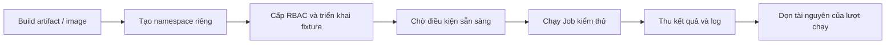

# Phân chia unit test, integration test và kiểm thử trong cluster

## Mục tiêu và tình huống sử dụng

Trong chương **Kiểm thử tự động** của module **SPRING_CLOUD_KUBERNETES**, ta cần trả lời hai câu hỏi: lỗi nào nên được phát hiện ngay trong JVM, và hành vi nào chỉ có thể chứng minh khi ứng dụng tương tác với Kubernetes thật?

Một ứng dụng có thể tính đúng báo giá nhưng không đọc được ConfigMap vì thiếu RBAC. Nó cũng có thể đọc được Service qua API nhưng không gọi được Pod do cấu hình cổng hoặc đường mạng. Đưa tất cả trường hợp vào một bộ kiểm thử lớn trong cluster làm phản hồi chậm và khó xác định nguyên nhân; chỉ dùng mock lại bỏ sót các lỗi triển khai quan trọng.

Bài này hướng dẫn phân chia phạm vi kiểm thử cho DiscoveryClient, ConfigMap, Secret, Spring Cloud LoadBalancer, Configuration Watcher và sức khỏe Pod. Các ví dụ Java dùng JUnit Jupiter, Spring Boot 3.5.x và các cơ chế Spring Cloud Kubernetes 3.3.x. Dự án phải chọn Spring Cloud BOM tương thích và quản lý phiên bản dependency kiểm thử nhất quán.

Sau bài học, bạn có thể:

- Phân loại test dựa trên thành phần thật, thành phần thay thế và ranh giới được kiểm tra.
- Viết unit test nghiệp vụ không cần Spring hoặc Kubernetes.
- Dùng integration test để kiểm tra adapter, cấu hình và hợp đồng giao tiếp.
- Chọn một tập kiểm thử cluster có giá trị, kèm điều kiện chờ và bằng chứng lỗi.
- Tách pipeline để bộ test nhanh không âm thầm cần credential cluster.

## 1. Ba khái niệm không nằm trên cùng một trục

**Unit test** và **integration test** mô tả phạm vi hành vi/thành phần được kiểm tra. **Trong cluster** mô tả môi trường thực thi hoặc môi trường đích. Vì vậy, đây không phải ba nhóm loại trừ nhau tuyệt đối.

Một integration test có thể chạy trong JVM trên laptop, gọi mock server local hoặc gọi Kubernetes API thật. Một test runner chạy trong Kubernetes Job cũng có thể chỉ chạy unit test; việc nằm trong Pod không tự làm test đó kiểm tra Kubernetes.

Để điều phối công việc, nhóm phát triển có thể quy ước ba bộ thực dụng:

| Bộ kiểm thử | Thành phần thật chủ yếu | Thành phần thay thế | Câu hỏi chính |
| --- | --- | --- | --- |
| Unit | Lớp nghiệp vụ hoặc policy nhỏ | Gateway/clock/nguồn dữ liệu tùy nhu cầu | Quy tắc xử lý có đúng không? |
| Integration không cần cluster | Spring context hoặc một adapter cùng thư viện giao tiếp | HTTP server, Kubernetes API hoặc dịch vụ phụ thuộc mô phỏng | Các thành phần này nối với nhau đúng không? |
| Integration/system với cluster thật | Image ứng dụng, manifest, API server, ServiceAccount và những thành phần cluster cần cho kịch bản | Chỉ những hệ thống ngoài phạm vi đã xác định | Ứng dụng hoạt động đúng với cách triển khai này không? |

Khi ghi kết quả, nên mô tả cả hai trục, chẳng hạn:

- “Unit test tính báo giá, không khởi động Spring.”
- “Integration test HTTP adapter, phản hồi được cung cấp bởi MockRestServiceServer.”
- “Integration test discovery: ứng dụng và test runner chạy trong cluster kind.”
- “Integration test API: runner ở ngoài cluster, không kiểm tra DNS giữa các Pod.”

Tên annotation, số lượng mock hoặc vị trí file không đủ để phân loại. Điều quan trọng là **đã chạy những thành phần thật nào và có thể kết luận đến đâu**.

## 2. Chọn lớp kiểm thử theo lỗi muốn phát hiện

Giả sử `checkout-service` gọi `catalog`, đọc cấu hình và được triển khai với Spring Cloud Kubernetes:

| Tính năng/rủi ro | Unit test phù hợp | Integration không cần cluster | Kiểm thử với cluster thật |
| --- | --- | --- | --- |
| Tính tổng tiền, kiểm tra số lượng | Đầu vào, quy tắc tính, trường hợp không có sản phẩm | Chuyển đổi request/response và wiring cần thiết | Một số luồng khói để xác nhận triển khai |
| DiscoveryClient | Policy của ứng dụng khi không có instance hoặc dữ liệu không hợp lệ | Mapping và xử lý lỗi qua adapter; có thể dùng API mô phỏng | Namespace, Service/EndpointSlice, informer/cache và quyền list/watch |
| ConfigMap | Xử lý giá trị cấu hình đã được cấp | Binding, kiểu dữ liệu, precedence và đường nạp được chọn | Đúng tên/namespace, nguồn API hoặc volume và RBAC tương ứng |
| Secret | Quy tắc sử dụng credential giả | Binding và hành vi khi thiếu dữ liệu thử nghiệm | Cách cấp Secret, mount/API, quyền và phạm vi đọc |
| LoadBalancer | Policy tùy chỉnh của ứng dụng nếu có | Cấu hình HTTP client, lỗi không có instance, hợp đồng phản hồi | Chọn đích thực tế và gọi được qua đường mạng/cổng triển khai |
| Configuration Watcher | Logic phản ứng với giá trị mới | Consumer có rebind/refresh đúng với cơ chế đã chọn | Theo dõi thay đổi, gửi thông báo và quan sát giá trị mới ở ứng dụng đang chạy |
| Sức khỏe Pod | Policy health tự viết | Nội dung endpoint/readiness của ứng dụng | Probe của kubelet, trạng thái Ready và tác động tới endpoint phục vụ |

Không cần viết test mới chỉ để xác nhận lại một dòng getter hoặc thuật toán bên trong thư viện mà ứng dụng không thay đổi. Chọn trường hợp có thể bắt lỗi cấu hình, hợp đồng hoặc quy tắc do dự án chịu trách nhiệm.

Nếu ứng dụng chỉ dùng Kubernetes DNS để gọi Service, không bắt buộc thêm test DiscoveryClient. Nếu nó không dùng watcher hoặc không đọc Secret qua API, không bật những tính năng đó chỉ để làm đầy danh sách kiểm thử.

## 3. Unit test: kiểm tra nghiệp vụ mà không mang Kubernetes vào

Tách việc lấy giá sản phẩm khỏi việc tính báo giá bằng một interface. Mỗi lớp public sau nằm trong file tương ứng, cùng package `com.example.testing`.

`CatalogGateway.java`:

```java
package com.example.testing;

import java.math.BigDecimal;
import java.util.Optional;

public interface CatalogGateway {
    Optional<BigDecimal> unitPrice(String sku);
}
```

`QuoteService.java`:

```java
package com.example.testing;

import java.math.BigDecimal;

public final class QuoteService {

    private final CatalogGateway catalogGateway;

    public QuoteService(CatalogGateway catalogGateway) {
        this.catalogGateway = catalogGateway;
    }

    public BigDecimal total(String sku, int quantity) {
        if (quantity < 1) {
            throw new IllegalArgumentException("quantity phải >= 1");
        }

        BigDecimal price = catalogGateway.unitPrice(sku)
                .orElseThrow(() ->
                        new IllegalStateException("Không có sản phẩm: " + sku));

        return price.multiply(BigDecimal.valueOf(quantity));
    }
}
```

`QuoteServiceTest.java`:

```java
package com.example.testing;

import java.math.BigDecimal;
import java.util.Optional;

import org.junit.jupiter.api.Tag;
import org.junit.jupiter.api.Test;

import static org.assertj.core.api.Assertions.assertThat;
import static org.assertj.core.api.Assertions.assertThatThrownBy;

@Tag("unit")
class QuoteServiceTest {

    @Test
    void calculatesTotalFromPriceAndQuantity() {
        CatalogGateway catalog = sku ->
                Optional.of(new BigDecimal("120000.00"));
        QuoteService service = new QuoteService(catalog);

        assertThat(service.total("spring-book", 3))
                .isEqualByComparingTo("360000.00");
    }

    @Test
    void rejectsInvalidQuantityBeforeLookingUpProduct() {
        CatalogGateway catalog = sku -> {
            throw new AssertionError("Không được tra giá với số lượng sai");
        };
        QuoteService service = new QuoteService(catalog);

        assertThatThrownBy(() -> service.total("spring-book", 0))
                .isInstanceOf(IllegalArgumentException.class);
    }

    @Test
    void reportsMissingProductInsteadOfInventingPrice() {
        QuoteService service =
                new QuoteService(sku -> Optional.empty());

        assertThatThrownBy(() -> service.total("missing", 1))
                .isInstanceOf(IllegalStateException.class)
                .hasMessageContaining("missing");
    }
}
```

Bộ test kiểm tra giá trị tiền, thứ tự kiểm tra đầu vào có ý nghĩa và hành vi khi thiếu sản phẩm. Nó không cần `@SpringBootTest`, profile, kubeconfig, mock Kubernetes hay container.

Dùng stub bằng lambda ở đây đủ rõ; không bắt buộc dùng Mockito cho mọi phụ thuộc. Nếu cần clock, random hoặc dữ liệu thời gian, truyền chúng vào để test kiểm soát được.

Những test này **chưa chứng minh** URL catalog đúng, JSON được giải mã đúng, discovery có instance hoặc ServiceAccount đủ quyền. Đó là các ranh giới khác.

## 4. Integration test: kiểm tra adapter và hợp đồng HTTP

Một HTTP adapter có thể sai đường dẫn, sai kiểu dữ liệu hoặc biến lỗi máy chủ thành “không có sản phẩm”. Các lỗi đó không được phát hiện bởi stub giá trong unit test.

### Adapter dùng trong ví dụ

`HttpCatalogGateway.java`:

```java
package com.example.testing;

import java.math.BigDecimal;
import java.util.Optional;

import org.springframework.beans.factory.annotation.Value;
import org.springframework.stereotype.Component;
import org.springframework.web.client.HttpClientErrorException;
import org.springframework.web.client.RestClient;

@Component
public class HttpCatalogGateway implements CatalogGateway {

    private final RestClient client;

    public HttpCatalogGateway(
            RestClient.Builder builder,
            @Value("${catalog.base-url}") String baseUrl) {
        this.client = builder.baseUrl(baseUrl).build();
    }

    @Override
    public Optional<BigDecimal> unitPrice(String sku) {
        try {
            PriceResponse response = client.get()
                    .uri("/products/{sku}", sku)
                    .retrieve()
                    .body(PriceResponse.class);

            if (response == null || response.unitPrice() == null) {
                throw new IllegalStateException("Phản hồi catalog thiếu giá");
            }

            return Optional.of(response.unitPrice());
        } catch (HttpClientErrorException.NotFound ex) {
            return Optional.empty();
        }
    }

    public record PriceResponse(BigDecimal unitPrice) {
    }
}
```

Adapter chỉ chuyển HTTP 404 thành “không có sản phẩm”. HTTP 500 và lỗi kết nối phải còn là lỗi để caller xử lý theo chính sách của hệ thống.

Ví dụ kiểm thử dưới đây giả định dự án có lớp gốc `@SpringBootApplication` hoặc `@SpringBootConfiguration` để Spring Boot tìm cấu hình kiểm thử. Các ví dụ trong bài minh họa từng ranh giới; không phải một bộ manifest triển khai hoàn chỉnh.

### Test slice cho HTTP client

`HttpCatalogGatewayIT.java`:

```java
package com.example.testing;

import org.junit.jupiter.api.AfterEach;
import org.junit.jupiter.api.Tag;
import org.junit.jupiter.api.Test;

import org.springframework.beans.factory.annotation.Autowired;
import org.springframework.boot.test.autoconfigure.web.client.RestClientTest;
import org.springframework.http.HttpMethod;
import org.springframework.http.HttpStatus;
import org.springframework.http.MediaType;
import org.springframework.test.context.ActiveProfiles;
import org.springframework.test.web.client.MockRestServiceServer;
import org.springframework.web.client.HttpServerErrorException;

import static org.assertj.core.api.Assertions.assertThat;
import static org.assertj.core.api.Assertions.assertThatThrownBy;
import static org.springframework.test.web.client.match.MockRestRequestMatchers.method;
import static org.springframework.test.web.client.match.MockRestRequestMatchers.requestTo;
import static org.springframework.test.web.client.response.MockRestResponseCreators.withStatus;
import static org.springframework.test.web.client.response.MockRestResponseCreators.withSuccess;

@Tag("integration")
@ActiveProfiles("offline-test")
@RestClientTest(
        components = HttpCatalogGateway.class,
        properties = "catalog.base-url=https://catalog.test.invalid")
class HttpCatalogGatewayIT {

    @Autowired
    HttpCatalogGateway gateway;

    @Autowired
    MockRestServiceServer server;

    @AfterEach
    void verifyAndReset() {
        try {
            server.verify();
        } finally {
            server.reset();
        }
    }

    @Test
    void readsPriceFromExpectedProductEndpoint() {
        server.expect(requestTo(
                        "https://catalog.test.invalid/products/spring-book"))
                .andExpect(method(HttpMethod.GET))
                .andRespond(withSuccess(
                        "{\"unitPrice\":120000.00}",
                        MediaType.APPLICATION_JSON));

        assertThat(gateway.unitPrice("spring-book"))
                .hasValueSatisfying(price ->
                        assertThat(price).isEqualByComparingTo("120000.00"));
    }

    @Test
    void mapsNotFoundToMissingProduct() {
        server.expect(requestTo(
                        "https://catalog.test.invalid/products/missing"))
                .andRespond(withStatus(HttpStatus.NOT_FOUND));

        assertThat(gateway.unitPrice("missing")).isEmpty();
    }

    @Test
    void keepsServerFailureVisible() {
        server.expect(requestTo(
                        "https://catalog.test.invalid/products/spring-book"))
                .andRespond(withStatus(HttpStatus.INTERNAL_SERVER_ERROR));

        assertThatThrownBy(() -> gateway.unitPrice("spring-book"))
                .isInstanceOf(HttpServerErrorException.class);
    }
}
```

`@RestClientTest` chọn phạm vi HTTP client và cấu hình hỗ trợ kiểm thử tương ứng. Adapter nhận `RestClient.Builder` từ Spring để test có thể gắn MockRestServiceServer vào client. Nếu adapter tự tạo một client ngoài cơ chế này, test có thể không kiểm soát được request như dự kiến.

Test dùng URI đầy đủ trong expectation vì đối tượng dưới test là `RestClient`. Cách dùng test slice được mô tả trong [Testing Spring Boot Applications](https://docs.spring.io/spring-boot/3.5/reference/testing/spring-boot-applications.html).

Ở ranh giới này, Spring, adapter, phép chuyển đổi JSON và cơ chế xử lý mã HTTP là thật. Phản hồi HTTP do test cung cấp. Nó chưa kiểm tra TCP, TLS thực tế, DNS, Kubernetes Service hoặc cân bằng tải.

MockRestServiceServer thay cơ chế gửi request, không khởi động một máy chủ HTTP thật. Khi cần kiểm tra transport, timeout hoặc hành vi của HTTP engine, dùng một mock web server thực sự lắng nghe socket với cùng HTTP engine của ứng dụng. Hai cách có phạm vi khác nhau theo [Testing Client Applications](https://docs.spring.io/spring-framework/reference/6.2/testing/spring-mvc-test-client.html).

## 5. Giữ bộ integration không cần cluster thực sự độc lập

Trong `src/test/resources/application-offline-test.yml` của dự án kiểm thử có thể dùng:

```yaml
spring:
  main:
    cloud-platform: NONE
  cloud:
    discovery:
      enabled: false
    kubernetes:
      discovery:
        enabled: false
      config:
        enabled: false
      secrets:
        enabled: false
      reload:
        enabled: false

management:
  health:
    kubernetes:
      enabled: false
```

Quan trọng hơn, file `application.yml` dùng chung không được bắt mọi profile nạp `spring.config.import: "kubernetes:"`. Đặt import đó trong profile tích hợp Kubernetes, không yêu cầu profile test “gỡ bỏ” một import đã được xử lý sớm.

`optional:kubernetes:` vẫn là một khai báo nguồn Kubernetes; nó không phải cam kết rằng resolver/client sẽ không gọi mạng. Tương tự, mock một bean sau khi context bắt đầu được chuẩn bị không bảo đảm ngăn các truy cập xảy ra ở giai đoạn nạp Config Data.

Cơ chế import và sự khác nhau với bootstrap được nêu trong [Kubernetes PropertySource implementations](https://docs.spring.io/spring-cloud-kubernetes/reference/3.3/property-source-config.html). Với Spring Cloud Kubernetes 3.x, nhận diện nền tảng được điều khiển bằng `spring.main.cloud-platform`, không dùng thuộc tính cũ `spring.cloud.kubernetes.enabled`; xem [Kubernetes Ecosystem Awareness](https://docs.spring.io/spring-cloud-kubernetes/reference/3.3/kubernetes-awareness.html).

CI của bộ test nhanh nên không được cấp kubeconfig và ServiceAccount token. Nếu bộ test chỉ chạy được nhờ credential của máy developer, nó đã có một phụ thuộc ẩn cần xử lý.

### Khi nào dùng SpringBootTest?

Dùng `@SpringBootTest` khi câu hỏi thực sự liên quan tới việc lắp ghép nhiều thành phần hoặc hành vi khởi động của ứng dụng. Không dùng nó làm mặc định cho mọi phép tính.

Phân biệt các cấu hình:

| Cách kiểm thử | Thành phần được chạy | Điều chưa thể kết luận |
| --- | --- | --- |
| Unit test tạo đối tượng bằng `new` | Lớp được chọn và các dependency do test cấp | Wiring Spring và hạ tầng |
| `@WebMvcTest` cùng dependency thay thế | MVC slice, mapping, chuyển đổi và phần web được chọn | Toàn bộ ứng dụng hay Kubernetes |
| `@RestClientTest` | HTTP adapter và cấu hình client được chọn | DNS/Service/Pod nếu request đã bị thay thế |
| `@SpringBootTest` mặc định | ApplicationContext với môi trường web giả lập nếu có web | Không tự khởi động HTTP server |
| `@SpringBootTest(RANDOM_PORT)` | Context và embedded HTTP server thật | Không tự tạo cluster hoặc API server Kubernetes |

Trong bài, integration test không được hiểu là “bất kỳ test nào có Spring annotation”. Hãy ghi rõ phạm vi đã chọn trong tên test hoặc tài liệu bộ test.

Nếu dùng `@MockitoBean` để thay `DiscoveryClient`, bạn đang kiểm tra hành vi ứng dụng với một kết quả discovery được cung cấp sẵn. Điều đó có thể có giá trị, nhưng chưa chứng minh implementation Spring Cloud Kubernetes đọc Service/EndpointSlice đúng. Cơ chế thay bean được mô tả trong [Bean Overriding in Tests](https://docs.spring.io/spring-framework/reference/testing/testcontext-framework/bean-overriding.html).

### Kubernetes mock server kiểm tra được gì?

Fabric8 có mock server theo chế độ expectation hoặc CRUD. Chế độ expectation cho phép khai báo request/phản hồi; CRUD lưu tài nguyên mô phỏng. Xem [Mocking Kubernetes của Fabric8](https://github.com/fabric8io/kubernetes-client#mocking-kubernetes).

Một integration test có thể dùng nó để kiểm tra adapter của ứng dụng:

- Gửi request tới đúng namespace và tên ConfigMap.
- Đọc đúng khóa hoặc báo lỗi khi thiếu dữ liệu.
- Giữ lỗi 403/500 đúng theo chính sách ứng dụng.
- Tương tác với các phản hồi list/watch mà kịch bản đã mô phỏng.

Nhưng một phản hồi 403 do test khai báo không chứng minh RoleBinding đang bảo vệ tài nguyên thật. Tạo Pod bằng CRUD mock cũng không làm scheduler, kubelet hoặc controller tạo một Pod đang chạy.

Nếu kiểm tra Spring Cloud Kubernetes bằng mock API, phải để **implementation thật cần kiểm tra** trỏ tới API mô phỏng, đồng thời chuẩn bị các tài nguyên/request cần cho phiên bản đó. Chỉ gọi `client.configMaps().get()` trong test không chứng minh cơ chế Config Data của Spring Cloud Kubernetes đã được chạy.

API server thật kèm etcd nhưng không có đầy đủ thành phần Node cũng không tương đương một cluster có DNS, kubelet và mạng Pod. Luôn ghi rõ những thành phần nào thực sự hiện diện.

## 6. Kiểm thử trong cluster: chứng minh hành vi triển khai

Với nhóm test này, ứng dụng dưới test thực sự chạy thành Pod và dùng cấu hình triển khai đã chọn. Test runner có thể chạy trong một Job để sử dụng cùng DNS và đường mạng nội bộ.

Một cluster kind là Kubernetes thật phục vụ kiểm thử cục bộ/CI, không phải mock API. Tuy nhiên, nó không tự tái tạo load balancer đám mây, chính sách mạng, ingress controller hoặc toàn bộ hạ tầng production. Phải ghi rõ các thành phần đã cài và các giới hạn môi trường. Xem [kind Quick Start](https://kind.sigs.k8s.io/docs/user/quick-start/).

Luồng điều phối nên là:



Image ứng dụng, manifest và phiên bản cluster là một phần của bằng chứng. Nếu test chỉ chạy một image fixture tối giản, kết quả chỉ xác nhận fixture đó; không được suy ra image phát hành của ứng dụng đã được kiểm tra tương đương.

### Tách danh tính điều phối khỏi danh tính ứng dụng

Thông thường cần hai phạm vi quyền:

- **Bộ điều phối CI** tạo namespace, triển khai fixture và thu log theo quyền được cấp.
- **Ứng dụng dưới test** dùng ServiceAccount giống vai trò chạy ứng dụng, chỉ có các quyền phục vụ tính năng được kiểm tra.

Nếu ứng dụng chạy bằng credential quản trị của runner, bộ test có thể bỏ sót hoàn toàn lỗi RBAC của deployment.

Một Job chỉ gọi HTTP của ứng dụng không cần tự có quyền đọc Kubernetes API. Có thể không mount ServiceAccount token cho runner đó; việc tạo và quan sát Job do bộ điều phối thực hiện.

## 7. Ví dụ kiểm thử discovery bằng implementation thật

Kịch bản này chỉ kiểm tra **đọc instance qua DiscoveryClient**. Nó chưa chứng minh gọi nghiệp vụ, cân bằng tải hoặc refresh cấu hình.

### Chuẩn bị fixture có chủ đích

Trong namespace riêng của lượt chạy, chuẩn bị:

1. Một Service có tên duy nhất, ví dụ `catalog-<run-id>`, chọn hai Pod Ready.
2. Cổng endpoint HTTP của các Pod là `8080`.
3. Ứng dụng probe dùng `spring-cloud-starter-kubernetes-fabric8` và DiscoveryClient thật.
4. ServiceAccount ứng dụng có quyền đọc Service và EndpointSlice trong namespace đó.
5. Service `discovery-probe` để runner gọi HTTP của probe.
6. Không dùng mock DiscoveryClient hoặc API server mô phỏng trong kịch bản này.

Cấu hình `application-cluster-test.yml` của ứng dụng probe:

```yaml
spring:
  application:
    name: discovery-probe
  main:
    cloud-platform: KUBERNETES
  cloud:
    kubernetes:
      client:
        namespace: ${TEST_NAMESPACE}
      discovery:
        enabled: true
        all-namespaces: false
        namespaces:
          - ${TEST_NAMESPACE}
        use-endpoint-slices: true
        include-not-ready-addresses: false
        metadata:
          add-pod-labels: false
          add-pod-annotations: false
      config:
        enabled: false
      secrets:
        enabled: false

management:
  health:
    kubernetes:
      enabled: false
```

Chỉ bật discovery để tránh đưa ConfigMap, Secret hoặc Pod Health Indicator vào một test chưa định kiểm tra chúng. DiscoveryClient có phạm vi namespace và lựa chọn EndpointSlice riêng; đối chiếu [DiscoveryClient for Kubernetes](https://docs.spring.io/spring-cloud-kubernetes/reference/3.3/discovery-client.html).

Deployment chọn profile `cluster-test`, dùng ServiceAccount của ứng dụng và truyền namespace từ metadata của chính Pod:

```yaml
# Trích phần Pod template, không phải Deployment đầy đủ.
spec:
  serviceAccountName: discovery-app
  containers:
    - name: application
      image: <IMAGE_KIEM_THU_DA_BUILD>
      env:
        - name: SPRING_PROFILES_ACTIVE
          value: cluster-test
        - name: TEST_NAMESPACE
          valueFrom:
            fieldRef:
              fieldPath: metadata.namespace
```

Role cho lựa chọn tính năng trên cần các rule:

```yaml
# Trích phần rules của Role trong namespace riêng của lượt chạy.
rules:
  - apiGroups: [""]
    resources: ["services"]
    verbs: ["get", "list", "watch"]
  - apiGroups: ["discovery.k8s.io"]
    resources: ["endpointslices"]
    verbs: ["get", "list", "watch"]
```

RoleBinding phải gắn Role đó với đúng ServiceAccount `discovery-app` trong namespace. Không lấy việc test bằng user quản trị đọc được tài nguyên làm bằng chứng ứng dụng có quyền.

### Endpoint probe chỉ dành cho môi trường kiểm thử

Thêm controller sau vào fixture hoặc bản build kiểm thử có kiểm soát. Không mở endpoint này ra môi trường công khai. Ứng dụng cần có cấu hình DiscoveryClient phù hợp; có thể khai báo `@EnableDiscoveryClient` trên lớp cấu hình gốc theo hướng dẫn của phiên bản đang dùng.

```java
package com.example.clusterprobe;

import java.util.List;

import org.springframework.cloud.client.discovery.DiscoveryClient;
import org.springframework.context.annotation.Profile;
import org.springframework.web.bind.annotation.GetMapping;
import org.springframework.web.bind.annotation.PathVariable;
import org.springframework.web.bind.annotation.RestController;

@RestController
@Profile("cluster-test")
public class DiscoveryProbe {

    private final DiscoveryClient discoveryClient;

    public DiscoveryProbe(DiscoveryClient discoveryClient) {
        this.discoveryClient = discoveryClient;
    }

    @GetMapping("/internal/test/discovery/{serviceId}")
    public List<InstanceView> instances(
            @PathVariable("serviceId") String serviceId) {
        return discoveryClient.getInstances(serviceId)
                .stream()
                .map(instance -> new InstanceView(
                        instance.getServiceId(),
                        instance.getHost(),
                        instance.getPort()))
                .toList();
    }

    public record InstanceView(
            String serviceId,
            String host,
            int port) {
    }
}
```

Package controller phải nằm trong phạm vi scan/import của ứng dụng probe. Các mã mẫu ở phần unit/integration trước thuộc package khác và không phải điều kiện bắt buộc để tạo fixture discovery.

### Runner kiểm tra kết quả quan sát được

Runner nhận ba biến môi trường bắt buộc:

| Biến | Ví dụ |
| --- | --- |
| `APP_BASE_URL` | `http://discovery-probe.<test-namespace>.svc.cluster.local:8080` |
| `TEST_SERVICE_ID` | `catalog-<run-id>` |
| `EXPECTED_INSTANCE_COUNT` | `2` |

Lớp `ClusterDiscoveryIT.java` không tạo một Spring application context mới trong runner. Nó gọi ứng dụng đang chạy trong cluster:

```java
package com.example.clustertest;

import java.net.http.HttpClient;
import java.time.Duration;

import org.junit.jupiter.api.Tag;
import org.junit.jupiter.api.Test;

import org.springframework.http.client.JdkClientHttpRequestFactory;
import org.springframework.web.client.ResourceAccessException;
import org.springframework.web.client.RestClient;

import static org.assertj.core.api.Assertions.assertThat;
import static org.awaitility.Awaitility.await;

@Tag("cluster")
class ClusterDiscoveryIT {

    @Test
    void applicationDiscoversExpectedReadyInstances() {
        String baseUrl = requiredEnv("APP_BASE_URL");
        String serviceId = requiredEnv("TEST_SERVICE_ID");
        int expectedCount = Integer.parseInt(
                requiredEnv("EXPECTED_INSTANCE_COUNT"));
        assertThat(expectedCount).isPositive();

        HttpClient engine = HttpClient.newBuilder()
                .connectTimeout(Duration.ofSeconds(2))
                .build();

        JdkClientHttpRequestFactory factory =
                new JdkClientHttpRequestFactory(engine);
        factory.setReadTimeout(Duration.ofSeconds(2));

        RestClient client = RestClient.builder()
                .requestFactory(factory)
                .baseUrl(baseUrl)
                .build();

        await()
                .alias("Ứng dụng quan sát đủ instance Ready")
                .pollInterval(Duration.ofMillis(500))
                .atMost(Duration.ofSeconds(45))
                .ignoreExceptionsMatching(
                        ex -> ex instanceof ResourceAccessException)
                .untilAsserted(() -> {
                    InstanceView[] instances = client.get()
                            .uri("/internal/test/discovery/{serviceId}",
                                    serviceId)
                            .retrieve()
                            .body(InstanceView[].class);

                    assertThat(instances).hasSize(expectedCount);
                    assertThat(instances).allSatisfy(instance -> {
                        assertThat(instance.serviceId())
                                .isEqualTo(serviceId);
                        assertThat(instance.host()).isNotBlank();
                        assertThat(instance.port()).isEqualTo(8080);
                    });
                });
    }

    private static String requiredEnv(String name) {
        String value = System.getenv(name);
        if (value == null || value.isBlank()) {
            throw new IllegalStateException(
                    "Thiếu biến môi trường bắt buộc: " + name);
        }
        return value;
    }

    public record InstanceView(
            String serviceId,
            String host,
            int port) {
    }
}
```

Timeout HTTP cho từng request và thời hạn chờ toàn kịch bản là hai cấu hình khác nhau. Test chỉ bỏ qua lỗi truy cập mạng tạm thời trong lúc chờ; không bỏ qua mọi exception, vì HTTP 401/403 hoặc sai schema cần được nhìn thấy.

Awaitility lặp assertion cho tới khi điều kiện đạt hoặc hết thời hạn. Đây là cách chờ một trạng thái quan sát được, không đoán thời gian bằng một lần `Thread.sleep(10000)`. Xem [Awaitility Usage](https://github.com/awaitility/awaitility/wiki/Usage).

Số instance được kiểm tra sau khi fixture đã ổn định, không phụ thuộc thứ tự danh sách. Dùng tên Service và namespace riêng giúp tránh vô tình đọc dữ liệu cũ của một lượt chạy khác.

Test không dùng `assumeTrue` để bỏ qua khi thiếu `APP_BASE_URL`. Trong một job được giao nhiệm vụ kiểm thử cluster, thiếu fixture hoặc cấu hình phải làm job thất bại; không tạo kết quả xanh do không chạy được test.

## 8. Những kịch bản cluster cần bổ sung theo tính năng

Bài discovery ở trên chỉ là một lát cắt. Chọn thêm kịch bản khi ứng dụng thật có sử dụng tính năng tương ứng:

| Kịch bản | Thao tác | Assertion có giá trị |
| --- | --- | --- |
| Discovery thay đổi | Làm một backend không Ready hoặc thay replica trong fixture | Sau thời gian hội tụ, tập instance phản ánh trạng thái mới; địa chỉ cũ không còn khi đã bị loại |
| Giới hạn namespace | Tạo Service tên riêng chỉ có ở namespace ngoài phạm vi discovery | Ứng dụng không trả instance của Service đó |
| ConfigMap lúc khởi động | Cấp giá trị đánh dấu riêng cho lượt chạy rồi khởi động ứng dụng | Consumer thực sự dùng giá trị đó, không phải giá trị mặc định |
| RBAC âm cho ConfigMap API | Chạy một deployment riêng với thiếu quyền đọc và cấu hình fail-fast phù hợp | Ứng dụng không Ready/khởi động thất bại đúng hợp đồng, log chỉ rõ lỗi quyền |
| Secret | Cấp Secret thử nghiệm và thay đổi quyền/nguồn cấp theo kịch bản | Consumer xác thực được hoặc thất bại đúng mong đợi, không trả giá trị Secret ra log |
| LoadBalancer | Gọi qua đúng client và mode ứng dụng đang dùng | Request đến backend hợp lệ; kiểm tra thêm khi một backend bị loại |
| Watcher refresh | Thay cấu hình được theo dõi sau khi ứng dụng đang chạy | Consumer quan sát giá trị mới trong giới hạn thời gian, theo đúng chiến lược refresh/restart đã chọn |
| Readiness | Điều khiển một điều kiện readiness của fixture | Trạng thái Pod và endpoint phục vụ phản ánh điều kiện đó |

Một số điểm cần giữ đúng:

**Discovery có dữ liệu chưa chứng minh gọi được nghiệp vụ.** Muốn kiểm tra mạng/cổng và LoadBalancer, phải gửi request thật qua client của ứng dụng tới backend, rồi kiểm tra phản hồi.

**Kỳ vọng cân bằng tải phải theo mode.** Spring Cloud Kubernetes có các mode `POD` và `SERVICE`, với đường chọn đích khác nhau. Không gán mọi hành vi phân phối request cho cùng một cơ chế; xem [LoadBalancer for Kubernetes](https://docs.spring.io/spring-cloud-kubernetes/reference/3.3/load-balancer.html). Một test ngắn không nên đòi tỷ lệ request chính xác 50/50 nếu đó không phải hợp đồng đã kiểm soát.

**ConfigMap đổi không tự chứng minh refresh.** Nếu test restart Pod rồi mới đọc giá trị mới, nó kiểm tra nạp cấu hình lúc khởi động. Muốn kiểm tra watcher, phải có watcher thật, label/phạm vi theo dõi đúng, đường gửi thông báo và consumer hỗ trợ cập nhật. Với chiến lược refresh, có thể kiểm tra thêm Pod UID và restart count không đổi; với chiến lược shutdown/restart thì kỳ vọng khác. Xem [Configuration Watcher](https://docs.spring.io/spring-cloud-kubernetes/reference/3.3/spring-cloud-kubernetes-configuration-watcher.html).

**Health ứng dụng và trạng thái Pod là hai lớp.** HTTP 200 tại một endpoint không tự chứng minh kubelet đã dùng đúng probe hoặc Pod đã Ready. Kiểm tra cả manifest, điều kiện Pod và tác động của readiness theo [tài liệu probe của Kubernetes](https://kubernetes.io/docs/tasks/configure-pod-container/configure-liveness-readiness-startup-probes/).

**Quyền đọc phụ thuộc đường cấp cấu hình.** Ứng dụng đọc ConfigMap/Secret bằng API cần quyền cho danh tính gọi API. Nếu dữ liệu chỉ được cấp qua volume hoặc biến môi trường của Pod, không mặc định yêu cầu ServiceAccount của ứng dụng có quyền list Secret. Phân quyền phải phù hợp cách tích hợp đã chọn theo [mô hình RBAC](https://kubernetes.io/docs/reference/access-authn-authz/rbac/).

## 9. Phân nhóm test và gắn vào pipeline

Một quy ước tên/tag có thể là:

| Bộ | Tên lớp | Tag |
| --- | --- | --- |
| Unit | `QuoteServiceTest` | `unit` |
| Integration không cần cluster | `HttpCatalogGatewayIT` | `integration` |
| Cluster | `ClusterDiscoveryIT` | `cluster` |

Tag mô tả nhóm; build tool vẫn cần được cấu hình để chọn nhóm. Annotation `@Tag("cluster")` không tự làm test chỉ chạy khi có cluster. Tham khảo [JUnit tagging và filtering](https://docs.junit.org/5.11.4/user-guide/index.html#writing-tests-tagging-and-filtering).

Với Maven, Surefire thường chọn các tên như `*Test`, còn Failsafe chọn các tên như `*IT`. Failsafe phải được khai báo trong lifecycle; chỉ đổi tên lớp chưa đủ để nó chạy. Xem [Surefire inclusions](https://maven.apache.org/surefire/maven-surefire-plugin/examples/inclusion-exclusion.html) và [Failsafe inclusions](https://maven.apache.org/surefire/maven-failsafe-plugin/examples/inclusion-exclusion.html).

### Cấu hình Maven minh họa

Dependency test:

```xml
<dependency>
    <groupId>org.springframework.boot</groupId>
    <artifactId>spring-boot-starter-test</artifactId>
    <scope>test</scope>
</dependency>

<dependency>
    <groupId>org.awaitility</groupId>
    <artifactId>awaitility</artifactId>
    <scope>test</scope>
</dependency>
```

Ví dụ phần chọn tag cho integration test:

```xml
<properties>
    <it.tags>integration</it.tags>
</properties>

<build>
    <plugins>
        <plugin>
            <groupId>org.apache.maven.plugins</groupId>
            <artifactId>maven-surefire-plugin</artifactId>
            <configuration>
                <failIfNoTests>true</failIfNoTests>
            </configuration>
        </plugin>

        <plugin>
            <groupId>org.apache.maven.plugins</groupId>
            <artifactId>maven-failsafe-plugin</artifactId>
            <configuration>
                <includes>
                    <include>**/*IT.java</include>
                </includes>
                <groups>${it.tags}</groups>
                <failIfNoTests>true</failIfNoTests>
            </configuration>
            <executions>
                <execution>
                    <goals>
                        <goal>integration-test</goal>
                        <goal>verify</goal>
                    </goals>
                </execution>
            </executions>
        </plugin>
    </plugins>
</build>
```

Đoạn này giả định parent hoặc `pluginManagement` đã quản lý phiên bản Surefire/Failsafe hỗ trợ JUnit Jupiter; nếu chưa có, dự án phải khai báo phiên bản phù hợp. Dependency version cũng cần được quản lý bởi BOM/parent của dự án.

Theo quy ước trên:

```powershell
# Bộ nhanh: các lớp tên *Test theo quy ước của dự án.
.\mvnw.cmd test

# Qua lifecycle verify; Failsafe chọn tag integration.
.\mvnw.cmd verify

# Chọn bộ cluster khi fixture đã được chuẩn bị.
.\mvnw.cmd verify '-Dit.tags=cluster' '-Dit.test=ClusterDiscoveryIT'
```

Lệnh `verify` vẫn đi qua các phase trước đó, nên Surefire có thể chạy unit test trước Failsafe. Đừng hiểu việc chọn tag của Failsafe là đã tự bỏ qua mọi test khác trong lifecycle.

Các lệnh trên chỉ minh họa chọn test trong runner. Chúng không tạo cluster, namespace, image hay Job. Pipeline phải chuẩn bị fixture và biến môi trường tương ứng trước khi chạy bộ cluster.

Nên theo dõi số test đã chạy, số bị skip và báo cáo của cả hai plugin. Một stage xanh nhưng không có test nào thực thi không đáp ứng mục tiêu kiểm tra; `failIfNoTests` là một kiểm soát hỗ trợ, không thay thế việc đối chiếu kết quả mong đợi.

### Phân tầng pipeline theo giá trị phản hồi

| Thời điểm | Bộ nên chạy | Điều kiện |
| --- | --- | --- |
| Khi phát triển và mỗi thay đổi | Unit, các test slice/adapter nhanh cần thiết | Không cần credential cluster |
| Trước khi tích hợp thay đổi | Integration liên quan tới hợp đồng và cấu hình | Fixture có thể chạy local/CI, tài nguyên được cô lập |
| Khi thay dependency Kubernetes, cấu hình triển khai hoặc image | Các test cluster liên quan | Dùng artifact và manifest cần xác nhận |
| Trước phát hành theo yêu cầu dự án | Tập smoke/cluster và kiểm tra môi trường cần thiết | Bằng chứng đủ cho tính năng thực sự được triển khai |

Không có tỷ lệ unit/integration/cluster bắt buộc cho mọi dự án. Chọn bộ nhỏ nhất có khả năng bắt lỗi ở từng ranh giới, rồi bổ sung khi có rủi ro hoặc lỗi đã quan sát.

## 10. Cô lập fixture, chờ hội tụ và giữ bằng chứng

Bộ test cluster thường bất đồng bộ. Các bước tạo tài nguyên, Pod Ready, EndpointSlice cập nhật, informer nhận sự kiện và ứng dụng refresh không xảy ra đồng thời.

Để tránh test chập chờn:

- Dùng namespace và tên tài nguyên gắn với một run ID duy nhất.
- Cấp dữ liệu đánh dấu riêng cho từng lượt chạy; không đọc giá trị mặc định giống mọi môi trường.
- Chờ đúng điều kiện quan sát được với thời hạn rõ ràng.
- Chỉ retry lỗi tạm thời có lý do; không bỏ qua lỗi quyền hoặc sai schema.
- Tránh để các test song song cùng sửa một Role, ConfigMap hoặc replica count.
- Thu bằng chứng trước khi dọn tài nguyên, kể cả khi test thất bại.
- Chỉ dọn namespace/tài nguyên do chính lượt chạy sở hữu.

Khi timeout, báo lỗi cần giúp xác định lớp hỏng:

| Bằng chứng | Giúp phân biệt |
| --- | --- |
| Image digest và phiên bản dependency | Đã kiểm tra đúng artifact chưa |
| Manifest đã render, context và namespace test | Đã triển khai đúng nơi và đúng tham số chưa |
| Log ứng dụng, init container và watcher nếu có | Lỗi nạp cấu hình, quyền, cache hoặc thông báo |
| Trạng thái Pod, restart count và event | Lỗi scheduling, image, probe hoặc vòng lặp khởi động |
| Service và EndpointSlice | Sai selector, cổng hoặc Ready condition |
| Kết quả HTTP và tập instance quan sát được | Ứng dụng đang thấy gì, khác mong đợi ở đâu |
| Báo cáo JUnit/Surefire/Failsafe | Test nào chạy, fail hoặc bị skip |

Không lưu token, kubeconfig đầy đủ hoặc nội dung Secret trong artifact chẩn đoán. Với Secret thử nghiệm, dùng một consumer trả tín hiệu thành công/thất bại hoặc version marker riêng, thay vì trả credential ra HTTP.

Nếu dùng `kubectl auth can-i --as=...`, danh tính điều phối cần quyền impersonation tương ứng. Đây là kiểm tra hỗ trợ; bằng chứng mạnh hơn vẫn là ứng dụng thực sự chạy với ServiceAccount đó và thực hiện đường gọi đang kiểm tra.

## 11. Những kết luận quá mức cần tránh

| Quan sát | Kết luận hợp lệ | Kết luận chưa được chứng minh |
| --- | --- | --- |
| Unit test báo giá xanh | Quy tắc với các đầu vào được kiểm tra đúng | Catalog triển khai trên Kubernetes gọi được |
| Mock API trả 403 và adapter báo lỗi | Adapter xử lý phản hồi cấm truy cập đúng | RoleBinding trong cluster thật đúng |
| Spring context khởi động với mock DiscoveryClient | Wiring/consumer được kiểm tra hoạt động với mock | Discovery đọc Service/EndpointSlice thật |
| Probe trả hai instance | Ứng dụng quan sát hai instance theo cấu hình đó | Client gọi được chúng hoặc phân phối tải đúng |
| ConfigMap đổi, Pod restart, giá trị mới xuất hiện | Nạp lại cấu hình sau khởi động hoạt động | Watcher refresh trong cùng tiến trình hoạt động |
| Health HTTP trả 200 | Endpoint và contributor đang bật báo tốt | Mọi phụ thuộc, kubelet probe và routing đều đúng |
| Job hoàn thành nhưng test bị skip | Job đã chạy xong | Bộ kiểm thử cluster đã xác nhận chức năng |

Một test tốt cần có assertion đủ gần hành vi mà nó tuyên bố. Nếu muốn xác nhận refresh của bean nghiệp vụ, chỉ đọc trực tiếp dữ liệu mới từ API không đủ; phải quan sát consumer sau refresh. Nếu muốn xác nhận LoadBalancer, chỉ gọi thẳng URL của một Pod không đủ.

## 12. Bài thực hành phân chia bộ kiểm thử

Với một ứng dụng Spring Cloud Kubernetes của bạn:

1. Liệt kê các tính năng đang bật và đánh dấu tính năng nào thực sự cần khi triển khai.
2. Chọn một quy tắc nghiệp vụ để viết unit test không khởi động Spring.
3. Chọn một adapter hoặc phần binding cấu hình để viết integration test không dùng cluster.
4. Xác nhận bộ test đó vẫn chạy khi môi trường không cấp credential Kubernetes.
5. Chọn một kịch bản cluster bắt lỗi mà hai lớp trước không chứng minh được, ví dụ sai namespace hoặc thiếu quyền list/watch.
6. Đặt fixture riêng, thời hạn chờ, assertion và bằng chứng cần thu khi thất bại.
7. Gắn bộ test vào pipeline và kiểm tra số lượng test thực thi, không chỉ mã thoát của job.

Hoàn thành khi bạn mô tả được từng test theo bốn dòng:

```text
Hành vi cần chứng minh:
Thành phần thật và thành phần thay thế:
Điều kiện đạt/thất bại:
Những điều test này chưa chứng minh:
```

Với cách phân chia này, lỗi nghiệp vụ được phát hiện nhanh, lỗi tích hợp được kiểm tra ở ranh giới thích hợp, và bộ test cluster tập trung vào những hành vi thật sự phụ thuộc cách triển khai Kubernetes.
