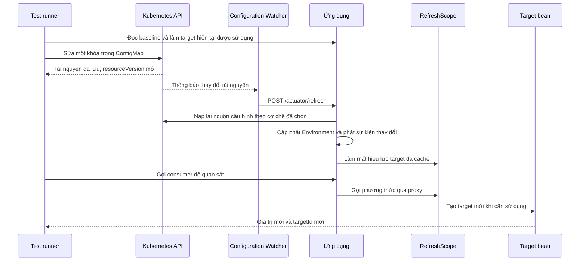

# Kiểm thử cập nhật tài nguyên, refresh và bean được tái tạo

## Mục tiêu và tình huống sử dụng

Trong chương **Kiểm thử tự động** của module **SPRING_CLOUD_KUBERNETES**, việc kiểm thử cập nhật cấu hình phải đi xa hơn câu khẳng định “ConfigMap đã đổi”. Ta cần biết ứng dụng đã nạp giá trị mới chưa, consumer đang dùng giá trị nào và bean nào thực sự được tạo lại.

Ví dụ, `refresh-demo` đọc lời chào từ ConfigMap. Sau khi đổi `demo.greeting.prefix` từ một giá trị trước cập nhật sang giá trị sau cập nhật, bài kiểm thử cần chứng minh đồng thời:

- Tài nguyên Kubernetes đã được cập nhật đúng nơi.
- Spring Environment của ứng dụng phản ánh giá trị mới.
- Target của bean `@RefreshScope` dùng giá trị mới và có định danh mới.
- Với chiến lược refresh của bài, tiến trình và application context vẫn là phiên ban đầu.

Những kiểm tra này giúp phân biệt refresh với một lần Pod/container hoặc context khởi động lại. Chúng cũng giúp tách lỗi RBAC, đọc ConfigMap, Configuration Watcher, Actuator và lifecycle bean.

Ví dụ dùng Spring Boot 3.5.x, Spring Cloud Context thuộc dòng 4.3.x và Spring Cloud Kubernetes 3.3.x, chạy trên JVM. Cần chọn BOM tương thích với dự án và cố định phiên bản image watcher. Các mẫu không giả định cơ chế refresh JVM này dùng nguyên trạng cho AOT/native image.

## 1. Chuỗi hành vi cần kiểm tra

Cập nhật cấu hình là một chuỗi nhiều bước, không phải một thao tác nguyên tử duy nhất:



Sơ đồ minh họa đường **đọc ConfigMap bằng API và watcher gửi HTTP refresh**. Nếu dùng volume hoặc Spring Cloud Bus, đường truyền dữ liệu/thông báo khác đi, nhưng vẫn phải kiểm tra tới consumer.

Các mốc có ý nghĩa khác nhau:

| Mốc | Bằng chứng | Điều chưa được chứng minh |
| --- | --- | --- |
| Kubernetes lưu tài nguyên mới | Đọc lại data, UID và resourceVersion | Ứng dụng đã nhận thay đổi |
| Watcher phát hiện sự kiện | Log hoặc telemetry của watcher | HTTP refresh đã thành công |
| Refresh request được xử lý | Phản hồi HTTP/sự kiện phù hợp | Consumer đã dùng giá trị mới |
| Environment có giá trị mới | Giá trị được đọc từ Environment | Singleton đã chụp giá trị lúc tạo sẽ tự thay đổi |
| Target có giá trị và định danh mới | Quan sát bên trong target qua phương thức | Toàn bộ context đã được tạo lại |
| Context/process marker giữ nguyên | Marker, Pod UID và thông tin container | Mọi bean khác đều được refresh hoặc toàn bộ hệ thống đổi đồng thời |

Theo [ContextRefresher 4.3.0](https://github.com/spring-cloud/spring-cloud-commons/blob/v4.3.0/spring-cloud-context/src/main/java/org/springframework/cloud/context/refresh/ContextRefresher.java), thao tác refresh phối hợp việc cập nhật Environment, phát sự kiện thay đổi và làm mới refresh scope. Không nên suy ra mọi singleton đều bị thay thế.

## 2. Phân biệt refresh, rebind và restart

| Cơ chế | Hành vi điển hình | Kỳ vọng kiểm thử |
| --- | --- | --- |
| Rebind một bean cấu hình mutable | Giá trị thuộc tính được bind lại theo cơ chế hỗ trợ | Consumer đọc giá trị mới; không mặc định yêu cầu object identity đổi |
| RefreshScope | Bỏ target đã cache; proxy tiếp tục làm điểm truy cập | Sau khi gọi phương thức, target mới có cấu hình mới |
| Restart application context | Khởi tạo lại context theo cơ chế restart | Nhiều singleton có thể được tạo lại, context marker của fixture đổi |
| Restart container hoặc thay Pod | Tiến trình khởi động lại và nạp cấu hình lúc bắt đầu | Process marker đổi; Pod UID có thể giữ nguyên nếu chỉ restart container |
| Chỉ cập nhật ConfigMap | Thay tài nguyên phía Kubernetes | Chưa có kỳ vọng consumer tự đổi nếu không có cơ chế cập nhật tương ứng |

Một bean dùng `@Value` và được tạo đúng một lần thường giữ giá trị đã tiêm lúc khởi tạo. Chỉ thay Environment không làm field đó tự được tiêm lại.

Với `@ConfigurationProperties`, cần xét loại bean, cách đăng ký và khả năng rebind của dòng phiên bản đang dùng. Không mặc định rằng record hoặc constructor-bound immutable object có cùng hành vi với bean mutable. Trong ví dụ chính, ta dùng một bean snapshot được tái tạo rõ ràng để quan sát lifecycle.

`@RefreshScope` trên một lớp `@Configuration` không có nghĩa mọi `@Bean` bên trong tự vào refresh scope. Đặt annotation trực tiếp lên bean cần thay target sẽ rõ hơn. Các giới hạn và cách sử dụng nằm trong [Spring Cloud Context 4.3](https://docs.spring.io/spring-cloud-commons/reference/4.3/spring-cloud-commons/application-context-services.html).

### Vì sao so sánh proxy dễ sai?

Spring thường tiêm một scoped proxy vào consumer. Proxy có thể giữ nguyên trong khi target phía sau đã đổi.

Do đó, các cách sau không đủ:

- So sánh hai lần `context.getBean(...)` rồi yêu cầu chúng khác nhau.
- Lấy identity hash của proxy để kết luận target đã được tạo lại.
- Kiểm tra tên class proxy.
- Chỉ kiểm tra bean vẫn tồn tại sau refresh.

Bài sử dụng một UUID được tạo **trong target** và trả qua một phương thức của target. UUID đổi cùng giá trị mới là bằng chứng trực tiếp hơn về việc tạo target mới.

RefreshScope có ngữ nghĩa target được khởi tạo khi sử dụng. Vì vậy, sau refresh phải gọi phương thức để quan sát; không đòi constructor đã chạy xong chỉ vì request refresh vừa trả về. Xem [RefreshScope 4.3.0](https://github.com/spring-cloud/spring-cloud-commons/blob/v4.3.0/spring-cloud-context/src/main/java/org/springframework/cloud/context/scope/refresh/RefreshScope.java).

## 3. Đặt hợp đồng kiểm thử trước khi chọn công cụ

Bài thực hành chọn hợp đồng sau:

| Thành phần | Lựa chọn |
| --- | --- |
| Nguồn cấu hình | ConfigMap đọc bằng Kubernetes API |
| Cơ chế thông báo | Configuration Watcher qua HTTP |
| Chiến lược | Refresh trong cùng phiên ứng dụng |
| Số replica ban đầu | Một replica, tránh lẫn kết quả giữa các Pod |
| Khóa kiểm thử | `demo.greeting.prefix` |
| Consumer | Bean snapshot có `@RefreshScope` |
| Dữ liệu | Chuỗi thử nghiệm riêng cho mỗi lượt chạy |
| Điều kiện đạt | Giá trị mới ở Environment và target; targetId đổi; context marker và Pod UID giữ nguyên |

Tách hai lớp kiểm thử:

1. **Integration test trong JVM:** thay một property source do test kiểm soát, làm mất hiệu lực refresh scope và kiểm tra target.
2. **Test với cluster:** sửa ConfigMap thật, không tự gọi refresh trong test, rồi chờ watcher và ứng dụng hoàn tất cả chuỗi.

Lớp thứ nhất phản hồi nhanh, giúp phát hiện thiếu scope hoặc consumer chụp giá trị sai. Lớp thứ hai phát hiện lỗi namespace, label, RBAC, discovery của watcher, đường HTTP và nạp lại cấu hình.

Không dùng `RefreshScope.refreshAll()` trong bài kiểm thử watcher để “hỗ trợ” ứng dụng cập nhật. Làm vậy có thể che một watcher hoàn toàn không hoạt động.

## 4. Chuẩn bị fixture đọc ConfigMap

Dự án ứng dụng cần Spring Web, Actuator và starter cấu hình cùng họ client, ví dụ:

```xml
<dependency>
    <groupId>org.springframework.boot</groupId>
    <artifactId>spring-boot-starter-web</artifactId>
</dependency>

<dependency>
    <groupId>org.springframework.boot</groupId>
    <artifactId>spring-boot-starter-actuator</artifactId>
</dependency>

<dependency>
    <groupId>org.springframework.cloud</groupId>
    <artifactId>spring-cloud-starter-kubernetes-fabric8-config</artifactId>
</dependency>
```

Đây là phần dependency trong một dự án đã quản lý phiên bản bằng Spring Boot và Spring Cloud BOM tương thích. Các lớp Java phía sau thuộc package ví dụ `com.example.refresh`, mỗi lớp public nằm trong file tương ứng.

ConfigMap trong namespace riêng của lượt chạy:

```yaml
apiVersion: v1
kind: ConfigMap
metadata:
  name: refresh-demo
  namespace: refresh-it-example
  labels:
    spring.cloud.kubernetes.config: "true"
data:
  demo.greeting.prefix: "before-example"
```

Khi tự động hóa, bộ điều phối thay namespace và chuỗi `before-example` bằng giá trị riêng cho run ID. Runner phải biết chính xác giá trị khởi đầu để không vô tình chấp nhận một fallback.

Không dùng ConfigMap immutable cho kịch bản cập nhật tại chỗ này. Test thay giá trị data, không chỉ đổi annotation hoặc gửi lại một nội dung giống hệt.

Cấu hình `application-refresh-test.yml`:

```yaml
spring:
  application:
    name: refresh-demo
  main:
    cloud-platform: KUBERNETES
  config:
    import: "kubernetes:"
  cloud:
    kubernetes:
      client:
        namespace: ${TEST_NAMESPACE}
      config:
        enabled: true
        enable-api: true
        name: refresh-demo
        namespace: ${TEST_NAMESPACE}
        include-profile-specific-sources: false
        fail-fast: true
      secrets:
        enabled: false
      discovery:
        enabled: false
      reload:
        enabled: false

management:
  endpoints:
    web:
      exposure:
        include: health,refresh
  health:
    kubernetes:
      enabled: false
```

Ứng dụng chỉ cần đọc ConfigMap; nó không cần DiscoveryClient để phục vụ endpoint quan sát. Watcher là một tiến trình khác và có cấu hình discovery riêng để tìm ứng dụng đích.

Ở dòng phiên bản minh họa, cơ chế reload bên trong ứng dụng đã bị deprecated. Bài để `reload.enabled=false` và dùng controller watcher, tránh hai đường cùng kích hoạt refresh. Xem [PropertySource Reload](https://docs.spring.io/spring-cloud-kubernetes/reference/3.3/property-source-config/propertysource-reload.html).

Config Data được bật bằng `spring.config.import`; không trộn với bootstrap trong fixture này. Xem [Kubernetes PropertySource implementations](https://docs.spring.io/spring-cloud-kubernetes/reference/3.3/property-source-config.html).

### Service và danh tính Pod cần quan sát

Service ứng dụng có tên `refresh-demo`, selector trỏ đúng Pod và có cổng HTTP tên `http` ở cổng ứng dụng, ví dụ 8080. Trong luồng đơn giản, tên ConfigMap, application name và Service đều trùng nhau để watcher tìm đúng đích.

Deployment chọn profile `refresh-test` và truyền:

```yaml
# Trích phần env của container ứng dụng.
env:
  - name: SPRING_PROFILES_ACTIVE
    value: refresh-test
  - name: TEST_NAMESPACE
    valueFrom:
      fieldRef:
        fieldPath: metadata.namespace
  - name: POD_UID
    valueFrom:
      fieldRef:
        fieldPath: metadata.uid
```

Cổng quản trị trong bài dùng cùng cổng HTTP để giảm biến số. Nếu dự án tách management port hoặc đổi Actuator path, watcher phải được cấu hình đúng đường đích đó.

Expose `refresh` không đồng nghĩa mọi caller được quyền gọi. Fixture phải cho watcher quyền truy cập đường quản trị theo cơ chế bảo vệ đã chọn; nếu có Spring Security, cần xét xác thực, phân quyền và CSRF cho request POST. Không mở endpoint quản trị ra Internet chỉ để test thuận tiện. Cách expose và kiểm soát endpoint được mô tả trong [Actuator Endpoints](https://docs.spring.io/spring-boot/3.5/reference/actuator/endpoints.html).

## 5. Tạo tín hiệu quan sát target bean

### Cấu hình snapshot và marker của context

`SnapshotConfiguration.java`:

```java
package com.example.refresh;

import java.util.UUID;

import org.springframework.cloud.context.config.annotation.RefreshScope;
import org.springframework.context.annotation.Bean;
import org.springframework.context.annotation.Configuration;
import org.springframework.core.env.Environment;

@Configuration(proxyBeanMethods = false)
public class SnapshotConfiguration {

    public static final String PREFIX_KEY = "demo.greeting.prefix";

    @Bean
    @RefreshScope
    public GreetingSnapshot greetingSnapshot(Environment environment) {
        return new GreetingSnapshot(
                environment.getRequiredProperty(PREFIX_KEY));
    }

    @Bean
    public RuntimeMarker runtimeMarker() {
        return new RuntimeMarker(UUID.randomUUID().toString());
    }

    public record RuntimeMarker(String id) {
    }

    public record TargetSnapshot(String prefix, String targetId) {
    }

    public static class GreetingSnapshot {

        private final String prefix;
        private final String targetId = UUID.randomUUID().toString();

        public GreetingSnapshot(String prefix) {
            this.prefix = prefix;
        }

        public TargetSnapshot read() {
            return new TargetSnapshot(prefix, targetId);
        }
    }
}
```

`GreetingSnapshot` và phương thức `read()` không final để phù hợp với proxy dựa trên class trong cấu hình này. Các record ở đây chỉ là DTO/marker; chúng không phải bean record `@ConfigurationProperties` đang được yêu cầu rebind.

Target chụp prefix đúng một lần ở constructor. Nếu chỉ Environment đổi mà target không được thay, nó vẫn trả prefix cũ. Đây là chủ đích của fixture để lỗi thiếu refresh không bị che.

`RuntimeMarker` là singleton bình thường, không có refresh scope. Trong fixture này, marker giúp phát hiện một context mới hoặc một lần tiến trình được khởi động lại, thay vì chỉ thay target.

### Endpoint đọc kết quả qua consumer

`RefreshObservationController.java`:

```java
package com.example.refresh;

import com.example.refresh.SnapshotConfiguration.GreetingSnapshot;
import com.example.refresh.SnapshotConfiguration.RuntimeMarker;
import com.example.refresh.SnapshotConfiguration.TargetSnapshot;

import org.springframework.core.env.Environment;
import org.springframework.web.bind.annotation.GetMapping;
import org.springframework.web.bind.annotation.RestController;

@RestController
public class RefreshObservationController {

    private final Environment environment;
    private final GreetingSnapshot snapshot;
    private final RuntimeMarker runtimeMarker;

    public RefreshObservationController(
            Environment environment,
            GreetingSnapshot snapshot,
            RuntimeMarker runtimeMarker) {
        this.environment = environment;
        this.snapshot = snapshot;
        this.runtimeMarker = runtimeMarker;
    }

    @GetMapping("/internal/test/refresh-observation")
    public Observation observe() {
        return new Observation(
                environment.getRequiredProperty(
                        SnapshotConfiguration.PREFIX_KEY),
                snapshot.read(),
                runtimeMarker.id(),
                environment.getRequiredProperty("POD_UID"));
    }

    public record Observation(
            String environmentPrefix,
            TargetSnapshot target,
            String contextMarker,
            String podUid) {
    }
}
```

Ứng dụng fixture có lớp gốc `@SpringBootApplication` scan package trên. Endpoint chỉ phục vụ môi trường kiểm thử có kiểm soát, không phải giao diện production cần bổ sung đại trà.

Một phản hồi ban đầu có dạng:

```json
{
  "environmentPrefix": "before-example",
  "target": {
    "prefix": "before-example",
    "targetId": "uuid-target-truoc"
  },
  "contextMarker": "uuid-context",
  "podUid": "uid-pod"
}
```

Gọi endpoint trước khi cập nhật bảo đảm target hiện tại đã được sử dụng. Nếu chưa từng dùng target trước đó, việc nó lần đầu được tạo sau cập nhật không chứng minh một target cũ đã bị thay.

Các trường Environment và target được đọc ở hai thời điểm rất gần nhau, không phải một giao dịch toàn cục. Trong lúc refresh đang diễn ra, một response có thể phản ánh trạng thái chuyển tiếp. Test sẽ chờ trạng thái hội tụ mà cả hai giá trị đều đúng.

## 6. Integration test nhanh cho refresh scope

Bộ test này chỉ dùng một property source trong bộ nhớ và Spring context tối thiểu. Nó không đọc ConfigMap, không chạy watcher và không chứng minh Config Data đã được nạp lại.

`SnapshotScopeIT.java`:

```java
package com.example.refresh;

import java.util.LinkedHashMap;
import java.util.Map;

import com.example.refresh.SnapshotConfiguration.GreetingSnapshot;
import com.example.refresh.SnapshotConfiguration.RuntimeMarker;
import com.example.refresh.SnapshotConfiguration.TargetSnapshot;

import org.junit.jupiter.api.Tag;
import org.junit.jupiter.api.Test;

import org.springframework.cloud.context.scope.refresh.RefreshScope;
import org.springframework.context.annotation.AnnotationConfigApplicationContext;
import org.springframework.core.env.MapPropertySource;

import static org.assertj.core.api.Assertions.assertThat;

@Tag("integration")
class SnapshotScopeIT {

    @Test
    void replacesTargetAfterScopeInvalidationWithoutReplacingProxy() {
        Map<String, Object> values = new LinkedHashMap<>();
        values.put(SnapshotConfiguration.PREFIX_KEY, "v1");

        try (AnnotationConfigApplicationContext context =
                     new AnnotationConfigApplicationContext()) {

            context.getEnvironment().getPropertySources()
                    .addFirst(new MapPropertySource("controlled-test", values));
            context.register(RefreshScope.class, SnapshotConfiguration.class);
            context.refresh();

            GreetingSnapshot proxy =
                    context.getBean(GreetingSnapshot.class);
            RuntimeMarker marker =
                    context.getBean(RuntimeMarker.class);
            TargetSnapshot before = proxy.read();

            values.put(SnapshotConfiguration.PREFIX_KEY, "v2");

            assertThat(context.getEnvironment().getProperty(
                    SnapshotConfiguration.PREFIX_KEY)).isEqualTo("v2");
            assertThat(proxy.read().prefix()).isEqualTo("v1");

            boolean invalidated = context.getBean(RefreshScope.class)
                    .refresh("greetingSnapshot");
            assertThat(invalidated).isTrue();

            TargetSnapshot after = proxy.read();

            assertThat(after.prefix()).isEqualTo("v2");
            assertThat(after.targetId()).isNotEqualTo(before.targetId());
            assertThat(context.getBean(GreetingSnapshot.class))
                    .isSameAs(proxy);
            assertThat(context.getBean(RuntimeMarker.class))
                    .isSameAs(marker);
        }
    }
}
```

Test có ba điểm kiểm chứng:

1. Thay giá trị nguồn chưa tự thay target đã được khởi tạo.
2. Sau khi scope bị làm mất hiệu lực, một lời gọi qua proxy lấy target mới.
3. Proxy và singleton không thuộc refresh scope vẫn giữ nguyên.

Đây là integration test của cách ứng dụng tạo snapshot với refresh scope. Nó không mô phỏng cả `ContextRefresher.refresh()` hoặc đường HTTP `/actuator/refresh`. Nếu cần kiểm tra việc nạp lại một nguồn Config Data cụ thể, phải có bài integration riêng cho nguồn đó hoặc dùng kịch bản cluster phía sau.

Test dùng các dependency kiểm thử như Spring Boot Starter Test và Spring Cloud Context đã có từ dependency ứng dụng. Tag/tên `*IT` cần được build tool chọn rõ ràng; không giả định annotation tự cấu hình lifecycle Maven.

## 7. Chuẩn bị watcher và quyền cho kịch bản cluster

Trước khi chạy test tự động, fixture phải có watcher đã sẵn sàng và được cấu hình cho namespace của lượt chạy.

Các điều kiện cần kiểm tra:

- Watcher theo dõi đúng namespace chứa ConfigMap.
- ConfigMap có label `spring.cloud.kubernetes.config: "true"`.
- Nếu bật chế độ lọc informer của phiên bản đang dùng, tài nguyên có thêm label lọc đúng yêu cầu.
- Discovery của watcher tìm được instance của Service `refresh-demo`.
- Port và đường Actuator khớp cấu hình thực tế.
- Watcher dùng chiến lược refresh qua HTTP, không phải shutdown.
- Request từ watcher tới ứng dụng được cho phép bởi mạng và cơ chế bảo vệ endpoint.
- Không có một cơ chế reload khác trong ứng dụng cùng làm thay công việc của watcher.

Một số cấu hình watcher thuộc phạm vi namespace có thể được truyền qua biến môi trường như `SPRING_CLOUD_KUBERNETES_RELOAD_NAMESPACES_0`. Cấu hình discovery cũng cần cùng phạm vi phù hợp; phạm vi theo dõi tài nguyên và phạm vi tìm ứng dụng đích là hai việc phải đối chiếu riêng.

Trong trường hợp tên ConfigMap không trùng ứng dụng đích, phải cấu hình ánh xạ ứng dụng theo cơ chế của watcher, thay vì mặc định mọi ConfigMap tự tìm đúng consumer. Chi tiết label, annotation và đường gửi HTTP nằm trong [Configuration Watcher 3.3](https://docs.spring.io/spring-cloud-kubernetes/reference/3.3/spring-cloud-kubernetes-configuration-watcher.html).

### Tách ba danh tính

| Danh tính | Quyền phục vụ bài test |
| --- | --- |
| Ứng dụng refresh-demo | Đọc ConfigMap qua API trong namespace, gồm các verb mà Config PropertySource yêu cầu |
| Configuration Watcher | Đọc/theo dõi tài nguyên và dữ liệu discovery cần để tìm ứng dụng đích |
| Test runner | Đọc và sửa ConfigMap riêng của fixture; gọi endpoint quan sát |

Ứng dụng không cần quyền ghi ConfigMap. Runner không cần quyền `cluster-admin`. Bộ điều phối có thể tạo namespace/Deployment và thu log bằng một danh tính riêng, không chuyển toàn bộ quyền đó vào Pod ứng dụng.

Ví dụ phần rule cho runner chỉ sửa ConfigMap `refresh-demo` trong namespace riêng:

```yaml
rules:
  - apiGroups: [""]
    resources: ["configmaps"]
    resourceNames: ["refresh-demo"]
    verbs: ["get", "patch", "update"]
```

RoleBinding của rule này phải trỏ đúng ServiceAccount của runner. Quyền tạo/xóa fixture do bộ điều phối xử lý riêng.

Quyền của watcher phải khớp image và chế độ thực tế. Nếu watcher vẫn khởi tạo informer Secret, cần xử lý cấu hình theo phiên bản trước khi thu hẹp quyền; không giả định rằng tắt Secret ở **ứng dụng** cũng tắt theo dõi Secret ở **watcher**. Bài chỉ cập nhật dữ liệu ConfigMap và không yêu cầu đưa Secret thật vào fixture.

## 8. Test toàn chuỗi bằng cập nhật ConfigMap thật

### Điều kiện đầu vào

Runner dưới đây chạy trong một Job cùng cluster và dùng ServiceAccount giới hạn quyền cho namespace test. Kubernetes client lấy cấu hình trong cluster của Job; không dựa vào kubeconfig quản trị trên máy developer.

Các biến môi trường bắt buộc:

| Biến | Giá trị minh họa |
| --- | --- |
| `TEST_NAMESPACE` | Namespace duy nhất của lượt chạy |
| `CONFIGMAP_NAME` | `refresh-demo` |
| `APP_BASE_URL` | `http://refresh-demo.<namespace>.svc.cluster.local:8080` |
| `INITIAL_PREFIX` | Chuỗi khởi đầu được bộ điều phối ghi vào ConfigMap |

Deployment ứng dụng có một replica và không được rollout trong thời gian test. Cả app và watcher phải Ready; dữ liệu discovery của watcher phải được khởi tạo trước khi gây thay đổi.

Runner cần JUnit Jupiter, AssertJ, Awaitility, Spring Web cho RestClient và Fabric8 Kubernetes Client. Quản lý phiên bản Fabric8 thống nhất với họ dependency đã chọn; không trộn các phiên bản tùy ý.

### Mã kiểm thử

`ResourceRefreshIT.java`:

```java
package com.example.refreshtest;

import java.net.http.HttpClient;
import java.time.Duration;
import java.util.UUID;

import io.fabric8.kubernetes.api.model.ConfigMap;
import io.fabric8.kubernetes.api.model.ConfigMapBuilder;
import io.fabric8.kubernetes.client.KubernetesClient;
import io.fabric8.kubernetes.client.KubernetesClientBuilder;

import org.junit.jupiter.api.Tag;
import org.junit.jupiter.api.Test;

import org.springframework.http.client.JdkClientHttpRequestFactory;
import org.springframework.web.client.ResourceAccessException;
import org.springframework.web.client.RestClient;

import static org.assertj.core.api.Assertions.assertThat;
import static org.awaitility.Awaitility.await;

@Tag("cluster")
class ResourceRefreshIT {

    private static final String KEY = "demo.greeting.prefix";

    @Test
    void updatesResourceAndRecreatesTargetWithoutRestartingApplication() {
        String namespace = requiredEnv("TEST_NAMESPACE");
        String configMapName = requiredEnv("CONFIGMAP_NAME");
        String initialPrefix = requiredEnv("INITIAL_PREFIX");
        String expectedPrefix = "after-" + UUID.randomUUID();

        RestClient application = applicationClient(
                requiredEnv("APP_BASE_URL"));

        try (KubernetesClient kubernetes =
                     new KubernetesClientBuilder().build()) {

            ConfigMap resourceBefore = kubernetes.configMaps()
                    .inNamespace(namespace)
                    .withName(configMapName)
                    .get();

            assertThat(resourceBefore).isNotNull();
            assertThat(resourceBefore.getData())
                    .containsEntry(KEY, initialPrefix);
            assertThat(resourceBefore.getMetadata().getUid()).isNotBlank();
            assertThat(resourceBefore.getMetadata().getResourceVersion())
                    .isNotBlank();

            Observation before = readObservation(application);
            assertThat(before.environmentPrefix()).isEqualTo(initialPrefix);
            assertThat(before.target().prefix()).isEqualTo(initialPrefix);
            assertThat(before.target().targetId()).isNotBlank();
            assertThat(before.contextMarker()).isNotBlank();
            assertThat(before.podUid()).isNotBlank();

            // Một thay đổi tài nguyên ở ngoài vòng polling.
            kubernetes.configMaps()
                    .inNamespace(namespace)
                    .withName(configMapName)
                    .edit(current -> new ConfigMapBuilder(current)
                            .addToData(KEY, expectedPrefix)
                            .build());

            ConfigMap persisted = kubernetes.configMaps()
                    .inNamespace(namespace)
                    .withName(configMapName)
                    .get();

            assertThat(persisted).isNotNull();
            assertThat(persisted.getData())
                    .containsEntry(KEY, expectedPrefix);
            assertThat(persisted.getMetadata().getUid())
                    .isEqualTo(resourceBefore.getMetadata().getUid());
            assertThat(persisted.getMetadata().getResourceVersion())
                    .isNotEqualTo(resourceBefore.getMetadata()
                            .getResourceVersion());

            // Không gọi POST /actuator/refresh trong test watcher.
            await()
                    .alias("Watcher làm consumer dùng target mới")
                    .pollInterval(Duration.ofMillis(500))
                    .atMost(Duration.ofSeconds(90))
                    .ignoreException(ResourceAccessException.class)
                    .untilAsserted(() -> {
                        Observation after = readObservation(application);

                        assertThat(after.environmentPrefix())
                                .isEqualTo(expectedPrefix);
                        assertThat(after.target().prefix())
                                .isEqualTo(expectedPrefix);
                        assertThat(after.target().targetId())
                                .isNotEqualTo(before.target().targetId());
                        assertThat(after.contextMarker())
                                .isEqualTo(before.contextMarker());
                        assertThat(after.podUid())
                                .isEqualTo(before.podUid());
                    });
        }
    }

    private static RestClient applicationClient(String baseUrl) {
        HttpClient engine = HttpClient.newBuilder()
                .connectTimeout(Duration.ofSeconds(2))
                .build();

        JdkClientHttpRequestFactory factory =
                new JdkClientHttpRequestFactory(engine);
        factory.setReadTimeout(Duration.ofSeconds(2));

        return RestClient.builder()
                .requestFactory(factory)
                .baseUrl(baseUrl)
                .build();
    }

    private static Observation readObservation(RestClient client) {
        Observation response = client.get()
                .uri("/internal/test/refresh-observation")
                .retrieve()
                .body(Observation.class);

        assertThat(response).isNotNull();
        assertThat(response.target()).isNotNull();
        return response;
    }

    private static String requiredEnv(String name) {
        String value = System.getenv(name);
        if (value == null || value.isBlank()) {
            throw new IllegalStateException(
                    "Thiếu biến môi trường bắt buộc: " + name);
        }
        return value;
    }

    public record TargetSnapshot(String prefix, String targetId) {
    }

    public record Observation(
            String environmentPrefix,
            TargetSnapshot target,
            String contextMarker,
            String podUid) {
    }
}
```

Cách sửa ConfigMap bằng builder giữ nguyên các trường khác và nhãn của tài nguyên; xem [Fabric8 ConfigMap operations](https://github.com/fabric8io/kubernetes-client/blob/main/doc/CHEATSHEET.md#configmap).

Test đọc lại tài nguyên sau khi sửa, trước khi chờ consumer. Nếu bước ghi bị 403 hoặc dữ liệu lưu không đúng, lỗi xuất hiện ở ranh giới API thay vì bị hiểu nhầm thành watcher timeout.

`resourceVersion` được so sánh như chuỗi opaque, không chuyển sang số hay yêu cầu tăng một đơn vị. UID giữ nguyên giúp xác nhận đây là cập nhật cùng tài nguyên, không phải xóa rồi tạo lại. Ngữ nghĩa version và cập nhật được mô tả trong [Kubernetes API Concepts](https://kubernetes.io/docs/reference/using-api/api-concepts/).

Vòng Awaitility chỉ đọc kết quả. Không sửa ConfigMap, phát sự kiện hoặc gọi refresh lại trong mỗi lần poll. Nếu gây tác động trong vòng assertion, test có thể liên tục làm mất hiệu lực target và không còn một chuyển đổi rõ ràng để đánh giá.

Thời hạn 90 giây là ngân sách minh họa của fixture, không phải cam kết mọi hệ thống phải hội tụ trong từng đó thời gian. Chọn ngân sách dựa trên cách nạp cấu hình, độ trễ watcher và môi trường CI. Cấu hình timeout từng request cũng cần hữu hạn. Xem [Awaitility Usage](https://github.com/awaitility/awaitility/wiki/Usage).

### Test đã chứng minh gì?

Khi đạt, bài test cho thấy:

- Đã đổi giá trị của ConfigMap mà ứng dụng được cấu hình sử dụng.
- Environment và target đều phản ánh đúng giá trị riêng của lần cập nhật.
- Target được quan sát trước đó đã được thay bằng target có UUID mới.
- Trong quan sát này, context marker và Pod UID giữ nguyên.

Bộ điều phối nên đối chiếu thêm restart count của container trước/sau để lưu bằng chứng vận hành. Pod UID riêng lẻ không phát hiện được mọi lần container restart trong cùng Pod; context marker của fixture bổ sung lớp phát hiện đó.

Nếu thiếu biến môi trường hoặc không gọi được API do sai quyền, test phải thất bại. Không dùng assumption để biến một job được giao nhiệm vụ kiểm thử cluster thành kết quả xanh do toàn bộ test bị bỏ qua.

## 9. Tách test watcher khỏi test refresh thủ công

Khi chuỗi đầy đủ thất bại, một bài kiểm tra riêng có thể:

1. Sửa ConfigMap.
2. Gửi POST tới `/actuator/refresh` bằng caller đã được cấp quyền.
3. Gọi consumer và xác nhận target dùng giá trị mới.

Bài này có ích để tách đường **nạp cấu hình + refresh bean** khỏi đường **watcher phát hiện và gửi thông báo**. Nhưng kết quả không chứng minh watcher đang hoạt động.

Không gọi refresh thủ công như một fallback trong chính bài test watcher. Nếu test chỉ xanh sau khi fallback chạy, lỗi watcher đã bị che.

Các mức kiểm tra nên được đặt tên rõ:

| Bài kiểm tra | Tác động do test tạo | Phạm vi chứng minh |
| --- | --- | --- |
| SnapshotScopeIT | Đổi property source trong bộ nhớ, invalidate scope | Target snapshot được thay đúng với scope |
| Refresh thủ công với ConfigMap | Đổi tài nguyên, gửi POST refresh | Nạp lại nguồn và consumer qua refresh endpoint |
| ResourceRefreshIT với watcher | Chỉ đổi tài nguyên | Toàn chuỗi watcher → refresh → consumer |
| Restart/redeploy | Đổi tài nguyên rồi khởi động lại | Nạp cấu hình ở lần khởi động mới |

Phản hồi HTTP 200 từ Actuator hoặc một danh sách changed keys chưa phải assertion cuối. Với refresh scope, cần gọi consumer để target được sử dụng và xác nhận kết quả nghiệp vụ/giá trị quan sát được.

## 10. Bổ sung các trường hợp dễ bỏ sót

### Thay giá trị nhiều lần

Có thể kiểm tra chuỗi `v1 → v2 → v3`, nhưng phải chờ consumer hội tụ ở `v2` trước khi gửi `v3` nếu yêu cầu quan sát từng bước.

Kubernetes watch hoặc cơ chế refresh có thể gộp/chồng các thay đổi gần nhau. Nếu cập nhật rất nhanh, không mặc định mọi giá trị trung gian đều được consumer quan sát. Khi hợp đồng chỉ yêu cầu trạng thái cuối, assertion nên tập trung vào trạng thái cuối và thời hạn hội tụ.

### Không có thay đổi cấu hình hiệu lực

Thay annotation hoặc ghi lại cùng giá trị có thể tạo sự kiện tài nguyên mà không đổi giá trị hiệu lực trong Environment. Không dùng resourceVersion mới để suy ra changed keys nhất định không rỗng.

Trong cơ chế ContextRefresher minh họa, refresh scope vẫn được làm mất hiệu lực khi thao tác refresh được thực hiện, kể cả khi tập key thay đổi rỗng. Vì vậy, không đặt quy tắc chung “không đổi key thì targetId chắc chắn giữ nguyên”.

Cũng không yêu cầu constructor chạy đúng một lần sau mỗi thao tác patch. Sự kiện, retry hoặc refresh trùng lặp có thể làm số lần tái tạo khác đi. Với bài chính, điều quan trọng là giá trị cuối đúng và target cũ đã được thay trong cùng phiên ứng dụng.

### Xóa khóa cấu hình

Xóa một key không hoàn toàn tương đương cập nhật key sang một giá trị khác. Một nguồn có ưu tiên thấp hơn có thể lộ ra, hoặc khả năng rebind xóa giá trị của loại bean đang dùng có giới hạn.

Nếu cần hỗ trợ xóa key, viết test riêng cho giá trị fallback/validation mong muốn. Không suy luận một field bắt buộc sẽ tự trở về null chỉ vì key không còn ở ConfigMap. Bài chính dùng thay giá trị của một key vẫn tồn tại để kiểm tra rõ hành vi refresh.

### Giá trị mới bị nguồn khác ghi đè

ConfigMap có thể đã đổi đúng, nhưng biến môi trường, tham số chạy, Secret hoặc nguồn cấu hình khác vẫn thắng ở giá trị hiệu lực.

Đó là lý do fixture quan sát cả Environment và target, không chỉ đọc lại API. Khi có nhiều nguồn, test cần chỉ rõ dữ liệu nào được kỳ vọng thắng. Các quy tắc nguồn cấu hình và binding phải được đối chiếu với [Externalized Configuration](https://docs.spring.io/spring-boot/3.5/reference/features/external-config.html).

### Giá trị sai hoặc tái tạo target thất bại

Nếu bean thực tế có validation, một cập nhật sai có thể làm lần tái tạo target thất bại. Không mặc định refresh có giao dịch rollback toàn cục hoặc tự giữ mọi bean ở cấu hình cũ.

Thiết kế một fixture có validation tương ứng rồi kiểm tra hợp đồng mong muốn: consumer báo lỗi, health thay đổi hoặc cơ chế phục hồi khi sửa lại cấu hình hợp lệ. Không bắt mọi lỗi để trả giá trị cũ thành công nếu ứng dụng chưa xác định rõ chính sách đó.

Với bean quản lý connection pool, thread hoặc tài nguyên bên ngoài, cần kiểm tra callback hủy/khởi tạo và việc giải phóng tài nguyên khi thay target. Không gắn refresh scope cho mọi bean tài nguyên mà không kiểm tra loại đó có hỗ trợ refresh an toàn hay không.

### Tài nguyên không được theo dõi

Các trường hợp như sai namespace, thiếu label hoặc sai ánh xạ ứng dụng phải được kiểm tra bằng fixture riêng.

Một test “không thấy giá trị đổi” có thể xanh chỉ vì watcher chưa hoạt động. Cần có kiểm tra sẵn sàng và một positive control chứng minh đường watcher đang làm việc, rồi mới đánh giá hành vi bị loại trong một khoảng quan sát được xác định.

Không diễn giải việc không có thay đổi trong vài giây thành bằng chứng không bao giờ có sự kiện. Dùng cả log/phạm vi lọc và điều kiện của bài test để mô tả giới hạn kết luận.

## 11. Khi có nhiều replica

Dùng Service cân bằng tải để lấy baseline ở Pod A rồi lấy kết quả sau ở Pod B có thể làm `targetId` khác nhau dù chưa có refresh. Vì vậy, bài chính cố định một replica.

Khi kiểm tra nhiều replica, cần giữ trạng thái theo từng Pod:

```text
podUid -> {
    contextMarker,
    targetId trước cập nhật,
    giá trị trước cập nhật
}
```

Sau cập nhật, chờ **tất cả Pod thuộc tập kỳ vọng** dùng giá trị mới và target của từng Pod thay đổi so với chính baseline của nó.

Không chỉ gọi Service cho tới khi tình cờ nhận một response mới rồi kết luận toàn bộ replica đã refresh. Có thể cần gọi trực tiếp từng endpoint được bộ điều phối xác định hoặc dùng một cơ chế quan sát theo Pod. Cách truy cập phải phù hợp đường mạng của runner.

Đối chiếu thêm:

- Có Pod nào bị thay thế hoặc container restart trong lúc test không?
- Watcher có tìm được mọi instance cần gửi thông báo không?
- Management port và path có giống nhau giữa các Pod không?
- Một replica trả lỗi có bị lần gọi Service tiếp theo che mất không?
- Yêu cầu của hệ thống là cuối cùng cùng hội tụ hay cần điều phối cấu hình theo phiên bản?

Refresh không tự bảo đảm một thời điểm mọi request ở mọi replica cùng chuyển sang cấu hình mới. Nếu nghiệp vụ cần tính nhất quán mạnh hơn, cần thiết kế cơ chế phiên bản/điều phối và kiểm thử hợp đồng đó riêng.

## 12. Phân biệt đường API, volume và biến môi trường

| Nguồn dữ liệu | Khi tài nguyên đổi | Điều phải bổ sung trong kiểm thử |
| --- | --- | --- |
| Đọc ConfigMap bằng API | Cần cơ chế nạp lại để cập nhật Environment | Quyền API, lần nạp lại và consumer |
| ConfigMap/Secret mount volume | File có thể cập nhật sau một khoảng truyền tải | Quan sát file đã cập nhật rồi đánh giá refresh/nạp lại của ứng dụng |
| Mount bằng subPath | Không có cùng hành vi cập nhật tự động như mount volume thông thường | Kiểm tra đúng kiểu mount và cơ chế triển khai |
| Biến môi trường lấy từ ConfigMap/Secret | Biến của tiến trình đang chạy không tự đổi theo tài nguyên | Kiểm tra rollout/restart nếu đó là cách áp dụng cấu hình |

Watcher gửi thông báo quá sớm với nguồn volume có thể khiến ứng dụng đọc lại file cũ. Nếu kiểm thử đường này, phải xét độ trễ projected volume và cấu hình delay của watcher, không lấy timing của đường API làm chuẩn chung. Hành vi cấp ConfigMap được giải thích trong [Kubernetes ConfigMaps](https://kubernetes.io/docs/concepts/configuration/configmap/).

Với Secret, giữ nguyên nguyên tắc kiểm tra từ tài nguyên tới consumer nhưng dùng dữ liệu thử nghiệm. Không trả credential thật hoặc giá trị Secret qua endpoint quan sát. Có thể dùng version marker không nhạy cảm hoặc kiểm tra một thao tác xác thực thử nghiệm thành công/thất bại.

Không mặc định rằng test ConfigMap đã bao phủ Secret: đường đọc, precedence, quyền API và chính sách theo dõi của watcher có thể khác nhau.

## 13. Chẩn đoán theo điểm đứt của chuỗi

| Quan sát khi test thất bại | Kiểm tra ưu tiên |
| --- | --- |
| Patch/get ConfigMap bị lỗi | Namespace, danh tính runner, resourceNames và verb get/patch/update |
| API có giá trị mới nhưng watcher không thấy | Phạm vi namespace, label, informer/filter và RBAC của watcher |
| Watcher thấy thay đổi nhưng không gửi đúng ứng dụng | Tên ConfigMap, Service/application name, annotation ánh xạ và dữ liệu discovery |
| Watcher gọi refresh bị 401/403 | Xác thực/ủy quyền HTTP, CSRF và chính sách mạng theo cấu hình thực tế |
| Refresh bị 404 | Endpoint chưa expose, sai Actuator path hoặc management port |
| Refresh hoàn tất nhưng Environment còn giá trị cũ | Nguồn cấu hình, tên/namespace, precedence hoặc timing volume |
| Environment mới nhưng target cũ | Thiếu refresh scope, bean không thuộc scope, consumer giữ bản sao giá trị hoặc chưa gọi qua proxy |
| targetId mới nhưng prefix cũ | Target đã được tạo lại từ nguồn/giá trị hiệu lực chưa đúng |
| Giá trị mới xuất hiện nhưng marker đổi | Có restart context/tiến trình hoặc request đã sang replica khác |
| Nhiều replica có kết quả khác nhau | Chưa hội tụ đủ, discovery thiếu instance, HTTP lỗi ở một Pod hoặc test đọc nhầm baseline |
| Test chỉ xanh khi tự POST refresh | Đường watcher chưa được chứng minh, fallback đang che lỗi |

Khi timeout, lưu tối thiểu:

- UID/resourceVersion và giá trị đánh dấu không nhạy cảm của ConfigMap trước/sau.
- Response baseline và response cuối cùng đọc được.
- Pod UID, restart count, image digest và context marker.
- Log watcher quanh sự kiện và kết quả gửi thông báo.
- Log ứng dụng quanh refresh, binding hoặc lỗi tạo target.
- Manifest đã render, namespace, cấu hình nguồn và phiên bản dependency/image.

Thu bằng chứng trước khi dọn namespace. Mỗi lượt chạy chỉ dọn tài nguyên nó sở hữu; không dùng một ConfigMap dùng chung cho các test chạy song song.

Không lưu kubeconfig, token hoặc toàn bộ nội dung Secret trong báo cáo CI. Không retry vô hạn để biến lỗi quyền hoặc sai cấu hình thành một lần chờ rất lâu.

## 14. Bài thực hành và tiêu chí hoàn thành

Thực hiện theo thứ tự:

1. Tạo bean snapshot có định danh target và một singleton marker không thuộc refresh scope.
2. Chạy integration test trong JVM, xác nhận đổi Environment đơn thuần chưa làm target snapshot đổi.
3. Invalidate scope, gọi consumer và kiểm tra target mới trong khi proxy/marker giữ nguyên.
4. Chuẩn bị namespace, ConfigMap, ứng dụng một replica, Service và watcher.
5. Chụp baseline qua consumer để target ban đầu chắc chắn đã được sử dụng.
6. Sửa một khóa ConfigMap một lần, đọc lại tài nguyên và chờ toàn chuỗi tự hội tụ.
7. Kiểm tra đồng thời giá trị mới, targetId mới và dấu mốc ứng dụng không đổi.
8. Thực hiện riêng một bài refresh thủ công hoặc một trường hợp âm để kiểm tra khả năng phân biệt nguyên nhân lỗi.

Bài đạt khi báo cáo trả lời rõ:

```text
Đã cập nhật tài nguyên nào, trong namespace nào?
Consumer đã dùng đúng giá trị riêng của lần cập nhật chưa?
Target cũ đã được thay hay chỉ mới được tạo lần đầu?
Có bằng chứng ứng dụng không restart/context không bị thay không?
Test có tự gọi refresh và vì vậy bỏ qua watcher hay không?
Khi thất bại, xác định được chuỗi dừng ở bước nào không?
```

Kết quả có giá trị là một chuỗi bằng chứng từ tài nguyên tới consumer. Việc tài nguyên đổi, refresh endpoint trả thành công và target bean được tái tạo là các điều kiện liên quan nhưng phải được quan sát riêng.
