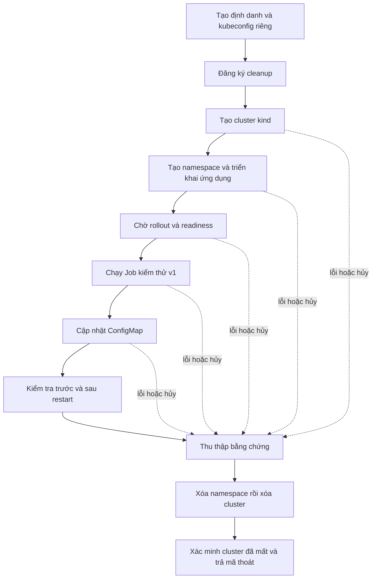

# Kiểm thử trong cluster tạm thời và dọn tài nguyên sau khi chạy

## 1. Mục tiêu và phạm vi

Trong chương **Kiểm thử tự động** của **SPRING_CLOUD_KUBERNETES**, bài này hướng dẫn kiểm tra một ứng dụng Spring bằng Kubernetes thật nhưng có vòng đời ngắn: tạo cluster, triển khai fixture, chạy kiểm thử, lưu bằng chứng và xóa tài nguyên của lượt chạy.

Sau bài học, bạn có thể:

- Chọn giữa namespace riêng và cluster riêng theo mức cô lập cần thiết.
- Kiểm tra DiscoveryClient bằng ServiceAccount và RBAC của chính ứng dụng.
- Xác minh ConfigMap được nạp vào Spring, Secret được cấp cho container và Pod có readiness hợp lệ.
- Phân biệt kiểm thử cập nhật cấu hình bằng restart với kiểm thử refresh qua Configuration Watcher.
- Dọn tài nguyên khi thành công, thất bại hoặc nhận tín hiệu hủy mà vẫn giữ mã lỗi có ý nghĩa.
- Nhận diện phần cần kiểm tra thêm trên nền tảng triển khai thật.

Luồng chính sử dụng **kind**, một namespace dành riêng cho lượt chạy, một ứng dụng `sck-probe` và các Job kiểm thử chạy bên trong cluster. kind chạy các node Kubernetes bằng container, phù hợp với một bài kiểm thử tích hợp trên runner có Docker. [Tài liệu kind](https://kind.sigs.k8s.io/docs/user/quick-start/)

## 2. Cluster tạm thời giải quyết vấn đề gì?

Một kiểm thử chỉ mock Kubernetes API có thể xác minh logic xử lý phản hồi nhưng không chứng minh được ServiceAccount đã gắn đúng, RoleBinding trỏ đúng namespace, Service chọn đúng Pod hay image thực sự khởi động được.

Ngược lại, chỉ gọi thành công `http://sck-probe:8080` mới chứng minh đường DNS và Service hoạt động. Nó chưa chứng minh Spring Cloud Kubernetes DiscoveryClient có quyền đọc tài nguyên hay trả về instance đúng.

Bài thực hành cần hai nhóm khẳng định độc lập:

| Nhóm | Bằng chứng cần có |
| --- | --- |
| Kubernetes runtime | Deployment sẵn sàng, Service tới được ứng dụng, probe trả thành công |
| Tích hợp Spring | Bean đọc giá trị ConfigMap; mã ứng dụng gọi DiscoveryClient và trả đúng địa chỉ Pod |

### 2.1. Chọn ranh giới cô lập

| Phương án | Phù hợp | Trách nhiệm dọn dẹp |
| --- | --- | --- |
| Một namespace mới trên cluster dùng chung | Kiểm thử chỉ tạo tài nguyên trong namespace | Xóa namespace; theo dõi tài nguyên ngoài namespace nếu có |
| Một cluster kind mới cho mỗi lượt chạy | Kiểm thử RBAC, discovery, cấu hình; cần chạy song song độc lập | Xóa cluster đúng tên, kubeconfig tạm và tiến trình phụ |
| Cluster tạm trên nền tảng đám mây | Cần xác minh ingress, cloud load balancer, CSI hoặc tích hợp cloud thật | Xóa cả cluster và các tài nguyên cloud phát sinh |

Namespace chỉ bao phủ tài nguyên có namespace. ClusterRole, ClusterRoleBinding, CRD và PersistentVolume có phạm vi cluster; việc xóa namespace không phải bằng chứng các đối tượng đó đã được dọn. [Phạm vi namespace của Kubernetes](https://kubernetes.io/docs/concepts/overview/working-with-objects/namespaces/)

Ví dụ dưới đây không tạo CRD, ClusterRole hay volume lưu trữ. Việc dùng cluster riêng giúp giới hạn ảnh hưởng của một lỗi cấu hình RBAC hoặc một lần chạy bị gián đoạn.

### 2.2. Vòng đời cần quản lý



Cleanup phải được đăng ký **trước lệnh tạo cluster**. Tạo cluster có thể thất bại sau khi đã tạo một phần container node.

## 3. Chuẩn bị fixture Spring

### 3.1. Điều kiện thực hành

Các tệp `ci/app-it.yaml`, `ci/smoke-job.yaml` và `ci/cluster-it.sh` xuất hiện dưới đây là những tệp bạn tạo trong dự án thực hành. Toàn bộ nội dung cần cho chúng được trình bày trong bài.

Môi trường chạy script:

- Linux runner hoặc WSL có Bash; script không dùng cú pháp PowerShell.
- Docker daemon dành cho kiểm thử, kind, kubectl, GNU `timeout`, `envsubst`, `mktemp`, `od`, `tr` và `grep`.
- Quyền tạo và xóa cluster kind trên daemon đó.
- Image ứng dụng đã build và một image chứa `/bin/sh` cùng `curl`, đều có sẵn trong Docker local.
- Phiên bản Spring Boot, Spring Cloud BOM, Spring Cloud Kubernetes, kind và Kubernetes node image đã được khóa trong cấu hình CI.

Dùng bản phát hành tương thích với dự án; không thay đồng thời tất cả dependency thành bản mới nhất. Các thuộc tính và quyền dưới đây cần được đối chiếu với tài liệu của **phiên bản đã khóa**, đặc biệt khi chuyển giữa cách đọc Endpoints và EndpointSlice.

Ba biến bắt buộc của script:

| Biến | Nội dung |
| --- | --- |
| `APP_IMAGE` | Tên có tag riêng của image fixture đã build, ví dụ `sck-probe:it-a1b2c3` |
| `CURL_IMAGE` | Tên có tag của image kiểm thử đã có local, chứa shell và curl |
| `KIND_NODE_IMAGE` | Node image được phát hành cho phiên bản kind đã chọn; nên khóa cả digest |

Với hai image được `kind load docker-image`, sử dụng tag local trỏ tới nội dung đã xác minh trong bước chuẩn bị image. Ghi lại image ID để truy vết; một tag dù có số phiên bản vẫn có thể bị thay đổi ở registry.

Script sử dụng `imagePullPolicy: Never` cho fixture và test runner: image phải được nạp vào node trước khi triển khai. Cách này cũng giúp phát hiện ngay lỗi nạp image. [Nạp image vào kind](https://kind.sigs.k8s.io/docs/user/quick-start/#loading-an-image-into-your-cluster)

### 3.2. Dependency và ứng dụng tối thiểu

Ứng dụng cần các thành phần sau, với version do bộ dependency đã khóa quản lý:

- Spring Boot web starter và Actuator.
- `org.springframework.cloud:spring-cloud-starter-kubernetes-fabric8` cho DiscoveryClient.
- `org.springframework.cloud:spring-cloud-starter-kubernetes-fabric8-config` cho ConfigMap PropertySource.

Không thêm đồng thời Fabric8 và Kubernetes Java Client cho cùng fixture. Bài này chọn Fabric8 và gọi trực tiếp `DiscoveryClient` từ ứng dụng; không dùng HTTP Discovery Server.

Đặt lớp sau trong `src/main/java/example/clusterit/LabApplication.java`:

```java
package example.clusterit;

import java.util.stream.Collectors;

import org.springframework.beans.factory.annotation.Value;
import org.springframework.boot.SpringApplication;
import org.springframework.boot.autoconfigure.SpringBootApplication;
import org.springframework.cloud.client.discovery.DiscoveryClient;
import org.springframework.cloud.client.discovery.EnableDiscoveryClient;
import org.springframework.context.annotation.Profile;
import org.springframework.http.MediaType;
import org.springframework.web.bind.annotation.GetMapping;
import org.springframework.web.bind.annotation.RequestMapping;
import org.springframework.web.bind.annotation.RestController;

@SpringBootApplication
@EnableDiscoveryClient
public class LabApplication {

    public static void main(String[] args) {
        SpringApplication.run(LabApplication.class, args);
    }

    @RestController
    @Profile("cluster-it")
    @RequestMapping(value = "/it", produces = MediaType.TEXT_PLAIN_VALUE)
    static class ProbeController {

        private final DiscoveryClient discoveryClient;
        private final String revision;
        private final String token;
        private final String podName;

        ProbeController(
                DiscoveryClient discoveryClient,
                @Value("${lab.revision}") String revision,
                @Value("${lab.token:}") String token,
                @Value("${POD_NAME:unknown}") String podName) {
            this.discoveryClient = discoveryClient;
            this.revision = revision;
            this.token = token;
            this.podName = podName;
        }

        @GetMapping("/config")
        String config() {
            return revision;
        }

        @GetMapping("/secret-ready")
        String secretReady() {
            return token.isBlank() ? "missing" : "present";
        }

        @GetMapping("/pod")
        String pod() {
            return podName;
        }

        @GetMapping("/discovery")
        String discovery() {
            return discoveryClient.getInstances("sck-probe").stream()
                    .map(instance -> instance.getServiceId()
                            + "@" + instance.getHost()
                            + ":" + instance.getPort())
                    .sorted()
                    .collect(Collectors.joining("\n"));
        }
    }
}
```

Endpoint discovery thực sự gọi `getInstances("sck-probe")`. Bài kiểm thử sẽ so sánh kết quả với IP của Pod do Kubernetes cấp và cổng `8080`. Không khai báo instance tĩnh hay dùng mock DiscoveryClient trong profile này. Các starter và API discovery được mô tả tại [DiscoveryClient for Kubernetes](https://docs.spring.io/spring-cloud-kubernetes/reference/discovery-client.html).

Các endpoint `/it/*` chỉ phục vụ fixture trong môi trường kiểm thử riêng. Nếu dự án đã có Spring Security, cấu hình quyền truy cập cho test runner và probe phù hợp; ví dụ đang giả định fixture không có lớp xác thực HTTP.

Endpoint `/it/secret-ready` chỉ xác minh ứng dụng nhận một giá trị không rỗng. Nó không chứng minh token dùng được với hệ thống bên ngoài. Nếu yêu cầu nghiệp vụ là xác thực tới dịch vụ khác, bổ sung lời gọi tới một stub hoặc dịch vụ kiểm thử có khả năng kiểm tra credential.

### 3.3. Profile cấu hình

Đặt nội dung sau vào `src/main/resources/application-cluster-it.properties`:

```properties
spring.application.name=sck-probe
spring.config.import=kubernetes:

spring.cloud.kubernetes.config.name=sck-probe
spring.cloud.kubernetes.config.fail-fast=true
spring.cloud.kubernetes.config.retry.enabled=false
spring.cloud.kubernetes.config.include-profile-specific-sources=false

spring.cloud.kubernetes.secrets.enabled=false
spring.cloud.kubernetes.reload.enabled=false

spring.cloud.kubernetes.discovery.all-namespaces=false
spring.cloud.kubernetes.discovery.use-endpoint-slices=true
spring.cloud.kubernetes.discovery.include-not-ready-addresses=false

management.endpoints.web.exposure.include=health
management.endpoint.health.probes.enabled=true
```

`spring.config.import=kubernetes:` bật đường Config Data; không thêm legacy bootstrap song song. Tên ứng dụng và tên ConfigMap được ghi rõ để tránh fixture vô tình đọc một ConfigMap khác. [Kubernetes PropertySource](https://docs.spring.io/spring-cloud-kubernetes/reference/property-source-config.html), [ConfigMap PropertySource](https://docs.spring.io/spring-cloud-kubernetes/reference/property-source-config/configmap-propertysource.html)

Ứng dụng đọc ConfigMap qua Kubernetes API nhưng nhận Secret qua `secretKeyRef` thành biến môi trường `LAB_TOKEN`. Vì vậy, việc tắt Secrets PropertySource không ngăn kubelet cấp giá trị Secret cho container. Nó giúp fixture không cần quyền liệt kê Secret bằng API. [Secrets PropertySource](https://docs.spring.io/spring-cloud-kubernetes/reference/property-source-config/secrets-propertysource.html)

Luồng chính không triển khai Configuration Watcher. Thuộc tính reload cũ được tắt rõ ràng; tính năng PropertySource Reload trong ứng dụng đã bị đánh dấu deprecated, và tài liệu Spring hướng tới Configuration Watcher khi cần cơ chế tương ứng. [PropertySource Reload](https://docs.spring.io/spring-cloud-kubernetes/reference/property-source-config/propertysource-reload.html)

## 4. Manifest ứng dụng và RBAC

Lưu mẫu sau thành `ci/app-it.yaml`. Script chỉ thay hai placeholder `APP_IMAGE` và `NS` bằng `envsubst`.

```yaml
apiVersion: v1
kind: ServiceAccount
metadata:
  name: sck-probe
---
apiVersion: rbac.authorization.k8s.io/v1
kind: Role
metadata:
  name: sck-probe-reader
rules:
  - apiGroups: [""]
    resources: ["pods", "services", "configmaps"]
    verbs: ["get", "list", "watch"]
  - apiGroups: ["discovery.k8s.io"]
    resources: ["endpointslices"]
    verbs: ["get", "list", "watch"]
---
apiVersion: rbac.authorization.k8s.io/v1
kind: RoleBinding
metadata:
  name: sck-probe-reader
subjects:
  - kind: ServiceAccount
    name: sck-probe
    namespace: ${NS}
roleRef:
  apiGroup: rbac.authorization.k8s.io
  kind: Role
  name: sck-probe-reader
---
apiVersion: v1
kind: ConfigMap
metadata:
  name: sck-probe
data:
  lab.revision: "v1"
---
apiVersion: v1
kind: Secret
metadata:
  name: sck-probe-token
type: Opaque
stringData:
  token: "it-only-not-a-real-credential"
---
apiVersion: apps/v1
kind: Deployment
metadata:
  name: sck-probe
spec:
  replicas: 1
  strategy:
    type: Recreate
  selector:
    matchLabels:
      app: sck-probe
  template:
    metadata:
      labels:
        app: sck-probe
    spec:
      serviceAccountName: sck-probe
      automountServiceAccountToken: true
      terminationGracePeriodSeconds: 10
      containers:
        - name: app
          image: ${APP_IMAGE}
          imagePullPolicy: Never
          ports:
            - name: http
              containerPort: 8080
          env:
            - name: SPRING_PROFILES_ACTIVE
              value: cluster-it
            - name: SPRING_CLOUD_KUBERNETES_CLIENT_NAMESPACE
              valueFrom:
                fieldRef:
                  fieldPath: metadata.namespace
            - name: POD_NAME
              valueFrom:
                fieldRef:
                  fieldPath: metadata.name
            - name: LAB_TOKEN
              valueFrom:
                secretKeyRef:
                  name: sck-probe-token
                  key: token
          resources:
            requests:
              cpu: 250m
              memory: 256Mi
            limits:
              cpu: "1"
              memory: 768Mi
          startupProbe:
            httpGet:
              path: /actuator/health/liveness
              port: http
            periodSeconds: 2
            timeoutSeconds: 1
            failureThreshold: 60
          readinessProbe:
            httpGet:
              path: /actuator/health/readiness
              port: http
            periodSeconds: 2
            timeoutSeconds: 1
            failureThreshold: 3
          livenessProbe:
            httpGet:
              path: /actuator/health/liveness
              port: http
            periodSeconds: 10
            timeoutSeconds: 1
            failureThreshold: 3
---
apiVersion: v1
kind: Service
metadata:
  name: sck-probe
spec:
  selector:
    app: sck-probe
  ports:
    - name: http
      port: 8080
      targetPort: http
```

Các tài nguyên không ghi `metadata.namespace` được script áp dụng bằng `-n "$NS"`. RoleBinding vẫn ghi namespace của ServiceAccount trong `subjects`.

Những lựa chọn cần hiểu:

- Role chỉ cấp quyền đọc trong namespace kiểm thử. Ứng dụng không có quyền sửa Deployment hay liệt kê Secret.
- Quyền EndpointSlice thuộc API group `discovery.k8s.io`, khớp với việc bật `use-endpoint-slices`. Nếu phiên bản đang dùng cần Endpoints thay cho EndpointSlice, phải đổi cả cấu hình lẫn RBAC theo cùng một lựa chọn.
- Namespace được lấy qua Downward API rồi truyền tới Spring Cloud Kubernetes, không dựa vào namespace trên máy phát triển.
- `Recreate` và một replica giúp fixture có đúng một instance khi so sánh kết quả discovery. Đây là lựa chọn phục vụ bài kiểm thử; chiến lược rollout cho ứng dụng thật cần được thiết kế riêng.

Các quyền đọc của client và cách tìm namespace được trình bày trong [Security Configurations Inside Kubernetes](https://docs.spring.io/spring-cloud-kubernetes/reference/security-service-accounts.html) và [Namespace resolution](https://docs.spring.io/spring-cloud-kubernetes/reference/property-source-config/namespace-resolution.html).

Startup probe cho phép JVM có thời gian khởi động trước khi liveness bắt đầu đánh giá. Readiness là điều kiện để Pod được đưa vào tập endpoint sẵn sàng; trạng thái Pod `Running` chưa đủ. Dùng endpoint Actuator trên cùng cổng ứng dụng giúp bài kiểm thử quan sát đúng HTTP server đang phục vụ. [Kubernetes probes trong Spring Boot](https://docs.spring.io/spring-boot/reference/actuator/endpoints.html#actuator.endpoints.kubernetes-probes), [Cơ chế probe của Kubernetes](https://kubernetes.io/docs/tasks/configure-pod-container/configure-liveness-readiness-startup-probes/)

## 5. Job kiểm thử từ bên trong cluster

Lưu thành `ci/smoke-job.yaml`:

```yaml
apiVersion: batch/v1
kind: Job
metadata:
  name: ${JOB_NAME}
  labels:
    ci.example.com/test: "true"
spec:
  backoffLimit: 0
  activeDeadlineSeconds: 120
  ttlSecondsAfterFinished: 600
  template:
    metadata:
      labels:
        ci.example.com/test: "true"
    spec:
      restartPolicy: Never
      automountServiceAccountToken: false
      containers:
        - name: test
          image: ${CURL_IMAGE}
          imagePullPolicy: Never
          env:
            - name: BASE
              value: "http://sck-probe:8080"
            - name: EXPECTED_REVISION
              value: "${EXPECTED_REVISION}"
            - name: EXPECTED_DISCOVERY
              value: "${EXPECTED_DISCOVERY}"
            - name: EXPECTED_POD
              value: "${EXPECTED_POD}"
          resources:
            requests:
              cpu: 50m
              memory: 32Mi
            limits:
              cpu: 200m
              memory: 64Mi
          command: ["/bin/sh", "-ec"]
          args:
            - |
              assert_value() {
                path="$1"
                expected="$2"
                attempt=0
                while [ "$attempt" -lt 8 ]; do
                  if actual="$(curl --fail --silent --show-error \
                    --connect-timeout 1 --max-time 2 "$BASE$path")"; then
                    if [ "$actual" = "$expected" ]; then
                      printf 'PASS %s\n' "$path"
                      return 0
                    fi
                  fi
                  attempt=$((attempt + 1))
                  sleep 1
                done
                printf 'FAIL %s\n' "$path" >&2
                return 1
              }

              curl --fail --silent --show-error \
                --connect-timeout 1 --max-time 2 \
                "$BASE/actuator/health/readiness" >/dev/null

              assert_value /it/config "$EXPECTED_REVISION"
              assert_value /it/secret-ready present
              assert_value /it/discovery "$EXPECTED_DISCOVERY"
              assert_value /it/pod "$EXPECTED_POD"
```

Job này không cần gọi Kubernetes API nên không mount ServiceAccount token. Việc kiểm tra discovery diễn ra bên trong ứng dụng, bằng danh tính `sck-probe`; test runner chỉ gọi HTTP.

Các giới hạn có mục đích khác nhau:

| Trường hoặc cơ chế | Mục đích |
| --- | --- |
| `curl --max-time` | Chặn một yêu cầu HTTP treo |
| Vòng lặp tối đa 8 lần | Cho phép chờ trạng thái hội tụ trong một khoảng hữu hạn |
| `activeDeadlineSeconds` | Giới hạn thời gian Job hoạt động, bao gồm tình huống không chạy xong |
| `backoffLimit: 0` | Không tạo một chuỗi Pod thử lại để che lỗi của lượt kiểm thử |
| `ttlSecondsAfterFinished` | Dọn Job đã kết thúc sau một khoảng lưu bằng chứng |

Kubernetes quản lý giới hạn chạy và trạng thái Job theo [tài liệu Jobs](https://kubernetes.io/docs/concepts/workloads/controllers/job/). TTL chỉ bắt đầu khi Job có trạng thái kết thúc `Complete` hoặc `Failed`; nó không dọn một Job đang treo, Deployment, Service, namespace hay cluster. [TTL cho Job đã hoàn thành](https://kubernetes.io/docs/concepts/workloads/controllers/ttlafterfinished/)

Một HTTP `500` không bị coi là thành công vì có `curl --fail`. Việc so sánh chính xác body cũng ngăn một trang lỗi HTTP `200` bị hiểu nhầm là kết quả đúng. Các phép thử không ghi giá trị Secret vào log.

## 6. Script điều phối vòng đời

Lưu thành `ci/cluster-it.sh`. Chạy từ thư mục gốc của dự án thực hành, nơi có hai manifest vừa tạo.

```bash
#!/usr/bin/env bash
set -Eeuo pipefail
umask 077

for tool in docker kind kubectl timeout envsubst mktemp od tr grep date; do
  command -v "$tool" >/dev/null || {
    printf 'Missing tool: %s\n' "$tool" >&2
    exit 2
  }
done

: "${APP_IMAGE:?Set APP_IMAGE to the local fixture image tag}"
: "${CURL_IMAGE:?Set CURL_IMAGE to the local curl image tag}"
: "${KIND_NODE_IMAGE:?Set KIND_NODE_IMAGE to a pinned kind node image}"

for image in "$APP_IMAGE" "$CURL_IMAGE" "$KIND_NODE_IMAGE"; do
  [[ "$image" =~ ^[a-zA-Z0-9][a-zA-Z0-9._/:@-]*$ ]] || {
    echo "Invalid image reference" >&2
    exit 2
  }
done

# kind load uses local tagged images in this example.
[[ "$APP_IMAGE" != *@* && "$CURL_IMAGE" != *@* ]]
[[ "${APP_IMAGE##*/}" == *:* && "${CURL_IMAGE##*/}" == *:* ]]
[[ "$APP_IMAGE" != *:latest && "$CURL_IMAGE" != *:latest ]]
[[ -f ci/app-it.yaml && -f ci/smoke-job.yaml ]]

export KIND_EXPERIMENTAL_PROVIDER=docker
RUN_ID="$(date -u +%Y%m%d%H%M%S)-$(od -An -N4 -tx1 /dev/urandom | tr -d ' \n')"
CLUSTER="sck-it-$RUN_ID"
CTX="kind-$CLUSTER"
export NS="sck-it-$RUN_ID"

artifact_root="${ARTIFACT_ROOT:-$PWD/it-artifacts}"
mkdir -p -- "$artifact_root"
artifact_dir="$(mktemp -d "$artifact_root/run.XXXXXXXX")"
work_dir="$(mktemp -d "${TMPDIR:-/tmp}/sck-it.XXXXXXXX")"
export KUBECONFIG="$work_dir/kubeconfig"

cluster_claimed=0
namespace_uid=""

k() {
  timeout 180s kubectl \
    --kubeconfig "$KUBECONFIG" --context "$CTX" \
    --request-timeout=170s "$@"
}

kd() {
  timeout 12s kubectl \
    --kubeconfig "$KUBECONFIG" --context "$CTX" \
    --request-timeout=10s "$@"
}

collect_diagnostics() {
  kd -n "$NS" get deployments,pods,services,jobs -o wide \
    >"$artifact_dir/resources.txt" 2>&1 || true
  kd -n "$NS" get endpointslices -o yaml \
    >"$artifact_dir/endpointslices.yaml" 2>&1 || true
  kd -n "$NS" get events --sort-by=.metadata.creationTimestamp \
    >"$artifact_dir/events.txt" 2>&1 || true
  kd -n "$NS" logs -l app=sck-probe \
    --all-containers=true --prefix=true --tail=200 \
    >"$artifact_dir/app.log" 2>&1 || true
  kd -n "$NS" logs -l app=sck-probe \
    --all-containers=true --prefix=true --previous --tail=200 \
    >"$artifact_dir/app-previous.log" 2>&1 || true
}

finish() {
  local test_rc="$1"
  local cleanup_rc=0
  local namespace_result="NOT_ATTEMPTED"
  local current_uid="" current_owner="" remaining="" containers=""
  trap - EXIT INT TERM
  set +e

  if (( cluster_claimed == 1 )); then
    if [[ -s "$KUBECONFIG" ]] && \
      [[ "$(timeout 5s kubectl --kubeconfig "$KUBECONFIG" \
        config current-context 2>/dev/null)" == "$CTX" ]]; then

      collect_diagnostics

      current_uid="$(kd get namespace "$NS" \
        -o jsonpath='{.metadata.uid}' 2>/dev/null)"
      current_owner="$(kd get namespace "$NS" \
        -o go-template='{{index .metadata.labels "ci.example.com/run-id"}}' \
        2>/dev/null)"

      if [[ -n "$namespace_uid" && "$current_uid" == "$namespace_uid" \
        && "$current_owner" == "$RUN_ID" ]]; then
        if kd delete namespace "$NS" --wait=false \
          >"$artifact_dir/namespace-delete.log" 2>&1; then
          if timeout 70s kubectl --kubeconfig "$KUBECONFIG" \
            --context "$CTX" --request-timeout=65s \
            wait --for=delete "namespace/$NS" --timeout=60s \
            >>"$artifact_dir/namespace-delete.log" 2>&1; then
            namespace_result="DELETED"
          else
            namespace_result="WAIT_FAILED"
          fi
        else
          namespace_result="DELETE_FAILED"
        fi
      else
        namespace_result="SKIPPED_OWNERSHIP_NOT_CONFIRMED"
      fi
    else
      namespace_result="SKIPPED_NO_VERIFIED_CONTEXT"
    fi

    # Always try deleting our dedicated cluster, including partial creation.
    if ! timeout 90s kind delete cluster \
      --name "$CLUSTER" --kubeconfig "$KUBECONFIG" \
      >"$artifact_dir/cluster-delete.log" 2>&1; then
      cleanup_rc=1
    fi

    if remaining="$(timeout 15s kind get clusters \
      2>"$artifact_dir/cluster-list.err")"; then
      if grep -Fxq -- "$CLUSTER" <<<"$remaining"; then
        cleanup_rc=1
      fi
    else
      cleanup_rc=1
    fi

    if containers="$(timeout 15s docker ps -aq \
      --filter "label=io.x-k8s.kind.cluster=$CLUSTER" \
      2>"$artifact_dir/docker-list.err")"; then
      [[ -z "$containers" ]] || cleanup_rc=1
    else
      cleanup_rc=1
    fi
  fi

  # Remove only exact temporary files created by this script.
  rm -f -- "$KUBECONFIG" "$work_dir/app.yaml" "$work_dir/job.yaml" \
    || cleanup_rc=1
  rmdir -- "$work_dir" || cleanup_rc=1

  printf 'test_exit=%s\ncleanup_exit=%s\nnamespace_cleanup=%s\n' \
    "$test_rc" "$cleanup_rc" "$namespace_result" \
    >"$artifact_dir/result.txt" || cleanup_rc=1

  printf 'Artifacts: %s\n' "$artifact_dir"
  printf 'test_exit=%s cleanup_exit=%s\n' "$test_rc" "$cleanup_rc"

  if (( test_rc == 0 && cleanup_rc != 0 )); then
    test_rc=1
  fi
  exit "$test_rc"
}

trap 'finish "$?"' EXIT
trap 'exit 130' INT
trap 'exit 143' TERM

printf 'run_id=%s\ncluster=%s\nnamespace=%s\napp_image=%s\ncurl_image=%s\nnode_image=%s\n' \
  "$RUN_ID" "$CLUSTER" "$NS" "$APP_IMAGE" "$CURL_IMAGE" "$KIND_NODE_IMAGE" \
  >"$artifact_dir/run.txt"

timeout 15s docker image inspect --format '{{.Id}}' \
  "$APP_IMAGE" "$CURL_IMAGE" >"$artifact_dir/image-ids.txt"

# Refuse a name collision; do not adopt an existing cluster.
existing="$(timeout 15s kind get clusters)"
if grep -Fxq -- "$CLUSTER" <<<"$existing"; then
  echo "Cluster name already exists" >&2
  exit 2
fi

# Set ownership before creation so partial creation is also cleaned.
cluster_claimed=1
timeout 240s kind create cluster \
  --name "$CLUSTER" --image "$KIND_NODE_IMAGE" \
  --kubeconfig "$KUBECONFIG" --wait 120s

[[ "$(timeout 5s kubectl --kubeconfig "$KUBECONFIG" \
  config current-context)" == "$CTX" ]]

timeout 120s kind load docker-image \
  "$APP_IMAGE" "$CURL_IMAGE" --name "$CLUSTER"

k create namespace "$NS"
k label namespace "$NS" "ci.example.com/run-id=$RUN_ID"
namespace_uid="$(k get namespace "$NS" -o jsonpath='{.metadata.uid}')"
[[ -n "$namespace_uid" ]]

envsubst '${APP_IMAGE} ${NS}' \
  <ci/app-it.yaml >"$work_dir/app.yaml"
k -n "$NS" apply -f "$work_dir/app.yaml"

subject="system:serviceaccount:$NS:sck-probe"
[[ "$(k -n "$NS" auth can-i list endpointslices.discovery.k8s.io \
  --as="$subject")" == "yes" ]]
[[ "$(k -n "$NS" auth can-i list configmaps \
  --as="$subject")" == "yes" ]]

expect_denied() {
  local answer="" auth_rc=0
  if answer="$(k "$@")"; then
    echo "Unexpected RBAC permission" >&2
    return 1
  else
    auth_rc=$?
    [[ "$auth_rc" -eq 1 && "$answer" == "no" ]]
  fi
}

expect_denied -n "$NS" auth can-i list secrets --as="$subject"
expect_denied -n kube-system auth can-i list services --as="$subject"

k -n "$NS" rollout status deployment/sck-probe --timeout=150s
k -n "$NS" wait --for=condition=Ready pod \
  -l app=sck-probe --timeout=60s

pod_uid() {
  k -n "$NS" get pods -l app=sck-probe \
    --field-selector=status.phase=Running \
    -o jsonpath='{.items[0].metadata.uid}'
}

run_test_job() {
  export JOB_NAME="$1" EXPECTED_REVISION="$2"
  local pod_ip="" conditions="" deadline=0

  EXPECTED_POD="$(k -n "$NS" get pods -l app=sck-probe \
    --field-selector=status.phase=Running \
    -o jsonpath='{.items[0].metadata.name}')"
  pod_ip="$(k -n "$NS" get "pod/$EXPECTED_POD" \
    -o jsonpath='{.status.podIP}')"
  [[ -n "$EXPECTED_POD" && -n "$pod_ip" ]]
  export EXPECTED_POD
  export EXPECTED_DISCOVERY="sck-probe@$pod_ip:8080"

  envsubst '${JOB_NAME} ${CURL_IMAGE} ${EXPECTED_REVISION} ${EXPECTED_DISCOVERY} ${EXPECTED_POD}' \
    <ci/smoke-job.yaml >"$work_dir/job.yaml"
  k -n "$NS" create -f "$work_dir/job.yaml"

  deadline=$((SECONDS + 150))
  while (( SECONDS < deadline )); do
    conditions="$(k -n "$NS" get "job/$JOB_NAME" \
      --request-timeout=5s \
      -o jsonpath='{range .status.conditions[*]}{.type}={.status}{"\n"}{end}')"

    if grep -q '^Failed=True$' <<<"$conditions"; then
      kd -n "$NS" logs "job/$JOB_NAME" --tail=200 \
        >"$artifact_dir/$JOB_NAME.log" 2>&1 || true
      echo "Test Job failed: $JOB_NAME" >&2
      return 1
    fi

    if grep -q '^Complete=True$' <<<"$conditions"; then
      kd -n "$NS" logs "job/$JOB_NAME" --tail=200 \
        >"$artifact_dir/$JOB_NAME.log" 2>&1
      return 0
    fi
    sleep 2
  done

  kd -n "$NS" logs "job/$JOB_NAME" --tail=200 \
    >"$artifact_dir/$JOB_NAME.log" 2>&1 || true
  echo "Timed out waiting for Test Job: $JOB_NAME" >&2
  return 1
}

before_uid="$(pod_uid)"
[[ -n "$before_uid" ]]
run_test_job smoke-v1 v1

k -n "$NS" patch configmap sck-probe --type=merge \
  -p '{"data":{"lab.revision":"v2"}}'

# Without a refresh mechanism, the existing bean must still expose v1.
run_test_job before-restart v1
[[ "$(pod_uid)" == "$before_uid" ]]

k -n "$NS" rollout restart deployment/sck-probe
k -n "$NS" rollout status deployment/sck-probe --timeout=150s
k -n "$NS" wait --for=condition=Ready pod \
  -l app=sck-probe --timeout=60s

after_uid="$(pod_uid)"
[[ -n "$after_uid" && "$after_uid" != "$before_uid" ]]
run_test_job after-restart v2

printf 'before_uid=%s\nafter_uid=%s\n' \
  "$before_uid" "$after_uid" >"$artifact_dir/pod-uids.txt"
echo "All cluster integration assertions passed"
```

### 6.1. Cách chạy

Sau khi đã chuẩn bị hai image local và chọn node image tương thích với phiên bản kind:

```bash
export APP_IMAGE='sck-probe:it-a1b2c3'

# Thay bằng tag local của image curl đã được kiểm tra nội dung.
export CURL_IMAGE='curl-it:approved'

# Điền giá trị node image thực tế đã khóa trong CI.
export KIND_NODE_IMAGE="$PINNED_KIND_NODE_IMAGE"

bash ci/cluster-it.sh
```

`PINNED_KIND_NODE_IMAGE` là giá trị bạn cung cấp từ cấu hình CI, không phải một biến có sẵn của kind. Không chạy nguyên ví dụ nếu chưa gán giá trị này.

Cấu trúc artifact được tạo riêng cho mỗi lượt chạy:

```text
it-artifacts/run.<random>/
  run.txt
  image-ids.txt
  smoke-v1.log
  before-restart.log
  after-restart.log
  pod-uids.txt
  resources.txt
  endpointslices.yaml
  events.txt
  app.log
  app-previous.log
  namespace-delete.log
  cluster-delete.log
  result.txt
```

Một số tệp có thể không xuất hiện nếu lỗi xảy ra trước bước tương ứng. Tệp `result.txt` ghi riêng kết quả kiểm thử và cleanup.

### 6.2. Vì sao script giữ an toàn cho các lượt chạy khác?

Mỗi lượt chạy có tên cluster, namespace, kubeconfig và thư mục artifact riêng. Script từ chối nhận một cluster trùng tên, rồi mới ghi nhận quyền sở hữu trước khi gọi `kind create`. Tên có thời gian và hậu tố ngẫu nhiên giúp các job chạy song song không dùng chung tài nguyên.

`--kubeconfig` và `--context` được truyền rõ vào kubectl. kind cũng nhận kubeconfig riêng; script không chuyển current context trong kubeconfig cá nhân. [Cách kind sử dụng kubeconfig](https://kind.sigs.k8s.io/docs/user/quick-start/#interacting-with-your-cluster)

Trước khi yêu cầu xóa namespace, cleanup so sánh cả UID và label của lượt chạy. Nếu không xác minh được namespace, nó bỏ qua lệnh xóa namespace và chuyển sang dọn cluster riêng đã ghi nhận sở hữu. Cơ chế này không nên được sao chép nguyên trạng sang cluster dùng chung: trong môi trường đó không có bước xóa toàn cluster để thay thế.

Script không gọi `docker system prune`, không xóa theo prefix chung và không xóa tài nguyên trên một context mặc định.

### 6.3. Vì sao phải chờ trạng thái thay vì ngủ cố định?

`rollout status` và `kubectl wait` quan sát điều kiện thực tế với thời hạn. Khoảng `sleep 2` trong vòng lặp Job chỉ là chu kỳ thăm dò; thành công vẫn được quyết định bởi điều kiện `Complete=True`.

Script kiểm tra thêm `Failed=True` để trả lỗi sớm. Nếu chỉ chờ điều kiện Complete, một Job đã thất bại vẫn có thể làm runner chờ tới hết timeout. [kubectl wait](https://kubernetes.io/docs/reference/kubectl/generated/kubectl_wait/)

Không tăng số lần chạy lại toàn suite để che một lỗi ổn định. Chỉ chờ trạng thái có tính bất đồng bộ, với ngân sách thời gian đã xác định. Lỗi authorization, sai expected value hoặc thiếu image phải xuất hiện thành lỗi kiểm thử có thể điều tra.

## 7. Đọc kết quả cập nhật cấu hình đúng cách

Luồng chính thực hiện ba lần kiểm thử:

| Thời điểm | Giá trị ConfigMap trên API | Giá trị bean phải trả | Bằng chứng Pod |
| --- | --- | --- | --- |
| Sau triển khai lần đầu | `v1` | `v1` | Pod ban đầu Ready |
| Sau patch, trước restart | `v2` | `v1` | UID vẫn là UID ban đầu |
| Sau rollout restart | `v2` | `v2` | UID mới khác UID ban đầu |

Tại sao bước giữa vẫn mong đợi `v1`? Fixture đã nạp cấu hình lúc khởi động và giữ giá trị trong bean. Không có watcher hoặc thao tác refresh nào được triển khai. Kiểm thử sẽ phát hiện nếu môi trường vô tình bật một cơ chế cập nhật khác với thiết kế.

Ở bước cuối, việc Deployment rollout thành công chưa đủ: Job phải đọc được `v2` từ ứng dụng. Ngược lại, chỉ thấy `v2` cũng chưa chứng minh được restart; so sánh UID bổ sung bằng chứng rằng một Pod mới đã chạy.

### 7.1. Những đường đưa cấu hình vào ứng dụng không có cùng hành vi

| Đường cấu hình | Khi đối tượng Kubernetes thay đổi | Điều cần kiểm thử |
| --- | --- | --- |
| `env` từ ConfigMap hoặc Secret | Môi trường của container đang chạy giữ giá trị đã nhận | Tạo lại Pod và xác minh hành vi ứng dụng |
| Volume ConfigMap thông thường | Nội dung file có thể được cập nhật sau một khoảng trễ | Chờ file cập nhật rồi kiểm tra ứng dụng có đọc lại hay không |
| ConfigMap PropertySource nạp lúc startup | Bean hiện tại không tự đổi chỉ vì API đã đổi | Xác minh restart hoặc cơ chế refresh đã chọn |
| Configuration Watcher và bean có thể refresh | Có thêm chuỗi phát hiện, thông báo và nạp lại cấu hình | Kiểm thử toàn chuỗi và trạng thái cuối của từng instance |

Kubernetes không tự cập nhật biến môi trường của container đang chạy khi ConfigMap đổi. Mount bằng `subPath` cũng không nhận cập nhật ConfigMap như một volume thông thường. [Cập nhật ConfigMap trong Pod](https://kubernetes.io/docs/concepts/configuration/configmap/)

Đừng thêm `LAB_REVISION=v1` vào Deployment rồi mong ConfigMap đổi được giá trị này: biến môi trường có độ ưu tiên cao hơn cấu hình được import. Kiểm thử có thể thất bại đúng vì source cấu hình bị ghi đè, dù quyền Kubernetes đều hợp lệ.

### 7.2. Nếu ứng dụng thực sự cần Configuration Watcher

Hãy mở rộng fixture thành **một kịch bản khác** với kỳ vọng khác, thay vì thay assertion của luồng restart một cách âm thầm.

Chuỗi cần xác minh:

1. Deploy Configuration Watcher với phiên bản tương thích, namespace theo dõi được chỉ định và ServiceAccount riêng.
2. Cho watcher quyền quan sát những tài nguyên cần thiết của kịch bản; ứng dụng giữ quyền đọc cấu hình của chính nó.
3. Gắn label `spring.cloud.kubernetes.config: "true"` cho ConfigMap `sck-probe`.
4. Cho phép watcher gọi `/actuator/refresh` bằng cơ chế truy cập đã cấu hình.
5. Đưa phần cấu hình cần thay đổi vào bean hỗ trợ refresh, chẳng hạn bean có `@RefreshScope`.
6. Patch ConfigMap, chờ giá trị mới xuất hiện trong ứng dụng và xác minh UID Pod không đổi.

Trong chế độ HTTP, watcher tìm các instance rồi gửi yêu cầu refresh. Với tên ConfigMap trùng tên ứng dụng, việc chọn đích của fixture khá trực tiếp. [Configuration Watcher](https://docs.spring.io/spring-cloud-kubernetes/reference/spring-cloud-kubernetes-configuration-watcher.html)

Đối với chính `ProbeController` ở ví dụ, nếu muốn thử refresh, cần bổ sung `@RefreshScope` và import tương ứng, rồi cho phép endpoint refresh trong profile kiểm thử. Không mở rộng exposure thành `*` chỉ để chạy một bài thử. Watcher, ứng dụng và test runner có thể cần các credential HTTP khác nhau theo cấu hình bảo vệ endpoint.

Các assertion quan trọng của kịch bản watcher:

| Assertion | Lỗi có thể phát hiện |
| --- | --- |
| Giá trị đổi từ `v1` sang `v2` trong thời hạn | Watcher không quan sát đúng ConfigMap hoặc không gọi được ứng dụng |
| UID Pod giữ nguyên | Giá trị mới xuất hiện do restart ngoài ý muốn |
| Mỗi replica đều trả `v2` | Một instance bị bỏ sót khi gửi refresh |
| ConfigMap không thuộc tập theo dõi không đổi hành vi ứng dụng | Phạm vi hoặc selector theo dõi quá rộng |

Nếu có nhiều replica, hãy lấy danh sách Pod sẵn sàng và kiểm tra từng Pod; gọi Service nhiều lần không bảo đảm chạm tới tất cả instance.

Đổi Secret được đưa vào biến môi trường vẫn cần xử lý vòng đời container phù hợp. Một lần refresh Spring không biến môi trường đã có thành giá trị Secret mới. Kiểm thử rotation phải đi theo đúng đường tiêu thụ Secret mà ứng dụng sử dụng.

### 7.3. Nếu ứng dụng dùng Spring Cloud LoadBalancer

Luồng chính chưa tạo một HTTP client có `@LoadBalanced`. Discovery trả đúng instance và gọi Service thành công chưa đủ để kết luận một client dùng Spring Cloud LoadBalancer đã chạy đúng.

Nếu ứng dụng cần cân bằng tải phía client, bổ sung fixture có ít nhất hai instance đích trả định danh Pod, rồi thực sự gọi qua HTTP client đã tích hợp LoadBalancer. Spring Cloud LoadBalancer có thể lấy danh sách instance từ một `ServiceInstanceListSupplier` dựa trên DiscoveryClient. [Spring Cloud LoadBalancer](https://docs.spring.io/spring-cloud-commons/reference/spring-cloud-commons/loadbalancer.html)

Kiểm thử nên kiểm tra rằng phản hồi tới từ các instance hợp lệ, quan sát sự hội tụ khi một instance mất readiness và cấu hình timeout cho caller. Không đòi phân phối chính xác 50/50 cho một số rất ít request nếu đó không phải hợp đồng của thuật toán và cấu hình đang dùng.

Nếu ứng dụng chỉ cần gọi một tên Service ổn định, Kubernetes DNS và Service có thể đã đáp ứng yêu cầu. Chỉ thêm DiscoveryClient, LoadBalancer hoặc Watcher khi bài toán triển khai có hành vi cần chúng, rồi kiểm thử chính hành vi đó.

## 8. Cleanup là một phần của kết quả kiểm thử

### 8.1. Giữ mã lỗi gốc và ghi lỗi cleanup riêng

Hàm `finish` nhận mã thoát ngay khi trap chạy. Nó lưu mã đó trước khi thu thập log hoặc xóa tài nguyên.

| Kết quả kiểm thử | Kết quả dọn cluster | Mã cuối của script |
| --- | --- | --- |
| Thành công | Thành công | `0` |
| Thất bại | Thành công | Mã lỗi kiểm thử |
| Thành công | Thất bại | Khác `0` |
| Thất bại | Thất bại | Giữ mã lỗi kiểm thử; ghi thêm lỗi cleanup |

Nhờ vậy, một lệnh xóa thành công không che lỗi assertion trước đó. Nếu kiểm thử thành công nhưng cluster còn sót, pipeline cũng không được báo một lượt chạy hoàn toàn thành công.

Các lệnh `|| true` trong ví dụ chỉ dùng cho thu thập bằng chứng ở nhánh có thể thiếu dữ liệu. Chúng không bọc lệnh chạy kiểm thử, tạo cluster hay kiểm tra cluster đã bị xóa.

`namespace_cleanup=WAIT_FAILED` không nhất thiết có nghĩa còn rò rỉ tài nguyên: script vẫn xóa toàn bộ cluster riêng. Kết quả dọn cuối được xác định thêm bằng việc kiểm tra cluster và container node không còn. Giữ trạng thái namespace riêng giúp người vận hành thấy lỗi đã xảy ra ở bước nào.

### 8.2. Namespace đang Terminating

Một namespace có thể tiếp tục ở trạng thái Terminating khi đối tượng bên trong còn finalizer hoặc bộ điều khiển liên quan không hoàn tất việc dọn dẹp. Việc yêu cầu xóa thành công không có nghĩa đối tượng đã biến mất ngay.

Finalizer là cơ chế hoàn tất công việc trước khi xóa. Không xóa cưỡng bức finalizer như bước mặc định của script kiểm thử; cần tìm tài nguyên và controller đang chờ. [Finalizers trong Kubernetes](https://kubernetes.io/docs/concepts/overview/working-with-objects/finalizers/)

Trong cluster kind riêng của bài này, timeout xóa namespace không chặn vô hạn: script chuyển sang xóa cluster. Trên cluster dùng chung, cần lưu UID, label, trạng thái đối tượng và chuyển tài nguyên còn sót cho cơ chế dọn có quyền hạn phù hợp.

Nếu bài thực hành được mở rộng với PVC hoặc dịch vụ cloud, phải xác minh tài nguyên ngoài vòng đời namespace. Ví dụ, reclaim policy của PersistentVolume có thể yêu cầu giữ lại tài nguyên lưu trữ sau khi claim bị xóa. [PersistentVolume và reclaim policy](https://kubernetes.io/docs/concepts/storage/persistent-volumes/)

### 8.3. Trap không xử lý được mọi kiểu hủy

Bash có thể chạy trap khi nhận và xử lý `INT`, `TERM` hoặc khi thoát bình thường. Nhưng `SIGKILL`, runner bị tắt, mất máy ảo hoặc mất kết nối tới Docker daemon có thể làm cleanup không hoàn tất.

Cần ba lớp:

| Lớp | Trách nhiệm |
| --- | --- |
| Cleanup trong script | Xử lý phần lớn đường thành công, lỗi và tín hiệu hủy thông thường |
| Bước finally/always của CI | Thử dọn tiếp khi tiến trình chính kết thúc mà runner còn hoạt động |
| Bộ dọn tài nguyên quá hạn | Xử lý lượt chạy mồ côi khi hai lớp trên không chạy được |

Bước finally/always phải sử dụng **đúng tên và định danh của lượt chạy**, không một lệnh xóa theo prefix trên toàn môi trường. kind cho phép gọi xóa cluster không tồn tại mà không coi đó là lỗi, thuận tiện để thiết kế thao tác dọn lặp lại. [Xóa cluster kind](https://kind.sigs.k8s.io/docs/user/quick-start/#deleting-a-cluster)

Bộ dọn tài nguyên quá hạn cần biết chủ sở hữu, thời điểm tạo, thời hạn tối đa và trạng thái job. Chỉ dọn tài nguyên đã quá hạn của phạm vi kiểm thử được quản lý; không dùng tuổi tài nguyên làm điều kiện duy nhất nếu một job còn hợp lệ.

Với kind, tài nguyên node nằm trên Docker daemon đã tạo cluster. Một runner mới kết nối tới daemon khác không thể dọn cluster cũ chỉ bằng tên. Cần runner dùng một lần hoặc bộ dọn hoạt động trên đúng máy/daemon lưu tài nguyên mồ côi.

### 8.4. Ngân sách thời gian

Timeout cần được thiết kế theo lớp:

- Một lần HTTP có timeout nhỏ và số lần thăm dò hữu hạn.
- Job có deadline lớn hơn thời gian các assertion hợp lệ.
- Driver chờ Job đủ lâu để nhận điều kiện kết thúc.
- Toàn bước kiểm thử phải còn thời gian cho diagnostics và cleanup.
- CI có giới hạn cuối để ngăn một lượt chạy chiếm runner vô hạn.

Trong ví dụ, mỗi assertion có tối đa khoảng 24 giây theo giới hạn HTTP và chu kỳ chờ; bốn assertion cùng kiểm tra readiness nằm trong deadline 120 giây ở điều kiện runner bình thường. Driver chờ trạng thái Job tối đa 150 giây, còn các lệnh kubectl cũng có timeout ở mức tiến trình.

Đặt ngân sách CI có phần dự phòng vài phút cho thu thập log và xóa cluster; không cấu hình CI giết toàn bộ job đúng bằng tổng thời gian chạy mong đợi của assertion. Khi phải tăng timeout, dùng số đo bước chậm để điều chỉnh đúng lớp.

## 9. Bằng chứng cần lưu và cách chẩn đoán

Lưu ít nhưng đủ để tái hiện:

- Định danh lượt chạy, tên cluster, namespace, phiên bản công cụ và image ID hoặc digest đã dùng.
- Log test của từng Job ngay khi Job kết thúc.
- Tình trạng Deployment, Pod, Service, EndpointSlice và events.
- Log ứng dụng, kể cả log container trước đó nếu có restart.
- UID Pod trước và sau thao tác cập nhật.
- Mã kết quả kiểm thử và kết quả cleanup.

Script đã lưu phần lớn bằng chứng này. Khi tích hợp CI, bổ sung thông tin version công cụ và bộ dependency đã khóa vào metadata của build.

Không đóng gói kubeconfig tạm vào artifact. Tránh dump toàn bộ Secret, môi trường container hay toàn namespace; base64 trong Secret không làm dữ liệu an toàn để công khai. Log ứng dụng và events cũng cần tuân theo chính sách che thông tin nhạy cảm của dự án.

| Triệu chứng | Kiểm tra trước | Cách xử lý phù hợp |
| --- | --- | --- |
| Pod báo `ErrImageNeverPull` | Image ID local, tên tag trong manifest và bước kind load | Nạp đúng image vào đúng cluster |
| Pod `Running` nhưng chưa Ready | Events và phản hồi readiness | Sửa cấu hình probe hoặc nguyên nhân ứng dụng chưa sẵn sàng |
| Ứng dụng lỗi `403 Forbidden` | ServiceAccount thực tế, RoleBinding và API group | Sửa quyền đúng tài nguyên, không cấp cluster-admin cho ứng dụng |
| Gọi Service được nhưng discovery rỗng | Cấu hình client, namespace, EndpointSlice và readiness | Kiểm tra đường discovery riêng với đường DNS |
| API có `v2` nhưng ứng dụng vẫn `v1` | Đường nạp cấu hình và bước restart/refresh | Thực hiện đúng cơ chế cập nhật đã chọn |
| Watcher gọi refresh nhưng bean không đổi | Bean có hỗ trợ refresh, nguồn cấu hình có bị env ghi đè | Sửa cách quản lý bean hoặc precedence |
| Job ở Pending | Scheduling, tài nguyên node, image và quota | Điều tra lỗi hạ tầng; không chỉ tăng retry của HTTP |
| Namespace không mất sau delete | Finalizer và controller liên quan | Thu thập bằng chứng, dùng bước dọn theo ranh giới sở hữu |
| Có lỗi nhưng CI vẫn xanh | Exit code, pipeline shell và bước finally | Truyền đúng mã lỗi; không để cleanup ghi đè kết quả |
| Cluster còn sau lần hủy cứng | Trạng thái runner và Docker daemon gốc | Dùng bộ dọn quá hạn hoặc hủy runner dùng một lần |

Probe thành công không chứng minh toàn bộ nghiệp vụ hay mọi dependency bên ngoài đều hoạt động. Các assertion của bài này cũng không chủ động làm readiness thất bại để kiểm tra việc rút endpoint; đó là một kịch bản bổ sung nếu ứng dụng phụ thuộc hành vi này.

## 10. Bài tập và tiêu chí hoàn thành

### 10.1. Thử các nhánh lỗi có kiểm soát

Chỉ thực hiện trên cluster riêng của lượt thực hành:

1. Đổi expected revision đầu tiên thành một giá trị sai. Xác minh Job thất bại, log được lưu và cluster vẫn được dọn.
2. Bỏ quyền đọc EndpointSlice. Xác minh kiểm tra RBAC hoặc đường discovery báo lỗi; quyền của runner không che quyền thiếu của ứng dụng.
3. Dùng một tag ứng dụng chưa có local. Xác minh preflight dừng mà không để lại cluster.
4. Chạy hai lượt đồng thời với các image đã chuẩn bị. Xác minh tên cluster, namespace, kubeconfig và thư mục artifact khác nhau.
5. Gửi `TERM` cho lượt đang chạy trên runner thử nghiệm. Quan sát mã lỗi và kiểm tra cluster không còn khi trap hoàn tất.
6. Trên môi trường kiểm thử việc dọn mồ côi, dừng cứng runner rồi kiểm tra lớp finally hoặc bộ dọn quá hạn xử lý phần còn lại.
7. Với fixture watcher bổ sung, kiểm tra cấu hình đổi mà UID Pod giữ nguyên; sau đó thử trường hợp ConfigMap không có label theo dõi.

Mỗi bài tập cần ghi cả **kết quả ứng dụng** và **kết quả tài nguyên sau khi kết thúc**. Thông báo “đã gửi lệnh delete” chưa phải bằng chứng dọn xong.

### 10.2. Tự kiểm tra hiểu biết

**Tại sao test runner không cần quyền list Service trong ví dụ?**  
Nó gọi HTTP vào ứng dụng. Chính ứng dụng dùng ServiceAccount của mình để chạy DiscoveryClient.

**Tại sao `kubectl auth can-i` chưa thay thế lời gọi discovery thực tế?**  
Nó xác minh quyền, còn discovery vẫn có thể sai namespace, sai cấu hình hoặc chưa có endpoint sẵn sàng.

**Tại sao không dùng TTL làm toàn bộ chiến lược cleanup?**  
TTL của Job không xóa phần triển khai ứng dụng, namespace hay cluster và chỉ áp dụng sau khi Job kết thúc.

**Tại sao phải so sánh UID ở kiểm thử refresh?**  
Nếu Pod đã bị tạo lại, giá trị mới có thể đến từ startup chứ không phải cơ chế refresh định kiểm thử.

**Cluster kind kiểm thử được những gì so với môi trường thật?**  
Nó cung cấp Kubernetes API, controller, RBAC và network của môi trường kind. Kết quả cần được bổ sung bằng các kiểm thử trên hạ tầng đích nếu ứng dụng phụ thuộc CNI, NetworkPolicy enforcement, ingress, cloud load balancer, CSI hay tích hợp danh tính cloud.

### 10.3. Tiêu chí hoàn thành bài thực hành

Một lượt thực hành đạt yêu cầu khi có đủ bằng chứng:

- Ứng dụng dùng đúng ServiceAccount, có quyền discovery và ConfigMap trong namespace được cấp, không có quyền đọc Secret qua API.
- Job gọi được Service và kết quả DiscoveryClient khớp IP, cổng của Pod thực tế.
- Bean đọc `v1` ban đầu, giữ `v1` trước restart và đọc `v2` sau restart với UID mới.
- Secret được ứng dụng nhận mà không bị ghi giá trị vào log hoặc endpoint kiểm thử.
- Lỗi kiểm thử được giữ nguyên ý nghĩa sau diagnostics và cleanup.
- Cluster và container node của lượt chạy không còn; kubeconfig tạm đã được xóa.
- Trường hợp hủy cứng có lớp xử lý tài nguyên mồ côi phù hợp với runner.
- Phạm vi chưa kiểm thử, như Configuration Watcher hoặc LoadBalancer ở fixture cơ sở, được ghi rõ trong báo cáo CI.

Những bằng chứng này cho phép dùng cluster tạm thời như một bước kiểm thử tích hợp có thể lặp lại, đồng thời kiểm soát vòng đời tài nguyên mà mỗi lượt chạy tạo ra.
