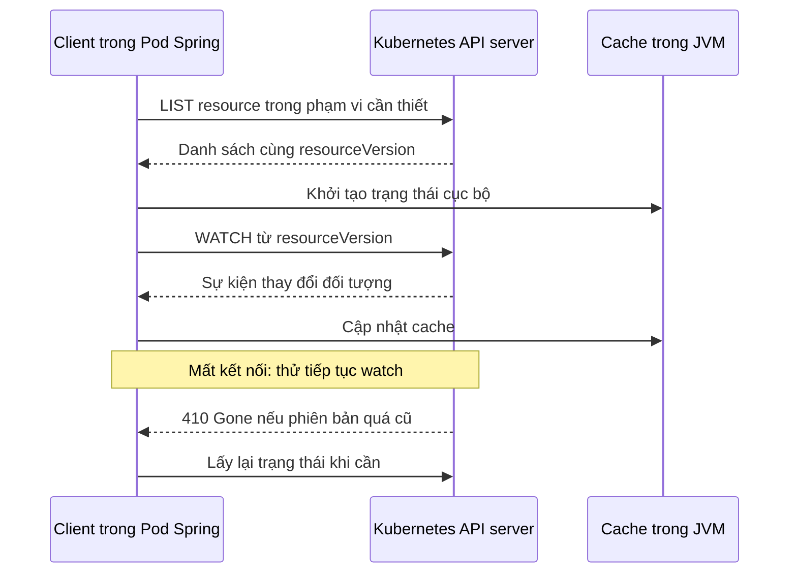

# Chi phí list và watch khi số Pod ứng dụng tăng

## Mục tiêu và bối cảnh

Trong chương **Hiệu năng và độ bền** của module **SPRING_CLOUD_KUBERNETES**, bài học này giải thích vì sao mở rộng một ứng dụng Spring có thể làm tăng cả tải lên Kubernetes API server lẫn bộ nhớ trong từng JVM. Phạm vi gồm DiscoveryClient, ConfigMap, Secret, Spring Cloud LoadBalancer, Configuration Watcher và những quyết định vận hành liên quan đến RBAC, cập nhật cấu hình, sức khỏe Pod.

Sau bài học, bạn có thể:

- Phân biệt chi phí lấy trạng thái ban đầu bằng list với chi phí duy trì watch.
- Ước lượng ảnh hưởng của số replica, namespace, resource và tốc độ thay đổi đối tượng.
- Nhận diện bão khởi động, bão reconnect và độ trễ của dữ liệu discovery.
- Chọn tính năng Spring Cloud Kubernetes phù hợp với nhu cầu thực tế.
- Thiết kế phép đo kiểm chứng trước khi tăng quy mô triển khai.

Các số liệu dung lượng và ngưỡng trong ví dụ đều là **giả định để tính toán**, không phải benchmark hay giới hạn Kubernetes. Ví dụ thuộc tính cần được đối chiếu với phiên bản Spring Cloud Kubernetes, Spring Cloud và thư viện client mà ứng dụng thực sự sử dụng.

## 1. Hai loại Pod cần đếm riêng

Giả sử `checkout-api` gọi `inventory-api`:

```text
checkout-api: 80 replica
    |
    | DiscoveryClient tìm các instance inventory-api
    v
Kubernetes API server
    |
    +-- Service inventory-api
    +-- EndpointSlice chứa địa chỉ các Pod inventory-api
```

Có hai đại lượng độc lập:

| Đại lượng | Ý nghĩa trong ví dụ | Khi tăng sẽ tác động trực tiếp đến |
| --- | --- | --- |
| Số Pod chạy client | Các replica checkout-api có kết nối Kubernetes API | Số cache, số subscription và lượt khởi tạo |
| Số đối tượng được theo dõi | Service, EndpointSlice hoặc Pod nằm trong phạm vi discovery | Kích thước snapshot, cache và lượng cập nhật |
| Tốc độ thay đổi đối tượng | Tạo, xóa, đổi trạng thái hoặc metadata | Lượng sự kiện phải phân phối và xử lý |

Tăng checkout-api từ 10 lên 80 replica có thể nhân tám lần số bản sao cache, ngay cả khi inventory-api vẫn chỉ có 5 Pod. Tăng inventory-api từ 5 lên 500 Pod lại làm tăng tập địa chỉ mà một client có thể phải giữ, dù checkout-api không đổi.

Không được lấy tổng số Pod toàn cluster làm kích thước list của mọi client. Một ứng dụng chỉ theo dõi EndpointSlice trong một namespace sẽ có phạm vi khác với ứng dụng list toàn bộ Pod ở mọi namespace. Trước khi tính chi phí, phải xác định **ai gọi, gọi resource nào, ở đâu, với bộ lọc nào**.

## 2. List lấy ảnh chụp, watch nhận thay đổi

Luồng phổ biến là list một tập đối tượng, lưu `metadata.resourceVersion` của tập kết quả, rồi watch từ phiên bản đó. Watch trả các sự kiện thay đổi như `ADDED`, `MODIFIED`, `DELETED`. Nếu lịch sử đã hết và server trả `410 Gone`, client cần lấy lại trạng thái rồi mở watch mới. Đây là cơ chế được mô tả trong [Kubernetes API Concepts](https://kubernetes.io/docs/reference/using-api/api-concepts/#efficient-detection-of-changes).



`resourceVersion` là token giao thức; không dùng nó như timestamp hay tự trừ hai giá trị để suy ra số sự kiện.

Một số tổ hợp server/client hỗ trợ truyền trạng thái ban đầu trong watch. Khi đó không nhất thiết thấy một HTTP LIST riêng, nhưng vẫn phải truyền và dựng trạng thái ban đầu. Vì vậy, mô hình chi phí bên dưới dùng khái niệm **snapshot ban đầu**, không buộc mọi implementation có cùng chuỗi HTTP request.

### Các khoản chi phí cần phân biệt

| Hoạt động | Phía server và đường truyền | Phía ứng dụng |
| --- | --- | --- |
| Snapshot ban đầu | Chuẩn bị và gửi tập kết quả | Giải mã, cấp phát object, dựng index/cache |
| Watch đang mở | Duy trì luồng và phân phối sự kiện phù hợp | Duy trì kết nối, đọc và áp dụng sự kiện |
| Reconnect | Thiết lập lại request/kết nối | Retry, xác thực và tiếp tục đồng bộ |
| Relist khi cần | Gửi lại trạng thái của phạm vi theo dõi | Tái đồng bộ và xử lý dữ liệu ban đầu |
| Truy vấn cache | Có thể không phát sinh HTTP tới Kubernetes | Tìm kiếm, lọc, tạo ServiceInstance hoặc kết quả khác |

**Một lần gọi `getInstances()` không đồng nghĩa một lần list Kubernetes.** Muốn biết đường đi thực tế phải quan sát implementation và request. Tương tự, watch của nhiều replica vẫn tạo công việc phân phối và xử lý, dù mỗi replica không polling liên tục.

## 3. Mô hình định lượng cho quy hoạch dung lượng

Đặt:

| Ký hiệu | Định nghĩa |
| --- | --- |
| `P` | Số Pod ứng dụng đang chạy client |
| `I` | Số pipeline theo dõi độc lập trung bình trong một Pod, kể cả các client trùng phạm vi |
| `K` | Số phạm vi namespace trung bình mỗi pipeline |
| `R` | Số loại resource được mỗi pipeline theo dõi |
| `N[r]` | Số đối tượng loại r trong một phạm vi đại diện |
| `b[r]` | Số byte trung bình của một đối tượng truyền về |
| `m[r]` | Bộ nhớ trung bình giữ lại cho một đối tượng sau giải mã và lập index |
| `lambda[r]` | Số thay đổi mỗi giây phù hợp với một subscription loại r |
| `e[r]` | Số byte trung bình của một sự kiện loại r |

Nếu mọi Pod có cấu hình đồng nhất và mở subscription riêng theo namespace/resource, có thể ước lượng:

```text
W ≈ P × I × K × R

D_initial ≈ P × I × K × Σ(N[r] × b[r])
M_total   ≈ P × I × K × Σ(N[r] × m[r])

E_delivery/giây ≈ P × I × K × Σ(lambda[r])
D_watch/giây    ≈ P × I × K × Σ(lambda[r] × e[r])
```

`W` là số subscription logic, không phải số TCP socket chắc chắn có. HTTP/2, HTTP client và cách mở watch có thể làm số kết nối vật lý khác đi.

Mô hình này còn giả định tập dữ liệu giữa các phạm vi tương đối giống nhau. Nếu namespace lớn nhỏ khác nhau hoặc mỗi loại resource có selector riêng, hãy cộng theo từng subscription thay vì nhân với `K`. Watch toàn namespace qua một request có thể làm số luồng ít hơn nhưng tập đối tượng lớn hơn; không được dùng cách đếm đó để kết luận tải thấp hơn.

Các công thức là phép ước lượng do bài học xây dựng. Chúng không dự đoán chính xác CPU của API server, chi phí etcd, tác dụng của watch cache hay tỷ lệ nén mạng.

### Ví dụ: 120 replica cùng theo dõi một tập dữ liệu

Giả định mỗi replica có một pipeline với hai nhóm resource:

| Nhóm | Số object | Payload trung bình/object | Bộ nhớ giữ lại/object |
| --- | ---: | ---: | ---: |
| Service | 300 | 2 KiB | 6 KiB |
| EndpointSlice | 900 | 4 KiB | 12 KiB |

Một replica nhận snapshot:

```text
300 × 2 KiB + 900 × 4 KiB = 4.1015625 MiB
```

Với 120 replica:

```text
Tổng payload ban đầu ≈ 492.2 MiB
Cache một replica   ≈ 12.3 MiB
Tổng cache          ≈ 1,476.6 MiB ≈ 1.44 GiB
Subscription logic  ≈ 120 × 1 × 1 × 2 = 240
```

Đây chỉ là phần cache đang mô hình hóa; chưa có heap nghiệp vụ, buffer, object tạm, thread stack và bộ nhớ native.

Nếu mỗi replica nhận 15 sự kiện EndpointSlice/giây, mỗi sự kiện giả định 4 KiB:

```text
Tổng lượt giao sự kiện = 120 × 15 = 1,800 lượt/giây
Payload sự kiện       = 1,800 × 4 KiB ≈ 7.0 MiB/giây
```

Vẫn chỉ có 15 thay đổi gốc mỗi giây trong giả định này. Con số 1.800 biểu thị các bản sao sự kiện được phân phối đến client.

Nếu cả 120 replica khởi động trong 10 giây, riêng snapshot tạo nhu cầu truyền trung bình khoảng 49,2 MiB/giây trong cửa sổ đó. Trải quá trình khởi động ra 120 giây làm con số trung bình khoảng 4,1 MiB/giây. Tổng dữ liệu gần như không đổi, nhưng áp lực tức thời khác rõ rệt.

### Khi nào có thể xuất hiện xu hướng bậc hai?

Nếu mỗi Pod theo dõi toàn bộ tập Pod ứng dụng, và chính tập đó tăng cùng số replica, ta có `N ∝ P`. Khi ấy tổng cache và payload snapshot có thể có xu hướng `P × N = O(P²)`.

Đây là hệ quả của **giả định mọi replica cùng giữ toàn bộ tập đang lớn lên**, không phải định luật rằng mọi triển khai Spring Cloud Kubernetes đều tăng chi phí bậc hai. Nếu ứng dụng chỉ giữ một tập Service nhỏ, hoặc phạm vi dữ liệu cố định, kết quả khác.

## 4. Chi phí trong Spring Cloud Kubernetes nằm ở đâu?

### DiscoveryClient và catalog watcher là các tầng khác nhau

DiscoveryClient cung cấp danh sách Service/instance; bên dưới có thể có informer và cache. Catalog watcher của Spring còn phát heartbeat theo chu kỳ để phản ánh thay đổi catalog. Thuộc tính `spring.cloud.kubernetes.discovery.catalog-services-watch-delay` điều khiển chu kỳ heartbeat, không phải chu kỳ mở Kubernetes watch hay cam kết rằng cứ mỗi chu kỳ sẽ có HTTP LIST. Xem [DiscoveryClient for Kubernetes](https://docs.spring.io/spring-cloud-kubernetes/reference/discovery-client.html).

Một bản kiểm kê nên ghi rõ:

```text
Pod checkout-api
  - Kubernetes client nào được khởi tạo?
  - Discovery đọc Service + Endpoints hay EndpointSlice?
  - Có thêm cache Pod để lấy metadata không?
  - Có catalog watcher không?
  - ConfigMap/Secret được đọc khi khởi động hay được theo dõi liên tục?
  - Có client khác do code nghiệp vụ hoặc starter khác tạo ra không?
```

Không coi việc thêm starter vào classpath là bằng chứng rằng chỉ có một bộ cache dùng chung. Cần kiểm tra số instance client, thread và request. Khả năng chia sẻ informer trong một JVM cũng không làm các JVM ở các Pod tự chia sẻ bộ nhớ.

### ConfigMap, Secret và Configuration Watcher

Đọc cấu hình khi khởi động tạo tải ở thời điểm khởi động; theo dõi thay đổi tạo thêm tải kéo dài. Configuration Watcher là thành phần có thể triển khai riêng để gửi thông báo refresh qua HTTP hoặc Spring Cloud Bus. Mô hình này và các cách thông báo được mô tả trong [tài liệu Configuration Watcher](https://docs.spring.io/spring-cloud-kubernetes/reference/spring-cloud-kubernetes-configuration-watcher.html).

Với một watcher trung tâm, thử lập hai ngân sách:

```text
Ngân sách A: Subscription và dữ liệu từ Kubernetes đến watcher.
Ngân sách B: Fan-out thông báo và chi phí refresh trong ứng dụng.
```

Giảm subscription trong các Pod nghiệp vụ chưa chắc giảm tải refresh. Nếu một ConfigMap làm 120 replica refresh cùng lúc, vẫn có thể xuất hiện đợt cấp phát object, tạo lại bean hoặc kết nối lại hệ thống phụ thuộc. Cần đo từng phần thay vì chỉ đếm watcher.

Số replica của watcher, cơ chế HA, leader election và hành vi thông báo phải được xác minh theo bản triển khai. Không suy luận rằng tăng replica watcher sẽ tự chia nhỏ tập resource hoặc tự loại bỏ thông báo trùng.

### Spring Cloud LoadBalancer và đường gọi nghiệp vụ

Trong chế độ `POD`, Kubernetes LoadBalancer sử dụng DiscoveryClient để lấy instance. Chế độ `SERVICE` là một đường xử lý khác; cần xem implementation trước khi suy luận nó loại bỏ mọi truy cập API. Hai chế độ được mô tả trong [LoadBalancer for Kubernetes](https://docs.spring.io/spring-cloud-kubernetes/reference/load-balancer.html).

Nếu một giao dịch gọi inventory-api ba lần, đó là ba lượt gọi nghiệp vụ. Số request tới Kubernetes phụ thuộc cách lấy danh sách instance và cache, không thể suy ra trực tiếp từ số giao dịch.

## 5. Thu hẹp phạm vi trước khi chỉnh retry

Ví dụ sau minh họa cấu hình discovery cho ứng dụng chỉ cần namespace `commerce`:

```yaml
spring:
  application:
    name: checkout-api
  cloud:
    kubernetes:
      discovery:
        enabled: true
        all-namespaces: false
        namespaces:
          - commerce
        service-labels:
          discovery-scope: checkout
        use-endpoint-slices: true
        metadata:
          add-pod-labels: false
          add-pod-annotations: false
        include-not-ready-addresses: false
```

Các thuộc tính trên có trong [phụ lục cấu hình Spring Cloud Kubernetes](https://docs.spring.io/spring-cloud-kubernetes/reference/appendix.html). Ý định của ví dụ là giới hạn namespace, chọn Service có label phù hợp, dùng EndpointSlice khi được hỗ trợ và không yêu cầu metadata Pod.

Label cần nằm trên **Service** được discover, chẳng hạn đoạn sau là một phần manifest của inventory-api:

```yaml
metadata:
  name: inventory-api
  namespace: commerce
  labels:
    discovery-scope: checkout
```

`service-labels` không phải selector chọn Pod đứng sau Service. Việc chọn backend vẫn thuộc `Service.spec.selector`. Cũng không được giả định label của Service sẽ tự được sao chép thành selector API giống hệt cho Pod, ConfigMap, Secret hay mọi EndpointSlice.

Để chứng minh thay đổi giảm tải, quan sát request URI và số object thực nhận của từng resource. Một bộ lọc áp dụng sau khi dữ liệu đã về JVM chỉ giảm kết quả xử lý tiếp theo, không giảm phần dữ liệu đã truyền.

Nếu dùng HTTP DiscoveryClient với DiscoveryServer, phạm vi truy cập Kubernetes cần được đặt ở phía server. Chỉ chỉnh ứng dụng gọi HTTP không đảm bảo tập dữ liệu server theo dõi đã nhỏ lại.

## 6. EndpointSlice giúp chia nhỏ cập nhật, không xóa hệ số replica

EndpointSlice chia địa chỉ backend thành nhiều đối tượng; mặc định control plane hướng tới tối đa 100 endpoint mỗi slice. Việc chia này giúp tránh một đối tượng chứa mọi địa chỉ phải được gửi lại cho từng thay đổi nhỏ. Xem [EndpointSlices](https://kubernetes.io/docs/concepts/services-networking/endpoint-slices/).

Giả định một Service có 1.000 backend, được chia thành 10 slice, và một thay đổi chỉ làm cập nhật một slice:

```text
Đối tượng lớn duy nhất:
  1 thay đổi → có thể truyền lại đối tượng chứa 1.000 địa chỉ.

Nhiều slice:
  1 thay đổi → trong giả định này truyền lại slice chứa 100 địa chỉ.
```

Kết quả thực tế phụ thuộc kích thước slice, cách đóng gói endpoint và số slice cùng thay đổi. Sự kiện watch thông thường chứa object cập nhật, không phải một bản vá chỉ gồm địa chỉ vừa đổi.

Khi 120 replica cùng subscribe phạm vi đó, sự kiện phù hợp vẫn phải đến 120 nơi. EndpointSlice cải thiện kích thước đơn vị cập nhật; nó không tự làm cache trong các JVM trở thành một cache dùng chung.

Không lấy số lượng EndpointSlice thấp làm bằng chứng bộ nhớ thấp: mỗi slice còn chứa một danh sách endpoint. Cần đo cả số object và tổng số địa chỉ, payload, heap giữ lại.

## 7. RBAC phải khớp với phạm vi client

Ví dụ dưới đây minh họa quyền discovery đọc Service và EndpointSlice trong namespace `commerce`. Nó là cấu hình nền cho đường discovery đang xét, không phải bộ quyền đầy đủ cho mọi tổ hợp tính năng.

```yaml
apiVersion: v1
kind: ServiceAccount
metadata:
  name: checkout-discovery
  namespace: commerce
---
apiVersion: rbac.authorization.k8s.io/v1
kind: Role
metadata:
  name: checkout-discovery-reader
  namespace: commerce
rules:
  - apiGroups: [""]
    resources: ["services"]
    verbs: ["get", "list", "watch"]
  - apiGroups: ["discovery.k8s.io"]
    resources: ["endpointslices"]
    verbs: ["get", "list", "watch"]
---
apiVersion: rbac.authorization.k8s.io/v1
kind: RoleBinding
metadata:
  name: checkout-discovery-reader
  namespace: commerce
subjects:
  - kind: ServiceAccount
    name: checkout-discovery
    namespace: commerce
roleRef:
  apiGroup: rbac.authorization.k8s.io
  kind: Role
  name: checkout-discovery-reader
```

Deployment cần dùng `spec.template.spec.serviceAccountName: checkout-discovery`. Nếu implementation còn đọc Pod, Endpoints hay cấu hình qua API, hãy bổ sung đúng quyền đã xác minh.

RoleBinding giới hạn quyền namespaced theo namespace của nó. Label selector không phải ranh giới phân quyền RBAC. Đặc biệt, quyền list/watch Secret có thể cho phép đọc nội dung Secret trong phạm vi được cấp; không thêm quyền đó chỉ để sửa lỗi discovery. Xem [Using RBAC Authorization](https://kubernetes.io/docs/reference/access-authn-authz/rbac/).

Lệnh kiểm tra minh họa dành cho môi trường thực hành:

```powershell
kubectl auth can-i list services -n commerce --as=system:serviceaccount:commerce:checkout-discovery
kubectl auth can-i watch endpointslices.discovery.k8s.io -n commerce --as=system:serviceaccount:commerce:checkout-discovery
kubectl auth can-i list secrets -n commerce --as=system:serviceaccount:commerce:checkout-discovery
```

Kết quả mong muốn theo Role trên là `yes`, `yes`, `no`, nếu không có binding khác cấp thêm quyền. Người chạy cần quyền impersonation cho tùy chọn `--as`.

Lỗi `403 Forbidden` kéo dài là tín hiệu sửa quyền hoặc phạm vi truy cập. Lặp lại cùng request liên tục sẽ chỉ tạo thêm tải và log.

## 8. Reconnect và relist quyết định khả năng phục hồi

Một hệ thống khỏe cần chịu được watch bị ngắt. Điểm cần đo là tần suất reconnect, số lần phải tải lại trạng thái và thời gian cache bắt kịp.

| Tình huống | Điều cần phân biệt | Hướng xử lý |
| --- | --- | --- |
| Kết nối đóng theo timeout | Có thể tiếp tục từ phiên bản đã nhận | Để client library quản lý vòng đời watch |
| Lịch sử không còn phù hợp | Cần đồng bộ lại trạng thái | Theo dõi số lần và lượng dữ liệu khởi tạo lại |
| API trả 429 hoặc lỗi tạm thời | Quá tải hoặc giới hạn lưu lượng | Backoff, jitter, tôn trọng Retry-After khi có |
| API trả 403 lặp lại | Quyền hay phạm vi không đúng | Sửa cấu hình/RBAC |
| Sự kiện vào nhanh hơn xử lý | Client tụt hậu | Đo hàng đợi, CPU, GC và thời gian xử lý |

API Priority and Fairness có thể xếp hàng hoặc từ chối request khi quá tải; list lớn và phân phối watch cũng tạo công việc cần tính đến. Cơ chế này được giải thích trong [API Priority and Fairness](https://kubernetes.io/docs/concepts/cluster-administration/flow-control/).

Một chính sách retry do ứng dụng tự bổ sung có thể dùng ý tưởng:

```text
upperBound = min(maxDelay, baseDelay × 2^attempt)
delay      = random(0, upperBound)
```

Đây là thuật toán minh họa, không phải tên thuộc tính cấu hình Spring Cloud Kubernetes. Với client đã có retry, tránh bọc thêm vòng retry không kiểm soát: các tầng có thể nhân số lần thử.

Một vòng phản hồi cần tránh:

```text
Nhiều Pod cùng khởi động
  → snapshot đồng loạt
  → API chậm, đồng bộ cache chậm
  → timeout hoặc probe giết Pod
  → Pod khởi động lại
  → thêm snapshot và reconnect
```

Biện pháp nên thử là giảm đồng thời khởi động, thu hẹp phạm vi dữ liệu và đặt ngân sách startup phù hợp. Tăng timeout đơn thuần có thể che giấu tải vẫn đang tăng.

Không đồng nhất `resync` của informer với relist mạng. Một vòng xử lý lại dữ liệu cache có thể tốn CPU mà không tải snapshot mới. Hãy dùng request thực tế để xác nhận thay vì suy luận từ tên log.

## 9. Cache, độ mới và sức khỏe Pod

### Một cache ít tốn mạng vẫn có thể trả dữ liệu cũ

Một instance đã bị loại khỏi endpoint chưa chắc biến mất ngay khỏi mọi tầng. Hãy đo chuỗi thời gian:

```text
Trạng thái backend đổi
  → trạng thái endpoint được cập nhật
  → sự kiện đến client
  → cache discovery được cập nhật
  → danh sách instance ở LoadBalancer phản ánh thay đổi
  → lượt chọn backend tiếp theo
```

Spring Cloud LoadBalancer có cache riêng và thuộc tính điều khiển TTL; tài liệu cũng lưu ý tránh cache trùng khi DiscoveryClient đã đảm nhiệm caching. Xem [Spring Cloud LoadBalancer](https://docs.spring.io/spring-cloud-commons/reference/spring-cloud-commons/loadbalancer.html#loadbalancer-caching).

Với hệ thống cụ thể, trước khi bật/tắt cache hãy xác định tầng nào thực hiện network call, tầng nào dựng danh sách, và cơ chế invalidation. Việc một lớp dùng informer không tự chứng minh rằng mọi kết quả ở tầng trên sẽ luôn được cập nhật ngay.

Đừng dùng thời điểm nhận sự kiện gần nhất làm thước đo duy nhất cho độ mới: resource có thể không thay đổi trong nhiều giờ. Cần phân biệt **không có thay đổi** với **đã mất khả năng theo dõi thay đổi**. Một sự kiện thử có kiểm soát trong môi trường thực hành giúp đo thời gian hội tụ rõ ràng hơn.

### Probe không nên gây thêm bão truy vấn

Nếu mỗi replica thực hiện một lần list trong health check mỗi 10 giây, 120 replica tạo thêm:

```text
120 / 10 = 12 lần list/giây
```

Đó là tải do thiết kế health check của ứng dụng. Nó có thể tồn tại song song với watch đang hoạt động tốt.

Spring Boot khuyến nghị liveness không phụ thuộc hệ thống bên ngoài, vì lỗi dùng chung có thể khiến nhiều instance cùng bị khởi động lại. Readiness cần được chọn theo khả năng phục vụ thực tế. Xem [Spring Boot: Kubernetes Probes](https://docs.spring.io/spring-boot/reference/actuator/endpoints.html#actuator.endpoints.kubernetes-probes).

Đối với checkout-api có cache discovery đã đồng bộ, cần quyết định liệu mất API trong thời gian ngắn có thực sự làm ứng dụng hết khả năng xử lý hay không. Hãy kiểm tra bằng hành vi nghiệp vụ và chính sách độ cũ chấp nhận được, thay vì để một request list sâu quyết định liveness.

## 10. Khi nào có thể giảm số tính năng tích hợp?

Hãy xuất phát từ thông tin ứng dụng thật sự cần:

| Nhu cầu | Phương án nên đánh giá | Chi phí cần tính tiếp |
| --- | --- | --- |
| Gọi một Service bằng tên ổn định | DNS và Kubernetes Service | DNS, kết nối và đường chuyển tiếp Service |
| Chọn trực tiếp từng instance dựa vào metadata | DiscoveryClient và LoadBalancer phù hợp | Cache, subscription, độ mới của endpoint |
| Chỉ đọc cấu hình lúc khởi động | Đọc cấu hình một lần hoặc cấu hình từ volume theo thiết kế | Tải lúc startup và quy trình cập nhật |
| Cần cập nhật cấu hình đang chạy | Configuration Watcher/Bus theo yêu cầu | Subscription và fan-out refresh |
| Cần tên, namespace của chính Pod | Downward API | Cách truyền và cập nhật thông tin cần dùng |
| Nhiều ứng dụng cần cùng catalog rộng | Đánh giá DiscoveryServer dùng chung | HA, tải HTTP, cache và điểm phụ thuộc mới |

Một Service thông thường có bản ghi DNS trỏ tới ClusterIP; ứng dụng có thể gọi tên như `inventory-api.commerce.svc.cluster.local` nếu cluster dùng domain đó. Headless Service có cách trả địa chỉ khác. Xem [DNS for Services and Pods](https://kubernetes.io/docs/concepts/services-networking/dns-pod-service/).

Dùng DNS làm thay đổi nơi ứng dụng nhận thông tin định tuyến; hạ tầng cluster vẫn có các thành phần theo dõi resource. Vì vậy, phép so sánh cần tính phần tải ứng dụng tránh được và phần hạ tầng còn đảm nhiệm.

Downward API có thể cung cấp tên và namespace của chính Pod qua `fieldRef`, giúp tránh tự truy vấn API chỉ để biết hai giá trị này. Xem [Downward API](https://kubernetes.io/docs/concepts/workloads/pods/downward-api/).

```yaml
env:
  - name: POD_NAME
    valueFrom:
      fieldRef:
        fieldPath: metadata.name
  - name: POD_NAMESPACE
    valueFrom:
      fieldRef:
        fieldPath: metadata.namespace
```

DiscoveryServer dùng chung cũng không biến chi phí thành số không. Lập ngân sách riêng cho số server, tải client HTTP, kích thước phản hồi, cache và tình huống server mất kết nối Kubernetes. Chọn phương án khi phép đo cho thấy tổng chi phí và khả năng phục hồi phù hợp.

## 11. Đo tải bằng những tín hiệu nào?

### Chỉ số từ control plane

Các metric thường dùng gồm `apiserver_request_total`, `apiserver_request_duration_seconds`, `apiserver_longrunning_requests` và `apiserver_response_sizes`. Tên, nhãn và độ sẵn có cần đối chiếu với [Kubernetes Metrics Reference](https://kubernetes.io/docs/reference/instrumentation/metrics/) của cluster.

Ví dụ PromQL cho resource thuộc phạm vi bài học:

```promql
sum by (resource, verb) (
  rate(apiserver_request_total{
    verb=~"LIST|WATCH",
    resource=~"services|endpoints|endpointslices|pods|configmaps|secrets"
  }[5m])
)
```

```promql
sum by (resource) (
  apiserver_longrunning_requests{
    verb="WATCH",
    resource=~"services|endpoints|endpointslices|pods|configmaps|secrets"
  }
)
```

```promql
histogram_quantile(
  0.95,
  sum by (le, resource) (
    rate(apiserver_request_duration_seconds_bucket{
      verb="LIST",
      resource=~"services|endpoints|endpointslices|pods|configmaps|secrets"
    }[5m])
  )
)
```

```promql
sum by (resource, code) (
  rate(apiserver_request_total{
    code=~"403|410|429|5..",
    resource=~"services|endpoints|endpointslices|pods|configmaps|secrets"
  }[5m])
)
```

Lưu ý khi diễn giải:

- WATCH request rate thể hiện lượt mở request, không phải số sự kiện đang chảy qua các watch.
- Watch có thể báo lỗi bên trong stream đã mở; chỉ nhìn mã HTTP không đếm đủ mọi lỗi client gặp.
- Các truy vấn trên gom toàn bộ client phù hợp, chưa cô lập checkout-api.
- Chỉ số API thường không có nhãn service account hay tên Pod gọi. Muốn quy nguồn cần dữ liệu client hoặc audit do quản trị viên cấu hình.
- Muốn ước lượng băng thông watch, bổ sung đo byte mạng và số sự kiện phía client; không suy ra trực tiếp từ request rate.

### Chỉ số cần bổ sung trong ứng dụng

| Tín hiệu | Câu hỏi cần trả lời |
| --- | --- |
| Thời gian đồng bộ cache ban đầu | Replica mới cần bao lâu trước khi discover được backend? |
| Số object/endpoint trong cache | Phạm vi thực tế có đúng như thiết kế? |
| Số lần reconnect và đồng bộ lại | Chi phí phục hồi có tăng bất thường? |
| Thời gian xử lý sự kiện, độ sâu hàng đợi nếu có | Client có theo kịp thay đổi? |
| Heap, allocation, GC pause và CPU | Chi phí giải mã, index và dựng kết quả lớn đến đâu? |
| Lỗi chọn backend, timeout, độ trễ nghiệp vụ | Tối ưu control plane có làm giảm chất lượng phục vụ? |
| Thời gian từ thay đổi backend đến kết quả discovery | Độ mới thực tế có đạt yêu cầu? |

Các dòng trong bảng là tín hiệu cần thiết kế hoặc thu thập; bài học không giả định Spring tự xuất sẵn từng metric với một tên cố định. Log chẩn đoán cũng cần giới hạn thời gian và tránh ghi payload Secret.

## 12. Thực hành kiểm chứng bằng từng biến độc lập

Thực hiện trong namespace thử nghiệm với ứng dụng mẫu đã có. Các lệnh dưới đây là hướng dẫn thực hành, không phải kết quả chạy thực tế.

### Bước 1: Chốt dữ liệu nền

Ghi lại phiên bản server/client, chế độ discovery, phạm vi namespace, số replica và cửa sổ đo. Lấy số lượng resource và backend làm mốc:

```powershell
kubectl get services -n commerce
kubectl get endpointslices.discovery.k8s.io -n commerce -l kubernetes.io/service-name=inventory-api
kubectl get pods -n commerce -l app=checkout-api
```

Không dùng một kết quả `kubectl get` để kết luận cache ứng dụng đã giống server; đây mới là trạng thái tham chiếu.

### Bước 2: Tăng số client, giữ nguyên tập backend

Lần lượt thử 1, 5, 20 rồi 50 replica checkout-api. Ở mỗi mức, đo riêng giai đoạn khởi động và giai đoạn ổn định.

Dự đoán cần kiểm chứng: nếu mỗi replica có cache/subscription độc lập, tổng chi phí tăng theo số client, còn số object trong cache của một replica gần như không đổi.

### Bước 3: Giữ số client, tăng tập được theo dõi

Giữ checkout-api ở 5 replica. Tăng số backend hoặc thêm Service thử nghiệm trong phạm vi discovery.

Dự đoán cần kiểm chứng: payload khởi tạo và heap mỗi replica tăng khi tập theo dõi lớn hơn. Số subscription có thể không đổi, nên chỉ đếm watch sẽ bỏ sót phần tăng này.

### Bước 4: Tạo thay đổi có kiểm soát

Thay đổi một backend trong môi trường lab, rồi ghi mốc thời gian khi endpoint tham chiếu đổi và khi ứng dụng chọn được trạng thái mới. Sau đó so sánh một rollout chậm với rollout dồn dập, giữ nguyên quy mô đích.

Một rollout có nhiều bước chuyển trạng thái; đừng giả định một Pod tạo đúng một sự kiện EndpointSlice. Hãy đo số cập nhật thực nhận.

### Bước 5: Thử mất watch tạm thời

Dùng cơ chế chèn lỗi được môi trường lab cho phép để ngắt đường truy cập API của client trong thời gian giới hạn. Không dừng API server của cluster dùng chung.

Quan sát client có retry đều đặn hay đồng loạt, có tải lại snapshot hay tiếp tục stream, và nghiệp vụ có còn phục vụ bằng trạng thái đã biết. Sau khi khôi phục kết nối, đo thời gian hội tụ và đỉnh CPU/GC.

### Bước 6: Thu hẹp phạm vi và so sánh

Áp dụng namespace và Service label phù hợp, xác minh lại RBAC rồi lặp phép đo. Mỗi lần chỉ đổi một yếu tố để xác định nguyên nhân.

Dùng bảng ghi nhận:

| Kịch bản | Replica client | Quy mô dữ liệu | Snapshot/cache sync | LIST rate | Watch đang mở | Heap/Pod | Lỗi nghiệp vụ |
| --- | ---: | --- | --- | --- | --- | --- | --- |
| Nền | 1 | Cố định | Đo | Đo | Đo | Đo | Đo |
| Tăng client | 20 | Như nền | Đo | Đo | Đo | Đo | Đo |
| Tăng dữ liệu | 5 | Lớn hơn | Đo | Đo | Đo | Đo | Đo |
| Rollout dồn | 20 | Như nền | Đo | Đo | Đo | Đo | Đo |
| Sau thu hẹp | 20 | Có lọc | Đo | Đo | Đo | Đo | Đo |

Đặt tiêu chí trước khi thử. Ví dụ giả định: p95 cache sync dưới 15 giây, độ trễ phản ánh thay đổi dưới 5 giây trong điều kiện bình thường, không tăng lỗi nghiệp vụ và không phát sinh 429 kéo dài. Điều chỉnh các số này theo SLO và ngân sách hạ tầng của hệ thống.

Một phương án chỉ đạt yêu cầu khi cả tải lúc ổn định, đỉnh lúc rollout và hành vi phục hồi đều phù hợp. Số LIST giảm nhưng heap vượt giới hạn hoặc backend lỗi thời lâu hơn vẫn là kết quả cần xử lý.

## 13. Những kết luận dễ sai và cách sửa

| Nhận định | Cách đánh giá đúng hơn |
| --- | --- |
| “Watch chỉ có một request nên rất rẻ” | Đo thời gian duy trì, số sự kiện, byte và công xử lý tại mọi client |
| “API server có cache thì JVM không cần RAM cho discovery” | Tính riêng trạng thái được giữ ở server và trong từng JVM |
| “Tăng Pod chỉ tăng CPU nghiệp vụ” | Tính thêm số client, cache, snapshot và subscription |
| “Lọc kết quả cuối cùng đã giảm toàn bộ tải mạng” | Xác minh bộ lọc có đi vào request và resource nào được lọc |
| “Đổi catalog watch delay sẽ đổi mọi Kubernetes watch” | Xác định đúng tầng heartbeat, informer và HTTP request |
| “Watch ngắt là luôn cần list lại từ đầu” | Kiểm tra khả năng tiếp tục và nhu cầu tái đồng bộ |
| “EndpointSlice làm hết mọi vấn đề scale” | Đo payload mỗi slice cùng hệ số số client |
| “API lỗi thì restart mọi Pod để sửa” | Đánh giá dữ liệu đã có và khả năng phục hồi để tránh bão startup |
| “Watcher tập trung loại bỏ mọi chi phí cấu hình” | Tính cả fan-out refresh và việc nạp lại cấu hình trong từng replica |

## 14. Áp dụng vào quyết định triển khai

Trước khi tăng replica checkout-api, nhóm vận hành cần trả lời được bốn câu hỏi:

1. Mỗi replica tạo bao nhiêu pipeline client và theo dõi chính xác tập resource nào?
2. Ngân sách snapshot, cache và sự kiện tăng ra sao ở quy mô đích?
3. Khi mất watch, hệ thống phục hồi trong bao lâu và có gây đợt tải đồng loạt không?
4. Tính năng nào cần dữ liệu Kubernetes trong JVM, tính năng nào có thể dùng khả năng sẵn có của nền tảng?

Với các câu trả lời và phép đo đó, việc chọn DiscoveryClient, cấu hình động, LoadBalancer hay Configuration Watcher trở thành quyết định có căn cứ. Mục tiêu là giữ được độ mới và khả năng phục hồi cần thiết, đồng thời kiểm soát chi phí nhân lên khi số Pod tăng.
