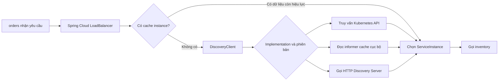
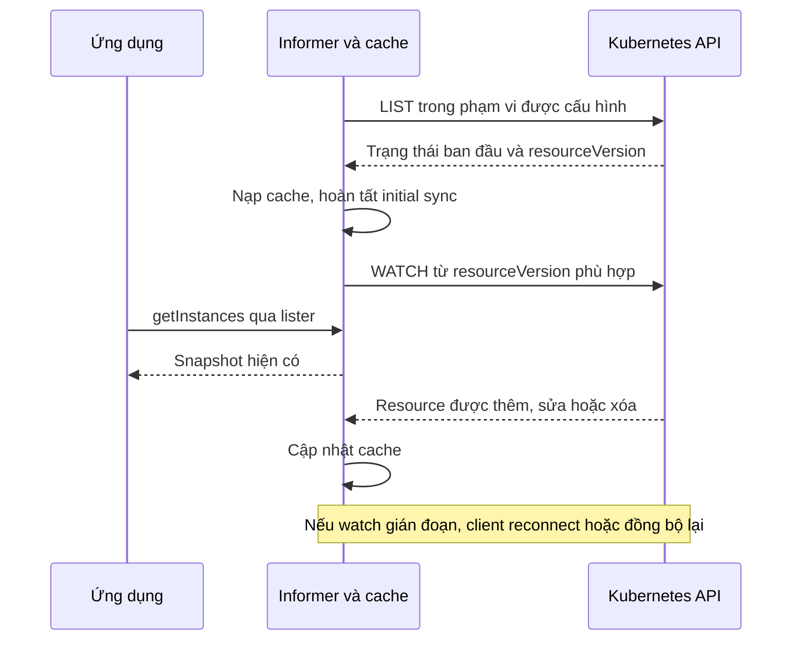

# Cache, informer và phạm vi sử dụng theo loại client

## Mục tiêu và phạm vi

Trong chương **Hiệu năng và độ bền** của module **SPRING_CLOUD_KUBERNETES**, bài này giải thích vì sao cùng một lời gọi `DiscoveryClient.getInstances("inventory")` có thể đọc dữ liệu trong bộ nhớ, gọi Kubernetes API hoặc gọi một Discovery Server. Hiểu đường đi thực tế giúp chọn cache đúng chỗ, giới hạn dữ liệu phải theo dõi và dự đoán điều gì xảy ra khi Pod hoặc kết nối tới control plane thay đổi.

Sau bài học, bạn có thể:

- Phân biệt informer cache, cache danh sách instance của Spring Cloud LoadBalancer và cấu hình đã nạp vào Spring Environment.
- So sánh Fabric8, Kubernetes Java Client và HTTP DiscoveryClient theo vị trí truy vấn, cache và RBAC.
- Giải thích initial sync, LIST/WATCH, reconnect, resync và nguy cơ dùng endpoint cũ.
- Thiết kế phạm vi namespace, tài nguyên và quyền truy cập phù hợp với nhu cầu discovery hoặc cập nhật ConfigMap/Secret.
- Lập phép đo kiểm tra cả chi phí API lẫn tốc độ loại bỏ instance không còn phục vụ.

**Mốc triển khai:** các đối chiếu implementation và ví dụ cấu hình dưới đây dùng **Spring Cloud Kubernetes 3.3.3**, discovery dựa trên **Endpoints**, cùng Spring Cloud Commons 4.3.x trong một release train tương thích. Đây là mốc để kiểm chứng hành vi, không phải khuyến nghị nâng/hạ phiên bản dự án. Khi dùng nhánh khác, đối chiếu lại implementation, metadata cấu hình và BOM; không suy ra cơ chế cache chỉ từ tên thư viện client.

Kiến thức cần có: Kubernetes Service, Pod readiness, namespace, ServiceAccount/RoleBinding và cách thêm starter qua Spring Cloud BOM. Bạn không cần tự viết informer để sử dụng discovery được Spring Cloud Kubernetes tự cấu hình.

## 1. Bắt đầu từ đường đi của một yêu cầu

Giả sử `orders` cần gọi `inventory`. Có hai câu hỏi độc lập:

1. **Chọn địa chỉ:** lấy danh sách instance nào và chọn địa chỉ nào?
2. **Gửi yêu cầu:** kết nối HTTP tới địa chỉ được chọn có thành công không?

Cache discovery tác động trực tiếp tới câu hỏi thứ nhất. Một danh sách đọc rất nhanh vẫn có thể chứa Pod IP đã bị thay thế; một danh sách mới cũng không bảo đảm yêu cầu nghiệp vụ thành công.



Sơ đồ mô tả các khả năng kiến trúc. Việc một nhánh thực sự được dùng phụ thuộc starter, auto-configuration và chuỗi `ServiceInstanceListSupplier` đang chạy.

Ví dụ suy luận: nếu tăng tải nghiệp vụ từ 100 lên 1.000 yêu cầu/giây mà số GET/LIST tới Kubernetes API cũng tăng gần tương ứng, hãy tìm đường truy vấn trực tiếp chưa được cache. Nếu API traffic gần như giữ nguyên nhưng heap tăng theo số Service/endpoint trong cluster, hãy kiểm tra phạm vi informer và số bản sao cache.

## 2. Các lớp trạng thái thường bị gọi chung là cache

| Lớp | Nội dung được giữ | Cách thay đổi | Câu hỏi khi chẩn đoán |
| --- | --- | --- | --- |
| Informer cache | Bản sao resource như Service, Endpoints trong tiến trình | Đồng bộ ban đầu rồi nhận thay đổi qua watch | Cache đã sync chưa, watch còn hoạt động không? |
| Cache của LoadBalancer | Danh sách `ServiceInstance` theo service ID | Hết hạn hoặc cơ chế làm mới/loại bỏ của supplier thực tế | Danh sách cũ còn sống ở lớp này bao lâu? |
| Spring Environment và bean cấu hình | Giá trị đã đọc từ nguồn cấu hình | Nạp lại nguồn và refresh/rebind hoặc khởi động lại phù hợp | Bean sử dụng đã nhận giá trị mới chưa? |
| Cache nghiệp vụ tự xây dựng | Giá, tồn kho hoặc kết quả xử lý | Quy tắc của ứng dụng | Có vô tình nhầm với trạng thái discovery không? |

Các lớp này có khóa, vòng đời và tiêu chí đúng khác nhau. Tăng TTL cache nghiệp vụ không sửa được watch discovery bị mất. Giảm TTL LoadBalancer cũng không khởi động lại informer đang lỗi RBAC.

Đặc biệt, informer cache không cần `@EnableCaching` hay một `CacheManager` của Spring để tồn tại. Một cấu hình `spring.cache.*` cũng không mặc nhiên điều khiển bộ nhớ mà thư viện Kubernetes client dùng cho informer.

## 3. Informer hoạt động như thế nào?

### 3.1. Đồng bộ bản sao thay vì đọc toàn bộ mỗi lần

Mô hình phổ biến là đọc tập resource ban đầu, giữ trạng thái cùng `resourceVersion`, sau đó nhận thay đổi qua WATCH để cập nhật bản sao. Khi lịch sử watch không còn khả dụng, client phải phục hồi trạng thái, thường bằng cách list lại rồi tiếp tục watch. Kubernetes có thể trả `410 Gone` cho phiên bản quá cũ; `resourceVersion` là giá trị opaque, không phải timestamp để ứng dụng tự trừ hoặc so sánh số học. Xem [Kubernetes API Concepts](https://kubernetes.io/docs/reference/using-api/api-concepts/).



Đây là mô hình giải thích LIST/WATCH truyền thống; chi tiết khởi tạo stream có thể thay đổi theo phiên bản client và Kubernetes API. Không viết mã nghiệp vụ phụ thuộc vào số lượng kết nối hay trình tự callback chính xác của sơ đồ.

### 3.2. Ba thuật ngữ phải tách riêng

- **Initial sync:** informer đã nạp được trạng thái khởi đầu. Nó trả lời câu hỏi ứng dụng có thể bắt đầu đọc một tập dữ liệu có ý nghĩa hay chưa.
- **Relist:** đọc lại resource từ API để phục hồi hoặc tái lập trạng thái khi cần.
- **Resync:** tùy implementation, đưa các object đã biết qua luồng xử lý lại. Không được coi chu kỳ resync là cam kết cứ mỗi chu kỳ sẽ tải mới mọi object từ API.

`hasSynced()` không chứng minh dữ liệu luôn mới về sau. Một cache đã sync có thể tiếp tục chứa trạng thái cuối cùng trong khi đường kết nối bị lỗi. Tương tự, namespace yên lặng không có sự kiện mới cũng không chứng minh watch đã chết; cần quan sát lỗi, reconnect và trạng thái kết nối.

Về thiết kế, hãy coi informer là một bản sao **nhất quán cuối cùng**. Nếu hai resource thay đổi gần nhau, không giả định hai cache cập nhật cùng thời điểm như một giao dịch. Handler tự viết nên xử lý lặp an toàn, thực hiện công việc nặng qua hàng đợi có giới hạn và đọc lại trạng thái hiện tại khi xử lý. Tránh tạo informer hoặc client mới cho từng HTTP request.

### 3.3. Shared informer chia sẻ trong phạm vi nào?

Từ `shared` thường chỉ việc dùng chung một cơ chế theo dõi/cache phù hợp trong một tiến trình và factory, không tạo một cache dùng chung tự động cho mọi Pod. Cần kiểm tra tài nguyên, namespace và selector thực tế có cùng phạm vi hay không trước khi kết luận hai người tiêu thụ dùng chung một watch.

Nếu 40 replica đều bật discovery trực tiếp với informer, hãy dự trù 40 tập trạng thái cục bộ. Tăng số replica của ứng dụng có thể tăng cả heap tổng lẫn fan-out sự kiện từ API, ngay cả khi mỗi lần `getInstances()` không gọi mạng.

## 4. Phạm vi theo từng loại client

### 4.1. Bảng đối chiếu cho mốc 3.3.3

| Lựa chọn discovery | Đường đọc chính trong ví dụ Endpoints | Cache/watch nằm ở đâu? | Hệ quả cần đo |
| --- | --- | --- | --- |
| Fabric8, starter `spring-cloud-starter-kubernetes-fabric8` | Discovery implementation truy vấn qua Fabric8 client | Không tự suy ra informer cache cho discovery chỉ vì Fabric8 hỗ trợ informer | Tần suất truy vấn API có thể tăng theo số lần discovery được gọi |
| Kubernetes Java Client, starter `spring-cloud-starter-kubernetes-client` | `KubernetesInformerDiscoveryClient` đọc Service/Endpoints qua lister | Informer/cache trong Pod ứng dụng | Chi phí đồng bộ ban đầu, bộ nhớ và độ trễ nhận sự kiện |
| HTTP, starter `spring-cloud-starter-kubernetes-discoveryclient` | Ứng dụng hỏi Spring Cloud Kubernetes Discovery Server | Truy cập Kubernetes và trạng thái liên quan ở phía server; cache phía ứng dụng là lớp riêng | Độ trễ HTTP, khả dụng server và số yêu cầu từ mọi ứng dụng |

Phần Fabric8 ở bảng được kiểm chứng từ [KubernetesDiscoveryClient 3.3.3](https://github.com/spring-cloud/spring-cloud-kubernetes/blob/v3.3.3/spring-cloud-kubernetes-fabric8-discovery/src/main/java/org/springframework/cloud/kubernetes/fabric8/discovery/KubernetesDiscoveryClient.java); phần Kubernetes Java Client từ [KubernetesInformerDiscoveryClient 3.3.3](https://github.com/spring-cloud/spring-cloud-kubernetes/blob/v3.3.3/spring-cloud-kubernetes-client-discovery/src/main/java/org/springframework/cloud/kubernetes/client/discovery/KubernetesInformerDiscoveryClient.java). Các starter và vị trí cấu hình cho HTTP client được mô tả trong [DiscoveryClient reference 3.3](https://docs.spring.io/spring-cloud-kubernetes/reference/3.3/discovery-client.html).

### 4.2. Fabric8: năng lực của thư viện khác với đường chạy discovery

Fabric8 có API phục vụ watch/informer, nhưng ứng dụng chỉ hưởng cache đó khi đường chạy thực sự sử dụng nó. Ở implementation Endpoints đang xét, `getInstances()` lấy endpoints và đọc Service qua client. Thêm cấu hình chờ informer không tự biến đường gọi này thành đọc cache.

Với ứng dụng dùng Fabric8 ở mốc này, cache LoadBalancer có thể giảm số lần truy vấn discovery từ các lời gọi qua LoadBalancer. Một endpoint chẩn đoán tự gọi `DiscoveryClient` vẫn có thể đi thẳng tới API và bỏ qua cache đó. Do vậy, luôn đo đúng đường gọi mà tải sản xuất sử dụng.

### 4.3. Kubernetes Java Client: lister đọc bản sao cục bộ

Trong đường Endpoints của mốc này, auto-configuration tạo informer cho Service/Endpoints và lister tương ứng. Có thể đối chiếu [KubernetesClientInformerAutoConfiguration 3.3.3](https://github.com/spring-cloud/spring-cloud-kubernetes/blob/v3.3.3/spring-cloud-kubernetes-client-discovery/src/main/java/org/springframework/cloud/kubernetes/client/discovery/KubernetesClientInformerAutoConfiguration.java).

Không nên mở rộng nhận xét đó thành “mọi thao tác của ứng dụng đều không gọi API”. Chẳng hạn, bật bổ sung metadata Pod có thể tạo thêm truy cập lấy Pod; ConfigMap/Secret và health contributor cũng có đường đọc riêng. Khi lập ngân sách API, liệt kê các tính năng đang bật thay vì chỉ đếm `getInstances()`.

Một cache đã có dữ liệu giúp giảm phụ thuộc tức thời vào control plane cho các lần đọc sau. Nó không cung cấp dữ liệu bền qua restart Pod và không bảo đảm việc chọn địa chỉ vẫn đúng trong một sự cố mạng kéo dài.

### 4.4. HTTP client: dời điểm truy cập, thêm một dependency

Ứng dụng chỉ dùng HTTP discovery có thể không cần quyền Kubernetes API **cho riêng chức năng discovery**. Namespace và bộ lọc discovery phải cấu hình ở Discovery Server. Nếu chính ứng dụng còn đọc ConfigMap/Secret qua API, quyền của những chức năng đó vẫn cần được xét riêng.

Ví dụ hai phía, dùng server 3.3.3 tương ứng:

```yaml
# Phía ứng dụng HTTP discovery
spring:
  cloud:
    kubernetes:
      discovery:
        discovery-server-url: http://discovery-server.platform.svc.cluster.local:80
```

```yaml
# Đoạn env trong Deployment của Discovery Server
env:
  - name: SPRING_CLOUD_KUBERNETES_DISCOVERY_ALL_NAMESPACES
    value: "false"
  - name: SPRING_CLOUD_KUBERNETES_DISCOVERY_NAMESPACES_0
    value: shop
```

Service `discovery-server` và port `80` là giả định của ví dụ, phải khớp manifest thực tế. Tập trung discovery có thể giảm số tiến trình trực tiếp giữ kết nối Kubernetes, nhưng mọi ứng dụng lại phụ thuộc vào server, đường mạng tới server và khả năng xử lý tải tập trung của nó. Đừng triển khai server chỉ để mặc định rằng cache sẽ tốt hơn.

## 5. Giới hạn phạm vi trước khi tăng cache

Chi phí giữ trạng thái có thể ước lượng bằng mô hình:

```text
Bộ nhớ tổng gần đúng
  ≈ số replica × tổng(object được giữ × kích thước object trong heap)
    + index, hàng đợi và cấu trúc phụ trợ

Chi phí khởi động gần đúng
  ≈ dữ liệu đồng bộ ban đầu × số replica khởi động cùng lúc

Chi phí sự kiện gần đúng
  ≈ tốc độ thay đổi trong phạm vi × số người theo dõi phù hợp
```

Đây là mô hình lập giả thuyết, không phải công thức tính RAM chính xác. JSON truyền trên mạng và Java object trong heap có kích thước khác nhau; số object không phản ánh đầy đủ số địa chỉ chứa trong một Endpoints.

Ví dụ tự xây dựng: một ứng dụng chỉ cần namespace `shop`, nhưng cấu hình theo dõi 15 namespace có quy mô tương đương. Nếu mỗi namespace chứa 400 object quan tâm và có 30 replica, phạm vi rộng có thể khiến tổng số bản sao logic tăng từ khoảng `400 × 30 = 12.000` lên `15 × 400 × 30 = 180.000`. Selector, index và implementation có thể thay đổi số thực tế; phép tính giúp giải thích vì sao cần đo phạm vi.

### 5.1. Namespace, nhãn và SpEL có tác dụng khác nhau

```yaml
spring:
  cloud:
    kubernetes:
      discovery:
        enabled: true
        all-namespaces: false
        namespaces:
          - shop
        service-labels:
          discovery-scope: storefront
```

Namespace giới hạn tập địa chỉ mà ứng dụng cần thấy. Nhãn biểu diễn nhóm Service theo mục đích. SpEL cung cấp lọc theo thuộc tính nhưng thường được đánh giá sau khi đã lấy object.

**Điểm phụ thuộc implementation:** trong đường informer mặc định của Kubernetes Java Client 3.3.3 đang xét, informer nạp Service theo namespace rồi discovery kiểm tra nhãn trên dữ liệu lister. Vì vậy, không khẳng định `service-labels` luôn làm nhỏ informer cache hoặc giảm lưu lượng WATCH. Ngược lại, các hàm Fabric8 tương ứng có đường gửi label filter tới API; xem [Fabric8KubernetesDiscoveryClientUtils 3.3.3](https://github.com/spring-cloud/spring-cloud-kubernetes/blob/v3.3.3/spring-cloud-kubernetes-fabric8-discovery/src/main/java/org/springframework/cloud/kubernetes/fabric8/discovery/Fabric8KubernetesDiscoveryClientUtils.java).

Khi muốn chứng minh bộ lọc tiết kiệm tài nguyên, kiểm tra selector trên yêu cầu LIST/WATCH và số object thực sự trong cache. Danh sách kết quả discovery ngắn hơn chưa đủ làm bằng chứng.

Không bật đồng thời nhiều chế độ namespace rồi dựa vào một thứ tự ưu tiên nhớ từ phiên bản khác. Trong ví dụ, đặt rõ `all-namespaces: false` và chỉ liệt kê namespace cần thiết.

### 5.2. EndpointSlice là lựa chọn resource, không phải công tắc cache

Ở cấu hình discovery hỗ trợ, `spring.cloud.kubernetes.discovery.use-endpoint-slices=true` chuyển sang đường EndpointSlice; phải kiểm tra implementation tương ứng và quyền `discovery.k8s.io/endpointslices`. EndpointSlice chia tập endpoint thành nhiều object nhằm hỗ trợ quy mô lớn. Việc chuyển đổi không xóa nhu cầu đo số địa chỉ, payload và tốc độ hội tụ. Xem [EndpointSlices](https://kubernetes.io/docs/concepts/services-networking/endpoint-slices/).

Đừng chỉ thay tên resource trong Role rồi coi triển khai đã chuyển hoàn toàn. Kiểm tra cấu hình có được bind, class discovery/supplier nào được tạo và yêu cầu API nào thực sự xuất hiện. Bài thực hành sau giữ Endpoints để so sánh các biến một cách nhất quán.

## 6. Chờ cache sẵn sàng và xử lý lúc khởi động

Với Kubernetes Java Client 3.3.3, có thể thể hiện chính sách khởi động rõ ràng:

```yaml
spring:
  cloud:
    kubernetes:
      discovery:
        wait-cache-ready: true
        cache-loading-timeout-seconds: 60
```

`wait-cache-ready` và timeout trên được công bố trong [Common application properties 3.3](https://docs.spring.io/spring-cloud-kubernetes/reference/3.3/appendix.html). Chúng liên quan việc chờ cache ban đầu ở implementation sử dụng chúng; không phải TTL và không phải giới hạn tuổi dữ liệu khi ứng dụng đã chạy.

Khi hết hạn mà cache chưa sẵn sàng, đường khởi tạo có thể làm startup thất bại nếu bắt buộc chờ thành công. Tắt yêu cầu này cho phép đi tiếp sau khi chờ thất bại, nhưng không sinh ra danh sách endpoint hợp lệ. Đối chiếu [logic khởi tạo informer 3.3.3](https://github.com/spring-cloud/spring-cloud-kubernetes/blob/v3.3.3/spring-cloud-kubernetes-client-discovery/src/main/java/org/springframework/cloud/kubernetes/client/discovery/KubernetesDiscoveryClientUtils.java).

Hãy phân biệt ba tình huống vận hành:

| Tình huống | Rủi ro | Chính sách cần quyết định |
| --- | --- | --- |
| Pod mới, chưa từng sync được | Danh sách rỗng hoặc không đầy đủ ngay từ đầu | Chưa nhận lưu lượng cần discovery; sửa kết nối/quyền trước |
| Pod đang chạy, watch gián đoạn | Vẫn đọc nhanh nhưng trạng thái có thể cũ dần | Theo dõi mất cập nhật và giới hạn chấp nhận theo SLO |
| Service thực sự không có endpoint ready | Cache có thể hoàn toàn đúng khi trả rỗng | Trả lỗi phù hợp, fallback có ý nghĩa hoặc chờ phục hồi có giới hạn |

Startup probe giúp dành thời gian cho quá trình khởi động; readiness xác định Pod có nhận lưu lượng hay không. Liveness nên phản ánh khả năng tiến trình tự tiếp tục làm việc. Gắn mọi lỗi API tạm thời vào liveness có thể tạo đợt restart đồng loạt, kéo theo nhiều lần đồng bộ ban đầu hơn. Ý nghĩa các probe được giải thích trong [Kubernetes probes](https://kubernetes.io/docs/tasks/configure-pod-container/configure-liveness-readiness-startup-probes/).

Ứng dụng cần tự xác định readiness phù hợp nếu muốn ràng buộc bằng trạng thái discovery; chỉ khai báo HTTP path probe không tự tạo phép kiểm tra tuổi cache.

## 7. Quyết định có cần cache LoadBalancer

Spring Cloud LoadBalancer có lớp cache danh sách instance riêng, TTL cấu hình bằng `spring.cloud.loadbalancer.cache.ttl`; tài liệu Commons 4.3 nêu TTL mặc định 35 giây. Nếu DiscoveryClient đã cache, cần cân nhắc tắt cache LoadBalancer để tránh giữ thêm một snapshot. Xem [LoadBalancer caching 4.3](https://docs.spring.io/spring-cloud-commons/reference/4.3/spring-cloud-commons/loadbalancer.html#loadbalancer-caching).

### 7.1. Trường hợp informer đã cung cấp dữ liệu cục bộ

Cấu hình khởi điểm cho **Kubernetes Java Client với đường informer đã xác nhận**:

```yaml
spring:
  cloud:
    loadbalancer:
      cache:
        enabled: false
```

Lý do thiết kế là giảm một lớp có thể giữ địa chỉ cũ sau khi informer đã nhận thay đổi. Hãy xác nhận chuỗi supplier thực tế: cấu hình riêng cho từng client hoặc supplier tự tạo có thể làm đường chạy khác với auto-configuration mặc định.

### 7.2. Trường hợp discovery cần gọi mạng

Với Fabric8 ở mốc đang xét hoặc HTTP client gọi server, có thể thử một TTL ngắn rồi đo tải và độ trễ hội tụ:

```yaml
spring:
  cloud:
    loadbalancer:
      cache:
        enabled: true
        ttl: 5s
```

`5s` là giá trị thử nghiệm, không phải giá trị tối ưu chung. Nếu mỗi cache giữ một service đang được gọi liên tục, 60 replica với TTL 5 giây có thể tạo cỡ 12 lượt nạp danh sách/giây trong mô hình lý tưởng. Không đồng nhất con số này với 12 Kubernetes API request: mỗi lượt nạp có thể phát sinh nhiều API request hoặc chỉ là một HTTP request tới server.

Ví dụ độ cũ: Pod A bị loại lúc `t0`; informer phản ánh thay đổi lúc `t1`; LoadBalancer vừa cache snapshot cũ trước `t1`. Nó vẫn có thể chọn A đến khi snapshot hết hiệu lực hoặc bị loại bỏ theo cơ chế thực tế. Do đó:

```text
Độ trễ ứng dụng ngừng chọn địa chỉ cũ
  ≈ độ trễ nhận thay đổi ở nguồn discovery
    + thời gian snapshot phía trên còn được sử dụng
    + thời gian lập lịch và chọn instance
```

Đây là mô hình suy luận, không phải giới hạn cứng. Watch mất kết nối có thể kéo dài thành phần đầu; event invalidation hoặc cấu hình supplier có thể rút ngắn thành phần thứ hai.

Catalog Watch phát heartbeat là cơ chế khác với stream Kubernetes WATCH nuôi informer. Không dùng `catalog-services-watch-delay` làm TTL cache hay khoảng thời gian bảo đảm endpoint mới xuất hiện. Với HTTP discovery, catalog watch còn có cấu hình riêng ở cả client và server; khi cần dùng, đối chiếu đúng phiên bản trước khi bật.

## 8. ConfigMap, Secret và Configuration Watcher

Discovery theo dõi địa chỉ phục vụ; Configuration Watcher theo dõi thay đổi nguồn cấu hình và phát thông báo refresh. Một cache Service/Endpoints không tự cập nhật Spring Environment.

Với ConfigMap/Secret được mount, file trong container có thể cập nhật trước hoặc sau thời điểm ứng dụng nhận thông báo. Cấu hình qua biến môi trường không tự thay đổi trong tiến trình đang chạy; mount bằng `subPath` cũng không nhận cập nhật ConfigMap như mount volume thông thường. Xem [ConfigMaps](https://kubernetes.io/docs/concepts/configuration/configmap/).

Trong **Configuration Watcher 3.3**, cần phân biệt:

- Nhãn `spring.cloud.kubernetes.config: "true"` hoặc `spring.cloud.kubernetes.secret: "true"` dùng để quyết định nguồn nào kích hoạt thông báo.
- Cơ chế lọc informer của watcher là thiết lập riêng; tài liệu 3.3 mô tả `SPRING_CLOUD_KUBERNETES_CONFIG_INFORMER_ENABLED=TRUE` cùng nhãn `spring.cloud.kubernetes.config.informer.enabled: "true"`.
- Namespace watcher được cấu hình bằng `SPRING_CLOUD_KUBERNETES_RELOAD_NAMESPACES_0` và các phần tử tiếp theo, không lấy từ danh sách namespace discovery của ứng dụng khác.

Nguồn đối chiếu: [Configuration Watcher 3.3](https://docs.spring.io/spring-cloud-kubernetes/reference/3.3/spring-cloud-kubernetes-configuration-watcher.html). Không mang nguyên các thiết lập này sang phiên bản khác mà chưa kiểm tra.

Một quy trình cập nhật cần kiểm tra toàn bộ chuỗi: nguồn đổi → watcher nhận sự kiện → thông báo đến đúng ứng dụng/replica → ứng dụng đọc lại giá trị mới → bean sử dụng phản ánh giá trị đó. Đo thời gian đầu cuối thay vì chỉ đếm log sự kiện.

Ví dụ giả định: nhóm mong cấu hình có hiệu lực trong 20 giây nhưng file mount đôi khi cần 12 giây mới đổi. Gửi refresh ngay khi watcher nhận sự kiện có thể khiến ứng dụng đọc lại file cũ. Cần chọn delay dựa trên quan sát cụm, kiểm tra giá trị được dùng và có đường khôi phục khi refresh không đạt yêu cầu.

Tính năng reload nội bộ với `spring.cloud.kubernetes.reload.*` đã được đánh dấu deprecated; [PropertySource Reload 3.3](https://docs.spring.io/spring-cloud-kubernetes/reference/3.3/property-source-config/propertysource-reload.html) hướng tới Configuration Watcher làm phương án thay thế. Không bật thêm reload nội bộ chỉ với mục đích “có informer”, vì nó mở một vòng đời theo dõi và refresh khác.

Đối với Secret, tránh bật đọc/watch hàng loạt nếu ứng dụng chỉ cần một file mount và chấp nhận rollout khi đổi. Selector giúp giới hạn dữ liệu được yêu cầu trong một đường chạy, nhưng không thay thế phân quyền. Không ghi giá trị Secret vào log hoặc endpoint chẩn đoán cache.

## 9. RBAC phải khớp tài nguyên thực sự truy cập

Ví dụ dưới đây dành cho ứng dụng `orders` ở namespace `shop`, discovery dùng Service/Endpoints. Nó tách quyền discovery và quyền đọc Pod theo tên để phục vụ phần tích hợp thông tin Pod nếu cần:

```yaml
apiVersion: v1
kind: ServiceAccount
metadata:
  name: orders-discovery
  namespace: shop
---
apiVersion: rbac.authorization.k8s.io/v1
kind: Role
metadata:
  name: orders-discovery-reader
  namespace: shop
rules:
  - apiGroups: [""]
    resources: ["services", "endpoints"]
    verbs: ["get", "list", "watch"]
  - apiGroups: [""]
    resources: ["pods"]
    verbs: ["get"]
---
apiVersion: rbac.authorization.k8s.io/v1
kind: RoleBinding
metadata:
  name: orders-discovery-reader
  namespace: shop
subjects:
  - kind: ServiceAccount
    name: orders-discovery
    namespace: shop
roleRef:
  apiGroup: rbac.authorization.k8s.io
  kind: Role
  name: orders-discovery-reader
```

Deployment của `orders` phải đặt `spec.template.spec.serviceAccountName: orders-discovery`. Nếu theo dõi namespace khác, tạo binding/quyền phù hợp ở namespace đích; việc thêm tên namespace vào cấu hình không tự cấp quyền.

Role này không bao gồm ConfigMap/Secret. Khi chuyển sang EndpointSlice, bổ sung quyền phù hợp cho resource đó sau khi kiểm tra đường chạy. Khi bật tính năng cần list/watch Pod, quyền `get` Pod ở đây cũng chưa đủ.

`get`, `list`, `watch` là các quyền khác nhau. Một thử nghiệm GET thành công không chứng minh informer khởi tạo và theo dõi được. Kubernetes RBAC không xem label selector của ứng dụng là ranh giới bảo mật; các hạn chế bằng `resourceNames` đối với LIST/WATCH còn cần field selector phù hợp từ client. Xem [Using RBAC Authorization](https://kubernetes.io/docs/reference/access-authn-authz/rbac/).

Lệnh kiểm tra từ tài khoản quản trị được phép impersonate:

```powershell
kubectl auth can-i get services --namespace shop --as system:serviceaccount:shop:orders-discovery
kubectl auth can-i list services --namespace shop --as system:serviceaccount:shop:orders-discovery
kubectl auth can-i watch services --namespace shop --as system:serviceaccount:shop:orders-discovery
kubectl auth can-i list endpoints --namespace shop --as system:serviceaccount:shop:orders-discovery
kubectl auth can-i watch endpoints --namespace shop --as system:serviceaccount:shop:orders-discovery
```

Nếu tài khoản đang dùng không có quyền impersonate, lỗi của các lệnh `--as` không phải kết luận về quyền của ServiceAccount. Nhờ người quản trị kiểm tra hoặc sử dụng ngữ cảnh kiểm chứng được cấp hợp lệ.

## 10. Thực hành: đo chi phí và độ trễ hội tụ

### 10.1. Điều kiện của bài thực hành

Dùng cluster thử nghiệm có namespace `shop`, Deployment `inventory` ban đầu 3 replica ready và một Service `inventory` chọn đúng các Pod đó, port có tên `http`. Có ứng dụng Spring Boot `orders` với web MVC và Actuator. Đây là các điều kiện môi trường cần chuẩn bị; các đoạn dưới bổ sung phần quan sát discovery, không phải manifest đầy đủ cho toàn bộ hệ thống.

Thông qua BOM tương thích, chọn **một** starter discovery: Kubernetes Java Client hoặc Fabric8. Nếu kiểm tra đường LoadBalancer, thêm `org.springframework.cloud:spring-cloud-starter-loadbalancer` và HTTP client được tích hợp. Không thêm cả hai loại Kubernetes discovery starter để làm phép so sánh trong cùng một tiến trình.

Thiết lập ban đầu cho lượt **Kubernetes Java Client 3.3.3**:

```yaml
spring:
  application:
    name: orders
  cloud:
    kubernetes:
      discovery:
        enabled: true
        all-namespaces: false
        namespaces:
          - shop
        use-endpoint-slices: false
        include-not-ready-addresses: false
        wait-cache-ready: true
        cache-loading-timeout-seconds: 60
        metadata:
          add-pod-labels: false
          add-pod-annotations: false
    loadbalancer:
      cache:
        enabled: false
```

Giữ cấu hình thử nghiệm trong nguồn cấu hình phù hợp của dự án. Chỉ bật ConfigMap/Secret/Watcher khi đo chức năng đó để tránh cộng chi phí từ các tính năng ngoài phép thử.

### 10.2. Endpoint đọc snapshot discovery

Đặt controller này trong package được ứng dụng quét; ứng dụng đã bật discovery và có starter tương ứng:

```java
package example.orders;

import java.util.List;
import org.springframework.cloud.client.discovery.DiscoveryClient;
import org.springframework.web.bind.annotation.GetMapping;
import org.springframework.web.bind.annotation.RestController;

@RestController
public class DiscoverySnapshotController {

    private final DiscoveryClient discoveryClient;

    public DiscoverySnapshotController(DiscoveryClient discoveryClient) {
        this.discoveryClient = discoveryClient;
    }

    @GetMapping("/internal/discovery/inventory")
    public List<InstanceView> inventory() {
        return discoveryClient.getInstances("inventory").stream()
                .map(instance -> new InstanceView(
                        instance.getHost(), instance.getPort()))
                .toList();
    }

    public record InstanceView(String host, int port) {}
}
```

Endpoint này chỉ phục vụ thử nghiệm nội bộ, không chứa giá trị Secret và không nên mở công khai danh sách địa chỉ nội bộ. Nó **gọi trực tiếp DiscoveryClient**, vì vậy không đo TTL của LoadBalancer.

Terminal thứ nhất:

```powershell
kubectl -n shop port-forward deployment/orders 8080:8080
```

Terminal thứ hai, lấy mẫu ra màn hình:

```powershell
1..100 | ForEach-Object {
    $snapshot = Invoke-RestMethod -Uri 'http://localhost:8080/internal/discovery/inventory'
    [pscustomobject]@{
        ObservedAt = [DateTimeOffset]::UtcNow.ToString('o')
        Instances = ConvertTo-Json -InputObject @($snapshot) -Compress
    }
    Start-Sleep -Milliseconds 200
}
```

Không mong danh sách luôn giữ nguyên thứ tự. Khi so sánh, coi mỗi `host:port` là một phần tử của tập và loại bỏ khác biệt chỉ do sắp xếp.

### 10.3. Ba lượt kiểm chứng độc lập

**Lượt A — trạng thái ổn định.** Đợi cache sync, ghi mức API traffic nền, sau đó gọi endpoint chẩn đoán nhiều lần. Với đường Java informer, dự kiến đọc Service/Endpoints lặp lại chủ yếu sử dụng cache; vẫn có WATCH và các hoạt động nền khác. Nếu GET/LIST tăng mạnh theo tần suất gọi, kiểm tra implementation và tính năng bổ sung.

**Lượt B — thay đổi endpoint.** Trong cluster thử nghiệm, có thể scale `inventory` từ 3 xuống 2 rồi khôi phục:

```powershell
kubectl -n shop scale deployment/inventory --replicas=2
kubectl -n shop get endpoints inventory --watch
# Sau khi đã quan sát đủ, kết thúc watch bằng Ctrl+C.
kubectl -n shop scale deployment/inventory --replicas=3
kubectl -n shop rollout status deployment/inventory
```

Trong lúc watch chạy, tiếp tục lấy mẫu ở terminal khác. Đo từ thời điểm thay đổi xuất hiện ở resource của cluster đến thời điểm tập instance tại ứng dụng phản ánh nó. Ghi rõ cách đồng bộ đồng hồ và độ phân giải lấy mẫu; đừng quy toàn bộ thời gian scale/termination cho cache.

**Lượt C — đường LoadBalancer thực tế.** Gọi endpoint nghiệp vụ của `orders` vốn dùng HTTP client có tích hợp LoadBalancer và ghi địa chỉ downstream được chọn qua log/trace. Thử cache tắt và cache TTL 5 giây, mỗi lần chỉ đổi một biến. Đừng chỉ chạy lại endpoint snapshot rồi kết luận TTL không có tác dụng.

Để so sánh Fabric8 ở mốc này, triển khai một lượt riêng với starter Fabric8 và cùng phạm vi namespace. Tách số lần gọi discovery khỏi số lần API request; kết quả cần thể hiện cả GET/LIST và WATCH, không chỉ độ trễ HTTP của endpoint chẩn đoán.

### 10.4. Bảng ghi nhận

| Đại lượng | Vì sao cần | Cách đọc kết quả |
| --- | --- | --- |
| Thời gian từ startup đến initial sync | Phát hiện chi phí nạp cache và lỗi quyền | Tách startup lạnh khỏi trạng thái ổn định |
| GET/LIST/WATCH theo resource và người gọi | Nhận biết truy vấn trực tiếp, fan-out và reconnect | Dùng audit/telemetry sẵn có; kiểm tra quyền xem dữ liệu |
| Heap/RSS và GC | Nhận biết chi phí giữ object | So sánh cùng phạm vi, cùng số replica và tải |
| Thời gian bỏ endpoint cũ | Đo rủi ro dùng snapshot cũ | Báo p95/p99 qua nhiều lần thay đổi |
| Tỷ lệ lỗi khi rollout | Đánh giá tác động nghiệp vụ | Đối chiếu với địa chỉ được chọn, readiness và timeout |

Không giả định mọi phiên bản đều xuất cùng một metric informer có sẵn. Nếu bổ sung metric tùy biến, định nghĩa rõ ý nghĩa và tránh tag theo Pod IP hoặc resourceVersion gây số chuỗi thời gian quá lớn.

## 11. Khi API gián đoạn: cache giúp được đến đâu?

Tình huống giả định: `orders` đã sync, sau đó mất đường tới API trong 90 giây nhưng vẫn kết nối được tới `inventory`. Một số yêu cầu có thể tiếp tục phục vụ nhờ địa chỉ trong cache. Nếu `inventory` đồng thời rollout, danh sách cũ sẽ ngày càng kém tin cậy.

Trong môi trường thử nghiệm được phép, mô phỏng mất kết nối bằng cơ chế mạng của môi trường rồi quan sát riêng: ứng dụng đang chạy, Pod mới khởi động và quá trình phục hồi watch. Không xóa Service hay sửa DNS chỉ để giả lập lỗi API, vì khi đó bạn đã thay đổi một thành phần khác.

Phép thử nên trả lời:

1. Cache cũ còn được sử dụng hay đường gọi bắt đầu lỗi ngay?
2. Pod mới có initial sync được không, và trạng thái readiness thể hiện thế nào?
3. Có reconnect/relist liên tục làm tải control plane tăng khi mạng trở lại không?
4. Sau khi phục hồi, endpoint bị xóa trong thời gian mất kết nối có được loại bỏ không?
5. Lỗi nghiệp vụ có vượt ngân sách đã chấp nhận không?

Giữ timeout và retry có giới hạn theo ngữ nghĩa thao tác. Cache không làm một lệnh tạo đơn hàng trở nên an toàn để retry nhiều lần; muốn retry thao tác ghi cần cơ chế chống trùng phù hợp. Tránh tự thêm vòng retry vô hạn bên ngoài cơ chế reconnect của client.

## 12. Chọn tính năng thực sự cần cho triển khai

| Nhu cầu | Lựa chọn khởi điểm để đánh giá | Điều kiện cần kiểm chứng |
| --- | --- | --- |
| Chỉ gọi một Service ổn định theo tên | Kubernetes DNS và Service | Không cần chọn Pod hoặc metadata riêng trong Java |
| Cần chọn instance bằng Spring Cloud | Một discovery implementation và LoadBalancer phù hợp | Vị trí cache, đường supplier, độ trễ loại endpoint |
| Nhiều replica, phạm vi theo dõi lớn | Thu hẹp namespace/resource trước; cân nhắc HTTP Discovery Server nếu có lý do vận hành | Chi phí tập trung, khả dụng và phân quyền server |
| Chỉ nhận cấu hình khi rollout | Mount hoặc inject cấu hình theo thiết kế triển khai | Không cần một vòng watch/refresh liên tục |
| Cần ConfigMap/Secret có hiệu lực động | Configuration Watcher và cách refresh được hỗ trợ | Nguồn mới, thông báo, bean và mọi replica đều hội tụ |

Chế độ `SERVICE` của Kubernetes LoadBalancer vẫn thực hiện tìm Service theo logic của tích hợp; đừng coi việc chuyển sang `SERVICE` là tự động bỏ mọi truy cập Kubernetes API. Nếu chỉ cần gọi DNS Service bằng HTTP client thông thường, đó là một kiến trúc khác và có thể không cần Spring Cloud Kubernetes discovery. Xem [LoadBalancer for Kubernetes 3.3](https://docs.spring.io/spring-cloud-kubernetes/reference/3.3/load-balancer.html).

Quyết định cuối cùng nên ghi lại bốn điều: dữ liệu nào được giữ, ai cập nhật nó, phạm vi resource/namespace nào được phép đọc và ứng dụng chịu được dữ liệu cũ trong bao lâu. Khi bốn điều này rõ ràng, việc chỉnh TTL, chọn informer hoặc triển khai watcher sẽ có mục tiêu đo lường cụ thể.

## 13. Tự kiểm tra hiểu biết

- Nếu `getInstances()` rất nhanh trong lúc API mất kết nối, có thể kết luận endpoint còn đúng không? **Không; cần phân biệt tốc độ đọc với độ mới của snapshot.**
- Nếu giảm TTL LoadBalancer mà endpoint snapshot trực tiếp không đổi, có phải cấu hình chắc chắn sai không? **Không; hai phép đo đang đi qua hai lớp khác nhau.**
- Nếu nhãn làm kết quả discovery ít đi, có thể kết luận informer dùng ít RAM hơn không? **Chưa; phải xác nhận nơi áp dụng selector và object thực sự được giữ.**
- Nếu discovery informer đã hoạt động, Secret đổi có tự refresh bean không? **Không; cần một luồng đọc và áp dụng cấu hình phù hợp.**
- Nếu cache Java informer đã có trong tiến trình, còn cần xét RBAC không? **Có; initial sync, reconnect và các tính năng đọc resource khác vẫn cần quyền tương ứng.**
