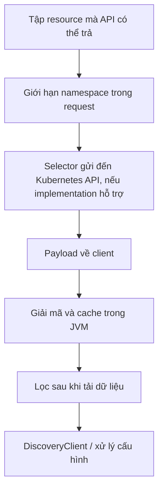

# Giới hạn namespace và label để giảm lượng tài nguyên theo dõi

## Mục tiêu và phạm vi

Trong chương **Hiệu năng và độ bền** của module **SPRING_CLOUD_KUBERNETES**, giới hạn namespace và label là cách kiểm soát lượng dữ liệu ứng dụng Spring nhận từ Kubernetes. Quyết định này liên quan trực tiếp đến DiscoveryClient, ConfigMap, Secret, Spring Cloud LoadBalancer, Configuration Watcher và quyền RBAC.

Sau bài học, bạn có thể:

- Xác định tập tài nguyên cần thiết cho từng tính năng tích hợp.
- Cấu hình discovery theo namespace và label của Service.
- Phân biệt lọc tại Kubernetes API với lọc sau khi dữ liệu đã được tải.
- Giữ phạm vi đọc cấu hình, theo dõi thay đổi và gửi refresh nhất quán.
- Kiểm chứng hiệu quả bằng dữ liệu thực nhận, cache và hành vi nghiệp vụ.

Các ví dụ thuộc tính Spring bên dưới tham chiếu tài liệu **Spring Cloud Kubernetes 5.1**. Khi dùng phiên bản khác, cần đối chiếu tài liệu đúng phiên bản và đúng implementation Fabric8, Kubernetes Java Client hoặc HTTP DiscoveryClient. Những con số dung lượng là giả định để minh họa, không phải benchmark.

## 1. Bắt đầu từ tập phụ thuộc của ứng dụng

Giả sử checkout-api chạy trong namespace `commerce`:

| Namespace | Tài nguyên có liên quan | Nhu cầu của checkout-api |
| --- | --- | --- |
| commerce | inventory-api, pricing-api, checkout-api | Discover hai dịch vụ phụ thuộc và theo dõi cấu hình của chính ứng dụng |
| shared-runtime | tax-api, cấu hình dùng chung | Discover tax-api và đọc một nhóm cấu hình đã xác định |
| analytics | Các dịch vụ phân tích | Không cần discovery hoặc cấu hình |
| sandbox | Dịch vụ thử nghiệm | Không thuộc luồng giao dịch production |

Nếu checkout-api theo dõi mọi namespace, dữ liệu từ analytics và sandbox sẽ cùng đi vào phạm vi xử lý dù ứng dụng không gọi chúng.

Ta cần mô tả ít nhất bốn tập riêng:

```text
D = Service và endpoint cần cho discovery
C = ConfigMap/Secret cần đọc làm cấu hình
W = ConfigMap/Secret cần theo dõi thay đổi
T = Ứng dụng/instance cần nhận thông báo refresh
```

Không có lý do để mặc định `D = C = W = T`. Ví dụ, checkout-api cần discover tax-api nhưng không cần đọc Secret của tax-api. Watcher cần theo dõi một ConfigMap dùng chung, còn đối tượng nhận refresh có thể là nhiều ứng dụng.

Một bản kê khai phạm vi tốt nên trả lời:

```text
Tính năng nào sử dụng dữ liệu?
Resource nào được đọc?
Namespace nào chứa resource?
Tên hoặc selector nào xác định resource?
Service account nào được phép đọc?
Khi resource thay đổi, ai cần phản ứng?
```

Đây là cơ sở cho cấu hình và phép đo, thay vì bắt đầu bằng cách bật mọi tính năng rồi thu hẹp dần khi có lỗi.

## 2. Namespace và label thu hẹp theo hai chiều khác nhau

Namespace giới hạn nơi tìm các resource có namespace. Label lựa chọn một nhóm đối tượng trong phạm vi đó. Tên resource có thể lặp lại giữa các namespace; Node và một số resource khác không thuộc namespace. Xem [Namespaces](https://kubernetes.io/docs/concepts/overview/working-with-objects/namespaces/).

Với ví dụ trên, tập Service mong muốn có thể được diễn tả:

```text
namespace thuộc {commerce, shared-runtime}
AND
Service có discovery-group=checkout-deps
AND
Service có environment=prod
```

Nhãn của chính đối tượng Namespace không tự truyền xuống Service hoặc Pod. Chẳng hạn, gắn `environment=prod` cho namespace commerce không làm mọi Service trong đó có cùng label.

Tương tự, danh sách `discovery.namespaces` trong Spring là danh sách tên namespace; không diễn giải một phần tử như `team=commerce` thành truy vấn label của Namespace.

### Vị trí bộ lọc quyết định khoản chi phí được giảm



Một bộ lọc ở cuối chuỗi có thể làm danh sách trả về ngắn hơn, trong khi dữ liệu ở đầu chuỗi vẫn được tải và lưu.

Cần kiểm chứng hai kết quả độc lập:

| Kết quả | Bằng chứng phù hợp |
| --- | --- |
| Ứng dụng chỉ nhìn thấy các dịch vụ cần thiết | Kết quả DiscoveryClient và hành vi gọi dịch vụ |
| Client nhận ít dữ liệu hơn từ Kubernetes | Request URI, selector, số object/payload nhận và cache thực tế |

API hỗ trợ label selector cho list/watch qua tham số truy vấn. Tuy nhiên, việc server trả ít object không đồng nghĩa CPU phía server giảm cùng tỷ lệ; còn phụ thuộc cách phục vụ request và cấu trúc dữ liệu. Xem [Labels and Selectors](https://kubernetes.io/docs/concepts/overview/working-with-objects/labels/#list-and-watch-filtering).

## 3. Cấu hình DiscoveryClient với phạm vi rõ ràng

Với client truy cập Kubernetes trực tiếp, ví dụ sau giới hạn discovery vào hai namespace:

```yaml
spring:
  application:
    name: checkout-api
  cloud:
    kubernetes:
      discovery:
        enabled: true
        all-namespaces: false
        namespaces:
          - commerce
          - shared-runtime
        service-labels:
          discovery-group: checkout-deps
          environment: prod
        use-endpoint-slices: true
        include-not-ready-addresses: false
        metadata:
          add-pod-labels: false
          add-pod-annotations: false
```

`service-labels` áp dụng cho label của Service. Nếu dùng HTTP DiscoveryClient với DiscoveryServer, phạm vi truy cập Kubernetes phải được cấu hình ở DiscoveryServer. Xem [DiscoveryClient for Kubernetes](https://docs.spring.io/spring-cloud-kubernetes/reference/discovery-client.html).

Vai trò các nhóm thuộc tính:

| Nhóm | Ý định cấu hình |
| --- | --- |
| all-namespaces + namespaces | Xác định phạm vi namespace được discovery |
| service-labels | Chọn Service theo metadata.labels |
| use-endpoint-slices | Dùng EndpointSlice thay cho Endpoints khi được hỗ trợ |
| include-not-ready-addresses | Không chủ động mở rộng kết quả sang địa chỉ chưa ready |
| metadata.add-pod-* | Không yêu cầu metadata Pod khi nghiệp vụ không cần |

Danh sách thuộc tính và mô tả được công bố tại [Common application properties](https://docs.spring.io/spring-cloud-kubernetes/reference/appendix.html).

Không chỉ đặt `all-namespaces: false` rồi coi như đã xác định được namespace. Khi không cung cấp danh sách rõ ràng, việc tìm namespace phụ thuộc cấu hình và môi trường client. Thuộc tính namespace tường minh, namespace của service account và cơ chế của client nằm trong quá trình resolution. Xem [Namespace resolution](https://docs.spring.io/spring-cloud-kubernetes/reference/property-source-config/namespace-resolution.html).

Cấu hình discovery cũng cần sẵn có trước khi client khởi tạo. Không đặt duy nhất thông tin cần để tìm cấu hình vào chính nguồn cấu hình chưa thể truy cập.

### Vì sao không chỉ dùng SpEL?

`spring.cloud.kubernetes.discovery.filter` là bộ lọc sau khi Service đã được lấy từ Kubernetes API. Nó có thể phục vụ quy tắc lựa chọn kết quả, nhưng không thay thế phạm vi namespace và selector đầu vào khi mục tiêu là giảm dữ liệu phải tải.

Một giá trị trong map `service-labels` cũng không tự trở thành biểu thức selector:

```yaml
# Không dùng map này để biểu diễn phép OR hoặc biểu thức "in".
service-labels:
  discovery-group: "in (checkout-deps, billing-deps)"
```

Hãy dùng cách biểu diễn mà thuộc tính và implementation thực sự hỗ trợ. Đừng suy từ cú pháp `kubectl -l` rằng mọi map cấu hình Spring đều nhận nguyên ngôn ngữ selector của Kubernetes.

## 4. Đặt label đúng đối tượng

Xét một Service inventory-api:

```yaml
apiVersion: v1
kind: Service
metadata:
  name: inventory-api
  namespace: commerce
  labels:
    discovery-group: checkout-deps
    environment: prod
spec:
  selector:
    app: inventory-api
  ports:
    - name: http
      port: 80
      targetPort: 8080
```

Hai phần có chức năng khác nhau:

- `metadata.labels` giúp client tìm **Service** theo nhóm discovery.
- `spec.selector` chọn **Pod backend** có label `app=inventory-api`.

Các Pod backend cần label phù hợp, thường được khai báo trong `Deployment.spec.template.metadata.labels`. Label ở `Deployment.metadata.labels` là label của Deployment, không thay thế label của Pod.

Cách Service dùng selector để chọn backend được trình bày trong [Service](https://kubernetes.io/docs/concepts/services-networking/service/).

Vì vậy, chỉ gắn `discovery-group=checkout-deps` cho Pod không làm Service khớp bộ lọc trên. Chỉ gắn nó cho Service cũng không làm thay đổi selector chọn backend.

Đối với tax-api trong shared-runtime, Service cần cùng bộ label đã chọn. Namespace khác nhau không làm điều kiện label biến mất.

### Không suy rộng selector của Service sang EndpointSlice

EndpointSlice có label `kubernetes.io/service-name` để liên kết với Service. Không giả định mọi label tùy ý của Service được sao chép sang EndpointSlice. Xem [EndpointSlices](https://kubernetes.io/docs/concepts/services-networking/endpoint-slices/#ownership).

Có thể kiểm tra slice của inventory-api:

```powershell
kubectl get endpointslices.discovery.k8s.io -n commerce -l kubernetes.io/service-name=inventory-api
```

Lệnh này chứng minh cách tìm slice tham chiếu. Nó chưa chứng minh Spring đang gửi cùng selector đó cho mỗi watch.

Nếu cache Service nhỏ lại nhưng cache EndpointSlice không đổi, hãy xem từng pipeline resource. Không thêm label thủ công vào slice do controller quản lý chỉ để ép một giả định về implementation trở thành đúng.

## 5. Thiết kế selector tránh loại nhầm hoặc nhận dư

Một selector gồm nhiều yêu cầu phân cách bằng dấu phẩy có nghĩa AND. Ví dụ `environment=prod,discovery-group=checkout-deps` đòi hỏi đồng thời cả hai điều kiện. Selector tập hợp `environment in (prod,staging)` chấp nhận một trong hai giá trị của cùng key; không phải phép OR tùy ý giữa các nhóm điều kiện. Các quy tắc được mô tả trong [Labels and Selectors](https://kubernetes.io/docs/concepts/overview/working-with-objects/labels/#label-selectors).

So sánh:

```powershell
kubectl get services -n commerce -l 'environment=prod,discovery-group=checkout-deps'
kubectl get services -n commerce -l 'environment in (prod,staging),discovery-group=checkout-deps'
```

Lệnh thứ hai minh họa selector API, không phải giá trị để chép nguyên vào map `service-labels`.

Nên ưu tiên cách chọn dương tính cho nhóm production: đối tượng phải mang đúng nhãn cho phép. Một điều kiện phủ định như `environment!=dev` có thể nhận cả đối tượng thiếu label environment; đó thường là bất ngờ không mong muốn trong nhóm backend sản xuất.

### Một key không biểu diễn tùy ý nhiều nhóm

Service không thể đồng thời có hai giá trị khác nhau cho cùng một key `discovery-group`. Giá trị `checkout-deps,billing-deps` cũng không phải danh sách hai label.

Khi nhiều ứng dụng cùng cần một Service, có thể đánh giá:

| Thiết kế | Lợi ích | Điều cần kiểm soát |
| --- | --- | --- |
| Nhóm theo miền, ví dụ discovery-domain=commerce | Dễ dùng chung và ít label | Phạm vi có thể rộng hơn từng consumer |
| Nhãn boolean cho từng nhóm độc lập | Biểu diễn được nhiều nhóm | Số key và công quản trị tăng |
| Namespace riêng cho phạm vi lớn | Ranh giới vận hành rõ | Cần thiết kế quyền và phụ thuộc liên namespace |

Chọn nhóm ổn định theo kiến trúc dịch vụ. Tránh dùng version phát hành, Pod UID hoặc timestamp làm label xác định phạm vi discovery: rollout sẽ vô tình thay đổi ai được nhìn thấy.

Các giá trị giống boolean như `"true"` cần được biểu diễn dưới dạng chuỗi trong manifest label.

## 6. Đọc cấu hình và theo dõi thay đổi cần phạm vi riêng

Đặt `discovery.namespaces` không tự giới hạn ConfigMap hoặc Secret. Ứng dụng có thể discover đúng hai namespace nhưng vẫn đọc nguồn cấu hình ở nơi khác nếu phần config có cấu hình khác.

Ví dụ dưới đây chỉ minh họa phần nạp ConfigMap qua tích hợp Kubernetes đã được cài đặt:

```yaml
spring:
  application:
    name: checkout-api
  config:
    import: "kubernetes:"
  cloud:
    kubernetes:
      config:
        enabled: true
        namespace: commerce
        sources:
          - name: checkout-api
            namespace: commerce
          - namespace: shared-runtime
            labels:
              config-group: checkout-shared
```

Theo ý định này, ứng dụng sử dụng ConfigMap riêng và nhóm ConfigMap dùng chung. Cách khai báo nguồn theo tên/label được mô tả trong [Using a ConfigMap PropertySource](https://docs.spring.io/spring-cloud-kubernetes/reference/property-source-config/configmap-propertysource.html).

**Nguồn có tên cụ thể chưa đủ để kết luận chỉ có HTTP GET theo tên.** Tài liệu 5.1 phân biệt chế độ đọc `BATCH` và `SINGLE`: cần kiểm tra chế độ, khả năng hỗ trợ nguồn theo label và request thực tế trước khi cam kết đã giảm phạm vi list. Không chuyển chế độ một cách máy móc khi đang dùng tìm kiếm theo label.

Cần quyết định thêm thứ tự nguồn, xử lý khóa cấu hình trùng và nguồn theo profile. Có nhiều ConfigMap khớp label không có nghĩa ứng dụng chỉ đọc một đối tượng.

### Secret có ngân sách quyền riêng

Chỉ bật đọc Secret qua API khi luồng triển khai cần nó. Label của Secret và nguồn cấu hình Secret cần được thiết kế riêng; label discovery trên Service không kiểm soát việc đọc Secret.

Tài liệu [Secrets PropertySource](https://docs.spring.io/spring-cloud-kubernetes/reference/property-source-config/secrets-propertysource.html) mô tả riêng việc đọc qua API và từ volume mount. Quyền list Secret cho phép đọc giá trị trong phạm vi được cấp, nên không dùng bộ lọc label trong ứng dụng như biện pháp thay thế phân quyền.

Nếu secret được mount thành tệp, còn cần xác định ứng dụng sẽ nạp lại tệp theo cơ chế nào. Thấy nội dung volume thay đổi không chứng minh mọi bean Spring đã dùng giá trị mới.

## 7. Configuration Watcher cần giới hạn cả đầu vào và đích refresh

Một watcher có hai công việc:

```text
Đầu vào: theo dõi các ConfigMap/Secret được chọn.
Đầu ra: tìm đúng ứng dụng/instance và gửi thông báo refresh.
```

Ví dụ phần cấu hình dành cho **tiến trình Configuration Watcher**, không phải checkout-api:

```yaml
spring:
  cloud:
    kubernetes:
      reload:
        namespaces:
          - commerce
          - shared-runtime
        config-maps-labels:
          watch-group: checkout
      secrets:
        enabled: false
      discovery:
        all-namespaces: false
        namespaces:
          - commerce
        service-labels:
          refresh-target-group: checkout
        use-endpoint-slices: true
```

Một ConfigMap dùng chung có thể chứa metadata:

```yaml
apiVersion: v1
kind: ConfigMap
metadata:
  name: checkout-shared-settings
  namespace: shared-runtime
  labels:
    config-group: checkout-shared
    watch-group: checkout
  annotations:
    spring.cloud.kubernetes.configmap.apps: checkout-api
data:
  checkout.timeout-ms: "1500"
```

`config-group` phục vụ lựa chọn nguồn đọc ở ví dụ trước. `watch-group` phục vụ bộ lọc đầu vào watcher. Annotation chỉ định ứng dụng nhận thông báo; Service checkout-api cần được watcher discover, chẳng hạn nhờ label `refresh-target-group=checkout`. Cơ chế namespace, bộ lọc và annotation được mô tả trong [Configuration Watcher](https://docs.spring.io/spring-cloud-kubernetes/reference/spring-cloud-kubernetes-configuration-watcher.html).

Nếu watcher dùng nguyên selector `discovery-group=checkout-deps`, nó có thể thấy inventory-api và pricing-api nhưng bỏ sót checkout-api. Khi đó, ConfigMap được theo dõi đúng vẫn chưa đủ để refresh đến đích.

Bản kê khai nên nêu rõ:

| Thành phần | Phạm vi cần thấy |
| --- | --- |
| Discovery của checkout-api | Các dịch vụ mà checkout-api gọi |
| Bộ đọc cấu hình của checkout-api | Các nguồn cấu hình checkout-api sử dụng |
| Watcher theo dõi thay đổi | Các nguồn cần tạo thông báo |
| Discovery của watcher | Ứng dụng/instance nhận thông báo |

Với HTTP refresh, kiểm tra thêm endpoint quản trị, cổng và quyền truy cập giữa watcher với ứng dụng. Với Bus, kiểm tra cách định tuyến sự kiện của bản triển khai. Tính đúng của tập resource và tính đúng của đích thông báo là hai điều kiện riêng.

Không trộn thuộc tính reload cũ từ các phiên bản khác vào cấu hình này. Cũng không giả định nhiều watcher replica sẽ tự chia nhau từng namespace.

## 8. RBAC giới hạn quyền; selector giới hạn dữ liệu được yêu cầu

Selector thể hiện client muốn đọc gì. RBAC quyết định client được phép thực hiện thao tác nào. Service account có quyền list Service trong một namespace không tự mất quyền đọc Service khác chỉ vì ứng dụng đang gửi label selector.

Ví dụ một ServiceAccount ở commerce có quyền discovery trong hai namespace, thông qua ClusterRole dùng lại và hai RoleBinding:

```yaml
apiVersion: v1
kind: ServiceAccount
metadata:
  name: checkout-discovery
  namespace: commerce
---
apiVersion: rbac.authorization.k8s.io/v1
kind: ClusterRole
metadata:
  name: checkout-discovery-reader
rules:
  - apiGroups: [""]
    resources: ["services"]
    verbs: ["get", "list", "watch"]
  - apiGroups: ["discovery.k8s.io"]
    resources: ["endpointslices"]
    verbs: ["get", "list", "watch"]
---
apiVersion: rbac.authorization.k8s.io/v1
kind: RoleBinding
metadata:
  name: checkout-discovery-reader
  namespace: commerce
subjects:
  - kind: ServiceAccount
    name: checkout-discovery
    namespace: commerce
roleRef:
  apiGroup: rbac.authorization.k8s.io
  kind: ClusterRole
  name: checkout-discovery-reader
---
apiVersion: rbac.authorization.k8s.io/v1
kind: RoleBinding
metadata:
  name: checkout-discovery-reader
  namespace: shared-runtime
subjects:
  - kind: ServiceAccount
    name: checkout-discovery
    namespace: commerce
roleRef:
  apiGroup: rbac.authorization.k8s.io
  kind: ClusterRole
  name: checkout-discovery-reader
```

RoleBinding tham chiếu ClusterRole vẫn cấp quyền trong namespace của RoleBinding. Đây không phải ClusterRoleBinding cấp cùng quyền ở mọi namespace. Cơ chế này và giới hạn `resourceNames` được mô tả trong [Using RBAC Authorization](https://kubernetes.io/docs/reference/access-authn-authz/rbac/).

Deployment cần khai báo:

```yaml
spec:
  template:
    spec:
      serviceAccountName: checkout-discovery
```

Bộ quyền trên chỉ minh họa discovery bằng Service và EndpointSlice. Nếu implementation có thêm thao tác đọc Pod, hoặc ứng dụng đọc ConfigMap qua API, cần quyền tương ứng đã được xác minh. Watcher cần service account và quyền phù hợp với công việc riêng của nó.

Không cấp `get/list/watch` Secret vào bộ quyền discovery để xử lý lỗi khởi động chung chung.

### Cẩn thận với resourceNames

`resourceNames` có thể giới hạn thao tác theo tên, nhưng list/watch bị giới hạn tên cần request có field selector `metadata.name` tương ứng để được chấp nhận. Không thêm `resourceNames` vào một Role rồi kỳ vọng một informer đang list cả namespace sẽ tiếp tục hoạt động.

Nếu muốn giới hạn chặt theo tên nguồn cấu hình, phải phối hợp cách đọc của client với RBAC. Một thay đổi quyền không tự biến chế độ đọc hàng loạt thành đọc từng tên.

## 9. Hiệu quả cần tính theo từng resource

Đặt:

- `P`: số replica đang chạy client.
- `N[r]`: số object resource r trước khi thu hẹp.
- `n[r]`: số object resource r mà client thực nhận sau khi thu hẹp.
- `b[r]`: payload trung bình một object.
- `m[r]`: bộ nhớ giữ lại trung bình một object trong client.

Với giả định mọi replica có cùng phạm vi và cache độc lập:

```text
Payload snapshot trước ≈ P × Σ(N[r] × b[r])
Payload snapshot sau   ≈ P × Σ(n[r] × b[r])

Bộ nhớ cache trước     ≈ P × Σ(N[r] × m[r])
Bộ nhớ cache sau       ≈ P × Σ(n[r] × m[r])
```

Đây là mô hình ước lượng của bài học. Nó bỏ qua nén, index phụ, object tạm và khác biệt kích thước giữa các đối tượng.

Giả định có 40 replica; mỗi replica trước đây nhận 2.400 Service và 4.800 EndpointSlice. Sau khi giới hạn, đo được 30 Service và 80 EndpointSlice. Nếu mọi object đều được giả định có payload trung bình 3 KiB:

```text
Trước: 40 × 7.200 × 3 KiB ≈ 843,75 MiB
Sau:   40 × 110 × 3 KiB   ≈ 12,89 MiB
```

Mức giảm trong giả định này khoảng 98,5%. Đây là lượng dữ liệu tổng hợp cho một vòng snapshot của các client, không phải băng thông mỗi giây.

Nhưng nếu thực tế chỉ Service được lọc còn 4.800 EndpointSlice vẫn được tải:

```text
40 × (30 + 4.800) × 3 KiB ≈ 566,02 MiB
```

Danh sách Service giảm mạnh, còn tổng payload chỉ giảm khoảng 32,9%. Vì vậy, không thể lấy tỷ lệ giảm Service làm tỷ lệ tiết kiệm toàn bộ discovery.

Số luồng watch cũng có thể giữ nguyên sau khi lọc: vẫn một pipeline Service và một pipeline EndpointSlice, nhưng mỗi pipeline mang ít dữ liệu hơn. Ngược lại, theo dõi hai namespace bằng hai watch riêng có thể có nhiều luồng hơn một watch cluster-wide, trong khi tổng dữ liệu nhỏ hơn nhiều.

Đối với sự kiện, đo tốc độ thay đổi trong tập được chọn. Một nhóm rất nhỏ nhưng thay đổi liên tục vẫn có thể tạo tải lớn; số object thấp không tự đảm bảo lưu lượng sự kiện thấp.

## 10. Kiểm chứng bộ lọc theo ba tầng

Các lệnh trong phần này dành cho môi trường thực hành đã có tài nguyên mẫu. Chúng không đại diện cho kết quả chạy thực tế.

### Tầng 1: Tập đối tượng trên Kubernetes

Đếm và liệt kê Service khớp trong từng namespace:

```powershell
$selector = 'discovery-group=checkout-deps,environment=prod'
$commerceServices = kubectl get services -n commerce -l $selector -o json | ConvertFrom-Json
$sharedServices = kubectl get services -n shared-runtime -l $selector -o json | ConvertFrom-Json

@($commerceServices.items).Count
@($sharedServices.items).Count

kubectl get services -n commerce -l $selector --show-labels
kubectl get services -n shared-runtime -l $selector --show-labels
```

Sau đó kiểm tra backend tham chiếu:

```powershell
kubectl get endpointslices.discovery.k8s.io -n commerce -l kubernetes.io/service-name=inventory-api
kubectl get endpointslices.discovery.k8s.io -n shared-runtime -l kubernetes.io/service-name=tax-api
kubectl get configmaps -n shared-runtime -l config-group=checkout-shared
```

Không xuất nội dung Secret chỉ để đếm hoặc chứng minh một selector.

### Tầng 2: Quyền thực tế của service account

```powershell
kubectl auth can-i list services -n commerce --as=system:serviceaccount:commerce:checkout-discovery
kubectl auth can-i watch endpointslices.discovery.k8s.io -n shared-runtime --as=system:serviceaccount:commerce:checkout-discovery
kubectl auth can-i list services -n analytics --as=system:serviceaccount:commerce:checkout-discovery
kubectl auth can-i list secrets -n commerce --as=system:serviceaccount:commerce:checkout-discovery
```

Theo bộ quyền minh họa và nếu không có binding khác cấp thêm quyền, kỳ vọng lần lượt là `yes`, `yes`, `no`, `no`. Người chạy cần quyền impersonation để dùng `--as`.

Các lệnh `kubectl get` không có `--as` ở tầng trước dùng danh tính của người chạy; chúng không chứng minh ứng dụng có cùng quyền.

### Tầng 3: Request và kết quả trong ứng dụng

Dạng request list Service theo namespace và label có thể là:

```http
GET /api/v1/namespaces/commerce/services?labelSelector=discovery-group%3Dcheckout-deps%2Cenvironment%3Dprod
```

Cần xác nhận từ log client phù hợp, audit đã được quản trị viên cấu hình hoặc cơ chế quan sát mạng được môi trường cho phép:

| Cần xác minh | Dấu hiệu |
| --- | --- |
| Client thực sự giới hạn namespace | Request đi đến namespace dự kiến |
| Bộ lọc được gửi đến server | Query có selector tương ứng |
| Tất cả pipeline liên quan đã được xem xét | Có dữ liệu riêng cho Service, endpoint và các resource bổ sung |
| Kết quả discovery đúng | Có inventory-api, pricing-api, tax-api và không có dịch vụ ngoài nhóm |
| Cấu hình vẫn đọc được | Giá trị nghiệp vụ đến từ đúng nguồn |
| Refresh vẫn đến đích | Thay đổi nguồn thử nghiệm phản ánh ở checkout-api |

Không bật log HTTP chứa token hoặc payload cấu hình nhạy cảm chỉ để thấy query string.

Nếu chưa có đo cache, có thể bắt đầu bằng số object trong phản hồi và heap/GC của ứng dụng. Sau đó bổ sung chỉ số client theo nhu cầu; không giả định framework tự xuất sẵn metric đếm từng cache với một tên cố định.

## 11. So sánh trước và sau mà không nhầm nguyên nhân

Một phép thử hợp lý giữ nguyên số replica, lượng tải nghiệp vụ và tập resource nền. Chỉ thay đổi một nhóm cấu hình tại một thời điểm:

| Lần đo | Thay đổi | Điều muốn kiểm chứng |
| --- | --- | --- |
| A | Cấu hình hiện tại | Có dữ liệu nền để so sánh |
| B | Chỉ giới hạn namespace | Tài nguyên ngoài phạm vi không còn đi vào pipeline |
| C | Thêm service-labels | Service không liên quan trong namespace được loại bỏ |
| D | Giới hạn nguồn cấu hình và watcher | Không mất cấu hình hoặc refresh cần thiết |
| E | Khởi động/rollout lại số replica tương đương | Đỉnh tải đồng bộ cache đã thay đổi thế nào |

Ghi riêng giai đoạn startup và trạng thái ổn định. Nếu chỉ đo lúc không có thay đổi, có thể bỏ qua lợi ích của việc giảm sự kiện và chi phí đồng bộ lại.

Những số liệu nên có:

```text
- Object và tổng byte nhận theo resource
- Thời gian đồng bộ cache ban đầu
- Heap giữ lại, allocation và GC
- Lượt reconnect/đồng bộ lại nếu client cung cấp
- Độ trễ phản ánh thay đổi endpoint/cấu hình
- Tỷ lệ lỗi và độ trễ gọi dịch vụ
```

Phía Kubernetes có các metric request, latency, response size và long-running request; xem [Kubernetes Metrics Reference](https://kubernetes.io/docs/reference/instrumentation/metrics/). Ví dụ truy vấn LIST rate:

```promql
sum by (resource) (
  rate(apiserver_request_total{
    verb="LIST",
    resource=~"services|endpoints|endpointslices|configmaps|secrets|pods"
  }[5m])
)
```

LIST rate có thể không giảm dù payload giảm. WATCH request rate cũng không phải số sự kiện watch. Muốn quy nguồn checkout-api cần dữ liệu bổ sung: metric API tổng hợp thường không có nhãn tên Pod gọi hoặc service account.

Nếu chỉ có số request toàn cluster, hãy ghi rõ giới hạn bằng chứng. Các controller khác có thể tạo lưu lượng cùng loại resource và làm thay đổi biểu đồ.

## 12. Thay đổi phạm vi theo trình tự tránh gián đoạn

Thu hẹp đúng về hiệu năng vẫn có thể sai về tập phụ thuộc. Một Service thiếu label dễ bị loại khỏi discovery dù backend đang khỏe.

Nên triển khai theo trình tự:

1. Lập danh sách dịch vụ, cấu hình và đích refresh thực sự cần.
2. Bổ sung label cho đầy đủ đối tượng liên quan qua manifest được quản lý.
3. Xác minh selector trả đúng tập mong muốn.
4. Chuẩn bị RoleBinding tại các namespace đích.
5. Thử cấu hình thu hẹp trên một nhóm replica nhỏ.
6. Kiểm tra cả gọi dịch vụ, thay đổi backend và refresh cấu hình.
7. Mở rộng cấu hình rồi thu hồi các quyền rộng không còn cần.

Đối với đổi key/value label, có thể cần giai đoạn chuyển tiếp: đối tượng mang cả key cũ và key mới, cập nhật client, xác minh rồi bỏ key cũ. Nếu chỉ đổi value của cùng key, phải thiết kế bước chuyển khác vì một đối tượng không có đồng thời hai value cho cùng key.

Không coi label nhóm discovery là metadata trang trí. Thay đổi nó có thể làm một Service rời tập mà ứng dụng sử dụng sau khi cache cập nhật.

Cũng cần xem xét tên Service trùng giữa hai namespace. Khi client chỉ gọi bằng serviceId như `inventory-api`, đừng giả định nó tự hiểu namespace đích theo ý định của người triển khai. Xác minh instance/địa chỉ và metadata namespace của kết quả, hoặc thiết kế phạm vi tránh sự nhập nhằng.

Theo dõi sức khỏe Pod và độ mới endpoint sau thay đổi. Một phép thử quan trọng là thay backend đang phục vụ rồi xác nhận ứng dụng chọn trạng thái mới trong ngân sách thời gian đã đặt. Không dùng restart hàng loạt để che việc client chưa hội tụ.

Rollback cần khôi phục cấu hình discovery/đọc cấu hình và quyền tương ứng nếu đã thu hồi. Giữ nhãn mới trong một giai đoạn thường thuận tiện hơn việc đồng thời đảo mọi thay đổi.

## 13. Chẩn đoán các lỗi thường gặp

| Hiện tượng | Nguyên nhân nên kiểm tra | Cách xác minh |
| --- | --- | --- |
| Discovery không có instance | Sai namespace, thiếu label trên Service hoặc backend chưa ready | Liệt kê Service và EndpointSlice; kiểm tra quyền |
| kubectl thấy Service nhưng Spring không thấy | Khác danh tính, khác selector hoặc cache chưa đồng bộ | So sánh request và service account thực tế |
| Có nhãn trên Deployment nhưng selector Service không khớp | Đã gắn label sai đối tượng | Xem metadata của Service và Pod template |
| Service cache giảm nhưng heap chưa giảm tương ứng | Pipeline endpoint/Pod còn rộng hoặc cache khác chiếm phần lớn | Đo theo resource và heap giữ lại |
| ConfigMap đọc được nhưng thay đổi không refresh | Phạm vi watcher hoặc đích thông báo thiếu | Đối chiếu tập C, W và T |
| Watcher theo dõi đúng nhưng checkout-api không nhận refresh | Discovery của watcher bỏ sót Service đích | Kiểm tra label Service checkout-api và đường tới endpoint |
| 403 khi theo dõi namespace thứ hai | Thiếu RoleBinding tại namespace đích | Kiểm tra quyền bằng đúng service account |
| 403 sau khi thêm resourceNames | Kiểu request không phù hợp quyền theo tên | Xem field selector và chế độ đọc |
| Danh sách có cả đối tượng chưa phân loại | Điều kiện phủ định nhận đối tượng thiếu key | Chuyển sang điều kiện chọn dương tính đã thiết kế |
| Đổi label làm mất một phụ thuộc | Nhãn được thay trước hoặc sau client không đúng trình tự | Xem manifest và trạng thái rollout |

## 14. Tiêu chí hoàn tất một cấu hình giới hạn phạm vi

Một thay đổi có thể được chấp nhận khi đã chứng minh:

- Mỗi client có danh sách namespace và quy tắc chọn resource rõ ràng.
- Bộ lọc đặt trên đúng Service, ConfigMap hoặc Secret; không dựa vào label ở đối tượng khác.
- Phần dữ liệu giảm được có bằng chứng theo từng pipeline resource.
- Các dịch vụ cần gọi và nguồn cấu hình cần đọc vẫn đầy đủ.
- Watcher còn tìm được đích nhận thông báo và refresh thành công.
- RBAC khớp với thao tác cần dùng, đặc biệt khi truy cập liên namespace.
- Rollout, mất kết nối ngắn và thay đổi backend không gây lỗi vượt SLO.

Nếu ứng dụng chỉ cần gọi một Service bằng tên ổn định, hãy đánh giá liệu cần đưa catalog Kubernetes vào JVM hay có thể dùng DNS/Service theo kiến trúc đang có. Nếu không cần cập nhật cấu hình đang chạy, cũng cần cân nhắc việc duy trì watcher.

Giới hạn phạm vi hiệu quả bắt đầu bằng việc chọn đúng dữ liệu cho từng tính năng. Namespace thu hẹp vùng tìm kiếm, selector thu hẹp tập đối tượng, RBAC giới hạn quyền, còn phép đo cho biết phần chi phí nào thực sự đã giảm.
