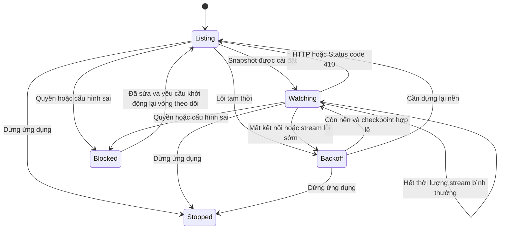

# Khôi phục watch sau mất kết nối hoặc phiên bản tài nguyên hết hiệu lực

Trong chương **Hiệu năng và độ bền** của **SPRING_CLOUD_KUBERNETES**, bài học này giải quyết tình huống ứng dụng Spring hoặc Configuration Watcher mất luồng cập nhật từ Kubernetes API server. Đích đến là khôi phục trạng thái đúng, giữ tải khôi phục trong giới hạn và xác minh rằng thay đổi đã đi tới nơi sử dụng.

Một socket đã kết nối lại chưa đủ để kết luận ứng dụng đã nhận cấu hình mới. Tương tự, một Pod vẫn `Running` chưa đủ để kết luận danh sách instance mà Spring Cloud LoadBalancer đang dùng còn phù hợp.

Sau bài học, bạn có thể:

- Phân biệt lỗi kết nối tạm thời với `410 Gone` do mốc theo dõi không còn được phục vụ.
- Mô tả chu trình LIST–WATCH và cách dựng lại cache sau một khoảng trống không thể phát lại.
- Thiết kế retry, RBAC, quan sát và chính sách readiness cho thành phần theo dõi.
- Thực hành ngắt luồng, nối lại và kiểm tra hội tụ mà không phụ thuộc một giá trị `resourceVersion` đoán trước.

## 1. Xác định thành phần nào đang theo dõi Kubernetes

Trong một hệ thống Spring Cloud Kubernetes, có thể tồn tại nhiều lớp liên quan đến cập nhật:

| Thành phần | Trách nhiệm cần xác định khi điều tra |
| --- | --- |
| Kubernetes client hoặc informer | Nhận dữ liệu API, duy trì cache và quản lý vòng đời luồng theo dõi |
| DiscoveryClient | Cung cấp thông tin instance cho mã ứng dụng hoặc thành phần khác |
| Configuration Watcher | Quan sát nguồn cấu hình và phát thông báo refresh theo cách triển khai đã chọn |
| Spring Cloud LoadBalancer | Chọn instance từ nguồn dữ liệu được cấu hình; có thể có cache riêng |
| Ứng dụng Spring nhận refresh | Nạp lại nguồn cấu hình và cập nhật những bean hỗ trợ thay đổi |

Tên có chữ “watch” không bảo đảm đó là một kết nối Kubernetes WATCH. Chẳng hạn, tài liệu DiscoveryClient mô tả catalog watch phát heartbeat theo lịch. Chu kỳ heartbeat này không phải tham số nối lại socket của Kubernetes client. Vì vậy, hãy xác định implementation Fabric8, Kubernetes Java Client hay HTTP DiscoveryClient trước khi chỉnh cấu hình. Với HTTP DiscoveryClient, thành phần nói chuyện trực tiếp với Kubernetes có thể nằm ở DiscoveryServer. [Tài liệu DiscoveryClient](https://docs.spring.io/spring-cloud-kubernetes/reference/discovery-client.html).

Ví dụ xuyên suốt bài: ứng dụng `orders` cần ConfigMap cùng tên; một thành phần theo dõi phải giữ bản sao cấu hình hiện tại. Những quyết định về cache, hàng đợi và thời gian retry dưới đây là thiết kế minh họa cho ví dụ, không phải cam kết mặc định của mọi phiên bản Spring Cloud Kubernetes.

## 2. LIST tạo nền, WATCH theo dõi phần thay đổi

Chu trình cơ bản:

1. LIST tập tài nguyên trong phạm vi đã chọn.
2. Dựng cache từ kết quả đầy đủ và lấy `metadata.resourceVersion` của **kết quả LIST**.
3. WATCH cùng phạm vi từ mốc đó.
4. Khi luồng bị gián đoạn, thử tiếp tục từ mốc đã tiếp nhận an toàn.
5. Nếu server trả `410 Gone`, bỏ tính hợp lệ của cache cũ, LIST lại và khởi tạo vòng theo dõi mới.

Đây là hợp đồng LIST–WATCH của Kubernetes. Lịch sử thay đổi được giữ hữu hạn; bài học không giả định một thời lượng lưu giữ cố định. [Kubernetes API: phát hiện thay đổi](https://kubernetes.io/docs/reference/using-api/api-concepts/#efficient-detection-of-changes).

Ví dụ rút gọn cho một lần LIST:

```json
{
  "kind": "ConfigMapList",
  "metadata": {
    "resourceVersion": "7421"
  },
  "items": [
    {
      "metadata": {
        "namespace": "watch-lab",
        "name": "orders",
        "uid": "uid-orders-a",
        "resourceVersion": "7398"
      },
      "data": {
        "demo.version": "v1"
      }
    }
  ]
}
```

Mốc khởi tạo watch trong ví dụ là `7421`, không phải mốc `7398` của phần tử. Các giá trị này chỉ minh họa vị trí trường dữ liệu.

`resourceVersion` phải được coi là chuỗi opaque: giữ nguyên và chuyển lại server. Không cộng thêm một, không chuyển thành thời gian, không chọn mốc bằng phép so sánh số. Một checkpoint còn gắn với tập tài nguyên mà nó đại diện. Khi thay cluster, loại tài nguyên, namespace hoặc selector, cách an toàn của thiết kế này là dựng lại nền thay vì tái sử dụng checkpoint cũ. [Định nghĩa ObjectMeta và ListMeta](https://github.com/kubernetes/apimachinery/blob/master/pkg/apis/meta/v1/types.go).

Quy ước phạm vi trong ví dụ:

```text
scope = {
    clusterIdentity,
    apiGroup,
    apiVersion,
    resource,
    namespace,
    labelSelector,
    fieldSelector
}
```

Nếu ứng dụng có các luồng ConfigMap, Secret và EndpointSlice riêng, hãy giữ trạng thái đồng bộ riêng cho từng luồng. Thiết kế ứng dụng cũng phải xác định cách xử lý lúc một nguồn đã cập nhật còn nguồn khác chưa cập nhật; việc gộp dữ liệu của chúng cần một chính sách nghiệp vụ rõ ràng.

## 3. Hai kịch bản khôi phục khác nhau

### 3.1. Mất kết nối nhưng mốc vẫn dùng được

Giả sử cache của `orders` đã được cập nhật an toàn tới mốc `R-a`. Sau đó TCP bị reset.

Thành phần theo dõi đóng stream cũ, chờ theo chính sách retry và mở stream mới từ `R-a`. Nếu yêu cầu được chấp nhận, cache tiếp tục nhận các thay đổi tiếp theo. Không cần chủ động bỏ cache sau mọi lỗi mạng.

Trong thiết kế của bài, “an toàn” nghĩa là thay đổi đã được áp dụng vào cache và công việc đối soát tương ứng đã được ghi nhận trong hàng đợi nội bộ. Việc nhận xong byte từ socket chưa đạt điều kiện này.

### 3.2. Server không còn phục vụ lịch sử cần thiết

Giả sử khoảng gián đoạn kéo dài và lần mở watch từ `R-a` nhận `410 Gone`. Retry liên tục cùng mốc sẽ không giúp cache bắt kịp.

Kế hoạch khôi phục của ví dụ là:

- Chuyển trạng thái cache sang cần dựng lại.
- Ngừng nhận callback từ phiên watch cũ.
- Lấy snapshot mới, không ép LIST quay về mốc đã hết hiệu lực.
- Thay tập dữ liệu có thẩm quyền của cache và nhận diện phần tử đã biến mất.
- Mở watch từ mốc của snapshot mới.

Một LIST mới có thể cho biết cấu hình hiện tại là `v3`; nó không tái tạo đầy đủ các lần chuyển `v1 → v2 → v3` trong thời gian mất kết nối. Nếu hệ thống phải ghi nhận từng thay đổi để tính tiền hay kiểm toán, cần một cơ chế lưu sự kiện phù hợp ngoài cache theo dõi này.

Trong Kubernetes Java Client, mã reflector cũng phân biệt watch hết hiệu lực, cập nhật resource version sau khi đưa dữ liệu vào store và dùng thao tác thay thế store khi đồng bộ lại. Đây là điểm tham khảo để hiểu implementation, không phải mã ứng dụng cần sao chép. [ReflectorRunnable của Kubernetes Java Client](https://github.com/kubernetes-client/java/blob/master/util/src/main/java/io/kubernetes/client/informer/cache/ReflectorRunnable.java).

## 4. Mô hình trạng thái để tránh khôi phục chồng chéo



`Blocked` ở đây là trạng thái vận hành của vòng theo dõi, nghĩa là cần sửa nguyên nhân hoặc chờ kiểm tra lại có kiểm soát. Nó không yêu cầu JVM phải dừng.

Quản lý mỗi scope bằng một chủ sở hữu vòng đời. Khi thay phiên, tăng `generation` và bỏ qua callback thuộc generation cũ. Cách này tránh tình huống stream mới đã nạp dữ liệu, nhưng callback đến muộn từ stream cũ lại sửa cache.

Chủ sở hữu phải đóng stream, hủy lịch retry và dừng worker khi ứng dụng shutdown. Nếu mọi đường lỗi đều tự tạo thêm một watcher mà không đóng watcher trước, số kết nối và số thông báo có thể tăng sau mỗi sự cố.

## 5. Phân loại lỗi trước khi retry

Bảng sau là chính sách xử lý đề xuất cho ứng dụng minh họa. Cần ánh xạ lỗi thực tế của HTTP client về các nhóm này.

| Dấu hiệu | Cách xử lý |
| --- | --- |
| Stream kết thúc sau thời lượng đã yêu cầu, không có lỗi | Mở lượt tiếp theo từ checkpoint; không coi mỗi lần kết thúc là sự cố |
| EOF rất sớm, connection reset, lỗi DNS hoặc timeout mạng | Giữ checkpoint hợp lệ; retry có backoff và jitter |
| HTTP `410` hoặc sự kiện `ERROR` có `Status.code=410` | Chuyển sang dựng lại nền; không lặp vô hạn mốc cũ |
| `429 Too Many Requests` | Tôn trọng chỉ dẫn chờ của server nếu có; giảm tốc thử lại |
| `5xx` tạm thời | Retry có giới hạn tốc độ; chưa xóa checkpoint chỉ vì mã lỗi |
| `401 Unauthorized` | Kiểm tra luồng làm mới credential của client và nguồn token; tránh retry dồn dập cùng credential lỗi |
| `403 Forbidden` | Kiểm tra ServiceAccount, verb, resource, namespace và RoleBinding; đưa vòng lặp vào trạng thái cần can thiệp |
| `400`, selector không hợp lệ hoặc endpoint API không tồn tại | Sửa request hoặc tương thích API trước khi tiếp tục |
| Giải mã event lỗi hoặc hàng đợi cục bộ không nhận thêm được | Không tiến checkpoint qua dữ liệu chưa tiếp nhận an toàn; phát hiện lỗi cục bộ và thực hiện kế hoạch phục hồi |

Một lỗi có thể xuất hiện ngay khi mở request, hoặc dưới dạng bản tin `ERROR` trong stream đã mở. Bộ phân loại phải đọc trạng thái có cấu trúc; tìm chữ “expired” trong log là chưa đủ.

Ví dụ lỗi để đưa vào transport giả lập:

```json
{
  "type": "ERROR",
  "object": {
    "apiVersion": "v1",
    "kind": "Status",
    "status": "Failure",
    "reason": "Expired",
    "message": "watch history is no longer available",
    "code": 410
  }
}
```

## 6. Thay cache đúng và giữ handler có thể chạy lại

### 6.1. LIST lại phải loại được dữ liệu đã biến mất

Xét tình huống riêng cho cache discovery:

```text
Trước gián đoạn: cache chứa instance A và B
Trong gián đoạn: A bị xóa, C được tạo
Sau LIST mới: snapshot chứa B và C
Kết quả yêu cầu: cache chứa đúng B và C
```

Nếu chỉ thêm B và C vào cache cũ, A sẽ còn sót lại. Trong ứng dụng minh họa, hãy dựng snapshot ứng viên rồi thay toàn bộ tập dữ liệu có thẩm quyền. Bản cũ có thể được giữ riêng làm dữ liệu fallback nếu chính sách cho phép, nhưng phải được đánh dấu stale và không được trộn âm thầm vào snapshot mới.

Nếu LIST có nhiều trang, chỉ công bố snapshot sau khi đã nhận trọn tập dữ liệu nhất quán. Khi một chuỗi phân trang không thể hoàn thành hợp lệ, bỏ snapshot ứng viên và bắt đầu lại. Không cài trang đầu làm toàn bộ trạng thái hiện tại.

### 6.2. Phân biệt tên và danh tính

Với ví dụ ConfigMap `orders`, dùng `namespace/name` để tìm đối tượng hiện tại và giữ thêm `uid` để phân biệt đối tượng bị xóa rồi tạo lại cùng tên. Khi xử lý thông báo xóa đến muộn, kiểm tra UID trước khi xóa khỏi cache.

Handler phải chịu được việc được gọi lại: cùng dữ liệu đầu vào không được gây thêm tác dụng phụ nghiệp vụ. Đối soát dựa trên trạng thái hiện tại thường dễ kiểm soát hơn việc coi mỗi callback là một lệnh bắt buộc thực thi đúng một lần.

Ví dụ: callback chỉ đánh dấu `orders` cần đối soát. Worker đọc bản cấu hình mới nhất từ cache, kiểm tra hợp lệ rồi áp dụng. Mười thay đổi dồn lại có thể được gom thành một lần áp dụng trạng thái mới nhất nếu nghiệp vụ cho phép.

### 6.3. Pseudocode cho thành phần tự quản lý

Đoạn sau mô tả thuật toán của bài, **không phải API Java hoặc cấu hình Spring Cloud Kubernetes**. Nếu informer của thư viện đang sở hữu luồng, không đặt thêm vòng lặp này bên ngoài nó.

```text
needList = true
cursor = null
generation = 0

while running:
    try:
        if needList:
            generation = generation + 1
            closePreviousStream()
            markAuthoritativeCacheUnavailable()

            snapshot = listCompleteSnapshot(scope, resourceVersion = unset)
            candidate = buildCache(snapshot.items)

            installSnapshotAndScheduleReconciliation(candidate)
            cursor = snapshot.metadata.resourceVersion
            needList = false
            markBaselineInstalled()

        myGeneration = generation

        with openWatch(scope, cursor, finiteTimeout, allowBookmarks = true) as stream:
            for event in stream:
                if not running:
                    break

                if myGeneration != generation:
                    discard(event)
                    continue

                if event.type == ERROR:
                    raise classifyStatus(event.object)

                if event.type == BOOKMARK:
                    acceptProgressMarkerAfterPriorEvents(event)
                    cursor = event.object.metadata.resourceVersion
                    continue

                applyToCacheAndScheduleIdempotently(event)
                cursor = event.object.metadata.resourceVersion

        if streamEndedAbnormallyEarly:
            waitInterruptibly(backoffWithJitter())
        else:
            recordNormalStreamCompletion()

    catch ResourceVersionExpired:
        needList = true
        cursor = null
        markAuthoritativeCacheUnavailable()

    catch TransientFailure as failure:
        recordFailure(failure)
        waitInterruptibly(backoffRespectingServerDelay(failure))

    catch CredentialOrPermissionOrRequestFailure as failure:
        markRecoveryBlocked(failure)
        awaitControlledRetryOrConfigurationChange()

    catch LocalProcessingFailure as failure:
        markRecoveryBlocked(failure)
        preserveUnprocessedWork()
        awaitControlledRecovery()

finally:
    closePreviousStream()
    cancelRetryScheduling()
```

Các hàm cài snapshot, nhận event và ghi nhận công việc cần có hợp đồng rõ ràng. Trong thiết kế dùng bộ nhớ, tiến trình khởi động lại sẽ LIST lại từ đầu. Nếu muốn lưu checkpoint bền vững, phải thiết kế việc lưu cache hoặc công việc cùng checkpoint; chỉ lưu riêng mốc rồi bỏ qua phần chưa xử lý có thể tạo khoảng trống.

Thuật toán minh họa cũng không chờ một lời gọi HTTP refresh chậm ngay trong vòng đọc stream. Việc phát thông báo và áp dụng cấu hình thuộc worker đối soát, có theo dõi thành công và retry riêng.

## 7. BOOKMARK hỗ trợ tiến độ, không thay thế kiểm tra sức khỏe

Khi yêu cầu `allowWatchBookmarks=true`, server có thể gửi `BOOKMARK` với mốc tiến độ. Chỉ cập nhật checkpoint qua bookmark sau khi các event đứng trước đã được tiếp nhận theo hợp đồng của cache hoặc hàng đợi.

Bookmark không phải bản cấu hình đầy đủ để ghi vào cache. Server cũng không cam kết gửi bookmark theo chu kỳ, thậm chí không cam kết có bookmark trong mỗi phiên. Vì vậy, im lặng trên stream không đủ để kết luận stream đã chết. `timeoutSeconds` giới hạn thời lượng request, không phải thời gian không có event. [Các trường ListOptions](https://github.com/kubernetes/apimachinery/blob/master/pkg/apis/meta/v1/types.go).

Trong thiết kế của bài, timeout hữu hạn giúp thay phiên kết nối có kiểm soát. Phải phối hợp nó với read timeout của HTTP client và idle timeout của proxy. Một stream khỏe nhưng không có thay đổi không nên bị coi là lỗi chỉ vì `lastEventTime` đã lâu.

## 8. Backoff, jitter và tải khôi phục

Một trăm replica cùng reconnect ngay sau khi API server trở lại có thể tạo tải đột biến. Với thiết kế minh họa, chọn backoff tăng dần, giới hạn trần, thêm jitter và chỉ reset sau một khoảng hoạt động ổn định.

Ví dụ hàm Java độc lập để tính thời gian chờ:

```java
import java.time.Duration;
import java.util.concurrent.ThreadLocalRandom;

final class ReconnectDelay {
    private ReconnectDelay() {
    }

    static Duration next(int attempt, Duration retryAfter) {
        int exponent = Math.min(Math.max(attempt, 0), 5);
        long ceilingMillis = Math.min(30_000L, 1_000L << exponent);
        long jitteredMillis = ThreadLocalRandom.current()
                .nextLong(ceilingMillis / 2, ceilingMillis + 1);

        Duration localDelay = Duration.ofMillis(jitteredMillis);
        if (retryAfter != null && retryAfter.compareTo(localDelay) > 0) {
            return retryAfter;
        }
        return localDelay;
    }
}
```

Các con số 1 giây và 30 giây là lựa chọn của ví dụ. `retryAfter` là chỉ dẫn chờ đã được lớp HTTP giải mã nếu server cung cấp; hàm không tự đọc header. Khoảng chờ cần có khả năng hủy khi shutdown. Với luồng reactive, dùng scheduler phù hợp thay vì chặn event loop.

Những lựa chọn giúp giới hạn chi phí trong ví dụ:

- Theo dõi đúng namespace và tập nguồn cần dùng.
- Chia sẻ informer có cùng scope trong một tiến trình khi thư viện hỗ trợ.
- Đưa công việc chậm ra hàng đợi có giới hạn và có kế hoạch khi đầy.
- Gom các yêu cầu refresh trùng theo ứng dụng hoặc nguồn cấu hình.
- Theo dõi số lần và kích thước LIST lại để nhận ra vòng phục hồi quá tốn kém.

Ước lượng sơ bộ do bài đặt ra: nếu `P` tiến trình độc lập mỗi lần LIST phải lấy `N` đối tượng, một đợt dựng lại đồng loạt có quy mô truyền dữ liệu tỷ lệ với `P × N`. Selector làm giảm dữ liệu quan tâm; nó không biến quyền đọc thành quyền theo từng nhãn.

Mã Fabric8 reflector có xử lý vòng LIST–WATCH, đồng bộ tập khóa trong store và cơ chế thử lại riêng. Vì vậy, hành vi thực tế cần được kiểm tra ở đúng phiên bản client mà dependency của ứng dụng đang dùng. Không giả định mọi đường lỗi mạng đều dẫn tới cùng một số lượng LIST. [Reflector của Fabric8](https://github.com/fabric8io/kubernetes-client/blob/main/kubernetes-client/src/main/java/io/fabric8/kubernetes/client/informers/impl/cache/Reflector.java).

## 9. Gắn với Configuration Watcher và Spring Cloud LoadBalancer

Đối với Configuration Watcher, cần kiểm tra cả đường quan sát nguồn và đường gửi thông báo. Tài liệu Spring mô tả các cách thông báo qua HTTP refresh hoặc Spring Cloud Bus. Quy tắc chọn nguồn, bật theo dõi Secret và các thuộc tính cấu hình phải theo tài liệu đúng release đang triển khai. [Configuration Watcher](https://docs.spring.io/spring-cloud-kubernetes/reference/spring-cloud-kubernetes-configuration-watcher.html).

Trong ứng dụng minh họa, hãy kiểm tra tuần tự:

```text
Nguồn Kubernetes đã đổi
    → cache của watcher đã đối soát
    → công việc thông báo đã được ghi nhận
    → replica đích nhận thông báo
    → nguồn cấu hình được đọc lại
    → bean hỗ trợ refresh sử dụng giá trị mới
    → hành vi nghiệp vụ phản ánh giá trị đó
```

Một lỗi gửi thông báo không nên bị nhầm thành lỗi Kubernetes watch. Sau khi khôi phục khoảng trống, cần xác minh trạng thái đích; không suy ra rằng mọi thông báo trung gian đã được phát lại chỉ vì informer đã có snapshot mới.

Cách ứng dụng nhận ConfigMap cũng ảnh hưởng kết quả. Biến môi trường lấy từ ConfigMap không tự cập nhật cho container đang chạy. Volume được cập nhật theo cơ chế lan truyền của Kubernetes, còn mount bằng `subPath` không nhận cập nhật ConfigMap theo cách đó. Nếu ứng dụng đọc file, cần tính cả thời gian file được thay đổi trước khi đối soát giá trị trong Spring. [Cập nhật ConfigMap trong Pod](https://kubernetes.io/docs/concepts/configuration/configmap/#mounted-configmaps-are-updated-automatically).

Đối với discovery, bài đặt tiêu chí kiểm tra đầu cuối là: instance bị loại khỏi nguồn dữ liệu có còn được chọn bởi LoadBalancer hay không. Cần xem cả cấu hình cache của supplier và thời gian làm mới, thay vì chỉ nhìn log reconnect.

Theo dõi trực tiếp Pod cũng cần mục đích rõ ràng. Pod còn tồn tại không đồng nghĩa endpoint của nó nên nhận request. Nếu mục tiêu là gọi một Service qua DNS với cấu hình chỉ nạp lúc khởi động, hãy đánh giá xem ứng dụng có cần một watcher riêng hay không. Mỗi watcher được thêm vào đều tạo thêm một vòng đời phải vận hành.

## 10. RBAC phải cho phép cả khởi tạo và khôi phục

Ví dụ sau dành cho thành phần chỉ đọc ConfigMap trong namespace `watch-lab`, không phải manifest đầy đủ cho Configuration Watcher có discovery và gửi HTTP refresh.

```yaml
apiVersion: v1
kind: ServiceAccount
metadata:
  name: config-observer
  namespace: watch-lab
---
apiVersion: rbac.authorization.k8s.io/v1
kind: Role
metadata:
  name: config-observer
  namespace: watch-lab
rules:
  - apiGroups: [""]
    resources: ["configmaps"]
    verbs: ["get", "list", "watch"]
---
apiVersion: rbac.authorization.k8s.io/v1
kind: RoleBinding
metadata:
  name: config-observer
  namespace: watch-lab
subjects:
  - kind: ServiceAccount
    name: config-observer
    namespace: watch-lab
roleRef:
  apiGroup: rbac.authorization.k8s.io
  kind: Role
  name: config-observer
```

`get`, `list` và `watch` là các quyền riêng. Kiểm tra quyền trên namespace và resource thực tế. Nhãn chọn nguồn không giới hạn quyền RBAC theo nhãn; quyền Secret cần được cấp riêng nếu thực sự dùng. [Kubernetes RBAC](https://kubernetes.io/docs/reference/access-authn-authz/rbac/).

Có thể kiểm tra bằng tài khoản quản trị được phép impersonate:

```powershell
kubectl auth can-i list configmaps -n watch-lab --as=system:serviceaccount:watch-lab:config-observer
kubectl auth can-i watch configmaps -n watch-lab --as=system:serviceaccount:watch-lab:config-observer
```

Nếu dùng discovery qua EndpointSlice, hãy kiểm tra quyền trên `endpointslices` của API group `discovery.k8s.io` cùng các resource khác implementation cần. Không mở rộng Role thành quyền toàn cluster chỉ để thử xóa lỗi.

Với Secret, giữ nội dung ra khỏi log và dữ liệu quan sát. Để chẩn đoán reconnect thường chỉ cần loại tài nguyên, scope, mã lỗi và trạng thái vòng theo dõi; không cần ghi payload.

## 11. Thực hành LIST–WATCH và nối lại bằng PowerShell

Bài thực hành này dùng Kubernetes API trực tiếp để quan sát cơ chế. Nó không tự triển khai ứng dụng Spring hay tự chứng minh bean đã refresh. Các lệnh dành cho cluster thực hành, namespace mới `watch-lab`, và người thực hiện có quyền tạo tài nguyên tại đó.

### 11.1. Tạo nguồn dữ liệu

```powershell
kubectl create namespace watch-lab

kubectl -n watch-lab create configmap orders --from-literal=demo.version=v1 --from-literal=demo.message=hello

kubectl -n watch-lab label configmap orders lesson=watch-recovery spring.cloud.kubernetes.config=true
```

Ở bước quan sát API, selector dùng nhãn `lesson=watch-recovery`. Nhãn Spring chỉ phục vụ phần tích hợp tiếp theo nếu release và cấu hình watcher của bạn chọn nguồn theo nhãn đó.

### 11.2. Lấy snapshot và mốc của tập dữ liệu

```powershell
$apiPath = '/api/v1/namespaces/watch-lab/configmaps'
$selector = [Uri]::EscapeDataString('lesson=watch-recovery')
$listUrl = $apiPath + '?labelSelector=' + $selector

$listJson = kubectl get --raw $listUrl
if ($LASTEXITCODE -ne 0) {
    throw 'LIST không thành công'
}

$snapshot = $listJson | ConvertFrom-Json
$rv = [string]$snapshot.metadata.resourceVersion

if ([string]::IsNullOrWhiteSpace($rv)) {
    throw 'Kết quả LIST thiếu resourceVersion'
}

$snapshot.items | Select-Object -ExpandProperty metadata
$rv
```

Đây là tập dữ liệu rất nhỏ; ví dụ không yêu cầu phân trang. Nếu áp dụng cho tập lớn, phải xử lý đầy đủ `continue` trước khi công bố snapshot.

### 11.3. Mở stream và thay dữ liệu ở cửa sổ khác

Giữ các biến của bước trước trong cùng cửa sổ PowerShell:

```powershell
$watchUrl = $apiPath + '?watch=true&allowWatchBookmarks=true&timeoutSeconds=60'
$watchUrl += '&labelSelector=' + $selector
$watchUrl += '&resourceVersion=' + [Uri]::EscapeDataString($rv)

kubectl --request-timeout=75s get --raw $watchUrl
```

Trong cửa sổ thứ hai:

```powershell
kubectl -n watch-lab create configmap orders --from-literal=demo.version=v2 --from-literal=demo.message=updated --dry-run=client -o yaml | kubectl apply -f -
```

Quan sát event có đối tượng mới. Nếu stream kết thúc sau thời lượng yêu cầu, đó là một lần kết thúc dự kiến. Lệnh raw này không phải vòng phục hồi tự động của informer.

### 11.4. Mô phỏng gián đoạn ở phía client

Dùng `Ctrl+C` trong cửa sổ watch. Trong lúc không có stream, thay cấu hình ở cửa sổ thứ hai:

```powershell
kubectl -n watch-lab create configmap orders --from-literal=demo.version=v3 --from-literal=demo.message=recovered --dry-run=client -o yaml | kubectl apply -f -
```

Mở lại lệnh watch với `$watchUrl` cũ. Nếu lịch sử còn được phục vụ, có thể quan sát các cập nhật kể từ snapshot ban đầu.

Lưu ý riêng của thực hành: `$rv` trong script vẫn là mốc của LIST ban đầu; script không tự cập nhật biến này theo event. Vì thế, lần mở lại có thể phát lại event bạn đã thấy. Client thực cần quản lý checkpoint như phần thuật toán đã mô tả.

### 11.5. Kiểm tra nhánh hết hiệu lực mà không đoán mốc

Không coi một giá trị tự đặt như `resourceVersion=1` là phép thử đáng tin cậy. Nó có thể không tương ứng với lịch sử đang có trên cluster.

Có hai cách thực hành:

- Với cluster thử nghiệm có thể kiểm soát thời gian giữ lịch sử, lưu một mốc thực và quan sát phản hồi khi mốc đó không còn được phục vụ.
- Với transport giả lập của vòng phục hồi, đưa vào phản hồi HTTP 410 hoặc bản tin `ERROR` ở phần 5 để kích hoạt nhánh dựng lại nền một cách xác định.

Khi nhánh này chạy, yêu cầu tiếp theo phải lấy snapshot mới; không được chỉ gửi lại watch vô hạn với mốc cũ. Chạy lại bước LIST, nhận mốc mới rồi mở watch từ mốc mới để quan sát thủ công kết quả tương đương.

Kiểm tra thêm trường hợp xóa rồi tạo lại ConfigMap `orders` trong lúc client gián đoạn. Dữ liệu sau khôi phục phải mang UID của đối tượng mới; đối tượng cũ không được tồn tại trong cache có thẩm quyền.

### 11.6. Xác minh giá trị đích

Đọc trạng thái hiện tại của Kubernetes:

```powershell
$current = kubectl -n watch-lab get configmap orders -o json | ConvertFrom-Json
$current.data.'demo.version'
$current.metadata.uid
```

Để kiểm tra phần Spring, cần một ứng dụng `orders` đã cấu hình đọc nguồn này, đường refresh phù hợp và bean hỗ trợ cập nhật. Có thể tự xây endpoint nội bộ trả về `demo.version` đã áp dụng; đây là endpoint của ứng dụng thử nghiệm, không phải endpoint mặc định của Spring.

Kết quả kỳ vọng là mọi replica cần nhận thay đổi cuối cùng đều sử dụng `v3`, hoặc có lỗi áp dụng được báo rõ. Việc chỉ đọc được `v3` bằng `kubectl` mới xác minh nguồn Kubernetes.

## 12. Quan sát độ bền và chính sách readiness

Các tên metric sau là gợi ý tự triển khai, không phải metric có sẵn được bảo đảm bởi Spring Cloud Kubernetes.

| Metric hoặc trạng thái | Mục đích |
| --- | --- |
| `app_k8s_watch_reconnect_total` | Đếm lần mở lại, phân loại nguyên nhân có số lượng giá trị giới hạn |
| `app_k8s_watch_expired_total` | Nhận ra nhánh dựng lại nền do hết hiệu lực |
| `app_k8s_relist_duration_seconds` | Đo thời gian lấy và cài snapshot |
| `app_k8s_watch_connected` | Biết stream có đang mở; không dùng riêng nó để khẳng định hội tụ |
| `app_k8s_cache_baseline_installed` | Biết cache đã có nền và chưa biết có khoảng trống chưa sửa |
| `app_config_reconcile_pending` | Biết còn công việc cấu hình chưa hoàn tất |
| Phiên bản cấu hình nghiệp vụ đã áp dụng | Đối chiếu nguồn hiện tại với hành vi thực tế |

Không đưa từng `resourceVersion`, UID hoặc nội dung Secret thành nhãn metric. Ghi lỗi theo nhóm và giới hạn tần suất log khi nhiều replica cùng phục hồi.

Spring Boot khuyến cáo liveness không phụ thuộc hệ thống bên ngoài vì có thể gây restart dây chuyền; readiness cần được lựa chọn theo khả năng phục vụ của ứng dụng. [Spring Boot: kiểm tra trạng thái bên ngoài với probe](https://docs.spring.io/spring-boot/reference/actuator/endpoints.html#actuator.endpoints.kubernetes-probes.external-state).

Áp dụng vào ví dụ:

- **Chưa có cấu hình bắt buộc lúc khởi động:** chưa nhận lưu lượng cho tới khi có một bản hợp lệ.
- **Đang dùng cấu hình hợp lệ rồi watch mất kết nối:** có thể tiếp tục phục vụ trong ngân sách stale do nhóm vận hành đặt ra.
- **Dữ liệu quá cũ hoặc cấu hình không còn đáp ứng yêu cầu nghiệp vụ:** hạ readiness theo chính sách, đồng thời giữ thông tin chẩn đoán.
- **Vòng theo dõi gặp lỗi tạm thời:** không biến mỗi lần reconnect thành một lần liveness thất bại.

Thời gian từ event cuối cùng không phải thước đo độ cũ đáng tin cậy: có thể nguồn không đổi. Nếu cần giới hạn stale chặt chẽ, thiết kế thêm cách xác nhận tiến độ hoặc snapshot định kỳ có giới hạn tải, cùng ngưỡng áp dụng cho từng nguồn.

Với bài thử, có thể đặt mục tiêu nội bộ như “áp dụng cấu hình cuối trong vòng 30 giây sau khi API server phục vụ bình thường trở lại”. Đây là tiêu chí của bài thử, cần đo gồm backoff, lấy snapshot, chờ hàng đợi, thông báo và áp dụng; không phải SLA mặc định của Kubernetes.

## 13. Tự kiểm tra kết quả thực hành

Một vòng phục hồi đáp ứng mục tiêu của bài khi chứng minh được các tình huống sau:

1. Ngắt kết nối ngắn: nối lại có giới hạn tốc độ và cuối cùng hội tụ về dữ liệu hiện tại.
2. Mốc hết hiệu lực: lấy nền mới thay vì lặp vô hạn mốc cũ.
3. Xóa trong thời gian gián đoạn: tài nguyên đã biến mất không còn sót trong cache có thẩm quyền.
4. Tạo lại cùng tên: danh tính mới được phản ánh đúng.
5. Mất quyền: báo rõ nguyên nhân và không tạo vòng retry nóng.
6. Tác dụng phụ chậm hoặc thất bại: vòng đọc không bị nghẽn vô hạn và công việc chưa hoàn tất vẫn được theo dõi.
7. Khôi phục đầu cuối: cấu hình đã áp dụng hoặc danh sách instance được sử dụng thực sự khớp trạng thái mong muốn.

Câu hỏi tự giải thích:

- Vì sao checkpoint của LIST phải lấy từ metadata của tập dữ liệu?
- Vì sao kết nối lại thành công vẫn có thể để lại một instance đã bị xóa trong LoadBalancer?
- Nếu cache đã nhận event nhưng HTTP refresh thất bại, trách nhiệm retry nằm ở đâu trong thiết kế của bạn?
- Khi nào nhóm vận hành cho phép tiếp tục dùng bản cấu hình hợp lệ trước đó, và điều kiện nào chấm dứt quyền dùng bản stale?
