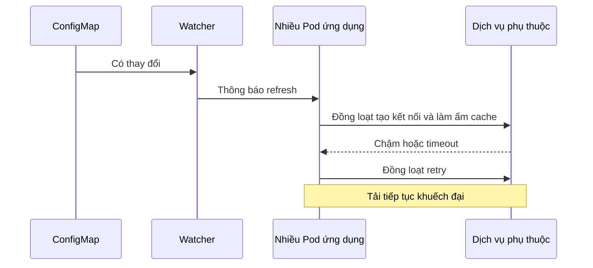

# Tránh nhiều Pod cùng nạp lại cấu hình hoặc gửi lại yêu cầu

Trong chương **Hiệu năng và độ bền** của module **SPRING_CLOUD_KUBERNETES**, bài học này giải quyết hiện tượng nhiều bản sao ứng dụng cùng phản ứng với một tín hiệu: cùng nạp cấu hình mới, dựng lại tài nguyên hoặc gửi lại một yêu cầu thất bại. Hiện tượng đó thường được gọi là *thundering herd*: mỗi hành động riêng lẻ có vẻ hợp lý, nhưng tổng tải tại một thời điểm có thể làm hệ thống mất ổn định.

Mục tiêu là phối hợp ConfigMap, Secret, Configuration Watcher, DiscoveryClient và Spring Cloud LoadBalancer để thay đổi cấu hình và phục hồi lỗi trong khả năng chịu tải của cụm. Sau bài học, bạn có thể:

- Phân biệt trì hoãn chung, debounce, jitter và giới hạn đồng thời.
- Chọn refresh tại chỗ hoặc rolling update theo loại cấu hình.
- Thiết kế xử lý sự kiện cấu hình trùng, dồn nhiều thay đổi và giữ cấu hình tốt gần nhất.
- Đặt giới hạn retry, thời gian chờ và điều kiện an toàn cho từng thao tác.
- Quan sát việc áp dụng cấu hình, sức khỏe Pod và tải khuếch đại xuống dịch vụ phụ thuộc.

Các giá trị thời gian và số lượng trong bài là số liệu minh họa cho một bài thực hành, cần được hiệu chỉnh bằng đo đạc. Những đoạn ghi rõ **mã giả** hoặc **thiết kế tùy biến** không phải tính năng tự động của Spring Cloud Kubernetes.

## 1. Từ một thay đổi nhỏ đến một đợt quá tải

Giả sử `order-service` có 30 Pod. Một lần refresh khiến mỗi Pod phải khởi tạo lại một client, làm ấm 200 mục cache và mở 8 kết nối mới.

Nếu mọi Pod bắt đầu cùng lúc, khối lượng phát sinh có thể là:

```text
Lượt đọc để làm ấm cache: 30 × 200 = 6.000
Lượt mở kết nối:         30 ×   8 =   240
```

Ngay cả khi ConfigMap chỉ thay đổi một giá trị, tác dụng phụ của mã khởi tạo có thể chạm tới cơ sở dữ liệu, dịch vụ khác và hệ thống xác thực. Nếu dịch vụ phụ thuộc bắt đầu timeout và tất cả Pod cùng retry sau đúng một giây, đợt tải thứ hai xuất hiện ngay khi nó đang cố phục hồi.



Cần tách hai đường tải để xử lý đúng:

| Đường tải | Sự kiện khởi đầu | Tài nguyên dễ bị quá tải | Biện pháp chính |
|---|---|---|---|
| Nạp lại cấu hình | ConfigMap/Secret thay đổi, thông báo refresh | CPU, pool kết nối, API Kubernetes, cache, dịch vụ phụ thuộc | Lọc phạm vi, gộp sự kiện, giãn lịch, giới hạn tác vụ nặng |
| Gửi lại yêu cầu | Timeout, mất kết nối, lỗi tạm thời | Luồng xử lý, hàng đợi, kết nối, dịch vụ đích | Deadline, backoff có jitter, retry budget, kiểm soát đồng thời |

Giãn lịch giải quyết sự trùng thời điểm. Hạn mức giải quyết tổng khối lượng. Một hệ thống lớn thường cần cả hai.

## 2. Hiểu cấu hình đi từ nguồn đến ứng dụng như thế nào

Trước khi thêm độ trễ, xác định đường đọc cấu hình thực tế:

| Cách sử dụng | Khi nguồn thay đổi | Việc ứng dụng phải làm |
|---|---|---|
| ConfigMap đưa vào biến môi trường | Biến của tiến trình đang chạy giữ nguyên | Tạo Pod mới để nhận giá trị mới |
| ConfigMap mount thành volume thông thường | Tệp được cập nhật theo cơ chế đồng bộ của Kubernetes | Đọc lại và áp dụng giá trị theo cơ chế của ứng dụng |
| ConfigMap mount bằng `subPath` | Mount đó không nhận cập nhật ConfigMap tự động | Thay đổi cách mount hoặc thay Pod |
| Ứng dụng đọc qua Kubernetes API | Có thể lấy trạng thái nguồn bằng client | Xác định khi nào đọc và khi nào thay cấu hình đang dùng |

Các đặc điểm về biến môi trường, volume và `subPath` được mô tả trong [tài liệu ConfigMap của Kubernetes](https://kubernetes.io/docs/concepts/configuration/configmap/). Với Secret cũng phải xác định chính xác cách tiêu thụ và kiểm tra tài liệu tương ứng; không suy rằng mọi đường nạp đều có cùng thời điểm cập nhật.

Configuration Watcher hỗ trợ thông báo qua HTTP đến endpoint refresh hoặc qua Spring Cloud Bus. Với cấu hình đọc từ volume, `SPRING_CLOUD_KUBERNETES_CONFIGURATION_WATCHER_REFRESHDELAY` cho phép chờ trước khi gửi sự kiện. Xem [tài liệu Configuration Watcher](https://docs.spring.io/spring-cloud-kubernetes/reference/spring-cloud-kubernetes-configuration-watcher.html).

Ví dụ sau là **đoạn ghép vào container của Watcher**, không phải container ứng dụng:

```yaml
env:
  - name: SPRING_CLOUD_KUBERNETES_CONFIGURATION_WATCHER_REFRESHDELAY
    value: "10000"
```

Mười giây ở đây là khoảng chờ chung được chọn cho ví dụ. Nó không tạo ra một lịch lệch riêng cho từng Pod, không bảo đảm volume đã đồng bộ ở mọi nơi và không đặt trần số lần refresh đồng thời. Đó là hệ quả cần tính đến khi thiết kế cơ chế giãn tải quanh đường phát thông báo.

Tương tự, `@RefreshScope` không phải cơ chế điều phối các Pod. Cũng không nên giả định mọi bean, connection pool và client đều được tái cấu hình an toàn chỉ vì endpoint refresh đã được gọi. Hãy xác định cụ thể thành phần nào đọc giá trị lúc khởi tạo, thành phần nào có thể thay tại chỗ và tác dụng phụ nào xảy ra khi dựng lại.

## 3. Chọn refresh hay rolling update

### 3.1. Refresh tại chỗ cho thay đổi nhỏ, có thể chuyển đổi an toàn

Có thể cân nhắc refresh tại chỗ cho một ngưỡng nghiệp vụ, một tỷ lệ lấy mẫu hoặc một bộ quy tắc nhỏ, nếu ứng dụng hỗ trợ áp dụng an toàn. Quy trình mong muốn là:

1. Đọc một snapshot cấu hình nhất quán.
2. Kiểm tra cú pháp, kiểu dữ liệu và ràng buộc nghiệp vụ.
3. Chuẩn bị tài nguyên mới với thời gian và mức đồng thời có giới hạn.
4. Công bố snapshot mới bằng thao tác thay tham chiếu nguyên tử hoặc cơ chế tương đương.
5. Thu hồi tài nguyên cũ sau khi các yêu cầu đang dùng nó đã kết thúc theo chính sách drain.

Nếu bước chuẩn bị thất bại, giữ snapshot tốt gần nhất và ghi nhận lỗi. Với cấu hình bảo mật bắt buộc thu hồi ngay, như thông tin xác thực bị lộ, cần chính sách riêng: không kéo dài vô hạn thời gian dùng bí mật cũ chỉ để giữ lưu lượng.

### 3.2. Rolling update cho thay đổi ảnh hưởng vòng đời tài nguyên

Thay đổi cấu trúc connection pool, tham số khởi động hoặc thư viện không hỗ trợ tái cấu hình thường dễ kiểm soát hơn bằng Pod mới. Một phương án là tạo ConfigMap mang tên phiên bản, rồi đổi tham chiếu trong Pod template.

Ví dụ dưới đây là **đoạn trích của Deployment đã có selector, image, resources và probes**:

```yaml
spec:
  replicas: 6
  minReadySeconds: 15
  progressDeadlineSeconds: 600
  strategy:
    type: RollingUpdate
    rollingUpdate:
      maxUnavailable: 0
      maxSurge: 1
  template:
    spec:
      containers:
        - name: order-service
          envFrom:
            - configMapRef:
                name: order-config-r42
```

Đổi `order-config-r41` thành `order-config-r42` làm thay đổi Pod template và kích hoạt rollout. Chỉ sửa nội dung một ConfigMap mà giữ nguyên Pod template không tự kích hoạt Deployment rollout.

`maxSurge: 1` và `maxUnavailable: 0` giới hạn nhịp thay Pod theo điều kiện rollout, với giả định cụm đủ tài nguyên. `minReadySeconds` yêu cầu Pod duy trì trạng thái sẵn sàng trong một khoảng trước khi được tính là available. Những giới hạn này không phải semaphore toàn cụm cho mọi tác vụ làm ấm, và Pod đang terminating có thể còn giữ tài nguyên trong thời gian drain. Xem [tài liệu Deployment](https://kubernetes.io/docs/concepts/workloads/controllers/deployment/).

Nếu cần giữ nguyên cấu hình cũ để rollback có thể tái hiện, quản lý các ConfigMap theo phiên bản và cân nhắc tính bất biến. Không xóa phiên bản cũ khi vẫn còn workload sử dụng nó.

PodDisruptionBudget điều tiết các eviction tự nguyện thuộc phạm vi của nó; không dùng nó để thay `maxUnavailable`/`maxSurge` của Deployment hoặc để xếp hàng refresh tại chỗ. Xem [hướng dẫn PodDisruptionBudget](https://kubernetes.io/docs/tasks/run-application/configure-pdb/).

### 3.3. Chấp nhận khoảng giao nhau giữa hai phiên bản

Cả refresh giãn thời gian và rolling update đều tạo một giai đoạn Pod cũ, Pod mới cùng phục vụ. Cấu hình cần tương thích trong giai đoạn đó.

Ví dụ, khi đổi khóa ký token, có thể cần phân phối khóa xác minh mới trước, chuyển khóa dùng để ký sau và chỉ thu hồi khóa cũ khi hết thời gian chuyển tiếp. Nếu nghiệp vụ yêu cầu mọi yêu cầu chuyển sang cùng một luật tại cùng một ranh giới, cần thiết kế phiên bản giao thức hoặc cơ chế chuyển lưu lượng phù hợp; một khoảng jitter đơn thuần không tạo được sự chuyển đổi nguyên tử toàn cụm.

## 4. Điều phối nạp lại cấu hình mà không tạo bão sự kiện

### 4.1. Bốn cơ chế có nhiệm vụ khác nhau

| Cơ chế | Ví dụ | Tác dụng | Giới hạn |
|---|---|---|---|
| Trì hoãn chung | Chờ 10 giây sau khi thấy thay đổi | Cho đường truyền cấu hình thêm thời gian hội tụ | Các Pod vẫn có thể bắt đầu cùng lúc |
| Debounce | Gộp nhiều thay đổi gần nhau trong cửa sổ 2 giây | Giảm số lần xử lý một chuỗi chỉnh sửa | Sự kiện liên tục có thể làm công việc bị trì hoãn mãi |
| Jitter | Mỗi Pod chờ một khoảng khác nhau trong cửa sổ 20 giây | Phân tán thời điểm bắt đầu | Không bảo đảm giới hạn cứng số tác vụ đồng thời |
| Giới hạn đồng thời | Chỉ 2 Pod được làm ấm cùng lúc | Bảo vệ một tài nguyên có năng lực hữu hạn | Cần điều phối giữa Pod nếu hạn mức là toàn cụm |

Với debounce, đặt thêm thời gian chờ tối đa. Ví dụ, gộp thay đổi trong 2 giây nhưng xử lý ít nhất một lần sau tối đa 10 giây kể từ sự kiện đầu tiên đang chờ. Đây là quy tắc thiết kế tùy biến, không phải một bộ property mặc định của Watcher.

### 4.2. Lọc sự kiện trước khi xếp lịch

Một sự kiện watch không đồng nghĩa ứng dụng cần dựng lại toàn bộ tài nguyên. Hệ thống tùy biến nên:

- Giới hạn namespace và tập nguồn cấu hình mà từng ứng dụng thực sự sử dụng.
- Chỉ xét các khóa liên quan đến thành phần cần thay đổi.
- Bỏ qua cập nhật metadata nếu payload hiệu dụng không đổi.
- Gộp nhiều thông báo cho cùng một trạng thái đích.
- Tránh kích hoạt đồng thời nhiều đường refresh cho cùng một nguồn.

Chẳng hạn, nếu đã chọn một đường thông báo từ Watcher, cần kiểm tra xem polling tự viết, bộ theo dõi tệp và sự kiện Bus có đang cùng gây refresh hay không. Đưa tất cả tín hiệu vào cùng một điểm điều phối nếu phải duy trì nhiều đường nhận.

Dùng `resourceVersion` như token theo dõi thay đổi theo quy ước của Kubernetes API; không chuyển sang số rồi so sánh lớn nhỏ để xác định phiên bản nghiệp vụ mới hơn. Một lựa chọn độc lập là thêm revision nghiệp vụ vào payload, hoặc tính fingerprint từ snapshot đã chuẩn hóa thứ tự khóa và kiểu giá trị. Bản thân fingerprint cho biết nội dung khác nhau, không cho biết thứ tự mới cũ.

Với Secret, chỉ công bố một mã revision an toàn cho việc quan sát. Không ghi payload hoặc hash trực tiếp của bí mật có miền giá trị nhỏ vào log; hash đó vẫn có thể hỗ trợ dò giá trị. Giữ dấu vết dùng để so sánh trong phạm vi được bảo vệ và có chính sách phù hợp.

### 4.3. Giãn lịch khác nhau cho từng Pod

Với một coordinator tùy biến, có thể tính độ trễ ổn định:

```text
spreadDelay = stableHash(podUid, configRevision) modulo spreadWindow
startAfter  = sourceWait + spreadDelay
```

`podUid` lấy qua Downward API; `configRevision` đại diện snapshot cần áp dụng. Hàm băm phải dùng biểu diễn ổn định và kết quả không âm. Cùng Pod, cùng revision cho cùng độ trễ; nhiều Pod thường có độ trễ khác nhau. Nếu chỉ băm revision mà bỏ định danh Pod, mọi Pod lại nhận cùng một lịch.

Đây là cách phân tán theo xác suất. Nếu 30 Pod trải trong cửa sổ 20 giây thì trung bình có khoảng 1,5 lượt bắt đầu mỗi giây; một giây cụ thể vẫn có thể nhiều hơn. Nếu một lần làm ấm kéo dài trung bình 4 giây thì mức đồng thời kỳ vọng xấp xỉ:

```text
Lượt đang làm ấm ≈ (30 / 20) × 4 = 6
```

Nếu dịch vụ đích chỉ chịu được hai lượt làm ấm, cửa sổ 20 giây chưa đáp ứng yêu cầu. Có thể tăng cửa sổ, giảm lượng làm ấm, chuyển sang nạp lười có kiểm soát hoặc thêm điều phối hạn mức toàn cụm. Jitter không thay thế phép tính năng lực.

### 4.4. Single-flight và hàng chờ hữu hạn trong một Pod

*Single-flight* ở đây có nghĩa là trong một Pod chỉ có một tác vụ áp dụng cấu hình đang chạy. Nhiều thông báo tới trong lúc tác vụ đó chạy được gộp, thay vì sinh thêm nhiều tác vụ song song.

**Mã giả cho một coordinator tùy biến:**

```text
khi nhận thông báo nguồn thay đổi:
    đánh dấu cần đọc lại nguồn
    nếu đang có tác vụ chạy hoặc đã có lịch chờ:
        chỉ cập nhật trạng thái đang chờ
    ngược lại:
        đặt lịch có debounce và jitter

khi lịch đến hạn:
    chiếm quyền xử lý của Pod
    đọc snapshot nhất quán mới nhất từ nguồn đã chọn
    nếu đường volume chưa có revision mong muốn:
        đặt lần kiểm tra lại hữu hạn có jitter
        không công bố rằng revision đã áp dụng
    nếu payload giống snapshot đang dùng:
        ghi nhận bỏ qua
    ngược lại:
        validate snapshot
        chuẩn bị tài nguyên với timeout và hạn mức
        nếu thành công:
            thay snapshot đang dùng
            ghi nhận revision đã áp dụng
            drain tài nguyên cũ
        nếu thất bại:
            giữ trạng thái tốt gần nhất theo chính sách
            ghi nhận lỗi, tránh thử lại vô hạn
    giải phóng quyền xử lý trong finally
    nếu có thay đổi mới trong lúc chạy:
        đặt một lịch xử lý tiếp
```

Các thao tác kiểm tra, đánh dấu và đặt lịch cần được đồng bộ để không mất sự kiện. Tránh giữ khóa trong lúc gọi mạng. Lịch đã đặt cũng cần kiểm tra trạng thái đích hiện tại khi thực thi, vì một revision mới có thể đã xuất hiện trong lúc chờ.

Không nên tạo một phần tử hàng đợi cho mọi sự kiện watch. Với cấu hình khai báo trạng thái, một ô “cần đọc trạng thái mới nhất” thường đủ; thêm lịch kiểm tra hội tụ có chu kỳ lệch nhau nếu cần phục hồi khi bỏ lỡ thông báo. Nếu từng revision đại diện một lệnh bắt buộc phải xử lý, đó là luồng sự kiện nghiệp vụ và cần cơ chế lưu trữ, thứ tự và xác nhận riêng.

### 4.5. Gắn thiết kế vào Spring ở đúng vị trí

Nếu đường HTTP vẫn gọi trực tiếp `/actuator/refresh`, một listener chạy sau khi refresh hoàn thành không thể trì hoãn chính lần refresh đó. Tương tự, nhận `EnvironmentChangeEvent` rồi mới ngủ không biến đường refresh mặc định thành hàng đợi có jitter.

Muốn áp dụng coordinator trên, cần tích hợp rõ ràng trước hành động thay đổi cấu hình: tùy biến bộ phát thông báo, dùng một endpoint nội bộ có xác thực nhận yêu cầu điều phối, hoặc kiểm soát phần tái tạo tài nguyên nặng trong mã ứng dụng. Cần tránh đường gọi trực tiếp khác đi vòng qua coordinator. Đây là công việc phát triển bổ sung; chỉ sao chép đoạn `refreshDelay` ở trên không tạo ra pipeline này.

Nếu cần giới hạn cứng số Pod refresh, có thể dùng bộ điều phối chia lô hoặc cơ chế cấp permit phân tán có timeout, hết hạn và thu hồi khi Pod chết. Một `Semaphore` trong JVM chỉ giới hạn một Pod. Leader election có thể giảm số bộ phát thông báo chủ động, nhưng việc chỉ chọn một leader không làm cấu hình tự cập nhật trong mọi Pod ứng dụng. Từng Pod có trạng thái cục bộ vẫn phải hội tụ.

## 5. Ngăn retry đồng loạt làm dịch vụ đích quá tải

### 5.1. Chọn đúng một nơi sở hữu retry cho một chặng gọi

Một yêu cầu có thể đi qua gateway, ứng dụng, HTTP client, Spring Cloud LoadBalancer và proxy. Nếu ba lớp đều cho phép tối đa ba lần thử, số lần gọi tới dịch vụ cuối trong trường hợp xấu có thể thành:

```text
3 × 3 × 3 = 27 lần thử cho một yêu cầu gốc
```

Kiểm tra cả mặc định của dependency và hạ tầng. Quy định một lớp sở hữu retry cho mỗi chặng; các lớp còn lại chuyển tiếp kết quả hoặc tuân theo ngân sách đã thống nhất.

Để lớp Reactor trong ví dụ kế tiếp sở hữu retry, có thể tắt retry của Spring Cloud LoadBalancer:

```yaml
spring:
  cloud:
    loadbalancer:
      retry:
        enabled: false
```

Property này kiểm soát retry của LoadBalancer; nó không tắt retry trong gateway, SDK, proxy hay mã nghiệp vụ. Xem [tài liệu Spring Cloud LoadBalancer](https://docs.spring.io/spring-cloud-commons/reference/spring-cloud-commons/loadbalancer.html).

Load balancing phân phối đích nhận. Jitter phân phối thời điểm gửi. Chuyển retry sang Pod khác có thể hữu ích khi một instance hỏng, nhưng không tạo thêm năng lực khi mọi instance cùng phụ thuộc vào một cơ sở dữ liệu đang quá tải. Cần bảo đảm mỗi lần thử được chọn đích từ đường discovery/load balancing phù hợp, thay vì giữ mãi một địa chỉ Pod đã lỗi.

### 5.2. Chỉ retry khi lỗi và thao tác đều phù hợp

| Tình huống | Hướng xử lý |
|---|---|
| GET thực sự chỉ đọc, lỗi tạm thời | Có thể retry hữu hạn nếu còn deadline và ngân sách |
| HTTP 400, 401, 403 hoặc lỗi validate | Sửa dữ liệu, quyền hoặc cấu hình; retry ngay thường không giúp |
| HTTP 429 hoặc 503 có `Retry-After` | Tôn trọng thời gian máy chủ yêu cầu; nếu vượt deadline thì dừng |
| Timeout khi tạo đơn hoặc thanh toán | Kết quả có thể chưa biết; cần cơ chế idempotency hoặc truy vấn trạng thái |
| Hết deadline, bị hủy hoặc hết retry budget | Dừng, trả lỗi hoặc dùng fallback hợp lệ theo nghiệp vụ |

`Retry-After` có thể là số giây hoặc một thời điểm HTTP-date. Khi thêm jitter, không gửi sớm hơn thời điểm máy chủ yêu cầu. Không kéo thời gian chờ xuống bằng deadline rồi vẫn gửi một lần nữa; nếu không đủ thời gian, bỏ lần thử đó.

Idempotency key phải giữ nguyên qua mọi lần thử của cùng thao tác và qua việc đổi Pod đích. Máy chủ cần lưu trạng thái khử trùng lặp bền vững, ràng buộc key với chủ thể và nội dung yêu cầu, cùng cơ chế xử lý đồng thời đủ chặt để tác dụng phụ không bị thực hiện hai lần. Chỉ thêm một HTTP header hoặc lưu key trong bộ nhớ một Pod chưa tạo được bảo đảm đó.

### 5.3. Exponential backoff có jitter

Một chính sách *full jitter* minh họa cho lần retry thứ `k`, bắt đầu từ `k = 1`:

```text
cap(k)   = min(maxBackoff, baseBackoff × 2^(k - 1))
delay(k) = randomUniform(0, cap(k))
```

Giả sử `baseBackoff = 100 ms`, `maxBackoff = 1.000 ms`: cửa sổ cho ba lần retry đầu lần lượt là 0–100 ms, 0–200 ms và 0–400 ms. Hai Pod thất bại cùng lúc thường chọn thời điểm thử lại khác nhau.

Không dùng cùng seed cố định cho mọi Pod. Với retry theo yêu cầu, chọn mẫu ngẫu nhiên theo từng lần thử; với tác vụ định kỳ hoặc refresh có revision, độ lệch ổn định theo Pod lại hữu ích cho việc tái hiện lịch vận hành.

Backoff giảm nhịp thử lại, jitter giảm sự trùng thời điểm. Vẫn cần giới hạn số lần thử và tải bổ sung, vì một nghìn Pod cùng retry hữu hạn vẫn có thể vượt năng lực của dịch vụ đích. Các nguyên tắc về timeout, retry và jitter được trình bày trong [Amazon Builders’ Library](https://aws.amazon.com/builders-library/timeouts-retries-and-backoff-with-jitter/).

### 5.4. Deadline tổng quan trọng ngang timeout từng lần

Một yêu cầu có ngân sách thời gian tổng `D` phải tính cả:

```text
D ≥ thời gian chọn đích và chờ tài nguyên
    + tổng thời gian các lần gọi
    + tổng thời gian backoff
    + thời gian xử lý và trả kết quả
```

Ví dụ: tối đa ba lần thử, mỗi lần 450 ms, hai khoảng chờ danh định 100 ms và 200 ms đã chiếm 1.650 ms. Với deadline 1.800 ms, phần dư rất ít, đặc biệt khi jitter làm tăng một khoảng chờ hoặc phải dựng kết nối TLS mới. Deadline tổng phải có quyền kết thúc chuỗi trước khi dùng hết số lần thử.

Phân biệt rõ `maxAttempts = 3` với `maxRetries = 3`: tên thứ hai thường có nghĩa ba lần thử bổ sung sau lần đầu. Đọc đúng quy ước thư viện đang dùng.

Đặt thêm giới hạn số yêu cầu đang chờ hoặc đang gọi, pool kết nối và hàng đợi. Không giữ luồng xử lý bằng `Thread.sleep` trong event loop reactive để thực hiện backoff. Với circuit breaker, giới hạn cả số probe khi half-open để tránh tất cả Pod cùng thăm dò phục hồi.

## 6. Ví dụ retry hữu hạn với WebClient và Reactor

Ví dụ dưới đây gọi một API GET chỉ đọc. `WebClient` được truyền vào đã có base URL và cơ chế chọn đích phù hợp. Nếu dùng Spring Cloud LoadBalancer, tạo nó từ `WebClient.Builder` có `@LoadBalanced` và service ID; nếu dùng DNS của Kubernetes Service, chọn client thông thường theo kiến trúc đã định. Không giả định một URL service ID tự có discovery khi client chưa được cấu hình.

Đoạn mã tập trung vào retry, yêu cầu WebFlux/Reactor và Java hỗ trợ pattern matching cho `instanceof`:

```java
import java.time.Duration;
import java.util.concurrent.TimeoutException;

import org.springframework.web.reactive.function.client.WebClient;
import org.springframework.web.reactive.function.client.WebClientResponseException;

import reactor.core.publisher.Mono;
import reactor.util.retry.Retry;

public final class InventoryClient {
    private final WebClient client;

    public InventoryClient(WebClient client) {
        this.client = client;
    }

    public Mono<String> readStock(String sku) {
        return Mono.defer(() -> client.get()
                    .uri("/stocks/{sku}", sku)
                    .retrieve()
                    .bodyToMono(String.class))
                .timeout(Duration.ofMillis(450))
                .retryWhen(Retry.backoff(2, Duration.ofMillis(100))
                        .maxBackoff(Duration.ofMillis(400))
                        .jitter(0.5)
                        .filter(InventoryClient::isRetryable))
                .timeout(Duration.ofMillis(1800));
    }

    private static boolean isRetryable(Throwable failure) {
        if (failure instanceof TimeoutException) {
            return true;
        }
        if (failure instanceof WebClientResponseException response) {
            // Chính sách mẫu không tự retry khi máy chủ yêu cầu chờ.
            if (response.getHeaders().containsKey("Retry-After")) {
                return false;
            }
            int status = response.getStatusCode().value();
            return status == 502 || status == 503 || status == 504;
        }
        return false;
    }
}
```

Cách đọc chính sách này:

- `Retry.backoff(2, ...)` cho phép tối đa hai lần retry, tổng cộng ba lần thử.
- Timeout 450 ms nằm trước `retryWhen`, nên áp dụng lại cho mỗi lần subscription thử gọi.
- Timeout 1.800 ms nằm ngoài chuỗi retry, nên bao phủ cả các khoảng backoff và các lần thử.
- `.jitter(0.5)` là cách tính jitter của Reactor, không đồng nhất với công thức full jitter ở mục trước.
- Bộ lọc cố ý hẹp: không tự retry 429, lỗi quyền, lỗi giải mã dữ liệu hoặc toàn bộ lỗi kết nối. Các phản hồi có `Retry-After` được chuyển lỗi để tầng sở hữu chính sách xử lý theo hợp đồng.

Các semantics của backoff, số retry và jitter được mô tả trong [API `RetryBackoffSpec` của Reactor](https://projectreactor.io/docs/core/release/api/reactor/util/retry/RetryBackoffSpec.html). Thông số timeout kết nối, pool và giới hạn concurrency phải cấu hình thêm ở HTTP connector hoặc tầng bảo vệ liên quan; đoạn mã trên chưa phải một client production đầy đủ.

Timeout phía client và việc hủy subscription không chứng minh máy chủ chưa thực hiện thao tác. Không áp nguyên ví dụ này cho POST thanh toán. Cũng cần kiểm tra trace để chắc rằng mỗi lần retry thực sự đi qua đường chọn instance mong muốn và không có lớp khác retry ngầm.

## 7. Đặt ngân sách tải cho toàn bộ bản sao

Giới hạn hai retry cho mỗi yêu cầu chỉ đặt trần trên từng yêu cầu. Có thể đặt thêm retry budget, ví dụ: trong cửa sổ 10 giây, tổng lần thử bổ sung không vượt quá 10% số lần gọi ban đầu hợp lệ, với dung lượng burst nhỏ đã xác định.

```text
A = tổng lần thử gửi xuống dịch vụ đích
O = số lần gọi ban đầu
R = số lần retry bổ sung = A - O

Tỷ lệ retry        = R / O
Hệ số khuếch đại   = A / O
```

Khi `O = 0`, không chia mà báo trạng thái không có mẫu. Khi cửa sổ mới bắt đầu, cần định nghĩa cách cấp token ban đầu và xử lý lưu lượng thấp. Nếu hết token thì kết thúc sớm theo chính sách, dù yêu cầu chưa dùng hết số retry tối đa.

Ví dụ có 1.000 lần gọi ban đầu trong cửa sổ, ngân sách cho phép tối đa khoảng 100 lần thử bổ sung. Trong một đợt lỗi diện rộng, không phải mọi yêu cầu đều được cấp hai retry.

Một token bucket trong mỗi Pod chỉ tạo hạn mức cục bộ. Nếu mỗi Pod cho 20 retry/giây và có 30 Pod, tổng mức có thể là 600 retry/giây; khi HPA tăng lên 60 Pod, mức đó có thể tăng thành 1.200. Muốn một hạn mức toàn dịch vụ cần chia ngân sách theo số bản sao với quy tắc cập nhật phù hợp, cấp token tập trung hoặc giới hạn ở phía dịch vụ đích/gateway.

Tương tự, giới hạn 10 lời gọi đồng thời mỗi Pod không có nghĩa toàn cụm chỉ có 10. Tính ngân sách theo năng lực thật của tài nguyên cuối cùng, kể cả tác vụ làm ấm sau refresh, tác vụ định kỳ và lưu lượng người dùng.

## 8. Readiness, liveness và RBAC trong thiết kế này

### 8.1. Dùng tín hiệu sức khỏe đúng mục đích

Nếu snapshot cũ vẫn hợp lệ và phục vụ an toàn trong lúc chuẩn bị snapshot mới, có thể giữ Pod Ready để giảm biến động lưu lượng. Nếu cấu hình hiện tại không còn cho phép phục vụ an toàn, phải phản ánh trạng thái đó và có lộ trình rollout phù hợp.

Tránh thiết kế mọi Pod đồng thời chuyển NotReady chỉ vì nhận được thông báo refresh. Khi toàn bộ endpoint cùng rời khỏi tập phục vụ, retry từ tầng trên có thể làm sự cố nặng hơn. Với đường gọi Pod trực tiếp qua DiscoveryClient/LoadBalancer, cũng cần xác nhận bộ cung cấp instance và cache thực sự phản ánh readiness như mong muốn.

Không gắn liveness với một dịch vụ phụ thuộc chỉ vì nó đang chậm. Restart đồng loạt có thể xóa cache, dựng lại pool và tạo thêm đợt tải. Startup probe và readiness nên phản ánh quá trình khởi động/làm ấm đã thiết kế, với timeout và ngưỡng dựa trên số đo.

### 8.2. Giới hạn quyền và đường điều khiển refresh

ServiceAccount của thành phần theo dõi chỉ nên có quyền đọc/watch các loại tài nguyên cần dùng trong phạm vi được chọn; xác định quyền discovery theo client và tính năng thực tế. Quyền đọc Secret cần được cấp riêng khi có nhu cầu, không thêm vào mọi Pod theo thói quen.

Label giúp chọn nguồn xử lý, nhưng không tự tạo hàng rào RBAC. Quyền `list`/`watch` Secret ở namespace có thể cho phép nhìn thấy dữ liệu ngoài các đối tượng có label mà ứng dụng quan tâm. Thiết kế namespace và quyền truy cập phải đáp ứng mức cô lập mong muốn.

Endpoint refresh và endpoint coordinator tùy biến là đường điều khiển nội bộ có thể gây tải lớn. Bảo vệ bằng xác thực, phân quyền, giới hạn mạng và hạn mức gọi phù hợp. Không đưa dữ liệu Secret vào log debug, sự kiện hay endpoint chẩn đoán.

## 9. Thực hành có kiểm soát

Thực hiện trong namespace thử nghiệm. Chuẩn bị một dịch vụ ứng dụng có nhiều bản sao, một dịch vụ phụ thuộc có khả năng mô phỏng độ trễ/lỗi và một nguồn cấu hình chỉ chứa dữ liệu không nhạy cảm. Giữ nguyên lưu lượng nền giữa các lượt đo.

### 9.1. Đo đường cơ sở

Dùng 6 Pod ứng dụng và cho mỗi Pod ghi một sự kiện khi bắt đầu/kết thúc áp dụng cấu hình. Ghi revision nghiệp vụ, định danh Pod và kết quả; tránh ghi giá trị cấu hình nhạy cảm.

Đo số tác vụ làm ấm đồng thời, số kết nối mới mỗi giây, độ trễ p95/p99 của dịch vụ phụ thuộc và số lần gọi ban đầu/retry. Đồng bộ thời gian quan sát hoặc dùng hệ thống trace phù hợp để so sánh các Pod.

### 9.2. Thay đổi cấu hình theo một chuỗi ngắn

Sửa ba lần liên tiếp một giá trị không nhạy cảm trong nguồn được theo dõi. So sánh hai thiết kế:

| Lượt thử | Cách xử lý | Điều cần kiểm tra |
|---|---|---|
| A | Refresh trực tiếp theo đường thông báo hiện có | Có bao nhiêu lần tái tạo tài nguyên; mức trùng thời điểm |
| B | Coordinator tùy biến có debounce, jitter và single-flight | Số sự kiện được gộp; khoảng trải thời gian; revision cuối đã hội tụ |

Đừng đặt tiêu chí “mỗi Pod chỉ có đúng một sự kiện”. Hệ thống phân tán có thể nhận thông báo trùng. Tiêu chí nên là không áp dụng lặp tác vụ nặng khi snapshot không đổi, không chạy chồng tác vụ trong cùng Pod và cuối cùng mọi Pod phục vụ bằng trạng thái đích hợp lệ.

Sau đó thử một snapshot không hợp lệ. Quan sát rằng Pod báo lỗi rõ ràng, không công bố revision đó là đã áp dụng và tuân theo chính sách giữ cấu hình cũ. Thử khôi phục cấu hình hợp lệ để kiểm tra đường phục hồi.

### 9.3. Mô phỏng lỗi dịch vụ phụ thuộc

Cho dịch vụ đích trả 503 không có `Retry-After` hoặc tăng độ trễ vượt 450 ms trong một khoảng ngắn. So sánh retry có khoảng chờ cố định với backoff có jitter, cùng số lần thử tối đa và cùng deadline.

Thu thập biểu đồ thời điểm thử lại với độ phân giải đủ nhỏ, như 100 ms nếu hệ thống đo cho phép. Biểu đồ trung bình một phút có thể che hoàn toàn những đỉnh tải ngắn. Xác nhận chuỗi thử dừng trước hoặc tại deadline tổng, và số retry thực tế tuân theo chính sách đã đặt.

Thử riêng phản hồi có `Retry-After`; chính sách mẫu ở mục 6 phải dừng retry tự động cho phản hồi đó. Nếu triển khai chính sách chờ theo header, kiểm tra cả trường hợp thời điểm chờ vượt deadline.

### 9.4. Kiểm tra phạm vi hạn mức và sự kiện trùng

- Tăng số bản sao từ 6 lên 12 để xem hạn mức cục bộ có làm tải toàn cụm tăng theo không.
- Gửi lặp thông báo về cùng trạng thái và xác nhận tác vụ nặng được bỏ qua nếu không có thay đổi hiệu dụng.
- Thay cấu hình trong lúc tác vụ đang chạy, kiểm tra trạng thái mới nhất không bị mất.
- Dừng một Pod đang xử lý; các Pod còn lại vẫn phục vụ và permit phân tán, nếu có, phải được thu hồi theo thiết kế.

Đây là các bước thực hành cho người học; chúng không hàm ý hệ thống đã có sẵn bộ điều phối, retry budget hoặc bộ tạo tải.

## 10. Quan sát để phát hiện sự cố sớm

Các metric dưới đây là **tên đề xuất cho instrumentation tùy biến**, không phải metric mặc định mà Spring Cloud Kubernetes luôn cung cấp:

| Metric đề xuất | Câu hỏi cần trả lời |
|---|---|
| `app_config_events_total` | Có bao nhiêu thông báo nguồn thay đổi? |
| `app_config_apply_total{result}` | Bao nhiêu lần áp dụng thành công, thất bại hoặc bị bỏ qua? |
| `app_config_apply_duration_seconds` | Nạp/chuẩn bị cấu hình mất bao lâu? |
| `app_config_apply_inflight` | Có bao nhiêu tác vụ đang chạy tại từng Pod và toàn dịch vụ? |
| `app_outbound_attempts_total{kind,outcome}` | Bao nhiêu lần gọi ban đầu, retry và lỗi? |
| `app_retry_budget_rejected_total` | Bao nhiêu retry bị từ chối vì hết ngân sách? |

Dùng label có tập giá trị hữu hạn như tên dependency, loại attempt và kết quả. Đặt revision chi tiết trong log/traces có kiểm soát hoặc endpoint trạng thái nội bộ; tránh đưa từng revision, idempotency key hay request ID vào label metric vì số chuỗi thời gian có thể tăng không giới hạn.

Cảnh báo hữu ích là sự kết hợp: tốc độ apply tăng bất thường, pool chạm trần, tỷ lệ retry tăng, p99 xấu đi và số Pod Ready giảm. Một thay đổi cấu hình cần có mã tương quan để đối chiếu với những tín hiệu đó.

Khi sự cố đang diễn ra, ưu tiên giảm nguồn tạo tải: dừng chuỗi thay đổi cấu hình, giảm retry, thu hẹp lượng làm ấm hoặc rollback phiên bản cấu hình theo quy trình. Chỉ tăng thời gian chờ hoặc số lần retry có thể làm lượng việc tồn đọng tăng thêm.

## 11. Chọn lượng tính năng Spring Cloud Kubernetes thực sự cần

| Nhu cầu triển khai | Lựa chọn để đánh giá |
|---|---|
| Cấu hình chỉ cần thay khi phát hành | ConfigMap/Secret theo phiên bản và rolling update; có thể không cần Watcher |
| Một số giá trị cần đổi tại chỗ | Refresh có phạm vi nhỏ, validate và cơ chế hội tụ có quan sát |
| Cần discovery theo metadata và chọn instance phía client | DiscoveryClient kết hợp Spring Cloud LoadBalancer, cùng chính sách cache/readiness rõ ràng |
| Kubernetes Service và DNS đã đáp ứng định tuyến | Cân nhắc dùng đường gọi đó để giảm thành phần và quyền API cần quản lý |
| Nhiều Pod làm ấm gây vượt năng lực dịch vụ đích | Thêm giới hạn tải và điều phối phù hợp; chỉ bật thêm watcher không giải quyết được |

Một thiết kế phù hợp phải trả lời được: mỗi lần thay đổi tạo bao nhiêu việc, ai có quyền kích hoạt, việc đó diễn ra trong bao lâu, có bao nhiêu Pod được làm cùng lúc và ứng dụng phục vụ thế nào nếu việc áp dụng thất bại. Khi những giới hạn này rõ ràng, nhiều Pod có thể hội tụ về cấu hình mới và phục hồi lỗi mà vẫn giữ tải trong năng lực đã đo của hệ thống.
