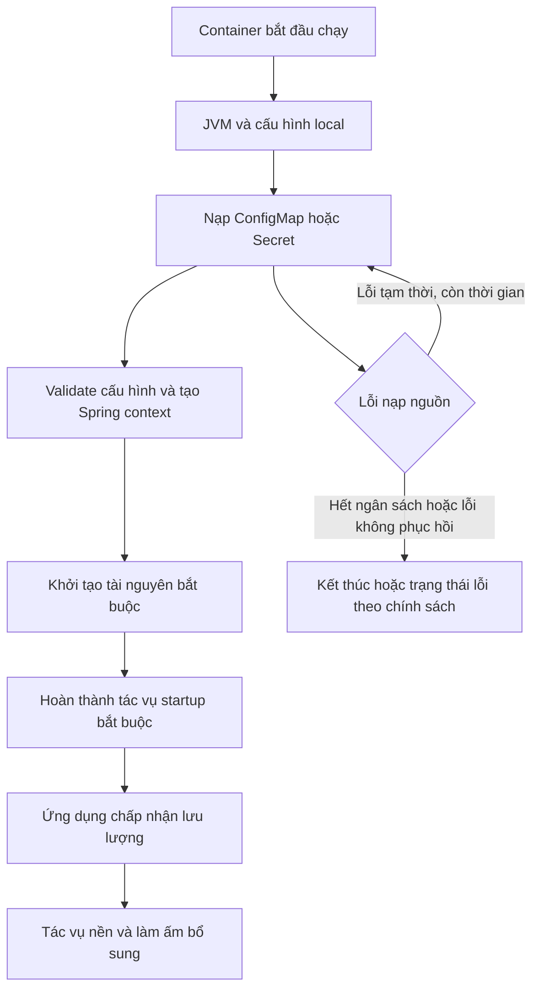

# Đặt timeout, giới hạn retry và ngân sách khởi động

Một Pod Spring có thể giữ tiến trình sống nhưng không bao giờ sẵn sàng: nó đang chờ Kubernetes API, thử đọc lại ConfigMap, đợi một connection pool hoặc làm ấm cache không có giới hạn. Ngược lại, một Pod có thể bị Kubernetes khởi động lại ngay trước khi hoàn tất công việc hợp lệ vì cửa sổ startup probe quá ngắn.

Trong chương **Hiệu năng và độ bền** của module **SPRING_CLOUD_KUBERNETES**, bài học này hướng dẫn thiết kế các giới hạn đó thành một chính sách có thể đo và vận hành. Phạm vi gồm nạp ConfigMap/Secret, sử dụng DiscoveryClient và Spring Cloud LoadBalancer, cập nhật cấu hình qua Configuration Watcher và theo dõi sức khỏe Pod.

Sau bài học, bạn có thể:

- Phân biệt timeout của một thao tác, deadline của cả chuỗi và ngân sách khởi động.
- Tính tổng thời gian retry thay vì chỉ chọn một số lần thử.
- Đặt chính sách nạp cấu hình bắt buộc và xử lý lỗi quyền khác lỗi tạm thời.
- Phối hợp thời gian khởi động của ứng dụng với startup, readiness, liveness và việc theo dõi rollout.
- Chứng minh bằng quan sát rằng ứng dụng dừng chờ, báo lỗi hoặc sẵn sàng theo đúng thiết kế.

Các con số trong bài là giả định thực hành, không phải giá trị tối ưu cho mọi cụm. Những phần ghi **mã giả**, **thiết kế tùy biến** hoặc **ngân sách đề xuất** cần được triển khai hoặc đo kiểm riêng; chúng không trở thành tính năng tự động khi thêm starter.

## 1. Ba loại giới hạn cần đặt cùng nhau

### 1.1. Timeout: một lần chờ được phép kéo dài bao lâu?

Timeout giới hạn một hoạt động cụ thể: mở kết nối, lấy một kết nối từ pool, chờ dữ liệu trả về hoặc thực hiện một lần đọc nguồn cấu hình.

Không nên dùng từ “timeout HTTP” mà bỏ qua phạm vi của nó:

| Giới hạn | Khoảng thời gian được kiểm soát | Điều có thể vẫn nằm ngoài |
|---|---|---|
| Connection timeout | Thiết lập kết nối theo định nghĩa của client | Chờ pool, một số bước phân giải tên hoặc xử lý phản hồi |
| Pool acquire timeout | Chờ lấy một kết nối rảnh | Thời gian gọi sau khi đã có kết nối |
| Read/response timeout | Chờ đọc hoặc nhận phản hồi theo client | Có thể không bao phủ toàn bộ body hoặc mọi bước trước đó |
| Timeout của cả attempt | Toàn bộ một lần thử ở tầng đã bọc | Các lần retry và backoff tiếp theo |
| Deadline tổng | Cả chuỗi thao tác nằm trong phạm vi được giám sát | Công việc trước khi bắt đầu đo hoặc sau khi thoát khỏi phạm vi |

Semantics cụ thể phụ thuộc HTTP client. Ví dụ, “không có dữ liệu trong hai giây” khác với “toàn bộ thao tác kết thúc trong hai giây”: một máy chủ gửi từng phần nhỏ đều đặn có thể tránh idle timeout mà vẫn làm tổng thời gian kéo dài.

Đối với Kubernetes client, cần xác định rõ đang dùng Fabric8 hay Kubernetes Java Client và client đó áp dụng timeout ở đâu. Không lấy property dành cho WebClient rồi giả định nó cũng kiểm soát lần nạp ConfigMap trước khi Spring context được tạo.

### 1.2. Retry limit: cho phép thêm bao nhiêu lần thử?

Retry cho lỗi tạm thời thêm cơ hội phục hồi. Mỗi lần thử cũng tiêu thụ thời gian và năng lực của dịch vụ đích.

Quy ước cần ghi rõ:

```text
maxAttempts = 3  → 1 lần đầu + tối đa 2 lần thử lại
maxRetries  = 3  → thường là 1 lần đầu + tối đa 3 lần thử lại
```

Tên property và thư viện quyết định semantics thực tế. Khi ghi chính sách vận hành, nên ghi cả “tổng số lần thử” để tránh nhầm.

Giới hạn số lần mà không giới hạn thời gian một attempt vẫn có thể treo rất lâu. Timeout từng attempt mà không có deadline tổng lại có thể tạo một chuỗi quá dài.

### 1.3. Ngân sách khởi động: bao lâu để đạt trạng thái phục vụ hợp lệ?

Ngân sách khởi động là giới hạn cho một phạm vi đã định nghĩa, chẳng hạn từ lúc tiến trình JVM bắt đầu đến lúc ứng dụng đủ điều kiện nhận yêu cầu.

Cần nói rõ phạm vi đo:

```text
Từ tạo Pod đến container chạy:
  scheduling + image pull + chuẩn bị volume + init containers + ...

Từ container chạy đến ứng dụng sẵn sàng:
  JVM + nạp cấu hình + tạo context + khởi tạo bắt buộc + ...

Từ bắt đầu phát hành đến rollout hoàn tất:
  các đợt tạo Pod + chờ availability + điều kiện triển khai + ...
```

Ba khoảng này không có cùng điểm bắt đầu hoặc kết thúc. Startup probe của container ứng dụng không tính thời gian Pod còn Pending để chờ node hay chờ một init container hoàn tất.

## 2. Lập bản đồ đường khởi động trước khi chọn con số

Một ứng dụng ví dụ có đường khởi động sau:



Với mỗi bước, ghi lại bốn thông tin:

1. Nó có thật sự bắt buộc trước khi phục vụ không?
2. Nó gọi mạng, chờ khóa, chờ pool hoặc chờ một vòng retry nào?
3. Tầng nào sở hữu timeout và retry của nó?
4. Khi hết thời gian, ứng dụng thoát hay tiếp tục ở trạng thái hạn chế nào?

Ví dụ:

| Công việc | Bắt buộc trước Ready? | Hành vi khi không hoàn tất |
|---|---|---|
| Đọc khóa cấu hình xác định tenant hoặc môi trường | Có | Dừng khởi động nếu không có giá trị hợp lệ |
| Đọc credential bắt buộc để phục vụ chức năng chính | Có | Dừng hoặc từ chối phục vụ theo thiết kế rõ ràng |
| Làm ấm toàn bộ cache gợi ý sản phẩm | Thường không | Chuyển nền, dùng đường truy vấn chậm có giới hạn |
| Chờ service tùy chọn xuất hiện trong discovery | Không nhất thiết | Khởi động với tính năng đó chưa khả dụng |
| Kiểm tra một schema tối thiểu cần dùng | Tùy ứng dụng | Chờ hữu hạn rồi báo lỗi rõ ràng |

Việc gỡ một tác vụ không cần thiết khỏi đường bắt buộc có thể hiệu quả hơn tăng mọi timeout. Tuy nhiên, chuyển sang chạy nền cần giới hạn concurrency và có cơ chế bảo đảm kết quả khi người dùng gọi chức năng chưa được chuẩn bị.

## 3. Tính ngân sách retry bằng thời gian thực sự tiêu thụ

### 3.1. Công thức cho một chuỗi tuần tự

Với tổng cộng `N` lần thử:

```text
T_retry ≤ tổng thời gian tối đa của N attempt
          + tổng thời gian chờ giữa N attempt
          + phần chi phí điều phối

Nếu mọi attempt bị chặn ở cùng mức a:
T_retry ≤ N × a + d1 + d2 + ... + d(N-1) + overhead
```

Nếu dùng exponential backoff không có jitter:

```text
dk = min(maxInterval, initialInterval × multiplier^(k - 1))
k  = 1, 2, ..., N - 1
```

Chỉ được xem đây là một giới hạn đáng tin khi `a` thật sự bao phủ toàn bộ attempt. Nếu attempt còn chứa nhiều lần gọi API, retry nội bộ hoặc một bước chờ không có timeout, phép tính chưa đủ.

### 3.2. Ví dụ nạp một nguồn cấu hình

Giả sử đã kiểm soát được một attempt nạp nguồn trong tối đa 1.500 ms, không có retry ẩn bên trong, và chính sách có:

```text
Tổng số lần thử:       3
Initial interval:     400 ms
Multiplier:           2
Max interval:         1.000 ms

Các khoảng chờ:       400 ms, 800 ms
Thời gian các attempt: 3 × 1.500 = 4.500 ms
Tổng danh định tối đa: 4.500 + 400 + 800 = 5.700 ms
```

Nếu dành 7 giây cho giai đoạn này, còn 1,3 giây cho chi phí điều phối và sai số. Con số đó chỉ có ý nghĩa sau khi xác nhận tầng client thực sự kết thúc một attempt đúng giới hạn.

Chỉ đặt connection timeout bằng 1.500 ms không chứng minh cả attempt kết thúc trong 1.500 ms. Việc đọc nhiều ConfigMap/Secret tuần tự cũng có thể làm một attempt dài hơn một lần gọi mạng.

### 3.3. Tác vụ song song và retry lồng nhau

Nếu hai tác vụ độc lập chạy song song, đường tới hạn gần với thời gian tác vụ chậm hơn, nhưng còn phụ thuộc CPU, pool kết nối và hàng đợi. Không cộng chúng như tuần tự, cũng không mặc định chúng hoàn toàn không tranh chấp tài nguyên.

Nếu tầng ngoài thử ba lần và mỗi lần HTTP client bên trong thử ba lần, một thao tác có thể gửi tới chín lần gọi mạng. Thời gian của attempt tầng ngoài phải bao gồm toàn bộ vòng thử của tầng trong.

Chọn một tầng sở hữu retry cho mỗi chặng. Ghi rõ retry nào còn tồn tại trong Kubernetes client, HTTP client, LoadBalancer, gateway hoặc SDK. Không chỉ nhìn annotation hoặc operator mà ứng dụng tự thêm.

## 4. Thiết lập nạp ConfigMap/Secret có giới hạn

### 4.1. Cấu hình retry phải có sẵn trước lần đọc từ xa

Chính sách dùng để kết nối và đọc một ConfigMap không nên chỉ nằm trong chính ConfigMap mà nó cần đọc thành công. Đặt các tham số thiết yếu ở cấu hình local, biến môi trường hoặc nguồn được xử lý trước giai đoạn đó.

Đoạn sau là **phần cấu hình local minh họa** cho ConfigMap PropertySource; không phải một cấu hình bootstrap hoàn chỉnh:

```yaml
spring:
  cloud:
    kubernetes:
      config:
        fail-fast: true
        retry:
          enabled: true
          max-attempts: 3
          initial-interval: 400
          multiplier: 2.0
          max-interval: 1000
```

Nhóm `spring.cloud.kubernetes.config.retry.*` cung cấp các giới hạn thử và backoff; các interval ở ví dụ có đơn vị mili giây. Để dùng cơ chế này cần `fail-fast` và dependency retry phù hợp phiên bản. Xem [ConfigMap PropertySource](https://docs.spring.io/spring-cloud-kubernetes/reference/property-source-config/configmap-propertysource.html).

Ví dụ, [tài liệu nhánh 3.1](https://docs.spring.io/spring-cloud-kubernetes/reference/3.1/property-source-config/configmap-propertysource.html) yêu cầu `spring-retry` và `spring-boot-starter-aop`; tài liệu các nhánh mới có thể nêu starter khác. Chọn dependency theo Spring Boot, Spring Cloud release train và Spring Cloud Kubernetes đang dùng, không trộn ví dụ giữa các nhánh.

Import Config Data hoặc bootstrap cũng phải được cấu hình đúng với phiên bản đã chọn. Thêm các property trên không tự tạo một Kubernetes client hợp lệ, không cấp RBAC và không giới hạn mọi lời gọi HTTP trong ứng dụng.

Đoạn này giới hạn retry nạp nguồn; nó chưa đặt deadline tổng 7 giây cho giai đoạn và chưa đặt timeout toàn attempt 1.500 ms. Hai giới hạn đó cần được thực thi ở tầng tương ứng, theo khả năng của loader/client hoặc tích hợp tùy biến đã chọn.

### 4.2. Fail-fast và validation giải quyết hai vấn đề khác nhau

`fail-fast` quyết định cách phản ứng với lỗi nạp nguồn. Validation quyết định cấu hình cuối cùng có đủ và hợp lệ để phục vụ hay không.

Một hệ thống vẫn có thể nhận nguồn rỗng, chọn sai profile hoặc thiếu một khóa mà không biểu hiện đúng như lỗi kết nối. Vì vậy, validate các thuộc tính bắt buộc sau khi hợp nhất cấu hình; không mặc định bật fail-fast sẽ kiểm tra toàn bộ yêu cầu nghiệp vụ.

Ví dụ, ứng dụng xử lý nhiều tenant cần từ chối khởi động nếu không xác định được tenant mục tiêu. Không dùng giá trị mặc định tiện lợi nhưng có thể dẫn đến ghi vào sai môi trường.

Với Secret PropertySource, có nhóm `spring.cloud.kubernetes.secrets.retry.*` và `spring.cloud.kubernetes.secrets.fail-fast` riêng. Chỉ bật đường API khi cần và cấp quyền phù hợp. Xem [Secrets PropertySource](https://docs.spring.io/spring-cloud-kubernetes/reference/property-source-config/secrets-propertysource.html). Không suy rằng cấu hình retry của ConfigMap tự bao phủ việc nạp Secret.

Nếu chọn mount Secret thành tệp, xác định cách ứng dụng đọc và validate tệp đó. Không thêm retry gọi Kubernetes API vào Pod chỉ để giải quyết một đường cấu hình vốn không cần API.

### 4.3. Phân loại nguyên nhân trước khi tăng số lần thử

| Dấu hiệu | Hướng đánh giá | Chính sách cần cân nhắc |
|---|---|---|
| Kubernetes API timeout hoặc lỗi máy chủ tạm thời | Có thể là lỗi chuyển tiếp | Retry ít lần, có backoff, còn deadline |
| HTTP 403 | ServiceAccount/RBAC hoặc namespace không đúng | Sửa quyền/phạm vi; chờ lâu hơn thường không giúp |
| HTTP 401 hoặc lỗi TLS cố định | Credential, trust hoặc danh tính không hợp lệ | Kiểm tra cấu hình, không che lỗi bằng vòng thử dài |
| Nguồn không tồn tại | Sai tên hoặc thứ tự triển khai | Chỉ chờ ngắn nếu thứ tự tạo nguồn đã được chủ ý thiết kế |
| Payload sai kiểu hoặc thiếu khóa bắt buộc | Lỗi nội dung cấu hình | Báo lỗi validation; thử lại cùng payload không sửa được nó |

Đây là chính sách phân loại nên thiết kế, không phải cam kết rằng bộ retry mặc định của mọi phiên bản đã phân loại lỗi theo bảng. Nếu cần dừng ngay với một nhóm lỗi, phải kiểm tra khả năng tùy biến và hành vi của loader thực tế.

Không cấp quyền rộng hơn chỉ để một startup “hết lỗi”. Xác minh đúng ServiceAccount, namespace và loại tài nguyên trước. Lỗi phải được ghi bằng loại, nguồn và giai đoạn, không bằng nội dung Secret.

## 5. Chia ngân sách khởi động thành các giai đoạn

Giả sử chọn mục tiêu thực hành: ứng dụng đạt trạng thái phục vụ trong **45 giây kể từ lúc container ứng dụng bắt đầu chạy**, dưới điều kiện tài nguyên đã định.

Một bảng phân bổ minh họa:

| Giai đoạn | Phân bổ tối đa |
|---|---:|
| JVM và chuẩn bị cấu hình local | 4 giây |
| Nạp các nguồn cấu hình bắt buộc | 7 giây |
| Validate và tạo Spring context | 10 giây |
| Khởi tạo kết nối/tài nguyên bắt buộc | 8 giây |
| Làm ấm tối thiểu bắt buộc | 6 giây |
| Dự phòng cho điều phối và hoàn tất trạng thái | 5 giây |
| **Tổng phân bổ** | **40 giây** |

Còn 5 giây đệm so với mục tiêu 45 giây. Đây là bảng thiết kế; để biến nó thành giới hạn cứng phải có cơ chế thực thi và hủy tác vụ phù hợp.

Những giai đoạn như class loading hoặc tạo bean đồng bộ không phải lúc nào cũng có một API an toàn để ngắt đúng thời điểm. Có thể cần tối ưu đường khởi động, giảm công việc bắt buộc, giám sát tiến trình hoặc dùng cơ chế kết thúc phù hợp. Không gắn nhãn “deadline cứng” cho một tác vụ chỉ ghi cảnh báo sau khi đã chạy quá lâu.

Nếu có nhiều nguồn cấu hình bắt buộc, 7 giây là tổng cho cả giai đoạn. Không cấp lại 7 giây riêng cho từng nguồn rồi vẫn tuyên bố tổng khởi động nằm trong 45 giây.

### 5.1. Ngân sách còn lại phải được truyền xuống

Khi một bước chuẩn bị gọi tiếp dịch vụ khác, tính:

```text
remaining = budget - elapsed
attemptTimeout = min(timeoutCấuHình, remaining - reserve)
```

Nếu phần thời gian còn lại không đủ cho một attempt có ích và phần dự phòng, dừng tại đó. Không bắt đầu retry chỉ vì bộ đếm vẫn còn một lần.

**Mã giả cho một giai đoạn có retry tùy biến:**

```text
bắt đầu đồng hồ đơn điệu cho phạm vi ngân sách

cho từng attempt, tối đa N lần:
    tính thời gian còn lại của giai đoạn và của startup
    nếu không đủ cho công việc tối thiểu và phần dự phòng:
        báo hết ngân sách

    gọi thao tác với timeout hữu hạn nằm trong thời gian còn lại
    nếu thành công:
        kết thúc giai đoạn

    nếu lỗi không phù hợp retry hoặc đây là attempt cuối:
        báo lỗi với nguyên nhân

    tính backoff có giới hạn, thêm jitter theo chính sách
    nếu có Retry-After:
        không lên lịch sớm hơn thời điểm được yêu cầu
    nếu thời gian chờ và công việc tối thiểu vượt phần còn lại:
        dừng, không retry

    chờ theo lịch có thể bị hủy

sau mỗi giai đoạn:
    chuyển phần ngân sách còn lại cho giai đoạn kế tiếp
```

Nếu dùng property retry của loader có sẵn, mã giả này không tự bọc được toàn bộ quá trình chỉ nhờ thêm một bean. Nạp cấu hình có thể xảy ra trước khi bean điều phối được tạo.

### 5.2. Đồng hồ đo thời gian và vị trí bắt đầu đo

Dùng đồng hồ đơn điệu để đo khoảng thời gian trong cùng tiến trình; ví dụ `System.nanoTime()` trong Java. Đồng hồ lịch phục vụ dấu thời gian log, có thể bị điều chỉnh và không phù hợp làm phép trừ ngân sách nội bộ.

Nếu chỉ bắt đầu đếm trong `ApplicationRunner`, phần JVM, nạp cấu hình và tạo context trước đó đã nằm ngoài ngân sách của runner. Có thể dùng runner để chặn thời gian tác vụ startup của nó, nhưng không gọi đó là giới hạn từ lúc container bắt đầu chạy.

Nếu bắt đầu đếm ngay đầu `main`, bạn cũng chưa tính phần khởi tạo JVM trước khi vào `main`. Khi mục tiêu bao phủ container, cần đối chiếu với mốc quan sát ở runtime/container và dành dự phòng tương ứng.

Không truyền giá trị thô của `System.nanoTime()` sang Pod khác. Các tiến trình không chia sẻ cùng một gốc đồng hồ đơn điệu. Với deadline xuyên dịch vụ, thiết kế giao thức truyền thời gian còn lại hoặc thời hạn có kiểm soát, tính đến độ trễ và độ lệch đồng hồ.

## 6. Retry lúc phục vụ cần ngân sách riêng

Ngân sách startup 45 giây không phải quyền giữ một yêu cầu người dùng trong 45 giây. Sau Ready, mỗi chặng gọi cần thời gian và chính sách phù hợp với SLO của yêu cầu đó.

Giả sử một chặng GET chỉ đọc có ngân sách **1.200 ms**. Dành 150 ms cho hàng đợi, chọn đích và xử lý kết quả, còn 1.050 ms cho các attempt và backoff.

Một phương án minh họa:

```text
Tối đa 2 attempt, mỗi attempt không quá 400 ms
Backoff có jitter nhưng bị chặn tối đa 150 ms
Chi phí dự phòng 150 ms

Tổng tính toán: 2 × 400 + 150 + 150 = 1.100 ms
Khoảng đệm còn lại so với 1.200 ms: 100 ms
```

Giới hạn này chỉ đúng nếu các bước thực tế được bao phủ như đã tính. Nếu còn thời gian chờ pool, DNS hoặc retry tầng dưới nằm ngoài, phải đưa chúng vào ngân sách.

Spring Cloud LoadBalancer có thể là một lớp retry trong đường gọi. Nếu tầng ứng dụng đã sở hữu retry, có thể tắt retry của LoadBalancer:

```yaml
spring:
  cloud:
    loadbalancer:
      retry:
        enabled: false
```

Property trên không tắt retry của gateway, proxy hay SDK. Xem [tài liệu Spring Cloud LoadBalancer](https://docs.spring.io/spring-cloud-commons/reference/spring-cloud-commons/loadbalancer.html).

Một lần thử mới nên chọn đích qua đường discovery/load balancing đã thiết kế. Việc thấy một instance trong DiscoveryClient không bảo đảm nó sẵn sàng hoặc đủ năng lực tại thời điểm gọi; vẫn cần timeout, chính sách readiness/cache phù hợp và xử lý lỗi.

Với thao tác tạo đơn hoặc thanh toán, timeout không chứng minh máy chủ chưa thực hiện tác dụng phụ. Chỉ retry khi hợp đồng idempotency và cơ chế chống thực hiện trùng phía máy chủ đủ chặt; giữ cùng idempotency key qua mọi attempt của cùng thao tác.

Ngoài trần trên mỗi yêu cầu, cần tính tải toàn dịch vụ. Hai retry mỗi yêu cầu vẫn có thể tạo đợt tải lớn khi hàng trăm Pod cùng gặp lỗi. Retry budget theo cửa sổ, giới hạn concurrency và backoff có jitter giải quyết các mặt khác nhau của vấn đề.

## 7. Phối hợp startup, readiness và liveness

### 7.1. Mỗi probe có một câu hỏi khác nhau

| Probe | Câu hỏi vận hành | Khi thất bại đến ngưỡng |
|---|---|---|
| Startup | Container đã vượt giai đoạn khởi động được chọn chưa? | Container bị xử lý để restart theo chính sách |
| Readiness | Instance có đủ điều kiện nhận lưu lượng lúc này không? | Pod bị đánh dấu không sẵn sàng |
| Liveness | Tiến trình có đang ở trạng thái cần restart để phục hồi không? | Container bị xử lý để restart theo chính sách |

Khi có startup probe, Kubernetes chưa thực hiện liveness/readiness probe cho container cho đến khi startup probe thành công. Xem [khái niệm probes của Kubernetes](https://kubernetes.io/docs/concepts/workloads/pods/probes/).

Không dùng một endpoint “mọi thứ đều tốt” cho cả ba mà không xem thành phần nào trong đó gọi mạng. Nếu probe phải gọi dịch vụ ngoài, probe cũng có timeout riêng và có thể làm tăng tải trong lúc sự cố.

Spring Boot Actuator cung cấp các nhóm liveness/readiness. Có thể bật các đường bổ sung trên cổng chính:

```yaml
management:
  endpoint:
    health:
      probes:
        enabled: true
        add-additional-paths: true
```

Các đường tương ứng là `/livez` và `/readyz`. Cần có Actuator, cấu hình health thích hợp và cho kubelet truy cập endpoint. Xem [Kubernetes Probes trong Spring Boot](https://docs.spring.io/spring-boot/reference/actuator/endpoints.html#actuator.endpoints.kubernetes-probes).

Giữ liveness tập trung vào khả năng sống của tiến trình. Đưa một dependency dùng chung vào liveness có thể khiến nhiều Pod cùng restart khi dependency đó hỏng. Readiness cần phản ánh khả năng phục vụ thực tế và phương án giảm chức năng đã thiết kế.

### 7.2. Chọn endpoint startup theo điểm kết thúc muốn bảo vệ

Dùng `/livez` cho startup có thể bảo vệ quá trình tạo context nhưng thành công trước một số tác vụ startup bắt buộc ở giai đoạn tiếp theo. Nếu cần bảo vệ đến khi các tác vụ đó hoàn tất, thiết kế một startup marker riêng hoặc dùng `/readyz` với semantics readiness đã được kiểm soát.

Trong ví dụ dưới đây, `/readyz` chỉ thành công sau phần startup bắt buộc; nó không bị buộc phải đợi một dependency tùy chọn phục hồi vô hạn. Trạng thái readiness của ứng dụng được cập nhật độc lập với việc kubelet đã chạy readiness probe, nên việc kiểm tra endpoint đó bằng startup probe không tự tạo vòng chờ.

**Đoạn ghép vào container ứng dụng đã có image và cấu hình:**

```yaml
ports:
  - name: http
    containerPort: 8080

startupProbe:
  httpGet:
    path: /readyz
    port: http
  periodSeconds: 5
  timeoutSeconds: 1
  failureThreshold: 18
  successThreshold: 1

readinessProbe:
  httpGet:
    path: /readyz
    port: http
  periodSeconds: 3
  timeoutSeconds: 1
  failureThreshold: 2
  successThreshold: 1

livenessProbe:
  httpGet:
    path: /livez
    port: http
  periodSeconds: 10
  timeoutSeconds: 1
  failureThreshold: 3
  successThreshold: 1
```

Cửa sổ startup được ước lượng theo `18 × 5 = 90 giây`. Đây là phép tính vận hành gần đúng, không phải bộ đếm deadline tuyệt đối chính xác đến mili giây; lịch chạy probe, thời điểm kiểm tra đầu tiên và thời gian xử lý có ảnh hưởng. Cách chọn cửa sổ được minh họa trong [hướng dẫn cấu hình startup probe](https://kubernetes.io/docs/tasks/configure-pod-container/configure-liveness-readiness-startup-probes/).

Ở ví dụ này, mục tiêu ứng dụng là 45 giây và probe cho cửa sổ rộng hơn để tránh giết nhầm trong dao động đã dự liệu. Nếu ứng dụng tự phát hiện hết ngân sách và thoát sớm, nó không cần chờ probe thất bại đủ 90 giây. Nếu đường startup bị kẹt mà cơ chế nội bộ không kết thúc được, probe là một lớp bảo vệ bên ngoài.

Cửa sổ probe dài hơn không làm một vòng retry vô hạn trở nên hợp lý. Nó chỉ trì hoãn lần restart tiếp theo.

## 8. Ngân sách rollout và thời gian restart không phải ngân sách ứng dụng

**Đoạn trích ở cấp Deployment:**

```yaml
spec:
  replicas: 3
  minReadySeconds: 10
  progressDeadlineSeconds: 300
  strategy:
    type: RollingUpdate
    rollingUpdate:
      maxUnavailable: 0
      maxSurge: 1
```

`progressDeadlineSeconds` giúp phát hiện Deployment không tiến triển trong khoảng quy định; nó không phải deadline 300 giây từ lúc bắt đầu đến lúc toàn bộ rollout xong. Khi vượt giới hạn, Kubernetes báo điều kiện `ProgressDeadlineExceeded`; bản thân điều kiện đó không tự rollback. Xem [tài liệu Deployment](https://kubernetes.io/docs/concepts/workloads/controllers/deployment/).

`minReadySeconds` là khoảng duy trì Ready để được tính available, không phải thời gian để tạo context. Rollout có thể gồm nhiều đợt Pod, chờ tài nguyên, kéo image và thời gian drain.

Ví dụ, lệnh theo dõi:

```bash
kubectl -n resilience-lab rollout status deployment/order-service --timeout=360s
```

`--timeout=360s` giới hạn thời gian lệnh chờ. Nó không thay đổi retry trong ứng dụng và không tự hủy rollout khi lệnh ngừng chờ.

Bốn con số trong một cấu hình minh họa có thể cùng tồn tại:

| Giới hạn | Ví dụ | Phạm vi |
|---|---:|---|
| Mục tiêu/giới hạn nội bộ startup | 45 giây | Phạm vi ứng dụng đã định nghĩa và thực thi |
| Cửa sổ startup probe | Khoảng 90 giây | Từ lúc container ứng dụng chạy đến probe đạt yêu cầu |
| Deadline phát hiện không tiến triển | 300 giây | Tiến triển của Deployment |
| Thời gian chờ công cụ theo dõi | 360 giây | Một phiên lệnh theo dõi |

Không suy ra một công thức tổng chỉ bằng cách so sánh các số này, vì phạm vi và cách cập nhật đồng hồ khác nhau.

Ngoài ra, một lần khởi động bị chặn ở 45 giây không có nghĩa Deployment chỉ thử trong 45 giây. Kubernetes có thể restart container nhiều lần với cơ chế backoff. Muốn có trần cho một đợt phát hành cần chính sách ở tầng điều phối phát hành và người chịu trách nhiệm xử lý khi không đạt tiến triển.

Init container chờ dependency cũng cần timeout và số lần thử riêng. Nếu nó chờ vô hạn, startup probe của container Spring chưa bắt đầu và không cứu được tình trạng đó.

## 9. Khi cập nhật cấu hình sau Ready

Configuration Watcher tác động tới ứng dụng đang chạy, nên cần ngân sách apply/refresh riêng. Không tái sử dụng một cách máy móc ngân sách startup cho mỗi thông báo thay đổi.

Một thiết kế refresh có thể tách:

1. Đọc và validate snapshot mới trong thời gian hữu hạn.
2. Chuẩn bị client hoặc tài nguyên thay thế với hạn mức đồng thời.
3. Công bố cấu hình mới khi chuẩn bị thành công.
4. Drain tài nguyên cũ theo thời gian đã định.

Nếu bước chuẩn bị thất bại, không công bố revision mới là đã áp dụng. Giữ cấu hình tốt gần nhất khi nghiệp vụ cho phép; với thông tin xác thực đã bị thu hồi hoặc sự kiện bảo mật bắt buộc, cần hành vi từ chối phục vụ theo chính sách riêng.

Refresh có thể xảy ra đồng thời ở nhiều Pod. Backoff có jitter, gộp sự kiện và kiểm soát tác vụ nặng giúp giảm đỉnh tải; vẫn phải có trần thời gian của từng đợt xử lý. Việc tăng khoảng chờ trước thông báo không thay thế timeout bên trong hành động refresh.

Nếu chọn chiến lược thay Pod để áp dụng cấu hình, chi phí quay lại đường startup và rollout. Tính cả thời gian đọc cấu hình, làm ấm và tài nguyên dư trong lúc hai thế hệ Pod cùng tồn tại.

Chỉ dùng Watcher, DiscoveryClient hoặc client-side load balancing khi chúng phục vụ nhu cầu cụ thể. Nếu cấu hình chỉ thay lúc phát hành và Kubernetes Service/DNS đã đủ định tuyến, một kiến trúc ít thành phần hơn có thể giảm số điểm chờ và số quyền API cần quản lý.

## 10. Đo đúng giai đoạn để điều chỉnh đúng giới hạn

Ghi dấu thời gian hoặc span cho các mốc quan trọng:

```text
container_started
main_entered
config_load_started / completed / failed
context_created
mandatory_startup_tasks_completed
readiness_accepting
startup_failed
```

Không phải mọi mốc đều có sẵn trong ứng dụng; mốc container lấy từ hạ tầng, các mốc còn lại có thể cần instrumentation. Những tên trên là đề xuất, không phải tên sự kiện mặc định của Spring Cloud Kubernetes.

Một log lỗi hữu ích có thể chứa:

```text
phase=config-load
source=order-config
attempt=3
elapsed_ms=5680
remaining_ms=1320
outcome=failed
reason=api-timeout
```

Không log giá trị Secret, access token hoặc nội dung credential. Revision cấu hình an toàn có thể giúp tương quan log, nhưng không đưa từng revision/request ID thành label metric có số giá trị không giới hạn.

Các chỉ số nên quan sát:

| Chỉ số đề xuất | Điều cần phân tích |
|---|---|
| Thời gian từ container chạy đến Ready | Có tính đúng cả giai đoạn trước `main` không? |
| Thời gian nạp cấu hình và số attempt | Tầng nào đang tiêu thụ phần lớn ngân sách? |
| Thời gian từng tác vụ startup bắt buộc | Có tác vụ không cần thiết hoặc không có timeout không? |
| Số lần restart theo nguyên nhân | Probe quá ngắn, lỗi ứng dụng, OOM hay lỗi cấu hình? |
| Số lần gọi ban đầu và retry | Có retry lồng hoặc khuếch đại tải không? |
| Thời gian chờ pool và mức CPU throttling | Timeout do thiếu tài nguyên hay do dịch vụ đích? |

Đo ở điều kiện gần môi trường thật: cache lạnh, image chưa có sẵn, CPU request/limit thực tế, nhiều Pod khởi động cùng lúc và dịch vụ phụ thuộc đang có tải.

Không cộng đơn giản các percentile p99 của từng giai đoạn rồi coi đó là p99 của tổng. Đo cả phân phối tổng thời gian, xem sự tương quan giữa các bước và dùng giới hạn từng bước để lập phương án bảo vệ.

## 11. Thực hành kiểm chứng chính sách

Thực hiện trong namespace thử nghiệm với dữ liệu không nhạy cảm. Chuẩn bị ứng dụng có Actuator, một nguồn cấu hình bắt buộc, một dịch vụ phụ thuộc có thể điều khiển độ trễ và khả năng xem log/metrics của các attempt.

### 11.1. Lượt cơ sở: khởi động bình thường

Đặt chính sách thử nghiệm như các ví dụ: tối đa ba attempt nạp ConfigMap, backoff 400/800 ms, mục tiêu startup 45 giây và cửa sổ startup probe khoảng 90 giây.

Xác nhận thời gian nạp nguồn, tạo context và startup task được ghi riêng. Kiểm tra Ready chỉ được công bố sau các bước bắt buộc. Xác nhận đường probe dùng đúng cổng/path và không thất bại chỉ vì cơ chế xác thực chặn kubelet.

### 11.2. Lỗi tạm thời có phục hồi

Mô phỏng Kubernetes API hoặc đường đọc cấu hình có lỗi tạm thời trong một môi trường kiểm thử được kiểm soát, chẳng hạn qua client stub hoặc fault injection phù hợp; không gây lỗi lên API server dùng chung.

Kiểm tra:

- Số attempt quan sát được khớp chính sách, bao gồm lần đầu.
- Thời gian chờ không bị nhân bởi một vòng retry tầng dưới ngoài dự kiến.
- Khởi động thành công khi nguồn phục hồi trong phần ngân sách còn lại.
- Khi không còn thời gian, không bắt đầu một attempt mới chỉ để dùng hết bộ đếm.

### 11.3. Lỗi quyền và lỗi payload

Cho ServiceAccount thử nghiệm thiếu quyền đọc đúng nguồn, rồi kiểm tra thông báo lỗi phân biệt được RBAC với timeout. Sau đó dùng một payload sai kiểu hoặc thiếu khóa bắt buộc.

Không đặt tiêu chí rằng mọi loader phải dừng ngay sau một attempt với 403: nếu chính sách mặc định không phân loại như vậy, ghi nhận đúng số lần thực tế và tùy biến nếu cần. Tiêu chí bắt buộc là chuỗi có giới hạn, nguyên nhân rõ ràng và ứng dụng không Ready với cấu hình không hợp lệ.

Khôi phục quyền và payload đúng, xác nhận ứng dụng phục hồi theo quy trình triển khai đã chọn.

### 11.4. Một tác vụ startup bị chậm

Mô phỏng một bước làm ấm bắt buộc mất nhiều thời gian hơn phần phân bổ. Kiểm tra tầng ứng dụng có kết thúc bước đó, hủy công việc và báo lỗi đúng cách không.

Nếu tác vụ không hỗ trợ hủy, phải thấy rõ giới hạn nội bộ chưa phải trần cứng và lớp bảo vệ ngoài nào sẽ xử lý. Quan sát startup probe để bảo đảm nó không bị endpoint thành công quá sớm rồi nhường quyền cho liveness trước khi công việc cần bảo vệ hoàn tất.

### 11.5. Không có endpoint hoặc dependency chỉ là tùy chọn

Cho một dịch vụ tùy chọn không có instance trong discovery. Ứng dụng không nên chờ vô hạn trên đường startup chỉ để chờ dịch vụ đó xuất hiện.

Kiểm tra đường nghiệp vụ bị ảnh hưởng trả lỗi có kiểm soát hoặc dùng fallback được chấp nhận. Nếu dependency thực sự bắt buộc cho mọi yêu cầu, thiết kế readiness và thời gian chờ phải phản ánh đúng sự phụ thuộc đó.

### 11.6. Thu thập bằng chứng

Các lệnh sau chỉ là ví dụ cho người thực hành; thay tên Pod theo môi trường:

```bash
kubectl -n resilience-lab get pods -l app=order-service -w
kubectl -n resilience-lab describe pod <pod-name>
kubectl -n resilience-lab logs <pod-name> -c order-service --timestamps
kubectl -n resilience-lab logs <pod-name> -c order-service --previous --timestamps
kubectl -n resilience-lab describe deployment order-service
```

Đối chiếu Events, trạng thái container, log lần chạy trước và trace attempt. Dòng log “application started” riêng lẻ chưa đủ chứng minh Pod đã nhận lưu lượng hợp lệ qua đường phục vụ thật.

## 12. Các sai lầm cần nhận ra khi vận hành

| Cách đặt giới hạn | Vấn đề gây ra | Điều chỉnh |
|---|---|---|
| Chỉ tăng `max-attempts` khi startup lỗi | Tăng thời gian chờ và tải API mà chưa biết nguyên nhân | Phân loại lỗi, đo attempt, tính lại ngân sách |
| Đặt retry policy trong chính nguồn đang không đọc được | Chính sách không có sẵn lúc cần | Đưa phần kết nối/đọc thiết yếu vào nguồn local sớm |
| Chỉ đặt read timeout | Bỏ sót chờ pool, DNS hoặc các vòng retry | Bao phủ toàn attempt và deadline tổng |
| Tính 3 attempt nhưng triển khai 3 retry bổ sung | Tổng thời gian và số lần gọi vượt thiết kế | Ghi rõ tổng attempt và xác minh trace |
| Đếm startup từ runner rồi báo là từ container | Bỏ qua phần nạp cấu hình và tạo context | Đặt mốc đúng và quan sát cả giai đoạn trước runner |
| Dùng liveness để kiểm tra dependency dùng chung | Restart lan rộng khi dependency gặp sự cố | Tách sức sống tiến trình và khả năng phục vụ |
| Cho startup probe thành công khi còn việc bắt buộc cần bảo vệ | Mất cửa sổ bảo vệ quá sớm | Chọn endpoint/marker có semantics phù hợp |
| Xem timeout của lệnh rollout là timeout ứng dụng | Dừng theo dõi nhưng workload vẫn tiếp tục | Thiết kế chính sách ở đúng tầng |
| Chờ vô hạn trong init container | Container Spring chưa chạy để probe xử lý | Đặt giới hạn riêng cho init container |

Một cấu hình có thể vận hành được cần trả lời rõ: thao tác nào được chờ, tối đa bao nhiêu lần, tổng thời gian là bao lâu và ai hành động khi hết thời gian. Với Spring Cloud Kubernetes, câu trả lời phải nối được từ lần đọc ConfigMap/Secret đầu tiên, qua trạng thái Ready của Pod, đến các lần gọi dịch vụ và thay đổi cấu hình sau khi ứng dụng đã chạy.
