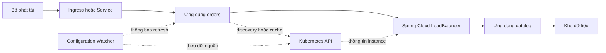

# Đo khả năng chịu tải trước khi tăng quy mô cluster

Trong chương **Hiệu năng và độ bền** của **SPRING_CLOUD_KUBERNETES**, bài học này hướng dẫn đo năng lực phục vụ của ứng dụng Spring trên Kubernetes trước khi quyết định tăng replica hoặc thêm node. Phép đo phải bao quát đường xử lý nghiệp vụ, chi phí DiscoveryClient, Spring Cloud LoadBalancer, ConfigMap, Secret và Configuration Watcher đang được sử dụng.

Một kết luận hữu ích cần trả lời: **với workload, phiên bản và cấu hình nào, hệ thống phục vụ được bao nhiêu yêu cầu đúng trong giới hạn độ trễ, lỗi và tài nguyên đã đặt ra?** Con số RPS cao nhất hoặc CPU trung bình của cluster chưa trả lời đủ câu hỏi đó.

Sau bài học, bạn có thể:

- Thiết kế phép thử có tải đầu vào, SLO và điều kiện dừng rõ ràng.
- Phân biệt giới hạn của bộ phát tải, ứng dụng, dependency, worker node và Kubernetes API.
- Đo chi phí cập nhật cấu hình và discovery khi tăng số replica.
- Dùng kết quả thực nghiệm để chọn tối ưu, tăng replica hoặc tăng node.

## 1. Định nghĩa “chịu tải được” trước khi chạy

Với bài thực hành, gọi **năng lực đạt SLO** là mức tải cao nhất đã kiểm chứng trong một khoảng đo ổn định, đồng thời thỏa mãn:

1. Bộ phát tải thực sự tạo được tải dự kiến.
2. Phản hồi đúng nghiệp vụ đạt tỷ lệ yêu cầu.
3. Phân vị độ trễ nằm trong ngưỡng.
4. Hàng đợi và mức dùng bộ nhớ không tăng không giới hạn.
5. Hệ thống vẫn quan sát, cập nhật cấu hình và thay đổi instance trong ngân sách đã chọn.

Năng lực này phụ thuộc workload và điều kiện thử. “250 RPS” cần đi cùng đường API, phân bố dữ liệu, số replica, dependency, thời gian đo và tiêu chí đạt. Phép thử chỉ đọc dữ liệu nóng không đại diện cho luồng ghi có giao dịch hoặc truy vấn dữ liệu lạnh.

Phân biệt các đại lượng:

| Đại lượng | Ý nghĩa trong bài |
| --- | --- |
| Tải mục tiêu | Số lượt nghiệp vụ dự định bắt đầu mỗi giây |
| Tải thực gửi | Số lượt thực sự bắt đầu tại bộ phát tải |
| Throughput hoàn tất | Số lượt kết thúc mỗi giây, gồm cả lỗi |
| Goodput | Số lượt hoàn tất đúng nghiệp vụ mỗi giây |
| Năng lực đạt SLO | Mức tải đã kiểm chứng thỏa toàn bộ điều kiện |
| Dự phòng vận hành | Phần năng lực chưa phân bổ để chịu dao động hoặc biến cố |

Ví dụ do bài đặt ra: 200 lượt/s hoàn tất nhưng 20 lượt/s trả lỗi chỉ tạo 180 lượt/s có kết quả đúng. Nếu độ trễ của các lượt đúng vượt SLO, không được công bố 180 lượt/s là năng lực đạt SLO.

## 2. Nhìn cả đường nghiệp vụ và đường quản lý

Giả sử hệ thống thử nghiệm có `orders` gọi `catalog` để tính báo giá:



Các cạnh nét đứt biểu diễn quan hệ logic; không có nghĩa mỗi request nghiệp vụ đều gọi Kubernetes API, hoặc LoadBalancer luôn nhận trực tiếp event từ API server. Đường thực tế phụ thuộc client, supplier, cache và cấu hình.

Trong module này cần tách hai nhóm tải:

- **Tải nghiệp vụ:** request HTTP, truy vấn dữ liệu, serialization, hàng đợi, connection pool và xử lý Java.
- **Tải tích hợp Kubernetes:** đọc hoặc theo dõi tài nguyên, khởi tạo cache, discovery, xử lý thay đổi instance và thông báo cấu hình.

Nếu tăng replica làm tải Kubernetes API tăng nhanh, thêm worker node có thể không giải quyết đúng giới hạn đang gặp. Ngược lại, nếu ứng dụng không dùng discovery qua API mà gọi Service bằng DNS, không nên gán mọi độ trễ cho Spring Cloud Kubernetes.

Spring Cloud Kubernetes hỗ trợ LoadBalancer với chế độ `POD` và `SERVICE`; đường chọn đích của chúng khác nhau. Ghi chế độ đang dùng vào hồ sơ phép thử và đối chiếu với đúng release trước khi so sánh. [LoadBalancer for Kubernetes](https://docs.spring.io/spring-cloud-kubernetes/reference/load-balancer.html).

## 3. Chốt workload và hồ sơ thử nghiệm

Dùng một hồ sơ đủ để người khác lặp lại phép đo:

```text
Ứng dụng: orders gọi catalog
Đường vào: URL thử nghiệm qua cùng loại ingress với môi trường cần đánh giá
Workload ban đầu: GET /api/quote?sku=SKU-001&qty=1
Ý nghĩa: tính báo giá, không tạo đơn hàng hay phát sinh thanh toán
Kết quả: HTTP 200 và JSON chứa sku cùng total hợp lệ

Phiên bản: image digest, Java, Spring Boot, Spring Cloud, Kubernetes client
Tài nguyên: requests/limits, heap, số replica, loại node, vị trí Pod
Dependency: phiên bản, dữ liệu, giới hạn kết nối, chính sách retry
Kubernetes: namespace theo dõi, selector, loại tài nguyên, chế độ LoadBalancer
Cấu hình: nguồn ConfigMap/Secret, cách nạp, cơ chế refresh
Đo lường: dashboard, khoảng scrape, đồng hồ và thời điểm bắt đầu/kết thúc
```

Đây là hợp đồng ứng dụng minh họa, không phải endpoint mặc định của Spring. Với hệ thống thật, thay bằng một hoặc nhiều luồng nghiệp vụ đã chuẩn bị dữ liệu.

Một SKU cố định thích hợp cho bước đầu để giảm biến số. Sau đó phải có phép thử phân bố dữ liệu đại diện: nhiều khóa, tỷ lệ cache hit/miss, kích thước payload và tỷ lệ gọi dependency phù hợp. Nếu nhiều API có SLO khác nhau, đo theo từng nhóm; một API rất nhanh có thể che khuất API chậm trong số tổng hợp.

Hồ sơ cấu hình chỉ lưu thông tin cần thiết để tái lập; không sao chép nội dung Secret, token hoặc credential vào báo cáo.

## 4. Đặt SLO và điều kiện dừng

Bảng dưới là **mục tiêu minh họa của bài thực hành**, không phải SLA mặc định của Spring hoặc Kubernetes.

| Tiêu chí | Ngưỡng ví dụ |
| --- | --- |
| Độ trễ một lượt báo giá tại client | p95 < 300 ms, p99 < 800 ms |
| Tỷ lệ lỗi nghiệp vụ | < 0,1% lượt thực gửi |
| Lượt dự kiến nhưng không được bắt đầu | 0 trong phiên đo công bố năng lực |
| Duy trì tải | Ít nhất 10 phút tại mỗi mức được xem là ứng viên đạt |
| Hội tụ cấu hình thử nghiệm | Các replica cần áp dụng đều nhận phiên bản cuối trong 30 giây |
| Loại instance khỏi lựa chọn mới | Trong ngân sách đã định nghĩa, ví dụ 10 giây từ mốc quan sát endpoint đổi |
| Mức dùng tài nguyên | Không OOM, không restart bất thường, không có backlog tăng liên tục |

Hai ngân sách hội tụ cần được định nghĩa bằng mốc thời gian đo được. Ví dụ cấu hình bắt đầu từ lúc ghi ConfigMap thành công tới lúc từng replica báo đã áp dụng. Với instance, phân biệt lần chọn đích cho request mới với kết nối đang bay hoặc kết nối giữ lâu.

Thiết lập điều kiện dừng sớm riêng: lỗi kéo dài, queue vượt ngân sách, dependency gần cạn tài nguyên hoặc môi trường thử bị ảnh hưởng ngoài phạm vi. Một threshold tổng hợp của công cụ không tự thay thế cơ chế quan sát và dừng vận hành.

Mười phút không tự bảo đảm độ tin cậy thống kê. Lưu số mẫu và lặp lại phép đo gần giới hạn; p99 từ quá ít mẫu hoặc một phiên không có lỗi chưa chứng minh hệ thống không có lỗi hiếm.

## 5. Cố định baseline trước khi thay đổi quy mô

Ở vòng đo đầu tiên, giữ ổn định:

- Số replica và tập node dành cho phép thử.
- Image, cấu hình JVM, requests/limits và connection pool.
- Đường mạng, workload, dữ liệu và chính sách retry.
- Cơ chế discovery, cache và cách cập nhật cấu hình.
- Các workload nền có thể gây cạnh tranh tài nguyên.

Trong môi trường thử nghiệm riêng, phối hợp để HPA, node autoscaler, GitOps hoặc rollout không tự đổi các yếu tố này giữa phiên baseline. Đừng dùng thao tác tăng replica thủ công làm bằng chứng nếu một controller khác lập tức ghi đè lại số replica đó.

Sau baseline cố định, thực hiện một vòng riêng để đánh giá autoscaling. Hai vòng trả lời hai câu hỏi khác nhau: năng lực với cấu hình cố định và khả năng bổ sung năng lực đủ nhanh.

Ví dụ cấu hình tài nguyên cho một container trong phép thử:

```yaml
resources:
  requests:
    cpu: "500m"
    memory: "768Mi"
  limits:
    cpu: "1"
    memory: "1Gi"
```

Các con số chỉ là điểm xuất phát minh họa. Cần tính cả heap, metaspace, direct buffer, thread stack và các phần bộ nhớ ngoài heap của tiến trình Java khi chọn giới hạn.

Scheduler dùng resource requests để bố trí Pod. Trên Linux, CPU limit có thể dẫn tới throttling, còn áp lực bộ nhớ vượt giới hạn có thể dẫn tới OOM kill. Vì vậy, CPU node còn rảnh không loại trừ giới hạn ở container. [Quản lý tài nguyên Pod và container](https://kubernetes.io/docs/concepts/configuration/manage-resources-containers/).

## 6. Thiết kế các vòng thử theo từng giả thuyết

| Vòng | Giữ nguyên | Thay đổi | Câu hỏi cần trả lời |
| --- | --- | --- | --- |
| Warmup | Cấu hình ứng dụng | Chạy tải vừa phải | JVM, pool và cache đã ổn định chưa? |
| Step load | Replica, node, dependency | Tăng tải theo từng mức | Mức nào bắt đầu vi phạm SLO? |
| Soak | Một mức tải ứng viên | Kéo dài thời gian | Bộ nhớ, queue hoặc độ trễ có trôi dần không? |
| Tăng replica | Cùng workload và node khả dụng | Số replica của một tầng | Thêm replica cải thiện goodput bao nhiêu? |
| Thay đổi tích hợp | Cùng workload, tài nguyên | Một lựa chọn discovery/cache | Chi phí giảm ở đâu, độ mới dữ liệu đổi thế nào? |
| Churn có kiểm soát | Một mức tải đã đạt | Rollout hoặc cập nhật cấu hình | Có giữ SLO và hội tụ trong ngân sách không? |
| Autoscaling | Cấu hình scale đã chốt | Tải tăng đột ngột | Năng lực mới có tới kịp không? |

Ví dụ step load: 40, 80, 120 rồi 160 lượt/s. Gần giới hạn, thu nhỏ bước và xác nhận lại. Không cần chạy tới mức gây sập hệ thống mới tìm được ngưỡng vi phạm.

Warmup chạy riêng, không trộn với cửa sổ công bố năng lực. Một đợt tăng tải đi qua năm mức rồi lấy chung một summary không cho biết mức cuối có thực sự đạt hay không.

Ở vòng churn, thay ConfigMap hoặc rollout một Deployment mỗi lần trước khi kết hợp. Nếu vừa tăng node, vừa thay pool, vừa đổi chế độ LoadBalancer, rất khó biết yếu tố nào tạo ra kết quả.

## 7. Phát tải có kiểm soát bằng k6

Khi muốn kiểm tra một tốc độ đến nhất định, mô hình tải mở giúp lượt mới không bị ràng buộc vào thời gian hoàn tất lượt trước. Với mô hình đóng có số người dùng cố định, hệ thống chậm có thể khiến tải phát ra tự giảm; cần biết điều đó khi diễn giải kết quả. [Mô hình mở và đóng của k6](https://grafana.com/docs/k6/latest/using-k6/scenarios/concepts/open-vs-closed/).

Ví dụ sau là nội dung script `capacity.js` để người học tạo trong môi trường thử. Mỗi iteration thực hiện một GET, không có retry phía script và không theo redirect, nên tải iteration gần với số request nghiệp vụ thực gửi.

```javascript
import http from 'k6/http';
import { check } from 'k6';
import { Rate, Trend } from 'k6/metrics';

const baseUrl = (__ENV.BASE_URL || '').replace(/\/$/, '');
const rate = Number(__ENV.RATE || '40');
const preAllocatedVUs = Number(__ENV.PRE_VUS || '50');
const maxVUs = Number(__ENV.MAX_VUS || '200');

if (!baseUrl || !Number.isInteger(rate) || rate <= 0) {
  throw new Error('Cần BASE_URL và RATE là số nguyên dương');
}
if (!Number.isInteger(preAllocatedVUs) || preAllocatedVUs <= 0
    || !Number.isInteger(maxVUs) || maxVUs < preAllocatedVUs) {
  throw new Error('Cần 0 < PRE_VUS <= MAX_VUS với các giá trị nguyên');
}

const businessFailed = new Rate('business_failed');
const logicalDuration = new Trend('logical_duration_ms', true);

export const options = {
  scenarios: {
    quote: {
      executor: 'constant-arrival-rate',
      rate,
      timeUnit: '1s',
      duration: __ENV.DURATION || '10m',
      preAllocatedVUs,
      maxVUs,
      gracefulStop: '10s',
    },
  },
  thresholds: {
    business_failed: ['rate<0.001'],
    logical_duration_ms: ['p(95)<300', 'p(99)<800'],
    dropped_iterations: ['count==0'],
  },
};

export default function () {
  const startedAt = Date.now();

  const response = http.get(
    baseUrl + '/api/quote?sku=SKU-001&qty=1',
    {
      timeout: '2s',
      redirects: 0,
      tags: { name: 'GET /api/quote' },
    }
  );

  let validBody = false;
  if (response.status === 200) {
    try {
      const body = response.json();
      validBody = body.sku === 'SKU-001'
        && typeof body.total === 'number'
        && Number.isFinite(body.total)
        && body.total >= 0;
    } catch (_) {
      validBody = false;
    }
  }

  const ok = response.status === 200 && validBody;
  check(response, { 'báo giá có kết quả hợp lệ': () => ok });
  businessFailed.add(!ok);
  logicalDuration.add(Date.now() - startedAt);
}
```

`constant-arrival-rate` lên lịch bắt đầu iteration theo tốc độ đã đặt, khi còn virtual user để thực hiện. Không thêm `sleep()` cuối iteration chỉ để điều tiết RPS vì executor đã làm việc đó. [Executor constant-arrival-rate](https://grafana.com/docs/k6/latest/using-k6/scenarios/executors/constant-arrival-rate/).

Script ghi thời gian từ trước lời gọi HTTP đến sau kiểm tra body, gồm cả các lượt lỗi đã hoàn tất. Đây là thời gian quan sát của lượt nghiệp vụ tại bộ phát tải; nó không bao gồm những iteration bị bỏ trước khi bắt đầu.

Kiểm tra body ở ví dụ chỉ bảo đảm hình dạng dữ liệu cơ bản. Với dữ liệu đã chuẩn bị, bổ sung kiểm tra số tiền và quy tắc nghiệp vụ mong đợi. HTTP 200 với báo giá sai không phải kết quả thành công.

Threshold là tiêu chí pass/fail của phiên k6. Với script này, thiếu một điều kiện trong ba nhóm vẫn khiến phiên không đạt. Ngưỡng tổng hợp không cho phép bỏ qua một khoảng lỗi ngắn nhưng vượt ngân sách vận hành đã đặt. [Thresholds của k6](https://grafana.com/docs/k6/latest/using-k6/thresholds/).

## 8. Chạy một phiên và kiểm tra bộ phát tải

Trước khi chạy, người học cần có ứng dụng thử, dataset, endpoint đúng hợp đồng và k6 đã cài. `BASE_URL` là URL thực của môi trường thử mà máy phát tải truy cập được. Không lấy `kubectl port-forward` làm đường benchmark chính rồi suy rộng kết quả sang đường ingress sản xuất.

Ví dụ PowerShell, chạy một mức tải riêng:

```powershell
$env:BASE_URL = 'https://orders.perf.test'
$env:RATE = '80'
$env:DURATION = '10m'
$env:PRE_VUS = '50'
$env:MAX_VUS = '200'

k6 run capacity.js
$runExitCode = $LASTEXITCODE
$runExitCode
```

Tên miền trên là ví dụ; thay bằng URL đã cấu hình trong môi trường thực hành. Lưu mã thoát và kết quả phiên. Chạy warmup riêng trước đó, rồi lặp lại lệnh với từng mức tải đã chọn; dừng tăng khi tiêu chí thất bại.

Quan sát cả máy phát tải: CPU, bộ nhớ, socket, băng thông, thời gian DNS và số virtual user đang dùng. Nếu generator cùng node với ứng dụng, tài nguyên nó tiêu thụ cũng là một phần của phép thử và có thể gây nhiễu.

Với arrival-rate executor, `dropped_iterations` tăng khi không còn VU rảnh để bắt đầu lượt mới. Nguyên nhân có thể là cấp VU chưa đủ hoặc ứng dụng chậm làm VU bị giữ lâu; không tự kết luận tất cả lượt bị bỏ là lỗi của ứng dụng. [Dropped iterations](https://grafana.com/docs/k6/latest/using-k6/scenarios/concepts/dropped-iterations/).

Nếu đặt 200 lượt/s nhưng thực gửi chỉ khoảng 150 lượt/s, phiên đó chưa chứng minh ứng dụng chịu được 200 lượt/s. Cần xác định nguyên nhân, cấp bộ phát phù hợp rồi đo lại. Tăng VU cũng cần kiểm tra khả năng máy phát; không chỉ nâng một giới hạn số học.

Phân biệt thời gian của k6: `http_req_duration` gồm gửi, chờ và nhận HTTP, không gồm thời gian thiết lập kết nối ban đầu. Nó có thể khác `logical_duration_ms` trong script và khác timer bên server. Không gộp các phân vị này thành một con số chung. [Metric có sẵn của k6](https://grafana.com/docs/k6/latest/using-k6/metrics/reference/).

## 9. Thu thập số liệu theo từng tầng

Chỉ `kubectl top` hoặc một biểu đồ CPU tổng không đủ xác định điểm nghẽn. Đối chiếu cùng cửa sổ thời gian giữa các tầng:

| Tầng | Dữ liệu cần thu | Dấu hiệu cần điều tra |
| --- | --- | --- |
| Bộ phát tải | Tải dự kiến/thực gửi, lỗi nghiệp vụ, phân vị, dropped iterations | Không phát đủ tải hoặc client bị bão hòa |
| Ingress và mạng | RPS, lỗi, độ trễ upstream, kết nối, băng thông | Giới hạn kết nối hoặc hàng đợi ở cửa vào |
| Spring/JVM | CPU, throttling, heap/non-heap, GC, thread, queue | CPU bị chặn, GC kéo dài, pool đầy hoặc memory tăng |
| HTTP client và database | Kết nối active/pending, timeout, số lần gọi trên một lượt | Dependency hoặc connection pool giới hạn |
| Pod và node | Restart, OOM, Pending, node pressure, vị trí Pod | Thiếu tài nguyên hoặc ràng buộc bố trí |
| Tích hợp Kubernetes | Lần đọc API, thời gian LIST, watch/reconnect, độ trễ hội tụ | Tải discovery hoặc phục hồi tăng theo số replica |
| Đường refresh | Số đích, số thông báo, lỗi, thời gian áp dụng | Fan-out quá lớn hoặc replica không áp dụng cấu hình |

Một số lệnh quan sát nhanh trong môi trường thực hành:

```powershell
kubectl -n perf-lab get deployment orders catalog
kubectl -n perf-lab get pods -o wide
kubectl -n perf-lab top pods --containers
kubectl top nodes
kubectl -n perf-lab get hpa
kubectl -n perf-lab get events --sort-by=.metadata.creationTimestamp
```

Các lệnh `top` cần Metrics API hoạt động. Chúng chỉ giúp xem nhanh; để nhận ra một đợt throttling hoặc GC ngắn, dùng dữ liệu chuỗi thời gian có độ phân giải phù hợp.

Khi có quyền truy cập, thu metric của API server hoặc số liệu tương đương do nền tảng cung cấp. Tên metric, nhãn và khả năng truy cập phụ thuộc phiên bản và môi trường quản lý. Không cấp quyền rộng hơn cho ServiceAccount ứng dụng chỉ để làm benchmark. [Metric của thành phần Kubernetes](https://kubernetes.io/docs/concepts/cluster-administration/system-metrics/).

Đối với API server, tách số request mở WATCH khỏi số event đi qua stream; hai đại lượng không tương đương. Cũng tách độ trễ request ngắn như LIST khỏi thời lượng một watch giữ mở lâu. So sánh tổng latency không phân loại có thể dẫn đến kết luận sai.

## 10. Đọc đúng histogram và tỷ lệ lỗi

Ví dụ dưới giả định ứng dụng đã xuất classic histogram `http_server_requests_seconds_bucket`, counter `http_server_requests_seconds_count`, có common tag `application="orders"` và URI template `/api/quote`. Cần kiểm tra tên và nhãn thực tế trước khi dùng; bucket không xuất hiện chỉ vì đã có một timer.

RPS quan sát ở server:

```promql
sum(
  rate(http_server_requests_seconds_count{
    application="orders",
    uri="/api/quote"
  }[2m])
)
```

p95 phía server, đơn vị giây:

```promql
histogram_quantile(
  0.95,
  sum by (le) (
    rate(http_server_requests_seconds_bucket{
      application="orders",
      uri="/api/quote"
    }[2m])
  )
)
```

Tỷ lệ HTTP 5xx tại server:

```promql
sum(
  rate(http_server_requests_seconds_count{
    application="orders",
    uri="/api/quote",
    status=~"5.."
  }[2m])
)
/
sum(
  rate(http_server_requests_seconds_count{
    application="orders",
    uri="/api/quote"
  }[2m])
)
```

Không lấy trung bình p95 của từng Pod để tạo p95 toàn hệ thống. Với classic histogram, cộng tốc độ các bucket tương thích rồi tính quantile; kết quả còn phụ thuộc cách đặt bucket và là một ước lượng. [Histogram và summary của Prometheus](https://prometheus.io/docs/practices/histograms/).

Tỷ lệ 5xx không bao gồm mọi lỗi nghiệp vụ, HTTP 429 hoặc request thất bại trước khi đến server. Vì vậy, nó là một tín hiệu chẩn đoán, không thay thế `business_failed` tại client. Giữ cùng cửa sổ đo khi đối chiếu; không so p95 của một phút với p95 cả phiên mà coi chúng tương đương.

Giới hạn số lượng nhãn metric. Dùng URI template hoặc tên luồng ổn định; không thêm từng SKU, request ID, UID hoặc giá trị Secret thành nhãn.

## 11. Đo riêng chi phí Spring Cloud Kubernetes

### 11.1. Discovery và cache danh sách instance

Với mỗi cấu hình, đo số request tới Kubernetes API hoặc DiscoveryServer trên một đơn vị goodput, đồng thời kiểm tra độ mới của danh sách instance.

Danh sách câu hỏi cần trả lời:

- `DiscoveryClient.getInstances()` lấy từ cache cục bộ hay thực hiện I/O trên đường đang dùng?
- Có bao nhiêu tầng cache trong chuỗi supplier?
- Có theo dõi nhiều namespace hoặc nhiều Service hơn cần thiết không?
- Khi một instance rời tập endpoint, bao lâu request mới ngừng chọn nó?
- Khi client gặp lỗi, retry có làm tăng số lần discovery hoặc gọi downstream không?

Spring Cloud LoadBalancer có cấu hình cache, trong đó có `spring.cloud.loadbalancer.cache.ttl` và `spring.cloud.loadbalancer.cache.enabled`. Cần xem cache mà DiscoveryClient thực tế đã có trước khi thêm hoặc bỏ một tầng cache khác. [Cache của Spring Cloud LoadBalancer](https://docs.spring.io/spring-cloud-commons/reference/spring-cloud-commons/loadbalancer.html#spring-cloud-loadbalancer-caching).

Không tăng TTL chỉ để RPS đẹp hơn rồi bỏ qua việc chọn nhầm instance cũ. Cấu hình đạt cần thỏa cả hiệu năng và ngân sách hội tụ.

Tài liệu DiscoveryClient cung cấp lựa chọn namespace và lọc Service; catalog watch cũng có cơ chế heartbeat riêng. Đo đúng implementation đang triển khai, không xem mọi “watch” là một stream Kubernetes giống nhau. [DiscoveryClient for Kubernetes](https://docs.spring.io/spring-cloud-kubernetes/reference/discovery-client.html).

### 11.2. ConfigMap, Secret và Configuration Watcher

Tạo một thay đổi cấu hình thử nghiệm không nhạy cảm khi hệ thống đang ở tải đã đạt. Gắn một phiên bản nghiệp vụ như `demo.version=v2`, rồi đo lúc từng replica xác nhận đã áp dụng. Không dùng nội dung Secret để tạo log hoặc biểu đồ thử tải.

Đối với bài thử, đặt:

```text
T_apply(replica) = thời điểm replica xác nhận dùng bản mới
                  - thời điểm ghi nguồn cấu hình thành công
```

Báo cáo replica chậm nhất và replica chưa áp dụng, không chỉ trung bình. Nếu thay đổi cấu hình làm app khởi tạo lại pool, đo thêm độ trễ và lỗi trong khoảng đó.

Configuration Watcher có thể thông báo qua HTTP refresh hoặc Spring Cloud Bus; đường truyền khác nhau tạo chi phí khác nhau. Nếu nguồn được mount thành file, còn phải tính thời gian lan truyền file và việc ứng dụng đọc lại nguồn. [Configuration Watcher](https://docs.spring.io/spring-cloud-kubernetes/reference/spring-cloud-kubernetes-configuration-watcher.html).

### 11.3. Tải khuếch đại khi tăng replica

Các biểu thức sau là **mô hình ước lượng của bài**, chỉ đúng với giả định nêu kèm:

```text
Giả sử mỗi tiến trình giữ một watch riêng
cho mỗi loại tài nguyên và mỗi namespace:

số stream ≈ số tiến trình × số loại tài nguyên × số namespace

Giả sử mỗi cập nhật cần thông báo một lần
tới mọi replica đích:

số lượt thông báo dự kiến/giây
    ≈ số cập nhật/giây × số replica đích
```

Ví dụ giả định: 20 tiến trình, 3 loại tài nguyên, 2 namespace tạo khoảng 120 stream nếu implementation thật sự tổ chức theo cách đó. Một informer dùng scope khác hoặc một watcher tập trung sẽ làm kết quả khác; phải kiểm tra số kết nối thực.

Mỗi lần khởi tạo hoặc LIST lại còn có chi phí theo số đối tượng và kích thước dữ liệu. Vì thế, kiểm tra cả thời gian rollout và một đợt reconnect có kiểm soát; chi phí lúc yên ổn không đại diện cho lúc nhiều client dựng cache đồng thời.

### 11.4. Chọn tính năng theo nhu cầu

Thiết kế một phép so sánh khi có giả thuyết rõ: thu hẹp namespace, bỏ nguồn cấu hình không dùng, điều chỉnh một tầng cache hoặc đổi cách chọn đích phù hợp kiến trúc. Giữ nguyên các yếu tố còn lại.

Nếu thử gọi Service bằng DNS thay cho một đường discovery, ghi rõ cả đường mạng, chính sách cân bằng và các yêu cầu metadata bị thay đổi. Chỉ so RPS rồi kết luận hai phương án tương đương là chưa đủ.

Tương tự, poll không mặc nhiên rẻ hơn watch. Tần suất, số nguồn, số tiến trình, dữ liệu trả về và tỷ lệ thay đổi mới quyết định chi phí thực tế.

## 12. Đọc một bảng kết quả minh họa

Bảng sau dùng **số liệu giả định để luyện cách lập luận**, không phải benchmark của sản phẩm. `catalog`, dữ liệu và node giữ nguyên. Tại mỗi dòng, ghi mức tải cao nhất đã xác nhận đạt; mức tiếp theo đã được thử và vi phạm ít nhất một tiêu chí.

Cấu hình A có nhiều lần đọc mạng trên đường discovery. Cấu hình B chỉ thay cách cache danh sách instance ở supplier đã xác định; ngân sách độ mới được kiểm tra lại.

| Cấu hình | Replica orders | Tải đã đạt, lượt/s | p95 client | p99 client | Lỗi nghiệp vụ | Đọc API ngắn/s |
| --- | ---: | ---: | ---: | ---: | ---: | ---: |
| A | 1 | 85 | 190 ms | 520 ms | 0,02% | 86 |
| A | 2 | 160 | 240 ms | 680 ms | 0,03% | 162 |
| A | 3 | 210 | 285 ms | 790 ms | 0,04% | 215 |
| B | 3 | 270 | 260 ms | 730 ms | 0,03% | 7 |

Giả sử mọi dòng đều phát đủ tải, qua soak tương ứng và không có backlog tăng. Riêng B còn được xác minh thời gian loại instance là 7,2 giây và thời gian áp dụng cấu hình chậm nhất là 18 giây, đều trong ngân sách ví dụ.

Những kết luận được phép rút ra:

- Với A, tăng replica có cải thiện năng lực nhưng không tuyến tính.
- Với B, cùng số replica và tập node đã kiểm chứng mức cao hơn.
- Chi phí đọc API giảm rõ rệt là bằng chứng hỗ trợ giả thuyết về đường discovery.
- Kết quả vẫn chỉ áp dụng cho workload và hồ sơ cấu hình đã đo.

Không đủ bằng chứng để nói 270 lượt/s là trần tuyệt đối, hoặc mọi workload được cải thiện cùng tỷ lệ. Nếu các mức thử là 270 và 300, ngưỡng chính xác còn nằm trong khoảng cần đo thêm.

Hiệu suất tăng replica trong cùng cấu hình A có thể ước lượng:

```text
E(n) = Q(n) / (n × Q(1))

E(2) = 160 / (2 × 85) ≈ 94%
E(3) = 210 / (3 × 85) ≈ 82%
```

Đây là tỷ số của năng lực đạt SLO đã đo, không phải chỉ số CPU. Không dùng baseline một replica của A để tuyên bố hiệu suất scale của B; B cần baseline riêng nếu muốn so theo công thức này.

Ở mỗi mức quan trọng, chạy lặp lại và lưu độ dao động. Có thể dùng mức thấp nhất trong các lần xác nhận làm đầu vào thận trọng cho kế hoạch, nhưng không gọi đó là khoảng tin cậy thống kê nếu chưa thực hiện phân tích tương ứng.

## 13. Chuyển kết quả thành ngân sách phục vụ

Giả sử sau các vòng xác nhận, dùng `Q_verified = 270` lượt/s cho cấu hình B. Nhóm chọn sử dụng 75% năng lực đó cho kế hoạch bình thường:

```text
Q_plan = Q_verified × U
       = 270 × 0,75
       = 202,5 lượt/s
```

`U = 0,75` là chính sách minh họa, cần điều chỉnh theo biến động tải, thời gian scale và mức quan trọng của dịch vụ. Nếu nhu cầu dự báo là 180 lượt/s, cấu hình B đủ cho kế hoạch bình thường theo giả định này; A với 210 lượt/s chỉ cho mức kế hoạch 157,5 lượt/s.

Điều đó chưa chứng minh chịu được mất một Pod hay một node. Phải đo lại khi thiếu năng lực tương ứng hoặc đang rollout, rồi kiểm tra workload còn lại có giữ SLO không. Phần dự phòng bình thường và khả năng chịu sự cố là hai điều kiện cần được chứng minh riêng.

Có thể kiểm tra tính hợp lý của độ đồng thời bằng quan hệ trung bình:

```text
L ≈ λ × W

Nếu lưu lượng qua hệ thống ổn định là 180 lượt/s
và thời gian trung bình trong phạm vi đo là 0,15 s:
L ≈ 27 lượt đang ở trong phạm vi đó
```

Dùng cùng ranh giới hệ thống và cùng cửa sổ ổn định cho `λ` và `W`. Không thay trung bình bằng p95 rồi dùng kết quả làm kích thước connection pool tối ưu. Pool còn phụ thuộc tỷ lệ gọi dependency, thời gian giữ kết nối, queue và mức dùng chung.

Theo dõi cả số lần gọi downstream trên một lượt nghiệp vụ. Nếu một lượt có hai lời gọi catalog và mỗi lời gọi có retry, tăng RPS đầu vào có thể gây tải downstream lớn hơn nhiều so với số RPS ingress.

## 14. Phân biệt tăng replica, HPA và tăng node

HPA điều chỉnh số replica dựa trên metric được cấu hình. Khi dùng CPU utilization, mẫu số liên quan tới CPU requests của workload; đó không phải phần trăm CPU của cả node. Ví dụ request 500m với mục tiêu 60% tương ứng khoảng 300m theo cách tính utilization của container liên quan, nhưng quyết định thực còn phụ thuộc cách tổng hợp metric và controller. [Horizontal Pod Autoscaling](https://kubernetes.io/docs/concepts/workloads/autoscaling/horizontal-pod-autoscale/).

Node autoscaling giải quyết nhu cầu bố trí Pod theo các ràng buộc lập lịch và cấu hình của autoscaler. Có Pod không thể schedule là một tín hiệu cần điều tra; phải đọc nguyên nhân trước khi kết luận thêm node sẽ giải quyết được. [Node autoscaling](https://kubernetes.io/docs/concepts/cluster-administration/node-autoscaling/).

Bảng quyết định cho phép thử:

| Bằng chứng | Hướng tiếp theo |
| --- | --- |
| Container bị throttling, node còn dư tài nguyên | Kiểm tra request/limit và đường CPU của ứng dụng; đo lại trước khi thêm node |
| Một Pod bão hòa, thêm replica đã chứng minh cải thiện, node còn chỗ | Tăng replica hoặc hiệu chỉnh HPA phù hợp |
| Replica cần thiết không schedule vì thiếu tài nguyên phù hợp | Lập kế hoạch thêm hoặc thay loại node và xác minh lại |
| Pending vì affinity, taint, quota hoặc ràng buộc lưu trữ | Sửa đúng ràng buộc; node mới bất kỳ có thể không giúp |
| Pool database đầy, tổng kết nối tăng theo replica | Xử lý ngân sách dependency và pool trước |
| LIST/read API tăng mạnh, ứng dụng chờ discovery | Đo và tối ưu đường discovery/cache/scope |
| CPU thấp nhưng queue HTTP client tăng | Điều tra I/O, pool và dependency |
| Bộ phát bỏ nhiều iteration | Xác minh khả năng phát tải và nguyên nhân giữ VU |
| Cấu hình mới không tới đủ replica | Điều tra đường refresh, RBAC và nguồn cấu hình; chưa kết luận năng lực chỉ từ RPS |

Một phép tính phụ cần làm trước khi tăng replica:

```text
Tổng kết nối database tiềm năng
    = số replica × giới hạn pool mỗi replica

8 replica × 20 kết nối = 160 kết nối
```

Nếu ngân sách database chỉ cho phép 100 kết nối của ứng dụng này, việc tăng replica có thể chuyển hoặc làm nặng thêm điểm nghẽn. Cần tính cả các ứng dụng khác, đợt rollout có Pod dư và các kết nối quản trị.

Đối với node, ước lượng tổng requests là bước đầu, chưa phải chứng minh schedule được. Từ `node.status.allocatable`, tính phần còn lại sau requests của DaemonSet và workload khác, rồi giữ dự phòng đã chọn. Không trừ phần hệ thống đã được loại khỏi allocatable thêm lần nữa.

Ví dụ giả định mỗi node còn ngân sách 2,5 CPU và 5 GiB cho nhóm thử; sáu Pod mỗi Pod request 0,5 CPU và 0,75 GiB cần tổng 3 CPU và 4,5 GiB. Tính gộp cho thấy cần ít nhất hai node cùng loại. Nhưng nếu đặt ràng buộc cứng mỗi node chỉ một Pod của nhóm, phải có sáu node phù hợp. Tổng CPU/RAM không thể hiện hết topology, IP, volume hay giới hạn số Pod.

## 15. Đo thời gian năng lực mới thật sự sử dụng được

Sau khi có baseline, bật vòng thử autoscaling với mức trần và phạm vi đã chốt. Ghi các mốc:

```text
t0: nhu cầu tăng vượt ngưỡng đã chọn
t1: controller tăng số replica mong muốn
t2: Pod được schedule
t3: ứng dụng vượt readiness
t4: request mới thực sự được phân phối tới năng lực mới
t5: độ trễ và lỗi trở lại trong ngân sách
```

Đo `t4 - t0` và `t5 - t0` để biết khoảng chờ năng lực và khoảng ảnh hưởng. Các giai đoạn có thể chồng lấn; không cộng máy móc các thời lượng riêng rồi gọi đó là thời gian thực tế.

Trong ứng dụng Spring, khởi động JVM, nạp ConfigMap/Secret, xây cache discovery, mở connection pool và cập nhật danh sách instance đều có thể nằm trên đường tới năng lực hữu ích. Một Pod vừa `Ready` chưa tự chứng minh lưu lượng đã chia đều hoặc cache đã ấm.

Nếu tải tăng nhanh hơn thời gian scale, cần năng lực dự phòng, pre-scaling hoặc cơ chế giới hạn tải phù hợp. Thêm node sau khi đã vi phạm SLO không làm biến mất khoảng lỗi trước đó.

Đo lại với một đợt cập nhật cấu hình hoặc rollout có kiểm soát ở mức tải dự kiến. Kiểm tra rằng health probe không tạo restart dây chuyền và refresh không làm các replica cùng mất khả năng phục vụ trong khoảng quá dài.

## 16. Báo cáo kết luận có thể kiểm chứng

Một báo cáo phép thử có thể dùng cấu trúc sau:

```text
Mã phiên và thời gian:
Phiên bản image/JVM/Spring/Kubernetes client:
Workload, dataset, đường mạng:
Replica, node, requests/limits, vị trí Pod:
Dependency và ngân sách kết nối:
Discovery, cache, scope, nguồn cấu hình:
SLO, điều kiện dừng, thời gian warmup/đo:

Tải mục tiêu / thực gửi / goodput:
p95 / p99 client và số mẫu:
Lỗi nghiệp vụ, timeout, HTTP 429/5xx:
Dropped iterations và tình trạng generator:
CPU, throttling, bộ nhớ, GC, pool, backlog:
Đọc API, watch/reconnect, thời gian LIST:
Thời gian hội tụ instance và cấu hình:

Mức cao nhất đã xác nhận và mức tiếp theo thất bại:
Kết quả lặp lại và độ dao động:
Kết quả khi rollout hoặc thiếu một phần năng lực:
Giả thuyết điểm nghẽn và bằng chứng:
Thay đổi được chọn, giới hạn kết luận:
Kế hoạch xác minh sau thay đổi:
```

Từ bảng số liệu minh họa, một kết luận hợp lý là: “Cấu hình B với ba replica đã đạt 270 lượt/s cho luồng báo giá trong điều kiện thử; ngân sách vận hành bình thường 202,5 lượt/s đáp ứng nhu cầu dự báo 180 lượt/s. Chưa cần thêm node cho điều kiện bình thường đã đo; vẫn cần xác minh tình huống mất năng lực và workload đại diện trước khi chốt triển khai.”

Không biến kết luận có điều kiện đó thành “cluster chịu mọi tải ở 270 RPS”. Bằng chứng phải đi cùng đúng ranh giới mà phép thử đã đo.

Câu hỏi tự kiểm tra:

- Nếu p95 thấp nhưng bộ phát bỏ 10% iteration, có thể công bố hệ thống đạt tải mục tiêu không?
- Nếu CPU node còn thấp nhưng container bị throttling, nên kiểm tra điều gì trước khi thêm node?
- Vì sao thêm replica có thể làm Kubernetes API hoặc database quá tải?
- Cache danh sách instance giúp RPS tăng nhưng thời gian loại Pod cũ vượt ngân sách: cấu hình đó có đạt không?
- Một phiên chạy ổn định với đủ replica đã chứng minh chịu mất một node chưa?
- Cần đo mốc nào để biết autoscaling bổ sung năng lực kịp thời, thay vì chỉ thấy số Pod tăng?
