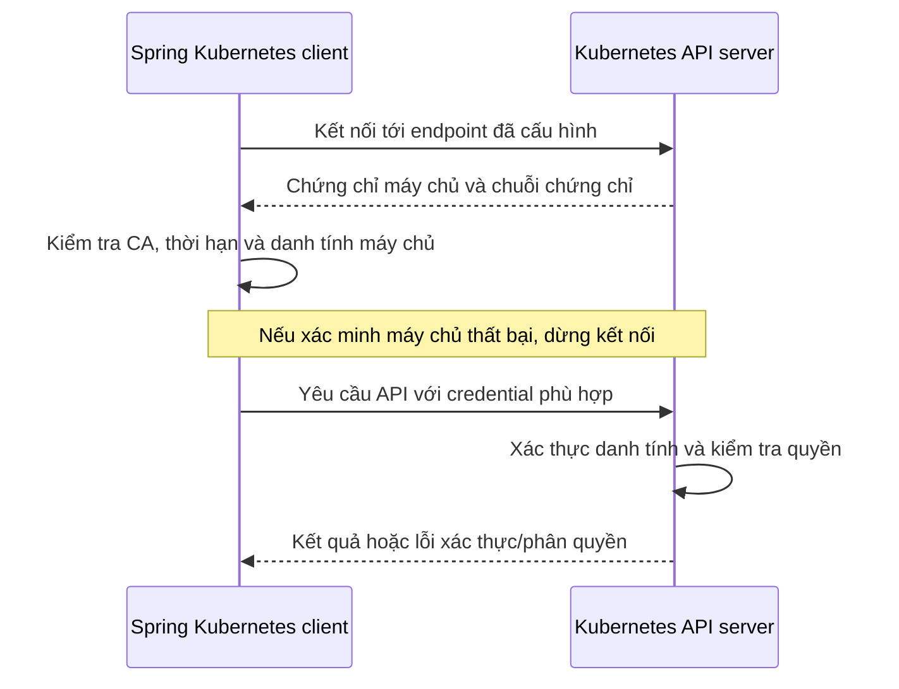

# Xác minh TLS và bảo vệ kubeconfig

## Mục tiêu và phạm vi

Trong chương **Bảo mật tích hợp** của module **SPRING_CLOUD_KUBERNETES**, bài này giải thích cách ứng dụng Spring xác minh danh tính Kubernetes API server và cách bảo vệ thông tin truy cập cluster. Các tính năng DiscoveryClient, đọc ConfigMap/Secret, theo dõi tài nguyên và Configuration Watcher đều cần một đường kết nối đáng tin cậy khi truy cập API; một cấu hình TLS yếu có thể làm lộ credential hoặc khiến ứng dụng tin dữ liệu từ sai máy chủ.

Sau bài học, bạn có thể:

- Phân biệt xác minh chứng chỉ máy chủ, xác thực client và phân quyền RBAC.
- Đọc các trường TLS, credential và context trong kubeconfig mà không phát tán bí mật.
- Cấu hình nguồn CA đúng cho loại Kubernetes client đang sử dụng.
- Kiểm tra cả kết nối hợp lệ lẫn việc từ chối CA hoặc hostname không hợp lệ.
- Bảo vệ kubeconfig trên máy phát triển, trong CI và khi triển khai Spring Boot vào Pod.
- Xử lý lỗi TLS và rò rỉ credential theo đúng nguyên nhân.

Kiến thức cần có: HTTPS, Kubernetes ServiceAccount, namespace và cấu hình Spring Boot. Ví dụ Spring Cloud Kubernetes dùng **3.3.3 với Fabric8** làm mốc đối chiếu cụ thể; không mặc định rằng cùng một property được mọi loại client hoặc mọi phiên bản xử lý như nhau. Phiên bản thực tế của dự án phải theo Spring Cloud BOM tương thích.

Các đường dẫn, tên miền và tên danh tính trong bài là dữ liệu minh họa. Bài không chứa token, private key hay kubeconfig thật. Khi thực hành, chỉ dùng cluster thử nghiệm và credential được cấp cho mục đích đó.

## 1. Ba lớp kiểm tra độc lập

Giả sử ứng dụng `orders` gọi Kubernetes API để tìm các endpoint của `inventory`. Trước khi kết quả discovery có ý nghĩa, cần trả lời ba câu hỏi:

| Lớp | Câu hỏi | Vật liệu liên quan | Lỗi thường gặp |
| --- | --- | --- | --- |
| Xác minh máy chủ TLS | Đang kết nối đúng API server được tin cậy không? | CA, chuỗi chứng chỉ, tên DNS/IP, thời hạn | Unknown CA, hostname mismatch, chứng chỉ hết hạn |
| Xác thực client | API server nhận diện người gọi là ai? | ServiceAccount token, client certificate hoặc credential plugin | Token không hợp lệ, credential hết hạn |
| Phân quyền | Danh tính đó có được thực hiện thao tác này không? | Role, ClusterRole, binding và policy đang áp dụng | Không được `list` hoặc `watch` resource |

TLS có thể xác thực client bằng chứng chỉ trong quá trình handshake; bearer token thường được gửi ở lớp HTTP sau khi đã thiết lập TLS. Vì vậy, đây là ba trách nhiệm khác nhau dù một số bước diễn ra cùng một kết nối.



Không sửa lỗi CA bằng cách thêm RoleBinding. Không sửa lỗi thiếu quyền `watch` bằng cách nhập thêm CA. HTTP `401` thường hướng tới xác thực, `403` thường hướng tới phân quyền; cần đọc thông báo, danh tính và thành phần trả lỗi vì proxy hoặc chế độ anonymous có thể làm kết luận đơn giản này chưa đủ.

Ví dụ suy luận: `orders` đọc được ConfigMap nhưng không watch được Service. Nếu hai thao tác đi qua cùng API endpoint và cùng client, hãy kiểm tra quyền của từng resource/verb trước khi thay đổi TLS.

## 2. TLS phải kiểm tra cả chuỗi tin cậy và danh tính

### 2.1. Tin một CA không có nghĩa là tin mọi tên máy chủ

Một kết nối HTTPS đúng cần kiểm tra chuỗi chứng chỉ tới trust anchor phù hợp, thời hạn và các ràng buộc chứng chỉ, đồng thời đối chiếu danh tính máy chủ với tên mà client kỳ vọng. Với DNS/IP, việc đối chiếu dựa trên loại định danh tương ứng trong Subject Alternative Name; không dựa vào việc Common Name nhìn có vẻ đúng. Tham khảo [RFC 9525 về danh tính dịch vụ trong TLS](https://www.rfc-editor.org/rfc/rfc9525.html).

Ví dụ tự xây dựng:

- Endpoint cấu hình là `https://api.dev.example.internal:6443`.
- Chứng chỉ chứa DNS SAN `api.dev.example.internal` và được CA của môi trường dev ký.
- Client có đúng CA dev và bật xác minh hostname: kết nối có cơ sở để vượt qua kiểm tra máy chủ.
- Nếu tự đổi endpoint thành `https://10.20.30.40:6443`, chứng chỉ còn cần IP SAN tương ứng, hoặc một cấu hình tên TLS được nền tảng quy định và client hỗ trợ. DNS SAN cũ không mặc nhiên xác minh được IP.

Không đổi URL sang một địa chỉ bất kỳ rồi tắt hostname verification để “kết nối được”. Hãy dùng endpoint chính thức hoặc sửa chứng chỉ/định tuyến theo thiết kế của cluster.

### 2.2. CA của máy chủ khác với chứng chỉ của client

| Thành phần | Vai trò | Mức bảo vệ cần có |
| --- | --- | --- |
| CA certificate/bundle | Giúp client xác minh API server | Bảo vệ tính toàn vẹn và nguồn cung cấp |
| Server certificate | Máy chủ trình bày danh tính của mình | Quản lý chuỗi, SAN và thời hạn |
| Client certificate | Có thể giúp API server xác thực client | Quản lý danh tính và thời hạn |
| Client private key | Chứng minh quyền sử dụng client certificate | Giữ bí mật, giới hạn quyền đọc và sao chép |
| Bearer token | Xác thực bằng việc nắm giữ token | Giữ bí mật và kiểm soát vòng đời |

CA certificate thường không phải bí mật, nhưng kẻ sửa được CA mà ứng dụng tin có thể làm thay đổi ranh giới tin cậy. Không tải chứng chỉ từ chính endpoint đang bị nghi ngờ rồi lập tức tin nó mà chưa đối chiếu với nguồn quản trị đáng tin cậy.

CA dùng xác minh chứng chỉ **máy chủ** và CA được API server chấp nhận để xác thực chứng chỉ **client** có thể là hai CA khác nhau. Đừng dùng tên file giống nhau làm bằng chứng chúng có cùng vai trò.

### 2.3. Những cấu hình không thay thế nhau

- `https://` cho biết giao thức được chọn; nó không chứng minh client đã bật mọi kiểm tra chứng chỉ.
- Bật TLS cho cổng web Spring Boot bằng `server.ssl.*` không tự cấu hình trust cho Kubernetes client đi ra ngoài.
- Metadata discovery đánh dấu instance là HTTPS không tự xây dựng trust store cho HTTP client nghiệp vụ.
- Service mesh mTLS bảo vệ những chặng thuộc mesh theo cấu hình của nó; cần xác định riêng chặng ứng dụng tới Kubernetes API.

Ví dụ: `orders` phục vụ HTTPS cho người dùng, nhưng Kubernetes client trong cùng JVM vẫn dùng cấu hình CA sai. Việc trình duyệt mở được `orders` không kiểm chứng đường gọi API của client đó.

## 3. Kubeconfig chứa những gì?

Kubeconfig kết hợp thông tin cluster, cách xác thực và context. `current-context` chọn một bộ tham chiếu; namespace trong context chỉ là namespace mặc định, không phải ranh giới phân quyền. Đặc tả các trường nằm trong [kubeconfig v1](https://kubernetes.io/docs/reference/config-api/kubeconfig.v1/).

Ví dụ tham chiếu các file riêng, chỉ dành cho môi trường dev đã cấp chứng chỉ client:

```yaml
apiVersion: v1
kind: Config
clusters:
  - name: shop-dev
    cluster:
      server: https://api.dev.example.internal:6443
      certificate-authority: ./pki/dev-server-ca.pem
      insecure-skip-tls-verify: false
users:
  - name: orders-reader-dev
    user:
      client-certificate: ./credentials/orders-reader.crt
      client-key: ./credentials/orders-reader.key
contexts:
  - name: orders-dev
    context:
      cluster: shop-dev
      user: orders-reader-dev
      namespace: shop
current-context: orders-dev
```

Tên `orders-reader-dev` là tên bản ghi cấu hình, không tự tạo Kubernetes user hoặc cấp quyền. Danh tính được API server nhận diện phụ thuộc credential thực tế. Chứng chỉ client cần được hệ thống cấp phát chấp nhận; các file minh họa ở trên không thể tự tạo bằng việc lưu YAML.

Trong cách xử lý kubeconfig của kubectl, đường dẫn tương đối được hiểu theo vị trí kubeconfig. Đối với thư viện Java, cần kiểm tra API nạp file có giữ được vị trí gốc để phân giải đường dẫn hay không. Khi đóng gói môi trường chạy, kiểm chứng các đường dẫn thực tế thay vì chỉ thử từ một working directory thuận tiện.

### 3.1. Những trường phải xem kỹ

| Trường hoặc nhóm trường | Cần xác minh điều gì? |
| --- | --- |
| `server` | Đúng cluster, đúng giao thức, đúng endpoint và port |
| `certificate-authority` / `certificate-authority-data` | Đúng nguồn CA; dữ liệu nhúng có thể ghi đè đường dẫn |
| `insecure-skip-tls-verify` | Không bật bỏ qua xác minh |
| `tls-server-name` | Nếu có, tên đó phải là danh tính được nền tảng quy định |
| `client-key`, `client-key-data`, `token`, `tokenFile` | Credential nằm ở đâu, ai đọc được và hết hạn lúc nào |
| `exec` / `auth-provider` | Cơ chế lấy credential, chương trình được gọi và nguồn cài đặt |
| `proxy-url` | Kết nối đi qua proxy nào, có thông tin xác thực trong URL không |
| `contexts`, `current-context` | Có vô tình chọn production hoặc danh tính quản trị không |

`certificate-authority-data` và `client-key-data` thường được biểu diễn bằng Base64 trong kubeconfig YAML. Base64 là mã hóa biểu diễn để truyền/lưu dữ liệu, không cung cấp bảo mật như mã hóa có khóa. Chuyển private key sang trường `*-data` không làm nó an toàn để commit.

### 3.2. Kubeconfig còn có thể chỉ định chạy chương trình

Credential plugin qua `users[].user.exec` có thể chạy một chương trình để lấy thông tin xác thực. Vì vậy, kubeconfig không chỉ là danh sách địa chỉ. Kubernetes yêu cầu chỉ dùng nguồn đáng tin cậy và cảnh báo kubeconfig được tạo có chủ đích xấu có thể dẫn tới thực thi mã hoặc lộ file; xem [Organizing Cluster Access Using kubeconfig Files](https://kubernetes.io/docs/concepts/configuration/organize-cluster-access-kubeconfig/).

Khi nhận file mới, xem bằng trình soạn thảo đáng tin cậy trước khi dùng lệnh/API có thể khởi chạy cơ chế xác thực. Kiểm tra `command`, `args`, `env`, đường dẫn binary, thư mục làm việc liên quan và cách cập nhật plugin. Một tên lệnh hợp lệ nhưng được phân giải từ thư mục không kiểm soát trong `PATH` vẫn cần xem xét.

Không gửi nguyên kubeconfig vào ticket hỗ trợ để người khác “thử giúp”. Có thể cung cấp endpoint đã được phép chia sẻ, loại client, lỗi đã che dữ liệu nhạy cảm, nguồn CA và các cờ kiểm tra TLS mà không gửi credential.

## 4. Chọn rõ nguồn cấu hình trước khi chẩn đoán

Trên máy phát triển, kubectl có thể dùng `--kubeconfig`, biến `KUBECONFIG` hoặc file mặc định. `KUBECONFIG` dạng danh sách dùng dấu `;` trên Windows và `:` trên Linux/macOS; quy tắc merge của kubectl không phải cam kết chung cho mọi thư viện Java.

Để một phép thử kubectl có đích rõ ràng, sau khi đã kiểm tra file và plugin, dùng đường dẫn và context tường minh:

```powershell
$devKubeconfig = 'C:/Users/learner/.kube/orders-dev.yaml'
$devContext = 'orders-dev'

kubectl --kubeconfig $devKubeconfig --context $devContext config current-context
kubectl --kubeconfig $devKubeconfig --context $devContext config view --minify -o 'jsonpath={.clusters[0].cluster.server}'
```

Hai lệnh trên xem cấu hình; chúng không chứng minh đã handshake với API server. Chỉ in endpoint trong môi trường được phép chia sẻ địa chỉ nội bộ. Với file chưa tin cậy, kiểm tra nội dung tĩnh trước như phần trước đã nêu.

Không dùng `kubectl config view --raw` trong log, bản ghi terminal hay báo cáo. Tùy cấu hình, thao tác này có thể hiện dữ liệu nhạy cảm. Tùy chọn `--flatten` còn có thể đưa nội dung file tham chiếu vào đầu ra, tạo thêm một bản credential cần bảo vệ. Đối chiếu [kubectl config view](https://kubernetes.io/docs/reference/kubectl/generated/kubectl_config/kubectl_config_view/).

Với ứng dụng Spring, phải xác định riêng nguồn mà **tiến trình Java** sử dụng. IDE có thể kế thừa biến môi trường khác terminal; container không có cùng đường dẫn với máy host. `kubectl` thành công bằng một context không chứng minh JVM đang dùng cùng cluster, CA và credential.

Thông tin chẩn đoán có thể ghi nhận theo danh sách cho phép: loại client, phiên bản, profile, endpoint đã loại thông tin user/password, namespace và các cờ xác minh. Không dump toàn bộ object cấu hình hoặc toàn bộ environment.

## 5. Cấu hình TLS theo loại Kubernetes client

### 5.1. Fabric8 trong Spring Cloud Kubernetes 3.3.3

Ở mốc này, auto-configuration lấy cấu hình nền của Fabric8 rồi áp các giá trị Spring được khai báo tường minh như master URL, CA và `trustCerts`. Có thể đối chiếu [Fabric8AutoConfiguration 3.3.3](https://github.com/spring-cloud/spring-cloud-kubernetes/blob/v3.3.3/spring-cloud-kubernetes-fabric8-autoconfig/src/main/java/org/springframework/cloud/kubernetes/fabric8/Fabric8AutoConfiguration.java).

Ví dụ phần cấu hình TLS cho ứng dụng chạy ngoài cluster trong môi trường dev:

```yaml
spring:
  cloud:
    kubernetes:
      client:
        master-url: https://api.dev.example.internal:6443
        namespace: shop
        ca-cert-file: C:/Users/learner/.kube/pki/dev-server-ca.pem
        trust-certs: false
```

Đây chỉ là phần endpoint/trust, không phải cấu hình hoàn chỉnh để bật mọi tính năng Spring Cloud Kubernetes hoặc cung cấp credential. Client phải được tạo qua đúng auto-configuration đang xét; nếu ứng dụng khai báo bean `Config`/client riêng, phải kiểm tra đường tạo bean đó.

Các property được công bố trong [Common application properties 3.3](https://docs.spring.io/spring-cloud-kubernetes/reference/3.3/appendix.html). Nếu nguồn cấu hình nền còn có `ca-cert-data`, không suy ra chỉ thay `ca-cert-file` đã chọn đúng CA; cần xác định giá trị có hiệu lực và loại bỏ xung đột ở nguồn cấu hình phù hợp.

Fabric8 có hai nhóm cờ cần phân biệt: tin mọi chứng chỉ và bỏ kiểm tra hostname. Theo [cấu hình chính thức của Fabric8](https://github.com/fabric8io/kubernetes-client#configuring-the-client), các biến tương ứng là `KUBERNETES_TRUST_CERTIFICATES` và `KUBERNETES_DISABLE_HOSTNAME_VERIFICATION`; cả hai phải không bật chế độ bỏ kiểm tra. Đối chiếu lại phiên bản Fabric8 thực tế do BOM chọn.

```yaml
# Đoạn env minh họa trong Deployment dùng Fabric8 tương ứng
env:
  - name: KUBERNETES_TRUST_CERTIFICATES
    value: "false"
  - name: KUBERNETES_DISABLE_HOSTNAME_VERIFICATION
    value: "false"
```

Giá trị `false` trong một nguồn không bảo đảm custom HTTP client hoặc một nguồn ưu tiên khác không thay đổi hành vi. Kiểm tra bằng phép thử từ chối CA sai và hostname sai trên chính đường chạy cần bảo vệ.

### 5.2. Kubernetes Java Client

Không mặc định rằng YAML của Fabric8 được ánh xạ nguyên vẹn sang Kubernetes Java Client. Trong Spring Cloud Kubernetes 3.3.3, đường tạo `ApiClient` và helper riêng có thể được xem ở [KubernetesClientAutoConfiguration](https://github.com/spring-cloud/spring-cloud-kubernetes/blob/v3.3.3/spring-cloud-kubernetes-client-autoconfig/src/main/java/org/springframework/cloud/kubernetes/client/KubernetesClientAutoConfiguration.java) và [KubernetesClientUtils](https://github.com/spring-cloud/spring-cloud-kubernetes/blob/v3.3.3/spring-cloud-kubernetes-client-autoconfig/src/main/java/org/springframework/cloud/kubernetes/client/KubernetesClientUtils.java).

Khi dự án tự tạo `ApiClient`, cần rà soát nguồn kubeconfig/in-cluster config, CA, cờ `verifyingSsl` và HTTP transport thực tế. Thư viện có các API cấu hình xác minh SSL; một bean tự viết gọi `setVerifyingSsl(false)` có thể vô hiệu hóa mục tiêu bảo vệ dù cấu hình Spring nhìn có vẻ đúng. Tham khảo [Config của Kubernetes Java Client](https://github.com/kubernetes-client/java/blob/master/util/src/main/java/io/kubernetes/client/util/Config.java), rồi đối chiếu tag phiên bản dự án dùng.

Chỉ tự tạo bean khi có nhu cầu cụ thể và hiểu vòng đời client. Tránh chép một ví dụ tạo SSLContext hoặc HostnameVerifier chấp nhận mọi máy chủ để làm lỗi biến mất.

### 5.3. JVM trust store không phải công tắc chung cho mọi transport

Một thư viện có thể dùng trust manager từ JVM hoặc tự xây trust manager từ CA trong kubeconfig/ServiceAccount. Vì vậy, nhập CA vào `cacerts`, đặt `javax.net.ssl.trustStore` hoặc tạo Spring SSL bundle chưa chắc tác động tới Kubernetes client đang chạy. Cần xác minh nơi transport lấy trust material; xem [JSSE Reference Guide](https://docs.oracle.com/en/java/javase/21/security/java-secure-socket-extension-jsse-reference-guide.html).

Ưu tiên thay đổi trust trong phạm vi client cần dùng. Thêm CA vào trust store toàn cục của một JVM còn gọi nhiều dịch vụ có thể mở rộng phạm vi tin cậy ngoài Kubernetes. PEM CA bundle và JKS/PKCS12 trust store cũng là các định dạng khác nhau; đổi phần mở rộng file không chuyển đổi định dạng.

## 6. Trong Pod: dùng danh tính workload phù hợp

Ứng dụng chạy trong cluster thường sử dụng ServiceAccount dành cho workload và cấu hình in-cluster của thư viện. Các vị trí tiêu chuẩn thường gặp là:

```text
/var/run/secrets/kubernetes.io/serviceaccount/ca.crt
/var/run/secrets/kubernetes.io/serviceaccount/token
/var/run/secrets/kubernetes.io/serviceaccount/namespace
```

CA phục vụ xác minh máy chủ; token phục vụ xác thực. Không in nội dung token để chứng minh mount thành công. Cần bảo đảm quyền của user chạy container cho phép đọc các file cần thiết và kiểm tra cơ chế client cập nhật credential khi token luân chuyển.

Ví dụ phần Pod template cho một ứng dụng **thực sự cần gọi API**:

```yaml
spec:
  template:
    spec:
      serviceAccountName: orders-reader
      automountServiceAccountToken: true
```

ServiceAccount phải tồn tại trong namespace của Pod và có RBAC đúng nhu cầu. Đây là phần template, chưa phải Deployment đầy đủ. Không mount kubeconfig quản trị lấy từ laptop vào Pod để thay thế ServiceAccount.

Nếu ứng dụng chỉ dùng Kubernetes DNS/Service và cấu hình mount, không cần trực tiếp gọi API, có thể chọn `automountServiceAccountToken: false`. Khi đó phải bảo đảm các tính năng đang bật không còn cần credential API hoặc đã có một cơ chế cấp credential khác được thiết kế rõ ràng. Ý nghĩa automount được mô tả trong [Configure Service Accounts for Pods](https://kubernetes.io/docs/tasks/configure-pod-container/configure-service-account/).

Cần phân tích theo tính năng:

| Tính năng | Đường truy cập cần bảo vệ |
| --- | --- |
| DiscoveryClient trực tiếp | Ứng dụng tới Kubernetes API |
| Đọc ConfigMap/Secret qua API | Ứng dụng tới Kubernetes API, cùng quyền cho resource tương ứng |
| Đọc cấu hình từ volume | Đường phân phối file vào Pod và quyền đọc file |
| HTTP DiscoveryClient | Ứng dụng tới Discovery Server; server tới Kubernetes API |
| Configuration Watcher | Watcher tới API; watcher/bus tới ứng dụng nhận refresh |
| HTTP client qua LoadBalancer | Ứng dụng tới instance hoặc Service được chọn |

Xác minh TLS ở một chặng không tự bảo vệ chặng khác. Ví dụ watcher xác minh tốt API server nhưng gọi endpoint refresh qua một đường không được kiểm soát vẫn cần được thiết kế lại cho phù hợp. Không chuyển credential Kubernetes cho downstream chỉ vì downstream được discovery tìm thấy.

## 7. Bảo vệ kubeconfig và credential đi kèm

### 7.1. Bảo vệ cả file lẫn thư mục chứa

Kubeconfig tham chiếu private key bên ngoài thì key đó cũng nằm trong phạm vi bảo vệ. Nếu dùng credential plugin, cần bảo vệ binary, cấu hình plugin và credential cache của nó. Quyền chỉ đọc của kubeconfig không ngăn một người có quyền ghi thư mục cha thay thế file.

Trên Linux/macOS, với thư mục/file thuộc tài khoản của bạn, ví dụ quyền tối thiểu cho một kubeconfig dev riêng:

```sh
chmod 700 "$HOME/.kube"
chmod 600 "$HOME/.kube/orders-dev.yaml"
chmod 600 "$HOME/.kube/credentials/orders-reader.key"
```

Các file phải tồn tại, owner phải đúng và những thư mục con chứa credential cũng phải được giới hạn phù hợp. Không dùng lệnh này một cách máy móc cho volume được nền tảng quản lý hoặc thư mục cần nhiều danh tính truy cập.

Trên Windows/NTFS, kiểm tra DACL của đúng file và các thư mục liên quan:

```powershell
$devKubeconfig = 'C:/Users/learner/.kube/orders-dev.yaml'
$devPrivateKey = 'C:/Users/learner/.kube/credentials/orders-reader.key'

icacls.exe $devKubeconfig
icacls.exe $devPrivateKey
```

`icacls` hiển thị hoặc chỉnh DACL; tài liệu chính thức nằm ở [Microsoft Learn](https://learn.microsoft.com/en-us/windows-server/administration/windows-commands/icacls). Trong phần Security/Advanced của file và thư mục, kiểm tra cả quyền kế thừa lẫn quyền cấp trực tiếp, loại bỏ quyền đọc/ghi cho các nhóm không cần thiết theo chính sách của máy. Giữ quyền cho tài khoản vận hành và các principal quản trị hệ thống cần thiết.

Chỉ tắt kế thừa không tự xóa mọi quyền cấp trực tiếp. Chỉ đặt file read-only cũng không bảo đảm bí mật. ACL không ngăn một tiến trình đã chạy dưới chính tài khoản có quyền đọc lấy credential; vì thế cần dùng credential có quyền hẹp và thời hạn phù hợp.

### 7.2. Git, image và artifact

- Lưu kubeconfig thật ngoài repository; trong repo chỉ có template với giá trị minh họa.
- Dùng quy tắc ignore phù hợp và secret scanning, nhưng không coi ignore là biện pháp xử lý credential đã từng commit.
- Không đưa kubeconfig vào Docker build context nếu không cần. Xóa file ở layer sau không xóa credential khỏi layer trước.
- Không đưa kubeconfig vào JAR resources, source map, bản backup dự án hoặc artifact CI.
- Kiểm tra terminal transcript, ảnh chụp màn hình và gói log trước khi chia sẻ.

Một Kubernetes Secret cũng không tự làm kubeconfig trở nên an toàn với mọi người: cần kiểm soát RBAC, cách lưu trữ và quyền truy cập workload. Tài liệu [Secrets](https://kubernetes.io/docs/concepts/configuration/secret/) giải thích rằng Base64 không bảo đảm tính bí mật và quyền truy cập Secret cần được hạn chế.

### 7.3. CI và máy dùng chung

Job CI nên có danh tính riêng và quyền vừa đủ cho công việc; tránh dùng kubeconfig cá nhân có thể truy cập nhiều cluster. Nếu phải tạo file tạm từ secret store, chỉ cấp cho job cần nó, giới hạn ACL trước khi sử dụng và kiểm soát log/artifact/cache. Cleanup cuối job không thay thế việc xử lý một credential đã bị lộ.

Không truyền token thật trong đối số CLI, ví dụ qua `--token` trong lệnh được ghi log. Masking của CI chỉ là một lớp hỗ trợ; dữ liệu có thể đổi dạng hoặc xuất hiện ở nơi bộ lọc không nhận diện.

Với RBAC, giới hạn namespace, resource và verb theo các tính năng thực sự dùng; đọc Secret hàng loạt có mức ảnh hưởng khác với đọc Service. Tham khảo [RBAC Good Practices](https://kubernetes.io/docs/concepts/security/rbac-good-practices/). TLS đúng và quyền tối thiểu bổ sung cho nhau.

## 8. Thực hành xác minh kết nối mà không lộ credential

### 8.1. Chuẩn bị nguồn tin cậy

Dùng một API endpoint dev do nhóm quản trị cung cấp, CA bundle lấy qua kênh được xác thực và kubeconfig chỉ chứa danh tính thử nghiệm có quyền hẹp. Các lệnh OpenSSL dưới đây dành cho OpenSSL 3.5 hoặc phiên bản có các tùy chọn tương ứng.

Kiểm tra metadata của CA certificate cục bộ, không đọc private key:

```powershell
openssl x509 -in 'C:/Users/learner/.kube/pki/dev-server-ca.pem' -noout -subject -issuer -dates -fingerprint -sha256
```

Đối chiếu fingerprint với nguồn quản trị được xác thực. Với bundle nhiều chứng chỉ, lệnh trên không thay thế việc kiểm tra từng CA trong bundle. `x509` đọc thông tin từ file; nó chưa chứng minh endpoint mạng đang trình đúng chứng chỉ. Tùy chọn được mô tả trong [openssl-x509](https://docs.openssl.org/3.5/man1/openssl-x509/).

### 8.2. Kiểm tra máy chủ TLS riêng

Không cung cấp token hoặc client private key cho phép thử máy chủ này:

```powershell
openssl s_client -connect api.dev.example.internal:6443 -servername api.dev.example.internal -verify_hostname api.dev.example.internal -verifyCAfile 'C:/Users/learner/.kube/pki/dev-server-ca.pem' -verify_return_error -brief
```

`-servername` gửi SNI, còn `-verify_hostname` yêu cầu kiểm tra danh tính DNS. `-verifyCAfile` chỉ định tập CA dùng xác minh; `-verify_return_error` làm phép thử dừng khi xác minh thất bại. Nếu không yêu cầu dừng, `s_client` có thể tiếp tục để phục vụ chẩn đoán dù gặp lỗi chứng chỉ. Xem [openssl-s_client](https://docs.openssl.org/3.5/man1/openssl-s_client/).

Sau khi quan sát kết quả, kết thúc kết nối tương tác nếu nó còn chờ. Nếu endpoint bắt buộc client certificate ở mức TLS, có thể xuất hiện lỗi yêu cầu credential client; cần phân biệt lỗi đó với việc không xác minh được chứng chỉ máy chủ.

Kết quả này chỉ kiểm chứng đường mạng và trust settings của OpenSSL. Nó không xác minh JVM đang dùng cùng CA hay có credential/RBAC đúng.

### 8.3. Kiểm tra kubeconfig và quyền của danh tính dev

Sau khi đã xem xét nguồn file/plugin, dùng đúng kubeconfig và context:

```powershell
$devKubeconfig = 'C:/Users/learner/.kube/orders-dev.yaml'
$devContext = 'orders-dev'

kubectl --kubeconfig $devKubeconfig --context $devContext --request-timeout=10s auth whoami
kubectl --kubeconfig $devKubeconfig --context $devContext --request-timeout=10s auth can-i list services --namespace shop
kubectl --kubeconfig $devKubeconfig --context $devContext --request-timeout=10s auth can-i watch services --namespace shop
kubectl --kubeconfig $devKubeconfig --context $devContext --request-timeout=10s get services --namespace shop -o name
```

`auth whoami` dùng khi phiên bản client/server hỗ trợ; nó giúp đối chiếu danh tính server nhận được, không hiển thị token để chẩn đoán. Xem [kubectl auth whoami](https://kubernetes.io/docs/reference/kubectl/generated/kubectl_auth/kubectl_auth_whoami/).

`auth can-i` kiểm tra khả năng được phân quyền cho một thao tác, không thực hiện watch dài hạn. Lệnh `get services -o name` kiểm tra thêm việc đọc resource thực tế; danh sách tên Service vẫn là thông tin nội bộ cần chia sẻ đúng phạm vi.

Không dùng `--as` để giả định ứng dụng có cùng danh tính, vì đó là cơ chế impersonation với yêu cầu quyền riêng. Không dùng `--insecure-skip-tls-verify` trong các lệnh kiểm chứng này.

### 8.4. Kiểm tra trên chính ứng dụng Spring

Chạy ứng dụng với đúng starter, profile và môi trường triển khai dự kiến. Kích hoạt thao tác đọc API thật của tính năng cần dùng: discovery, tải cấu hình qua API hoặc watcher. Kiểm tra log đã che thông tin nhạy cảm để xác nhận endpoint, loại client và kết quả.

Không chỉ gọi một endpoint trả dữ liệu cache rồi coi đó là bằng chứng handshake mới thành công. Với informer/watch, cần quan sát khởi tạo và một lần thiết lập lại kết nối theo quy trình thử nghiệm; một kết nối cũ đang mở có thể che vấn đề khi nạp CA mới.

Tiêu chí cho lượt hợp lệ: client xác minh được máy chủ, API nhận đúng danh tính dev, thao tác được cấp quyền thành công và không có credential trong đầu ra. Việc đọc ConfigMap thành công không chứng minh luồng watch hoặc tải Secret cũng đã được kiểm tra.

## 9. Phép thử âm: xác minh rằng kết nối sai bị từ chối

Thành công với CA đúng chưa đủ để chứng minh client kiểm tra chứng chỉ. Hãy thử lỗi có kiểm soát trên môi trường dev, mỗi lần chỉ thay một yếu tố.

| Tình huống | Kết quả mong đợi | Điều được kiểm chứng |
| --- | --- | --- |
| CA đúng, tên đúng | Vượt kiểm tra máy chủ; sau đó xử lý auth/RBAC | Cấu hình hợp lệ hoạt động |
| CA không tin chuỗi máy chủ | Kết nối mới thất bại ở xác minh chứng chỉ | Không chấp nhận mọi chứng chỉ |
| Tên kỳ vọng không thuộc SAN | Thất bại ở xác minh danh tính | Không bỏ hostname verification |
| Credential dev hết hạn/không hợp lệ | Lỗi auth phù hợp sau hoặc trong TLS tùy cơ chế | Phân biệt credential với trust |
| Credential đúng nhưng không được `watch` | Yêu cầu watch bị từ chối | RBAC được kiểm soát riêng |

Ví dụ thử hostname sai bằng OpenSSL, vẫn kết nối tới endpoint dev thật và giữ nguyên SNI:

```powershell
openssl s_client -connect api.dev.example.internal:6443 -servername api.dev.example.internal -verify_hostname definitely-not-the-api.invalid -verifyCAfile 'C:/Users/learner/.kube/pki/dev-server-ca.pem' -verify_return_error -brief
```

Tên `.invalid` ở đây chỉ là **giá trị cần đối chiếu**; lệnh không yêu cầu kết nối tới tên đó. Mong đợi lỗi hostname, không phải thành công rồi nhận phản hồi HTTP.

Để thử CA sai, thay file xác minh bằng một CA thử nghiệm hợp lệ nhưng không ký chuỗi máy chủ. Phải bảo đảm không còn trust anchor khác khiến chuỗi vẫn được tin; một file không đọc được chỉ kiểm tra lỗi đọc file, không chứng minh kiểm tra chuỗi chứng chỉ.

Sau đó lặp lại điều kiện tương ứng trên **transport của ứng dụng Spring**, bằng cấu hình dev hoặc endpoint TLS thử nghiệm được quản lý phù hợp. Tạo kết nối mới và kiểm tra rằng thao tác thực sự thất bại. Không gửi credential production đến máy chủ giả lập; dùng danh tính thử nghiệm hoặc endpoint không cần credential để kiểm tra TLS.

Không sửa kubeconfig đang dùng chung để thực hiện phép thử âm. Dùng cấu hình thử nghiệm tách biệt, giữ đúng endpoint/context được phép và khôi phục nguồn trust hợp lệ sau phép thử. Các phép thử này nhằm kiểm tra cơ chế từ chối; kết quả từ OpenSSL không thay thế kết quả của Java client.

## 10. Chẩn đoán lỗi theo tầng

| Hiện tượng | Nhóm nguyên nhân cần xét | Cách xử lý đúng hướng |
| --- | --- | --- |
| `UnknownHostException` hoặc không phân giải được tên | DNS, endpoint sai, VPN chưa kết nối | Xác minh tên và đường phân giải trong môi trường chạy |
| Timeout trước khi handshake | Route, firewall, proxy, NetworkPolicy | Kiểm tra kết nối tới đúng host/port |
| `PKIX path building failed`, unknown authority | Sai CA, thiếu intermediate, transport đọc trust source khác | Kiểm tra chuỗi và nguồn CA thực sự được nạp |
| Hostname/SAN mismatch | Sai URL, SAN không chứa tên/IP kỳ vọng | Sửa endpoint hoặc cấp chứng chỉ đúng thiết kế |
| Certificate expired / not yet valid | Hết hạn, luân chuyển chưa hoàn tất hoặc đồng hồ lệch | Kiểm tra thời gian và quy trình PKI |
| TLS báo lỗi yêu cầu/chứng chỉ client | Client certificate thiếu hoặc không được server chấp nhận | Kiểm tra cơ chế mTLS, client chain và hạn dùng |
| HTTP `401` | Credential thiếu, hết hạn, audience/issuer không phù hợp | Kiểm tra cơ chế cấp credential, không in token |
| HTTP `403` cho resource/verb | Danh tính hoặc RBAC không đúng | Đối chiếu user/group/ServiceAccount và binding |
| kubectl chạy được nhưng Java lỗi | Khác context, CA, proxy, filesystem hoặc client | So sánh cấu hình hiệu lực có chọn lọc |

Ví dụ tình huống: sau khi đổi laptop, `orders` gặp `PKIX path building failed`; nhóm đã sao chép kubeconfig nhưng quên thư mục `pki`. Cách khắc phục là nhận lại CA đúng và sửa đường dẫn/nguồn cấu hình. Bật trust-all có thể làm ứng dụng chạy tiếp nhưng xóa mất điều kiện nhận diện API server.

Một proxy doanh nghiệp có thể thay đổi đường đi hoặc chứng chỉ quan sát được. Chỉ bổ sung CA proxy khi đó là thiết kế được phê duyệt cho lưu lượng Kubernetes; không tự tin mọi CA của proxy hoặc tự bỏ qua proxy bằng cấu hình ngoài quy định.

Khi cần bật TLS debug, sử dụng môi trường thử nghiệm, giới hạn thời gian và phạm vi log, kiểm tra đầu ra trước khi gửi đi. Không bật logging HTTP headers/body tràn lan; ConfigMap, Secret và header xác thực có mức nhạy cảm khác nhau.

## 11. Luân chuyển CA và xử lý rò rỉ

### 11.1. Luân chuyển phải kiểm tra kết nối mới

Có ba vòng đời riêng: chứng chỉ/CA máy chủ, credential client và object client/transport trong JVM. Thay file CA trên đĩa chưa chắc làm client đang chạy nạp lại ngay. Tương tự, Spring refresh cấu hình nghiệp vụ không mặc nhiên tái tạo TLS context của Kubernetes client.

Một kế hoạch đổi CA cần xác định thời gian chồng lấn trust nếu hệ thống hỗ trợ, cách phân phối bundle mới, cách client nạp lại và cách xác minh kết nối mới. Triển khai theo đợt để quan sát lỗi trước khi chuyển toàn bộ workload. Không xóa CA cũ khi còn client hợp lệ chưa nhận được trust mới.

Với token luân chuyển, xác nhận phiên bản thư viện và cách đọc token file có hỗ trợ vòng đời dự kiến. Không chép token hiện tại vào một chuỗi cấu hình cố định rồi giả định nó tiếp tục được cập nhật.

### 11.2. Nếu kubeconfig hoặc key đã bị lộ

Xử lý theo credential thực sự có trong file, không chỉ đổi tên hoặc xóa kubeconfig khỏi máy:

1. Xác định các cluster, danh tính, token, key hoặc plugin cache nằm trong phạm vi lộ.
2. Thu hồi/thay thế credential bằng cơ chế mà hệ thống xác thực hỗ trợ; giảm hoặc loại bỏ quyền liên quan khi cần để hạn chế ảnh hưởng.
3. Kiểm tra nơi file đã đi qua: Git history, image layer, artifact, log, backup và máy nhận.
4. Kiểm tra audit theo phạm vi được cấp quyền để tìm sử dụng bất thường.
5. Cấp credential mới có quyền hẹp, rồi kiểm chứng credential cũ không còn thực hiện được các thao tác cần chặn.

Không mặc định việc cấp client certificate mới làm certificate cũ mất hiệu lực. Cơ chế xác thực X.509 của Kubernetes có hạn chế về thu hồi chứng chỉ; phải làm việc với nhóm quản trị về quyền, thời hạn và PKI theo phiên bản cluster. Nguồn đối chiếu là [Kubernetes authentication](https://kubernetes.io/docs/reference/access-authn-authz/authentication/#x509-client-certs).

Nếu credential từng có đặc quyền rất cao, không suy ra chỉ xóa một RoleBinding đã chặn hết mọi đường truy cập. Kết quả xử lý phải dựa trên các quyền và cơ chế xác thực thực tế.

## 12. Hoàn tất một cấu hình tích hợp đáng tin cậy

Đối với `orders`, kết quả cần chứng minh được là: tiến trình Java chọn đúng cluster dev, sử dụng CA từ nguồn đáng tin cậy, từ chối chứng chỉ/tên không hợp lệ, gửi đúng danh tính workload và chỉ đọc/watch các resource cần thiết. Kubeconfig và mọi credential tham chiếu phải nằm ngoài artifact chia sẻ.

Bằng chứng có thể lưu gồm phiên bản client, profile triển khai, nguồn trust đã được xác nhận, kết quả thử hợp lệ/thử âm và các verb được cấp quyền. Không cần lưu token/private key để chứng minh phép thử thành công.

Tự kiểm tra hiểu biết:

- `server.ssl.enabled=true` có đủ bảo vệ kết nối Kubernetes client không? **Không; phải kiểm tra transport đi ra và nguồn CA của nó.**
- Kubeconfig chỉ có `namespace: shop` có ngăn danh tính truy cập namespace khác không? **Không; quyền do policy/RBAC quyết định.**
- CA công khai có thể cho mọi người sửa tùy ý không? **Không; tính toàn vẹn của trust anchor quyết định máy chủ nào được tin.**
- OpenSSL thành công có chứng minh Java không dùng trust-all không? **Không; cần thử từ chối trên chính Java client.**
- Xóa kubeconfig khỏi commit mới nhất có xử lý xong một token đã lộ không? **Không; phải xử lý credential và các bản sao đã phát tán.**
- Có cần bật mọi tính năng Spring Cloud Kubernetes chỉ vì ứng dụng chạy trong Pod không? **Không; chọn tính năng theo nhu cầu, từ đó xác định đúng kết nối và credential phải bảo vệ.**
