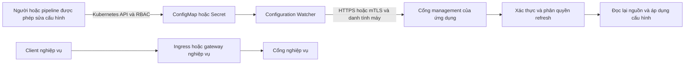

# Bảo vệ refresh endpoint khỏi yêu cầu trái phép

Refresh endpoint là một đường điều khiển của ứng dụng. Người được gọi nó có thể khiến ứng dụng đọc lại cấu hình, vô hiệu hóa các đối tượng trong refresh scope và phát sinh công việc tái tạo tài nguyên. Vì vậy, quyền gọi refresh cần được quản lý như một quyền vận hành có tác động tới hệ thống.

Trong chương **Bảo mật tích hợp** của module **SPRING_CLOUD_KUBERNETES**, bài học này hướng dẫn bảo vệ đường refresh khi ứng dụng dùng ConfigMap, Secret và Configuration Watcher trên Kubernetes. DiscoveryClient giúp tìm instance, Spring Cloud LoadBalancer giúp chọn đích gọi; cả hai vẫn cần phối hợp với xác thực, phân quyền và giới hạn mạng.

Sau bài học, bạn có thể:

- Xác định ai được gọi refresh, gọi tới ứng dụng nào và qua đường mạng nào.
- Phân biệt exposure của Actuator, xác thực HTTP, phân quyền nghiệp vụ vận hành và Kubernetes RBAC.
- Viết cấu hình Spring Security giới hạn POST refresh cho một scope riêng.
- Chọn cách xử lý CSRF phù hợp với client máy và client trình duyệt.
- Giữ đường gọi hợp lệ của Watcher hoạt động sau khi siết bảo mật.
- Kiểm chứng cả trường hợp bị từ chối lẫn việc áp dụng cấu hình thành công trên các Pod mục tiêu.

Ví dụ Java bên dưới dùng **Spring MVC, Spring Boot 3.5 và Spring Security 6.5** làm mốc minh họa. Dependency Spring Cloud và Spring Cloud Kubernetes phải thuộc release train tương thích. Với phiên bản khác hoặc WebFlux, kiểm tra API và cơ chế cấu hình tương ứng; không chép nguyên servlet filter chain vào ứng dụng reactive.

## 1. Refresh tạo ra quyền lực gì?

Spring Cloud cung cấp `/actuator/refresh` để làm mới ngữ cảnh cấu hình và các bean thuộc refresh scope. Chức năng này khác với ghi một bộ giá trị tùy ý qua endpoint môi trường. Xem [Spring Cloud Context: Application Context Services](https://docs.spring.io/spring-cloud-commons/reference/spring-cloud-commons/application-context-services.html).

Một lần gọi refresh không nhất thiết thay mọi bean ngay lập tức. Một số tài nguyên được dựng lại khi sử dụng lần tiếp theo. Tác động thực tế phụ thuộc thành phần được refresh và mã khởi tạo của ứng dụng.

Các tác động cần tính đến:

| Tác động | Ví dụ rủi ro |
|---|---|
| Thay đổi hành vi đang chạy | Luật nghiệp vụ hoặc ngưỡng xử lý đổi ngoài kế hoạch |
| Tạo tải khởi tạo lại | Nhiều client, cache hoặc kết nối được dựng lại |
| Kích hoạt nhiều lần liên tiếp | CPU, pool và dependency bị quá tải |
| Đọc một nguồn cấu hình vừa bị sửa sai | Tính năng chuyển sang trạng thái không hợp lệ |
| Trả về thông tin quản trị | Tên khóa thay đổi hoặc thông tin nội bộ xuất hiện ở nơi không phù hợp |

Một kẻ gọi trái phép có thể không cần biết giá trị Secret để gây gián đoạn. Chỉ cần làm ứng dụng refresh liên tục cũng có thể tạo tải đáng kể.

Ngược lại, bảo vệ refresh không thay thế bảo vệ nguồn cấu hình. Nếu một chủ thể được sửa ConfigMap nhạy cảm rồi hệ thống tự động áp dụng, việc khóa chặt HTTP endpoint vẫn không ngăn chủ thể đó tác động qua nguồn.

## 2. Tách các lớp quyền trước khi viết cấu hình

Một thiết kế điển hình có các quan hệ sau:



Mỗi lớp giải quyết một câu hỏi khác nhau:

| Lớp | Câu hỏi được giải quyết | Điều nó không tự bảo đảm |
|---|---|---|
| Actuator exposure | Endpoint có được cung cấp qua HTTP/JMX không? | Danh tính và quyền của người gọi |
| NetworkPolicy/firewall | Nguồn mạng nào được kết nối tới cổng đích? | Scope HTTP của request |
| TLS/mTLS | Kênh có được bảo vệ và có xác minh peer theo cấu hình không? | Quyền thực hiện refresh nếu chưa có policy tương ứng |
| Spring Security | Request có danh tính hợp lệ và được phép refresh không? | Quyền sửa ConfigMap trên Kubernetes API |
| Kubernetes RBAC | ServiceAccount/chủ thể được thao tác tài nguyên Kubernetes nào? | Quyền gọi URL HTTP thông thường của ứng dụng |
| Bảo vệ nguồn cấu hình | Ai có thể thay đổi nội dung được áp dụng? | Ai được kích hoạt một lần refresh thủ công |

Không suy ra rằng Pod được đọc ConfigMap thì đương nhiên được gọi refresh. Request tới ứng dụng không tự đi qua bộ kiểm tra RBAC của Kubernetes API server.

`ClusterIP`, namespace riêng và tên endpoint khó đoán cũng không phải danh tính. Một Pod khác có thể biết địa chỉ hoặc tìm thấy nó qua discovery; khả năng kết nối vẫn phải được kiểm soát bằng các lớp phù hợp.

## 3. Định nghĩa quyền refresh đủ hẹp

Trước khi cấu hình, ghi rõ hợp đồng vận hành. Ví dụ:

```text
Ứng dụng đích: order-service trong môi trường thử nghiệm
Thao tác: POST tới refresh endpoint
Danh tính máy hợp lệ: workload Configuration Watcher đã được đăng ký
Issuer token: issuer được tổ chức tin cậy
Audience: order-service-management
Scope: config.refresh
Client nghiệp vụ thông thường: không có quyền này
Tần suất: hữu hạn, có audit và kiểm soát công việc trùng
```

Đây là chính sách ví dụ, không phải tên role hay scope mặc định của Spring Cloud Kubernetes.

Nên cấp danh tính riêng cho đường điều khiển cấu hình. Không dùng lại token của người dùng cuối hoặc một tài khoản quản trị có quyền ở mọi môi trường chỉ để gọi refresh.

Nếu một Watcher phục vụ nhiều ứng dụng, cân nhắc audience và phạm vi đích được cấp cho nó. Một token có quyền refresh mọi service trong mọi namespace làm tăng phạm vi ảnh hưởng khi credential bị lộ.

Scope chỉ có ý nghĩa khi authorization server kiểm soát việc cấp scope. Ví dụ Java trong bài giả định chỉ các client vận hành được phê duyệt mới nhận `config.refresh` cho audience quản trị của ứng dụng này. Nếu issuer còn cấp scope đó cho nhiều loại chủ thể, cần thêm chính sách client/workload tương ứng.

## 4. Giới hạn endpoint được cung cấp ra ngoài

Ứng dụng cần có Actuator và thành phần Spring Cloud cung cấp refresh endpoint. Với mô hình JWT bên dưới, cần thêm Spring Security và OAuth2 Resource Server, thường thông qua các starter tương ứng.

**Cấu hình minh họa cho ứng dụng đích:**

```yaml
server:
  port: 8080

management:
  server:
    port: 9090
  endpoints:
    web:
      base-path: /actuator
      exposure:
        include:
          - health
          - refresh
    jmx:
      exposure:
        exclude: "*"
  endpoint:
    health:
      show-details: never
      show-components: never

spring:
  security:
    oauth2:
      resourceserver:
        jwt:
          issuer-uri: https://idp.example.com/realms/platform
          audiences:
            - order-service-management
```

Địa chỉ issuer là placeholder. Thay bằng issuer thật và cấu hình client nhận token theo hạ tầng danh tính của môi trường.

Exposure chỉ chọn những endpoint được đưa lên giao diện quản trị; nó không cấp hoặc kiểm tra quyền HTTP. Khi tự khai báo `SecurityFilterChain`, cần tự thiết lập đầy đủ các chain cần thiết. Xem [Actuator Endpoints của Spring Boot 3.5](https://docs.spring.io/spring-boot/3.5/reference/actuator/endpoints.html).

Property `audiences` giúp kiểm tra claim `aud` của JWT, như mô tả trong [cấu hình Resource Server của Spring Boot 3.5](https://docs.spring.io/spring-boot/3.5/reference/web/spring-security.html#web.security.oauth2.server). Có chữ ký hợp lệ từ đúng issuer vẫn chưa đủ nếu token được phát hành cho một API khác.

Cổng 9090 giúp tách đường quản trị khỏi cổng nghiệp vụ, nhưng chưa tự tạo kết nối mã hóa. Trước khi dùng bearer token, phải cấu hình HTTPS đúng trust/hostname hoặc một đường mesh/proxy bảo vệ kênh tương đương đã được xác minh. Không coi đoạn YAML trên là cấu hình TLS hoàn chỉnh.

Giới hạn JMX exposure trong ví dụ chỉ áp dụng cho endpoint Actuator qua JMX. Nếu runtime còn bật các MBean hoặc cổng quản trị khác có khả năng kích hoạt thao tác tương tự, cần quản lý chúng riêng.

Không dùng `include: "*"` chỉ để chắc rằng refresh xuất hiện. Những endpoint như `env`, `configprops`, `heapdump`, `loggers` hoặc `shutdown` có mục đích và rủi ro khác nhau. Chỉ mở thêm khi có nhu cầu đã xác định và quyền truy cập phù hợp.

## 5. Phân quyền POST refresh bằng Spring Security

### 5.1. Ví dụ servlet filter chain

Ví dụ dưới đây dành riêng cho API điều khiển dùng bearer token, không đăng nhập bằng form, không xác thực refresh bằng cookie/session và không dùng HTTP Basic cho đường này.

```java
import org.springframework.boot.actuate.autoconfigure.security.servlet.EndpointRequest;
import org.springframework.context.annotation.Bean;
import org.springframework.context.annotation.Configuration;
import org.springframework.core.annotation.Order;
import org.springframework.security.config.Customizer;
import org.springframework.security.config.annotation.web.builders.HttpSecurity;
import org.springframework.security.config.annotation.web.configuration.EnableWebSecurity;
import org.springframework.security.config.http.SessionCreationPolicy;
import org.springframework.security.web.SecurityFilterChain;
import org.springframework.security.web.util.matcher.AndRequestMatcher;
import org.springframework.security.web.util.matcher.RequestMatcher;

@Configuration(proxyBeanMethods = false)
@EnableWebSecurity
public class ManagementSecurityConfiguration {

    @Bean
    @Order(1)
    SecurityFilterChain actuatorSecurity(HttpSecurity http) throws Exception {
        RequestMatcher refreshPost = new AndRequestMatcher(
                EndpointRequest.to("refresh"),
                request -> "POST".equals(request.getMethod()));

        RequestMatcher healthGet = new AndRequestMatcher(
                EndpointRequest.to("health"),
                request -> "GET".equals(request.getMethod()));

        http
            .securityMatcher(EndpointRequest.toAnyEndpoint())
            .authorizeHttpRequests(authorize -> authorize
                .requestMatchers(healthGet).permitAll()
                .requestMatchers(refreshPost)
                    .hasAuthority("SCOPE_config.refresh")
                .anyRequest().denyAll())
            .sessionManagement(session -> session
                .sessionCreationPolicy(SessionCreationPolicy.STATELESS))
            .csrf(csrf -> csrf.ignoringRequestMatchers(refreshPost))
            .oauth2ResourceServer(resourceServer -> resourceServer
                .jwt(Customizer.withDefaults()));

        return http.build();
    }

    @Bean
    @Order(2)
    SecurityFilterChain denyUnmatchedRequests(HttpSecurity http) throws Exception {
        http.authorizeHttpRequests(authorize -> authorize
                .anyRequest().denyAll());
        return http.build();
    }
}
```

Chain thứ hai là fallback từ chối cho ví dụ tối thiểu chưa khai báo API nghiệp vụ. Khi tích hợp vào ứng dụng có API, thay nó bằng hoặc hợp nhất với chain nghiệp vụ đã thiết kế; mọi đường không thuộc Actuator vẫn phải có chính sách rõ ràng. Đừng chỉ thêm chain thứ nhất rồi để phần còn lại không được bảo vệ.

Spring Security chọn chain đầu tiên khớp request theo thứ tự. Một chain có matcher quá rộng đứng trước có thể làm chain quản trị không bao giờ được dùng. Xem [Java Configuration của Spring Security 6.5](https://docs.spring.io/spring-security/reference/6.5/servlet/configuration/java.html).

### 5.2. Đọc các quyết định trong ví dụ

- `EndpointRequest` khớp endpoint Actuator theo ID, giúp giảm lệ thuộc vào việc viết cứng đường dẫn `/actuator` trong matcher.
- Chỉ GET health được cho phép không cần danh tính; health không trả chi tiết theo YAML.
- Chỉ POST refresh đi qua quy tắc `SCOPE_config.refresh`.
- Các request Actuator khác không được tự động cấp quyền chỉ vì token đã đăng nhập hợp lệ.
- Chain quản trị dùng mô hình stateless; ví dụ không thiết lập form login hoặc HTTP Basic.
- Ngoại lệ CSRF chỉ áp dụng cho matcher POST refresh trong mô hình bearer token đã nêu.

Resource Server xác minh JWT và mặc định ánh xạ scope thành authority có tiền tố `SCOPE_`. Do đó scope `config.refresh` tương ứng `SCOPE_config.refresh` trong ví dụ. Xem [JWT Resource Server của Spring Security 6.5](https://docs.spring.io/spring-security/reference/6.5/servlet/oauth2/resource-server/jwt.html).

Token có thể mang các claim minh họa sau; đây chỉ là payload mô tả, không phải token có thể sử dụng:

```json
{
  "iss": "https://idp.example.com/realms/platform",
  "sub": "configuration-watcher",
  "aud": ["order-service-management"],
  "scope": "config.refresh"
}
```

Token thật còn cần chữ ký hợp lệ và các giới hạn thời gian phù hợp. Không chấp nhận một chuỗi JSON chỉ vì có đủ các trường trên. `sub` ở ví dụ thể hiện danh tính minh họa; cách ánh xạ subject/client phải thống nhất với issuer của môi trường.

Nếu tự cung cấp `JwtDecoder` hoặc converter, phải giữ các bước kiểm tra cần thiết như chữ ký, issuer, thời gian và audience. Đừng giả định mọi property auto-configuration vẫn còn hiệu lực khi bạn đã thay thế bean mặc định.

### 5.3. Authentication và authorization không phải cùng một kết quả

Với cấu hình bearer token trong ví dụ, kỳ vọng chính là:

| Request | Kết quả dự kiến |
|---|---|
| POST refresh không có token | 401 |
| Token sai chữ ký, hết hạn hoặc sai issuer/audience | 401 |
| Token hợp lệ cho audience nhưng thiếu scope refresh | 403 |
| Token có quyền refresh hợp lệ | Đi tới endpoint; thành công hay lỗi áp dụng phụ thuộc xử lý bên trong |
| GET refresh | Không kích hoạt refresh; bị từ chối theo chain hoặc không có operation tương ứng |

Một `401` thường chỉ ra vấn đề xác thực; một `403` có thể do phân quyền hoặc CSRF tùy mô hình. Reverse proxy, gateway hoặc chain khác có thể làm mã phản hồi khác đi, nên cần xem nơi sinh phản hồi thay vì chỉ nhìn mã.

Request được phép chưa chắc refresh thành công. Lỗi đọc cấu hình hoặc tái tạo tài nguyên có thể xảy ra sau khi qua bước authorization. Phân biệt audit “được chấp nhận” với kết quả “đã áp dụng”.

## 6. Xử lý CSRF theo cách client xác thực

### 6.1. Khi trình duyệt tự gửi credential

Nếu endpoint chấp nhận cookie/session, hoặc cơ chế credential mà trình duyệt tự gửi trong bối cảnh triển khai, một trang bên ngoài có thể lợi dụng danh tính của người đã đăng nhập để phát sinh request.

Trong mô hình đó, giữ CSRF protection cho các thao tác thay đổi trạng thái và thiết kế client gửi CSRF token đúng cách. Không bỏ CSRF chỉ vì nhận một lỗi 403 từ POST.

CORS cũng không thay thế CSRF hay phân quyền: việc trình duyệt cho phép đọc phản hồi khác với việc máy chủ có thực hiện request hay không.

### 6.2. Khi client máy chủ động gửi bearer token

Mẫu Java ở trên chỉ miễn CSRF cho POST refresh vì đường này được thiết kế cho client máy dùng bearer token trong header `Authorization`, không lấy danh tính từ cookie/session hoặc HTTP Basic.

Ngoại lệ đó cần được xem lại nếu về sau ứng dụng thêm cơ chế xác thực khác cho cùng đường gọi. Chữ “stateless” riêng lẻ không chứng minh mọi dạng CSRF đều không còn liên quan.

Spring Security bảo vệ các unsafe method mặc định và hỗ trợ bỏ qua matcher cụ thể. Xem [CSRF của Spring Security 6.5](https://docs.spring.io/spring-security/reference/6.5/servlet/exploits/csrf.html).

Không dùng `csrf.disable()` cho toàn ứng dụng chỉ để sửa một lời gọi Watcher. Tìm đúng lớp từ chối, xác định mô hình credential và chỉ điều chỉnh phạm vi cần thiết.

## 7. Giữ Configuration Watcher gọi được qua đường có xác thực

### 7.1. Bảo vệ phía nhận chưa hoàn thành tích hợp

Configuration Watcher có đường HTTP gửi POST tới refresh endpoint của các instance tìm được qua discovery; nó cũng hỗ trợ thông báo qua Spring Cloud Bus. Xem [tài liệu Configuration Watcher](https://docs.spring.io/spring-cloud-kubernetes/reference/spring-cloud-kubernetes-configuration-watcher.html).

Khi phía ứng dụng bắt đầu đòi bearer token, một Watcher chỉ gửi POST không kèm credential sẽ bị từ chối. Cần hoàn thiện phía gọi trước khi coi tích hợp bảo mật là xong.

Trong phiên bản đang sử dụng, kiểm tra cụ thể:

1. Client phát thông báo có hỗ trợ cơ chế auth cần dùng không?
2. Credential được lấy, thay mới và gắn vào từng request ở đâu?
3. Client xác minh TLS/hostname thế nào khi discovery trả địa chỉ instance?
4. Lỗi 401/403 được ghi nhận và dừng thử lại theo chính sách nào?
5. Cổng và đường management thực tế có khớp thông tin Watcher dùng không?

Không tự đặt một property giả như “watcher refresh token” rồi coi đó là tính năng có sẵn. Khả năng tùy biến phụ thuộc phiên bản và HTTP implementation.

### 7.2. Các phương án triển khai

| Phương án | Phần cần triển khai hoặc xác minh |
|---|---|
| Tùy biến HTTP client/image của Watcher | Lấy token ngắn hạn, cache có giới hạn, renew và gắn header đúng mỗi đích |
| Mesh có mTLS và authorization theo workload | Xác thực workload và quyền gọi đúng phương thức/path, chống đi vòng qua proxy |
| Adapter/proxy refresh chuyên dụng | Xác thực đầu vào, giới hạn đích và dùng danh tính được cấp quyền cho đầu ra |
| Spring Cloud Bus thay đường HTTP | Bảo vệ broker, quyền publish/consume và phạm vi event; xem lại nhu cầu mở HTTP refresh |

Chọn một kiến trúc nhất quán. Ví dụ, nếu ứng dụng vẫn giữ yêu cầu JWT như phần 5, chỉ bật mTLS ở mesh chưa tự làm ứng dụng nhận được JWT. Cần ánh xạ/phát credential phù hợp hoặc chuyển sang policy ứng dụng khác đã thiết kế đầy đủ.

Một proxy gắn token cho mọi request vô danh không tạo ra đường bảo vệ hữu ích. Nó phải xác thực/giới hạn nguồn gọi, khóa đích được phép và không cho caller chỉ định tùy ý URL quản trị. Nếu không, proxy có thể trở thành bên thực hiện thao tác đặc quyền thay cho người không có quyền.

Đối với OAuth2 client credentials, dùng danh tính máy riêng và quyền đủ hẹp. Kubernetes ServiceAccount token không mặc nhiên là access token của issuer trong ví dụ; không gửi token dùng cho Kubernetes API sang ứng dụng rồi mong nó có scope `config.refresh`.

Nếu discovery đưa ra Pod IP còn chứng thư chỉ có DNS của Service, phải giải quyết định danh TLS theo kiến trúc. Không tắt xác minh hostname để khiến lời gọi “chạy được”.

### 7.3. Nhiều Pod cần kiểm chứng từng đích

Một request qua Kubernetes Service hoặc một client LoadBalancer thông thường thường được chuyển tới một instance. Nó không chứng minh mọi Pod đã áp dụng cấu hình.

Đường thông báo hợp lệ phải đảm bảo tập instance cần refresh được xử lý theo cơ chế đã chọn. Ghi nhận instance đích và revision đã áp dụng bằng tín hiệu an toàn, thay vì chỉ kiểm tra một lần gọi qua Service trả về 200.

Khi dùng Bus, không coi việc khóa HTTP refresh là đã khóa mọi đường làm mới. Quyền phát thông điệp refresh vào broker cũng là quyền điều khiển và cần được giới hạn tương ứng.

## 8. Giới hạn đường mạng bằng Kubernetes NetworkPolicy

Tách management port giúp viết quy tắc cổng rõ hơn. Ví dụ dưới đây chọn Pod ứng dụng trong namespace `apps`, cho management từ Watcher trong `platform-ops` và cổng nghiệp vụ từ gateway riêng.

**Manifest minh họa cần điều chỉnh theo namespace, label và cổng thực tế:**

```yaml
apiVersion: networking.k8s.io/v1
kind: NetworkPolicy
metadata:
  name: order-service-ingress
  namespace: apps
spec:
  podSelector:
    matchLabels:
      app: order-service
  policyTypes:
    - Ingress
  ingress:
    - from:
        - namespaceSelector:
            matchLabels:
              kubernetes.io/metadata.name: platform-ops
          podSelector:
            matchLabels:
              app: configuration-watcher
      ports:
        - protocol: TCP
          port: 9090
    - from:
        - namespaceSelector:
            matchLabels:
              kubernetes.io/metadata.name: gateway
          podSelector:
            matchLabels:
              app: edge-gateway
      ports:
        - protocol: TCP
          port: 8080
```

Hai selector cùng một phần tử `from` tạo điều kiện giao: Pod phải có label phù hợp và thuộc namespace phù hợp. Nếu tách chúng thành hai phần tử riêng, phạm vi cho phép sẽ khác.

NetworkPolicy cần plugin mạng thực thi; các policy có tác dụng cộng gộp, nên một policy khác có thể mở thêm lưu lượng. Nó không lọc URL HTTP. Xem [Network Policies của Kubernetes](https://kubernetes.io/docs/concepts/services-networking/network-policies/).

Vì vậy, rà soát cả policy đang áp dụng và đường vào của ứng dụng. Nếu management và nghiệp vụ cùng một cổng, NetworkPolicy không thể tự phân biệt `/orders` với `/actuator/refresh`.

Nếu phía gọi còn có egress policy, cần cho phép đúng đường ra và các phụ thuộc danh tính/DNS cần dùng. Kiểm chứng health probes, giám sát và đường vận hành theo CNI thực tế; không sửa bằng cách mở toàn bộ management port cho mọi namespace.

Label trong policy là công cụ chọn workload. Quyền tạo Pod, đổi template/label hoặc triển khai workload vào namespace được tin cậy cũng cần được kiểm soát. Danh tính mật mã và authorization ứng dụng vẫn bảo vệ thêm khi nguồn mạng nằm trong vùng được phép.

Không đưa management port vào public Ingress hoặc một Service công khai ngoài ý muốn. Dù public gateway đã chặn đường Actuator, vẫn kiểm tra đường Service, Pod IP, một gateway khác và cổng quản trị riêng để tránh đi vòng.

## 9. Bảo vệ nguồn cấu hình và các danh tính liên quan

Đường refresh được bảo vệ cần đi cùng chuỗi nguồn đáng tin:

```text
Quyền sửa ConfigMap/Secret
    → quyền gắn nhãn hoặc chọn ứng dụng nhận thông báo
    → danh tính bộ phát thông báo
    → quyền gọi refresh tại ứng dụng
    → quyền ứng dụng đọc nguồn
```

ServiceAccount của Watcher chỉ cần quyền phù hợp với tài nguyên và namespace nó thực sự theo dõi, cùng nhu cầu discovery của implementation. Không gộp quyền sửa cấu hình vào danh tính chỉ có nhiệm vụ quan sát và thông báo nếu không có lý do cụ thể.

Tương tự, không cấp quyền đọc Secret cho mọi workload chỉ vì một Watcher có theo dõi Secret. Mỗi workload cần quyền theo đường tiêu thụ của nó.

Đặc biệt, ai được sửa label/annotation quyết định tập đích nhận refresh có thể làm phạm vi tác động thay đổi. Cần quản lý quyền cập nhật những đối tượng đó cùng quyền cập nhật nội dung.

Các giá trị bảo mật gốc như trusted issuer, audience, policy cấp scope và trust store phải nằm dưới quy trình thay đổi phù hợp. Tránh để một nguồn cấu hình ít tin cậy có thể làm ứng dụng tự nới lỏng quy tắc bảo vệ đường điều khiển.

Refresh endpoint chuẩn được dùng để kích hoạt đọc lại nguồn; không biến nó thành một API tùy ý nhận giá trị cấu hình từ body request mà bỏ qua quy trình validate, phân quyền và audit nguồn.

## 10. Hạn chế lạm dụng từ cả danh tính hợp lệ

Token đúng quyền vẫn có thể bị dùng quá mức do lỗi tự động hóa hoặc credential bị lộ. Thêm hạn mức ở các tầng có khả năng thực thi:

- Giới hạn tần suất request refresh theo danh tính và ứng dụng đích.
- Gộp sự kiện trùng hoặc bỏ qua trạng thái cấu hình đã áp dụng.
- Chỉ cho một tác vụ áp dụng cấu hình chạy trong mỗi Pod khi cần.
- Giới hạn việc tái tạo tài nguyên nặng và thời gian chờ.
- Đặt backoff/retry hữu hạn cho bộ phát thông báo.

Những khả năng trên là thiết kế hoặc cấu hình bổ sung; không mặc định rằng chỉ thêm Spring Security đã có rate limiter và hàng đợi refresh.

Với lỗi 401/403, retry nhanh liên tục thường không giúp. Token hết hạn có thể dẫn đến một lần lấy token mới theo chính sách; token sai scope hoặc sai audience cần sửa cấu hình/cấp quyền, thay vì tăng số lần gọi.

Bearer token có thể bị sử dụng lại trong thời gian còn hiệu lực nếu bị lấy cắp. Token ngắn hạn giảm cửa sổ ảnh hưởng nhưng không tự chống replay; nếu yêu cầu cao hơn, cân nhắc credential ràng buộc với client hoặc workload identity phù hợp và khả năng thực thi của hạ tầng.

Khi thu hồi credential, tính đến việc JWT được xác minh cục bộ có thể còn hợp lệ đến khi hết hạn. Quy trình xử lý sự cố cần chỉ rõ cách dừng nguồn gọi, thu hồi quyền, thay credential và xác minh hệ thống đã ngừng chấp nhận đường gọi bị ảnh hưởng.

## 11. Audit đủ để truy vết mà không làm lộ dữ liệu

Một bản ghi audit nên giúp trả lời:

| Trường | Ý nghĩa |
|---|---|
| Thời điểm và request/correlation ID | Liên kết các bước gọi |
| Danh tính đã xác thực | Ai được nhận diện là caller |
| Ứng dụng và instance đích | Phạm vi bị tác động |
| Kết quả xác thực/phân quyền | Không có danh tính, thiếu quyền hoặc được chấp nhận |
| Kết quả xử lý refresh | Áp dụng thành công, không đổi hoặc thất bại |
| Revision cấu hình an toàn | Trạng thái được áp dụng nếu có thể xác định |
| Thời lượng và loại lỗi | Phân tích tải và lỗi tích hợp |

Không log toàn bộ JWT, header `Authorization`, cookie, credential của client hoặc payload Secret. Nội dung phản hồi refresh cũng có thể chứa thông tin về khóa cấu hình; tránh sao chép nguyên phản hồi vào log dùng chung nếu không cần.

Thông tin caller chỉ đáng tin sau khi đã xác thực. Không tin một header `X-User` hoặc `X-Config-Revision` do caller tự gửi nếu chưa có cơ chế xác minh và ràng buộc phù hợp.

Không mặc định framework đã tự audit đầy đủ cả lần bị từ chối và kết quả áp dụng. Có thể cần cấu hình event listener, filter hoặc instrumentation riêng. Một filter chỉ nhìn mã HTTP không luôn biết mọi tài nguyên đã hội tụ về revision nào.

Metric nên dùng nhãn có tập giá trị hữu hạn như ứng dụng, loại kết quả và loại lỗi. Đặt request ID hoặc revision chi tiết trong log/traces có kiểm soát, tránh tăng số chuỗi thời gian không giới hạn.

## 12. Thực hành kiểm chứng cả chặn và cho phép

Thực hiện trong namespace thử nghiệm với cấu hình không nhạy cảm. Chuẩn bị:

- Ứng dụng có ít nhất hai Pod và một giá trị cấu hình đơn giản có thể quan sát an toàn.
- Issuer kiểm thử cùng các token hợp lệ, thiếu scope, sai audience và hết hạn.
- Một nguồn gọi nằm trong vùng mạng được phép và một nguồn ngoài vùng đó.
- Watcher hoặc phương án phát thông báo đã hoàn thiện đường xác thực.
- Audit/metric hoặc log an toàn để xác định có xảy ra áp dụng cấu hình hay không.

Các lệnh dưới đây là ví dụ Bash cho người thực hành. `ADMIN_URL` là URL management nội bộ dùng HTTPS với chứng thư hợp lệ; `CA_CERT` là đường dẫn CA tin cậy. Các tệp header được công cụ credential chuẩn bị, chỉ chứa header bearer tương ứng và có quyền đọc phù hợp; không đưa token thật vào tài liệu.

### 12.1. Không có credential phải bị từ chối

Từ nguồn mạng được phép:

```bash
curl --silent --show-error --include   --cacert "$CA_CERT"   --request POST   "$ADMIN_URL/actuator/refresh"
```

Với mô hình mẫu, kỳ vọng 401. Đồng thời xác nhận không có tác vụ áp dụng cấu hình được kích hoạt. Nếu request không tới ứng dụng do policy mạng, đó là bằng chứng của lớp mạng, chưa kiểm chứng quy tắc HTTP.

### 12.2. Token hợp lệ nhưng thiếu quyền phải bị từ chối

Dùng token đúng issuer, audience và thời hạn nhưng không có scope refresh:

```bash
curl --silent --show-error --include   --cacert "$CA_CERT"   --header "@$NO_SCOPE_HEADER_FILE"   --request POST   "$ADMIN_URL/actuator/refresh"
```

Kỳ vọng 403 ở cấu hình mẫu và không có refresh thực sự. Lượt thử này chứng minh bước phân quyền, khác lượt thử dùng token đã hỏng hoặc hết hạn.

Thử riêng token sai audience, sai issuer hoặc hết hạn. Chúng phải không được xác thực thành danh tính có quyền. Ghi nhận nơi sinh lỗi nếu proxy trả mã khác.

### 12.3. Credential đúng nhưng nguồn mạng sai

Từ Pod ngoài vùng được phép, thử kết nối tới management port theo quy trình kiểm thử. Nếu NetworkPolicy đang chặn, có thể thấy timeout hoặc từ chối kết nối tùy môi trường; không mong một mã 403 HTTP từ lớp chưa nhận request.

Không dùng `kubectl port-forward` làm bằng chứng duy nhất cho NetworkPolicy giữa hai Pod. Đường truy cập đó có đặc điểm khác đường lưu lượng mà policy cần kiểm soát.

### 12.4. Đường hợp lệ phải áp dụng được cấu hình

Thay một giá trị không nhạy cảm trong nguồn được phép, rồi gọi bằng danh tính refresh:

```bash
curl --silent --show-error --include   --cacert "$CA_CERT"   --header "@$REFRESH_HEADER_FILE"   --request POST   "$ADMIN_URL/actuator/refresh"
```

Kỳ vọng request được chấp nhận và ứng dụng áp dụng đúng giá trị qua cơ chế refresh đã triển khai. Không chỉ kiểm tra status 200: quan sát revision hoặc hành vi thực tế của instance đích.

Tiếp theo kích hoạt đường Watcher thật, kiểm tra nó dùng đúng credential, gọi tới đúng cổng/path và tập Pod cần hội tụ đã áp dụng cấu hình. Nếu thao tác thủ công hoạt động nhưng Watcher gặp 401, phần phía gọi vẫn chưa hoàn thành.

Khi không có thay đổi hiệu dụng, phản hồi thành công hoặc danh sách khóa trống không chứng minh có lỗi; cần đối chiếu trạng thái đích và audit.

### 12.5. Kiểm tra đường đi vòng và tác động tới sức khỏe Pod

| Lượt kiểm tra | Điều cần chứng minh |
|---|---|
| Public Ingress/gateway | Không mở thêm một đường refresh ngoài chủ ý |
| Địa chỉ Service và Pod IP | Không bỏ qua policy khi đi thẳng tới instance |
| Management base path hoặc cổng tùy biến | Quy tắc bảo vệ vẫn áp dụng đúng |
| GET refresh và các method không được cấp | Không kích hoạt thao tác làm mới |
| Endpoint quản trị khác | Không vô tình được mở bởi matcher quá rộng |
| Token bị thay mới/rotation | Đường hợp lệ tiếp tục hoạt động và credential cũ được xử lý theo chính sách |
| Health/readiness/liveness | Probes cần thiết vẫn truy cập được, không làm Pod restart do lỗi auth |
| Bus hoặc JMX nếu có | Không còn đường điều khiển khác chưa được quản lý |

Những bước này dành cho bài thực hành; chúng không khẳng định bộ môi trường, token hoặc policy đã được tạo sẵn.

## 13. Chẩn đoán lỗi tích hợp mà không nới quyền tùy tiện

| Hiện tượng | Nguyên nhân cần kiểm tra | Hướng xử lý |
|---|---|---|
| Watcher nhận 401 | Không gửi token, token hết hạn, sai issuer/audience hoặc xác minh khóa lỗi | Sửa phía lấy/gắn credential và trust |
| Token hợp lệ nhận 403 | Thiếu authority, chain khớp sai hoặc CSRF theo mô hình | Xác định thành phần từ chối trước khi đổi policy |
| Kết nối management timeout | NetworkPolicy, sai cổng, route hoặc TLS/proxy | Kiểm tra từng chặng từ nguồn hợp lệ |
| TLS hostname không hợp lệ | Discovery trả địa chỉ không khớp định danh chứng thư | Sửa đường định danh/chứng thư, giữ kiểm tra TLS |
| POST trả thành công nhưng cấu hình không đổi | Nguồn chưa cập nhật, bean không refresh như kỳ vọng hoặc chỉ một Pod được gọi | Kiểm tra đường nạp và trạng thái từng instance |
| Bảo mật refresh xong nhưng Pod mất Ready | Probe dùng cổng/path bị chặn hoặc chain health không đúng | Điều chỉnh đúng đường probe, không mở toàn Actuator |
| Endpoint không tồn tại | Thiếu thành phần cung cấp endpoint, exposure/access hoặc path sai | Xác minh khả năng cung cấp endpoint và cấu hình phiên bản |

Nếu không cần cập nhật cấu hình tại chỗ, có thể chọn triển khai cấu hình theo phiên bản và rolling update, rồi không cung cấp HTTP refresh. Khi cần refresh, thiết kế phải giữ được hai điều cùng lúc: yêu cầu không có quyền không tạo ra tác động, và danh tính được cấp quyền vẫn cập nhật được đúng cấu hình trên đúng các Pod mục tiêu.
