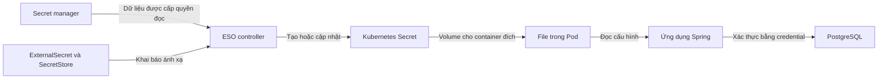

# Quản lý Secret bằng công cụ ngoài và ranh giới tích hợp

Trong chương **Bảo mật tích hợp** của **SPRING_CLOUD_KUBERNETES**, bài học này làm rõ cách dùng công cụ ngoài để quản lý bí mật và đưa chúng tới ứng dụng Spring trên Kubernetes. Trọng tâm là xác định ai cấp credential, ai vận chuyển, ai được đọc và ai chịu trách nhiệm khi credential thay đổi.

Spring Cloud Kubernetes có thể giúp ứng dụng đọc Kubernetes Secret và phối hợp cập nhật cấu hình. Việc đó không tự biến nó thành một hệ thống quản lý vòng đời bí mật bên ngoài. Một thiết kế đầy đủ phải nối được nguồn bí mật, cơ chế xác thực, cách phân phối và hành vi sử dụng thực tế của ứng dụng.

Sau bài học, bạn có thể:

- Phân biệt External Secrets Operator, Secrets Store CSI Driver, tích hợp trực tiếp và bí mật mã hóa trong Git.
- Chọn ranh giới giữa secret manager, Kubernetes và Spring.
- Thiết kế quyền đọc tối thiểu, quy trình rotation và xử lý lỗi mà không làm lộ dữ liệu.
- Thực hành xác minh đồng bộ và áp dụng credential bằng trạng thái cùng kết quả xác thực, thay vì in giá trị bí mật.

## 1. Tách nguồn quản lý, bản phân phối và nơi sử dụng

Ví dụ xuyên suốt bài: ứng dụng `orders` cần username/password để truy cập PostgreSQL. Nhóm vận hành muốn quản lý credential trong một secret manager bên ngoài và không đưa mật khẩu vào repository, image hay ConfigMap.

Ba lớp cần phân biệt:

| Lớp | Ví dụ | Trách nhiệm |
| --- | --- | --- |
| Nguồn quản lý | Vault hoặc dịch vụ secret manager của nền tảng | Quản lý giá trị, phiên bản, chính sách truy cập và vòng đời theo khả năng của backend |
| Cơ chế phân phối | Operator, CSI driver, agent hoặc thư viện client | Xác thực với nguồn, lấy dữ liệu và đưa tới nơi tiêu thụ |
| Nơi sử dụng | Spring Environment, DataSource, HTTP client, TLS context | Đọc giá trị đúng, áp dụng đúng lúc và ngừng dùng credential hết hiệu lực |

Đưa một mật khẩu mới vào secret manager chưa chắc đã đổi được mật khẩu của PostgreSQL. Với credential tĩnh, cần một quy trình cập nhật đồng bộ hệ thống đích và nguồn phân phối. Với credential động, backend cấp phát có thể quản lý việc tạo và thu hồi tài khoản theo cơ chế riêng.

Kubernetes Secret là một loại tài nguyên chứa dữ liệu nhạy cảm. Base64 trong trường `data` là biểu diễn dữ liệu, không phải cơ chế mã hóa bảo mật. Khi dùng Secret làm bản phân phối, vẫn phải kiểm tra mã hóa lưu trữ, RBAC và quyền truy cập workload. [Kubernetes Secrets](https://kubernetes.io/docs/concepts/configuration/secret/).

Trong ví dụ, secret manager là nơi quản lý giá trị. Kubernetes Secret, file mount và giá trị trong bộ nhớ Java là các bản được phân phối tới runtime; chúng vẫn cần được bảo vệ.

## 2. Bốn cách tích hợp phổ biến

| Cách | Luồng dữ liệu chính | Có cần Kubernetes Secret chứa dữ liệu không? | Ranh giới với Spring |
| --- | --- | --- | --- |
| External Secrets Operator, viết tắt ESO | Secret manager → controller → Kubernetes Secret | Có, với luồng ExternalSecret thông thường | Spring đọc Secret qua volume, biến môi trường hoặc API đã chọn |
| Secrets Store CSI Driver | Secret manager → provider/driver → volume của Pod | Không bắt buộc; có thể bật đồng bộ thêm | Spring đọc file; phải có cơ chế áp dụng thay đổi phù hợp |
| Tích hợp trực tiếp hoặc agent | Secret manager → client/agent → ứng dụng hoặc file | Không bắt buộc | Client/agent quản lý kết nối và xác thực; ứng dụng quản lý việc sử dụng |
| SOPS hoặc Sealed Secrets trong GitOps | Dữ liệu mã hóa → bên giải mã được cấp quyền → cấu hình runtime | Phụ thuộc quy trình; thường có Secret ở đích | Spring vẫn nhận dữ liệu sau khi giải mã, không tự giải mã vì có Spring Cloud Kubernetes |

Đây là các hướng kiến trúc, không phải bốn tính năng cần bật cùng lúc.

SOPS bảo vệ nội dung cấu hình bằng mã hóa với các danh tính được phép giải mã. Sealed Secrets cung cấp công cụ và controller để đưa dữ liệu đã mã hóa tới Kubernetes Secret. Đổi khóa mã hóa hoặc mã hóa lại file không đồng nghĩa đổi credential ở database. [SOPS](https://getsops.io/), [Sealed Secrets](https://github.com/bitnami/sealed-secrets).

Tiêu chí chọn cần gắn với nhu cầu: có chấp nhận bản sao trong Kubernetes API không, có cần credential động theo lease không, ứng dụng đọc file được không và ai vận hành cơ chế rotation.

## 3. Vẽ rõ đường dữ liệu và đường cấp quyền

Với ESO và Secret volume:



Đường dữ liệu không đồng nhất với danh tính thực hiện:

| Tác vụ | Danh tính hoặc quyền cần xác định |
| --- | --- |
| Tạo credential trong PostgreSQL | Chủ thể quản trị hoặc backend cấp phát được giao trách nhiệm |
| Đọc secret manager | Danh tính mà cấu hình provider/SecretStore chọn |
| Ghi Kubernetes Secret | ServiceAccount và RBAC của controller |
| Mount Secret vào Pod | Cơ chế Kubernetes/kubelet và quyền tạo hoặc sửa workload |
| Đọc file trong container | User/group, volume mount và quyền runtime |
| Gọi Kubernetes API từ ứng dụng | ServiceAccount của ứng dụng, nếu ứng dụng thật sự cần gọi |
| Kết nối database | Credential nghiệp vụ được phân phối |

Không dùng một tài khoản quyền rộng cho mọi hàng. Danh tính mà ESO hoặc CSI dùng để truy cập backend có thể dựa trên workload identity hoặc cơ chế xác thực khác, tùy provider. Cần kiểm tra chủ thể thực tế trong cấu hình và audit của backend, không suy ra chỉ từ tên Pod.

Ứng dụng chỉ nhận credential qua volume không cần được cấp `get/list/watch secrets` cho việc đọc file đó. Nếu ứng dụng đồng thời dùng DiscoveryClient, chỉ cấp các quyền API cần cho discovery theo implementation; nhu cầu discovery không tự tạo ra nhu cầu đọc Secret.

## 4. Ví dụ ESO: đồng bộ có giới hạn tới một Secret

### 4.1. Điều kiện của ví dụ

Giả sử môi trường thực hành đã có:

- ESO và CRD hỗ trợ `external-secrets.io/v1`.
- Namespace `secret-lab` và ServiceAccount ứng dụng `orders`.
- SecretStore `orders-store` do nhóm nền tảng quản lý trong namespace này.
- Provider hỗ trợ đọc một đối tượng có các thuộc tính `username`, `password`, `revision`.
- Danh tính provider chỉ được đọc nguồn thử nghiệm `training/orders/database`.
- Credential trong nguồn khớp với credential hợp lệ của PostgreSQL thử nghiệm.

Bài không giả định một cấu hình IAM dùng chung cho mọi nhà cung cấp. SecretStore phải được cấu hình và kiểm chứng theo backend được chọn; không đặt access key quản trị dài hạn trong manifest ví dụ.

`revision` là mã phiên bản do bài thực hành đặt ra, chẳng hạn `r1`, không phải mật khẩu hoặc hash của mật khẩu. Nó hỗ trợ quan sát, không tự chứng minh xác thực thành công.

### 4.2. Khai báo ánh xạ

```yaml
apiVersion: external-secrets.io/v1
kind: ExternalSecret
metadata:
  name: orders-db
  namespace: secret-lab
spec:
  refreshPolicy: Periodic
  refreshInterval: 1m
  secretStoreRef:
    name: orders-store
    kind: SecretStore
  target:
    name: orders-db
    creationPolicy: Owner
    deletionPolicy: Retain
  data:
    - secretKey: username
      remoteRef:
        key: training/orders/database
        property: username
    - secretKey: password
      remoteRef:
        key: training/orders/database
        property: password
    - secretKey: revision
      remoteRef:
        key: training/orders/database
        property: revision
```

`ExternalSecret` mô tả dữ liệu cần lấy và Secret đích. Với `Periodic` và khoảng thời gian dương, controller định kỳ đồng bộ theo chính sách đó. Khoảng một phút là lựa chọn của bài, không phải cam kết rằng ứng dụng sẽ dùng credential mới trong đúng một phút. [ExternalSecret API](https://external-secrets.io/latest/api/externalsecret/).

Lưu ý hai loại xóa khác nhau:

- `creationPolicy: Owner` gắn quan hệ sở hữu; xóa ExternalSecret có thể dẫn tới thu gom Secret đích.
- `deletionPolicy: Retain` mô tả cách giữ bản đích khi dữ liệu nguồn bị xóa theo hành vi provider được hỗ trợ; nó không vô hiệu hóa quan hệ sở hữu trên.

Trước khi dùng chính sách xóa, kiểm tra hỗ trợ của provider và thử trong môi trường riêng. [Vòng đời và chính sách sở hữu của ESO](https://external-secrets.io/latest/guides/ownership-deletion-policy/).

### 4.3. Quyền tạo ExternalSecret cũng là quyền nhạy cảm

Người được sửa `remoteRef` có thể yêu cầu controller lấy một đường dẫn khác mà danh tính provider đọc được. Vì thế, quyền sửa ExternalSecret và SecretStore phải được xem cùng quyền của backend.

SecretStore có phạm vi namespace không tự thu hẹp IAM của nhà cung cấp. Với mô hình nhiều nhóm, có thể quản lý SecretStore riêng từng namespace và danh tính provider có tập khóa nhỏ. Không chia sẻ một danh tính đọc toàn bộ bí mật chỉ vì mỗi nhóm có namespace riêng. [Mô hình nhiều tenant của ESO](https://external-secrets.io/latest/guides/multi-tenancy/).

## 5. Đưa Secret tới Spring bằng volume

### 5.1. Mount đúng key cho đúng container

Đoạn sau là **phần PodSpec để ghép vào Deployment đã có**, không phải một Deployment hoàn chỉnh. Ví dụ giả định container Linux của ứng dụng chạy với UID/GID `10001`.

```yaml
serviceAccountName: orders
securityContext:
  runAsNonRoot: true
  runAsUser: 10001
  runAsGroup: 10001
  fsGroup: 10001
containers:
  - name: orders
    volumeMounts:
      - name: db-credentials
        mountPath: /run/secrets/orders
        readOnly: true
volumes:
  - name: db-credentials
    secret:
      secretName: orders-db
      defaultMode: 0440
      items:
        - key: username
          path: spring.datasource.username
        - key: password
          path: spring.datasource.password
        - key: revision
          path: app.credentials.revision
```

Tên file được chọn để khớp tên property. Chỉ mount vào container cần sử dụng và kiểm tra quyền truy cập bằng user runtime thật. Không coi `readOnly` là cơ chế ngăn tiến trình đọc bí mật; nó chỉ hạn chế ghi qua mount đó.

Không dùng `subPath` nếu thiết kế dựa vào việc cập nhật nội dung volume Secret. Đồng thời, ứng dụng không nên giữ một file descriptor cũ vô hạn rồi giả định luôn đọc được nội dung mới.

### 5.2. Import configuration tree

Cấu hình ứng dụng minh họa:

```yaml
spring:
  application:
    name: orders
  config:
    import: "configtree:/run/secrets/orders/"
  datasource:
    url: jdbc:postgresql://postgres.secret-lab.svc.cluster.local:5432/orders
  cloud:
    kubernetes:
      secrets:
        enabled: false
```

Spring Boot hỗ trợ `configtree:` để ánh xạ tên file thành property và nội dung file thành giá trị. Ví dụ này nạp username/password mà không cần ứng dụng đọc Secret bằng Kubernetes API. Không có `optional:` vì thư mục credential là nguồn bắt buộc của luồng thử. [Configuration trees của Spring Boot](https://docs.spring.io/spring-boot/reference/features/external-config.html#features.external-config.files.configtrees).

`spring.cloud.kubernetes.secrets.enabled=false` tắt đường Secrets PropertySource của Spring Cloud Kubernetes trong ví dụ, tránh vô tình tạo thêm một đường đọc Secret. Nó không tắt mọi tính năng Kubernetes của ứng dụng. Nếu dùng nhiều nguồn import, phải khai báo danh sách nhất quán với ứng dụng thực tế.

Thư mục tồn tại chưa bảo đảm đủ key hoặc credential hợp lệ. Ứng dụng cần kiểm tra dữ liệu bắt buộc và xác thực kết nối trước khi nhận lưu lượng nghiệp vụ phụ thuộc database.

Configuration tree là cách nạp cấu hình; chỉ thêm dòng import không tạo ra một cơ chế tự thay DataSource đang chạy khi file đổi. Luồng áp dụng sau cập nhật được thiết kế riêng ở phần rotation.

### 5.3. Đừng tạo hai nguồn cho cùng một property

Nếu mật khẩu đồng thời xuất hiện trong file mount, biến môi trường, Secret PropertySource và tham số JVM, ứng dụng có thể dùng nguồn khác với nguồn bạn vừa cập nhật.

Trong hồ sơ triển khai, ghi rõ một đường có thẩm quyền cho mỗi credential. Kiểm tra precedence theo đúng cơ chế cấu hình của Spring và release đang dùng. Đổi file mà một biến môi trường ưu tiên cao hơn vẫn ghi đè sẽ không tạo ra kết quả mong muốn.

Ví dụ trên chọn file mount cho credential. ConfigMap có thể chứa cấu hình không bí mật như tên database hoặc timeout, nhưng không dùng làm nơi “dự phòng” mật khẩu.

## 6. Nhánh CSI: mount trực tiếp từ secret manager

Với Secrets Store CSI Driver, ứng dụng tham chiếu một `SecretProviderClass` đã được cấu hình cho provider. Đường dữ liệu có thể đi tới file trong Pod mà không tạo bản Kubernetes Secret.

Trích đoạn volume và mount:

```yaml
containers:
  - name: orders
    volumeMounts:
      - name: external-credentials
        mountPath: /run/secrets/orders
        readOnly: true
volumes:
  - name: external-credentials
    csi:
      driver: secrets-store.csi.k8s.io
      readOnly: true
      volumeAttributes:
        secretProviderClass: orders-db-files
```

Điều kiện: driver/provider đã cài, SecretProviderClass `orders-db-files` ở namespace của Pod, danh tính đã được giới hạn và tên file được ánh xạ phù hợp với ứng dụng. Các tham số provider không giống nhau, nên đoạn volume trên không thay thế cấu hình provider. [Sử dụng Secrets Store CSI Driver](https://secrets-store-csi-driver.sigs.k8s.io/getting-started/usage).

Hai lựa chọn cần phân biệt:

1. **Chỉ mount file:** không có Secret tương ứng trong Kubernetes API cho Spring Cloud Kubernetes theo dõi.
2. **Mount và đồng bộ thêm Kubernetes Secret:** có thêm bản sao cùng các quyền và vòng đời phải quản lý.

Đồng bộ Secret là tính năng tùy chọn. Theo tài liệu driver, nó gắn với Pod mount nội dung; không nên thiết kế một consumer chỉ chờ Secret được đồng bộ mà bỏ qua vòng đời Pod mount. [Đồng bộ CSI thành Kubernetes Secret](https://secrets-store-csi-driver.sigs.k8s.io/topics/sync-as-kubernetes-secret).

Auto rotation cũng cần được bật và cấu hình theo phiên bản driver/provider. Nó cập nhật nội dung phân phối; driver không tự restart ứng dụng. File đổi cần cơ chế đọc lại, còn biến môi trường của container đang chạy không tự đổi theo. [Rotation của CSI Driver](https://secrets-store-csi-driver.sigs.k8s.io/topics/secret-auto-rotation).

Nếu dùng CSI thuần file, không thêm một Kubernetes Secret chứa cùng dữ liệu chỉ để “cho watcher thấy” khi kiến trúc không cần nó. Trước tiên chọn cơ chế áp dụng file phù hợp với ứng dụng.

## 7. Nhánh tích hợp trực tiếp: client hoặc agent quản lý phiên riêng

Ứng dụng có thể đọc secret manager qua thư viện phù hợp, hoặc nhận file từ một agent được cấu hình. Khi đó, phải chỉ định rõ bên nào quản lý:

- Xác thực ban đầu và làm mới token.
- Lease, TTL, gia hạn và thu hồi nếu backend có các khái niệm này.
- Cache, timeout, retry và giới hạn tần suất gọi.
- Giao dữ liệu mới cho ứng dụng và xử lý khi không lấy được bản tiếp theo.
- Dọn phiên hoặc credential được cấp phát khi workload kết thúc.

Spring Cloud Vault là một tích hợp riêng dành cho Vault. Nó có cơ chế quản lý vòng đời token và lease theo loại backend, cấu hình và phiên bản. Chỉ thêm Spring Cloud Kubernetes không tự cung cấp các cơ chế đó. [Vòng đời lease và phiên của Spring Cloud Vault](https://docs.spring.io/spring-cloud-vault/reference/advanced-topics.html#lease-lifecycle-management-renewal-and-revocation).

Với credential động có thời hạn, một Secret tĩnh chứa username/password không đủ mô tả ai đang gia hạn lease. Phải kiểm tra công cụ đang dùng có hỗ trợ đúng vòng đời backend hay không, ai giữ lease và điều gì xảy ra khi chủ thể đó dừng.

Ví dụ thiết kế: nếu mỗi replica được cấp một credential động riêng, đừng vô tình đưa tất cả replica về cùng một Secret mà một replica khác có thể thu hồi khi shutdown. Nếu chọn credential dùng chung, phải có một chủ sở hữu vòng đời phù hợp với mô hình đó.

Đường trực tiếp làm giảm một số bản sao trung gian nhưng tăng trách nhiệm của client hoặc agent. Không gọi secret manager trên từng request nghiệp vụ nếu thiết kế có thể dùng một cơ chế cache và gia hạn phù hợp.

## 8. Spring Cloud Kubernetes bắt đầu và kết thúc ở đâu?

| Thành phần | Có thể đảm nhiệm | Không tự bảo đảm |
| --- | --- | --- |
| Secrets PropertySource | Đưa dữ liệu Secret được chọn vào cấu hình Spring | Tạo tài khoản database, đặt IAM hoặc thu hồi credential ở backend |
| Configuration Watcher | Quan sát nguồn Kubernetes theo cấu hình và phát thông báo refresh | Nhận event từ mọi file CSI hoặc mọi secret manager |
| Refresh của ứng dụng | Kích hoạt cơ chế nạp lại được hỗ trợ | Mọi bean, pool và kết nối đang chạy đều thay credential đúng |
| DiscoveryClient | Cung cấp thông tin Service/instance theo implementation | Phân quyền truy cập dữ liệu bí mật |
| Spring Cloud LoadBalancer | Chọn instance theo nguồn và chính sách | Xác thực database hoặc quản lý vòng đời token của secret manager |

Secrets PropertySource của Spring Cloud Kubernetes có các cách chọn nguồn và đường đọc khác nhau. Nếu bật đọc qua Kubernetes API, cần cấp quyền theo hành vi thực tế của client; đọc theo nhãn có thể dẫn tới quyền trên một tập Secret rộng hơn mong muốn. [Secrets PropertySource](https://docs.spring.io/spring-cloud-kubernetes/reference/property-source-config/secrets-propertysource.html).

Trong nhánh ESO, controller cập nhật Kubernetes Secret nên một watcher được cấu hình phù hợp có thể quan sát thay đổi ở lớp này. Điều đó chỉ chứng minh có đường phát thông báo; còn phải kiểm tra ứng dụng đọc lại đúng nguồn và áp dụng được giá trị mới.

Trong nhánh CSI thuần file, không có Secret tương ứng để watcher Kubernetes theo dõi. Có thể chọn rollout có kiểm soát, cơ chế quan sát file hoặc tích hợp reload riêng của ứng dụng. Không cấu hình watcher theo tên một Secret không tồn tại rồi chờ nó phát hiện thay đổi file.

Nếu chọn Configuration Watcher, kiểm tra tài liệu đúng release về bật theo dõi Secret, namespace, nhãn chọn nguồn và cách gửi refresh. Bật đọc Secrets PropertySource và bật theo dõi thay đổi là hai việc cần xác minh riêng. [Configuration Watcher](https://docs.spring.io/spring-cloud-kubernetes/reference/spring-cloud-kubernetes-configuration-watcher.html).

Một thông báo refresh không nên mang toàn bộ credential. Đích của thông báo là yêu cầu bên được phép đọc lại nguồn, không phải phát tán mật khẩu qua payload log, HTTP hoặc bus.

## 9. Rotation là một quy trình đầu cuối

Cần phân biệt ba mốc:

```text
Published:   nguồn quản lý đã có bản mới
Delivered:   Secret hoặc file runtime đã nhận bản mới
Applied:     ứng dụng dùng bản mới và xác thực thành công
```

Không đánh dấu hoàn tất rotation chỉ vì ExternalSecret có `Ready=True`, Secret đổi `resourceVersion` hoặc file đổi timestamp. Mốc Applied phải có bằng chứng từ nơi sử dụng credential.

### 9.1. Quy trình có khoảng chồng lấn

Nếu backend cho phép hai credential hợp lệ đồng thời, quy trình minh họa là:

1. Chuẩn bị credential mới tại hệ thống đích với quyền tối thiểu.
2. Xuất bản bộ giá trị tương ứng vào secret manager.
3. Đợi cơ chế phân phối nhận bản mới và xác minh nguồn dữ liệu đầy đủ.
4. Áp dụng vào từng replica bằng cơ chế đã chọn.
5. Mở phiên xác thực mới để kiểm tra credential mới hoạt động.
6. Dừng cấp công việc mới cho kết nối cũ và drain theo thời hạn.
7. Thu hồi credential cũ khi đủ điều kiện.
8. Kiểm tra hệ thống vẫn phục vụ được sau thu hồi.

Nếu backend không hỗ trợ khoảng chồng lấn, cần thiết kế chuyển đổi phối hợp với ngân sách gián đoạn cụ thể. Không hứa rotation không gián đoạn chỉ dựa vào việc có operator.

### 9.2. Đọc một bộ credential nhất quán

Username, password và revision phải đại diện cho cùng một lần chuyển đổi. Không đọc username mới rồi ghép với password cũ trong lúc nguồn đang cập nhật.

Ví dụ ESO sử dụng cùng một đối tượng nguồn để biểu đạt bộ dữ liệu. Tuy vậy, không suy ra mọi provider thực hiện nhiều `remoteRef` trong một transaction. Kiểm tra khả năng pin version, cách đọc và bảo đảm nhất quán của backend; sau đó xác minh toàn bộ candidate trước khi áp dụng.

### 9.3. Áp dụng vào tài nguyên đang sống

Pseudocode dưới mô tả trách nhiệm ứng dụng, không phải API có sẵn của Spring:

```text
onCredentialCandidateAvailable:
    candidate = readCompleteCredentialSet()
    validateRequiredFields(candidate)

    preparedClient = buildClientOrPool(candidate)
    try:
        verifyUsingNewAuthenticatedSession(preparedClient)
        previousClient = atomicallyActivate(preparedClient)
        reportAppliedRevisionWithoutSecretValues(candidate.revision)
        drainAndClose(previousClient, deadline)
    catch failure:
        closeIfNotActivated(preparedClient)
        reportRedactedApplyFailure(failure)
        applyCurrentCredentialValidityPolicy()
```

Cần thiết kế đồng bộ giữa các thread và hợp đồng đóng tài nguyên theo loại client/pool. Nếu dùng rollout thay vì thay pool trong tiến trình, Pod mới phải kiểm tra credential và readiness trước khi thay thế năng lực của Pod cũ.

Đọc được `app.credentials.revision=r2` không đủ nếu ứng dụng vẫn giữ một DataSource tạo từ bản `r1`. Một health check mượn kết nối cũ đã xác thực cũng chưa chứng minh có thể tạo kết nối mới bằng `r2`.

Tương tự, thu hồi quyền đăng nhập không luôn cắt ngay mọi phiên database đã mở. Phải kiểm tra hành vi của database và quy trình thu hồi để xác định lúc nào kết nối cũ không còn được phép hoạt động.

## 10. Thiết kế hành vi khi nguồn hoặc credential gặp lỗi

Bảng sau là chính sách đề xuất để thảo luận cho ứng dụng `orders`, không phải mặc định của mọi thư viện.

| Tình huống | Cách xử lý cần thiết kế |
| --- | --- |
| Lần khởi động đầu chưa có Secret bắt buộc | Chờ có giới hạn hoặc không nhận lưu lượng phụ thuộc database |
| Secret manager tạm mất kết nối nhưng credential hiện tại còn hợp lệ | Tiếp tục trong ngân sách được duyệt, retry có backoff và báo trạng thái đồng bộ lỗi |
| Credential hiện tại đã hết hạn hoặc bị thu hồi | Ngừng dùng cho công việc cần xác thực; readiness hoặc đường lỗi nghiệp vụ phải phản ánh khả năng phục vụ |
| Candidate thiếu key hoặc không xác thực được | Không áp dụng một phần; giữ trạng thái hiện tại chỉ khi nó còn hợp lệ |
| ESO hoặc provider bị từ chối quyền | Sửa danh tính/policy; không retry nóng hoặc mở rộng quyền toàn kho để chữa nhanh |
| CSI không mount được khi tạo Pod | Điều tra driver, provider, danh tính và sự kiện volume trước khi sửa ứng dụng |
| Secret đích bị sửa tay | Đối chiếu chủ sở hữu dữ liệu; reconcile có thể ghi lại từ nguồn |
| Secret nguồn bị xóa | Áp dụng chính sách xóa/giữ đã chọn; đồng thời kiểm tra credential ở hệ thống đích |

Giữ được bản cũ không có nghĩa được dùng vô thời hạn. Xác định điều kiện chấm dứt dùng bản cũ bằng thời hạn credential, trạng thái thu hồi và yêu cầu nghiệp vụ.

Nếu đang dùng credential động, thời gian đồng bộ định kỳ phải phù hợp với lease và khoảng an toàn. Một vòng retry kéo dài vượt TTL có thể khiến ứng dụng hết quyền truy cập dù file vẫn còn.

Trong thiết kế của bài, liveness phản ánh tiến trình có vận hành được, còn readiness phản ánh khả năng nhận công việc cần credential. Không biến mọi sự cố secret manager thành lệnh restart đồng loạt các replica; restart có thể làm mất bản đang dùng và tạo thêm yêu cầu lấy bí mật.

Rollback cũng là thay đổi có kiểm soát tại nguồn hoặc quy trình chuyển phiên bản. Không sửa tay Secret do ESO quản lý rồi coi đó là rollback bền vững; controller có thể ghi đè lại.

## 11. Kiểm soát quyền ở từng ranh giới

### 11.1. Kubernetes RBAC và quyền sửa workload

Với nhánh volume, ServiceAccount ứng dụng không cần quyền đọc Secret qua API cho việc mount. Tuy nhiên, người có quyền tạo hoặc sửa Pod/Deployment có thể đưa một Secret trong namespace vào workload họ kiểm soát. Quyền `exec`, thêm container gỡ lỗi và quyền quản trị node cũng cần được xem trong mô hình truy cập.

Quyền `list` Secret cho phép lấy cả dữ liệu, không chỉ danh sách tên. Không cấp quyền rộng đó chỉ để tạo dashboard hoặc chọn vài nguồn bằng nhãn. [Thực hành bảo vệ Kubernetes Secret](https://kubernetes.io/docs/concepts/security/secrets-good-practices/).

Kiểm tra đầy đủ RoleBinding/ClusterRoleBinding đang áp dụng. Một Role hạn chế không “phủ định” quyền rộng đã được cấp từ nơi khác.

### 11.2. SecretStore, namespace và IAM backend

Giới hạn cả người sửa store lẫn người sửa mapping. Với ClusterSecretStore, cân nhắc điều kiện namespace được phép sử dụng và ai được thay nhãn namespace. Điều kiện chọn namespace không tự tạo policy đọc theo từng khóa tại backend.

ESO có các cơ chế giới hạn tài nguyên theo namespace và lựa chọn triển khai phù hợp. Với môi trường nhiều tenant, cần kết hợp chúng với quyền của provider và chính sách admission khi cần kiểm soát mapping hoặc đích ghi. [Ranh giới bảo mật của ESO](https://external-secrets.io/latest/guides/security-best-practices/).

Ví dụ chính sách của bài:

```text
Nhóm ứng dụng:
    được tham chiếu orders-store trong secret-lab
    chỉ ánh xạ nguồn training/orders/database
    chỉ ghi Secret đích orders-db
    không tự sửa danh tính provider hoặc ClusterSecretStore

Danh tính provider:
    chỉ có quyền đọc nguồn đã duyệt
    không có quyền quản trị, đổi policy hoặc đọc nhóm khác

Ứng dụng orders:
    đọc volume được mount
    không có get/list/watch secrets qua API
    quyền discovery, nếu có, được đánh giá riêng
```

Đây là mục tiêu phân quyền; cần triển khai bằng các cơ chế thật của Kubernetes, provider và nền tảng. Một dòng mô tả trong Git không tự thực thi policy.

### 11.3. Danh tính khởi tạo và đường mạng

Ưu tiên cơ chế danh tính workload được nền tảng hỗ trợ thay cho việc nhúng một credential quản trị dài hạn để đọc credential khác. Kiểm tra liên kết ServiceAccount, namespace, role, audience và thời hạn token theo provider.

Không tắt xác minh TLS để làm cho secret manager “kết nối được”. Cấu hình trust và đường mạng phù hợp; giới hạn egress theo khả năng của môi trường mà vẫn cho phép DNS, endpoint danh tính và backend cần thiết.

Nếu ứng dụng chỉ mount Secret và không gọi bất kỳ API nào cần ServiceAccount token, có thể đánh giá tắt automount. Nếu dùng DiscoveryClient hoặc xác thực backend cần token, phải cung cấp đúng token và audience cần thiết; không áp dụng tắt token một cách máy móc.

### 11.4. Một chủ sở hữu dữ liệu

Với ví dụ, GitOps quản lý khai báo ExternalSecret, ESO quản lý dữ liệu Secret đích, ứng dụng chỉ tiêu thụ. Tránh để GitOps, CSI sync và ESO cùng ghi một Secret chứa credential.

Nếu cần Secret bất biến, phải thiết kế tên theo phiên bản và cập nhật tham chiếu workload phù hợp. Không kỳ vọng Secret đã đánh dấu immutable vẫn được operator cập nhật tại chỗ cho rotation.

Bảo vệ cả các bản sao ngoài đường phân phối chính: backup, log, heap dump, bản chẩn đoán, cache và dữ liệu trên node. Secret manager bên ngoài không tự xóa credential đã bị sao chép sang các nơi này.

## 12. Thực hành xác minh mà không in dữ liệu bí mật

Bài thực hành chọn **ESO → Secret volume → configuration tree → rollout có kiểm soát**. Không yêu cầu Configuration Watcher cho nhánh này. Một vòng thực hành khác có thể đánh giá refresh trong tiến trình nếu ứng dụng đã hỗ trợ đầy đủ.

### 12.1. Chuẩn bị và kiểm tra điều kiện

Dùng môi trường riêng với credential thử nghiệm có quyền hẹp. Chuẩn bị source `training/orders/database`, SecretStore đã phê duyệt, PostgreSQL và Deployment `orders` có hai replica.

Ứng dụng thử cần:

- Đọc các file theo phần 5.
- Kiểm tra key bắt buộc và xác thực database trước khi sẵn sàng.
- Có cách quan sát revision đã áp dụng.
- Có phép thử tạo một phiên kết nối mới, không chỉ tái dùng kết nối cũ.
- Không in credential trong log hoặc thông báo lỗi.

Không đặt mật khẩu thật vào `--from-literal`, lệnh shell, tham số JVM hay ví dụ commit vào Git. Dùng luồng nhập và cập nhật bí mật đã được phê duyệt của backend.

### 12.2. Xác minh quyền API của ứng dụng

Tài khoản vận hành có quyền impersonate có thể chạy:

```powershell
kubectl auth can-i get secret/orders-db -n secret-lab --as=system:serviceaccount:secret-lab:orders
kubectl auth can-i list secrets -n secret-lab --as=system:serviceaccount:secret-lab:orders
kubectl auth can-i watch secrets -n secret-lab --as=system:serviceaccount:secret-lab:orders
```

Kỳ vọng với thiết kế chỉ dùng volume là `no` cho các quyền trên. Ứng dụng vẫn phải sử dụng được file đã mount.

`can-i` kiểm tra quyền Kubernetes của danh tính được hỏi. Nó không xác minh IAM tại secret manager, quyền đọc file trong container hoặc khả năng người sửa Deployment gắn Secret vào workload khác. Các kiểm tra đó là những nhánh riêng.

### 12.3. Đợi đồng bộ ban đầu

Áp dụng manifest ExternalSecret của phần 4 theo quy trình môi trường thực hành, rồi quan sát:

```powershell
kubectl -n secret-lab wait --for=condition=Ready externalsecret/orders-db --timeout=120s

kubectl -n secret-lab get externalsecret orders-db -o "custom-columns=NAME:.metadata.name,REFRESH:.status.refreshTime"

kubectl -n secret-lab get pods -l app=orders -o wide
```

Kết quả Ready và thời gian refresh là tín hiệu của controller. Cần tiếp tục xác minh ứng dụng đã đọc và xác thực thành công với revision ban đầu.

Nếu cần xem metadata của Secret đích, chỉ người đã có quyền phù hợp thực hiện và không xuất `data`. Ngay cả lệnh chỉ in metadata vẫn có thể dùng một yêu cầu đọc Secret đầy đủ ở phía API; không cấp thêm quyền cho ứng dụng chỉ để chạy lệnh chẩn đoán này.

### 12.4. Chuyển từ r1 sang r2

Thực hiện quy trình có khoảng chồng lấn nếu backend hỗ trợ:

1. Tạo credential mới hợp lệ tại database thử nghiệm.
2. Cập nhật bộ dữ liệu trong secret manager cùng revision `r2` qua luồng bảo mật của backend.
3. Đối chiếu lần reconcile sau thời điểm thay đổi và xác nhận bản phân phối đã được cập nhật.
4. Chạy rollout sau khi dữ liệu đích sẵn sàng.
5. Xác minh từng replica mới dùng r2 và mở phiên xác thực mới thành công.
6. Thu hồi r1 theo quy trình đã chọn, rồi xác nhận nghiệp vụ vẫn chạy.

Lệnh rollout trong môi trường thực hành:

```powershell
kubectl -n secret-lab rollout restart deployment/orders
kubectl -n secret-lab rollout status deployment/orders --timeout=180s
```

`rollout status` thành công chỉ là một phần bằng chứng. Readiness, revision và phép xác thực mới phải cùng đáp ứng điều kiện.

Một trạng thái `Ready=True` của ExternalSecret từ trước không tự chứng minh r2 đã được lấy. Đối chiếu thời điểm refresh, đường phân phối và revision mà ứng dụng xác nhận; nếu cần, kiểm tra phiên bản nguồn theo khả năng của provider mà không xuất giá trị bí mật.

### 12.5. Tạo bằng chứng ở nơi tiêu thụ

Có thể xây endpoint nội bộ `/internal/credential-status` trả về dữ liệu giới hạn như:

```json
{
  "appliedRevision": "r2",
  "newConnectionVerified": true,
  "lastVerificationTime": "2026-11-25T03:00:00Z"
}
```

Đây là endpoint do ứng dụng thực hành tự xây, không phải endpoint mặc định của Spring. Chỉ báo thành công sau khi phép thử thực sự tạo phiên xác thực mới. Hạn chế quyền truy cập endpoint và không trả username, password, token, connection string có credential hoặc toàn bộ Environment.

Không dùng hash mật khẩu làm mã phiên bản công khai. Dùng revision riêng không nhạy cảm, và xem revision là thông tin chẩn đoán cần kiểm soát theo ngữ cảnh.

### 12.6. Kiểm tra các nhánh thất bại

| Phép thử trong môi trường riêng | Bằng chứng mong đợi |
| --- | --- |
| Tạm từ chối quyền đọc nguồn thử nghiệm | Controller báo lỗi quyền; không xuất payload |
| Tạo candidate thiếu password | Ứng dụng không áp dụng một phần hoặc không nhận lưu lượng khi chưa có bản hợp lệ |
| Tạm ngắt kết nối backend | Có retry được giới hạn và tín hiệu đồng bộ trễ |
| Xuất bản r2 có dữ liệu không khớp database | Phép xác thực mới thất bại; r2 chưa được báo Applied |
| Thu hồi r1 sau khi r2 đã áp dụng | Các replica tiếp tục mở được phiên mới |
| Đổi nguồn trong khi ứng dụng chỉ nạp lúc khởi động | Dữ liệu phân phối đổi nhưng ứng dụng chưa đổi cho tới cơ chế áp dụng đã chọn |
| Thử mapping ngoài tập nguồn đã duyệt | Policy chặn ở lớp được thiết kế; không đọc dữ liệu nhóm khác |

Chỉ thay quyền và nguồn thử nghiệm thuộc phạm vi thực hành. Không dùng secret của nhóm khác làm dữ liệu kiểm tra âm.

## 13. Quan sát trạng thái, không quan sát giá trị

Các chỉ số dưới là gợi ý cho thiết kế; tên cụ thể của metric có sẵn phụ thuộc công cụ và phiên bản.

| Tín hiệu | Ý nghĩa |
| --- | --- |
| Lần đồng bộ thành công gần nhất | Biết controller hoặc provider đã hoạt động gần đây |
| Tuổi dữ liệu phân phối | Phát hiện vượt ngân sách đồng bộ |
| Số lỗi xác thực/quyền theo nhóm | Phân biệt mất quyền với lỗi mạng |
| Revision đã áp dụng theo replica | Tìm replica chưa chuyển phiên bản |
| Lần xác thực mới thành công gần nhất | Xác minh credential tại nơi sử dụng |
| Thời gian tới hết hạn | Chủ động xử lý lease hoặc credential sắp hết hiệu lực |
| Lỗi áp dụng, queue hoặc số lần rollout | Nhận ra vòng cập nhật lặp và gián đoạn |

Không đưa token, giá trị Secret hoặc đường dẫn bí mật chi tiết không cần thiết vào nhãn metric. Revision có thể tạo số lượng giá trị lớn nếu gắn làm label lâu dài; chọn cách lưu trạng thái hoặc log được kiểm soát phù hợp.

Log lỗi nên ghi lớp lỗi, tên nguồn theo quy ước cho phép, thời điểm và trạng thái, thay vì dump response body của provider. Khi rà soát audit, bảo đảm chính sách không ghi nội dung nhạy cảm ngoài nhu cầu đã duyệt.

Endpoint Actuator và cơ chế che giá trị cũng cần cấu hình, kiểm thử và hạn chế truy cập. Không coi sanitization là lý do để công khai `/env`, `/configprops` hoặc heap dump.

Một phép đo rotation hữu ích bao gồm thời gian xuất bản, thời gian phân phối, replica áp dụng chậm nhất và thời điểm thu hồi bản cũ. Số liệu “ESO đồng bộ trong 10 giây” chưa mô tả đầy đủ vòng đời đó.

## 14. Chọn ranh giới phù hợp cho triển khai

| Nhu cầu chính | Hướng cần đánh giá | Điều kiện phải kiểm chứng |
| --- | --- | --- |
| Ứng dụng hiện có chỉ nhận Kubernetes Secret | ESO hoặc cơ chế đồng bộ tương đương | RBAC, mã hóa lưu trữ, quyền controller và vòng đời Secret |
| Muốn nhận file mà không tạo Secret dữ liệu trong API | CSI hoặc agent thích hợp | Mount, quyền runtime, cơ chế cập nhật và áp dụng |
| Credential động cần lease theo phiên ứng dụng | Client/agent hỗ trợ backend | Gia hạn, thu hồi, ownership và thay client đang sử dụng |
| Quy trình GitOps quản lý dữ liệu mã hóa | SOPS hoặc Sealed Secrets theo kiến trúc chọn | Quyền giải mã, lưu giữ khóa, phục hồi và rotation credential riêng |
| Chỉ cần discovery hoặc LoadBalancer | Giữ tích hợp cần thiết cho discovery | Không cấp quyền Secret khi không có nhu cầu đọc |

Ví dụ `orders` của bài chọn ESO và volume vì ứng dụng cần cấu hình database khi khởi động, chấp nhận bản sao Kubernetes Secret và sử dụng rollout để áp dụng. Spring Cloud Kubernetes vẫn có thể phục vụ discovery với quyền riêng; không cần bật Secrets PropertySource hoặc Configuration Watcher chỉ để đọc các file đó.

Nếu yêu cầu đổi thành credential động theo từng replica hoặc không chấp nhận dữ liệu trong Kubernetes API, phải đánh giá lại đường phân phối và chủ sở hữu vòng đời. Thay công cụ kéo theo thay đổi trách nhiệm, không chỉ đổi một manifest.

Câu hỏi tự kiểm tra:

- Secret manager có bản mới nhưng PostgreSQL chưa chấp nhận credential đó: hệ thống đã rotation thành công chưa?
- Vì sao ServiceAccount không được `get secrets` vẫn có thể đọc Secret được mount?
- Vì sao quyền sửa ExternalSecret có thể nhạy cảm dù manifest không chứa mật khẩu?
- Khi dùng CSI thuần file, Configuration Watcher sẽ quan sát tài nguyên Kubernetes nào để biết file đã đổi?
- Làm thế nào chứng minh DataSource đang dùng r2 thay vì chỉ đọc được property revision r2?
- Ai chịu trách nhiệm gia hạn và thu hồi một credential động khi replica dừng?
- Xóa Secret nguồn, xóa ExternalSecret và thu hồi credential tại database khác nhau như thế nào?
