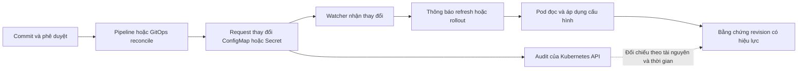

# Kiểm toán truy cập và thay đổi tài nguyên cấu hình

## Mục tiêu và phạm vi

Trong chương **Bảo mật tích hợp** của module **SPRING_CLOUD_KUBERNETES**, bài này xây dựng cách trả lời hai nhóm câu hỏi: ai đã đọc hoặc sửa ConfigMap/Secret trên Kubernetes, và ứng dụng Spring nào đã thực sự sử dụng cấu hình sau thay đổi. Hai nhóm bằng chứng này cần được liên kết nhưng không thay thế nhau.

Sau bài học, bạn có thể:

- Phân biệt Kubernetes audit log, Kubernetes Event, log ứng dụng và lịch sử GitOps.
- Đọc danh tính, resource, verb, stage và kết quả trong một bản ghi audit.
- Thiết kế policy ghi nhận truy cập/thay đổi mà hạn chế phát tán dữ liệu cấu hình nhạy cảm.
- Liên kết một lần triển khai cấu hình với hoạt động Configuration Watcher và trạng thái của từng Pod.
- Thực hành đọc được cấp quyền, truy cập bị từ chối, thay đổi ConfigMap và quan sát watch.
- Phát hiện khoảng trống thu thập log trước khi kết luận rằng không có hoạt động bất thường.

Kiến thức cần có: ConfigMap, Secret, ServiceAccount/RBAC và cách ứng dụng Spring nhận cấu hình. Ví dụ audit dùng schema `audit.k8s.io/v1`; phần Configuration Watcher tham chiếu Spring Cloud Kubernetes **3.3.x**, phần audit ứng dụng tham chiếu Spring Boot **3.5.x**. Khi áp dụng, đối chiếu phiên bản cluster, release train và cơ chế xuất audit của nền tảng thực tế.

Các bản ghi, danh tính và mã thay đổi trong bài là dữ liệu minh họa. Bài thực hành chỉ dùng ConfigMap không chứa bí mật; không cần tạo Secret thật để kiểm tra một yêu cầu bị từ chối.

## 1. Bắt đầu bằng những câu hỏi cần có bằng chứng

Giả sử `orders` đọc cấu hình trong namespace `shop`. Sau một lần đổi cấu hình, một số Pod hoạt động khác dự kiến. Một báo cáo hữu ích cần tách các câu hỏi:

1. Ai hoặc controller nào gửi yêu cầu tới API?
2. Yêu cầu nhắm tới cluster, namespace, resource và tên nào?
3. Đó là đọc, mở watch, ghi thật, dry-run hay thao tác bị từ chối?
4. Cấu hình được đề xuất có được API chấp nhận và lưu theo mong đợi không?
5. Watcher có phát hiện thay đổi, có gửi thông báo tới đúng ứng dụng không?
6. Những Pod nào đã áp dụng revision dự kiến và còn Pod nào chưa hội tụ?

Ví dụ suy luận: một bản ghi `patch configmaps` thành công có thể giải thích rằng API đã xử lý yêu cầu ghi, nhưng không chứng minh bean trong cả ba replica đã được refresh. Ngược lại, log `orders` nhận thông báo refresh không xác định được người đã sửa ConfigMap.

Vì vậy, mục tiêu kiểm toán là xây dựng chuỗi bằng chứng đủ để đánh giá sự kiện, chứ không chỉ tăng mức DEBUG của mọi thư viện.

## 2. Mỗi nguồn thông tin chứng minh được điều gì?

| Nguồn | Bằng chứng chính | Giới hạn cần nhớ |
| --- | --- | --- |
| Kubernetes audit log | Yêu cầu tới API, danh tính, đích, thao tác và kết quả theo policy | Không mặc nhiên ghi mọi giá trị cũ/mới hoặc việc ứng dụng đã dùng cấu hình |
| Kubernetes Event | Tín hiệu vận hành do thành phần/controller phát ra | Không phải lịch sử đầy đủ mọi GET/PATCH và không thay audit API |
| Log/trace ứng dụng Spring | Hoạt động nạp, refresh, kiểm tra và áp dụng cấu hình trong tiến trình | Chỉ phản ánh những điểm ứng dụng thực sự ghi nhận |
| Log Configuration Watcher | Nhận thay đổi và xử lý thông báo theo thiết kế | Gửi thành công chưa đủ chứng minh mọi bean dùng giá trị mới |
| Git, pipeline, GitOps controller | Đề xuất, người phê duyệt, commit và lần reconcile | Trạng thái mong muốn trong Git chưa chứng minh cluster đã nhận đúng |
| Telemetry của hệ thống thu thập | Độ trễ, mất sự kiện, lỗi parser và tình trạng lưu trữ | Cần dùng để đánh giá độ đầy đủ của các nguồn trên |

Kubernetes phân biệt audit event với resource Event. Resource Event dùng cho thông tin sự kiện vận hành và có cách phát sinh/lưu giữ riêng; xem [Kubernetes Event API](https://kubernetes.io/docs/reference/kubernetes-api/core/event-v1/). `kubectl get events` không phải lệnh truy vấn toàn bộ lịch sử truy cập Secret.

Tương tự, `metadata.managedFields` cho biết thông tin quản lý trường của object, không phải kho lịch sử bất biến của mọi giá trị. Tên field manager cũng không thay thế danh tính đã xác thực. Đối chiếu [Server-Side Apply](https://kubernetes.io/docs/reference/using-api/server-side-apply/).

## 3. Hiểu một yêu cầu được ghi audit như thế nào

### 3.1. Audit được thực hiện ở control plane

`kube-apiserver` tạo bản ghi theo policy và đưa tới backend log file hoặc webhook. Bật logging trong ứng dụng Spring không tự bật Kubernetes audit. Với cluster được quản lý, nền tảng có thể cung cấp cơ chế xuất và policy được quản lý riêng; cần xác nhận tính năng thực tế thay vì sửa manifest control plane theo một hướng dẫn chung.

Tài liệu nền tảng của cơ chế này là [Kubernetes Auditing](https://kubernetes.io/docs/tasks/debug/debug-cluster/audit/). Khi điều tra, luôn ghi thêm cluster ID, khoảng thời gian UTC và nguồn xuất log để tránh trộn các cluster có namespace/tên resource giống nhau.

### 3.2. Stage khác với kết quả thao tác

| Stage | Ý nghĩa khi đọc bằng chứng |
| --- | --- |
| `RequestReceived` | API đã nhận yêu cầu vào audit handler; chưa đủ kết luận thao tác thành công |
| `ResponseStarted` | Bắt đầu phản hồi cho yêu cầu kéo dài, điển hình là watch |
| `ResponseComplete` | Phản hồi đã hoàn tất; cần đọc thêm mã kết quả |
| `Panic` | Ghi nhận tình huống panic trong xử lý yêu cầu |

Một request có thể sinh nhiều bản ghi có cùng `auditID`. Nếu đếm mỗi dòng thành một thao tác độc lập, số liệu truy cập sẽ bị tăng sai. Với watch còn đang mở, chỉ tìm `ResponseComplete` có thể bỏ sót hoạt động đang diễn ra.

Stage và các trường của bản ghi được định nghĩa trong [audit API](https://kubernetes.io/docs/reference/config-api/apiserver-audit.v1/). Không gộp `RequestReceived` hoặc quyết định authorization `allow` thành kết luận rằng object đã được thay đổi.

### 3.3. Watch và cache tạo giới hạn quan sát

Một yêu cầu watch có thể nhận nhiều thay đổi trên cùng stream. Không kỳ vọng có một audit request mới cho mỗi notification mà informer nhận. Reconnect có thể tạo request khác với `auditID` khác.

Ứng dụng đọc ConfigMap/Secret qua một cache cục bộ cũng không tạo API request cho từng lần sử dụng giá trị. Nếu cấu hình được mount vào Pod, lần đọc file trong container không phải một GET của ServiceAccount ứng dụng tới API. Các thao tác phân phối resource có thể mang danh tính của thành phần khác trong cluster.

Do đó, audit cho biết **truy cập API được quan sát**, không cung cấp sổ theo dõi từng lần một hàm nghiệp vụ đọc biến cấu hình hoặc từng byte của Secret đã được dùng.

## 4. Chọn mức ghi nhận mà không tạo thêm kho bí mật

### 4.1. Bốn mức audit

| Mức | Nội dung chính | Hệ quả khi dùng với cấu hình |
| --- | --- | --- |
| `None` | Không ghi sự kiện khớp rule | Có khoảng trống quan sát được chủ ý chấp nhận |
| `Metadata` | Danh tính, thời gian, đích, verb và metadata audit; không có body request/response | Điểm khởi đầu để theo dõi truy cập và thao tác |
| `Request` | Thêm body request cho resource request | Có thể chứa giá trị cấu hình được gửi lên |
| `RequestResponse` | Thêm cả body request và response | Có thể sao chép toàn bộ dữ liệu nhạy cảm vào log |

Không chọn `RequestResponse` hàng loạt cho Secret. `data` ở dạng Base64 vẫn có thể giải mã; `stringData` trong request có thể chứa văn bản rõ. ConfigMap cũng có thể bị dùng sai để chứa mật khẩu, nên không được mặc định mọi body ConfigMap đều an toàn. Nguyên tắc hạn chế tiếp xúc dữ liệu được trình bày trong [Good practices for Kubernetes Secrets](https://kubernetes.io/docs/concepts/security/secrets-good-practices/).

`Metadata` giảm rủi ro ghi body nhưng không đồng nghĩa mọi trường còn lại vô hại: tên object, URI, annotation hoặc nội dung lỗi vẫn có thể nhạy cảm. Không đưa token/mật khẩu vào tên resource, query string, change ID hoặc thông điệp lỗi.

### 4.2. Policy khởi điểm ưu tiên Metadata

Ví dụ dưới đây là **file policy cho API server**, không phải manifest để chạy `kubectl apply` như Role hoặc ConfigMap:

```yaml
apiVersion: audit.k8s.io/v1
kind: Policy
omitStages:
  - RequestReceived
omitManagedFields: true
rules:
  # Giữ Secret và token subresource ở mức không ghi body.
  - level: Metadata
    resources:
      - group: ""
        resources: ["secrets", "serviceaccounts/token"]

  # Theo dõi cả đọc và ghi ConfigMap.
  - level: Metadata
    resources:
      - group: ""
        resources: ["configmaps"]

  # Quyền truy cập cấu hình có thể đổi thông qua RBAC.
  - level: Metadata
    resources:
      - group: rbac.authorization.k8s.io
        resources:
          - roles
          - rolebindings
          - clusterroles
          - clusterrolebindings

  - level: Metadata
    resources:
      - group: ""
        resources: ["serviceaccounts"]

  # Ví dụ dùng fallback rộng; cần đánh giá tải khi triển khai.
  - level: Metadata
```

Rule khớp đầu tiên quyết định mức ghi nhận. Fallback trên tiếp tục ghi Metadata cho các yêu cầu khác để bài minh họa không âm thầm loại chúng; nó có thể tạo lưu lượng lớn. Khi xây policy thực tế, xác định rõ những nhóm nào được loại hoặc giữ và đo tải tương ứng.

`omitManagedFields: true` chỉ bỏ phần managed fields trong body được audit; nó không che `data`, token hay private key. Bỏ `RequestReceived` giảm số bản ghi nhưng làm mất bằng chứng ở stage đó; cần hiểu giới hạn trước khi dùng trong một chế độ yêu cầu ghi audit đồng bộ.

Nếu cần xem body của **ConfigMap thử nghiệm không có bí mật**, có thể chèn rule sau **trước rule ConfigMap tổng quát**:

```yaml
- level: Request
  namespaces: ["audit-lab"]
  verbs: ["create", "update", "patch"]
  resources:
    - group: ""
      resources: ["configmaps"]
```

Đây là lựa chọn bổ sung, không cần cho bài thực hành Metadata. Namespace không tự bảo đảm nội dung không nhạy cảm; chỉ bật khi môi trường thử nghiệm có kiểm soát dữ liệu. Audit policy không phải bộ lọc tự động xóa mọi trường chứa bí mật trong JSON/YAML.

### 4.3. Policy cần backend thu thập và lưu giữ

Trên control plane tự quản lý, cấu hình khởi động API server có thể gồm:

```text
--audit-policy-file=/etc/kubernetes/audit-policy.yaml
--audit-log-path=/var/log/kubernetes/audit.log
--audit-log-maxage=7
--audit-log-maxbackup=10
--audit-log-maxsize=100
```

Đường dẫn phải tồn tại/được mount và có quyền phù hợp với cách chạy API server. Các giá trị trên chỉ minh họa rotation; không phải cam kết giữ đủ bảy ngày nếu giới hạn số file/dung lượng làm log cũ bị xoay vòng sớm. Tài liệu cờ nằm ở [kube-apiserver reference](https://kubernetes.io/docs/reference/command-line-tools-reference/kube-apiserver/).

Đổi policy hoặc cấu hình control plane là công việc của nhóm quản trị cluster. Trong cluster được quản lý, dùng cơ chế xuất audit mà nhà cung cấp hỗ trợ; ứng dụng Spring không thể tạo ra log quá khứ bằng một property mới.

## 5. Đọc một bản ghi cụ thể

Ví dụ rút gọn sau biểu diễn một request sửa ConfigMap đã hoàn tất. Mọi giá trị đều giả lập:

```json
{
  "kind": "Event",
  "apiVersion": "audit.k8s.io/v1",
  "level": "Metadata",
  "auditID": "9f31d472-24ab-4ebf-a398-7ac482f622a0",
  "stage": "ResponseComplete",
  "requestURI": "/api/v1/namespaces/shop/configmaps/orders",
  "verb": "patch",
  "user": {
    "username": "system:serviceaccount:gitops:config-reconciler",
    "groups": ["system:serviceaccounts", "system:authenticated"]
  },
  "sourceIPs": ["10.20.1.18"],
  "userAgent": "config-reconciler/example",
  "objectRef": {
    "resource": "configmaps",
    "namespace": "shop",
    "name": "orders",
    "apiVersion": "v1"
  },
  "responseStatus": {"code": 200},
  "requestReceivedTimestamp": "2026-11-25T03:15:00.120000Z",
  "stageTimestamp": "2026-11-25T03:15:00.155000Z",
  "annotations": {"authorization.k8s.io/decision": "allow"}
}
```

Cách diễn giải phù hợp: API ghi nhận request PATCH tới `shop/orders`, được gửi bằng danh tính ServiceAccount của controller và hoàn tất với HTTP 200. Bản ghi Metadata không cung cấp body cũ/mới, commit Git hay kết quả refresh của ứng dụng.

### 5.1. Phân biệt danh tính và thông tin client tự khai

- `user.username` và groups giúp xác định danh tính đã được API xác thực.
- Nếu có `impersonatedUser`, phải giữ cả người gọi ban đầu lẫn danh tính bị impersonate khi phân tích.
- `userAgent` là dữ liệu client cung cấp, có thể bị giả mạo.
- Một số phần của `sourceIPs` có thể đến từ header do client/proxy cung cấp; cần hiểu chuỗi proxy đáng tin cậy.

Các giới hạn này được ghi rõ trong [định nghĩa audit Event của Kubernetes](https://github.com/kubernetes/apiserver/blob/master/pkg/apis/audit/types.go). Không miễn cảnh báo chỉ vì user agent chứa tên một công cụ quen thuộc.

Annotation của **audit event** không tự động chứa `metadata.annotations` của ConfigMap. Ví dụ gắn `audit.example.com/change-id` vào ConfigMap không làm trường đó xuất hiện trong audit Metadata; muốn liên kết cần nguồn triển khai/đọc metadata có kiểm soát hoặc cơ chế bổ sung được thiết kế rõ ràng.

### 5.2. Đọc mã phản hồi cùng ngữ cảnh

| Kết quả | Điều có thể kết luận | Điều còn phải kiểm chứng |
| --- | --- | --- |
| GET thành công | API trả kết quả cho danh tính đó theo request | Ứng dụng có dùng dữ liệu hay chỉ kiểm tra/chẩn đoán |
| PATCH thành công | API chấp nhận và xử lý request | Có dry-run không, thay đổi có thực chất không, trạng thái lưu cuối cùng là gì |
| `403` | Yêu cầu bị từ chối theo thông báo thực tế | Từ chối bởi quyền hay policy/khâu nào; ai đang bị từ chối |
| `409` | Có xung đột cần xử lý | Có lần retry khác thành công không |
| Watch bắt đầu thành công | Stream được mở | Client nhận và xử lý được thay đổi nào |

Authorization cho phép chưa có nghĩa admission sẽ chấp nhận. Admission còn có thể kiểm tra hoặc biến đổi request trước khi lưu; xem [Admission Control](https://kubernetes.io/docs/reference/access-authn-authz/admission-controllers/).

Dry-run đi qua nhiều bước kiểm tra nhưng không lưu thay đổi. Vì vậy, đọc `dryRun=All` trong ngữ cảnh request trước khi đếm một thay đổi đã được triển khai; tham khảo [Kubernetes API Concepts](https://kubernetes.io/docs/reference/using-api/api-concepts/#dry-run). Không dùng số HTTP 2xx làm chỉ báo duy nhất.

## 6. Liên kết thay đổi từ Git tới từng Pod Spring

### 6.1. Chuỗi bằng chứng



Trong GitOps, audit có thể ghi danh tính controller thay cho người sửa Git. Muốn tìm người chịu trách nhiệm về đề xuất, cần liên kết với commit/PR và lần reconcile. Không đổi nhãn danh tính controller thành tên người phát triển chỉ bằng suy đoán.

Một bộ trường liên kết do hệ thống của bạn định nghĩa có thể gồm:

| Trường | Nguồn phù hợp | Lưu ý |
| --- | --- | --- |
| Cluster ID, namespace, kind/name | Nền tảng và object | Tên có thể trùng giữa cluster |
| Object UID | Metadata khi đọc/ghi object | Phân biệt object bị xóa rồi tạo lại cùng tên |
| `resourceVersion` | Metadata do API cung cấp | Giá trị opaque; không dùng như timestamp hoặc số revision nghiệp vụ |
| Change ID, commit, reconcile ID | Pipeline/controller | Chỉ có ý nghĩa khi quy trình tạo và đối chiếu được kiểm soát |
| `auditID` | Một request API và các stage của nó | Không mặc định trùng change ID hoặc trace ID |
| Revision ứng dụng đã áp dụng | Bộ phận kiểm tra cấu hình trong ứng dụng | Phải phản ánh trạng thái sử dụng, không chỉ trạng thái đã nhận |
| Pod UID, phiên bản ứng dụng | Môi trường triển khai | Xác định replica và lần khởi động |

Không phải mọi audit event đều có đủ UID/resourceVersion/object name, đặc biệt ở request collection. Nếu pipeline muốn lưu các trường này, lấy từ kết quả API phù hợp và ghi riêng theo danh sách cho phép. Không nâng audit lên mức có body chỉ để tiện lấy một trường rồi vô tình lưu cả Secret.

### 6.2. Configuration Watcher không phải hệ thống kiểm toán hoàn chỉnh

Trong Spring Cloud Kubernetes 3.3.x, Configuration Watcher có thể theo dõi ConfigMap/Secret và thông báo qua HTTP refresh hoặc Spring Cloud Bus theo cấu hình. Nó cần namespace/RBAC phù hợp và tiêu chí chọn nguồn. Tham khảo [Configuration Watcher 3.3](https://docs.spring.io/spring-cloud-kubernetes/reference/3.3/spring-cloud-kubernetes-configuration-watcher.html).

Một thông báo refresh không nhất thiết chứa đầy đủ tác giả, auditID và revision gốc. Nếu cần các trường đó, thiết kế kênh liên kết riêng; không giả định thư viện tự truyền chúng xuyên suốt.

Với file mount, thời điểm file đổi và thời điểm thông báo có thể lệch nhau. Với biến môi trường, cập nhật ConfigMap không tự sửa môi trường của tiến trình đang chạy. Giới hạn cơ chế cập nhật được trình bày trong [ConfigMaps](https://kubernetes.io/docs/concepts/configuration/configmap/).

Do vậy, ghi riêng các trạng thái như `CHANGE_OBSERVED`, `REFRESH_REQUESTED`, `CONFIGURATION_APPLIED` và `CONFIGURATION_REJECTED`. Đây là tên sự kiện **do ứng dụng/hệ thống tự quy ước**, không phải các sự kiện mặc định được Spring Cloud Kubernetes đảm bảo phát ra.

### 6.3. Ghi sự kiện ứng dụng có chủ đích

Ví dụ sau minh họa một điểm ghi nhận sau khi ứng dụng đã áp dụng và kiểm tra revision. Nó không tự lắng nghe mọi thay đổi ConfigMap:

```java
package example.orders;

import java.util.Map;
import org.springframework.boot.actuate.audit.AuditEvent;
import org.springframework.boot.actuate.audit.listener.AuditApplicationEvent;
import org.springframework.context.ApplicationEventPublisher;
import org.springframework.stereotype.Component;

@Component
public class ConfigurationAudit {

    private final ApplicationEventPublisher publisher;

    public ConfigurationAudit(ApplicationEventPublisher publisher) {
        this.publisher = publisher;
    }

    public void applied(String namespace, String sourceName,
                        String revision, String podUid) {
        Map<String, Object> data = Map.of(
                "namespace", namespace,
                "sourceKind", "ConfigMap",
                "sourceName", sourceName,
                "revision", revision,
                "podUid", podUid);

        AuditEvent event = new AuditEvent(
                "orders", "CONFIGURATION_APPLIED", data);
        publisher.publishEvent(new AuditApplicationEvent(event));
    }
}
```

`orders` ở đây là agent ứng dụng phát sự kiện, không phải kết luận về người đã sửa ConfigMap. Các tham số phải lấy từ ngữ cảnh nội bộ đáng tin cậy và chỉ chứa metadata/revision không nhạy cảm; không lấy nguyên body cấu hình hoặc header do người gọi gửi rồi ghi thẳng.

API ví dụ được mô tả trong [AuditEvent](https://docs.spring.io/spring-boot/3.5/api/java/org/springframework/boot/actuate/audit/AuditEvent.html) và [AuditApplicationEvent](https://docs.spring.io/spring-boot/3.5/api/java/org/springframework/boot/actuate/audit/listener/AuditApplicationEvent.html). Ứng dụng cần dependency Actuator phù hợp và một đường tiếp nhận/lưu sự kiện được cấu hình.

Spring Boot có `AuditEventRepository`; bản in-memory chỉ phù hợp phát triển, không cung cấp lịch sử bền qua restart. Cơ chế audit xác thực/authorization của Spring Security cũng không tự quan sát Kubernetes API hoặc xác nhận cấu hình đã áp dụng; xem [Spring Boot Auditing](https://docs.spring.io/spring-boot/3.5/reference/actuator/auditing.html).

Nếu ứng dụng có nhiều nguồn cấu hình, một revision chỉ đại diện cho một ConfigMap có thể chưa đủ. Xác định rõ revision tổng hợp gồm nguồn nào, không gắn trạng thái “áp dụng thành công” chỉ vì một callback đã chạy. Tránh ghi hash trực tiếp của Secret có ít giá trị khả dĩ vì người đọc log có thể thử đoán giá trị.

## 7. Thực hành trong namespace thử nghiệm

### 7.1. Điều kiện chuẩn bị

Dùng một cluster thử nghiệm đã bật audit và có đường xuất log được cấp quyền. Nhóm quản trị xác nhận namespace `audit-lab` được dành riêng cho bài này, policy ghi Metadata cho ConfigMap/Secret và người thực hành có quyền tạo tài nguyên bài tập.

Để thử `--as`, tài khoản hiện tại còn cần quyền impersonate ServiceAccount thử nghiệm. Nếu không có, dùng một ngữ cảnh đăng nhập đã được cấp cho danh tính tương ứng; không diễn giải lỗi thiếu quyền impersonate thành lỗi quyền đọc ConfigMap của ServiceAccount.

Đặt context được xác nhận là cluster lab:

```powershell
$labContext = 'training-cluster'
kubectl --context $labContext config current-context
```

`--context` chọn đích của từng lệnh; thao tác xem cấu hình này chưa chứng minh quyền hoặc đường audit đã hoạt động. Đối chiếu endpoint/context với thông tin môi trường trước khi tạo tài nguyên.

### 7.2. Tạo danh tính chỉ được GET một ConfigMap

Manifest dưới đây không chứa credential. Chạy trong PowerShell, sử dụng context lab đã xác nhận:

```powershell
@'
apiVersion: v1
kind: Namespace
metadata:
  name: audit-lab
---
apiVersion: v1
kind: ServiceAccount
metadata:
  name: config-reader
  namespace: audit-lab
automountServiceAccountToken: false
---
apiVersion: rbac.authorization.k8s.io/v1
kind: Role
metadata:
  name: read-orders-config
  namespace: audit-lab
rules:
  - apiGroups: [""]
    resources: ["configmaps"]
    resourceNames: ["orders"]
    verbs: ["get"]
---
apiVersion: rbac.authorization.k8s.io/v1
kind: RoleBinding
metadata:
  name: read-orders-config
  namespace: audit-lab
subjects:
  - kind: ServiceAccount
    name: config-reader
    namespace: audit-lab
roleRef:
  apiGroup: rbac.authorization.k8s.io
  kind: Role
  name: read-orders-config
'@ | kubectl --context $labContext apply -f -
```

Role này phục vụ phép thử GET theo tên; nó không phải Role đầy đủ cho informer hoặc watcher. LIST/WATCH bị giới hạn theo tên còn cần selector phù hợp từ client. Xem [RBAC resourceNames](https://kubernetes.io/docs/reference/access-authn-authz/rbac/).

Không tạo token để dán lên terminal: phép thử impersonation dùng quyền được quản trị cấp và tạo bằng chứng về cả danh tính gốc lẫn danh tính impersonate.

### 7.3. Ghi cấu hình giả và thay đổi có revision

Định nghĩa hàm thử nghiệm dùng server-side apply. Mã thay đổi được lưu cả trong annotation và dữ liệu revision không nhạy cảm:

```powershell
function Set-LabConfiguration {
    param(
        [string]$Revision,
        [bool]$FeatureEnabled
    )

    $enabledText = $FeatureEnabled.ToString().ToLowerInvariant()
    $manifest = @"
apiVersion: v1
kind: ConfigMap
metadata:
  name: orders
  namespace: audit-lab
  labels:
    spring.cloud.kubernetes.config: "true"
  annotations:
    audit.example.com/change-id: "$Revision"
data:
  demo.revision: "$Revision"
  demo.feature-enabled: "$enabledText"
"@

    $manifest | kubectl --context $labContext apply --server-side --field-manager=lesson-audit -f -
    if ($LASTEXITCODE -ne 0) { throw 'Không ghi được cấu hình lab.' }
}

Set-LabConfiguration -Revision 'CHG-LAB-001' -FeatureEnabled $false
Set-LabConfiguration -Revision 'CHG-LAB-002' -FeatureEnabled $true
```

Kiểm tra trạng thái lưu cuối cùng bằng cách chỉ hiển thị metadata và revision công khai của ConfigMap lab:

```powershell
$configJson = kubectl --context $labContext -n audit-lab get configmap orders -o json
if ($LASTEXITCODE -ne 0) { throw 'Không đọc được ConfigMap lab.' }
$config = $configJson | ConvertFrom-Json

[pscustomobject]@{
    Uid = $config.metadata.uid
    ResourceVersion = $config.metadata.resourceVersion
    Revision = $config.data.'demo.revision'
    ChangeId = $config.metadata.annotations.'audit.example.com/change-id'
}
```

Đoạn này đọc toàn bộ **ConfigMap giả đã biết không chứa bí mật** trong bộ nhớ để trích trường cần thiết. Không dùng nguyên cách đó để dump Secret hoặc object production chưa kiểm soát nội dung.

Mong đợi revision `CHG-LAB-002`. Khi xem audit, không bắt buộc mọi lệnh apply được ghi bằng một verb có tên `apply`: đối chiếu request PATCH/create thực tế và mã kết quả. Nếu xảy ra conflict do field manager khác, ghi nhận lỗi và tìm đúng tài nguyên của bài; không tự ép ghi đè resource ngoài phạm vi.

### 7.4. Đọc được phép và truy cập bị từ chối

```powershell
$labReader = 'system:serviceaccount:audit-lab:config-reader'

kubectl --context $labContext --as $labReader -n audit-lab get configmap orders -o name
kubectl --context $labContext --as $labReader -n audit-lab get secret audit-lab-not-a-real-secret -o name
```

Mong đợi lệnh đầu thành công, lệnh sau bị từ chối nếu ServiceAccount không có quyền khác. Không cần Secret đó tồn tại: mục đích là kiểm tra yêu cầu đọc resource không được cấp quyền.

Tìm hai request trong audit theo namespace, object name, thời gian, user và `impersonatedUser`. Nếu lệnh thứ hai thành công hoặc đi tới `NotFound` thay vì bị chặn theo kỳ vọng, kiểm tra các binding khác và danh tính hiệu lực; không bỏ qua vì Role vừa tạo nhìn có vẻ hẹp.

`kubectl auth can-i` hữu ích để kiểm tra quyền nhưng là một loại yêu cầu kiểm tra khác; nó không thay thế bằng chứng của chính lệnh GET đã thực hiện.

### 7.5. Quan sát một watch kéo dài

Trong terminal khác, bằng danh tính lab có quyền watch:

```powershell
$labContext = 'training-cluster'
kubectl --context $labContext -n audit-lab get configmaps --field-selector=metadata.name=orders --watch-only -o name
```

Thực hiện một thay đổi ConfigMap nữa ở terminal ban đầu, rồi kết thúc watch bằng Ctrl+C sau khi quan sát. Đối chiếu `ResponseStarted` và, khi có, `ResponseComplete` của request watch. Không mong từng dòng notification trên terminal có một auditID riêng.

Đối với hệ thống đã triển khai ứng dụng `orders` và Configuration Watcher trong lab, có thể tiếp tục kiểm tra label nguồn, namespace watcher, thông báo refresh và revision từng Pod. Đây là phần mở rộng cần ứng dụng/watcher đã cấu hình; bài audit cơ bản không tự triển khai chúng.

## 8. Trích bản ghi theo danh sách trường cho phép

Ví dụ PowerShell sau giả định nhóm quản trị cung cấp file NDJSON **của một cluster**, mỗi dòng là một audit `Event` đã được xuất đúng schema. Nó không giả định mọi dịch vụ cloud xuất log cùng cấu trúc:

```powershell
$auditPath = 'C:/audit-lab/audit.ndjson'
$parseErrors = 0

$summary = foreach ($line in Get-Content -LiteralPath $auditPath) {
    if ([string]::IsNullOrWhiteSpace($line)) { continue }
    try {
        $event = ConvertFrom-Json -InputObject $line -ErrorAction Stop
    } catch {
        $parseErrors++
        continue
    }

    if ($event.apiVersion -ne 'audit.k8s.io/v1' -or $event.kind -ne 'Event') {
        throw 'Cần chuẩn hóa wrapper hoặc EventList trước khi lọc.'
    }

    if ($event.objectRef.namespace -ne 'audit-lab') { continue }
    if ($event.objectRef.resource -notin @('configmaps', 'secrets')) { continue }
    if ($event.stage -notin @('ResponseStarted', 'ResponseComplete', 'Panic')) { continue }

    [pscustomobject]@{
        At = $event.stageTimestamp
        AuditId = $event.auditID
        Stage = $event.stage
        Actor = $event.user.username
        Impersonated = $event.impersonatedUser.username
        Verb = $event.verb
        Resource = $event.objectRef.resource
        Name = $event.objectRef.name
        Code = $event.responseStatus.code
    }
}

if ($parseErrors -gt 0) {
    throw "Có $parseErrors dòng lỗi; chưa thể kết luận dữ liệu đầy đủ."
}

$summary | Sort-Object At | Format-Table -AutoSize
```

Đây là bộ lọc phục vụ bài tập với object reference có sẵn. Request collection hoặc bản ghi thiếu reference có thể cần đối chiếu URI đã chuẩn hóa ở pipeline; không suy ra chúng không tồn tại chỉ vì không xuất hiện trong bảng.

Đoạn mã không in `requestObject`, `responseObject` hay toàn bộ annotation. Khi triển khai truy vấn tương tự trên hệ thống log tập trung, thêm cluster ID và giới hạn thời gian, giữ dữ liệu gốc theo quyền phù hợp và không bỏ im lặng lỗi parse.

Để đếm request, nhóm theo cluster và `auditID`, đọc các stage cùng nhau; để loại bản ghi được collector gửi lại, cần khóa nhận diện đủ cả stage và nguồn. Không xóa hết các stage khác nhau chỉ vì auditID giống nhau.

## 9. Thiết kế cảnh báo có ngữ cảnh

| Tín hiệu | Lý do cần xem xét | Cách giảm báo động không hữu ích |
| --- | --- | --- |
| ServiceAccount mới đọc/list/watch Secret ngoài phạm vi dự kiến | Có thể là thay đổi quyền hoặc đường truy cập bất thường | So với baseline theo workload, namespace và thời điểm triển khai |
| Nhiều yêu cầu đọc cấu hình bị từ chối | Có thể cấu hình sai hoặc dò quyền | Phân biệt một lần rollout lỗi với chuỗi truy cập nhiều đích |
| ConfigMap/Secret bị ghi bởi danh tính ngoài quy trình | Có thể có thay đổi trực tiếp hoặc credential bị dùng sai | Đối chiếu change window, break-glass và pipeline được phê duyệt |
| RoleBinding/ClusterRoleBinding đổi trước một đợt truy cập | Có thể mở rộng quyền trước khi đọc dữ liệu | Liên kết tác nhân, đối tượng được cấp quyền và khoảng thời gian |
| API ghi cấu hình thành công nhưng Pod chưa áp dụng | Có thể mất thông báo, đọc nguồn cũ hoặc lỗi refresh | Đối chiếu revision từng Pod, không chỉ log của watcher |
| Audit giảm đột ngột hoặc ngừng đến collector | Có thể mất bằng chứng | Kiểm tra pipeline trước khi kết luận workload ngừng hoạt động |

Không chỉ cảnh báo thao tác ghi. Quyền `list` hoặc `watch` Secret có thể đưa dữ liệu của nhiều Secret tới client; một yêu cầu được cho phép nhưng ngoài nhu cầu workload vẫn cần được đánh giá.

Ngược lại, một watcher hợp lệ thường có LIST/WATCH nền và reconnect. Xây baseline theo identity và cơ chế client đang dùng, không yêu cầu mọi Pod có cùng số GET. Nếu một ứng dụng chỉ dùng DNS Service nhưng lại có hoạt động đọc Secret hàng loạt, cần kiểm tra tính năng/dependency và quyền đã bật.

Ngưỡng cảnh báo phải dựa trên phạm vi và tần suất thực tế. Ví dụ tự xây dựng: một namespace thường có 10 request đọc cấu hình/phút nhưng tăng lên 300 request/phút sau rollout; trước khi kết luận có truy cập trái phép, đối chiếu số replica mới, reconnect và cách nạp cấu hình. Phân tích actor/resource giúp phân biệt các nguyên nhân.

## 10. Bảo vệ và kiểm tra chính đường audit

Audit log cũng là dữ liệu nhạy cảm. Tách quyền đọc bằng chứng, quyền chỉnh policy và quyền vận hành ứng dụng; workload thông thường không cần quyền xóa/sửa kho audit. Dùng truyền tải được xác minh, lưu trữ có kiểm soát và cơ chế phát hiện sửa/xóa phù hợp với nhu cầu hệ thống.

Đừng gọi một file log là “bất biến” chỉ vì ứng dụng không có quyền ghi: quản trị viên hoặc tiến trình thu thập vẫn có thể tác động. Nếu cần thuộc tính chống sửa, phải thiết kế và kiểm chứng ở lớp lưu trữ/quy trình, đồng thời ghi nhận ai đọc hoặc xuất bằng chứng.

Các điểm vận hành cần theo dõi gồm độ trễ từ API tới kho truy vấn, lỗi export, hàng đợi, dung lượng, rotation, quyền truy cập, sai schema và đồng hồ giữa các thành phần. Retention phải khớp nhu cầu điều tra đã xác định; không tự coi các giá trị rotation của ví dụ là chính sách giữ log hoàn chỉnh.

Batching và chế độ ghi đồng bộ có đánh đổi giữa độ trễ, tải và hành vi khi backend lỗi. Không mặc định bật một chế độ sẽ bảo đảm không mất bản ghi. Nếu cân nhắc `blocking-strict`, cần hiểu nó tác động khi lỗi audit ở `RequestReceived`; policy ví dụ đang bỏ stage đó nên không được suy ra cơ chế chặn request tương ứng.

Kubernetes công bố các metric như `apiserver_audit_event_total` và `apiserver_audit_error_total` để theo dõi export audit; cần kiểm tra phiên bản và quyền xem metric trong môi trường thực tế. Đối chiếu phần vận hành trong [Auditing](https://kubernetes.io/docs/tasks/debug/debug-cluster/audit/#parameter-tuning).

Kiểm chứng đầu cuối bằng một thay đổi lab có mã nhận diện không nhạy cảm: từ thao tác API, bản ghi gốc, bản ghi collector tới kết quả truy vấn. Việc parser chạy không lỗi trên một file mẫu chưa chứng minh mọi API server trong cluster đều được thu thập.

Nếu không tìm thấy một request, kiểm tra lần lượt policy, stage bị bỏ, API server xử lý request, đường export, độ trễ, rotation, bộ lọc truy vấn và schema. Chỉ kết luận trong phạm vi bằng chứng sẵn có: “chưa tìm thấy trong nguồn X, khoảng thời gian Y”, không khẳng định “không có ai truy cập”.

## 11. Tình huống điều tra: API đúng, một Pod vẫn dùng cấu hình cũ

Tình huống giả định: lúc 03:15 UTC, controller ghi revision `CHG-042` vào ConfigMap `shop/orders`. Hai Pod báo revision mới, Pod thứ ba vẫn ở `CHG-041`. Một số yêu cầu sử dụng hành vi cũ.

Cách dựng lại diễn biến:

1. Từ pipeline, xác định commit/change ID và lần reconcile dự kiến.
2. Từ audit, xác nhận request tới đúng cluster/object, danh tính controller, stage kết thúc và mã phản hồi; loại dry-run hoặc lần retry thất bại.
3. Từ metadata/kết quả đọc có kiểm soát, xác nhận UID và revision hiện tại của nguồn.
4. Từ watcher, kiểm tra quan sát nguồn và xử lý thông báo, tránh coi một log “sent” là xác nhận cả ba Pod.
5. Từ ứng dụng, đối chiếu Pod UID, revision đã áp dụng và kết quả kiểm tra sau refresh.
6. Từ dữ liệu vận hành, kiểm tra Pod còn lại có nhận thông báo, đọc lại đúng nguồn và cập nhật đúng bean không.

Một kết luận có thể kiểm chứng là “thay đổi tới API đã được quan sát và hai replica xác nhận áp dụng; replica thứ ba chưa có bằng chứng áp dụng revision mới”. Nguyên nhân có thể nằm ở đường thông báo, thời điểm file mount cập nhật, cách bind bean hoặc vòng đời Pod; không quy cho RBAC nếu chưa có bằng chứng từ chối tương ứng.

Nếu phải rollback, tạo một thay đổi mới có change ID riêng và ghi nhận revision đích. Không xóa/sửa log cũ để làm lịch sử trông khớp trạng thái mong muốn. Sau rollback vẫn cần đối chiếu từng replica như một lần thay đổi bình thường.

## 12. Tự kiểm tra hiểu biết

- `kubectl get events` có cho biết ai đã GET Secret không? **Không; cần nguồn audit API phù hợp.**
- Hai audit record cùng `auditID` luôn là hai lần truy cập khác nhau? **Không; có thể là các stage của một request.**
- Audit Metadata có tự chứa change ID trong annotation của ConfigMap không? **Không; audit annotation và object annotation là hai nguồn khác nhau.**
- Watcher mở một watch thành công có chứng minh nó đã xử lý mọi thay đổi không? **Không; cần bằng chứng tiếp nhận/xử lý và trạng thái ứng dụng.**
- HTTP 200 của PATCH có đủ chứng minh mọi Pod dùng giá trị mới không? **Không; còn dry-run, trạng thái lưu và vòng đời áp dụng trong từng Pod.**
- Có nên ghi toàn bộ Secret để kiểm toán đầy đủ hơn không? **Không; chọn bằng chứng theo mục tiêu và hạn chế dữ liệu nhạy cảm.**
- Không thấy audit record có chứng minh không có truy cập không? **Không; phải đánh giá phạm vi policy và độ đầy đủ của đường thu thập.**

Với Spring Cloud Kubernetes, một thiết kế kiểm toán có ích là thiết kế phân biệt rõ **truy cập API**, **thay đổi nguồn** và **cấu hình có hiệu lực trong ứng dụng**. Mỗi kết luận cần gắn với nguồn bằng chứng, danh tính, đích và giới hạn quan sát của chính nó.
