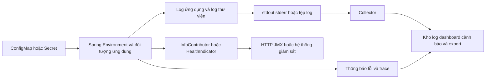

# Rà soát log, endpoint info và health để tránh rò rỉ dữ liệu

Ứng dụng đã đọc Secret đúng quyền vẫn có thể làm lộ giá trị đó qua log khởi động, thông báo lỗi hoặc một contributor của Actuator. Tương tự, endpoint health chỉ được dùng để theo dõi Pod vẫn có thể trở thành nơi công bố địa chỉ cơ sở dữ liệu, đường dẫn nội bộ và thông tin lỗi nếu trả quá nhiều chi tiết.

Trong chương **Bảo mật tích hợp** của module **SPRING_CLOUD_KUBERNETES**, bài học này hướng dẫn rà soát dữ liệu đi ra từ ứng dụng Spring khi tích hợp ConfigMap, Secret, DiscoveryClient, Spring Cloud LoadBalancer và Configuration Watcher. Mục tiêu là giữ đủ tín hiệu để vận hành, đồng thời giới hạn dữ liệu theo đúng người nhận và mục đích sử dụng.

Sau bài học, bạn có thể:

- Lập bản đồ những nơi dữ liệu cấu hình, credential và metadata có thể xuất hiện.
- Thiết kế log theo các trường được phép ghi thay vì in toàn bộ đối tượng.
- Giới hạn contributor của `info` và nội dung của `health`.
- Phân biệt che giá trị, kiểm soát truy cập và giới hạn exposure.
- Kiểm chứng đường thành công, lỗi, khởi động và refresh bằng dữ liệu giả có dấu nhận diện.
- Rà soát cả hệ thống thu thập log và quyền đọc kết quả sau khi dữ liệu rời khỏi Pod.

Ví dụ cấu hình và Java dùng **Spring Boot 3.5 với Spring MVC** làm mốc minh họa; phần Secret sanitization tham chiếu Spring Cloud Kubernetes 3.3. Khi sử dụng nhánh khác, cần đối chiếu dependency, release train và tài liệu tương ứng. Các bước thực hành bên dưới dành cho môi trường thử nghiệm, không sử dụng credential thật.

## 1. Xác định dữ liệu cần bảo vệ

Không phải dữ liệu nhạy cảm nào cũng có tên chứa `password`. Một khóa mang tên `connection`, `credential` hoặc `payload` vẫn có thể chứa thông tin xác thực.

| Nhóm dữ liệu | Ví dụ | Cách xử lý điển hình |
|---|---|---|
| Bí mật xác thực | Mật khẩu, API key, bearer token, cookie phiên, private key | Không ghi giá trị vào log hoặc endpoint chẩn đoán |
| Dữ liệu người dùng | Email, thông tin đơn hàng, nội dung request | Chỉ ghi phần tối thiểu có mục đích và quyền truy cập phù hợp |
| Định danh hạ tầng | Pod IP, namespace, hostname, địa chỉ database | Đánh giá người nhận; không mặc định được công khai |
| Metadata phần mềm | Nhánh Git, commit, dependency, bản vá runtime | Chỉ công bố dữ liệu cần cho đối tượng sử dụng |
| Tín hiệu vận hành | Kết quả apply, thời lượng, loại lỗi, số attempt | Ưu tiên giá trị có tập hữu hạn và không chứa payload |
| Thông tin tương quan | Trace ID, mã yêu cầu, revision an toàn | Dùng có kiểm soát; không coi là danh tính đã xác thực |

Tên Secret, tên tenant hoặc namespace đôi khi cũng tiết lộ thông tin tổ chức. Một mã revision có thể an toàn để ghi trong log nội bộ nhưng không phù hợp để đưa vào endpoint công khai.

Mã hóa Base64 không làm dữ liệu trở nên an toàn để công bố. Hash trực tiếp một bí mật có miền giá trị nhỏ cũng có thể hỗ trợ dò giá trị. Nếu cần liên kết sự kiện, ưu tiên mã tương quan không được suy ra trực tiếp từ nội dung bí mật.

## 2. Vẽ đường dữ liệu ra khỏi ứng dụng

Một giá trị có thể đi theo nhiều đường:



Việc che một endpoint chỉ xử lý một nhánh. Ví dụ, `/actuator/env` trả giá trị đã che không ngăn mã ứng dụng gọi `log.info("{}", properties)`.

Tương tự, collector xóa một trường trước khi đưa vào kho trung tâm không xóa bản gốc đã ghi ở stdout, tệp cục bộ hoặc một nhánh xuất khác. Thiết kế cần giảm dữ liệu ngay tại nơi phát sinh, rồi bổ sung bảo vệ ở tầng thu thập và lưu trữ.

Trong Kubernetes, log container thường đi qua runtime, node và hệ thống thu thập tập trung. Pod bị thay không đồng nghĩa mọi bản log đã biến mất. Xem [Logging Architecture của Kubernetes](https://kubernetes.io/docs/concepts/cluster-administration/logging/).

Lập danh sách ít nhất các bề mặt sau:

- Log ứng dụng, HTTP client, Kubernetes client và Configuration Watcher.
- Access log của server, gateway, ingress, sidecar hoặc mesh.
- Actuator qua HTTP, JMX và các đường quản trị tùy biến.
- Trace/span, baggage, metric label và cảnh báo gửi sang hệ thống khác.
- Log startup, log lần chạy trước, lỗi validation và lỗi xử lý refresh.
- Bản export hỗ trợ, tệp đính kèm sự cố, cache và kho lưu trữ dài hạn.

## 3. Thiết kế log từ câu hỏi vận hành

### 3.1. Ghi sự kiện và kết quả, không ghi toàn bộ cấu hình

Để điều tra một lần cập nhật cấu hình, người vận hành thường cần biết:

```text
Sự kiện gì xảy ra?
Thành phần nào xử lý?
Kết quả là thành công, không đổi, bị từ chối hay thất bại?
Mất bao lâu?
Lỗi thuộc nhóm nào?
Tìm các sự kiện liên quan bằng mã nào?
```

Thông thường không cần giá trị Secret hoặc toàn bộ nội dung ConfigMap để trả lời các câu hỏi đó.

Các cách ghi dễ gây lộ dữ liệu:

```java
log.info("Configuration changed: {}", configurationObject);
log.debug("Request headers: {}", headers);
log.warn("Remote call failed: {}", exception.getMessage());
log.info("Discovered instances: {}", instances);
```

Đối tượng cấu hình có thể có `toString()` chứa mọi trường. Exception message có thể chứa URL có query credential, đoạn phản hồi từ xa hoặc giá trị bị validation từ chối. Metadata của instance có thể chứa dữ liệu không phù hợp cho kho log dùng chung.

Một mẫu hẹp hơn:

```java
log.info(
    "event=config.apply outcome={} source_alias={} duration_ms={} correlation_id={}",
    outcome.name(),
    approvedSourceAlias,
    durationMillis,
    safeCorrelationId
);
```

Trong ví dụ, `outcome` là enum nội bộ; `approvedSourceAlias` được chọn từ danh sách nguồn đã định; `safeCorrelationId` có định dạng và chiều dài được kiểm soát. Không lấy nguyên URL, tên tài nguyên hoặc header từ request rồi đổi tên trường thành “safe”.

Dùng tham số `{}` giúp định dạng log đúng cách, nhưng không tự che bí mật hoặc loại bỏ ký tự điều khiển. Đầu vào không tin cậy vẫn phải được kiểm tra và mã hóa phù hợp với định dạng đầu ra.

### 3.2. Dùng mã lỗi có tập giá trị hữu hạn

Ví dụ:

| Tình huống | Tín hiệu nên ghi | Dữ liệu không cần đưa vào log phổ thông |
|---|---|---|
| Kubernetes API trả 403 | `K8S_READ_FORBIDDEN`, nguồn logic, attempt | Token ServiceAccount, toàn bộ request header |
| Payload cấu hình sai kiểu | `CONFIG_VALIDATION_FAILED`, mã quy tắc an toàn | Giá trị bí mật bị từ chối |
| Gọi dependency timeout | `DEPENDENCY_TIMEOUT`, tên dependency logic, thời lượng | URL đầy đủ có query hoặc userinfo |
| Refresh không có quyền | `REFRESH_ACCESS_DENIED`, thông tin caller đã kiểm soát | Toàn bộ JWT/cookie |
| Không tìm thấy instance | `NO_INSTANCE_AVAILABLE`, service ID đã duyệt | Dump toàn bộ danh sách metadata cluster |

Không loại bỏ mọi dấu vết lỗi. Cần giữ đủ khả năng phân biệt lỗi quyền, lỗi nội dung và lỗi kết nối. Nếu cần chẩn đoán sâu hơn, dùng kênh hạn chế với dữ liệu đã xét duyệt và thời gian truy cập hữu hạn.

Các nguyên tắc tránh credential trong log, kiểm tra dữ liệu đầu vào và bảo vệ kho log được nêu trong [OWASP Logging Cheat Sheet](https://cheatsheetseries.owasp.org/cheatsheets/Logging_Cheat_Sheet.html).

### 3.3. Xem exception, MDC và tracing như các nguồn dữ liệu

Rà soát cả:

- Message, cause và suppressed exception.
- Các trường của MDC hoặc context tương quan.
- Header được chọn để ghi, query string, URL lỗi và response body.
- Request/response dump của HTTP client và wire logging.
- Thuộc tính span/baggage được chuyển qua nhiều service.

Với MDC dựa trên thread, phải có cơ chế dọn context đúng vòng đời để dữ liệu request trước không xuất hiện trong request sau. Trong reactive hoặc async, quản lý context theo mô hình thực thi thay vì dựa vào giả định một request luôn ở cùng thread.

Không đưa token hay dữ liệu cá nhân vào MDC chỉ để tiện điều tra. Structured logging có thể tự đưa các trường MDC vào JSON; đổi log từ text sang JSON không tự làm dữ liệu ít nhạy cảm hơn.

## 4. Cấu hình logging có chủ đích

Một cấu hình cơ sở minh họa:

```yaml
logging:
  level:
    root: INFO
    org.springframework.cloud.kubernetes: INFO
  structured:
    format:
      console: logstash
```

Spring Boot 3.5 hỗ trợ structured logging và các tùy chỉnh JSON. Xem [Logging của Spring Boot 3.5](https://docs.spring.io/spring-boot/3.5/reference/features/logging.html). Cần kiểm tra cả cấu hình logging tùy biến đang có; một encoder riêng có thể có hành vi khác.

`INFO` không đồng nghĩa an toàn: một dòng `INFO` in toàn bộ đối tượng vẫn gây lộ. `DEBUG` cũng không phải công cụ để dump mọi dữ liệu khi gặp sự cố.

Nếu phải bật mức chi tiết hơn:

1. Chọn đúng logger và vấn đề cần điều tra.
2. Xác định các dữ liệu có thể được ghi bởi client/thư viện đó.
3. Chọn phạm vi workload và thời gian áp dụng.
4. Giới hạn người được đọc đầu ra.
5. Tắt lại và kiểm tra tác động sau khi chẩn đoán.

Thay đổi mức log qua cấu hình hoặc endpoint `loggers` cũng là thao tác vận hành có thể làm tăng độ nhạy của dữ liệu. Quyền sửa những thiết lập này cần được quản lý.

Một bộ lọc trường JSON có thể giúp bỏ trường cấu trúc đã biết, nhưng không tự tìm và xóa bí mật nằm bên trong chuỗi `message` hay exception. Regex che dữ liệu ở collector là lớp bổ sung; các biến thể encoding, xuống dòng hoặc schema mới có thể vượt qua nó.

Giới hạn độ dài stack trace giúp kiểm soát dung lượng, không bảo đảm bí mật biến mất. Một credential có thể nằm ngay dòng đầu của message.

## 5. Giới hạn exposure và giữ các giá trị chẩn đoán ở mức tối thiểu

**Cấu hình minh họa cho bài thực hành:**

```yaml
server:
  port: 8080
  error:
    include-message: never
    include-binding-errors: never
    include-stacktrace: never
    include-exception: false

management:
  server:
    port: 9090
  endpoints:
    web:
      base-path: /actuator
      exposure:
        include:
          - health
          - info
    jmx:
      exposure:
        exclude: "*"
  endpoint:
    health:
      show-details: never
      show-components: never
      probes:
        enabled: true
      group:
        liveness:
          show-details: never
          show-components: never
        readiness:
          show-details: never
          show-components: never
    env:
      show-values: never
    configprops:
      show-values: never
  info:
    defaults:
      enabled: false
    env:
      enabled: false
    build:
      enabled: false
    git:
      enabled: false
    java:
      enabled: false
    os:
      enabled: false
    process:
      enabled: false
    ssl:
      enabled: false

spring:
  cloud:
    kubernetes:
      sanitize:
        secrets: true
```

Danh sách exposure ở đây chỉ mở `health` và `info` qua HTTP. Nó không thiết lập authorization; phần đó cần một lớp riêng. Cổng 9090 cũng không tự tạo TLS hay giới hạn nguồn mạng.

`show-values` là cơ chế của endpoint có hỗ trợ sanitization, chẳng hạn `env` và `configprops`. Nó không tự lọc dữ liệu do code đưa vào `info`, `health`, log hoặc một controller tùy biến. Xem [Actuator Endpoints](https://docs.spring.io/spring-boot/3.5/reference/actuator/endpoints.html).

Spring Cloud Kubernetes có `spring.cloud.kubernetes.sanitize.secrets=true` cho dữ liệu Secret liên quan tới `env`/`configprops`; xem [Secrets PropertySource nhánh 3.3](https://docs.spring.io/spring-cloud-kubernetes/reference/3.3/property-source-config/secrets-propertysource.html). Không coi property đó là bộ che bí mật cho toàn ứng dụng.

Các thiết lập `server.error.*` áp dụng cho cơ chế lỗi Spring Boot tương ứng, không tự sửa nội dung do custom controller, exception handler, gateway hoặc thư viện tự trả về. Vẫn phải kiểm chứng response lỗi thực tế.

Giới hạn JMX endpoint exposure cũng không quản lý mọi MBean hoặc đường chẩn đoán riêng của JVM. Rà soát những đường quản trị thực sự được bật trong môi trường.

Nếu ứng dụng còn cần `refresh`, `prometheus` hoặc endpoint khác, bổ sung theo nhu cầu đã xác định và quyền riêng. Không dùng `include: "*"` làm cách tiện lợi để chẩn đoán.

## 6. Rà soát endpoint info bằng danh sách trường được phép

### 6.1. Đừng biến info thành bản dump môi trường

Các nội dung dễ bị đưa nhầm vào `info` gồm:

| Nguồn | Dữ liệu cần xem xét |
|---|---|
| Các thuộc tính `info.*` | Giá trị tham chiếu sang Environment, credential hoặc địa chỉ nội bộ |
| Build/Git contributor | Nhánh, commit, tên artifact, thông tin thời điểm build |
| Contributor tùy biến | Đối tượng cấu hình, danh sách instance, namespace, hostname |
| Dữ liệu từ CI/CD | Đường dẫn workspace, URL repository, địa chỉ registry nội bộ |
| Thông tin runtime | Phiên bản JVM/OS, tên tiến trình hoặc dữ liệu chứng thư |

Không phải mọi trường trong bảng đều phải bị cấm ở mọi nơi. Vấn đề là người đọc cần trường nào và quyền truy cập được đặt ra sao.

`management.info.defaults.enabled=false` tắt các contributor được bật theo mặc định theo cơ chế auto-configuration; nó không phải bộ lọc nội dung của mọi bean `InfoContributor` do ứng dụng tự đăng ký. Một contributor tùy biến vẫn cần được rà soát.

Cũng không nên giả định `info.*` được che giống các giá trị ở `env`. Một property tham chiếu tới Secret có thể đưa giá trị đã được phân giải vào nội dung contributor nếu code chọn công bố nó.

### 6.2. Contributor tối thiểu cho một đối tượng sử dụng rõ ràng

Ví dụ chỉ công bố tên dịch vụ và mã phát hành được phép hiển thị:

```java
import java.util.Map;

import org.springframework.boot.actuate.info.Info;
import org.springframework.boot.actuate.info.InfoContributor;
import org.springframework.stereotype.Component;

@Component
public final class ServiceInfoContributor implements InfoContributor {

    @Override
    public void contribute(Info.Builder builder) {
        builder.withDetail("service", Map.of(
                "name", "order-service",
                "release", "public-r12"
        ));
    }
}
```

Phản hồi dự kiến trong ví dụ:

```json
{
  "service": {
    "name": "order-service",
    "release": "public-r12"
  }
}
```

Đây là dữ liệu minh họa đã được lựa chọn, không phải thông tin lấy nguyên từ một đối tượng runtime. Nếu cần đọc release từ cấu hình, validate nguồn và chỉ công bố trường đã được chấp thuận.

`InfoContributor` thêm dữ liệu vào builder theo code của ứng dụng; tham khảo [API InfoContributor](https://docs.spring.io/spring-boot/3.5/api/java/org/springframework/boot/actuate/info/InfoContributor.html). Kiểm tra tất cả contributor được đăng ký, kể cả bean do dependency mang vào.

Nếu đội vận hành cần commit đầy đủ để điều tra, có thể cung cấp trong hệ thống phát hành hoặc kênh có quyền phù hợp. Không bắt buộc đưa mọi metadata đó vào một HTTP endpoint mà nhiều người có thể truy cập.

## 7. Rà soát health cả lúc UP và lúc DOWN

### 7.1. Trả trạng thái tối thiểu cho đường probe

Ví dụ nội dung phù hợp với một probe chỉ cần biết trạng thái:

```json
{"status":"UP"}
```

Khi lỗi, nội dung vẫn có thể chỉ là:

```json
{"status":"DOWN"}
```

Giữ nguyên ý nghĩa và HTTP status phù hợp với cơ chế health đã chọn. Che chi tiết không có nghĩa chuyển mọi kết quả sang 200 hoặc làm liveness luôn UP.

Thông tin nên tránh trả cho người không cần biết:

- Chuỗi kết nối, user database và hostname dependency.
- Đường dẫn tệp, thư mục mount Secret hoặc nội dung kiểm tra tệp.
- Stack trace và exception message từ hệ thống ngoài.
- Nội dung phản hồi của API mà indicator vừa gọi.
- Danh sách endpoint, Pod hoặc metadata discovery không phục vụ việc quyết định sức khỏe.

`show-details: never` và `show-components: never` giúp giảm nội dung health được xuất. Đồng thời kiểm tra override ở từng health group và từng profile triển khai. Không chỉ nhìn cấu hình mặc định trong một tệp.

Một đường con như `/actuator/health/db` có thể vẫn làm lộ sự tồn tại hoặc trạng thái của một thành phần nếu được phép gọi. Vì vậy, ngoài nội dung, cần quyết định những path nào được truy cập.

### 7.2. Không đưa lỗi thô vào indicator tùy biến

Ví dụ thiết kế một indicator chỉ trả mã lý do nội bộ có tập hữu hạn:

```java
import java.util.Objects;
import java.util.function.BooleanSupplier;

import org.springframework.boot.actuate.health.Health;
import org.springframework.boot.actuate.health.HealthIndicator;

public final class DependencyHealthIndicator implements HealthIndicator {
    private final BooleanSupplier check;

    public DependencyHealthIndicator(BooleanSupplier check) {
        this.check = Objects.requireNonNull(check);
    }

    @Override
    public Health health() {
        try {
            if (check.getAsBoolean()) {
                return Health.up().build();
            }
            return Health.down()
                    .withDetail("reason", "DEPENDENCY_UNAVAILABLE")
                    .build();
        }
        catch (RuntimeException failure) {
            return Health.down()
                    .withDetail("reason", "CHECK_FAILED")
                    .build();
        }
    }
}
```

Đây là mẫu thành phần cần được đăng ký thành bean với phép kiểm tra phù hợp. `check` phải có giới hạn thời gian và mức tải riêng; ví dụ không tự thêm timeout cho một lời gọi chặn.

Mẫu tránh đưa exception trực tiếp vào body health. Các builder cho phép đính kèm detail/exception nên cần chọn dữ liệu có chủ đích; xem [API Health.Builder](https://docs.spring.io/spring-boot/3.5/api/java/org/springframework/boot/actuate/health/Health.Builder.html).

Mã lý do không thay thế quan sát lỗi bên trong. Có thể phát sự kiện an toàn khi trạng thái chuyển đổi, ghi loại lỗi đã phân loại và mã tương quan. Tránh log toàn stack trace trên mỗi lần probe vì vừa có thể lộ dữ liệu vừa tạo bão log.

Với `show-details: never`, các detail trong indicator không được công bố qua response đó. Việc vẫn chọn detail an toàn giúp giảm rủi ro khi một kênh chẩn đoán có quyền về sau được bổ sung.

### 7.3. Bảo vệ dữ liệu mà vẫn giữ probe có ích

Readiness và liveness có nhiệm vụ khác nhau. Không gắn liveness với mọi dependency dùng chung; một lỗi database có thể dẫn tới restart nhiều Pod nếu indicator được chọn sai.

Nếu management dùng cổng riêng, probe thành công ở đó chưa chứng minh cổng nghiệp vụ nhận được kết nối. Chọn cách kiểm chứng đường phục vụ thật, và khi thêm path probe trên cổng chính phải giữ cùng chính sách giới hạn nội dung.

Thông tin sức khỏe tổng quát cũng có thể là dữ liệu vận hành nội bộ. Cho phép không cần token trong Spring Security không đồng nghĩa phải cho phép mọi nguồn Internet kết nối tới endpoint đó.

## 8. Phân quyền đọc info và giới hạn các path health

Đặt một hợp đồng minh họa:

```text
GET health tổng, liveness, readiness:
    trả nội dung tối thiểu; chỉ có đường mạng cần thiết

GET info:
    yêu cầu danh tính vận hành với scope ops.info.read

Các endpoint/path quản trị khác:
    không được cấp chỉ vì caller đã đăng nhập
```

Ví dụ servlet security sau dùng bearer JWT. Cần có OAuth2 Resource Server, issuer, audience và cấu hình bảo vệ kênh TLS/mesh tương ứng. Scope bên dưới là quyền tự định nghĩa cho ví dụ.

```java
import java.util.Set;

import org.springframework.boot.actuate.autoconfigure.security.servlet.EndpointRequest;
import org.springframework.context.annotation.Bean;
import org.springframework.context.annotation.Configuration;
import org.springframework.core.annotation.Order;
import org.springframework.security.config.Customizer;
import org.springframework.security.config.annotation.web.builders.HttpSecurity;
import org.springframework.security.web.SecurityFilterChain;
import org.springframework.security.web.util.matcher.AndRequestMatcher;
import org.springframework.security.web.util.matcher.RequestMatcher;

@Configuration(proxyBeanMethods = false)
public class DiagnosticSecurityConfiguration {

    @Bean
    @Order(1)
    SecurityFilterChain diagnosticEndpoints(HttpSecurity http) throws Exception {
        Set<String> probePaths = Set.of(
                "/actuator/health",
                "/actuator/health/liveness",
                "/actuator/health/readiness");

        RequestMatcher probeGet = request ->
                "GET".equals(request.getMethod())
                && probePaths.contains(request.getServletPath());

        RequestMatcher infoGet = new AndRequestMatcher(
                EndpointRequest.to("info"),
                request -> "GET".equals(request.getMethod()));

        http
            .securityMatcher(EndpointRequest.toAnyEndpoint())
            .authorizeHttpRequests(authorize -> authorize
                .requestMatchers(probeGet).permitAll()
                .requestMatchers(infoGet)
                    .hasAuthority("SCOPE_ops.info.read")
                .anyRequest().denyAll())
            .oauth2ResourceServer(resourceServer -> resourceServer
                .jwt(Customizer.withDefaults()));

        return http.build();
    }

    @Bean
    @Order(2)
    SecurityFilterChain denyUnmatchedRequests(HttpSecurity http) throws Exception {
        http.authorizeHttpRequests(authorize -> authorize
                .anyRequest().denyAll());
        return http.build();
    }
}
```

Mẫu hardcode path health cho base path `/actuator` của cấu hình minh họa. Khi đổi base path, servlet path hoặc thêm đường như `/livez` trên cổng chính, phải điều chỉnh matcher và kiểm thử lại. Không giả định mọi alias tự được quy tắc này bao phủ.

Chain thứ hai là fallback từ chối cho ví dụ chưa có API nghiệp vụ. Trong ứng dụng thật, hợp nhất hoặc thay bằng chain nghiệp vụ có chính sách đầy đủ. Không để một chain matcher quá rộng đứng trước làm chain chẩn đoán không được dùng.

Đây là lớp kiểm soát truy cập, không phải lớp che dữ liệu. Người có quyền `info` vẫn chỉ nên nhận những trường cần thiết. Mạng nội bộ, gateway và ứng dụng cần thống nhất đường truy cập, bao gồm cả cổng quản trị riêng và Pod IP.

## 9. Rà soát riêng các thành phần Spring Cloud Kubernetes

| Thành phần | Nội dung dễ bị ghi hoặc công bố quá mức | Cách giới hạn |
|---|---|---|
| ConfigMap/Secret PropertySource | Payload, giá trị binding lỗi, tên nguồn nội bộ | Ghi nguồn logic và kết quả; validate không công bố giá trị |
| DiscoveryClient | Pod IP, namespace, labels/annotations | Không dump ServiceInstance hoặc toàn metadata |
| Spring Cloud LoadBalancer | Đích gọi, URI có query, lỗi HTTP client | Dùng service ID/route template đã duyệt và loại lỗi |
| Configuration Watcher | Nguồn thay đổi, request quản trị, lỗi xác thực | Audit lần thông báo và kết quả mà không ghi credential/payload |
| Health integration | Danh sách Pod, thông tin API client hoặc lỗi dependency | Chọn indicator và mức detail theo nhu cầu vận hành |

Label và annotation không được thiết kế như kho chứa Secret. Nhưng việc chúng không phải Secret không có nghĩa mọi metadata đều phù hợp để đưa vào log công khai.

Nếu bật DEBUG để kiểm tra Watcher, xem cả log thư viện HTTP phía dưới. Một logger cấp cao không in body không chứng minh wire logging hoặc interceptor khác không in header.

Phản hồi của refresh có thể chứa tên khóa thay đổi. Không sao chép nguyên phản hồi vào mọi log hoặc cảnh báo nếu người nhận không cần những tên đó.

Nếu không sử dụng một tính năng như đọc Secret qua API, discovery theo metadata hoặc refresh động, không bật nó chỉ để lấy thêm thông tin chẩn đoán. Giảm đường tích hợp không cần thiết cũng giảm số nguồn dữ liệu phải rà soát và số quyền API phải quản lý.

## 10. Quyền đọc log cũng cần phạm vi rõ ràng

Một người không được đọc Secret qua Kubernetes API vẫn có thể thấy giá trị nếu ứng dụng đã in nó vào log. Vì vậy, quyền đọc log là một đường truy cập dữ liệu độc lập.

Trong Kubernetes RBAC, `pods/log` là subresource có thể được cấp quyền riêng với tài nguyên `pods`. Xem [Using RBAC Authorization](https://kubernetes.io/docs/reference/access-authn-authz/rbac/).

Đừng gộp quyền đọc log của mọi namespace vào một vai trò chỉ cần hỗ trợ một ứng dụng. Nếu cần quyền liệt kê Pod để chọn log, đánh giá quyền đó riêng thay vì cấp một wildcard rộng.

Ngoài RBAC của cluster, rà soát:

- Quyền của collector, agent trên node và các volume chứa log.
- Phân quyền tìm kiếm theo dịch vụ/môi trường trong kho trung tâm.
- Người có thể tạo dashboard, export hoặc chia sẻ link kết quả.
- Thời gian lưu, bản sao, cache và chính sách xử lý bản export.
- Đường truyền từ agent tới collector và tới kho lưu trữ.

Một dashboard che một cột không chứng minh dữ liệu đã bị xóa khỏi index hoặc API truy vấn. Phân quyền cần ở tầng thực thi truy cập dữ liệu, không chỉ ở giao diện hiển thị.

## 11. Thực hành rà soát bằng dữ liệu giả có dấu nhận diện

### 11.1. Chuẩn bị tập dữ liệu thử nghiệm

Dùng namespace cô lập và một ứng dụng thử nghiệm. Tạo các giá trị hoàn toàn giả, chẳng hạn:

```text
LEAK_TEST_PASSWORD_7f2c
LEAK_TEST_TOKEN_9b41
LEAK_TEST_CONNECTION_2d86
LEAK_TEST_CUSTOM_FIELD_6a03
```

Đặt chúng vào những đường khác nhau: một Secret giả, một thuộc tính tên không chứa “password”, một header kiểm thử và một giá trị cấu hình cố ý làm validation thất bại.

Những marker này chỉ là dấu nhận diện dữ liệu thử. Không dùng credential thật rồi kiểm tra xem có rò rỉ hay không.

Xác định trước các đầu ra được phép chứa gì. Ví dụ:

| Đầu ra | Nội dung được phép trong bài thực hành |
|---|---|
| Log cấu hình | Kết quả, nguồn logic, thời lượng, mã tương quan |
| Health tổng và probe | Trạng thái tối thiểu |
| Info cho người có quyền | Chỉ object `service` với hai trường đã duyệt |
| Phản hồi lỗi | Mã lỗi hoặc thông báo chung không chứa marker |
| Metric label | Loại kết quả/loại dependency hữu hạn |

### 11.2. Kích hoạt cả đường bình thường và đường lỗi

Rà soát theo các giai đoạn:

1. Khởi động thành công với cấu hình hợp lệ.
2. Khởi động thất bại do sai kiểu hoặc thiếu khóa bắt buộc.
3. Kubernetes API trả lỗi quyền hoặc timeout trong môi trường mô phỏng.
4. Dependency trả lỗi và health chuyển DOWN.
5. Cấu hình được thay, Watcher thông báo và ứng dụng refresh.
6. Caller không có quyền gọi endpoint quản trị.
7. Một lần restart để kiểm tra log của tiến trình trước.

Các lỗi nên được mô phỏng trong phạm vi thử nghiệm có kiểm soát. Không gây lỗi cho API server hoặc dịch vụ dùng chung chỉ để tạo dữ liệu kiểm tra.

Tìm marker ở message, exception, MDC, phản hồi HTTP, log gateway/sidecar, kho log và cảnh báo. Kiểm tra cả dữ liệu đã encode hoặc lồng trong một trường JSON nếu pipeline có những biến đổi đó.

### 11.3. Kiểm tra response và quyền truy cập

Ví dụ Bash dành cho người thực hành; `ADMIN_URL` là URL quản trị HTTPS đã có cấu hình trust phù hợp:

```bash
curl --silent --show-error --include --cacert "$CA_CERT" "$ADMIN_URL/actuator/health"
curl --silent --show-error --include --cacert "$CA_CERT" "$ADMIN_URL/actuator/health/readiness"
curl --silent --show-error --include --cacert "$CA_CERT" "$ADMIN_URL/actuator/info"
curl --silent --show-error --include --cacert "$CA_CERT" --header "@$OPS_HEADER_FILE" "$ADMIN_URL/actuator/info"
```

Tệp header do công cụ credential chuẩn bị cho danh tính kiểm thử; không chép token thật vào tài liệu hay output chia sẻ.

Kỳ vọng đối với mô hình minh họa:

- Health trả trạng thái phù hợp, không chứa detail, component hoặc marker.
- Info không có credential hợp lệ bị từ chối; token hợp lệ thiếu scope cũng bị từ chối.
- Info đúng quyền chỉ có các trường đã được duyệt.
- `/actuator/health/db` hoặc path ngoài danh sách không tự được mở.
- `env`, `configprops` và các endpoint không có nhu cầu không bị cung cấp giá trị ra ngoài.
- Health DOWN vẫn thể hiện trạng thái lỗi; không che lỗi bằng cách đổi mọi response sang 200.

Nếu hạ tầng trả mã khác, xác định response đến từ gateway, Spring Security hay endpoint. Một 404 hoặc 403 không tự chứng minh tất cả đường truy cập khác cũng bị chặn.

### 11.4. Thu thập log có giới hạn

Các lệnh ví dụ cho môi trường thực hành:

```bash
kubectl -n leak-lab logs <pod-name> -c order-service --since=15m --timestamps
kubectl -n leak-lab logs <pod-name> -c order-service --previous --timestamps
kubectl -n leak-lab logs <watcher-pod> -c configuration-watcher --since=15m --timestamps
```

Lượt `--previous` chỉ có ý nghĩa khi runtime còn giữ log lần chạy trước tương ứng. Nó không thay thế việc xem dữ liệu đã vào kho tập trung.

Nếu dùng công cụ tìm kiếm trên các artifact thử nghiệm đã thu thập, ưu tiên chỉ báo tệp hoặc số lượng khớp thay vì in toàn bộ dòng ra một kênh mới:

```bash
rg -l -F -- "LEAK_TEST_PASSWORD_7f2c" "$REVIEW_DIR"
```

Không tìm thấy một marker chỉ chứng minh chưa quan sát thấy marker đó trong tập dữ liệu và đường thử đã chọn. Cần kết hợp kiểm tra schema đầu ra, code phát dữ liệu, cấu hình hiệu dụng và các đầu ra khác.

### 11.5. Kiểm tra chức năng vận hành sau khi giảm dữ liệu

Sau khi chỉnh sửa, xác nhận:

- Kubelet vẫn gọi được probe cần thiết.
- Readiness phản ánh đúng điều kiện phục vụ.
- Người có quyền vẫn xác định được nhóm lỗi và liên kết sự kiện.
- Watcher vẫn cập nhật cấu hình qua đường đã được cấp quyền.
- Không có logger khác tiếp tục ghi bản thô trước bước lọc.
- Collector và kho log vẫn nhận được tín hiệu cần thiết.

Mục tiêu không phải làm mọi đầu ra trở nên rỗng. Một hệ thống mất khả năng chẩn đoán sẽ khiến người vận hành có xu hướng bật lại các đường dump dữ liệu quá rộng.

## 12. Xử lý khi đã phát hiện dữ liệu nhạy cảm bị công bố

Nếu marker giả xuất hiện, ghi nhận đường đi và sửa ở nơi phát sinh trước. Ví dụ: bỏ `toString()` của cấu hình khỏi log, thay exception message bằng mã lỗi hoặc thu hẹp contributor.

Nếu phát hiện credential thật trong môi trường vận hành:

1. Chặn nguồn tiếp tục phát dữ liệu và giới hạn người có thể đọc đầu ra bị ảnh hưởng.
2. Đánh giá phạm vi log, index, export, cảnh báo và bản sao đã chứa dữ liệu.
3. Thu hồi hoặc thay credential theo quy trình phù hợp; che màn hình không vô hiệu hóa credential.
4. Giữ bằng chứng cần thiết trong phạm vi được bảo vệ và xử lý các bản sao theo chính sách.
5. Kiểm chứng lại đường thành công, lỗi, startup và refresh sau khi sửa.

Không xóa log tùy tiện khiến mất bằng chứng điều tra, cũng không đưa nguyên dòng chứa credential vào ticket để “minh họa lỗi”. Báo cáo bằng loại dữ liệu, vị trí, thời điểm và mẫu đã được làm sạch.

## 13. Các dấu hiệu cần đưa vào lần rà soát tiếp theo

| Dấu hiệu | Điều cần xem xét |
|---|---|
| `show-details: always` hoặc override theo profile | Ai nhận được component/detail health? |
| `management.info.git.mode: full` | Có nhu cầu công bố mọi trường Git cho đối tượng đó không? |
| `info.*` tham chiếu giá trị Environment | Dữ liệu được phân giải có phù hợp để công bố không? |
| Log toàn object cấu hình hoặc ServiceInstance | `toString()` và metadata thực sự chứa gì? |
| Root DEBUG/TRACE hoặc HTTP wire logging | Có header, body hoặc credential đi vào log không? |
| Custom HealthIndicator trả exception | Có đường xuất lỗi thô qua response hoặc log không? |
| Bật `env`/`configprops` để điều tra | Phạm vi, quyền, sanitization và thời gian mở có rõ không? |
| Dashboard có nút export rộng | Dữ liệu có rời khỏi phạm vi kiểm soát ban đầu không? |
| Log có user ID, URL hoặc request ID làm metric label | Có rò rỉ dữ liệu và tăng cardinality không? |

Một lần rà soát đạt mục tiêu khi mỗi trường dữ liệu được công bố có người nhận và mục đích rõ ràng; các giá trị nhạy cảm không xuất hiện trên những đầu ra đã kiểm chứng; và đội vận hành vẫn theo dõi được sức khỏe Pod, lỗi tích hợp và kết quả cập nhật cấu hình bằng các tín hiệu an toàn.
