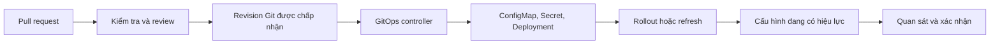

# Quản lý thay đổi ConfigMap và Secret qua quy trình GitOps

Trong chương **Vận hành cấu hình** của module **SPRING_CLOUD_KUBERNETES**, bài học này xây dựng một quy trình đưa thay đổi cấu hình từ Git đến trạng thái đang phục vụ của ứng dụng Spring. Quy trình phải trả lời được bốn câu hỏi: ai đã thay đổi, hệ thống đã áp dụng bản nào, ứng dụng thực sự dùng giá trị nào và có thể quay lại trạng thái an toàn bằng cách nào.

Spring Cloud Kubernetes hỗ trợ đọc cấu hình và nhận thông báo thay đổi; GitOps cung cấp cơ chế quản lý trạng thái mong muốn và đồng bộ tài nguyên. Cần nối hai cơ chế bằng một chính sách vận hành rõ ràng, thay vì giả định rằng merge một pull request đồng nghĩa mọi Pod đã nạp cấu hình mới.

## 1. Tình huống và kết quả cần đạt

Giả sử dịch vụ `orders` chạy ba replica trong namespace `payments`. Bản hiện tại dùng ConfigMap `orders-config-r41`, Secret `orders-db-cred-r11` và image ứng dụng đã được kiểm chứng.

Đội vận hành muốn:

- Đổi timeout gọi `inventory` từ hai giây xuống 1.500 mili giây.
- Giữ giới hạn kích thước trang ở mức 100 phần tử.
- Chuyển sang credential cơ sở dữ liệu phiên bản `cred-r12`.
- Thử ở staging trước khi đưa sang production.
- Có bằng chứng từng replica đã chuyển đổi và giữ được đường rollback trong thời gian đã định.

Thay đổi sẽ tạo ConfigMap `orders-config-r42` và Secret `orders-db-cred-r12`, sau đó chuyển tham chiếu của Deployment. Credential thật không xuất hiện trong nội dung bài học hoặc các manifest minh họa dạng rõ.

Sau bài học, bạn có thể thiết kế pull request cấu hình, bảo vệ Secret trong Git, lựa chọn rollout hoặc refresh, theo dõi các giai đoạn hội tụ và xử lý rollback mà không để controller ghi đè ngược lại thao tác sửa nóng.

## 2. GitOps quản lý trạng thái nào?

OpenGitOps mô tả các nguyên tắc: trạng thái mong muốn được khai báo, có phiên bản và lịch sử, được agent tự động lấy về, rồi liên tục đối chiếu với trạng thái thực tế. [OpenGitOps: GitOps Principles](https://opengitops.dev/).

Một luồng triển khai cấu hình điển hình:



Có ít nhất ba lớp trạng thái cần theo dõi riêng:

| Lớp | Ví dụ trong tình huống | Bằng chứng cần có |
| --- | --- | --- |
| Trạng thái khai báo | Revision Git chứa cấu hình `cfg-r42` | Commit, review và artifact render được chọn |
| Trạng thái tài nguyên | ConfigMap/Secret tồn tại; Deployment tham chiếu bản mới | Trạng thái reconcile, object và Pod template |
| Trạng thái ứng dụng | Tiến trình dùng timeout 1.500 ms và credential mới | Quan sát cấu hình không nhạy cảm, kiểm tra chức năng và kết nối mới |

Controller đồng bộ thành công không tự chứng minh một connection pool đã thay credential hoặc mọi bean đã được tạo lại. Ngược lại, một Pod báo Ready cũng không tự chứng minh nó dùng đúng nguồn cấu hình nếu một biến môi trường cũ vẫn ghi đè giá trị mong muốn.

### Trách nhiệm của các chủ thể

| Chủ thể | Trách nhiệm trong quy trình |
| --- | --- |
| Người sửa cấu hình | Nêu mục đích, phạm vi ảnh hưởng, cách xác minh và đường rollback |
| Reviewer | Kiểm tra hợp đồng cấu hình, tính tương thích, quyền và kế hoạch áp dụng |
| CI | Kiểm tra cú pháp, render, chính sách, rò rỉ bí mật và các điều kiện có thể tự động hóa |
| GitOps controller | Lấy revision được phép, giải mã hoặc điều phối nguồn bí mật theo thiết kế, áp dụng và đối chiếu tài nguyên |
| Ứng dụng/controller refresh | Nạp cấu hình, kiểm tra hợp lệ và chuyển sang trạng thái sử dụng được |
| Người vận hành | Quan sát hội tụ, dừng phát hành khi không đạt và thực hiện quy trình phục hồi |

Không để pipeline CI, GitOps controller và một công cụ quản lý khác cùng ghi các trường cấu hình của một object mà không có hợp đồng sở hữu. Một tài nguyên cần có chủ thể quản lý rõ ràng; controller tạo Secret từ kho ngoài cũng là một chủ thể trong chuỗi này.

## 3. Phân loại ConfigMap, Secret và dữ liệu được lưu trong Git

ConfigMap phù hợp cho dữ liệu cấu hình không bí mật. Secret dành cho dữ liệu nhạy cảm nhưng base64 trong trường `data` chỉ là cách biểu diễn, không phải mã hóa bảo mật. [Kubernetes: ConfigMaps](https://kubernetes.io/docs/concepts/configuration/configmap/), [Kubernetes: Secrets](https://kubernetes.io/docs/concepts/configuration/secret/).

Ví dụ phân loại cho `orders`:

| Thông tin | Nơi khai báo trong thiết kế |
| --- | --- |
| Timeout, giới hạn trang, phiên bản schema | ConfigMap được review trong Git |
| Username/password cơ sở dữ liệu | Secret đã mã hóa hoặc tham chiếu tới kho bí mật |
| Tham chiếu ConfigMap/Secret của Pod | Deployment trong Git |
| Khóa riêng để giải mã Secret | Cơ chế cấp phát/bootstrap an toàn ngoài nội dung Git dạng rõ |
| Phiên bản credential và quyết định thu hồi | Metadata vận hành và lịch sử ở hệ thống có thẩm quyền |
| Giá trị cấu hình có hiệu lực trên từng replica | Dữ liệu quan sát phù hợp; không công khai credential |

Không đặt credential bên trong URL datasource, annotation mô tả thay đổi hoặc nội dung pull request. Cũng cần kiểm tra log CI, artifact render, file tạm và cache của công cụ, vì các kênh này có thể lộ dữ liệu dù file cuối cùng trong Git đã mã hóa.

### Hai lựa chọn chính cho Secret

| Lựa chọn | Git chứa gì? | Thành phần cần được bảo vệ |
| --- | --- | --- |
| Secret mã hóa bằng SOPS | Manifest với các trường nhạy cảm đã mã hóa và metadata SOPS | Khóa/KMS, quyền giải mã, controller và đường xử lý bản rõ |
| Secret lấy từ kho ngoài | Khai báo nguồn, phiên bản và đích đồng bộ | Danh tính provider/controller, quyền nguồn ngoài và vòng đời Secret đích |

Flux hỗ trợ giải mã manifest SOPS trong quá trình reconcile. Khóa giải mã cần được cấp cho môi trường triển khai theo cơ chế phù hợp; không commit khóa riêng cạnh ciphertext. [Flux: Manage Kubernetes secrets with SOPS](https://fluxcd.io/flux/guides/mozilla-sops/).

Với External Secrets Operator, khai báo `ExternalSecret` mô tả việc lấy dữ liệu ở provider và tạo Secret đích. Chính sách refresh và tham chiếu phiên bản ảnh hưởng đến thời điểm dữ liệu thay đổi. [External Secrets Operator: ExternalSecret](https://external-secrets.io/latest/api/externalsecret/).

Nếu nguồn ngoài trỏ tới một giá trị “mới nhất” có thể thay đổi, cùng một commit Git chưa chắc tái tạo cùng credential sau một thời gian. Muốn truy vết đầy đủ, cần ghi nhận phiên bản nguồn thực tế và dùng tham chiếu phiên bản cố định khi provider và yêu cầu nghiệp vụ cho phép.

Không vừa để GitOps quản lý trực tiếp trường `data` của Secret đích, vừa để một operator khác ghi đè các trường đó. Khi chọn nguồn ngoài, GitOps thường quản lý khai báo nguồn; operator chịu trách nhiệm tạo/cập nhật Secret đích theo hợp đồng đã chọn.

## 4. Chọn cách áp dụng trước khi mở pull request

Có hai mô hình thường dùng:

| Mô hình | Cách áp dụng | Đổi lại điều gì? |
| --- | --- | --- |
| Tài nguyên có phiên bản, nạp lúc khởi động | Tạo tên mới và đổi Pod template để rollout | Dễ xác định bộ cấu hình theo Pod; cần quản lý thời gian rollout và lưu bản cũ |
| Tài nguyên tên ổn định, cập nhật động | Sửa dữ liệu rồi kích hoạt cơ chế refresh đã kiểm chứng | Có thể cập nhật nhanh; phải quản lý độ trễ, bean được nạp lại và trạng thái không đồng nhất |

Bài thực hành chính chọn mô hình thứ nhất. Không bật thêm refresh chỉ vì trong classpath có Spring Cloud Kubernetes.

Kubernetes chỉ khởi tạo rollout của Deployment khi Pod template thay đổi. Sửa dữ liệu của một ConfigMap được tham chiếu bằng tên cũ không tự làm Pod template đổi. Đổi `configMap.name`, `secret.secretName` hoặc annotation nằm dưới `spec.template.metadata` là các cách tạo thay đổi ở template. [Kubernetes: Deployments](https://kubernetes.io/docs/concepts/workloads/controllers/deployment/).

Một annotation ở `metadata.annotations` của Deployment, nằm ngoài `spec.template`, không có tác dụng tương đương. Với checksum, giá trị checksum phải được công cụ tính từ nội dung có liên quan và đặt trong Pod template; Kubernetes không tự hiểu một annotation bất kỳ là yêu cầu theo dõi ConfigMap.

Nếu checksum tính từ Secret, xem lại nguy cơ lộ thông tin qua digest của dữ liệu có không gian đoán nhỏ và qua log render. Trong ví dụ, dùng tên/nhãn phiên bản credential không chứa giá trị bí mật.

## 5. Thiết kế một bộ cấu hình có thể quay lại

Không chỉ gán một số phiên bản cho ứng dụng. Cần nhận diện bộ thay đổi đang phát hành:

```text
image:             orders 1.4.2 đã được kiểm chứng
config revision:   cfg-r42
ConfigMap:         payments/orders-config-r42
credential revision: cred-r12
Secret:            payments/orders-db-cred-r12
Git revision:      commit được controller quan sát
schema cấu hình:   phiên bản 1
```

`cfg-r42` và `cred-r12` là các nhãn phiên bản do đội ứng dụng quy định, không phải giá trị Kubernetes tự sinh. `resourceVersion` của Kubernetes cũng không thay thế phiên bản phát hành hoặc commit Git.

Giữ riêng phiên bản cấu hình và credential để có thể đánh giá rollback độc lập. Khi chỉ timeout có vấn đề, có thể đưa cấu hình trở lại bản trước nhưng vẫn giữ credential mới đã được xoay vòng thành công.

### Giữ bản cũ là một phần của desired state

Nếu bật prune, việc bỏ manifest cũ khỏi tập tài nguyên render có thể khiến controller xóa tài nguyên đó. Giữ lịch sử trong Git không đồng nghĩa bản cũ vẫn tồn tại để Pod rollback sử dụng. [Flux: Kustomization, prune](https://fluxcd.io/flux/components/kustomize/kustomizations/#prune).

Quy trình chuyển đổi được chia thành ba giai đoạn:

1. **Chuẩn bị:** thêm ConfigMap/Secret mới và giữ bản cũ trong tập desired state; xác nhận tài nguyên mới sẵn sàng.
2. **Chuyển tham chiếu:** đổi Deployment sang bộ được chọn; quan sát rollout và chức năng.
3. **Thu dọn:** chỉ bỏ bản cũ sau khi hết cửa sổ rollback, không còn người dùng liên quan và chính sách credential cho phép.

Ba giai đoạn có thể được biểu diễn bằng các pull request/đợt đồng bộ riêng. Nếu dùng một đợt phát hành tự động, cần có các bước chờ và kiểm tra tương đương. Một commit chứa nhiều object không tạo ra một giao dịch nguyên tử trên toàn cluster.

## 6. Ví dụ rollout với ConfigMap và Secret có phiên bản

Ví dụ dùng Spring Boot Config Data và Secret volume. Ứng dụng gọi các dịch vụ qua DNS Service; các tính năng truy cập Kubernetes API không cần thiết được tắt trong mẫu nền. Image đã có Actuator, datasource phù hợp và hỗ trợ chạy bằng UID/GID được chọn. Thay image minh họa bằng bản đã kiểm chứng; trong quy trình phát hành thật, ưu tiên tham chiếu image theo digest được quản lý.

### 6.1. ConfigMap mới

```yaml
apiVersion: v1
kind: ConfigMap
metadata:
  name: orders-config-r42
  namespace: payments
  labels:
    app.kubernetes.io/name: orders
  annotations:
    learning.example/config-revision: cfg-r42
immutable: true
data:
  application.yaml: |
    orders:
      schema-version: 1
      config-revision: cfg-r42
      inventory-timeout: 1500ms
      max-page-size: 100
    spring:
      datasource:
        url: jdbc:postgresql://orders-db.payments.svc.cluster.local:5432/orders
      cloud:
        kubernetes:
          config:
            enabled: false
          secrets:
            enabled: false
          discovery:
            enabled: false
```

`immutable: true` không cho sửa nội dung dữ liệu của object này sau khi tạo; muốn đổi cấu hình, tạo tên phiên bản mới rồi đổi tham chiếu. Không bật chế độ thay thế cưỡng bức chỉ để ghi dữ liệu mới lên một tên được tuyên bố bất biến. [Kubernetes: Immutable ConfigMaps](https://kubernetes.io/docs/concepts/configuration/configmap/#immutable-configmaps).

Các thuộc tính `orders.*` là hợp đồng do ứng dụng của bài học định nghĩa. Chúng không phải thuộc tính tích hợp sẵn của Spring Cloud Kubernetes.

### 6.2. Secret mới và tham chiếu trong Deployment

Tệp Secret mã hóa được tạo bằng công cụ của đội vận hành. Trước bước mã hóa, cấu trúc mục tiêu là Secret `orders-db-cred-r12` trong `payments`, loại `Opaque`, có `immutable: true` và hai key `username`, `password` trong `data`. Không đưa bản rõ hoặc bản base64 chưa mã hóa vào Git.

ServiceAccount và Deployment minh họa:

```yaml
apiVersion: v1
kind: ServiceAccount
metadata:
  name: orders-runtime
  namespace: payments
automountServiceAccountToken: false
---
apiVersion: apps/v1
kind: Deployment
metadata:
  name: orders
  namespace: payments
spec:
  replicas: 3
  revisionHistoryLimit: 5
  progressDeadlineSeconds: 300
  strategy:
    type: RollingUpdate
    rollingUpdate:
      maxUnavailable: 0
      maxSurge: 1
  selector:
    matchLabels:
      app: orders
  template:
    metadata:
      labels:
        app: orders
      annotations:
        learning.example/config-revision: cfg-r42
        learning.example/credential-revision: cred-r12
    spec:
      serviceAccountName: orders-runtime
      automountServiceAccountToken: false
      securityContext:
        runAsNonRoot: true
        runAsUser: 10001
        runAsGroup: 2000
        fsGroup: 2000
      containers:
        - name: app
          image: registry.example.internal/orders:1.4.2
          ports:
            - name: http
              containerPort: 8080
          env:
            - name: SPRING_CONFIG_IMPORT
              value: "file:/etc/order-config/application.yaml,configtree:/etc/order-secrets/"
            - name: MANAGEMENT_ENDPOINT_HEALTH_PROBES_ENABLED
              value: "true"
          readinessProbe:
            httpGet:
              path: /actuator/health/readiness
              port: http
            periodSeconds: 5
            failureThreshold: 3
          securityContext:
            allowPrivilegeEscalation: false
            capabilities:
              drop:
                - ALL
          volumeMounts:
            - name: application-config
              mountPath: /etc/order-config
              readOnly: true
            - name: database-credentials
              mountPath: /etc/order-secrets
              readOnly: true
      volumes:
        - name: application-config
          configMap:
            name: orders-config-r42
        - name: database-credentials
          secret:
            secretName: orders-db-cred-r12
            defaultMode: 0440
            items:
              - key: username
                path: spring.datasource.username
              - key: password
                path: spring.datasource.password
```

Secret được chiếu thành hai file có tên trùng với thuộc tính datasource. `configtree:` ánh xạ file thành thuộc tính; import file YAML và import cây thư mục là hai cơ chế khác nhau của Spring Boot. Không dùng `optional:` ở đây vì cấu hình và credential là đầu vào bắt buộc. [Spring Boot: Externalized Configuration](https://docs.spring.io/spring-boot/reference/features/external-config.html).

Quyền nhóm của volume và khả năng chạy bằng UID/GID trong image phải được kiểm chứng. `0440` là số octal trong YAML. Mẫu không dùng `subPath`, và không cần quyền GET Secret của ServiceAccount chỉ để tiến trình đọc file đã mount.

`maxUnavailable: 0` không phải lời bảo đảm không gián đoạn trong mọi tình huống. Rollout còn cần tài nguyên cho Pod tăng thêm, readiness đáng tin cậy, khả năng tương thích và cơ chế kết thúc request phù hợp của ứng dụng. `revisionHistoryLimit` giữ lịch sử ReplicaSet; nó không giữ hộ các ConfigMap/Secret đã bị prune.

Nếu ứng dụng đang dùng DiscoveryClient hoặc Spring Cloud LoadBalancer có supplier cần Kubernetes API, giữ những tính năng cần thiết và cấp token/RBAC tương ứng. Nhận cấu hình qua volume không buộc phải tắt discovery; mẫu tắt vì tình huống nền không cần tính năng đó.

## 7. Đưa Secret mã hóa vào chuỗi reconcile

Ví dụ chọn Flux với SOPS. Các cơ chế khác cần được cấu hình theo controller đã chọn; không đưa hai GitOps controller cùng quản lý các tài nguyên minh họa.

### 7.1. Cấu trúc repository minh họa

```text
.sops.yaml
clusters/
  staging/
    orders/
      kustomization.yaml
      serviceaccount.yaml
      deployment.yaml
      orders-config-r41.yaml
      orders-config-r42.yaml
      orders-db-cred-r11.secret.yaml
      orders-db-cred-r12.secret.yaml
```

Các tệp `r41` và `cred-r11` là manifest còn được giữ từ bản phát hành trước. Hai Secret trong cây này đều là tệp đã mã hóa. Production có thư mục/overlay và chính sách khóa phù hợp với môi trường, không sao chép credential staging sang production chỉ để giữ diff giống nhau.

Tệp Kustomize của ứng dụng:

```yaml
apiVersion: kustomize.config.k8s.io/v1beta1
kind: Kustomization
resources:
  - serviceaccount.yaml
  - orders-config-r41.yaml
  - orders-config-r42.yaml
  - orders-db-cred-r11.secret.yaml
  - orders-db-cred-r12.secret.yaml
  - deployment.yaml
```

Đây là cấu hình render của Kustomize, khác với custom resource `Kustomization` của Flux ở phần sau. Giữ hai tên API này tách bạch khi đọc lỗi và khi kiểm tra CI.

### 7.2. Chính sách mã hóa

Một `.sops.yaml` minh họa:

```yaml
creation_rules:
  - path_regex: '.*\.secret\.yaml$'
    encrypted_regex: '^(data|stringData)$'
    age: '<AGE_PUBLIC_RECIPIENT_CUA_MOI_TRUONG>'
```

Thay placeholder bằng public recipient thật của môi trường trước khi sử dụng. Khóa riêng không thuộc file này. Metadata và tên key có thể vẫn hiện rõ; tránh đặt thông tin nhạy cảm vào tên, annotation hoặc trường không được chính sách mã hóa bảo vệ.

Quy trình tạo Secret phải mã hóa dữ liệu trước khi đưa vào phần thay đổi được commit, đồng thời kiểm tra có metadata SOPS và các trường nhạy cảm đã ở dạng mã hóa. Không giả lập một chuỗi `ENC[...]` bằng cách gõ tay. Manifest được mã hóa là đầu vào của luồng giải mã, không phải manifest Secret có thể áp dụng trực tiếp bằng `kubectl apply`. [Flux: SOPS workflow](https://fluxcd.io/flux/guides/mozilla-sops/).

Không để một pipeline render/giải mã ghi manifest bản rõ ra log hoặc artifact được chia sẻ. Việc chỉ che output ở bước cuối không sửa được dữ liệu đã bị công cụ phía trước in ra.

### 7.3. Flux Kustomization

Giả định Flux đã được bootstrap, có `GitRepository` tên `platform-config` và khóa age được cấp an toàn qua Secret `sops-age` trong `flux-system`. Namespace `payments` và phạm vi quyền của controller đã được quản trị chuẩn bị.

```yaml
apiVersion: kustomize.toolkit.fluxcd.io/v1
kind: Kustomization
metadata:
  name: orders-staging
  namespace: flux-system
spec:
  interval: 1m
  path: ./clusters/staging/orders
  sourceRef:
    kind: GitRepository
    name: platform-config
  targetNamespace: payments
  prune: true
  wait: true
  timeout: 5m
  decryption:
    provider: sops
    secretRef:
      name: sops-age
```

Khai báo Flux này thuộc lớp quản lý của nền tảng, không nằm trong danh sách tài nguyên tự quản lý của thư mục ứng dụng phía trên. Khóa trong `sops-age` cần được quản lý và khôi phục qua quy trình bootstrap độc lập; không để việc khôi phục khóa phụ thuộc vào chính manifest chỉ có thể đọc bằng khóa đó.

Flux có thể chờ health của tài nguyên được reconcile; `wait` và `timeout` không thay thế kiểm tra nghiệp vụ. Nếu tách thành nhiều Kustomization, cần thiết kế dependencies và cách kiểm tra phiên bản của phụ thuộc; chỉ thấy một phụ thuộc Ready từ lần reconcile trước chưa đủ chứng minh nó đã ở phiên bản đang phát hành. [Flux: Kustomization](https://fluxcd.io/flux/components/kustomize/kustomizations/).

Trong Argo CD, sync phases/waves là cơ chế riêng để sắp thứ tự đồng bộ. Annotation `argocd.argoproj.io/sync-wave` không tạo tác dụng tương đương trên Flux. Thứ tự apply cũng không tự chứng minh một operator đã tạo xong Secret hoặc credential ở hệ thống ngoài đã sử dụng được. [Argo CD: Sync Phases and Waves](https://argo-cd.readthedocs.io/en/stable/user-guide/sync-waves/).

## 8. Kiểm tra hợp đồng cấu hình trước khi cấp lưu lượng

Một hợp đồng nhỏ cho ví dụ:

| Thuộc tính | Điều kiện chấp nhận do ứng dụng quy định |
| --- | --- |
| `orders.schema-version` | Bằng 1 đối với image đang phát hành |
| `orders.config-revision` | Có giá trị để truy vết |
| `orders.max-page-size` | Từ 1 đến 200 |
| `orders.inventory-timeout` | Từ 100 ms đến 5 giây |
| Credential datasource | Có đủ và dùng được cho quyền runtime yêu cầu |

Ví dụ binding/validation cho nhóm thuộc tính không nhạy cảm, dùng Jakarta Validation và record:

```java
import java.time.Duration;

import jakarta.validation.constraints.AssertTrue;
import jakarta.validation.constraints.Max;
import jakarta.validation.constraints.Min;
import jakarta.validation.constraints.NotBlank;
import jakarta.validation.constraints.NotNull;

import org.springframework.boot.context.properties.ConfigurationProperties;
import org.springframework.validation.annotation.Validated;

@Validated
@ConfigurationProperties(prefix = "orders")
public record OrdersSettings(
        @Min(1) @Max(1) int schemaVersion,
        @NotBlank String configRevision,
        @Min(1) @Max(200) int maxPageSize,
        @NotNull Duration inventoryTimeout) {

    @AssertTrue(message = "orders.inventory-timeout nằm ngoài chính sách")
    public boolean isTimeoutWithinPolicy() {
        return inventoryTimeout != null
                && inventoryTimeout.compareTo(Duration.ofMillis(100)) >= 0
                && inventoryTimeout.compareTo(Duration.ofSeconds(5)) <= 0;
    }
}
```

Đăng ký kiểu này bằng `@EnableConfigurationProperties(OrdersSettings.class)` trên một cấu hình được ứng dụng quét, hoặc dùng cơ chế scan configuration properties của dự án. Cần dependency validation và JDK phù hợp với BOM đã chọn.

Đây là kiểm tra ở lúc nạp cấu hình của ví dụ rollout, không phải cơ chế tự cập nhật record khi có refresh. Không để lộ credential trong thông báo validation. Một record cấu hình chứa mật khẩu còn có thể làm lộ giá trị qua `toString()` nếu được log không phù hợp.

Hợp đồng cần xét cả quan hệ giữa thuộc tính: timeout gọi dependency và ngân sách request tổng, kích thước pool và giới hạn kết nối, hoặc schema cấu hình và khả năng của image. Một YAML hợp lệ về cú pháp có thể vẫn tạo một cấu hình không dùng được.

## 9. Pull request, CI và promotion giữa môi trường

### 9.1. Nội dung một pull request cấu hình

Một pull request cho `cfg-r42` nên mô tả:

- **Mục đích:** giảm timeout của lời gọi inventory theo ngân sách request đã phân tích.
- **Phạm vi:** `orders` ở staging; phiên bản image và schema tương thích.
- **Giá trị thay đổi:** chỉ nêu giá trị không nhạy cảm; đối với Secret, nêu phiên bản và mục đích xoay vòng.
- **Cách áp dụng:** tạo tài nguyên mới, chờ sẵn sàng rồi đổi tham chiếu để rollout.
- **Điều kiện đạt:** mọi replica dùng bản mong muốn, chức năng hợp lệ và độ trễ/lỗi trong ngưỡng đã chọn.
- **Rollback:** có thể trở về `cfg-r41` nhưng giữ `cred-r12` nếu credential mới đã được chấp nhận hoặc credential cũ đã thu hồi.
- **Thu dọn:** thời điểm bỏ tài nguyên cũ và người chịu trách nhiệm xác nhận.

Không để người review phải suy ra kế hoạch phục hồi từ tên file. Với Secret mã hóa, diff ciphertext không tự cho biết thay đổi ngữ nghĩa; cần có bằng chứng về nguồn, phiên bản và phạm vi quyền mà không đưa giá trị vào phần review công khai.

### 9.2. Các lớp kiểm tra phù hợp trong CI

| Lớp kiểm tra | Điều cần phát hiện |
| --- | --- |
| Cú pháp và schema Kubernetes | YAML sai, cấu trúc resource không hợp lệ, namespace hoặc tên bị thiếu |
| Render Helm/Kustomize | Overlay ra đúng tài nguyên, đúng môi trường, đúng tham chiếu và không xóa ngoài dự kiến |
| Chính sách cấu hình | Giá trị ngoài khoảng, thuộc tính bắt buộc thiếu, schema không tương thích |
| Chính sách Secret | Dữ liệu rõ/base64 chưa mã hóa, khóa riêng, key không cần thiết hoặc nguồn ngoài ngoài phạm vi |
| Hành vi ứng dụng | Binding/validation và đường sử dụng cấu hình đạt yêu cầu |
| Kế hoạch thay đổi | Rollout/refresh có chủ đích, giữ tài nguyên rollback và không mở thêm quyền ngoài nhu cầu |

Đối với YAML nằm bên trong `ConfigMap.data.application.yaml`, kiểm tra schema Kubernetes của ConfigMap chưa kiểm tra được toàn bộ hợp đồng Spring bên trong chuỗi đó. Cần phân tích và kiểm tra lớp cấu hình ứng dụng riêng.

Chạy render với phiên bản công cụ/dependency được quản lý. Tránh để cùng một commit cho đầu ra khác nhau chỉ vì chart, image tag hoặc tham chiếu bên ngoài đã trôi sang bản mới.

Nếu phần render còn chứa dữ liệu SOPS mã hóa, không gửi thẳng nó tới API server như Secret đã giải mã để kiểm tra. Kiểm tra cấu trúc mã hóa ở lớp phù hợp; những bước cần bản rõ phải chạy trong môi trường được phép và không phát tán bản rõ ra output hoặc artifact. CI không nhất thiết phải giữ khóa giải mã production chỉ để kiểm tra thay đổi ConfigMap không nhạy cảm.

### 9.3. Promotion là chuyển một thay đổi đã kiểm chứng

Sau khi staging đạt điều kiện, mở thay đổi cho production theo đúng cấu trúc repository và chính sách phát hành của tổ chức. Ghi rõ revision/artifact nào đã được kiểm chứng và phần nào khác giữa môi trường.

Không đồng nhất promotion với sao chép cả bộ manifest staging. Endpoint, namespace, quyền, khóa giải mã, nguồn credential và ngưỡng tài nguyên có thể khác. Những khác biệt này cần được thể hiện có chủ đích trong overlay hoặc tham số được review.

Không dùng alias Secret có thể đổi ngầm mà không ghi nhận phiên bản nguồn. Nếu nghiệp vụ chọn rotation tự động độc lập với Git, coi đó là một luồng thay đổi có quan sát và trách nhiệm riêng, thay vì giả định mọi thay đổi runtime đều xuất phát từ commit mới.

## 10. Khi chọn cập nhật động với Spring Cloud Kubernetes

Mô hình tên ổn định có thể phù hợp cho một số cấu hình được thiết kế để đổi khi ứng dụng đang chạy. Cần giải quyết đầy đủ chuỗi sau:

```text
Dữ liệu mới được controller apply
  → thành phần phát hiện thay đổi nhận đúng sự kiện
  → nguồn cấu hình có thể đọc được bản mới
  → binding/bean liên quan được cập nhật theo khả năng hỗ trợ
  → hành vi ứng dụng chuyển đổi an toàn
  → mọi replica được xác nhận đã hội tụ
```

Spring Cloud Kubernetes có thể nạp property source bằng `spring.config.import: "kubernetes:"`. Cơ chế này cần được chọn rõ thay vì vô tình trộn với file mount và biến môi trường cũ. Khi nhiều nguồn cùng đặt một thuộc tính, phải kiểm tra thứ tự ưu tiên thực tế. [Spring Cloud Kubernetes: PropertySource implementations](https://docs.spring.io/spring-cloud-kubernetes/reference/property-source-config.html).

Configuration Watcher theo dõi thay đổi rồi điều phối refresh qua HTTP hoặc Spring Cloud Bus; file trên volume được Kubernetes cập nhật không tự bảo đảm Spring đã nạp lại cấu hình. Với nguồn mount, còn phải tính khoảng thời gian từ thay đổi API đến khi nội dung file tới Pod và hành vi nạp lại của đường cấu hình đã chọn. [Spring Cloud Kubernetes Configuration Watcher](https://docs.spring.io/spring-cloud-kubernetes/reference/spring-cloud-kubernetes-configuration-watcher.html).

Những điều cần kiểm chứng trước khi dùng refresh trong production:

| Câu hỏi | Ý nghĩa vận hành |
| --- | --- |
| Bean nào thực sự nhận giá trị mới? | Giá trị trong Environment đổi chưa đủ chứng minh đối tượng đang dùng đã đổi |
| Có giá trị nào chỉ đọc khi khởi tạo không? | Cần tái tạo thành phần hoặc chọn rollout |
| Đổi nhiều trường có tạo trạng thái trung gian không? | Cần snapshot hợp lệ, tương thích và cách chuyển đổi an toàn |
| Nếu binding/khởi tạo lỗi thì giữ bản nào? | Không mặc định refresh là một giao dịch có tự rollback |
| Các replica hội tụ trong bao lâu? | Phải đo độ mới dữ liệu và xử lý việc tạm dùng nhiều phiên bản |
| Refresh có bị phát dồn khi GitOps sửa nhiều object không? | Cần giới hạn tải và tránh nhiều cơ chế cùng kích hoạt |

Spring Cloud có quy tắc riêng cho `@RefreshScope` và các bean không hỗ trợ refresh; tài liệu nêu `HikariDataSource` thuộc nhóm không được refresh theo cơ chế đó. Không hứa rằng POST refresh sẽ thay mọi connection pool hoặc credential của connection đang mở. [Spring Cloud Context: Refresh Scope](https://docs.spring.io/spring-cloud-commons/reference/spring-cloud-commons/application-context-services.html#refresh-scope).

Đối với volume mutable, cập nhật file có độ trễ; ConfigMap đưa vào biến môi trường cần khởi động lại để nhận thay đổi, và mount `subPath` không nhận cập nhật ConfigMap theo cơ chế volume thông thường. [Kubernetes: ConfigMaps](https://kubernetes.io/docs/concepts/configuration/configmap/).

Trong ví dụ rollout của bài, không triển khai thêm watcher cho cùng bộ cấu hình. Nếu có nhu cầu refresh riêng, phân loại rõ nhóm thuộc tính, nguồn dữ liệu, quyền watcher và đường kiểm chứng; bảo vệ endpoint quản trị, broker và dữ liệu Secret theo đúng phạm vi.

## 11. Xác minh từ revision Git tới cấu hình hiệu lực

### 11.1. Quan sát controller và tài nguyên

Các lệnh chỉ đọc minh họa cho môi trường dùng Flux:

```powershell
flux get sources git -n flux-system
flux get kustomizations -n flux-system
kubectl get kustomizations.kustomize.toolkit.fluxcd.io orders-staging -n flux-system -o jsonpath='{.status.lastAppliedRevision}'
kubectl get configmap orders-config-r42 -n payments
kubectl get secret orders-db-cred-r12 -n payments
kubectl get deployment orders -n payments -o jsonpath='{.spec.template.spec.volumes[*].configMap.name}'
kubectl get deployment orders -n payments -o jsonpath='{.spec.template.spec.volumes[*].secret.secretName}'
kubectl rollout status deployment/orders -n payments --timeout=5m
kubectl get pods -n payments -l app=orders
```

Người chạy cần quyền quan sát phù hợp. Lệnh xem Secret ở dạng bảng trên không yêu cầu in nội dung ra màn hình, nhưng quyền GET Secret vẫn là quyền có thể đọc giá trị; không cấp quyền đó đại trà cho mọi người chỉ để theo dõi rollout.

Kiểm tra revision controller đã áp dụng, trạng thái lỗi và các tham chiếu thật trong Pod template. Không kết luận từ việc webhook đã được gửi hoặc pipeline đã chạy xong rằng controller chắc chắn đã reconcile revision mới.

### 11.2. Bằng chứng ở lớp ứng dụng

Ứng dụng có thể phát một sự kiện cấu hình không nhạy cảm như:

```text
config_effective pod=orders-example-abc
config_revision=cfg-r42 schema_version=1
inventory_timeout_ms=1500 max_page_size=100
credential_revision=cred-r12
```

Sự kiện này là giao diện quan sát do ứng dụng thiết kế, không phải log mặc định mà Spring Cloud Kubernetes cam kết cung cấp. Giá trị không nhạy cảm cần được lấy từ đối tượng thực sự được sử dụng, không chỉ chép từ annotation dự định triển khai.

`credential_revision=cred-r12` là nhãn truy vết, không phải bằng chứng duy nhất rằng mọi connection đang dùng mật khẩu mới. Cần kiểm chứng kết nối mới và trạng thái chuyển đổi tại cơ sở dữ liệu bằng dữ liệu quan sát được phép, không ghi mật khẩu hoặc hash của mật khẩu vào log.

Tránh công khai `/actuator/env`, `/configprops` hoặc một endpoint tùy biến trả toàn bộ cấu hình chỉ để hỗ trợ kiểm tra phiên bản. Dùng tập thông tin không nhạy cảm, giới hạn người xem và không đưa Secret vào metric label.

### 11.3. Điều kiện chấp nhận sau rollout

Một bộ điều kiện chấp nhận cho ví dụ:

1. Controller đã quan sát và áp dụng revision Git đúng.
2. Deployment/Pod tham chiếu ConfigMap và Secret đúng phiên bản; bản cũ vẫn còn trong thời gian cần rollback.
3. Ba replica mới đạt readiness và báo cấu hình hiệu lực `cfg-r42`.
4. Request chức năng đạt yêu cầu với timeout và giới hạn trang mới.
5. Connection mới dùng credential `cred-r12` đúng quyền runtime.
6. Tỷ lệ lỗi, độ trễ, số lần restart và tải cơ sở dữ liệu nằm trong ngưỡng đã chấp nhận.
7. Không có replica ngoài phạm vi dự kiến tiếp tục phục vụ bằng cấu hình cũ khi đợt chuyển đổi được tuyên bố hoàn tất.

Trong lúc rolling update, nhiều bộ cấu hình có thể cùng tồn tại. Thay đổi phải tương thích trong giai đoạn này hoặc cần một chiến lược triển khai khác. Readiness phải phản ánh khả năng phục vụ an toàn, không chỉ việc tiến trình đã mở cổng HTTP.

## 12. Rollback và xử lý thay đổi ngoài Git

### 12.1. Rollback theo thành phần bị lỗi

| Sự cố | Hướng phục hồi cần đánh giá |
| --- | --- |
| Timeout mới quá thấp | Tạo thay đổi Git đưa tham chiếu về `orders-config-r41`, có thể giữ `cred-r12` |
| Schema cấu hình không tương thích image | Khôi phục một cặp image/cấu hình tương thích đã kiểm chứng |
| Credential mới không được hệ thống đích chấp nhận | Xử lý nguồn credential và phiên bản hợp lệ; chỉ dùng bản cũ nếu còn được phép |
| Mất quyền giải mã | Khôi phục quyền/khóa qua quy trình bootstrap; không commit bản rõ để vượt lỗi |
| Tài nguyên cũ đã bị prune | Khôi phục tài nguyên cần thiết từ nguồn được phép trước khi chuyển Pod tham chiếu |
| Refresh chỉ thành công trên một số replica | Ngừng tuyên bố hoàn tất; khôi phục hoặc rollout tới bộ nhất quán đã chọn |

Đưa trạng thái mong muốn cần khôi phục vào Git bằng pull request theo quy trình phát hành. Có thể dùng thao tác revert hoặc một thay đổi mới, nhưng phải xem lại toàn bộ diff, đặc biệt khi một commit chứa cả xoay vòng Secret và đổi cấu hình.

`kubectl rollout undo` chỉ quay lại phần Pod template trong lịch sử Deployment; nó không tự khôi phục dữ liệu ConfigMap/Secret đã sửa hoặc bị xóa. Nếu desired state trong Git vẫn giữ tham chiếu mới, lần reconcile tiếp theo còn có thể đưa workload trở lại bộ mới. Không dùng riêng một lệnh rollback Deployment để tuyên bố đã hoàn tất rollback cấu hình.

### 12.2. Credential đã thu hồi không phải phương án rollback hợp lệ

Giữ ciphertext cũ và khóa giải mã không làm một mật khẩu đã bị thu hồi ở cơ sở dữ liệu sử dụng được trở lại. Khi có sự cố, có thể cần giữ credential mới và chỉ lùi cấu hình nghiệp vụ, hoặc cấp một credential mới khác có quyền đúng phạm vi.

Khi quyết định thời gian cùng tồn tại hai credential, cân bằng yêu cầu phục hồi với thời gian chấp nhận rủi ro ở hệ thống đích. Việc xóa Secret Kubernetes cũng không tự thu hồi credential tại cơ sở dữ liệu.

Nếu khóa giải mã bị lộ, mã hóa lại file hiện tại không làm các bản ciphertext trong lịch sử Git biến mất. Cần xử lý credential bị ảnh hưởng và vòng đời khóa theo kế hoạch sự cố, thay vì coi một commit mã hóa lại là đã thu hồi mọi dữ liệu cũ.

### 12.3. Sửa nóng phải được đưa lại vào luồng quản lý

Thay đổi trực tiếp bằng `kubectl edit`, patch hoặc console có thể bị lần sync sau ghi đè, tùy controller và cấu hình reconcile/self-heal. Với Argo CD, automated sync, self-heal và prune là các lựa chọn cần được hiểu riêng. [Argo CD: Automated Sync Policy](https://argo-cd.readthedocs.io/en/stable/user-guide/auto_sync/).

Khi playbook sự cố cho phép can thiệp ngoài Git, xác định đúng application/phạm vi controller, phối hợp việc tạm dừng hoặc hạn chế reconcile phù hợp, ghi nhận thay đổi và đưa trạng thái cần giữ trở lại Git trước khi khôi phục quản lý bình thường. Không tắt toàn bộ GitOps của cluster chỉ để sửa một thuộc tính của một ứng dụng.

## 13. Thực hành có kiểm soát và chẩn đoán lỗi

Thực hành trên staging/lab với credential giả hoặc tài khoản thử nghiệm đã giới hạn. Những manifest và lệnh trong bài là hướng dẫn học tập; không áp dụng vào production khi chưa chuẩn bị image, nguồn Git, khóa, quyền và chính sách môi trường tương ứng.

### 13.1. Chuỗi thực hành

1. Triển khai bản nền `cfg-r41` và `cred-r11`, ghi lại bằng chứng chức năng cùng cấu hình hiệu lực.
2. Mở pull request chuẩn bị `orders-config-r42` và Secret `cred-r12` đã mã hóa; giữ các bản cũ trong desired state.
3. Kiểm tra CI, review và chờ controller tạo tài nguyên mới; kiểm chứng nguồn credential mới tại hệ thống đích.
4. Mở thay đổi chuyển Deployment sang tham chiếu mới, quan sát rollout và cấu hình ở từng replica.
5. Kiểm tra request nghiệp vụ, kết nối mới, độ trễ và lỗi; ghi nhận thời điểm tất cả replica hội tụ.
6. Tạo một thay đổi cấu hình ngoài hợp đồng, chẳng hạn `max-page-size: 0`, để kiểm chứng CI/validation chặn hoặc Pod mới không được nhận lưu lượng.
7. Tạo thay đổi Git khôi phục cấu hình hợp lệ; kiểm chứng cả controller, Pod template và giá trị hiệu lực.
8. Thực hành rollback chỉ cấu hình trong khi giữ credential mới, rồi xác minh credential cũ đã thu hồi không được dùng lại.
9. Sau cửa sổ rollback đã chọn, mở thay đổi thu dọn bản cũ và kiểm tra prune chỉ xóa đúng tài nguyên dự kiến.

Không cố sửa `data` của ConfigMap immutable để mô phỏng một phiên bản mới. Tạo object phiên bản mới và thay tham chiếu đúng như quy trình đang học.

### 13.2. Chẩn đoán theo điểm đứt của chuỗi

| Hiện tượng | Kiểm tra đầu tiên | Hướng xử lý |
| --- | --- | --- |
| Merge xong nhưng revision áp dụng chưa đổi | Source, nhánh/path, trạng thái reconcile và quyền đọc Git | Sửa đường lấy desired state hoặc lỗi controller |
| Secret không tạo được | Khóa/recipient, quyền KMS, cú pháp SOPS và quyền apply | Khôi phục đúng đường giải mã/cấp phát |
| Apply báo không thể sửa dữ liệu immutable | Có đang dùng lại tên cũ cho nội dung mới không? | Tạo tên phiên bản mới và đổi tham chiếu |
| ConfigMap mới tồn tại nhưng Pod không đổi | Pod template có thay đổi không? | Sửa tham chiếu hoặc cơ chế rollout đã chọn |
| Pod mới chờ mount | Tên, namespace, key và trạng thái tạo Secret | Sửa phụ thuộc/tham chiếu; không thêm quyền Secret API nếu chỉ dùng volume |
| Pod Ready nhưng giá trị cũ vẫn được dùng | Thứ tự ưu tiên nguồn và đối tượng thực sự giữ cấu hình | Loại bỏ override ngoài dự kiến hoặc sửa đường nạp |
| Refresh được gọi nhưng pool chưa đổi credential | Khả năng refresh của bean và connection đang mở | Chọn cơ chế chuyển đổi/rollout phù hợp |
| Rollback trỏ tới object đã mất | Desired state hiện tại, inventory và chính sách prune | Khôi phục tài nguyên hợp lệ trước khi chuyển tham chiếu |
| Sửa nóng bị ghi đè | Desired state và chính sách reconcile của application | Đưa quyết định cần giữ về Git và hoàn tất playbook sự cố |

Một thay đổi cấu hình chỉ được xem là đã vận hành xong khi desired state, tài nguyên và hành vi ứng dụng khớp với bộ phiên bản đã chọn; chức năng đạt yêu cầu; Secret vẫn được bảo vệ; và kế hoạch giữ/thu hồi bản cũ đã được thực hiện đúng thời điểm.
