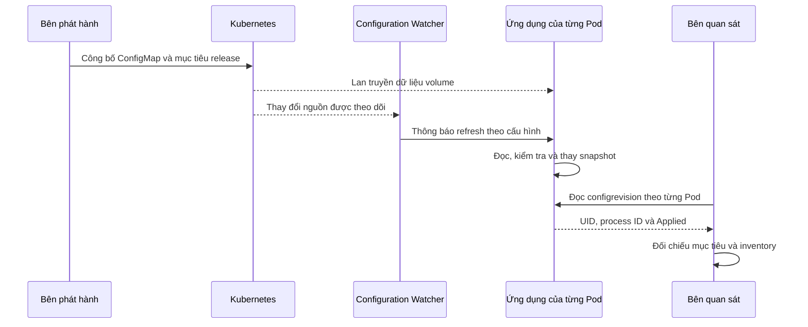

# Theo dõi phiên bản cấu hình được áp dụng trên từng Pod

Trong chương **Vận hành cấu hình** của **SPRING_CLOUD_KUBERNETES**, bài học này hướng dẫn xác định cấu hình mà từng Pod thực sự đang dùng. Mục tiêu là có bằng chứng tại ứng dụng, đối chiếu được với phiên bản mong muốn và phát hiện replica chưa cập nhật.

Một ConfigMap đã đổi không chứng minh mọi Pod đã đọc bản mới. Một lời gọi refresh thành công cũng chưa chứng minh mọi thành phần nghiệp vụ đã áp dụng thay đổi. Với nhiều replica, cần theo dõi riêng từng tiến trình và kiểm tra trạng thái hội tụ của cả tập Pod.

Sau bài học, bạn có thể:

- Phân biệt phiên bản nguồn, phiên bản mong muốn và phiên bản đã áp dụng.
- Thiết kế bản ghi trạng thái có định danh Pod, phạm vi cấu hình và bằng chứng runtime.
- Công bố trạng thái qua endpoint nội bộ mà không làm lộ Secret.
- Kiểm tra rollout, refresh, rollback và tình huống thiếu dữ liệu quan sát trên từng replica.

## 1. Ba lớp phiên bản cần phân biệt

| Lớp | Câu hỏi trả lời | Ví dụ |
| --- | --- | --- |
| Desired | Đợt triển khai muốn cohort này dùng cấu hình nào? | Pipeline chọn `cfg-r2` |
| Observed | Tiến trình đã nhìn thấy dữ liệu nào? | File mount hoặc nguồn cấu hình đã chứa r2 |
| Applied | Mã nghiệp vụ hoặc tài nguyên runtime đang sử dụng bản nào? | Bộ quy tắc đang phục vụ request là r2 |

Có thể cần thêm bước `Validated`: dữ liệu đã được parse và kiểm tra nhưng chưa thay trạng thái đang hoạt động.

Ví dụ ba Pod của ứng dụng `orders`:

| Pod | Nguồn đã thấy | Cấu hình đang dùng | Diễn giải |
| --- | --- | --- | --- |
| orders-a | cfg-r2 | cfg-r2 | Đã áp dụng |
| orders-b | cfg-r2 | cfg-r1 | Đã nhận nhưng chưa áp dụng hoặc áp dụng thất bại |
| orders-c | cfg-r1 | cfg-r1 | Chưa nhận nguồn mới |

Nếu endpoint chỉ đọc `Environment.getProperty("config.revision")`, nó có thể báo r2 trong khi một bean hoặc connection pool vẫn dùng giá trị r1. Vì thế, bản ghi Applied phải gắn với đối tượng hoặc tài nguyên đang được dùng thật.

Trong bài, phạm vi minh họa là **order-policy**, có quy tắc giới hạn số mặt hàng trong một đơn. Đây là cấu hình không bí mật, thuận tiện để kiểm tra hành vi trước và sau thay đổi.

## 2. Chọn định danh phiên bản và phạm vi

### 2.1. Không dùng nhầm metadata làm bằng chứng

| Giá trị | Hữu ích cho | Chưa chứng minh |
| --- | --- | --- |
| ConfigMap `resourceVersion` | Truy vết thay đổi ở Kubernetes API | Bean đã áp dụng dữ liệu |
| `metadata.generation` nếu loại tài nguyên có sử dụng | Theo dõi thế hệ đặc tả theo cơ chế tài nguyên | Cấu hình runtime của ứng dụng |
| Git commit hoặc mã release | Nối với quy trình phát hành | Dữ liệu sau merge/override thực tế của từng Pod |
| Annotation checksum trên Pod template | Gắn một nội dung với Pod template và kích hoạt rollout khi template đổi | Tiến trình đã áp dụng nội dung |
| Deployment revision | Truy vết lịch sử Pod template | Phiên bản ConfigMap đang được dùng |
| Mã phiên bản do runtime công bố | Đối chiếu trạng thái ứng dụng | Toàn bộ hệ thống đã hội tụ nếu mới đọc một replica |

`resourceVersion` là giá trị opaque; giữ nó làm dữ liệu đối chiếu, không so sánh như số thứ tự nghiệp vụ hoặc dùng làm mã release toàn hệ thống. [Kubernetes API và resource versions](https://kubernetes.io/docs/reference/using-api/api-concepts/#resource-versions).

Deployment tạo revision khi Pod template thay đổi. Rollback Deployment chỉ đưa Pod template về bản trước; nó không tự đưa nội dung một ConfigMap cùng tên về dữ liệu cũ. [Deployment revision và rollback](https://kubernetes.io/docs/concepts/workloads/controllers/deployment/#rolling-back-a-deployment).

### 2.2. Một mã release gắn với một nội dung

Ví dụ cấu hình:

```yaml
apiVersion: v1
kind: ConfigMap
metadata:
  name: orders
  namespace: config-lab
  labels:
    spring.cloud.kubernetes.config: "true"
data:
  policy.properties: |
    release-id=cfg-r1
    max-items=20
```

Quy ước của bài:

- `release-id` do quy trình phát hành cấp.
- Không dùng lại cùng một ID cho nội dung khác trong cùng phạm vi.
- Giữ ID và dữ liệu policy trong cùng một tài liệu được đọc nhất quán.
- Phân biệt release mới với bản cũ được chọn lại khi rollback.

Nếu rollback về nội dung r1, hệ thống có thể chọn lại ID r1 hoặc tạo release mới ghi rõ quan hệ rollback. Dù chọn cách nào, quy trình phải đối chiếu với mục tiêu hiện tại; không kết luận ID có vẻ “nhỏ hơn” là sai.

### 2.3. Fingerprint cần phản ánh đúng phạm vi

Ngoài release ID, có thể tính fingerprint trên cấu hình hiệu lực đã chuẩn hóa. Với policy của bài:

```text
order-policy/v1
maxItems=20
```

Fingerprint không bao gồm release ID, nên hai release có cùng hành vi có thể có cùng fingerprint. Khi kiểm tra mục tiêu phát hành, vẫn đối chiếu cả ID và fingerprint nếu hợp đồng yêu cầu.

Chuẩn hóa rõ tên key, thứ tự, kiểu dữ liệu và giá trị mặc định. Không hash nguyên YAML rồi coi thay đổi khoảng trắng là thay đổi hành vi.

Với nhiều nguồn, bản ghi cần thể hiện phạm vi hoặc tập phiên bản thành phần, chẳng hạn `order-policy`, `http-client`, `db-credentials`. Không lấy revision của một ConfigMap để đại diện cho toàn bộ cấu hình ứng dụng.

Đối với Secret, dùng mã phiên bản không nhạy cảm được cấp riêng và bằng chứng áp dụng phù hợp. Không xuất hash mật khẩu hoặc toàn bộ nội dung Secret để tạo fingerprint quan sát.

## 3. Định nghĩa hợp đồng trạng thái của từng Pod

Một báo cáo minh họa:

```json
{
  "application": "orders",
  "namespace": "config-lab",
  "podName": "orders-a",
  "podUid": "uid-a",
  "processInstanceId": "process-a",
  "scope": "order-policy",
  "applied": {
    "releaseId": "cfg-r2",
    "effectiveFingerprint": "sha256:...",
    "appliedAt": "2026-11-25T04:00:10Z"
  },
  "observedAt": "2026-11-25T04:00:15Z"
}
```

Giá trị UID, process ID và fingerprint trong JSON chỉ minh họa cấu trúc. Khi chạy thật, lấy định danh và fingerprint thật từ ứng dụng.

Các trường quan trọng:

| Trường | Vai trò |
| --- | --- |
| `podUid` | Phân biệt Pod bị xóa rồi tạo lại cùng tên |
| `processInstanceId` | Phân biệt lần chạy mới của container trong cùng Pod |
| `scope` | Nói rõ phần cấu hình đang được xác nhận |
| `releaseId` | Phiên bản đã được cài vào trạng thái hoạt động |
| `effectiveFingerprint` | Phát hiện cùng ID nhưng nội dung hiệu lực khác |
| `appliedAt` | Thời điểm tiến trình này áp dụng trạng thái |
| `observedAt` | Thời điểm tạo báo cáo để hỗ trợ kiểm tra tính mới |

Một Pod UID có thể không đổi khi container restart. Vì vậy, cache báo cáo chỉ theo tên Pod hoặc UID có thể giữ nhầm bằng chứng từ tiến trình trước.

Không để ứng dụng lấy “desired” từ chính giá trị nó đang dùng rồi tự kết luận khớp mục tiêu. Desired phải đến từ hồ sơ release hoặc bên điều phối độc lập; ứng dụng cung cấp bằng chứng Applied.

Nếu chưa áp dụng được cấu hình bắt buộc, báo chưa có trạng thái hợp lệ hoặc lỗi rõ ràng. Không trả một ID mặc định như `latest` rồi cho phép hệ thống quan sát coi đó là thành công.

## 4. Cấp định danh Pod bằng Downward API

Trích đoạn để ghép vào container của Deployment đã có:

```yaml
env:
  - name: POD_NAME
    valueFrom:
      fieldRef:
        fieldPath: metadata.name
  - name: POD_NAMESPACE
    valueFrom:
      fieldRef:
        fieldPath: metadata.namespace
  - name: POD_UID
    valueFrom:
      fieldRef:
        fieldPath: metadata.uid
```

Downward API cung cấp các trường Pod này cho container mà ứng dụng không cần gọi Kubernetes API chỉ để tự nhận diện. [Downward API](https://kubernetes.io/docs/concepts/workloads/pods/downward-api/).

Có thể đưa revision mong muốn vào annotation của Pod template để truy vết ý định triển khai. Tuy nhiên, annotation không tự trở thành xác nhận Applied. Với hot refresh, bản annotation tĩnh còn có thể giữ nguyên trong suốt đời Pod.

Bên quan sát phải đối chiếu `podUid` trong báo cáo với inventory Kubernetes đang có. Kết nối tới một địa chỉ IP được tái sử dụng không được phép nhận lại bằng chứng của Pod cũ.

## 5. Gắn bằng chứng với đúng trạng thái runtime

Phần Java dưới là thiết kế minh họa dành cho Java 17 trở lên. Các lớp đặt trong cùng package `demo.config`, trong ứng dụng Spring Boot có web, Actuator và tích hợp Spring Cloud Context phù hợp release.

Ứng dụng dùng một đối tượng bất biến chứa cả policy và bằng chứng. Việc thay policy và công bố Applied diễn ra qua một lần đổi tham chiếu.

### 5.1. Thành phần giữ policy đang hoạt động

```java
package demo.config;

import java.nio.charset.StandardCharsets;
import java.security.MessageDigest;
import java.security.NoSuchAlgorithmException;
import java.time.Instant;
import java.util.HexFormat;
import java.util.Objects;
import java.util.concurrent.atomic.AtomicReference;

import org.springframework.stereotype.Component;

@Component
public final class RuntimePolicy {

    public record Candidate(String releaseId, int maxItems) {
    }

    public record Evidence(
            String releaseId,
            String effectiveFingerprint,
            Instant appliedAt) {
    }

    public record Decision(String releaseId, boolean accepted) {
    }

    private record Active(Candidate policy, Evidence evidence) {
    }

    private final AtomicReference<Active> active = new AtomicReference<>();

    public synchronized void apply(Candidate candidate) {
        Objects.requireNonNull(candidate, "candidate");

        if (candidate.releaseId() == null
                || !candidate.releaseId().matches("cfg-[A-Za-z0-9._-]{1,64}")) {
            throw new IllegalArgumentException("Invalid release ID");
        }
        if (candidate.maxItems() < 1 || candidate.maxItems() > 1000) {
            throw new IllegalArgumentException("max-items is out of range");
        }

        String fingerprint = fingerprint(candidate.maxItems());
        Active previous = active.get();

        if (previous != null
                && previous.policy().releaseId().equals(candidate.releaseId())) {
            if (!previous.evidence().effectiveFingerprint().equals(fingerprint)) {
                throw new IllegalArgumentException("Release ID was reused");
            }
            return;
        }

        Evidence evidence = new Evidence(
                candidate.releaseId(), fingerprint, Instant.now());

        active.set(new Active(candidate, evidence));
    }

    public Evidence evidence() {
        return requireActive().evidence();
    }

    public Decision decide(int itemCount) {
        Active snapshot = requireActive();
        boolean accepted = itemCount > 0
                && itemCount <= snapshot.policy().maxItems();
        return new Decision(snapshot.policy().releaseId(), accepted);
    }

    private Active requireActive() {
        Active snapshot = active.get();
        if (snapshot == null) {
            throw new IllegalStateException("No policy has been applied");
        }
        return snapshot;
    }

    private static String fingerprint(int maxItems) {
        String canonical = "order-policy/v1\nmaxItems=" + maxItems + "\n";
        try {
            byte[] digest = MessageDigest.getInstance("SHA-256")
                    .digest(canonical.getBytes(StandardCharsets.UTF_8));
            return "sha256:" + HexFormat.of().formatHex(digest);
        } catch (NoSuchAlgorithmException exception) {
            throw new IllegalStateException(exception);
        }
    }
}
```

Ở đây:

- Dữ liệu sai bị từ chối trước khi thay `active`.
- Policy và Evidence được giữ cùng một snapshot.
- Một request đọc snapshot một lần, nên release ID trong kết quả khớp policy dùng cho quyết định đó.
- Nhận lại cùng ID và cùng nội dung không làm thay đổi `appliedAt`.
- Cùng ID nhưng nội dung khác bị phát hiện khi so với trạng thái hiện tại.

Quy trình phát hành vẫn phải kiểm soát việc dùng lại ID trên toàn lịch sử; thành phần nhỏ này không phải kho lưu lịch sử release.

Đừng đặt riêng một biến `lastRefreshSucceeded=true` rồi xem nó là bằng chứng cho tất cả bean. Với database pool hoặc HTTP client, phải công bố Applied sau khi tài nguyên mới được chuẩn bị, kiểm tra và chuyển vào sử dụng đúng cách.

### 5.2. Đường nghiệp vụ dùng chính snapshot đó

```java
package demo.config;

import org.springframework.web.bind.annotation.GetMapping;
import org.springframework.web.bind.annotation.RequestParam;
import org.springframework.web.bind.annotation.RestController;

@RestController
public final class OrderPolicyController {

    private final RuntimePolicy runtime;

    public OrderPolicyController(RuntimePolicy runtime) {
        this.runtime = runtime;
    }

    @GetMapping("/orders/eligibility")
    public RuntimePolicy.Decision eligibility(
            @RequestParam("items") int items) {
        return runtime.decide(items);
    }
}
```

Với `max-items=20`, yêu cầu 30 mặt hàng trả `accepted=false`. Với `max-items=50`, cùng yêu cầu trả `accepted=true`. Đường API này là của ứng dụng minh họa, không phải endpoint mặc định của Spring.

Kết quả gồm release ID mà request đã dùng. Điều này có ích khi chuyển cấu hình trong lúc vẫn có request đang xử lý: một request bắt đầu với snapshot cũ có thể hoàn tất với snapshot đó dù endpoint quan sát đã thấy bản mới.

## 6. Nạp cùng một tài liệu rồi mới công bố Applied

Để ví dụ có một đường dữ liệu rõ ràng, ứng dụng tự đọc `policy.properties` từ ConfigMap volume. Nó không giả định Spring tự nhận biết một file tùy ý trong ConfigMap.

Loader chạy khi ứng dụng khởi động và khi nhận sự kiện refresh đã chọn:

```java
package demo.config;

import java.io.IOException;
import java.io.StringReader;
import java.nio.charset.StandardCharsets;
import java.nio.file.Files;
import java.nio.file.Path;
import java.util.Properties;

import org.springframework.boot.ApplicationArguments;
import org.springframework.boot.ApplicationRunner;
import org.springframework.cloud.context.scope.refresh.RefreshScopeRefreshedEvent;
import org.springframework.context.event.EventListener;
import org.springframework.stereotype.Component;

@Component
public final class MountedPolicyLoader implements ApplicationRunner {

    private final RuntimePolicy runtime;
    private final Path path = Path.of("/etc/orders-policy/policy.properties");

    public MountedPolicyLoader(RuntimePolicy runtime) {
        this.runtime = runtime;
    }

    @Override
    public void run(ApplicationArguments arguments) throws IOException {
        reload();
    }

    @EventListener(RefreshScopeRefreshedEvent.class)
    public void afterRefresh() throws IOException {
        reload();
    }

    public synchronized void reload() throws IOException {
        String document = Files.readString(path, StandardCharsets.UTF_8);
        Properties properties = new Properties();
        properties.load(new StringReader(document));

        RuntimePolicy.Candidate candidate = new RuntimePolicy.Candidate(
                properties.getProperty("release-id"),
                Integer.parseInt(properties.getProperty("max-items")));

        runtime.apply(candidate);
    }
}
```

Loader đọc một tài liệu vào bộ nhớ, parse candidate rồi gọi `apply()`. Một lần đọc lỗi hoặc candidate không hợp lệ không làm thay snapshot hoạt động trước đó. Khi khởi động chưa có policy hợp lệ, lỗi từ runner phải được xử lý như lỗi khởi động, không tự tạo một phiên bản thành công giả.

`reload()` được tuần tự hóa trong loader. Với một implementation tải nguồn bất đồng bộ, cũng cần giữ thứ tự áp dụng, tránh bản tải cũ hoàn tất muộn rồi ghi đè bản mới. Mã release opaque không đủ để tự sắp xếp; có thể dùng thế hệ do bên điều phối quản lý hoặc đọc lại nguồn hiện tại qua một hàng đợi có chủ sở hữu.

`RefreshScopeRefreshedEvent` là sự kiện của Spring Cloud Context. Mã nguồn RefreshScope cho thấy việc refresh có phát sự kiện liên quan; ứng dụng vẫn phải lựa chọn adapter và xác minh hành vi với release thực tế. [RefreshScope](https://github.com/spring-cloud/spring-cloud-commons/blob/main/spring-cloud-context/src/main/java/org/springframework/cloud/context/scope/refresh/RefreshScope.java).

Trong ví dụ, listener chủ động gọi loader. Điều này không có nghĩa một sự kiện Spring bất kỳ tự chứng minh mọi bean đã tạo lại hoặc mọi tài nguyên đã chuyển phiên bản.

Không đặt `RuntimePolicy` vào `@RefreshScope` trong thiết kế này: nó là nơi giữ trạng thái đang hoạt động và bằng chứng qua các lần refresh. Nếu dùng cơ chế bean khác, phải bảo đảm nơi ghi nhận Applied có cùng vòng đời và hợp đồng với tài nguyên được giám sát.

Ví dụ chỉ giữ bằng chứng áp dụng thành công. Hệ thống vận hành nên ghi thêm lần thử gần nhất, mã lỗi đã che dữ liệu và trạng thái candidate bị từ chối, nhưng không thay `applied.releaseId` khi lần thử thất bại.

## 7. Công bố endpoint quan sát riêng

### 7.1. Endpoint đọc từ runtime, không đọc lại nguồn

```java
package demo.config;

import java.time.Instant;
import java.util.Map;
import java.util.UUID;

import org.springframework.boot.actuate.endpoint.annotation.Endpoint;
import org.springframework.boot.actuate.endpoint.annotation.ReadOperation;
import org.springframework.core.env.Environment;
import org.springframework.stereotype.Component;

@Component
@Endpoint(id = "configrevision")
public final class ConfigRevisionEndpoint {

    private final RuntimePolicy runtime;
    private final String podName;
    private final String podUid;
    private final String namespace;
    private final String processInstanceId = UUID.randomUUID().toString();

    public ConfigRevisionEndpoint(
            RuntimePolicy runtime, Environment environment) {
        this.runtime = runtime;
        this.podName = environment.getRequiredProperty("POD_NAME");
        this.podUid = environment.getRequiredProperty("POD_UID");
        this.namespace = environment.getRequiredProperty("POD_NAMESPACE");
    }

    @ReadOperation
    public Map<String, Object> read() {
        RuntimePolicy.Evidence evidence = runtime.evidence();
        return Map.of(
                "application", "orders",
                "namespace", namespace,
                "podName", podName,
                "podUid", podUid,
                "processInstanceId", processInstanceId,
                "scope", "order-policy",
                "applied", evidence,
                "observedAt", Instant.now().toString());
    }
}
```

`processInstanceId` được tạo cho lần chạy của thành phần quan sát và không đổi theo từng request. Trong thiết kế này, endpoint cũng không nằm trong RefreshScope.

Spring Boot hỗ trợ custom Actuator endpoint với `@Endpoint` và `@ReadOperation`. Với base path mặc định, ID trên có đường HTTP `/actuator/configrevision` khi được phép truy cập và được expose. Đây là endpoint do ứng dụng tự xây, không có sẵn trong Spring Cloud Kubernetes. [Custom Actuator endpoints](https://docs.spring.io/spring-boot/reference/actuator/endpoints.html#actuator.endpoints.implementing-custom).

### 7.2. Cấu hình và bảo vệ đường quản trị

Ví dụ cấu hình tối thiểu cho đường quan sát và refresh của bài:

```yaml
spring:
  application:
    name: orders
management:
  server:
    port: 9090
  endpoints:
    web:
      exposure:
        include: health,configrevision,refresh
  endpoint:
    configrevision:
      cache:
        time-to-live: 0ms
```

Cần dependency và auto-configuration của Spring Cloud Context để cung cấp endpoint refresh phù hợp. Dòng exposure không tự tạo endpoint nếu tính năng tương ứng chưa có.

Trong môi trường thực hành, dùng cơ chế xác thực đã cấu hình để:

- Bên quan sát chỉ được GET trạng thái.
- Bên điều phối được POST refresh khi cần.
- Không công khai đường quản trị qua ingress nghiệp vụ.
- Không dump toàn bộ `Environment`, `/env` hoặc `/configprops` làm báo cáo phiên bản.

Exposure là lựa chọn đưa endpoint lên giao thức, không thay thế phân quyền HTTP. Cần cấu hình Spring Security, mTLS hoặc lớp bảo vệ tương ứng với kiến trúc thực tế.

Cache trên proxy hoặc collector cũng phải phù hợp. Một JSON đúng nhưng được cache từ tiến trình đã chết không phải bằng chứng hiện tại. Lưu thời điểm collector nhận báo cáo; không chỉ tin timestamp do ứng dụng tự khai báo.

## 8. Gắn ConfigMap volume và nhận diện Pod

Phần sau là trích đoạn Deployment để ghép với image, selector và cấu hình sẵn có. Nó không phải manifest đủ để triển khai ứng dụng từ đầu.

```yaml
spec:
  template:
    metadata:
      labels:
        app: orders
    spec:
      containers:
        - name: orders
          ports:
            - name: http
              containerPort: 8080
            - name: management
              containerPort: 9090
          env:
            - name: POD_NAME
              valueFrom:
                fieldRef:
                  fieldPath: metadata.name
            - name: POD_NAMESPACE
              valueFrom:
                fieldRef:
                  fieldPath: metadata.namespace
            - name: POD_UID
              valueFrom:
                fieldRef:
                  fieldPath: metadata.uid
          volumeMounts:
            - name: order-policy
              mountPath: /etc/orders-policy
              readOnly: true
      volumes:
        - name: order-policy
          configMap:
            name: orders
            items:
              - key: policy.properties
                path: policy.properties
```

ConfigMap mount thông thường được cập nhật theo cơ chế lan truyền của Kubernetes. Dữ liệu lấy qua biến môi trường không tự đổi cho container đang chạy; mount bằng `subPath` cũng không nhận cập nhật ConfigMap theo cách đó. [Cập nhật ConfigMap trong Pod](https://kubernetes.io/docs/concepts/configuration/configmap/#mounted-configmaps-are-updated-automatically).

Với ví dụ, volume đổi chỉ là mốc Observed. Loader phải chạy và candidate phải được chấp nhận để mốc Applied đổi.

Nếu dùng environment cho policy, hãy chọn rollout thay vì kỳ vọng hot refresh cập nhật giá trị environment. Nếu dùng cấu hình immutable theo tên phiên bản, đối chiếu cả tham chiếu nguồn trong Pod template và bằng chứng ứng dụng.

Đừng đưa một revision mong muốn qua environment rồi trả nguyên environment đó làm Applied. Hai đại lượng có cùng chuỗi ký tự không tạo ra bằng chứng về bước áp dụng.

## 9. Configuration Watcher là đường kích hoạt, không phải xác nhận cuối

Đường cập nhật có thể được mô tả như sau:



Hai nhánh lan truyền volume và thông báo watcher có thể chạy với thời gian khác nhau. Nếu listener đọc file trước khi volume có r2, nó có thể đọc lại r1 hợp lệ. Một lần refresh hoàn tất vẫn chưa đưa Pod đó tới r2.

Configuration Watcher hỗ trợ thông báo qua HTTP hoặc Spring Cloud Bus; tài liệu có cấu hình chờ trước khi refresh cho nguồn mount. Phải kiểm tra namespace, nhãn, tên ứng dụng, cổng quản trị và cơ chế gửi của release đang dùng. [Configuration Watcher](https://docs.spring.io/spring-cloud-kubernetes/reference/spring-cloud-kubernetes-configuration-watcher.html).

Khoảng delay cố định chỉ là một cách phối hợp thời gian, không phải chứng minh mọi Pod đã nhận dữ liệu. Với yêu cầu vận hành chặt hơn, cần đối soát và retry có giới hạn cho Pod chưa khớp mục tiêu, hoặc chọn một đường đọc nguồn phù hợp hơn.

Mã loader của bài **không tự có vòng retry khi file đến muộn**. Phép thực hành bên dưới sẽ kiểm tra nguồn trước rồi kích hoạt lại refresh khi cần. Nếu đưa mẫu vào hệ thống thực, phải thiết kế cơ chế đối soát đó và giới hạn tốc độ theo ngân sách.

Nếu watcher dùng cổng khám phá 8080 nhưng Actuator nằm ở 9090, phải cấu hình đúng đường quản trị theo cơ chế của phiên bản watcher. HTTP 404, 401, 403 hoặc timeout ở bước này không phải bằng chứng candidate đã bị từ chối bởi validation.

Spring Cloud Context còn có đặc điểm riêng về refresh bean: một bean trong RefreshScope có thể chỉ được tạo lại khi được gọi tiếp, và một số tài nguyên không hỗ trợ refresh theo cách mong đợi. Với tài nguyên có trạng thái như pool, đặt điểm xác nhận Applied sau bước thực sự chuyển vào sử dụng. [Refresh Scope](https://docs.spring.io/spring-cloud-commons/reference/spring-cloud-commons/application-context-services.html#refresh-scope).

Nếu ứng dụng chỉ đọc file mount và nhận thông báo HTTP, không nhất thiết phải được cấp quyền đọc ConfigMap hoặc Secret qua API. Configuration Watcher và bên quan sát dùng danh tính, RBAC riêng theo chức năng của chúng.

## 10. Đối soát toàn bộ Pod và định nghĩa hội tụ

### 10.1. Lấy inventory độc lập với endpoint ứng dụng

Nguồn danh sách Pod phải đến từ Kubernetes hoặc hệ thống điều phối đáng tin cậy. Không lấy mẫu nhiều lần qua Service rồi xem số response là số replica đã kiểm tra: load balancing, keep-alive hoặc affinity có thể đưa nhiều request tới cùng một Pod.

Với từng mục inventory, giữ namespace, Pod name, UID, owner/cohort, readiness, trạng thái terminating và danh tính tiến trình nhận được từ endpoint. Xác định trước cách xử lý Pod cũ đang drain, Pod mới chưa sẵn sàng và các cohort canary.

Ví dụ mục tiêu của cohort stable là `cfg-r2/H2`:

| Pod | Ready | Báo cáo Applied | Trạng thái đối soát |
| --- | --- | --- | --- |
| a | Có | cfg-r2/H2 | Khớp mục tiêu |
| b | Có | cfg-r1/H1 | Chưa khớp |
| c | Có | cfg-r2/H1 | ID khớp nhưng fingerprint sai |
| d | Chưa | Không lấy được | Chưa có bằng chứng |

Không được bỏ d khỏi kết quả rồi tuyên bố “mọi Pod trả lời đều đúng”. Tập mục tiêu, số replica cần có và các trường hợp thiếu dữ liệu phải được thể hiện cùng nhau.

### 10.2. Điều kiện hoàn tất của một đợt cập nhật

Ví dụ chính sách của bài:

1. Mục tiêu release và fingerprint của mỗi cohort đã được cố định cho vòng kiểm tra.
2. Số replica và trạng thái workload đáp ứng yêu cầu triển khai.
3. Tất cả Pod thuộc tập phải xác nhận có báo cáo mới, đúng UID và đúng phạm vi.
4. Mỗi báo cáo khớp mục tiêu của cohort đó.
5. Không có Pod chưa được tính tới do lỗi truy cập hoặc thay đổi inventory.
6. Điều kiện giữ ổn định qua ít nhất ba lần kiểm tra cách nhau năm giây.

Ba lần kiểm tra trên bao phủ một khoảng mười giây giữa lần đầu và lần cuối; đây là chính sách thực hành, không phải bảo đảm nhất quán toàn cluster hay một chuẩn mặc định.

Không cho phép tập mục tiêu rỗng tự làm điều kiện “tất cả đều khớp” trở thành thành công. Deployment mong muốn ba replica nhưng không có Pod quan sát được là một trường hợp thiếu năng lực hoặc thiếu bằng chứng.

Trong canary, stable và canary có thể cố ý dùng release khác nhau. Đối chiếu theo cohort đã khai báo; đếm hai revision toàn hệ thống không đủ kết luận có lỗi.

### 10.3. Vòng kiểm tra có thời hạn

```text
target = captureReleaseContract()
deadline = now + convergenceBudget

while now < deadline:
    if releaseContractWasSuperseded(target):
        stopAndReevaluateTarget()

    inventory = listOwnedPodsAndWorkloadState()

    reports = fetchEachPodWithBoundedConcurrency(inventory)

    for pod in inventory:
        report = reports[pod.uid]
        classify:
            missing or request failed        -> UNKNOWN
            UID or scope does not match      -> INVALID_EVIDENCE
            process identity changed         -> NEW_PROCESS_RECHECK
            report is stale                  -> STALE_EVIDENCE
            revision or fingerprint differs  -> MISMATCH
            otherwise                        -> MATCH

    evaluateReplicaCountReadinessAndCohorts()

    if everyGateIsSatisfiedForStableWindow():
        return PASS

    waitWithinPollingBudget()

return FAIL_WITH_PER_POD_EVIDENCE
```

Giới hạn concurrency, timeout và retry để việc quan sát không làm quá tải endpoint quản trị. Tập Pod thay đổi thì lấy lại inventory và đánh giá lại; chỉ bỏ một UID khỏi tập khi xác nhận đúng vòng đời và chính sách cohort.

Nếu HPA thay đổi số replica trong đợt này, các Pod mới cũng phải được gắn với đúng mục tiêu. Không đóng băng danh sách ba Pod ban đầu rồi bỏ sót replica thứ tư vừa tham gia phục vụ.

Đo thời gian hội tụ trên đồng hồ của bên điều phối: từ mốc công bố mục tiêu tới lần quan sát đủ điều kiện. `appliedAt` của ứng dụng hữu ích cho chẩn đoán, nhưng chênh lệch giữa các đồng hồ không đồng bộ có thể làm phép trừ timestamp sai.

## 11. Thực hành quan sát theo từng Pod

### 11.1. Điều kiện môi trường

Chuẩn bị ứng dụng thử `orders` với các lớp minh họa, package được component scan, ba replica trong namespace `config-lab`, ConfigMap ở phần 2 và volume ở phần 8.

Đường quản trị cần được bảo vệ bằng cơ chế có sẵn của môi trường. Bài dùng ví dụ bearer token đã được cấp riêng cho quyền đọc và quyền refresh; không nhúng token vào mã nguồn hoặc lịch sử lệnh. Nếu môi trường dùng mTLS hay cơ chế khác, thay phần xác thực tương ứng.

Readiness của ứng dụng phải phù hợp với yêu cầu đã có policy hợp lệ. Các lệnh dưới là hướng dẫn thực hành, không triển khai đầy đủ image, Service, security hay Configuration Watcher.

### 11.2. Lập danh sách Pod

Trong PowerShell:

```powershell
$ns = 'config-lab'
$inventoryJson = kubectl -n $ns get pods -l app=orders -o json
if ($LASTEXITCODE -ne 0) {
    throw 'Không đọc được inventory Pod'
}

$inventory = $inventoryJson | ConvertFrom-Json
$columns = @(
    @{Name='Name'; Expression={$_.metadata.name}}
    @{Name='UID'; Expression={$_.metadata.uid}}
    @{Name='Phase'; Expression={$_.status.phase}}
    @{Name='Terminating'; Expression={$_.metadata.deletionTimestamp}}
)
$inventory.items | Select-Object -Property $columns

$selectedPod = $inventory.items |
    Where-Object { -not $_.metadata.deletionTimestamp } |
    Select-Object -First 1

if ($null -eq $selectedPod) {
    throw 'Không có Pod để quan sát'
}

$podName = $selectedPod.metadata.name
$selectedPod.metadata.uid

kubectl -n $ns port-forward ("pod/" + $podName) 19090:9090 18080:8080
```

Trong môi trường thực hành, xác minh selector chỉ chọn workload cần kiểm tra; môi trường dùng selector rộng cần đối chiếu cả quan hệ sở hữu.

Giữ cửa sổ này chạy để tunnel tới đúng Pod được chọn. Đây là đường chẩn đoán theo Pod, không phải cách phát tải benchmark.

### 11.3. Đọc bằng chứng của tiến trình

Ở cửa sổ thứ hai:

```powershell
if ([string]::IsNullOrWhiteSpace($env:CONFIG_READ_TOKEN)) {
    throw 'Cần credential đọc đã được cấp cho môi trường thử'
}

$readHeaders = @{
    Authorization = 'Bearer ' + $env:CONFIG_READ_TOKEN
}

$report = Invoke-RestMethod -Uri 'http://127.0.0.1:19090/actuator/configrevision' -Headers $readHeaders -TimeoutSec 5
$report | ConvertTo-Json -Depth 5
```

Đối chiếu `podUid` với Pod đã chọn. Ghi cả `processInstanceId`; nếu container restart, không tái dùng báo cáo cũ cho tiến trình mới.

Với r1, API nghiệp vụ minh họa cần trả `accepted=false` khi `items=30`:

```powershell
Invoke-RestMethod -Uri 'http://127.0.0.1:18080/orders/eligibility?items=30' -Headers $readHeaders -TimeoutSec 5
```

Credential đọc của môi trường thực hành cần có quyền truy cập API thử tương ứng. Nếu hệ thống dùng quyền riêng cho nghiệp vụ, sử dụng credential thích hợp thay cho token quan sát.

### 11.4. Công bố r2 bằng dữ liệu không bí mật

Ví dụ PowerShell giữ nguyên nhãn dùng cho watcher:

```powershell
$policyDocument = @'
release-id=cfg-r2
max-items=50
'@

$updatedConfig = @{
    apiVersion = 'v1'
    kind = 'ConfigMap'
    metadata = @{
        name = 'orders'
        namespace = 'config-lab'
        labels = @{
            'spring.cloud.kubernetes.config' = 'true'
        }
    }
    data = @{
        'policy.properties' = $policyDocument
    }
}

$updatedConfig | ConvertTo-Json -Depth 5 | kubectl apply -f -
if ($LASTEXITCODE -ne 0) {
    throw 'Chưa công bố được ConfigMap'
}
```

Trong hệ thống do GitOps quản lý, thay đổi nguồn có thẩm quyền theo quy trình của hệ thống, tránh hai bên cùng ghi. Manifest trên chỉ là cách cập nhật cho môi trường thực hành riêng.

Ghi mục tiêu đợt này là cfg-r2 với max-items=50. Công bố ConfigMap thành công mới hoàn tất bước thay nguồn.

### 11.5. Tách Observed khỏi Applied

Với quyền chẩn đoán được cho phép trong môi trường thử, đọc file policy không bí mật ở đúng container:

```powershell
kubectl -n config-lab exec $podName -c orders -- cat /etc/orders-policy/policy.properties
```

Lệnh này dùng biến `podName` từ cửa sổ lập inventory; nếu chạy cửa sổ khác, chọn lại đúng Pod. Không dùng cùng cách để dump Secret.

Nếu file đã là r2 nhưng endpoint vẫn báo r1, Pod đã nhận nguồn nhưng chưa áp dụng. Nếu file còn r1, điều tra đường lan truyền thay vì lập tức kết luận runtime từ chối r2.

Khi chưa có watcher tự động, hoặc cần kiểm tra lại sau lúc file đến muộn, bên có quyền ghi thực hiện:

```powershell
if ([string]::IsNullOrWhiteSpace($env:CONFIG_REFRESH_TOKEN)) {
    throw 'Cần credential refresh đã được cấp cho môi trường thử'
}

$refreshHeaders = @{
    Authorization = 'Bearer ' + $env:CONFIG_REFRESH_TOKEN
}

$refreshRequest = @{
    Method = 'Post'
    Uri = 'http://127.0.0.1:19090/actuator/refresh'
    Headers = $refreshHeaders
    ContentType = 'application/json'
    Body = '{}'
    TimeoutSec = 10
}
Invoke-RestMethod @refreshRequest
```

Sau đó đọc lại configrevision và API nghiệp vụ. Với snapshot r2, quyết định cho 30 mặt hàng cần có `releaseId=cfg-r2` và `accepted=true`.

Một lần POST tới Pod đang port-forward chỉ kiểm tra Pod đó. Watcher tự động cũng cần được kiểm chứng về phạm vi đích; không suy rộng thành mọi replica đã hoàn tất.

### 11.6. So cả ID và fingerprint

Với quy tắc chuẩn hóa của mẫu Java, có thể tính fingerprint mục tiêu bằng PowerShell:

```powershell
$expectedRevision = 'cfg-r2'
$canonical = 'order-policy/v1' + [char]10 + 'maxItems=50' + [char]10

$sha = [System.Security.Cryptography.SHA256]::Create()
try {
    $digest = $sha.ComputeHash(
        [System.Text.Encoding]::UTF8.GetBytes($canonical)
    )
    $expectedFingerprint = 'sha256:' +
        [System.BitConverter]::ToString($digest).Replace('-', '').ToLowerInvariant()
} finally {
    $sha.Dispose()
}

$report = Invoke-RestMethod -Uri 'http://127.0.0.1:19090/actuator/configrevision' -Headers $readHeaders -TimeoutSec 5
$revisionMatches = $report.applied.releaseId -ceq $expectedRevision
$fingerprintMatches = $report.applied.effectiveFingerprint -ceq $expectedFingerprint

[pscustomobject]@{
    Pod = $report.podName
    UID = $report.podUid
    Process = $report.processInstanceId
    RevisionMatches = $revisionMatches
    FingerprintMatches = $fingerprintMatches
}
```

Trong thực tế, quy trình phát hành nên tạo hợp đồng fingerprint bằng cùng quy tắc đã quản lý phiên bản. Đừng để mỗi collector tự đoán cách chuẩn hóa.

Dừng tunnel bằng `Ctrl+C`, chọn Pod tiếp theo và lặp lại. Lập bảng đầy đủ theo inventory, kể cả Pod lỗi hoặc không trả lời. Việc tự động hóa dùng nguyên tắc vòng đối soát ở phần 10.

### 11.7. Thử candidate sai, restart và rollback

Các tình huống cần xác minh:

| Thao tác trong môi trường thử | Kết quả mong đợi |
| --- | --- |
| Công bố cfg-r3 với max-items=0 rồi kích hoạt loader | Candidate bị từ chối; Applied vẫn là bản hợp lệ trước đó |
| Gửi lại r2 cùng nội dung | Không đổi hành vi hoặc đặt lại appliedAt chỉ vì thông báo lặp |
| Đổi nội dung nhưng giữ nguyên ID của bản đang dùng | Phát hiện vi phạm hợp đồng ID |
| Restart một container | Bằng chứng được tạo lại cho processInstanceId mới |
| Xóa và tạo lại Pod | Inventory có UID mới; báo cáo UID cũ không được tính |
| Rollback có kiểm soát về policy 20 mặt hàng | Mọi Pod mục tiêu áp dụng đúng nội dung đã chọn và hành vi quay về từ chối 30 mặt hàng |
| Chặn quyền đọc endpoint của một Pod | Pod đó ở trạng thái UNKNOWN, không bị bỏ khỏi phép kiểm |

Khi chọn một release mới cho rollback, ví dụ cfg-r4 chứa max-items=20, hồ sơ phát hành cần ghi nó là bản hoàn tác. Đối chiếu với mục tiêu cfg-r4, không tiếp tục chờ cfg-r2.

## 12. Metric và cảnh báo về sai khác cấu hình

Các tên dưới là gợi ý tự thiết kế, không phải metric mặc định được bảo đảm bởi Spring Cloud Kubernetes:

| Metric hoặc tín hiệu | Nơi tính phù hợp |
| --- | --- |
| `app_config_apply_total{scope,result}` | Ứng dụng, với nhóm kết quả có giới hạn |
| `app_config_last_success_timestamp_seconds{scope}` | Ứng dụng |
| `app_config_target_match{namespace,pod,scope}` | Collector có cả target và bằng chứng ứng dụng |
| Thời điểm nhận báo cáo gần nhất | Collector |
| Pod thiếu báo cáo hoặc sai UID | Collector đối chiếu inventory |
| Thời gian hội tụ theo cohort | Bên điều phối release |

Không dùng `last_success` đã lâu làm điều kiện cảnh báo duy nhất: cấu hình có thể không đổi suốt nhiều tuần và vẫn đúng. Cảnh báo phải xem mục tiêu đã thay chưa, độ mới báo cáo và trạng thái đối soát.

Các điều kiện cảnh báo minh họa:

- Có Pod thuộc cohort không khớp target sau ngân sách 60 giây.
- Có báo cáo cùng release ID nhưng fingerprint khác.
- Có Pod cần xác nhận mà endpoint không truy cập được.
- Replica hoặc tiến trình mới chưa có bằng chứng áp dụng hợp lệ.
- Tỷ lệ candidate bị từ chối tăng trong một đợt phát hành.

Sáu mươi giây là ngân sách ví dụ, cần chọn theo phương thức phân phối và yêu cầu nghiệp vụ.

Phân biệt `match=0` với không có series hoặc không scrape được. Nếu chỉ kiểm tra các series đang tồn tại, Pod bị mất dữ liệu có thể biến mất khỏi cảnh báo. Dùng inventory và trạng thái thu thập để phát hiện trường hợp này.

Giữ chi tiết revision và fingerprint ở endpoint hoặc kho bằng chứng phù hợp. Mỗi tổ hợp label tạo một time series; thêm mọi revision, hash, request ID hoặc process ID vào label có thể làm số series tăng nhanh. [Nhãn metric và cardinality](https://prometheus.io/docs/practices/naming/#labels).

## 13. Bảo mật, readiness và điều tra sai khác

Bản ghi phiên bản cần whitelist trường được công bố. Không trả toàn bộ cấu hình, Secret, connection string chứa credential hoặc nội dung nguồn chỉ để tiện so sánh.

Quyền của các thành phần nên tách theo chức năng:

- **Ứng dụng:** nhận cấu hình và tự báo runtime; không cần quyền sửa annotation Pod để chứng minh đã áp dụng.
- **Watcher:** đọc/theo dõi nguồn cần thiết và gửi thông báo tới đích được phép.
- **Collector:** lấy inventory và đọc endpoint trạng thái; không mặc nhiên được POST refresh hoặc đọc Secret.
- **Bên phát hành:** công bố mục tiêu và thay nguồn theo quy trình được cấp quyền.

Không sao chép toàn bộ quyền của Configuration Watcher sang ServiceAccount ứng dụng hoặc collector. DiscoveryClient và Spring Cloud LoadBalancer có thể hỗ trợ tìm instance, nhưng danh sách discovery không nhất thiết bao gồm Pod chưa Ready cần điều tra; inventory Kubernetes vẫn cần được đối chiếu theo mục tiêu.

Readiness cần phản ánh hợp đồng phục vụ. Nếu không có policy hợp lệ, ứng dụng chưa nên nhận công việc cần policy. Nếu còn policy cũ hợp lệ và đang cập nhật, có thể tiếp tục phục vụ trong cửa sổ chuyển đổi đã cho phép. Yêu cầu đồng bộ tức thì hoặc cấu hình bảo mật đặc biệt có thể đòi hỏi chính sách chặt hơn.

Đừng tự động biến mỗi sai khác quan sát thành liveness thất bại. Restart đồng loạt có thể làm mất năng lực và che mất nguyên nhân gốc.

| Dấu hiệu | Nhánh điều tra |
| --- | --- |
| ConfigMap đổi, file chưa đổi | Volume projection, mount, subPath và phạm vi nguồn |
| File đổi, Applied chưa đổi | Loader chưa chạy, refresh đến sớm, validation hoặc lỗi áp dụng |
| Environment có r2, tài nguyên vẫn dùng r1 | Binding, vòng đời bean, cache hoặc tài nguyên chưa được chuyển |
| POST refresh lỗi 401/403 | Xác thực và quyền trên đường quản trị |
| POST refresh lỗi 404 hoặc timeout | Endpoint có tồn tại/expose không, base path, cổng và mạng |
| Applied đúng nhưng hành vi sai | Điểm xác nhận đặt sai, code còn đường dùng trạng thái cũ hoặc scope chưa bao quát |
| Cùng ID, khác fingerprint giữa Pod | Override khác nhau, nội dung không đồng nhất hoặc tái sử dụng ID |
| Một Pod không có báo cáo | Tách lỗi ứng dụng, lỗi mạng, quyền quan sát và inventory đã thay đổi |
| Dashboard còn báo bản cũ sau restart | Cache báo cáo, process identity hoặc dữ liệu quan sát cũ |
| Rollback Deployment nhưng policy không quay lại | ConfigMap cùng tên chưa được hoàn tác hoặc nguồn hiện tại vẫn ưu tiên cao hơn |

## 14. Hồ sơ hoàn tất một đợt cập nhật

Báo cáo nên lưu đủ để giải thích kết luận sau này:

```text
Mã đợt phát hành và cohort:
Phạm vi cấu hình:
Revision và fingerprint mục tiêu:
Tham chiếu nguồn, namespace và phiên bản nguồn nếu có:
Thời điểm công bố mục tiêu:
Số replica cần có và chính sách readiness:

Theo từng Pod:
    name / UID / processInstanceId
    revision / fingerprint đã áp dụng
    appliedAt / thời điểm collector nhận
    trạng thái MATCH / MISMATCH / UNKNOWN
    kết quả kiểm tra hành vi hoặc tài nguyên liên quan

Thời điểm hội tụ:
Cửa sổ ổn định đã quan sát:
Pod còn lỗi hoặc bị loại theo chính sách nào:
Giới hạn bằng chứng và hành động tiếp theo:
```

Chỉ kết luận hoàn tất trong phạm vi đã xác minh: đúng cohort, đúng tập Pod, đúng policy và đúng thời điểm. Đối với tài nguyên có vòng đời phức tạp, bổ sung bằng chứng sử dụng thực tế của tài nguyên đó.

Câu hỏi tự kiểm tra:

- Vì sao `kubectl get configmap` không đủ chứng minh mọi Pod đang dùng bản mới?
- Nếu đọc qua Service mười lần đều thấy r2, đã xác minh được bao nhiêu Pod?
- Vì sao cần processInstanceId bên cạnh Pod UID?
- Cùng release ID nhưng khác fingerprint nói lên những khả năng nào?
- Trong lúc refresh, request giữ snapshot r1 còn endpoint đã báo r2 có luôn là lỗi không?
- Nếu endpoint của một Pod không truy cập được, điều kiện hội tụ nên xử lý nó thế nào?
- Khi rollback, làm sao phân biệt quay về cấu hình cũ hợp lệ với một Pod bị tụt lại ngoài ý muốn?
