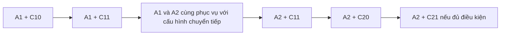

# Phát hành thay đổi cấu hình tương thích với phiên bản ứng dụng

Một ConfigMap hợp lệ về YAML vẫn có thể làm ứng dụng lỗi vì nó đổi tên khóa, đơn vị thời gian hoặc ý nghĩa một giá trị mà mã đang chạy chưa hiểu. Trong rolling update, nhiều phiên bản ứng dụng cùng tồn tại, nên cấu hình phải phù hợp với từng thế hệ Pod và cả đường rollback.

Trong chương **Vận hành cấu hình** của module **SPRING_CLOUD_KUBERNETES**, bài học này hướng dẫn phát hành cấu hình như một phần của hợp đồng triển khai. Phạm vi bao gồm ConfigMap, Secret, refresh qua Configuration Watcher, theo dõi sức khỏe Pod và ảnh hưởng của DiscoveryClient/Spring Cloud LoadBalancer khi nhiều phiên bản cùng phục vụ.

Sau bài học, bạn có thể:

- Phân biệt phiên bản ứng dụng, schema cấu hình và revision nội dung.
- Lập ma trận tương thích cho những cặp ứng dụng–cấu hình được phép.
- Đổi tên hoặc loại bỏ khóa qua giai đoạn mở rộng rồi thu hẹp.
- Gắn một phiên bản cấu hình cụ thể vào Pod template để tái hiện phát hành.
- Chọn rolling update hoặc refresh tại chỗ theo loại thay đổi.
- Canary, quan sát và rollback mà không tạo ra cặp phiên bản chưa được kiểm chứng.

Ví dụ sử dụng các phiên bản giả định của `order-service`. Các hợp đồng, tên revision và quy tắc tương thích trong bài là thiết kế minh họa của ứng dụng, không phải schema mặc định do Spring Cloud Kubernetes cung cấp. Phần Spring Boot tham chiếu nhánh 3.5; cơ chế Watcher tham chiếu Spring Cloud Kubernetes 3.3.

## 1. Cấu hình cũng là một giao diện giữa người phát hành và mã chạy

Giả sử phiên bản A1 đọc:

```yaml
order:
  remote:
    timeout-ms: 800
```

A2 chuyển sang một tên rõ nghĩa hơn:

```yaml
order:
  remote:
    request-deadline-ms: 800
```

Nếu xóa ngay `timeout-ms` khỏi nguồn dùng chung, các Pod A1 có thể thiếu cấu hình, dùng giá trị mặc định ngoài dự kiến hoặc thất bại khi refresh. Nếu chỉ triển khai A2 trước mà nó bắt buộc khóa mới, Pod A2 có thể không khởi động được với cấu hình hiện tại.

Ngay cả khi tên khóa không đổi, đổi `800` từ mili giây sang giây là thay đổi phá vỡ hợp đồng. Những dạng thay đổi cần xem xét gồm:

| Thay đổi | Điều cần kiểm chứng |
|---|---|
| Thêm khóa | Phiên bản cũ bỏ qua hay từ chối khóa lạ? |
| Đổi tên hoặc xóa khóa | Reader cũ còn cần khóa đó không? |
| Đổi kiểu dữ liệu | Cả binder và code sử dụng có chấp nhận không? |
| Đổi đơn vị | Giá trị có còn cùng ý nghĩa không? |
| Đổi giá trị mặc định | Khi khóa vắng mặt, hành vi cũ và mới có khác không? |
| Thêm giá trị enum | Reader cũ có hiểu giá trị mới không? |
| Bật tính năng | Mọi instance và dependency cần thiết đã hỗ trợ chưa? |
| Đổi credential hoặc chứng thư | Cả ứng dụng và hệ thống phía nhận còn chấp nhận không? |

Tương thích cần được đánh giá theo hành vi. “Ứng dụng khởi động được” chưa chứng minh nó xử lý đúng yêu cầu.

## 2. Phân biệt ba loại phiên bản

| Loại định danh | Ví dụ | Trả lời câu hỏi |
|---|---|---|
| Phiên bản ứng dụng | A1, A2 hoặc image digest | Đang chạy bộ mã nào? |
| Schema cấu hình | 1, 2 | Cấu trúc và ý nghĩa cấu hình theo hợp đồng nào? |
| Revision cấu hình | c10, c11, c20 | Đây là snapshot nội dung cụ thể nào? |

Hai revision cùng schema vẫn có thể đổi hành vi mạnh, chẳng hạn tăng concurrency từ 10 lên 1.000. Vì vậy, schema giống nhau không đồng nghĩa thay đổi ít rủi ro.

Ngược lại, một phiên bản ứng dụng có thể hỗ trợ nhiều schema nếu nó có reader và bước chuẩn hóa tương ứng. Không nên suy ra schema bằng cách cắt một phần version ứng dụng hoặc so sánh chuỗi tên ConfigMap.

Nên ghi nhận một bản phát hành bằng bộ thông tin:

```text
release-id
image hoặc image digest
config reference
config schema
config revision
secret/version reference nếu có
profile và các override được phép
điều kiện tương thích với dependency hoặc dữ liệu bên ngoài
```

Đây là metadata quản lý phát hành, không phải nơi lưu payload Secret. Một cấu hình cần nhiều nguồn phải ghi đủ tập nguồn tạo nên snapshot mong muốn.

## 3. Lập ma trận tương thích trước khi sắp thứ tự phát hành

Trong ví dụ, quy định:

- A1 chỉ hiểu schema 1, đọc khóa `timeout-ms` và chấp nhận các khóa bổ sung đã được kiểm chứng.
- A2 hiểu schema 1 và 2, có bước chuẩn hóa tên cũ/tên mới.
- C10 dùng schema 1, chỉ có tên cũ.
- C11 dùng schema 1, chứa cả hai tên với cùng giá trị, tính năng mới vẫn tắt.
- C20 dùng schema 2, chỉ có tên mới, tính năng mới vẫn tắt.
- C21 dùng schema 2, bật tính năng mới sau khi các điều kiện hệ thống đã đáp ứng.

Ma trận dự kiến:

| Ứng dụng | C10: tên cũ | C11: hai tên cùng giá trị | C20: chỉ tên mới | C21: bật tính năng mới |
|---|---|---|---|---|
| A1 | Được phép | Được phép theo hợp đồng đã kiểm chứng | Từ chối | Từ chối |
| A2 | Được phép qua reader tương thích | Được phép | Được phép | Chỉ khi dependency/giao thức đã sẵn sàng |

“Được phép” trong bảng cần được chứng minh bằng kiểm thử binding, validation và hành vi liên quan. Đây không phải kết luận tự động từ một annotation.

`@ConfigurationProperties` có tùy chọn `ignoreUnknownFields`; API Spring Boot mô tả việc bỏ qua trường lạ. Xem [ConfigurationProperties](https://docs.spring.io/spring-boot/3.5/api/java/org/springframework/boot/context/properties/ConfigurationProperties.html). Tuy nhiên, ứng dụng có thể dùng binder chặt, schema riêng, `@Value` hoặc code kiểm tra khác.

Nếu A1 từ chối khóa mới, không thể dùng bước “thêm tên mới vào nguồn chung” như ví dụ. Khi đó cần triển khai reader tương thích trước hoặc tách nguồn cấu hình theo thế hệ ứng dụng.

Ma trận còn phải bao gồm những phiên bản vẫn có khả năng quay lại: Pod đang chạy, Job/CronJob, workload dự phòng, phiên bản rollback và các Pod được autoscaler tạo trong thời gian chuyển tiếp.

## 4. Dùng mở rộng rồi thu hẹp để thay hợp đồng

Một đường chuyển tiếp minh họa:



### 4.1. Mở rộng: thêm khả năng mới nhưng giữ hợp đồng cũ

C11:

```yaml
order:
  contract:
    schema-version: 1
    revision: c11
  remote:
    timeout-ms: 800
    request-deadline-ms: 800
  features:
    new-checkout: false
```

Hai tên ở đây có cùng nghĩa là ngân sách tổng cho lời gọi, đơn vị mili giây. Không dùng một tên làm read timeout còn tên kia làm deadline tổng rồi gọi chúng là alias tương thích.

A1 tiếp tục đọc `timeout-ms`. A2 dùng tên mới nếu có, nhưng vẫn hỗ trợ C10. Nếu cả hai khóa cùng xuất hiện mà giá trị khác nhau, quy tắc mẫu là từ chối thay vì âm thầm chọn một tên.

Giữ hai giá trị nhất quán bằng bước kiểm tra trong pipeline và reader A2. Không yêu cầu người vận hành nhớ cập nhật hai nơi bằng thao tác thủ công mà không có validation.

### 4.2. Chuyển reader: triển khai A2 trong lúc hai thế hệ cùng phục vụ

Trong giai đoạn này, tắt tính năng mới và giữ hành vi cũ. Tập trung xác nhận A2 đọc cấu hình chuyển tiếp đúng và các Pod A1 vẫn phục vụ bình thường.

Nếu dùng ConfigMap theo phiên bản, Pod A1 có thể vẫn gắn C10 trong khi Pod A2 gắn C11. Điều quan trọng là hành vi hai snapshot tương thích trong khoảng giao nhau; không bắt buộc mọi Pod luôn đọc cùng một tên ConfigMap.

Nếu dùng nguồn chung có thể sửa tại chỗ, mọi reader đang sử dụng nguồn đó phải chấp nhận C11 trước khi nó được công bố. Watcher có thể làm thay đổi đến nhiều Pod nhanh hơn dự kiến, nên không chỉ xét Pod đang được triển khai mới.

### 4.3. Thu hẹp: bỏ tên cũ khi không còn reader cần nó

C20:

```yaml
order:
  contract:
    schema-version: 2
    revision: c20
  remote:
    request-deadline-ms: 800
  features:
    new-checkout: false
```

Chỉ chuyển sang C20 khi đã xác định:

- Không còn instance cần khóa cũ trên đường phục vụ liên quan.
- Job, autoscaling và workload dự phòng không tái tạo reader cũ với nguồn không tương thích.
- Quy trình rollback biết quay về cặp A1+C10 hoặc A1+C11 đã kiểm chứng.
- Những bản cấu hình và credential cần cho rollback còn sử dụng được.

Không chỉ xóa tên cũ vì Deployment đã báo đủ replica mới. Cần nhìn toàn bộ consumer của nguồn và chính sách phát hành.

### 4.4. Bật hành vi mới là một thay đổi riêng

C21 có thể chỉ đổi `new-checkout` thành `true`, nhưng tác động nghiệp vụ vẫn cần được đánh giá độc lập.

Feature flag không tạo ra mã còn thiếu trong A1. Cũng không bảo đảm API phía nhận hoặc schema dữ liệu đã hỗ trợ hành vi mới. Khi bật flag, kiểm tra cả producer, consumer, định dạng dữ liệu và đường rollback.

Nếu muốn thay đổi theo nhóm người dùng hoặc tenant, cần một quy tắc phân nhóm nhất quán. Để mỗi Pod tự chọn ngẫu nhiên có thể khiến cùng một thao tác gặp hai hành vi không tương thích.

## 5. Validate hợp đồng và chuẩn hóa cấu hình trong ứng dụng

### 5.1. Validate metadata ở lúc khởi động

Ví dụ Spring Boot 3.5, Java 17 và Bean Validation:

```java
import jakarta.validation.constraints.Max;
import jakarta.validation.constraints.Min;
import jakarta.validation.constraints.NotBlank;
import jakarta.validation.constraints.NotNull;
import jakarta.validation.constraints.Pattern;

import org.springframework.boot.context.properties.ConfigurationProperties;
import org.springframework.validation.annotation.Validated;

@ConfigurationProperties(
        prefix = "order.contract",
        ignoreUnknownFields = false)
@Validated
public record ConfigContract(
        @NotNull @Min(1) @Max(2) Integer schemaVersion,
        @NotBlank
        @Pattern(regexp = "[a-z0-9][a-z0-9.-]{0,63}")
        String revision) {
}
```

Đăng ký bằng `@ConfigurationPropertiesScan` hoặc `@EnableConfigurationProperties(ConfigContract.class)` và có implementation Bean Validation phù hợp, thường qua starter validation.

Mẫu này kiểm tra metadata cho A2. A1 phải có giới hạn schema theo hợp đồng của riêng nó. Không dùng annotation `@Max(2)` cho mọi image rồi cho rằng A1 đã hiểu schema 2.

Spring Boot hỗ trợ validation với `@ConfigurationProperties` và `@Validated`; xem [Externalized Configuration](https://docs.spring.io/spring-boot/3.5/reference/features/external-config.html). Record trên minh họa binding/validation lúc khởi động, không cam kết được tự động thay nội dung an toàn chỉ nhờ một lần refresh.

### 5.2. Chuẩn hóa tên cũ và tên mới thành một mô hình nội bộ

**Mã giả cho reader A2:**

```text
đọc schema và revision
nếu schema không thuộc {1, 2}:
    từ chối

nếu schema = 1:
    yêu cầu timeout-ms tồn tại
    nếu request-deadline-ms tồn tại và khác timeout-ms:
        từ chối vì alias mâu thuẫn
    effectiveDeadlineMs =
        request-deadline-ms nếu có, ngược lại dùng timeout-ms

nếu schema = 2:
    yêu cầu request-deadline-ms tồn tại
    từ chối timeout-ms vì schema này đã loại bỏ tên cũ
    effectiveDeadlineMs = request-deadline-ms

yêu cầu effectiveDeadlineMs nằm trong khoảng 50..10000
kiểm tra các quan hệ nghiệp vụ khác
tạo snapshot nội bộ chỉ có một trường deadline đã chuẩn hóa
```

Khoảng 50..10000 ms chỉ là giới hạn minh họa cho ứng dụng giả định. Kiểm tra cả kiểu dữ liệu, giá trị null và đơn vị trước khi so sánh.

Sau bước chuẩn hóa, phần gọi dịch vụ dùng một mô hình duy nhất. Không để từng bean tự chọn alias theo một thứ tự khác nhau.

Nếu snapshot không hợp lệ ở startup, ứng dụng không được công bố sẵn sàng phục vụ bằng cấu hình đó. Nếu dùng refresh, cần thiết kế riêng việc chuẩn bị và công bố snapshot, giữ trạng thái tốt gần nhất khi nghiệp vụ cho phép. Một lần rebind framework không tự bảo đảm giao dịch nguyên tử cho mọi bean và tài nguyên.

## 6. Chọn chiến lược áp dụng theo loại thay đổi

| Loại thay đổi | Phương án thường dễ kiểm soát |
|---|---|
| Tham số nhỏ đã có hợp đồng refresh an toàn | Refresh có phạm vi và validation rõ ràng |
| Đổi cấu trúc/schema hoặc vòng đời tài nguyên | Tạo cấu hình theo phiên bản rồi thay Pod |
| Đổi tham số chỉ đọc lúc khởi động | Rollout Pod mới |
| Thay credential cần thời gian giao nhau | Kế hoạch rotation phối hợp với phía xác thực |
| Thay đổi chỉ cần khi phát hành | Có thể không cần Configuration Watcher |

Với biến môi trường, tiến trình đang chạy không tự nhận giá trị ConfigMap mới. Volume ConfigMap có cơ chế cập nhật khác; mount `subPath` không nhận cập nhật tự động theo cùng cách. Xem [ConfigMaps của Kubernetes](https://kubernetes.io/docs/concepts/configuration/configmap/).

Đọc tệp đã đổi và áp dụng vào đối tượng đang chạy là hai việc riêng. Spring Boot không tự biến mọi tệp được mount thành một nguồn cấu hình động có validation và rollback.

Đừng chọn refresh chỉ vì nó không tạo Pod mới. Chi phí thực tế có thể nằm ở pool, cache, client hoặc các tác dụng phụ của mã khởi tạo.

## 7. Gắn cấu hình theo phiên bản vào Pod template

### 7.1. Tạo một ConfigMap cho một snapshot

**Manifest minh họa cho C11:**

```yaml
apiVersion: v1
kind: ConfigMap
metadata:
  name: order-config-c11
  namespace: release-lab
immutable: true
data:
  application.yaml: |
    order:
      contract:
        schema-version: 1
        revision: c11
      remote:
        timeout-ms: 800
        request-deadline-ms: 800
      features:
        new-checkout: false
```

Khi nội dung thay đổi, tạo tên mới như `order-config-c20`. Không xóa rồi tạo lại cùng tên cũ với payload khác, vì thao tác đó làm mất ý nghĩa “tên này là snapshot này”.

`immutable: true` ngăn sửa dữ liệu của ConfigMap đã tạo, không ngăn người có quyền xóa tài nguyên. Chính sách quyền và lưu giữ vẫn cần bảo vệ các artifact đang dùng hoặc còn cần cho rollback.

### 7.2. Đổi image và tham chiếu cấu hình trong cùng một Pod template

Ví dụ Deployment cho cặp A2+C11:

```yaml
apiVersion: apps/v1
kind: Deployment
metadata:
  name: order-service
  namespace: release-lab
spec:
  replicas: 3
  minReadySeconds: 10
  progressDeadlineSeconds: 300
  strategy:
    type: RollingUpdate
    rollingUpdate:
      maxUnavailable: 0
      maxSurge: 1
  selector:
    matchLabels:
      app: order-service
  template:
    metadata:
      labels:
        app: order-service
      annotations:
        example.com/release-id: a2-c11
        example.com/config-revision: c11
    spec:
      containers:
        - name: order-service
          image: registry.example.com/order-service:2.0.0
          env:
            - name: SPRING_CONFIG_IMPORT
              value: file:/etc/order-config/application.yaml
            - name: MANAGEMENT_ENDPOINT_HEALTH_PROBES_ENABLED
              value: "true"
          ports:
            - name: http
              containerPort: 8080
          volumeMounts:
            - name: application-config
              mountPath: /etc/order-config
              readOnly: true
          startupProbe:
            httpGet:
              path: /actuator/health/readiness
              port: http
            periodSeconds: 5
            failureThreshold: 24
          readinessProbe:
            httpGet:
              path: /actuator/health/readiness
              port: http
            periodSeconds: 5
      volumes:
        - name: application-config
          configMap:
            name: order-config-c11
```

Image và registry trong ví dụ là placeholder. Dùng image thực sự triển khai contract A2 và Actuator tương ứng; trong phát hành tái hiện được, ghim digest hoặc dùng một chính sách tag bất biến đã thực thi.

Ví dụ chọn đường đọc tệp bằng `SPRING_CONFIG_IMPORT` và không dùng `optional:` cho tệp bắt buộc. Image phải được cấu hình để không đồng thời nhập một nguồn Kubernetes API ngoài chủ ý. Mount tệp không đòi ứng dụng tự gọi API chỉ để đọc chính tệp đó.

Các path health và quyền truy cập probe là giả định cần được cấu hình trong image. Bảo đảm readiness chỉ thành công sau validation bắt buộc; không công bố Secret hoặc toàn payload qua health.

Thay tham chiếu ConfigMap trong Pod template kích hoạt rollout. Chỉ sửa một ConfigMap có tên giữ nguyên không tự tạo một revision Deployment mới. Xem [Deployments](https://kubernetes.io/docs/concepts/workloads/controllers/deployment/).

Việc đổi image và config reference trong cùng template gắn hai lựa chọn cho Pod mới. Nó không tạo giao dịch nguyên tử cho ConfigMap, Secret và mọi đối tượng Kubernetes liên quan. Chuẩn bị các nguồn trước, xác minh chúng tồn tại rồi cập nhật template.

### 7.3. Quan tâm cả Pod sẽ được tạo sau này

Ghim nguồn giúp Pod được tạo do HPA, restart hoặc thay node đọc đúng snapshot của template. Nếu template vẫn trỏ tới một tên mutable chung, các Pod mới có thể nhận nội dung khác Pod đang chạy dù cùng image và cùng ReplicaSet.

Nếu dùng annotation checksum để kích hoạt rollout, checksum phải được tạo từ nội dung mong muốn theo một quy tắc nhất quán và đặt trong `spec.template.metadata`. Tuy nhiên, checksum không tự lưu lại payload cũ của nguồn mutable và không tự giải quyết rollback nguồn đó.

Khi có nhiều ConfigMap/Secret, ghi đủ bộ tham chiếu trong release. Kubernetes không tự bảo đảm một snapshot nghiệp vụ nguyên tử xuyên nhiều tài nguyên đang được sửa độc lập.

## 8. Tổ chức phát hành theo cổng kiểm soát rõ ràng

### 8.1. Trước khi đưa vào cluster

Kiểm tra:

1. Cấu hình đúng kiểu, đúng đơn vị và thỏa các ràng buộc quan hệ.
2. Image mục tiêu đọc được cấu hình mới.
3. Các phiên bản vẫn có thể chạy trong khoảng chuyển tiếp đọc được nguồn tương ứng.
4. Feature flag giữ ở trạng thái an toàn cho giai đoạn hiện tại.
5. Không có override trái dự kiến từ environment, command line hoặc profile.
6. Cặp rollback và các nguồn cần giữ đã được xác định.

Spring Boot hợp nhất nhiều property source theo thứ tự ưu tiên. Nội dung trong tệp ConfigMap chưa chắc là giá trị hiệu dụng cuối cùng nếu một nguồn ưu tiên cao hơn ghi đè nó.

Ví dụ, revision vẫn báo `c11` nhưng một biến môi trường cũ ghi đè deadline sang giá trị khác. Vì vậy, quan sát revision cần đi cùng validation cấu hình hiệu dụng và kiểm tra các override được phép.

### 8.2. Canary trước khi chuyển toàn bộ lưu lượng

Có thể tạo workload canary riêng với cặp A2+C11 và một đường truy cập kiểm thử riêng. Tập trung kiểm tra:

- Startup, readiness và các lỗi bind/validation.
- Hành vi request thực tế với giá trị sau chuẩn hóa.
- Độ trễ, timeout, retry và tác động tới dependency.
- Hành vi khi canary được tạo lại.
- Khả năng quay về cặp trước đó.

Một Kubernetes Service với selector khớp cả stable và canary không tự cung cấp tỷ lệ phần trăm cố định theo phiên bản. Nếu cần chia lưu lượng có kiểm soát, dùng cơ chế routing thực sự hỗ trợ hoặc tách Service và đường thử.

Tương tự, việc cả hai thế hệ xuất hiện trong DiscoveryClient không chứng minh Spring Cloud LoadBalancer đã cô lập canary. Kiểm tra bộ lọc instance, metadata và chính sách chọn đích thực tế.

### 8.3. Mở rộng rollout với điều kiện dừng

Đặt điều kiện dừng trước, chẳng hạn:

```text
Có lỗi contract/schema: dừng ngay đợt mới
Có Pod công bố sai revision sau deadline hội tụ: dừng và điều tra
Tỷ lệ lỗi hoặc p99 vượt ngưỡng đã thống nhất: dừng mở rộng
Credential/dependency không tương thích: không chuyển bước tiếp theo
```

Ngưỡng phải dựa trên môi trường và lưu lượng đo được. Một cấu hình chỉ vượt qua bài kiểm tra startup có thể vẫn sai ở đường request ít dùng.

`maxUnavailable` và `maxSurge` điều tiết rollout, không kiểm chứng nội dung cấu hình. `progressDeadlineSeconds` phát hiện không tiến triển theo cơ chế Deployment; nó không tự thay thế điều kiện nghiệm thu nghiệp vụ hoặc tự rollback theo mọi lỗi.

## 9. Kiểm soát Watcher khi nhiều phiên bản cùng tồn tại

Configuration Watcher có thể phát thông báo tới nhiều instance ứng dụng qua HTTP hoặc Spring Cloud Bus. Tài liệu [Configuration Watcher nhánh 3.3](https://docs.spring.io/spring-cloud-kubernetes/reference/3.3/spring-cloud-kubernetes-configuration-watcher.html) mô tả cơ chế này.

Watcher không tự hiểu rằng A1 chỉ chấp nhận schema 1 còn A2 hiểu schema 2. Việc cùng mang một tên ứng dụng hoặc cùng xuất hiện trong discovery không phải bằng chứng tương thích.

Trước khi sửa nguồn có theo dõi, xác định:

| Câu hỏi | Hệ quả cần tránh |
|---|---|
| Nguồn này được những thế hệ nào đọc? | Refresh schema mới vào reader cũ |
| Thông báo được fan-out tới tập instance nào? | Stable nhận thay đổi chỉ dành cho canary |
| Ứng dụng đọc bằng API, tệp hay biến môi trường? | Nhận thông báo nhưng giá trị thực tế không đổi |
| Nếu validate thất bại thì trạng thái nào còn được dùng? | Một phần bean đã đổi còn phần khác vẫn cũ |
| Lần retry/refresh trùng được xử lý thế nào? | Tái tạo tài nguyên nhiều lần hoặc ghi nhận sai revision |

Không dùng label chọn đối tượng như thể đó là một hệ thống thương lượng schema. Nếu cần cô lập cấu hình theo thế hệ, thiết kế nguồn và tập đích tách biệt, cùng quyền truy cập và tên ứng dụng/dịch vụ phù hợp.

Với thay đổi phá vỡ hợp đồng, cấu hình theo phiên bản và rollout thường dễ kiểm soát hơn việc phát một refresh rộng. Nếu không cần thay đổi tại chỗ, không phải triển khai Watcher chỉ vì ứng dụng chạy trên Kubernetes.

## 10. Rollback đúng cặp ứng dụng–cấu hình

### 10.1. Chọn đích rollback trước khi thực hiện

Giả sử trạng thái hiện tại là A2+C20 và A1 không đọc được C20.

| Đích dự định | Đánh giá |
|---|---|
| A1+C20 | Không hợp lệ theo ma trận |
| A1+C11 | Hợp lệ nếu artifact và dependency còn phù hợp |
| A1+C10 | Hợp lệ nếu đó là cặp đã được kiểm chứng |
| A2+C11 | Có thể dùng để hoàn tác cấu hình mà giữ code mới |

Rollback image riêng lẻ có thể tạo cặp chưa từng được kiểm thử. Với nguồn mutable dùng chung, việc quay lại image cũ không tự quay lại payload cấu hình cũ.

Một revision Deployment lưu Pod template, không lưu bản sao nội dung mọi ConfigMap/Secret mà template từng tham chiếu. Nếu tên ConfigMap vẫn như cũ nhưng dữ liệu đã đổi, `kubectl rollout undo` không tự phục hồi payload đó.

Nếu Pod template cũ ghim một tên cấu hình theo phiên bản và artifact còn nguyên, quay về template đó có thể khôi phục tham chiếu mong muốn. Vẫn phải kiểm tra credential, dữ liệu và dependency ngoài ứng dụng.

### 10.2. Thứ tự rollback tùy chiến lược nguồn

Với nguồn theo phiên bản:

1. Xác minh image và bộ nguồn của cặp đích còn tồn tại.
2. Xác minh tương thích với trạng thái dependency hiện tại.
3. Cập nhật Pod template về đúng image và các reference đã chọn.
4. Quan sát startup, revision được áp dụng và hành vi nghiệp vụ.
5. Giữ artifact phục vụ điều tra và không dọn nguồn còn được dùng.

Với nguồn chung mutable, cần thêm kế hoạch đưa nội dung về trạng thái mà mọi reader đang chạy đều chấp nhận. Tránh phục hồi một payload chỉ A1 hiểu trong khi A2 hiện tại không còn hỗ trợ nó.

Nếu có GitOps hoặc controller khác quản lý desired state, thay đổi phải được phản ánh trong nguồn điều khiển tương ứng. Một thao tác sửa tay trong cluster có thể bị reconcile quay lại cấu hình gây lỗi.

### 10.3. Credential và dữ liệu có thể giới hạn rollback

Secret revision cũ chưa chắc còn hợp lệ ở hệ thống phía nhận. Nếu credential đã bị thu hồi, quay Pod về tham chiếu cũ không khôi phục được quyền truy cập.

Khi đổi khóa hoặc credential theo kế hoạch, thường cần khoảng giao nhau: phía nhận chấp nhận cả hai trong thời gian chuyển, workload chuyển sang giá trị mới, xác nhận hội tụ rồi mới thu hồi giá trị cũ. Với sự cố lộ bí mật, chính sách thu hồi khẩn cấp có thể không cho phép khoảng giao nhau đó.

Tương tự, ứng dụng cũ có thể không hiểu dữ liệu do tính năng mới đã ghi. Feature flag tắt lại không xóa hoặc biến đổi ngược dữ liệu. Kế hoạch phát hành cấu hình cần nhận diện những thay đổi có tác dụng khó đảo ngược.

## 11. Quan sát phiên bản mong muốn và phiên bản đã áp dụng

Một annotation trong Pod template thể hiện ý định triển khai. Nó không chứng minh ứng dụng đã đọc đúng nguồn, validate thành công và công bố snapshot đó.

Nên có tín hiệu an toàn từ ứng dụng:

```text
app_release=A2
config_schema=1
config_revision=c11
config_apply_result=APPLIED
instance=<định danh phù hợp với hệ thống quan sát>
```

Các tên trường trên là đề xuất instrumentation tùy biến, không phải metric mặc định của Spring Cloud Kubernetes.

Không log payload Secret hoặc hash trực tiếp của bí mật chỉ để chứng minh revision. Dùng mã phiên bản không nhạy cảm; đặt thông tin chi tiết trong log/traces hoặc endpoint nội bộ có quyền phù hợp.

Tách hai nhóm quan sát:

| Nhóm | Nội dung |
|---|---|
| Kỹ thuật | Bind/validation, startup, Ready, apply failure, thời lượng, số instance hội tụ |
| Hành vi | Tỷ lệ lỗi, độ trễ, timeout/retry, kết quả nghiệp vụ và tác động dependency |

Revision có số giá trị tăng mãi không nên tự động trở thành metric label trên mọi chuỗi. Có thể dùng log/traces để tương quan và tổng hợp metric theo thế hệ phát hành trong phạm vi hữu hạn.

Một request qua Service trả đúng giá trị chỉ phản ánh instance nhận request đó. Để xác nhận hội tụ, cần quan sát đủ tập instance mục tiêu hoặc dữ liệu tổng hợp đáng tin cậy từ chúng.

## 12. Thực hành chuyển hợp đồng và rollback

Thực hiện trong namespace thử nghiệm với dữ liệu không nhạy cảm. Chuẩn bị image A1/A2 thật theo hợp đồng ví dụ, Actuator/probes và một đường kiểm tra hành vi deadline an toàn. Các YAML là mẫu cho người học, không khẳng định môi trường hoặc image đã được tạo sẵn.

### 12.1. Chuẩn bị và kiểm chứng các artifact

Tạo C10, C11, C20 và C21 với tên riêng, revision đúng nội dung và chính sách bất biến. Lưu manifest phát hành gắn image với config reference.

Kiểm tra ma trận:

| Cặp | Kỳ vọng kiểm thử |
|---|---|
| A1+C10 | Khởi động và hành vi cũ đúng |
| A1+C11 | Khởi động, bỏ qua phần mở rộng theo hợp đồng |
| A1+C20 | Bị từ chối do không hỗ trợ schema |
| A2+C10 | Chuẩn hóa từ tên cũ |
| A2+C11 | Hai tên nhất quán, hành vi tương đương |
| A2+C20 | Chấp nhận tên mới, không cần tên cũ |
| A2+C11 với hai giá trị khác nhau | Từ chối alias mâu thuẫn |

Thử thêm khóa sai kiểu, schema ngoài phạm vi, thiếu revision và một environment override ngoài dự kiến. Mục tiêu là kiểm tra cấu hình hiệu dụng cùng reader thật, không chỉ parse YAML độc lập.

### 12.2. Đi qua giai đoạn hai phiên bản cùng tồn tại

Bắt đầu từ A1+C10. Triển khai cấu hình chuyển tiếp theo chiến lược đã chọn, sau đó tạo một canary A2+C11.

Khi cả A1 và A2 cùng phục vụ, xác nhận:

- Không có instance đọc schema ngoài khả năng của nó.
- Giá trị hiệu dụng sau chuẩn hóa vẫn là 800 ms theo ví dụ.
- Tính năng mới vẫn tắt.
- Routing canary đúng phạm vi.
- Pod A2 được tạo lại vẫn đọc C11, không nhận một nguồn mutable khác.

Chỉ mở rộng A2 sau khi các điều kiện đạt yêu cầu. Không bật tính năng mới trong cùng bước nếu mục tiêu lúc này là chứng minh reader tương thích.

### 12.3. Thu hẹp và thử rollback có chủ đích

Sau khi không còn reader cũ trong phạm vi liên quan, chuyển A2 sang C20. Giữ C10/C11 theo chính sách lưu giữ.

Thử rollback về A1+C11 bằng bản phát hành đích đã chuẩn bị. Không chỉ đổi image về A1 trong khi giữ C20.

Nếu dùng GitOps, hoàn tác desired state theo quy trình của môi trường. Kiểm tra controller không đưa workload trở lại cặp sai sau một khoảng reconcile.

### 12.4. Thu thập bằng chứng vận hành

Ví dụ Bash cho người thực hành:

```bash
kubectl -n release-lab get deployment order-service -o yaml
kubectl -n release-lab get pods -l app=order-service -o wide
kubectl -n release-lab rollout status deployment/order-service --timeout=300s
kubectl -n release-lab rollout history deployment/order-service
kubectl -n release-lab logs <pod-name> -c order-service --since=10m --timestamps
```

Đối chiếu image, volume reference, Pod template và tín hiệu revision từ ứng dụng. Giới hạn đầu ra chia sẻ nếu manifest/log có metadata nội bộ.

Timeout của lệnh theo dõi chỉ giới hạn phiên lệnh chờ, không tự hoàn tác hoặc dừng phát hành. Trạng thái Ready và rollout complete cũng cần đi cùng kết quả kiểm tra hành vi.

## 13. Những lỗi vận hành cần nhận ra

| Cách làm | Rủi ro | Cách điều chỉnh |
|---|---|---|
| Xóa khóa cũ ngay khi thêm khóa mới | Reader cũ lỗi trong rolling update | Dùng giai đoạn chuyển tiếp hoặc tách nguồn |
| Cho rằng khóa mới luôn bị bỏ qua | Binder/schema cũ có thể từ chối | Kiểm chứng bằng image reader cũ |
| Hai alias có giá trị khác nhau | Mỗi thế hệ dùng một hành vi | Validate tính nhất quán và chuẩn hóa |
| Dùng cùng tên ConfigMap cho mọi payload | Khó tái hiện và rollback | Quản lý snapshot theo tên/revision bất biến |
| Chỉ rollback image | Tạo cặp image–config không hợp lệ | Quay về cặp đã kiểm chứng |
| Chỉ kiểm tra Pod đang chạy | Pod mới do HPA nhận nội dung khác | Ghim nguồn trong template và thử tạo lại Pod |
| Bật flag cùng lúc triển khai reader mới | Khó xác định nguyên nhân, có thể sai giao thức | Tách chuyển reader và bật hành vi |
| Watcher phát rộng trong lúc đổi schema | Reader cũ nhận refresh không tương thích | Xác định consumer và cô lập đích phù hợp |
| Xóa nguồn cũ khi rollout vừa xong | Mất đường rollback hoặc workload khác còn dùng | Dọn theo tham chiếu và thời gian lưu giữ |
| Chỉ quan sát annotation revision | Ý định khác cấu hình đã áp dụng | Quan sát từ ứng dụng và kiểm tra hành vi |

Phát hành cấu hình đáng tin cậy cần giữ được mối liên hệ giữa mã ứng dụng, schema, snapshot nội dung và các điều kiện bên ngoài. Mỗi bước chuyển phải có cặp phiên bản được phép, bằng chứng hội tụ và một đích rollback còn sử dụng được.
