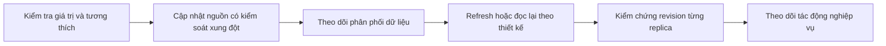

# Chọn cập nhật tại chỗ hoặc tạo tài nguyên cấu hình mới

## Mục tiêu và phạm vi

Trong chương **Vận hành cấu hình** của module **SPRING_CLOUD_KUBERNETES**, bài này giúp chọn cách đưa một thay đổi ConfigMap/Secret tới ứng dụng Spring: sửa tài nguyên đang được dùng, hay tạo tài nguyên mang phiên bản mới rồi chuyển ứng dụng sang đó.

Quyết định này ảnh hưởng tới phạm vi tác động, cách refresh bean, rollout Pod, canary và khả năng quay lại cấu hình trước. Nó cũng quyết định liệu bạn có thực sự cần Configuration Watcher hoặc quyền gọi Kubernetes API trong ứng dụng.

Sau bài học, bạn có thể:

- Phân biệt cập nhật dữ liệu, chuyển tham chiếu cấu hình và áp dụng cấu hình trong tiến trình.
- Chọn giữa tên ổn định, tên theo phiên bản và tài nguyên `immutable`.
- Giải thích vì sao đổi ConfigMap không tự rollout Deployment hoặc tự refresh mọi bean Spring.
- Thiết kế quy trình triển khai, kiểm chứng, rollback và dọn tài nguyên cũ.
- Thực hành quan sát sự khác nhau giữa file mount đã đổi và giá trị Spring đang sử dụng.

Kiến thức cần có: ConfigMap, Secret, Deployment, volume mount, biến môi trường và cấu hình Spring Boot. Ví dụ tích hợp qua API/Configuration Watcher dùng Spring Cloud Kubernetes **3.3.x** làm mốc; ví dụ ứng dụng dùng Spring Boot **3.5.x**. Dự án thực tế phải dùng BOM/release train tương thích và kiểm tra hành vi phiên bản đang chạy.

Bài thực hành sử dụng dữ liệu giả, không chứa credential. Các lệnh minh họa dành cho cluster thử nghiệm; chúng không tự triển khai một hệ thống Spring Cloud Kubernetes hoàn chỉnh.

## 1. Hai chiến lược chính và một lựa chọn kết hợp

### 1.1. Cập nhật tại chỗ: giữ tên, thay nội dung

Ví dụ tài nguyên `shop/orders-config` đang chứa revision nghiệp vụ `R001`. Bạn cập nhật chính object đó để chứa `R002`. Những bên đang đọc theo tên này tiếp tục dùng cùng tham chiếu nhưng có thể nhận nội dung mới theo cơ chế nạp cấu hình của chúng.

```text
Trước: orders-config → nội dung R001
Sau:   orders-config → nội dung R002
```

Điểm thuận tiện là không phải đổi tên nguồn ở mỗi lần cập nhật. Đổi lại, tên tài nguyên không còn xác định duy nhất một bộ giá trị trong suốt vòng đời ứng dụng.

### 1.2. Tạo tài nguyên mới: giữ bản cũ, chuyển tham chiếu

Bạn tạo `orders-config-r002`, giữ `orders-config-r001`, rồi đổi workload hoặc cấu hình nguồn đọc từ tên cũ sang tên mới:

```text
orders-config-r001 → nội dung R001
orders-config-r002 → nội dung R002

Pod cũ tham chiếu r001; Pod mới tham chiếu r002.
```

Việc tạo tài nguyên và việc chuyển người tiêu thụ là hai bước khác nhau. Chỉ tạo `orders-config-r002` không tự thay `volumes[].configMap.name`, `envFrom` hoặc `spring.cloud.kubernetes.config.sources` của ứng dụng.

### 1.3. Kết hợp: tên ổn định nhưng chủ động restart/rollout

Một hệ thống có thể sửa `orders-config`, sau đó thay Pod template hoặc dùng controller để rollout ứng dụng. Đây vẫn là tài nguyên cấu hình được sửa tại chỗ, dù ứng dụng nhận thay đổi qua lần khởi động mới.

Chiến lược kết hợp hữu ích khi không muốn hot refresh nhưng muốn giữ tên nguồn ổn định. Tuy nhiên, nó không tự lưu lại nội dung cấu hình cũ để rollback.

## 2. Phân biệt ba trạng thái trước khi chọn cách triển khai

| Trạng thái | Ví dụ | Câu hỏi kiểm chứng |
| --- | --- | --- |
| Dữ liệu lưu trong Kubernetes API | ConfigMap đã chứa `R002` | Object nào, UID nào, nội dung/revision nào đang được lưu? |
| Dữ liệu được phân phối tới Pod/client | File mount đã có `R002`, hoặc cache API đã nhận thay đổi | Pod/client đã nhìn thấy nguồn mới chưa? |
| Giá trị ứng dụng đang dùng | Bean hoặc HTTP client vẫn được tạo từ `R001` | Đường xử lý nghiệp vụ đang dùng revision nào? |

Không suy ra trạng thái thứ ba chỉ từ trạng thái thứ nhất. Một ConfigMap hợp lệ về YAML/Kubernetes vẫn có thể chứa giá trị không phù hợp với ứng dụng, chẳng hạn timeout âm hoặc tên enum không được hỗ trợ.

Ví dụ suy luận: thao tác cập nhật ConfigMap thành công lúc 10:00, file trong Pod đổi lúc 10:01, nhưng bean chỉ được bind lúc startup. Ở 10:02, file có `R002` còn nghiệp vụ vẫn chạy với `R001`. Đây không nhất thiết là lỗi watch của Kubernetes; ứng dụng chưa có cơ chế áp dụng lại giá trị.

Tên revision nên là dữ liệu nghiệp vụ được thiết kế, chẳng hạn `demo.revision: R002`. Không dùng `resourceVersion` như số phát hành có thể cộng/trừ hoặc như timestamp. Cơ chế phiên bản object được mô tả trong [Kubernetes API Concepts](https://kubernetes.io/docs/reference/using-api/api-concepts/).

## 3. Đường nạp cấu hình quyết định tác dụng của cập nhật tại chỗ

| Cách ứng dụng nhận cấu hình | Khi sửa cùng ConfigMap/Secret | Việc còn phải làm |
| --- | --- | --- |
| Biến môi trường từ `env`/`envFrom` | Không tự cập nhật môi trường của tiến trình đang chạy | Tạo lại Pod hoặc quy trình restart phù hợp |
| Volume mount thông thường | File có thể được cập nhật sau một khoảng trễ | Ứng dụng phải đọc lại và áp dụng giá trị |
| Mount bằng `subPath` | Không nhận cập nhật ConfigMap theo cơ chế mount thông thường | Thiết kế lại mount hoặc tạo lại Pod |
| Spring Cloud Kubernetes đọc qua API | Phụ thuộc nguồn được chọn và cơ chế refresh đang cấu hình | Xác nhận thông báo, nạp lại nguồn và cập nhật bean cần thiết |
| Cấu hình được đọc một lần khi startup | Giá trị trong tiến trình giữ nguyên | Rollout/restart nếu không có cơ chế cập nhật được hỗ trợ |

Kubernetes mô tả việc cập nhật volume là quá trình hội tụ có độ trễ, còn cấu hình qua biến môi trường không tự cập nhật; xem [ConfigMaps](https://kubernetes.io/docs/concepts/configuration/configmap/). Không đặt một khoảng chờ cố định rồi coi mọi Pod chắc chắn đã nhận dữ liệu.

Đặc biệt, Deployment chỉ rollout khi Pod template thay đổi. Sửa dữ liệu một ConfigMap được tham chiếu không tự thay `.spec.template`; xem [Deployments](https://kubernetes.io/docs/concepts/workloads/controllers/deployment/). Controller reloader hoặc hệ thống triển khai bổ sung có thể tạo hành vi khác, nên cần ghi rõ thành phần nào đang kích hoạt rollout.

## 4. Khi nào cập nhật tại chỗ là lựa chọn hợp lý?

Cập nhật tại chỗ phù hợp khi thay đổi nhỏ, ứng dụng hỗ trợ áp dụng an toàn khi đang chạy, chấp nhận một khoảng thời gian các replica chưa hội tụ và có cách kiểm chứng từng replica.

Ví dụ có thể đánh giá:

- Bật/tắt một tính năng mà cả hai trạng thái đều tương thích với ứng dụng hiện tại.
- Thay một ngưỡng nghiệp vụ đã có kiểm tra miền giá trị và quy trình refresh rõ ràng.
- Điều chỉnh một cấu hình động được ứng dụng chủ động đọc và hoán đổi snapshot.

Không phải mọi feature flag đều an toàn: nếu bật cờ làm thay đổi hợp đồng dữ liệu hoặc đòi hỏi schema mới, mức rủi ro có thể tương đương một lần phát hành phần mềm.

### 4.1. Một quy trình cập nhật tại chỗ có thể kiểm soát



Trước khi ghi, giữ bản cấu hình đã được phê duyệt và xác định chủ thể được phép cập nhật. Với nhiều người/controller cùng ghi, dùng cơ chế phát hiện xung đột phù hợp; đừng để một bản cấu hình cũ ghi đè thay đổi vừa được người khác chấp nhận.

Đặt tiêu chí hoàn tất, ví dụ “mọi Pod phục vụ đã áp dụng R002 và tỷ lệ lỗi không vượt ngưỡng đã thống nhất”. HTTP 200 của API hoặc một log refresh không đáp ứng riêng tiêu chí đó.

### 4.2. Hạn chế cần chấp nhận

Nếu 20 replica cùng đọc một tên nguồn, sửa tại chỗ có thể ảnh hưởng cả 20 mà không đi qua lịch thay Pod của Deployment. Canary bằng cách chỉ rollout một Pod sẽ không cách ly cấu hình nếu Pod cũ cũng đang theo dõi chính nguồn mutable đó.

Rollback cần một lần ghi lại nội dung đã biết tốt, rồi lại chờ phân phối và áp dụng. Nó không tự xảy ra khi rollback image hoặc Pod template. Bản cấu hình cũ trong Git còn phải tương thích với trạng thái hệ thống hiện tại.

Với thay đổi liên quan nhiều thuộc tính, thiết kế kiểm tra và áp dụng nhất quán trong ứng dụng. Không mặc định quá trình rebind nhiều bean tạo thành một giao dịch nguyên tử cho toàn bộ request đang xử lý.

## 5. Khi nào nên tạo tài nguyên mới theo phiên bản?

Ưu tiên đánh giá chiến lược này khi cần gắn cấu hình với một lần phát hành, phân tách cohort canary, giữ bằng chứng nội dung đã chạy hoặc thay đổi các thành phần chỉ được khởi tạo một lần.

Ví dụ tự xây dựng: image ứng dụng `2.1` dùng cấu hình schema `v1`, image `2.2` dùng schema `v2`. Một tên mutable dùng chung có thể khiến Pod image `2.1` nhận cấu hình `v2` trong lúc rollout. Tạo hai nguồn và ghim đúng tham chiếu giúp kiểm soát tình huống cùng tồn tại đó.

### 5.1. Dùng `immutable` để ngăn sửa dữ liệu đã phát hành

```yaml
apiVersion: v1
kind: ConfigMap
metadata:
  name: orders-config-r002
  namespace: shop
  labels:
    app.kubernetes.io/name: orders
    config.example.com/revision: r002
immutable: true
data:
  application.yaml: |
    demo:
      revision: R002
      feature-enabled: true
```

`immutable: true` ngăn thay đổi dữ liệu của object và không thể đổi ngược về mutable. Nó không đồng nghĩa mọi metadata đều bất biến. Đừng xóa rồi tạo lại cùng tên để giả vờ đó vẫn là bản cấu hình cũ: UID thay đổi và các Pod đang dùng mount cũ cần được xử lý theo vòng đời phù hợp.

Secret cũng hỗ trợ immutable. Kubernetes lưu ý việc xóa/tạo lại không tự thay mount hiện có của Pod; xem [Immutable Secrets](https://kubernetes.io/docs/concepts/configuration/secret/#immutable-secrets). Một tài nguyên immutable không tự tạo ra chính sách retention hoặc cơ chế rollout.

Chỉ đặt tên có hậu tố `r002` mà vẫn cho sửa nội dung tùy ý thì chưa có một snapshot đáng tin cậy. Cần kết hợp bất biến dữ liệu, quyền ghi và quy trình phát hành phù hợp.

### 5.2. Ghim người tiêu thụ vào nguồn cụ thể

```yaml
# Đoạn Pod template minh họa
spec:
  template:
    metadata:
      annotations:
        config.example.com/revision: R002
    spec:
      volumes:
        - name: application-config
          configMap:
            name: orders-config-r002
            optional: false
```

Đổi tên volume source trong Pod template làm Deployment triển khai Pod theo template mới. Annotation ở đây giúp quan sát ý định triển khai; nó không chứng minh Spring đã đọc được `R002`.

Tạo nguồn mới trước, kiểm tra nó, rồi chuyển tham chiếu. Nếu cấu hình bắt buộc chưa tồn tại, hãy để quy trình phát hiện lỗi thay vì dùng `optional` hoặc giá trị mặc định để che một lần phát hành thiếu dữ liệu.

### 5.3. Rollback có tham chiếu rõ ràng

Giữ `orders-config-r001` trong thời gian cần thiết. Khi phải quay lại, đưa template/source selector về bộ tham chiếu đã biết tốt và kiểm tra lại trạng thái ứng dụng.

`kubectl rollout undo` chỉ đưa Pod template về lịch sử tương ứng; nó không tự phục hồi nội dung của một ConfigMap mutable đã bị ghi đè. Ngay cả với tên theo phiên bản, rollback cũng thất bại nếu object cũ đã bị dọn, credential cũ không còn hiệu lực hoặc image cũ không tương thích với dữ liệu bên ngoài.

## 6. Spring Cloud Kubernetes cần xử lý riêng việc chọn nguồn và refresh

### 6.1. Tên ứng dụng khác với tên tài nguyên phiên bản

Trong mô hình đọc ConfigMap qua API của Spring Cloud Kubernetes 3.3.x, khai báo nguồn bằng tên/namespace cụ thể khi cần ghim phiên bản:

```yaml
spring:
  application:
    name: orders
  config:
    import: "kubernetes:"
  cloud:
    kubernetes:
      config:
        enabled: true
        enable-api: true
        include-profile-specific-sources: false
        sources:
          - name: orders-config-r002
            namespace: shop
```

Đây là phần cấu hình nguồn, không phải toàn bộ dependency/RBAC của ứng dụng. Chọn một starter config theo loại client và BOM tương thích. Không dùng đồng thời Config Data import và bootstrap theo hai cơ chế nạp chồng nhau; xem [Kubernetes PropertySource implementations 3.3](https://docs.spring.io/spring-cloud-kubernetes/reference/3.3/property-source-config.html).

`sources` và quy tắc tên nguồn được mô tả trong [Using a ConfigMap PropertySource 3.3](https://docs.spring.io/spring-cloud-kubernetes/reference/3.3/property-source-config/configmap-propertysource.html). Ví dụ tắt nguồn theo profile để phép chọn một snapshot dễ quan sát; dự án dùng profile cần chủ động định nghĩa tập nguồn tương ứng.

Khi tạo `orders-config-r003`, ứng dụng ghim `r002` không tự chuyển nguồn chỉ vì có một tên mới trong namespace. Cần thay selector/tham chiếu bằng cơ chế triển khai đã thiết kế. Không đặt thông tin duy nhất để tìm nguồn mới trong chính object mà ứng dụng chưa biết cách tìm.

Cũng cần xét ưu tiên cấu hình: một biến môi trường hoặc tham số khác có thể ghi đè giá trị trong file/PropertySource. Ghi nhận nguồn hiệu lực khi chẩn đoán; không chỉ kiểm tra nội dung ConfigMap.

### 6.2. Watcher xác định ứng dụng nhận thông báo, không tự sửa nguồn của nó

Ví dụ nguồn mutable có tên khác `spring.application.name` của ứng dụng:

```yaml
metadata:
  name: orders-runtime
  namespace: shop
  labels:
    spring.cloud.kubernetes.config: "true"
  annotations:
    spring.cloud.kubernetes.configmap.apps: orders
```

Ở mốc 3.3.x, label/annotation này liên quan tới việc Configuration Watcher chọn nguồn và ứng dụng nhận thông báo. Nó không thay `spring.cloud.kubernetes.config.sources` hay volume source của `orders`. Xem [Configuration Watcher 3.3](https://docs.spring.io/spring-cloud-kubernetes/reference/3.3/spring-cloud-kubernetes-configuration-watcher.html).

Vì vậy, tạo một nguồn phiên bản mới có annotation `apps: orders` rồi phát refresh có thể vẫn làm ứng dụng đọc lại nguồn phiên bản cũ đang được ghim. Phải xác định rõ ai cập nhật tham chiếu và lúc nào.

Không bật watcher cho mọi snapshot phát hành nếu ứng dụng chỉ nhận cấu hình khi rollout. Làm vậy có thể tạo thông báo không cần thiết mà không thay đổi kết quả chọn nguồn.

### 6.3. Refresh không có nghĩa mọi object Java được tạo lại

`@RefreshScope`, rebind cấu hình và vòng đời của bean có giới hạn riêng. Chẳng hạn, một client hoặc pool được tạo một lần có thể vẫn giữ giá trị cũ dù Environment đã đổi; việc thêm annotation ở một lớp không làm toàn bộ dependency graph tự refresh. Tham khảo [Spring Cloud Context 4.3](https://docs.spring.io/spring-cloud-commons/reference/4.3/spring-cloud-commons/application-context-services.html).

Khi xóa một property, không giả định refresh luôn khôi phục đúng giá trị mặc định hoặc xóa trạng thái cũ của bean. Với kiểu thay đổi chưa được kiểm chứng, rollout từ nguồn đầy đủ thường dễ đánh giá hơn một lần cập nhật từng phần trong tiến trình.

Reload nội bộ theo `spring.cloud.kubernetes.reload.*` đã được đánh dấu deprecated ở mốc tài liệu này; không dùng nó như một công tắc mặc định để mọi thay đổi được áp dụng. Xem [PropertySource Reload 3.3](https://docs.spring.io/spring-cloud-kubernetes/reference/3.3/property-source-config/propertysource-reload.html).

## 7. Bảng ra quyết định

| Tình huống | Cách nên đánh giá trước | Điều kiện quyết định |
| --- | --- | --- |
| Tham số động nhỏ, đã có kiểm tra và refresh an toàn | Cập nhật tại chỗ | Chấp nhận độ trễ và sự khác nhau tạm thời giữa replica |
| Cấu hình chỉ được dùng lúc startup | Tài nguyên phiên bản mới + rollout, hoặc tên ổn định + rollout có quy trình | Cần Pod mới để áp dụng và phải xác định cách giữ bản cũ |
| Cần canary cấu hình độc lập | Tài nguyên mới cho từng cohort | Pod cũ không theo dõi chung nguồn mutable bị thay |
| Đổi tên/xóa key hoặc đổi schema lớn | Snapshot mới + rollout đã kiểm tra tương thích | Không dựa vào giả định refresh từng phần |
| Đổi credential | Quy trình luân chuyển riêng, có thể dùng Secret phiên bản mới | Hệ thống bên ngoài, thời gian chồng lấn và cách client nạp lại |
| Cấu hình dùng chung nhiều ứng dụng | Tách theo owner/vòng đời nếu cần; chọn chiến lược cho từng nhóm | Biết đầy đủ người tiêu thụ và phạm vi tác động |
| Cập nhật khẩn cấp | Cách đã được diễn tập và có bằng chứng áp dụng | Mức khẩn cấp không làm biến mất giới hạn kỹ thuật |

Các lựa chọn trên là hướng thiết kế để kiểm chứng trong hệ thống cụ thể. Không dùng quy tắc “thay đổi nhỏ thì luôn sửa tại chỗ” nếu thay đổi đó có thể phá tương thích hoặc tác động tới nhiều ứng dụng.

## 8. Nhiều nguồn cấu hình và Secret cần thêm điều kiện

### 8.1. Một lần phát hành có thể gồm nhiều object

Ví dụ một bản phát hành gồm image `2.2`, ConfigMap `r002` và Secret `s005`. Tạo hai tài nguyên mới không tạo giao dịch nguyên tử giữa chúng. Khi thay cả tham chiếu trong một Pod template, Pod mới nhận một tập tham chiếu xác định, nhưng vẫn cần kiểm tra sự tồn tại, khả năng đọc và tính tương thích của từng nguồn.

Nên ghi lại bộ phát hành dưới dạng metadata không nhạy cảm:

```text
release: orders-2026-11-25-02
image: orders@sha256:<digest-image>
configmap: shop/orders-config-r002
secret: shop/orders-credentials-s005
expected-config-revision: R002
```

Digest trong ví dụ là ký hiệu minh họa, không phải một image thật. Không đưa giá trị Secret vào bản ghi phát hành. Nếu cấu hình gồm nhiều file, ứng dụng vẫn cần kiểm tra rằng các giá trị đang dùng thuộc một bộ hợp lệ; không giả định đọc nhiều nguồn khác nhau là một snapshot nguyên tử.

### 8.2. Đổi Secret không đồng nghĩa luân chuyển credential đã hoàn tất

Tạo Secret mới chỉ thay nơi lưu dữ liệu trên Kubernetes. Hệ thống nhận credential, chẳng hạn cơ sở dữ liệu, còn phải chấp nhận credential mới. Client/pool đang chạy cần đọc lại hoặc được thay thế theo cơ chế phù hợp.

Một trình tự có thể là: chuẩn bị credential mới → xác nhận được chấp nhận → tạo nguồn mới → triển khai cohort nhỏ → triển khai phần còn lại → xác nhận không còn phụ thuộc credential cũ → thu hồi theo thiết kế. Từng bước phải phù hợp loại credential và cơ chế cấp phát thực tế.

Nếu credential cũ đã bị thu hồi hoặc bị lộ, quay lại tên Secret cũ không phục hồi khả năng đăng nhập và có thể trái với mục tiêu xử lý sự cố. Quyết định rollback phải xét cả trạng thái bên ngoài Kubernetes.

Giữ nhiều phiên bản Secret cũng mở rộng lượng credential được lưu và phạm vi cần bảo vệ. Chỉ giữ trong khoảng thời gian có lý do, giới hạn quyền và tránh log/diff chứa dữ liệu; tham khảo [Good practices for Kubernetes Secrets](https://kubernetes.io/docs/concepts/security/secrets-good-practices/).

## 9. Thực hành: nhìn thấy sự khác nhau giữa nguồn và giá trị đã bind

### 9.1. Điều kiện của bài thực hành

Dùng namespace riêng `config-choice-lab` trên cluster thử nghiệm. Không có controller reloader hoặc watcher tự động thay Deployment của bài. Chuẩn bị image Spring Boot từ mã ví dụ dưới đây, có web starter, chạy cổng 8080 và có công cụ `cat` để quan sát file giả trong container.

Image trong ví dụ Deployment là tên minh họa cần thay bằng image đã build/publish và cluster truy cập được. Bài không cung cấp một registry hoặc image dựng sẵn.

Ứng dụng lab chỉ dùng Spring Boot đọc file mount lúc startup, không thêm starter Kubernetes Config hay cơ chế refresh. Mục đích là quan sát chính xác giới hạn này trước khi quyết định có cần tích hợp động.

### 9.2. Ứng dụng trả revision đang được sử dụng

```java
package example.configdemo;

import java.util.Map;
import org.springframework.boot.SpringApplication;
import org.springframework.boot.autoconfigure.SpringBootApplication;
import org.springframework.boot.context.properties.ConfigurationProperties;
import org.springframework.boot.context.properties.EnableConfigurationProperties;
import org.springframework.core.env.Environment;
import org.springframework.web.bind.annotation.GetMapping;
import org.springframework.web.bind.annotation.RestController;

@SpringBootApplication
@RestController
@EnableConfigurationProperties(ConfigDemoApplication.DemoSettings.class)
public class ConfigDemoApplication {

    private final DemoSettings settings;
    private final String podName;

    public ConfigDemoApplication(DemoSettings settings, Environment environment) {
        this.settings = settings;
        this.podName = environment.getProperty("HOSTNAME", "local");
    }

    public static void main(String[] args) {
        SpringApplication.run(ConfigDemoApplication.class, args);
    }

    @GetMapping("/config-state")
    public Map<String, Object> state() {
        return Map.of(
                "pod", podName,
                "revision", settings.revision(),
                "featureEnabled", settings.featureEnabled());
    }

    @ConfigurationProperties(prefix = "demo")
    public record DemoSettings(String revision, boolean featureEnabled) {
        public DemoSettings {
            if (revision == null || revision.isBlank()) {
                throw new IllegalArgumentException("demo.revision là bắt buộc");
            }
        }
    }
}
```

Bean record trong bài được bind khi khởi động; endpoint trả trạng thái của bean đó, không tự đọc lại file ở mỗi request. `demo.revision` chỉ chứa mã công khai của bài tập.

Nạp file bằng `SPRING_CONFIG_IMPORT=file:/etc/orders/application.yaml`. Đây là import bắt buộc, không có tiền tố `optional:`. Cách Config Data hoạt động và ưu tiên nguồn được mô tả trong [Spring Boot Externalized Configuration](https://docs.spring.io/spring-boot/3.5/reference/features/external-config.html).

### 9.3. Tạo ConfigMap mutable R001

Trong PowerShell, đặt context lab đã được xác nhận và tạo namespace riêng:

```powershell
$labContext = 'training-cluster'
$demoImage = 'registry.example.com/training/orders-config-demo:1.0.0'
# Thay $demoImage bằng image lab thực tế trước khi triển khai.

@'
apiVersion: v1
kind: Namespace
metadata:
  name: config-choice-lab
'@ | kubectl --context $labContext apply -f -
```

Hàm dưới tạo/cập nhật các ConfigMap giả trong đúng namespace bài tập:

```powershell
function Set-LabConfigMap {
    param(
        [string]$Name,
        [string]$Revision,
        [bool]$FeatureEnabled,
        [bool]$Immutable = $false
    )

    $featureText = $FeatureEnabled.ToString().ToLowerInvariant()
    $immutableText = $Immutable.ToString().ToLowerInvariant()
    $manifest = @"
apiVersion: v1
kind: ConfigMap
metadata:
  name: $Name
  namespace: config-choice-lab
immutable: $immutableText
data:
  application.yaml: |
    demo:
      revision: "$Revision"
      feature-enabled: $featureText
"@

    $manifest | kubectl --context $labContext apply -f -
    if ($LASTEXITCODE -ne 0) { throw 'Không ghi được ConfigMap lab.' }
}

Set-LabConfigMap -Name 'orders-config-live' -Revision 'R001' -FeatureEnabled $false
```

### 9.4. Triển khai hai replica tham chiếu nguồn đã chọn

```powershell
function Set-LabDeployment {
    param(
        [string]$ConfigMapName,
        [string]$ExpectedRevision
    )

    $manifest = @"
apiVersion: apps/v1
kind: Deployment
metadata:
  name: orders-demo
  namespace: config-choice-lab
spec:
  replicas: 2
  revisionHistoryLimit: 3
  progressDeadlineSeconds: 300
  strategy:
    type: RollingUpdate
    rollingUpdate:
      maxUnavailable: 0
      maxSurge: 1
  selector:
    matchLabels:
      app: orders-demo
  template:
    metadata:
      labels:
        app: orders-demo
      annotations:
        config.example.com/revision: "$ExpectedRevision"
    spec:
      automountServiceAccountToken: false
      containers:
        - name: app
          image: $demoImage
          ports:
            - name: http
              containerPort: 8080
          env:
            - name: SPRING_CONFIG_IMPORT
              value: file:/etc/orders/application.yaml
          volumeMounts:
            - name: config
              mountPath: /etc/orders
              readOnly: true
          readinessProbe:
            httpGet:
              path: /config-state
              port: http
            periodSeconds: 2
      volumes:
        - name: config
          configMap:
            name: $ConfigMapName
            optional: false
"@

    $manifest | kubectl --context $labContext apply -f -
    if ($LASTEXITCODE -ne 0) { throw 'Không cập nhật được Deployment lab.' }
    kubectl --context $labContext -n config-choice-lab rollout status deployment/orders-demo --timeout=300s
    if ($LASTEXITCODE -ne 0) { throw 'Rollout lab chưa hoàn tất.' }
}

Set-LabDeployment -ConfigMapName 'orders-config-live' -ExpectedRevision 'R001'
```

Readiness của lab chỉ chứng minh endpoint trả lời; nó chưa so sánh revision mong muốn với revision đang dùng. Hệ thống thực tế cần tiêu chí sẵn sàng/kiểm chứng phù hợp thay vì chỉ sao chép probe này.

Chọn một Pod để quan sát:

```powershell
$podJson = kubectl --context $labContext -n config-choice-lab get pods -l app=orders-demo -o json
if ($LASTEXITCODE -ne 0) { throw 'Không lấy được Pod lab.' }
$pods = $podJson | ConvertFrom-Json
$podName = $pods.items[0].metadata.name

kubectl --context $labContext -n config-choice-lab exec $podName -- cat /etc/orders/application.yaml
kubectl --context $labContext -n config-choice-lab port-forward "pod/$podName" 18080:8080
```

Trong terminal khác:

```powershell
Invoke-RestMethod -Uri 'http://localhost:18080/config-state'
```

Mong đợi revision `R001`. Port-forward tới một Pod chỉ kiểm chứng Pod đó; không coi đây là bằng chứng của cả Deployment.

### 9.5. Sửa cùng ConfigMap thành R002

Ở terminal có các hàm đã định nghĩa, sau khi dừng port-forward nếu cần:

```powershell
Set-LabConfigMap -Name 'orders-config-live' -Revision 'R002' -FeatureEnabled $true
kubectl --context $labContext -n config-choice-lab get pods -l app=orders-demo
kubectl --context $labContext -n config-choice-lab exec $podName -- cat /etc/orders/application.yaml
```

Lặp lại lệnh xem file tới khi quan sát `R002`; không giả định nó xuất hiện tức thì. Sau đó mở lại port-forward tới **cùng Pod còn đang chạy** và gọi `/config-state`.

Kết quả cần quan sát trong môi trường đã nêu:

| Nơi quan sát | Revision sau khi file đã hội tụ |
| --- | --- |
| ConfigMap trong API | `R002` |
| File `/etc/orders/application.yaml` | `R002` |
| Bean của tiến trình chưa restart/refresh | `R001` |

Nếu Pod bị thay thế bởi thành phần khác hoặc tiến trình đã restart, kết quả có thể khác. Đối chiếu Pod UID, thời điểm startup và controller trong môi trường, không chỉ tên hoặc số replica.

Phân biệt cập nhật file và môi trường/tiến trình cũng được minh họa trong [Updating Configuration via a ConfigMap](https://kubernetes.io/docs/tutorials/configuration/updating-configuration-via-a-configmap/).

### 9.6. Chuyển sang snapshot immutable rồi rollout

Tạo cả hai snapshot trước; không xóa nguồn mutable đang dùng:

```powershell
Set-LabConfigMap -Name 'orders-config-r001' -Revision 'R001' -FeatureEnabled $false -Immutable $true
Set-LabConfigMap -Name 'orders-config-r002' -Revision 'R002' -FeatureEnabled $true -Immutable $true

# Thiết lập baseline theo phiên bản rõ ràng.
Set-LabDeployment -ConfigMapName 'orders-config-r001' -ExpectedRevision 'R001'

# Chuyển sang phiên bản mới.
Set-LabDeployment -ConfigMapName 'orders-config-r002' -ExpectedRevision 'R002'
```

Sau mỗi rollout, lấy lại danh sách Pod vì `$podName` cũ có thể không còn tồn tại. Mở port-forward lần lượt tới từng Pod phục vụ và đối chiếu revision. Không tái sử dụng một kết nối tới Pod cũ để kết luận về các Pod mới.

```powershell
$podJson = kubectl --context $labContext -n config-choice-lab get pods -l app=orders-demo -o json
if ($LASTEXITCODE -ne 0) { throw 'Không lấy được trạng thái rollout.' }
$pods = $podJson | ConvertFrom-Json

$pods.items | ForEach-Object {
    [pscustomobject]@{
        Pod = $_.metadata.name
        Uid = $_.metadata.uid
        ExpectedRevision = $_.metadata.annotations.'config.example.com/revision'
        ConfigMap = $_.spec.volumes.configMap.name -join ','
    }
}
```

Bảng này cho biết template/tham chiếu của Pod, không thay thế lời gọi endpoint. Với bản rollout `r002` đã hội tụ, các Pod phục vụ cần báo `R002` từ `/config-state`.

### 9.7. Quay lại snapshot R001

```powershell
Set-LabDeployment -ConfigMapName 'orders-config-r001' -ExpectedRevision 'R001'
```

Giữ hai ConfigMap trong suốt phép thử và kiểm tra lại revision từng Pod sau rollout. Controller có thể dùng lại ReplicaSet tương ứng với template lịch sử; tiêu chí là tham chiếu và cấu hình hiệu lực đúng, không phải luôn xuất hiện một tên ReplicaSet chưa từng có.

Bài thử chứng minh khả năng chuyển tham chiếu trong môi trường lab. Nó không chứng minh rollback một Secret đã bị thu hồi hoặc một phiên bản ứng dụng không còn tương thích với schema cơ sở dữ liệu.

## 10. Tự động hóa tên phiên bản và kích hoạt rollout

### 10.1. Kustomize với hậu tố theo nội dung

```yaml
apiVersion: kustomize.config.k8s.io/v1beta1
kind: Kustomization
resources:
  - deployment.yaml
configMapGenerator:
  - name: orders-config
    files:
      - application.yaml
```

Ví dụ này là một cấu trúc nguồn triển khai riêng: `deployment.yaml` tham chiếu `orders-config` ở trường volume chuẩn, còn Kustomize tạo tên có hậu tố và biến đổi tham chiếu tương ứng. Đối chiếu [Kustomize generators](https://kubernetes.io/docs/tasks/manage-kubernetes-objects/kustomization/).

Kiểm tra manifest đã render trước khi triển khai. Không mặc định mọi chuỗi bên trong `application.yaml`, CRD hoặc `spring.cloud.kubernetes.config.sources` tự được viết lại như trường volume mà công cụ đã biết.

Tên có hash hỗ trợ nhận diện phiên bản theo nội dung, nhưng không tự bảo đảm dữ liệu không bị sửa bởi người có quyền hoặc tự dọn phiên bản cũ. Cần định nghĩa thêm quy tắc ghi và retention.

### 10.2. Helm checksum làm thay Pod template

```yaml
spec:
  template:
    metadata:
      annotations:
        checksum/config: {{ include (print $.Template.BasePath "/configmap.yaml") . | sha256sum }}
```

Đây là template Helm, không phải YAML thuần để đưa thẳng cho kubectl. Khi checksum đổi, Pod template đổi và có thể kích hoạt rollout; xem [Helm chart tips](https://helm.sh/docs/howto/charts_tips_and_tricks/).

Nếu ConfigMap vẫn giữ cùng tên mutable, checksum không tự biến nội dung cũ thành snapshot. Pod đang chạy có thể nhận file mới trước khi được thay; rollback template còn phải bảo đảm nội dung nguồn cũng được khôi phục đúng.

Với GitOps, mọi thay đổi tham chiếu cần được phản ánh trong nguồn quản lý. Một lệnh sửa trực tiếp chỉ ở cluster có thể bị reconcile ghi đè; cần biết chủ thể đang giữ trạng thái mong muốn trước khi xử lý sự cố.

## 11. Giữ và dọn tài nguyên cũ theo người tiêu thụ

Phiên bản cũ không nên bị xóa chỉ vì Deployment chính đã rollout xong. Còn có thể có Pod canary, ReplicaSet được giữ để rollback, Job đang chạy hoặc CronJob sẽ tạo Pod theo template cũ.

Quy trình dọn nên xác định:

- Những workload hoặc cấu hình API source nào còn tham chiếu phiên bản đó.
- Khoảng thời gian rollback đã thống nhất và bản phát hành nào vẫn được hỗ trợ.
- Image, Secret/credential và dữ liệu ngoài cluster có còn tương thích với rollback không.
- Controller GitOps/prune hoặc owner reference nào có thể dọn object ngoài ý muốn.
- Bằng chứng triển khai nào cần giữ mà không lưu thêm giá trị Secret.

Quét volume/env references giúp tìm người tiêu thụ kiểu Kubernetes chuẩn, nhưng có thể bỏ sót tên nguồn trong cấu hình ứng dụng đọc qua API. Không coi một truy vấn không thấy Pod tham chiếu là đủ để xóa mọi tài nguyên trùng nhãn.

Việc giữ ReplicaSet lịch sử không đồng nghĩa Kubernetes tự giữ bản ConfigMap/Secret mà ReplicaSet tham chiếu. Cần quản lý vòng đời hai loại tài nguyên này cùng một kế hoạch.

## 12. Kiểm chứng theo chiến lược đã chọn

| Chiến lược | Bằng chứng tối thiểu cần có | Dấu hiệu chưa hoàn tất |
| --- | --- | --- |
| Tại chỗ + refresh | Revision nguồn, dữ liệu đã tới client, giá trị hiệu lực từng replica | Chỉ có API ghi thành công hoặc watcher gửi thông báo |
| Tại chỗ + rollout | Nội dung nguồn đã biết tốt, template/Pod mới, cấu hình hiệu lực | Pod mới đọc nhầm nguồn hoặc nguồn tiếp tục bị ghi trong rollout |
| Tên phiên bản + rollout | Nguồn mới tồn tại, tham chiếu đúng, Pod áp dụng đúng revision | Chỉ tạo object mới nhưng người tiêu thụ vẫn ghim bản cũ |
| Canary theo phiên bản | Cohort được cách ly nguồn và có đo lường riêng | Pod cũ vẫn theo dõi chung nguồn mutable bị đổi |
| Rollback | Bộ tham chiếu cũ còn dùng được và từng replica đã hội tụ | Chỉ rollback image/template nhưng nguồn hoặc credential đã khác |

Nếu cần đo thời gian hội tụ, tách thời điểm API lưu thay đổi, dữ liệu được phân phối, refresh/startup hoàn tất và hành vi nghiệp vụ được xác nhận. Độ trễ của từng bước giúp chọn đúng cơ chế cải thiện.

Ví dụ tự xây dựng: với 12 replica, một lần refresh cho 11 Pod thành công còn một Pod giữ revision cũ. Đánh dấu toàn bộ cập nhật thành công chỉ vì phần lớn request đã đúng sẽ che một trạng thái không đồng nhất. Cần có tiêu chí xử lý replica còn lại hoặc chủ động loại nó khỏi phục vụ theo thiết kế.

## 13. Tình huống lựa chọn

**Tình huống A — thay ngưỡng hiển thị.** Ứng dụng đã có cơ chế snapshot cấu hình động, kiểm tra giá trị và đo revision từng Pod. Hai mức ngưỡng tương thích với cùng image và nhóm chấp nhận thời gian hội tụ. Cập nhật tại chỗ là lựa chọn có thể kiểm chứng, miễn là phạm vi người tiêu thụ và rollback đã rõ.

**Tình huống B — đổi URL backend và cách khởi tạo client.** Client được tạo một lần, chưa có cơ chế thay thế khi đang xử lý request. Tạo snapshot mới và rollout giúp kiểm soát thời điểm tạo client mới; vẫn cần timeout, readiness và tương thích giữa Pod cũ/mới.

**Tình huống C — đổi schema cấu hình kèm image.** Hai image hiểu key khác nhau, cần canary. Ghim mỗi cohort vào tài nguyên phiên bản phù hợp và ghi lại bộ phát hành. Sửa cùng một nguồn đang được cả hai cohort theo dõi có thể phá mục tiêu canary.

**Tình huống D — đổi credential bị lộ.** Mục tiêu là đưa credential mới vào sử dụng và chặn credential cũ, không chỉ quay lại tên một Secret. Thứ tự cấp, phân phối, kiểm chứng và thu hồi phải phối hợp với hệ thống xác thực bên ngoài.

Các tình huống cho thấy không có một chiến lược tốt cho mọi thuộc tính. Có thể tách cấu hình động theo tên ổn định khỏi cấu hình gắn với bản phát hành; ranh giới nên dựa trên owner, vòng đời và tính tương thích.

## 14. Tự kiểm tra hiểu biết

- Sửa ConfigMap có tự tạo rollout Deployment không? **Không, trừ khi một thành phần khác làm Pod template thay đổi.**
- Tạo `orders-config-r003` có khiến ứng dụng ghim `r002` chuyển nguồn không? **Không; phải cập nhật tham chiếu hoặc selector theo thiết kế.**
- File mount đã có R002 thì bean Spring chắc chắn đã dùng R002? **Không; còn bước đọc lại, bind hoặc tạo lại bean.**
- Tên có hậu tố phiên bản đã bảo đảm dữ liệu không bị sửa chưa? **Chưa; cần cơ chế bất biến dữ liệu và quyền/quy trình ghi phù hợp.**
- Rollback image có phục hồi ConfigMap mutable cũ không? **Không; phải xử lý nguồn cấu hình riêng.**
- Secret cũ còn tồn tại thì credential cũ chắc chắn dùng được không? **Không; còn trạng thái của hệ thống chấp nhận credential.**
- Có cần Configuration Watcher nếu cấu hình chỉ thay khi rollout không? **Không mặc định; chỉ thêm khi cần cơ chế cập nhật động đã được thiết kế và kiểm chứng.**

Quyết định nên ghi rõ bốn điều: nguồn nào được sửa hoặc tạo mới, ai chuyển người tiêu thụ sang nguồn đó, cách xác nhận giá trị hiệu lực và điều kiện quay lại phiên bản đã biết tốt.
