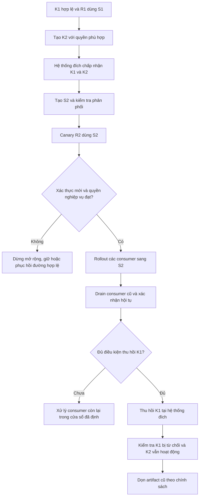

# Phối hợp rollout ứng dụng với luân chuyển Secret

Luân chuyển Secret không kết thúc ở việc cập nhật một đối tượng Kubernetes. Credential mới phải được hệ thống đích chấp nhận, được phân phối tới đúng workload, được client thực sự sử dụng, rồi credential cũ mới được thu hồi theo kế hoạch.

Trong chương **Vận hành cấu hình** của module **SPRING_CLOUD_KUBERNETES**, bài học này hướng dẫn phối hợp các bước đó với rollout ứng dụng Spring. Phạm vi gồm Secret, ConfigMap liên quan, Configuration Watcher, discovery/load balancing và sức khỏe Pod trong thời gian nhiều thế hệ ứng dụng cùng chạy.

Sau bài học, bạn có thể:

- Phân biệt credential tại hệ thống đích với Secret dùng để phân phối nó.
- Chọn chiến lược chuyển đổi dựa trên khả năng chấp nhận đồng thời credential cũ và mới.
- Ghim Secret theo phiên bản vào Pod template và rollout có kiểm soát.
- Chứng minh xác thực mới thành công thay vì chỉ nhìn trạng thái Ready.
- Đặt điều kiện thu hồi, rollback và xử lý những consumer ngoài Deployment chính.
- Tránh nhầm refresh cấu hình với thay đổi an toàn mọi client hoặc connection pool.

Ví dụ chính dùng API key cho một dịch vụ catalog giả định. Credential và tên tài nguyên trong bài đều là dữ liệu minh họa. Cấu hình Spring Boot tham chiếu nhánh 3.5; phần refresh tham chiếu Spring Cloud Commons 4.3 và Spring Cloud Kubernetes 3.3.

## 1. Phân biệt ba trạng thái thường bị đánh đồng

Quy ước trong bài:

| Ký hiệu | Ý nghĩa |
|---|---|
| K1 | Credential cũ mà hệ thống catalog đang chấp nhận |
| K2 | Credential mới cần chuyển sang |
| S1 | Kubernetes Secret chứa K1 |
| S2 | Kubernetes Secret chứa K2 |
| R1 | Bản phát hành ứng dụng tham chiếu S1 |
| R2 | Bản phát hành ứng dụng tham chiếu S2 |

Có ba câu hỏi độc lập:

1. Hệ thống đích có chấp nhận K2 không?
2. Pod đã nhận dữ liệu từ S2 chưa?
3. Client trong Pod có dùng K2 cho một lần xác thực thực sự chưa?

S2 tồn tại không chứng minh K2 có hiệu lực. Tệp trong Pod đã đổi không chứng minh client đã đọc lại. Một request thành công có thể đang dùng kết nối, session hoặc access token được tạo trước khi chuyển credential.

Hai phân biệt quan trọng khác:

- Xóa S1 khỏi Kubernetes không tự thu hồi K1 ở hệ thống đích.
- Thu hồi K1 ở hệ thống đích không tự xóa các bản K1 đã được phân phối hoặc lưu lại.

Kế hoạch phải quản lý cả vòng đời credential và vòng đời artifact phân phối.

## 2. Xác định khả năng luân chuyển của hệ thống đích

### 2.1. Hệ thống hỗ trợ hai credential cùng hợp lệ

Đây là điều kiện thuận lợi cho rolling update:

```text
Ban đầu:      hệ thống đích chấp nhận K1
Chuyển tiếp:  hệ thống đích chấp nhận K1 và K2
Kết thúc:     hệ thống đích chỉ chấp nhận K2
```

Trong thời gian giao nhau, Pod R1 vẫn dùng K1 và Pod R2 bắt đầu dùng K2. Sau khi xác nhận mọi consumer cần thiết đã chuyển, mới thu hồi K1.

Cần kiểm tra K2 có đúng quyền nghiệp vụ, tenant, audience hoặc phạm vi tài nguyên; chỉ “đăng nhập được” chưa đủ. Không cấp quyền rộng hơn cho K2 để vượt qua một bài kiểm tra thiếu quyền.

### 2.2. Hệ thống chỉ cho một credential hợp lệ

Nếu đổi mật khẩu của cùng một tài khoản khiến mật khẩu cũ mất hiệu lực ngay, rolling update không tự tạo ra một lần chuyển nguyên tử giữa mọi Pod.

Các phương án cần đánh giá:

| Phương án | Điều kiện |
|---|---|
| Hai tài khoản hoặc hai principal tương đương | Hệ thống cho phép tạo thêm danh tính có quyền tối thiểu tương ứng |
| Cơ chế giữ đồng thời credential cũ/mới của sản phẩm | Có hỗ trợ thực tế và thời gian giao nhau đã xác định |
| Identity ngắn hạn hoặc broker cấp credential | Ứng dụng và hạ tầng hỗ trợ vòng đời phù hợp |
| Cửa sổ bảo trì hoặc dừng lưu lượng có kế hoạch | Không có cách chuyển tương thích mà vẫn phục vụ liên tục |

Không hứa “không gián đoạn” chỉ vì đặt `maxUnavailable: 0`. Deployment không điều khiển giao dịch thay credential tại hệ thống ngoài.

Nếu client tự thử K1 khi K2 bị từ chối, fallback đó có thể che lỗi và khiến K1 không bao giờ hết được sử dụng. Chỉ dùng cơ chế hai credential khi có thiết kế rõ, đo được credential thực tế và có điều kiện loại bỏ fallback.

## 3. Lập danh sách toàn bộ consumer trước khi chuyển

Không giới hạn phạm vi ở những Pod đang nhận lưu lượng qua một Service.

| Consumer | Điều cần kiểm tra |
|---|---|
| Deployment chính | Replica đang chạy và template dùng cho Pod mới |
| Canary hoặc môi trường dự phòng | Có cùng dùng credential cũ không? |
| Job đang chạy | Có giữ credential hoặc kết nối cũ trong thời gian dài không? |
| CronJob | Template lần chạy sau đã chuyển chưa? |
| Worker xử lý hàng đợi | Có công việc dài hoặc session riêng không? |
| Hệ thống ngoài cluster | Có chia sẻ cùng tài khoản/API key không? |
| Pipeline vận hành | Có giữ credential cũ trong biến hoặc kho riêng không? |

Pod do HPA tạo sau một giờ cũng phải nhận S2. Một lần luân chuyển nhìn thành công trên Pod hiện tại nhưng template vẫn trỏ S1 sẽ tái tạo consumer cũ về sau.

Nếu nhiều nhóm chia sẻ K1, cần đầu mối xác nhận và bằng chứng hội tụ cho từng nhóm. Một Deployment không có quyền quyết định thay cho tất cả consumer ngoài phạm vi của nó.

Các credential dùng để kéo image cũng có vòng đời riêng. Luân chuyển API key của ứng dụng không thay thế việc quản lý `imagePullSecrets` hoặc credential của hệ thống triển khai.

## 4. Chọn cách phân phối và áp dụng Secret

| Đường sử dụng | Khi Secret thay đổi | Yêu cầu phía ứng dụng |
|---|---|---|
| Biến môi trường | Giá trị trong tiến trình đang chạy không tự đổi | Tạo tiến trình/Pod mới để nhận giá trị mới |
| Secret volume thông thường | Nội dung có thể được cập nhật theo cơ chế đồng bộ | Đọc lại và tái cấu hình client theo thiết kế |
| Mount bằng `subPath` | Không nhận cập nhật Secret tự động | Không dựa vào nó cho hot rotation |
| Đọc qua Kubernetes API | Client có thể đọc trạng thái nguồn | Quản lý quyền, sự kiện, retry và áp dụng |
| CSI/operator hoặc kho Secret ngoài | Phụ thuộc implementation | Kiểm chứng thời gian phân phối và cách ứng dụng tiêu thụ |

Kubernetes mô tả cơ chế cập nhật volume và giới hạn `subPath` trong [tài liệu Secrets](https://kubernetes.io/docs/concepts/configuration/secret/). Không xem một khoảng chờ cố định là bằng chứng mọi Pod đã nhận và áp dụng dữ liệu.

Với một client chỉ lấy credential lúc khởi tạo, rollout Pod mới thường dễ kiểm soát hơn thay tại chỗ. Nếu muốn hot rotation, phải xác định rõ bước dựng client mới, kiểm tra credential, chuyển tham chiếu và drain client cũ.

Nếu chọn đọc từ tệp mount, không cần tự thêm quyền đọc Secret API cho ứng dụng chỉ để mở tệp đó. Các tính năng khác như DiscoveryClient vẫn phải có quyền theo nhu cầu riêng.

## 5. Quy trình chuyển đổi có điểm dừng



### 5.1. Chuẩn bị K2 tại nơi thực thi xác thực

Tạo K2 ở hệ thống catalog hoặc hệ thống quản lý danh tính của nó. Xác nhận credential được kích hoạt, quyền tương ứng và các replica phía nhận đã hội tụ nếu có độ trễ phân phối.

Chỉ sau đó mới đưa K2 vào S2 để rollout. Cập nhật Secret trước khi hệ thống đích chấp nhận K2 có thể làm Pod mới thất bại trong lúc Pod cũ vẫn bình thường.

Với luân chuyển định kỳ, cố gắng giữ image và cấu hình nghiệp vụ không đổi ở bước này. Nếu cần nâng cấp code để hiểu định dạng credential mới, triển khai khả năng đọc tương thích trước rồi tách bước chuyển credential.

### 5.2. Chuẩn bị S2 và canary

Tạo S2 theo một tên phiên bản, xác minh đúng namespace, đúng tên khóa và quyền đọc tệp. Không kiểm tra bằng cách in giá trị Secret ra terminal hay log.

Canary phải dùng cùng đường client mà nghiệp vụ sẽ dùng. Một công cụ bên ngoài dùng K2 thành công không chứng minh client bên trong ứng dụng đã bỏ K1.

Giữ K1 hợp lệ trong giai đoạn này nếu chính sách và hệ thống đích cho phép. Nếu K2 sai quyền hoặc sai cấu trúc, dừng mở rộng trước khi làm ảnh hưởng thêm consumer.

### 5.3. Rollout, drain và xác nhận hội tụ

Khi canary đạt, thay tham chiếu S1 bằng S2 trong Pod template và rollout theo nhịp đã chọn. Trong khoảng giao nhau, hệ thống đích tiếp tục chấp nhận cả K1/K2.

Đợi các Pod cũ ngừng công việc và hoàn tất drain theo chính sách. Một Pod không còn Ready vẫn có thể có request đang xử lý, background task hoặc kết nối đang tồn tại.

Xác nhận cả workload hiện tại lẫn template cho những lần tạo sau. Không thu hồi K1 chỉ dựa trên một lượt gọi qua Service trả thành công.

## 6. Ví dụ Secret theo phiên bản và Spring config tree

### 6.1. Secret chứa dữ liệu giả cho bài thực hành

```yaml
apiVersion: v1
kind: Secret
metadata:
  name: catalog-credentials-v2
  namespace: rotation-lab
type: Opaque
immutable: true
stringData:
  api-key: DEMO_V2_NOT_A_REAL_CREDENTIAL
  credential-version: v2
```

Đây là dữ liệu giả dành cho một backend mô phỏng. Trong môi trường thật, credential được cấp và phân phối qua quy trình quản lý Secret; không commit giá trị thật chỉ vì nó nằm trong manifest `Secret`. `stringData` và Base64 không phải cơ chế mã hóa bí mật.

Nếu dùng công cụ server-side apply/GitOps, chọn cách quản lý dữ liệu Secret phù hợp công cụ; không xem ví dụ `stringData` là một thiết kế hoàn chỉnh cho mọi pipeline.

Với `immutable: true`, khi cần nội dung mới thì tạo đối tượng tên mới. Tính bất biến ngăn sửa dữ liệu của đối tượng đang tồn tại, không ngăn người có quyền xóa rồi tạo lại tên đó. Quy trình nên giữ ý nghĩa một tên phiên bản tương ứng một snapshot.

### 6.2. Ghim Secret vào Pod template

**Deployment minh họa cần image triển khai client và kiểm tra startup được mô tả trong bài:**

```yaml
apiVersion: apps/v1
kind: Deployment
metadata:
  name: order-service
  namespace: rotation-lab
spec:
  replicas: 3
  minReadySeconds: 10
  progressDeadlineSeconds: 300
  strategy:
    type: RollingUpdate
    rollingUpdate:
      maxUnavailable: 0
      maxSurge: 1
  selector:
    matchLabels:
      app: order-service
  template:
    metadata:
      labels:
        app: order-service
      annotations:
        example.com/rotation-id: rotation-v2
        example.com/credential-version: v2
    spec:
      terminationGracePeriodSeconds: 40
      securityContext:
        runAsNonRoot: true
        runAsUser: 10001
        runAsGroup: 10001
        fsGroup: 10001
      containers:
        - name: order-service
          image: registry.example.com/order-service:2.4.1
          env:
            - name: SPRING_CONFIG_IMPORT
              value: configtree:/run/catalog-secrets/
            - name: MANAGEMENT_ENDPOINT_HEALTH_PROBES_ENABLED
              value: "true"
          ports:
            - name: http
              containerPort: 8080
          volumeMounts:
            - name: catalog-credentials
              mountPath: /run/catalog-secrets
              readOnly: true
          startupProbe:
            httpGet:
              path: /actuator/health/readiness
              port: http
            periodSeconds: 5
            failureThreshold: 24
          readinessProbe:
            httpGet:
              path: /actuator/health/readiness
              port: http
            periodSeconds: 5
      volumes:
        - name: catalog-credentials
          secret:
            secretName: catalog-credentials-v2
            defaultMode: 0440
            items:
              - key: api-key
                path: catalog.api-key
              - key: credential-version
                path: catalog.credential-version
```

Registry/image là placeholder; image thật phải chạy được với UID/GID đã chọn, có Actuator và client catalog phù hợp. Ghim image digest hoặc dùng chính sách tag bất biến đã thực thi để tái hiện phát hành.

Các tệp dưới thư mục mount trở thành thuộc tính `catalog.api-key` và `catalog.credential-version` qua `configtree:`. Cơ chế này được mô tả trong [Externalized Configuration của Spring Boot 3.5](https://docs.spring.io/spring-boot/3.5/reference/features/external-config.html).

Import không có `optional:` vì đây là nguồn bắt buộc của ví dụ. Vẫn cần validation để phát hiện khóa thiếu, rỗng hoặc sai định dạng; thư mục tồn tại không chứng minh có mọi giá trị cần dùng.

Chọn một đường nạp credential có chủ đích. Kiểm tra các biến môi trường, profile hoặc nguồn API khác không ghi đè giá trị mount ngoài dự kiến.

Thay `secretName` trong Pod template tạo thay đổi rollout. Sửa dữ liệu một Secret có tên giữ nguyên không tự tạo revision Deployment mới. Tham khảo [Deployments](https://kubernetes.io/docs/concepts/workloads/controllers/deployment/).

Ở ví dụ này có thể giữ nguyên image `2.4.1` giữa R1 và R2, chỉ đổi tham chiếu credential. Nếu đồng thời đổi image, phải kiểm chứng cả cặp phiên bản code và định dạng Secret.

### 6.3. Bind credential mà không tự in nó qua toString

Ví dụ rút gọn cho cấu hình startup:

```java
import jakarta.validation.constraints.NotBlank;
import jakarta.validation.constraints.Pattern;

import org.springframework.boot.context.properties.ConfigurationProperties;
import org.springframework.validation.annotation.Validated;

@ConfigurationProperties(prefix = "catalog")
@Validated
public class CatalogCredentials {
    @NotBlank
    private String apiKey;

    @NotBlank
    @Pattern(regexp = "v[0-9]+")
    private String credentialVersion;

    public String getApiKey() {
        return apiKey;
    }

    public void setApiKey(String apiKey) {
        this.apiKey = apiKey;
    }

    public String getCredentialVersion() {
        return credentialVersion;
    }

    public void setCredentialVersion(String credentialVersion) {
        this.credentialVersion = credentialVersion;
    }

    @Override
    public String toString() {
        return "CatalogCredentials[redacted]";
    }
}
```

Đăng ký bằng `@ConfigurationPropertiesScan` hoặc `@EnableConfigurationProperties` và có implementation Bean Validation phù hợp.

Ghi đè `toString()` chỉ giảm một đường vô tình ghi log. Nó không che giá trị khi code gọi getter, serialize đối tượng, ghi exception chứa giá trị hoặc dump toàn Environment.

Trường `credential-version` là metadata phục vụ quan sát. Nó không chứng minh `apiKey` là K2; bằng chứng xác thực phải đến từ đường sử dụng credential thật và, khi có thể, audit của phía nhận.

## 7. Chứng minh lần xác thực mới, không dựa vào trạng thái cũ

### 7.1. Thiết kế kiểm tra ở đúng ranh giới

**Mã giả cho bước startup bắt buộc của ví dụ:**

```text
đọc và validate credential được bind
khởi tạo client mới theo đường dùng cho nghiệp vụ
đặt timeout và retry hữu hạn cho bước kiểm tra
gọi một operation chỉ đọc nhưng yêu cầu xác thực và quyền cần thiết
xác nhận không dùng fallback K1 hoặc kết quả xác thực cache
ghi sự kiện an toàn về kết quả và phiên bản credential mong muốn
chỉ hoàn tất startup khi điều kiện bắt buộc đạt
nếu thất bại:
    không công bố sẵn sàng bằng credential chưa dùng được
```

Một endpoint catalog công khai luôn trả 200 không phải bài kiểm tra credential. Operation kiểm tra cần yêu cầu đúng loại quyền mà ứng dụng cần, đồng thời không gây tác dụng phụ nghiệp vụ.

Trong Spring Boot, một startup task đồng bộ có giới hạn có thể là vị trí thực hiện bước này. Tuy nhiên, image phải thực sự triển khai và liên kết nó với trạng thái sẵn sàng; thêm YAML probe không tự tạo bài kiểm tra xác thực.

Nếu catalog chỉ là tính năng tùy chọn, có thể không chặn toàn ứng dụng Ready. Khi đó cổng kiểm soát phát hành vẫn phải kiểm chứng riêng đường catalog trước khi xác nhận rotation thành công.

### 7.2. Những dấu hiệu thành công giả

| Quan sát | Vì sao chưa đủ? |
|---|---|
| Tệp Secret có nhãn v2 | Metadata có thể không khớp giá trị client dùng |
| Pod Ready | Probe có thể chỉ kiểm tra trạng thái tiến trình |
| Gọi qua Service thành công | Request có thể vào Pod cũ dùng K1 |
| Query database thành công | Pool có thể trả kết nối đã xác thực bằng K1 |
| OAuth API trả thành công | Client có thể đang dùng access token được cấp trước đó |
| Refresh endpoint trả 200 | Không chứng minh mọi client/pool đã đổi credential |

Với database, cần kiểm tra khả năng tạo kết nối mới theo chính sách thích hợp, không chỉ mượn một connection cũ từ pool. Với API key trên từng request, cần xác nhận request thực sự mang K2 và phía nhận ghi nhận đúng key ID nếu có khả năng đó.

Với OAuth2, thử cấp access token mới bằng client credential mới, rồi kiểm tra quyền khi gọi API. Thu hồi client secret cũ có thể không vô hiệu hóa ngay access token đã được cấp; thời hạn token và cơ chế thu hồi là phần của kế hoạch.

Không ghi toàn header hoặc key vào log để chứng minh. Dùng mã định danh credential không nhạy cảm từ phía cấp/phía nhận, kết quả xác thực và mã tương quan.

## 8. Readiness, drain và năng lực trong lúc rollout

`maxUnavailable: 0` giúp giữ Pod cũ trong lúc Pod mới chưa đạt availability theo điều kiện Deployment. Nó không bảo đảm dependency đủ chịu tải khi Pod mới mở kết nối và Pod cũ còn đang drain.

Tính cả:

- Số replica chính và replica tăng thêm do surge/HPA.
- Kết nối của Pod đang terminating.
- Bước kiểm tra xác thực, làm ấm cache và khởi tạo pool.
- Job/worker vẫn dùng credential cũ.
- Retry khi một nhóm credential bị từ chối.

Dùng timeout, giới hạn attempt và backoff phù hợp. Không retry liên tục lỗi 401/403 do credential sai; nó có thể làm tăng tải, khóa tài khoản hoặc che nguyên nhân.

Ví dụ cấu hình graceful shutdown ở ứng dụng:

```yaml
server:
  shutdown: graceful

spring:
  lifecycle:
    timeout-per-shutdown-phase: 20s
```

Spring Boot mô tả khoảng chờ theo từng shutdown phase trong [Graceful Shutdown](https://docs.spring.io/spring-boot/3.5/reference/web/graceful-shutdown.html). Thời gian Kubernetes cho container kết thúc phải đủ cho tổng quá trình thực tế, kể cả hook hoặc pha dọn tài nguyên; không suy rằng 40 giây luôn đủ chỉ vì một phase được đặt 20 giây.

Graceful shutdown HTTP không tự drain mọi worker hoặc session ra ngoài. Phải có logic dừng nhận việc, hoàn tất hoặc chuyển giao công việc nền theo mô hình ứng dụng.

DiscoveryClient, cache của LoadBalancer và kết nối giữ lâu có thể làm đường gọi tiếp tục chạm instance đang chuyển trạng thái. Xác nhận readiness, thời gian cập nhật tập đích và cơ chế xử lý request đang chạy; không xem một lần đổi nhãn là đã kết thúc mọi công việc cũ.

## 9. Khi nào chọn refresh, khi nào chọn thay Pod?

Configuration Watcher có thể phát thông báo refresh khi nguồn thay đổi, nhưng không tự thực hiện toàn bộ giao thức luân chuyển tại hệ thống đích. Xem [Configuration Watcher nhánh 3.3](https://docs.spring.io/spring-cloud-kubernetes/reference/3.3/spring-cloud-kubernetes-configuration-watcher.html).

Một thiết kế hot rotation tùy biến cần đủ các bước:

1. Đọc một bộ credential nhất quán.
2. Validate và tạo client/pool thay thế theo khả năng thư viện.
3. Kiểm tra một lần xác thực mới.
4. Công bố client mới bằng cơ chế chuyển đổi an toàn.
5. Ngăn công việc mới dùng client cũ.
6. Drain rồi đóng tài nguyên cũ.
7. Ghi nhận phiên bản đã áp dụng và xử lý lỗi.

Không đặt giả định rằng refresh `@ConfigurationProperties` đồng nghĩa mọi đối tượng đang giữ giá trị đã đổi.

Đặc biệt, tài liệu Spring Cloud Context nhánh 4.3 nêu `HikariDataSource` thuộc nhóm không refresh theo cơ chế đó. Xem [Refresh Scope](https://docs.spring.io/spring-cloud-commons/reference/4.3/spring-cloud-commons/application-context-services.html). Không hứa đổi mật khẩu datasource bằng `/actuator/refresh` nếu chưa có tích hợp cụ thể được kiểm chứng.

Với nhiều loại client, rollout bằng Secret theo phiên bản có ít trạng thái trung gian hơn. Nếu chọn rollout, không bật thêm một đường Watcher refresh credential ngoài chủ ý trong cùng đợt chuyển, vì nó có thể làm Pod cũ đổi trạng thái bất ngờ.

Nếu dùng nguồn Secret chung mutable với Watcher, phải chứng minh mọi consumer hiểu định dạng mới và có khả năng tái tạo tài nguyên an toàn. Thời gian chờ trước thông báo không thay thế việc xác nhận client đã sử dụng K2.

## 10. Đặt điều kiện thu hồi K1

Một cổng kiểm soát thu hồi nên yêu cầu bằng chứng, chẳng hạn:

| Điều kiện | Bằng chứng |
|---|---|
| Tất cả workload mục tiêu đã chuyển | Template, replica hiện tại và danh sách consumer |
| Mỗi thế hệ mới dùng được K2 | Kiểm tra xác thực mới qua client thật |
| Không còn công việc bắt buộc cần K1 | Trạng thái drain, Job/worker và session liên quan |
| Template tương lai không tái tạo S1 | Deployment, CronJob, autoscaling và môi trường dự phòng |
| Đã chọn đích phục hồi sau thu hồi | Cặp image–Secret còn hợp lệ |
| Phía nhận đã sẵn sàng thu hồi nhất quán | Trạng thái backend/issuer và quy tắc cache/session |

Không có lưu lượng K1 trong năm phút chưa đủ nếu có CronJob chạy mỗi đêm. Cập nhật template và kiểm tra đường thực thi của consumer ít hoạt động, thay vì chỉ chờ quan sát một cửa sổ ngắn.

Sau khi thu hồi:

1. Dùng công cụ kiểm thử có quyền để xác nhận một lần xác thực mới bằng K1 bị từ chối.
2. Xác nhận K2 vẫn xác thực và có quyền đúng.
3. Theo dõi lỗi từ consumer bị bỏ sót.
4. Xử lý session hoặc access token cũ theo semantics của hệ thống đích.

Nếu backend chỉ kiểm tra credential khi mở session, đổi mật khẩu hoặc thu hồi key có thể không đóng ngay session cũ. Quyết định có kết thúc session hay không cần phù hợp yêu cầu bảo mật và cơ chế thực tế của sản phẩm.

## 11. Tính cửa sổ giao nhau có giới hạn

Giao nhau quá ngắn dễ gây gián đoạn. Giữ hai credential vô thời hạn lại làm rotation không đạt mục tiêu giảm phạm vi sử dụng credential cũ.

Lập kế hoạch theo đường tới hạn:

```text
Cửa sổ K1/K2 cùng hợp lệ cần bao phủ:
    phân phối và kích hoạt K2
    + canary
    + rollout consumer
    + drain công việc cũ
    + xác minh hội tụ
    + dự phòng đã thống nhất
```

Các công việc có thể chạy song song không nhất thiết cộng tất cả thời gian; cần xét phụ thuộc thực tế.

Ví dụ dự trù tuần tự:

| Bước | Thời lượng minh họa |
|---|---:|
| Xác nhận kích hoạt và phân phối K2 | 5 phút |
| Canary | 10 phút |
| Rollout các consumer | 15 phút |
| Drain công việc cũ | 10 phút |
| Xác minh hội tụ | 10 phút |
| Dự phòng | 10 phút |
| **Tổng** | **60 phút** |

Đây là số liệu giả định để lập kế hoạch, không phải thời gian bắt buộc của Kubernetes. Nếu có consumer không thể hoàn tất trong cửa sổ, phải thay kế hoạch, điều phối công việc hoặc chọn phương án khác trước khi thu hồi.

Đặt người/chức năng chịu trách nhiệm đóng rotation, hạn cuối và hành động khi vượt thời gian. Không tự gia hạn K1 chỉ vì một lần rollout gặp lỗi mà không đánh giá rủi ro.

## 12. Rollback trước và sau thu hồi là hai bài toán khác nhau

### 12.1. Trước khi K1 bị thu hồi

Nếu đây là rotation định kỳ và K1 vẫn được phép sử dụng, có thể quay về bản phát hành tham chiếu S1 đã kiểm chứng. Giữ K2 hay thu hồi K2 khi dừng thử phải theo kế hoạch và tình trạng credential.

`kubectl rollout undo` phục hồi Pod template theo revision, không khôi phục trạng thái credential tại hệ thống ngoài. Nếu S1 đã bị xóa hoặc K1 không còn hợp lệ, template cũ không tự làm chúng xuất hiện lại.

Nguồn có phiên bản giúp xác định đúng cặp image và Secret. Với Secret mutable có tên chung, lịch sử Deployment không lưu payload cũ để tự tái hiện.

### 12.2. Sau khi K1 bị thu hồi

Không mặc định rollback về S1. Các lựa chọn có thể là:

| Tình huống | Hướng xử lý |
|---|---|
| Image cũ hiểu định dạng S2 | Rollback code nhưng tiếp tục dùng S2 sau khi kiểm chứng |
| Image cũ không hiểu S2 | Dùng bản sửa tương thích hoặc tạo phương án phục hồi mới |
| K2 sai quyền hoặc bị lộ | Cấp credential tiếp theo theo quy trình, không tái sử dụng bí mật đã lộ |
| Cần khôi phục credential cũ | Chỉ khi chính sách và hệ thống đích cho phép rõ ràng |

Nếu K1 đã bị lộ, “rollback thuận tiện” không phải lý do tự động kích hoạt lại nó. Luân chuyển khẩn cấp có thể chấp nhận gián đoạn hoặc giảm chức năng để thu hồi nhanh; tiêu chí phải khác rotation định kỳ.

Nếu có GitOps, operator hoặc một kho Secret ngoài làm nguồn điều khiển, cập nhật desired state đúng nơi. Sửa trực tiếp trong cluster có thể bị reconcile quay lại Secret hoặc reference không mong muốn.

## 13. Phân biệt các loại credential và cơ chế riêng

| Loại | Điểm cần phối hợp |
|---|---|
| API key | Key mới được bật, đúng quyền và key cũ được tắt sau hội tụ |
| Database password | Khả năng hai password/principal, tạo kết nối mới, pool/session cũ |
| OAuth2 client secret | Cấp token mới, token đã cấp còn sống bao lâu, quy tắc thu hồi |
| Chứng thư mTLS | Trust của hai phía, chuỗi chứng thư, tên định danh và session TLS |
| Credential kéo image | Khả năng Pod mới kéo image, không chỉ ứng dụng đang chạy |
| ServiceAccount token projected | Cơ chế tự làm mới và khả năng client đọc lại token |

Với thay CA cho mTLS, một cách chuyển theo kế hoạch thường cần phân phối trust phù hợp trước khi đổi chứng thư sử dụng rồi mới loại trust cũ sau hội tụ. Trình tự cụ thể phụ thuộc việc thay CA, leaf certificate hay danh tính; không tắt xác minh TLS để vượt giai đoạn chuyển tiếp.

ServiceAccount token projected có vòng đời do Kubernetes quản lý, khác với Secret API key tĩnh trong ví dụ. Kubelet làm mới token, còn client phải sử dụng được token cập nhật; xem [Configure Service Accounts for Pods](https://kubernetes.io/docs/tasks/configure-pod-container/configure-service-account/). Không sao chép một token ngắn hạn sang biến môi trường hoặc một Secret tĩnh rồi kỳ vọng cơ chế làm mới tự tiếp tục.

## 14. Thực hành rotation và kiểm chứng điểm thất bại

### 14.1. Chuẩn bị backend mô phỏng

Dùng namespace cô lập, credential giả và backend có thể:

- Chấp nhận riêng K1, cả K1/K2 hoặc riêng K2.
- Ghi key ID không nhạy cảm của request được chấp nhận.
- Mô phỏng sai quyền, từ chối xác thực và độ trễ.
- Cung cấp một operation chỉ đọc có yêu cầu xác thực thật.

Chuẩn bị ứng dụng Spring có client gửi credential từ cấu hình, kiểm tra startup hữu hạn và audit an toàn. Các khả năng này là phần cần xây dựng cho bài thực hành, không có sẵn chỉ nhờ tạo Secret.

### 14.2. Đi hết đường thành công

1. Chạy R1 với S1, backend chỉ chấp nhận K1.
2. Bật K2 ở backend mà vẫn giữ K1.
3. Tạo S2, chạy canary R2 và xác nhận key ID mới được dùng.
4. Rollout toàn bộ workload mục tiêu sang S2.
5. Tạo lại một Pod để chứng minh template tương lai vẫn lấy S2.
6. Hoàn tất drain và kiểm tra các consumer khác.
7. Thu hồi K1.
8. Xác nhận K1 không tạo được lần xác thực mới, K2 vẫn hoạt động.

Giữ image không đổi trong lượt đầu để tách lỗi rotation khỏi lỗi nâng cấp code. Sau đó mới thử tình huống cần đổi cả image và định dạng credential.

### 14.3. Thử các điểm lỗi

| Lỗi được đưa vào | Kết quả cần quan sát |
|---|---|
| Tạo S2 trước khi backend bật K2 | Canary không đạt, không mở rộng sang mọi Pod |
| K2 đúng định dạng nhưng thiếu quyền nghiệp vụ | Gate quyền nghiệp vụ phát hiện, không chỉ kiểm tra login |
| Annotation báo v2 nhưng client vẫn dùng K1 | Audit phía nhận/bài kiểm tra mới phát hiện |
| K1 bị thu hồi khi còn Pod cũ | Có lỗi xác thực; xác định consumer còn sót |
| Pool/session cũ tiếp tục dùng được | Phân biệt kết nối cũ với khả năng xác thực mới |
| CronJob còn tham chiếu S1 | Kiểm tra inventory/template phát hiện trước lần chạy sau |
| Rollback về S1 sau thu hồi | Kế hoạch phục hồi phải từ chối hoặc chọn cặp còn hợp lệ |

Không dùng dữ liệu thật để tạo sự cố thử nghiệm. Mọi thao tác thu hồi trong lượt lab chỉ áp dụng cho backend mô phỏng hoặc tài khoản thử nghiệm đã được kiểm soát.

### 14.4. Thu thập bằng chứng không in credential

Ví dụ Bash cho người thực hành:

```bash
kubectl -n rotation-lab get pods -l app=order-service -o wide
kubectl -n rotation-lab describe deployment order-service
kubectl -n rotation-lab rollout status deployment/order-service --timeout=300s
kubectl -n rotation-lab rollout history deployment/order-service
kubectl -n rotation-lab get secret catalog-credentials-v2 -o name
kubectl -n rotation-lab logs <pod-name> -c order-service --since=10m --timestamps
```

Tên Secret và trạng thái triển khai chỉ chứng minh một phần quy trình. Ghép chúng với sự kiện ứng dụng và audit backend; không dùng `get secret -o yaml` hoặc in các tệp credential làm bằng chứng chia sẻ.

Ví dụ sự kiện an toàn do ứng dụng tự instrument:

```text
rotation_id=rotation-v2
app_release=2.4.1
credential_version=v2
fresh_auth_check=SUCCESS
dependency=catalog
duration_ms=184
```

Các trường trên không phải metric mặc định của Spring Cloud Kubernetes. Không ghi API key, password, client secret, token hoặc header xác thực vào log/trace. Mã phiên bản là dữ liệu được chọn cho quan sát, không phải hash của bí mật.

## 15. Điều kiện hoàn tất rotation

Một lần luân chuyển có thể được đóng khi có bằng chứng cho toàn bộ các điểm sau:

- K2 đã được cấp đúng quyền và đang được consumer mục tiêu sử dụng.
- Những consumer tương lai không tự quay về S1.
- Công việc/session cũ đã được xử lý theo chính sách.
- K1 đã được thu hồi tại nơi thực thi xác thực, với kiểm chứng phù hợp.
- Đích rollback còn lại không phụ thuộc vào credential đã bị thu hồi trái chính sách.
- Artifact, bản sao và thời gian lưu credential cũ được xử lý theo quy trình.
- Audit giữ đủ thông tin truy vết mà không chứa giá trị bí mật.

Điểm quyết định là chuyển thành công việc sử dụng credential, không chỉ chuyển tên Secret. Rollout, refresh, readiness và lịch sử Deployment là các công cụ hỗ trợ; bằng chứng xác thực mới và điều kiện thu hồi mới nối chúng thành một quy trình luân chuyển hoàn chỉnh.
