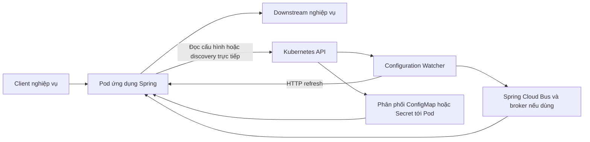

# Chuẩn bị quy trình xử lý khi API server hoặc watcher ngừng hoạt động

## Mục tiêu và phạm vi

Trong chương **Vận hành cấu hình** của module **SPRING_CLOUD_KUBERNETES**, bài này xây dựng quy trình xử lý sự cố khi ứng dụng không còn đọc/theo dõi được Kubernetes API hoặc khi Configuration Watcher không đưa thay đổi cấu hình tới ứng dụng Spring.

Mục tiêu là duy trì phần dịch vụ còn có thể hoạt động an toàn, xác định đúng đường bị lỗi và đưa từng Pod trở lại revision được chấp nhận. Khởi động lại một Deployment hoặc nhìn thấy watcher `Ready` chưa đủ để kết luận đã phục hồi.

Sau bài học, bạn có thể:

- Phân biệt lỗi control plane, lỗi đường kết nối và lỗi riêng của watcher/refresh.
- Đánh giá khác nhau giữa Pod đang chạy và Pod mới khởi động.
- Chuẩn bị thông tin, tiêu chí phục vụ suy giảm và đường quan sát trước sự cố.
- Thực hiện các bước khoanh vùng có thời hạn, không tạo thêm đợt restart hoặc retry đồng loạt.
- Đối chiếu nguồn cấu hình, dữ liệu được phân phối và revision đang dùng sau phục hồi.
- Thiết kế diễn tập watcher dừng và diễn tập mất kết nối API trong môi trường kiểm soát.

Kiến thức cần có: ConfigMap/Secret, ServiceAccount/RBAC, DiscoveryClient, probe và Configuration Watcher. Các điểm cấu hình Spring Cloud Kubernetes dùng **3.3.x** làm mốc; phần Actuator/probe tham chiếu Spring Boot **3.5.x** và Spring Cloud Commons **4.3.x**. Cần đối chiếu đúng phiên bản, loại client và cách triển khai trong môi trường thực tế.

Các tên resource, thời gian và revision dưới đây là ví dụ. Bài không yêu cầu chủ động làm gián đoạn control plane production và không chứa credential thật.

## 1. Xác định chính xác thành phần bị gián đoạn

### 1.1. Hai mặt phẳng có liên quan nhưng không đồng nhất

Kubernetes control plane quản lý trạng thái cluster và cung cấp API. Workload đang chạy trên worker node còn có đường xử lý lưu lượng riêng. Vì vậy, mất API server không đồng nghĩa mọi request nghiệp vụ lập tức thất bại; nhưng khả năng cập nhật trạng thái, điều phối và thay đổi tài nguyên có thể bị ảnh hưởng. Xem [Cluster Architecture](https://kubernetes.io/docs/concepts/architecture/).



Sơ đồ là mô hình logic: watcher là bên mở kết nối theo dõi API, còn kubelet tham gia phân phối volume. Mỗi mũi tên có thể có lỗi mạng, xác thực, quyền hoặc cơ chế cập nhật riêng.

### 1.2. Ba loại sự cố cần tách

| Loại sự cố | Biểu hiện có thể gặp | Điều không nên suy ra ngay |
| --- | --- | --- |
| API/control plane không phục vụ được | Nhiều client độc lập gặp timeout hoặc lỗi API | Mọi Pod nghiệp vụ đều đã chết |
| Chỉ một nhóm client không tới API được | Pod lỗi nhưng máy quản trị vẫn truy cập được | API server toàn cluster đã ngừng |
| API vẫn tốt nhưng watcher/refresh lỗi | Đọc ConfigMap được nhưng cấu hình ứng dụng không đổi | Dữ liệu mới đã có hiệu lực chỉ vì API trả thành công |

`401`, `403`, lỗi CA/hostname và timeout là các bằng chứng khác nhau. Một lỗi RBAC không chứng minh server ngừng hoạt động; một lỗi DNS từ một namespace không chứng minh toàn bộ cluster mất DNS.

### 1.3. Chuỗi cập nhật có nhiều điểm dừng

Đối với Configuration Watcher, hãy tách:

```text
Nguồn thay đổi
  → watcher nhìn thấy thay đổi
  → watcher chọn đúng ứng dụng đích
  → thông báo tới ứng dụng
  → ứng dụng đọc lại đúng nguồn
  → bean/client cần thiết áp dụng được giá trị
  → nghiệp vụ sử dụng revision đã kiểm chứng
```

Watcher có thể còn tiến trình nhưng mất watch; nhận được sự kiện nhưng chọn sai ứng dụng; hoặc gửi HTTP thành công nhưng một bean chỉ lỗi khi được dùng lại. Runbook cần có phép kiểm tra ở từng chặng, không chỉ có lệnh restart watcher.

## 2. Lập bảng ảnh hưởng theo cách sử dụng Spring Cloud Kubernetes

| Cách sử dụng | Pod đã chạy và đã có cấu hình | Pod mới hoặc tiến trình khởi động lại |
| --- | --- | --- |
| Cấu hình chỉ nạp lúc startup | Có thể tiếp tục dùng giá trị đã nạp, nếu còn phù hợp | Có thể không nạp được nguồn hoặc thất bại ở kiểm tra cấu hình |
| Cấu hình qua API và refresh động | Có thể giữ giá trị hiện tại nhưng mất cập nhật; hành vi khi refresh lỗi phải được kiểm thử | Phụ thuộc kết nối, nguồn bắt buộc và chính sách startup |
| ConfigMap/Secret mount dạng volume | File hiện có có thể còn dùng được; không bảo đảm nhận giá trị mới | Việc tạo/chạy Pod phụ thuộc trạng thái phân phối và khả năng lấy tài nguyên |
| Biến môi trường từ ConfigMap/Secret | Giá trị của tiến trình đang chạy không tự thay đổi | Cần lấy đúng giá trị khi Pod được tạo/chạy |
| Discovery dùng trạng thái cục bộ đã đồng bộ | Có thể đọc danh sách cũ, kèm rủi ro endpoint không còn đúng | Chưa có cache ban đầu có thể làm startup/discovery không sẵn sàng |
| Discovery cần gọi API hoặc Discovery Server | Lời gọi mới có thể lỗi ngay hoặc sau khi cache phía trên hết hiệu lực | Cần đường truy cập tương ứng hoạt động |

Không coi đây là cam kết mọi implementation đều có fallback. Cần ghi nhận đúng starter, client, supplier và cache thực tế; tài liệu [DiscoveryClient 3.3](https://docs.spring.io/spring-cloud-kubernetes/reference/3.3/discovery-client.html) mô tả các loại client và phạm vi discovery.

Một tiến trình đang dùng cấu hình cũ không có nghĩa cấu hình đó được lưu bền để dùng sau restart. Cache informer trong bộ nhớ, Spring Environment và dữ liệu mount có vòng đời khác nhau.

Với ConfigMap, volume cập nhật theo cơ chế hội tụ, biến môi trường không tự cập nhật và mount `subPath` có giới hạn riêng; xem [ConfigMaps](https://kubernetes.io/docs/concepts/configuration/configmap/). Không restart Pod đang phục vụ tốt chỉ với giả định Pod mới chắc chắn sẽ khởi động được bằng dữ liệu đã có trên node.

Đối với Secret, ngoài nguồn phân phối còn phải xét credential có hết hạn hoặc bị thu hồi ở hệ thống đích không. Việc file Secret vẫn tồn tại không chứng minh credential còn được chấp nhận; xem [Secrets](https://kubernetes.io/docs/concepts/configuration/secret/).

## 3. Chuẩn bị runbook trước khi có sự cố

### 3.1. Lưu thông tin vận hành không chứa bí mật

| Nhóm thông tin | Nội dung cần biết trước |
| --- | --- |
| Phạm vi | Cluster ID/context, namespace, Deployment, ứng dụng bị ảnh hưởng |
| Nguồn cấu hình | Tên/kind nguồn, profile, cách chọn nguồn, revision được phê duyệt |
| Tích hợp API | Loại client, phiên bản, endpoint, nguồn CA, ServiceAccount |
| Watcher | Namespace, Deployment, label selector, transport HTTP hay Bus |
| Đích refresh | Cách tìm từng replica, cổng/path quản trị, cơ chế xác thực |
| Khởi động | Nguồn bắt buộc, fail-fast, retry, initial sync và thời gian probe cho phép |
| Phục hồi | Bản cấu hình đã biết tốt, cách rollout/refresh từng nhóm, người phụ trách |
| Quan sát | Dashboard/log và đường truy cập còn dùng được khi Kubernetes API lỗi |

Không lưu token, private key, toàn bộ kubeconfig hoặc giá trị Secret vào runbook. Đường dẫn tới cơ chế cấp credential được quản lý có ích hơn một credential bị sao chép và hết hạn âm thầm.

Ví dụ bản ghi điền sẵn cho một môi trường, cần thay bằng giá trị thực tế:

```text
cluster-context: staging-cluster
application-namespace: shop
application-deployment: orders
config-source: ConfigMap shop/orders-runtime
approved-revision: R042
watcher-namespace: platform
watcher-deployment: configuration-watcher
watcher-selector: app=configuration-watcher
watcher-service-account: configuration-watcher
notification-mode: HTTP
configuration-owner: nhóm sở hữu orders
control-plane-owner: nhóm nền tảng
```

### 3.2. Có đường quan sát không phụ thuộc hoàn toàn API đang lỗi

`kubectl get`, `logs`, `exec` và việc tạo một phiên port-forward mới đều cần đường API hoạt động theo cách tương ứng. Nếu API đang mất, không thể lấy chúng làm con đường quan sát duy nhất.

Chuẩn bị trước log/metric tập trung và một đường chẩn đoán được bảo vệ mà nhóm có thể dùng trong tình huống dự kiến. Nếu dùng công cụ điều khiển ngoài cluster hoặc bảng trạng thái của nền tảng, ghi rõ phạm vi mà nó quan sát được.

Một phiên port-forward đã mở cũng có thể mất theo kết nối; không coi nó là kênh khôi phục độc lập được bảo đảm. Đường thoát của một bài diễn tập phải nằm ngoài phần kết nối mà bài diễn tập cố ý chặn.

### 3.3. Biết ai có quyền và ai sở hữu quyết định

Nhóm ứng dụng quyết định revision nào còn đủ điều kiện phục vụ và cách kiểm chứng nghiệp vụ. Nhóm nền tảng xử lý control plane, mạng và cơ chế cấp credential theo phạm vi sở hữu. Người điều phối sự cố giữ thứ tự hành động và bản ghi thời gian để tránh nhiều nhóm cùng sửa một nguồn.

Chuẩn bị quyền chẩn đoán cần thiết từ trước. Không dùng `cluster-admin`, trust-all TLS hoặc công khai endpoint refresh làm cách mặc định để rút ngắn điều tra.

## 4. Định nghĩa trước việc tiếp tục phục vụ bằng cấu hình cũ

### 4.1. Không có một thời hạn đúng cho mọi thuộc tính

Với mỗi nhóm cấu hình, xác định giá trị đã biết tốt gần nhất, cách kiểm tra tính hợp lệ, điều kiện phải ngừng chức năng và ai được quyết định kéo dài chế độ suy giảm.

| Nhóm cấu hình minh họa | Chính sách cần thiết kế |
| --- | --- |
| Tùy chọn hiển thị không ảnh hưởng hợp đồng dữ liệu | Có thể cho phép dùng revision hiện tại trong cửa sổ đã thống nhất |
| Địa chỉ/metadata chọn downstream | Phải xét endpoint thay đổi và lỗi kết nối thực tế, không chỉ tuổi cấu hình |
| Credential có thời hạn | Chỉ dùng khi còn hợp lệ; không che lỗi hết hạn bằng trạng thái cache “healthy” |
| Quy tắc bắt buộc phải xác minh trực tuyến | Chức năng liên quan có thể phải từ chối khi không xác minh được |

Đây là các nhóm để thảo luận, không phải quy định thời gian chung của Spring Cloud Kubernetes. Thư viện không tự hiểu thuộc tính nào có thể dùng cũ an toàn theo nghiệp vụ của bạn.

Nếu ứng dụng không có cơ chế giữ snapshot hợp lệ và xử lý refresh lỗi nhất quán, đừng ghi vào runbook rằng “luôn dùng last known good”. Cần xây dựng và kiểm thử khả năng đó hoặc chọn phương án rollout/cấu hình tĩnh phù hợp.

### 4.2. Phân biệt tuổi giá trị và độ tin cậy về độ mới

Một cấu hình không đổi trong 30 ngày vẫn có thể là cấu hình đúng nếu nguồn tiếp tục được xác minh. Ngược lại, một giá trị mới nạp vài phút có thể đã không còn đúng sau một thay đổi mà client bỏ lỡ.

Theo dõi riêng:

- Lần đọc/đối soát nguồn có thẩm quyền thành công gần nhất.
- Revision nguồn đã quan sát và revision đã áp dụng.
- Lần áp dụng thành công và lỗi áp dụng gần nhất.
- Nguồn bằng chứng là API, file cục bộ hay snapshot được lưu trước đó.

Đọc lại cùng file cục bộ mỗi vài giây không chứng minh file đang phản ánh trạng thái mới nhất trong API. Đọc từ cache cũng không được ghi nhận như một lần xác minh trực tiếp với nguồn nếu nó không có ý nghĩa đó.

Tương tự, không có sự kiện watch mới trong một namespace yên lặng không chứng minh watch đã chết. Cần thêm lỗi kết nối, reconnect, trạng thái client hoặc phép kiểm tra chức năng có kiểm soát.

### 4.3. Trạng thái phục vụ có thể quy ước

```text
NORMAL
  → DEGRADED: mất khả năng cập nhật, còn đủ điều kiện dùng trạng thái hiện tại
  → RECONCILING: đã có lại đường truy cập, đang đối soát revision
  → NORMAL: đã kiểm chứng dữ liệu và chức năng

DEGRADED hoặc RECONCILING
  → RESTRICTED: không còn đủ điều kiện phục vụ chức năng liên quan
```

Các trạng thái này do hệ thống tự thiết kế, không phải bộ trạng thái mặc định của Spring Cloud Kubernetes. Cần ánh xạ chúng tới hành vi HTTP/nghiệp vụ và telemetry cụ thể.

## 5. Probe và retry không được làm sự cố lan rộng

### 5.1. Liveness không nên đo sức khỏe của mọi dependency

Nếu liveness của mọi Pod đều phụ thuộc vào một API đang mất, kubelet có thể restart hàng loạt ứng dụng. Những tiến trình vốn còn cấu hình hợp lệ sẽ mất trạng thái trong bộ nhớ và lại phải khởi động khi dependency vẫn lỗi.

Spring Boot khuyến nghị không đưa kiểm tra hệ thống bên ngoài vào liveness; readiness cần được chọn theo khả năng phục vụ của ứng dụng. Xem [Actuator Kubernetes probes](https://docs.spring.io/spring-boot/3.5/reference/actuator/endpoints.html#actuator.endpoints.kubernetes-probes).

Ví dụ thể hiện rõ các nhóm sức khỏe cơ bản:

```yaml
management:
  endpoint:
    health:
      probes:
        enabled: true
      group:
        liveness:
          include: livenessState
        readiness:
          include: readinessState
```

Cấu hình trên không tự kiểm tra revision hay chính sách dùng cấu hình cũ. Nếu cần một kiểm tra an toàn cấu hình tùy biến trong readiness, phải triển khai nó và định nghĩa điều kiện rõ ràng.

Startup probe cho phép dành thời gian khởi tạo trước khi liveness có hiệu lực; ý nghĩa các loại probe được mô tả trong [Kubernetes probes](https://kubernetes.io/docs/concepts/workloads/pods/probes/). Không tăng thời gian probe để che một startup thiếu cấu hình bắt buộc.

Khi control plane mất kết nối, thay đổi trạng thái readiness cũng có thể chưa được phản ánh kịp tới mọi đường định tuyến. Nếu một chức năng không còn an toàn, ứng dụng cần thực thi việc từ chối ở chính đường xử lý phù hợp; không chỉ trông vào việc cập nhật danh sách endpoint.

### 5.2. Tính ngân sách startup và phục hồi

Ví dụ giả định: một bước đọc có timeout tối đa 6 giây, thử 5 lần, với các khoảng chờ 1, 2, 4 và 8 giây. Ngân sách bước đó có thể tới khoảng `5 × 6 + 1 + 2 + 4 + 8 = 45` giây, chưa tính các bước khác. Probe, rollout deadline và kỳ vọng vận hành cần xét cùng ngân sách này.

Trong Spring Cloud Kubernetes 3.3.x, retry khi nạp ConfigMap qua API có thiết lập/dependency riêng; xem [ConfigMap PropertySource](https://docs.spring.io/spring-cloud-kubernetes/reference/3.3/property-source-config/configmap-propertysource.html). Không giả định retry nạp cấu hình lúc startup cũng điều khiển reconnect của informer hoặc retry thông báo HTTP từ watcher.

Các thuộc tính chờ discovery cache như `wait-cache-ready` và `cache-loading-timeout-seconds` chỉ có ý nghĩa ở implementation sử dụng chúng; xem [Common application properties 3.3](https://docs.spring.io/spring-cloud-kubernetes/reference/3.3/appendix.html). Chúng không cung cấp TTL chung cho cấu hình và không tạo cache hợp lệ khi API chưa từng truy cập được.

Khi nhiều replica cùng phục hồi, giới hạn mức song song, dùng backoff/jitter ở nơi được hỗ trợ và triển khai theo nhóm. Không thêm vòng retry vô hạn bên ngoài client chỉ vì log đang báo lỗi kết nối.

## 6. Quy trình bước đầu khi nhận cảnh báo

### 6.1. Ghi bối cảnh và bảo toàn phần còn phục vụ

Trong bước đánh giá đầu tiên:

1. Ghi thời điểm phát hiện, cluster, ứng dụng, namespace và tín hiệu nghiệp vụ bị ảnh hưởng.
2. Xác định đây là mất cập nhật cấu hình hay đã có lỗi phục vụ người dùng.
3. Đối chiếu Pod đang chạy, Pod mới, revision hiện tại và thay đổi gần nhất.
4. Tạm dừng các thay đổi cấu hình/rollout không cần thiết qua quy trình quản lý sẵn có.
5. Phân công một luồng chẩn đoán ứng dụng và một luồng nền tảng khi phạm vi yêu cầu.

Việc tạm dừng pipeline phải có đường thực hiện đã chuẩn bị; một lệnh cần API sẽ không giúp được nếu API đang hoàn toàn không truy cập được. Không coi một hành động chưa thực hiện thành công là đã cô lập được sự cố.

### 6.2. Những hành động cần tránh trước khi có giả thuyết

- Xóa hoặc restart đồng loạt các Pod đang phục vụ được.
- Tắt TLS verification để thử lại credential thật.
- Mở rộng quyền API trên toàn cluster khi chưa thấy lỗi quyền tương ứng.
- Đổi nhiều nguồn cấu hình, dependency và image cùng lúc.
- Ép mọi Pod refresh ngay khi đường API vừa trở lại nhưng revision đích chưa được xem xét.

Mỗi lần can thiệp nên có mục đích, kết quả mong đợi, thời hạn quan sát và điều kiện dừng. Nếu can thiệp thất bại, ghi nhận rồi chuyển sang nhánh nguyên nhân phù hợp.

## 7. Nhánh A: xác minh API/control plane và đường kết nối

### 7.1. Kiểm tra từ một ngữ cảnh đã được cấp quyền

Ví dụ PowerShell, sử dụng context đã xác nhận:

```powershell
$clusterContext = 'staging-cluster'

kubectl --context $clusterContext --request-timeout=5s get --raw='/livez'
kubectl --context $clusterContext --request-timeout=5s get --raw='/readyz?verbose'
kubectl --context $clusterContext --request-timeout=5s -n shop get configmap orders-runtime -o 'jsonpath={.metadata.resourceVersion}'
```

`/livez` và `/readyz` có ý nghĩa riêng đối với API server; mã HTTP là cơ sở kiểm tra máy, còn dạng verbose phục vụ chẩn đoán. Xem [Kubernetes API health endpoints](https://kubernetes.io/docs/reference/using-api/health-checks/). Không bỏ các kiểm tra thất bại ra khỏi phép đo rồi kết luận hệ thống đã khỏe.

Context quản trị có thể không được cấp quyền non-resource URL hoặc GET ConfigMap này. `403` cần được đọc theo quyền và danh tính; nó không tự chứng minh API server không sẵn sàng.

Một lần trả lời qua load balancer cũng chưa chứng minh mọi replica API hoặc đường đi từ Pod đều tốt. So sánh kết quả từ những vị trí được phép và đại diện cho luồng lỗi; không dùng quyền của máy quản trị để suy ra quyền của ServiceAccount ứng dụng.

`--request-timeout` giúp giới hạn request chẩn đoán của kubectl; nó không cấu hình timeout trong JVM. Giữ số lần kiểm tra có giới hạn để không bổ sung tải lớn khi control plane đang phục hồi.

### 7.2. Phân loại bằng chứng

| Bằng chứng | Nhánh cần kiểm tra tiếp |
| --- | --- |
| Nhiều vị trí độc lập không kết nối API | Endpoint/LB, control plane, mạng chung; chuyển nhóm nền tảng |
| Máy quản trị được nhưng một nhóm Pod timeout | Route, DNS, proxy, NetworkPolicy, node hoặc namespace liên quan |
| Lỗi chứng chỉ máy chủ | CA, hostname, thời gian, certificate rotation; giữ TLS verification |
| `401` | Credential, hạn dùng, issuer/audience hoặc cơ chế cấp danh tính |
| `403` cho LIST/WATCH | Role/binding, namespace, resource/verb thực tế |
| `429` hoặc lỗi tạm thời khi phục hồi | Tải API, giới hạn client và hướng dẫn retry của server |

Kiểm tra quyền phải tách GET, LIST và WATCH. Nếu dùng `kubectl auth can-i --as ...`, tài khoản thực hiện còn cần quyền impersonate. Kết quả kiểm tra quyền không thay thế việc kiểm tra đường mạng từ chính nhóm Pod; xem [RBAC](https://kubernetes.io/docs/reference/access-authn-authz/rbac/).

### 7.3. Duy trì phục vụ trong lúc xử lý

Đối chiếu điều kiện dùng revision hiện tại theo chính sách đã chuẩn bị. Theo dõi lỗi downstream, tuổi bằng chứng độ mới và hiệu lực credential. Với discovery, endpoint trong cache có thể không còn đúng khi backend rollout; thêm retry nghiệp vụ vô hạn không sửa được danh sách stale.

Giữ những Pod còn phục vụ được nếu không có lý do an toàn phải thay. Không chủ động tạo thêm nhiều startup phụ thuộc API đang lỗi. Nếu phải hạn chế một chức năng, dùng cơ chế đã thiết kế và có đường thực thi thực tế; cân nhắc giữ các chức năng độc lập khác.

Việc sửa control plane, etcd hoặc load balancer thuộc quy trình nền tảng tương ứng. Runbook ứng dụng cần cung cấp bằng chứng và tiêu chí kiểm chứng, không thay thế bằng một lệnh restart API server chung cho mọi cluster.

## 8. Nhánh B: API hoạt động nhưng watcher hoặc refresh không hoạt động

### 8.1. Kiểm tra tiến trình và vòng đời watcher

Ví dụ với tên/selector đã điền trong runbook:

```powershell
kubectl --context $clusterContext --request-timeout=5s -n platform get deployment configuration-watcher
kubectl --context $clusterContext --request-timeout=5s -n platform get pods -l app=configuration-watcher -o wide
kubectl --context $clusterContext --request-timeout=5s -n platform logs deployment/configuration-watcher --since=10m --tail=200
```

Nếu có nhiều Pod, lệnh logs theo Deployment có thể không cung cấp đủ log của mọi replica cần điều tra. Chọn đúng Pod/container và lấy log lần chạy trước khi cần, nếu dữ liệu đó còn được lưu. Không xuất toàn bộ environment hoặc Secret để tìm nguyên nhân.

Phân biệt watcher bị dừng/CrashLoop, khởi động nhưng chưa đồng bộ được API, hay đã theo dõi mà không gửi đúng thông báo. Một readiness HTTP xanh chỉ kiểm tra những điều endpoint đó thực sự kiểm tra.

Không tự tăng số replica rồi giả định watcher có leader election và xử lý đúng một lần. Cơ chế HA phụ thuộc phiên bản/triển khai; nếu nhiều instance cùng xử lý, cần xét thông báo lặp và tính an toàn của refresh.

### 8.2. Kiểm tra từ nguồn tới ứng dụng

| Chặng | Câu hỏi cần trả lời |
| --- | --- |
| Nguồn | Đúng cluster, namespace, tên và revision được phê duyệt chưa? |
| Theo dõi | Watcher có quyền đúng resource và có LIST/WATCH thành công không? |
| Chọn nguồn | Label/selector có làm nguồn bị bỏ qua không? |
| Chọn đích | Tên ConfigMap/Secret có khớp ứng dụng hoặc có mapping đúng không? |
| Truyền HTTP | DNS, Service/endpoint, path, port, xác thực và quyền gọi refresh có đúng không? |
| Truyền Bus | Broker, kết nối, routing/consumer và độ trễ thông báo có bình thường không? |
| Áp dụng | Ứng dụng đã đọc lại đúng nguồn, bind/tạo lại thành phần cần thiết và kiểm tra revision chưa? |

Ở mốc 3.3.x, watcher sử dụng label nguồn và hỗ trợ annotation ánh xạ tới ứng dụng, ví dụ:

```yaml
metadata:
  name: orders-runtime
  namespace: shop
  labels:
    spring.cloud.kubernetes.config: "true"
  annotations:
    spring.cloud.kubernetes.configmap.apps: orders
```

Đây chỉ là metadata minh họa cho nguồn phù hợp, không phải ConfigMap hoàn chỉnh. Đối chiếu tên property và cách lọc informer theo [Configuration Watcher 3.3](https://docs.spring.io/spring-cloud-kubernetes/reference/3.3/spring-cloud-kubernetes-configuration-watcher.html). Đừng sửa label nguồn khi chưa xác định nó có phải nguyên nhân.

### 8.3. Chọn can thiệp nhỏ nhất có bằng chứng

Nếu thấy sai RBAC, sửa đúng resource/verb/namespace bằng quy trình quản lý quyền. Nếu HTTP trả `401`/`403`, sửa đường xác thực/authorization của endpoint quản trị. Nếu broker lỗi, xử lý transport thay vì restart tất cả ứng dụng.

Chỉ restart watcher khi có giả thuyết phù hợp, đã giữ bằng chứng cần thiết và biết cấu hình startup hiện tại còn dùng được. Watcher dừng nhiều phút không đồng nghĩa mọi sự kiện bị bỏ lỡ sẽ được phát lại như một hàng đợi bền.

## 9. Phục hồi: đối soát hiện trạng thay vì chỉ chờ kết nối xanh

### 9.1. Chọn revision đích trước khi phát refresh

Trong khoảng sự cố, nguồn có thể đã thay đổi nhiều lần. Bản đang lưu mới nhất chưa chắc là bản đã được phê duyệt hoặc tương thích với image đang chạy.

Xác nhận cluster, UID/tên nguồn, revision đích và bộ nguồn liên quan. Với Secret, kiểm tra tính hợp lệ qua cơ chế được cấp quyền mà không ghi giá trị ra log. Nếu nguồn hiện tại có vấn đề, chọn quy trình đưa về bản đã biết tốt hoặc phát hành bản sửa, rồi mới mở rộng áp dụng.

Không coi việc nhận lại mọi thay đổi trung gian là mục tiêu mặc định. Với cấu hình trạng thái, mục tiêu thường là hội tụ tới snapshot hiện tại được chấp nhận. Nếu nghiệp vụ cần xử lý từng chuyển trạng thái, không dùng một watch cấu hình như hàng đợi sự kiện nghiệp vụ bền vững.

### 9.2. Xác nhận client đồng bộ và kiểm soát tải

Watch có thể phải reconnect hoặc đọc lại trạng thái khi `resourceVersion` cũ không còn được giữ. Kubernetes mô tả cách xử lý `410 Gone` trong [API Concepts](https://kubernetes.io/docs/reference/using-api/api-concepts/). Không tự sửa resourceVersion thành một số đoán được hoặc xóa mọi cache đang chạy cùng lúc.

Phục hồi theo nhóm, quan sát số GET/LIST/WATCH, lỗi API, CPU/heap và thời gian initial sync. Nếu rollout/restart đồng loạt khi API vừa trở lại, nhiều client có thể cùng tải lại toàn bộ trạng thái và kéo dài sự cố.

### 9.3. Kiểm chứng ba lớp dữ liệu

| Lớp | Bằng chứng cần có |
| --- | --- |
| Nguồn | Revision được chấp nhận thực sự đang ở nguồn mà ứng dụng chọn |
| Phân phối | Client/file của Pod đã nhìn thấy dữ liệu tương ứng |
| Hiệu lực | Bean/client và hành vi kiểm tra của từng Pod sử dụng revision đó |

Với volume, notification có thể đến trước khi file cập nhật. Delay của watcher cần được thiết kế theo môi trường, không phải cam kết mọi mount luôn hội tụ sau cùng một số giây.

Với Spring, thành công của `/actuator/refresh` không chứng minh mọi object đã được tái tạo hoặc mọi lỗi khởi tạo lười đã xuất hiện. Kiểm tra thành phần thực sự sử dụng cấu hình; xem [Spring Cloud Context 4.3](https://docs.spring.io/spring-cloud-commons/reference/4.3/spring-cloud-commons/application-context-services.html).

### 9.4. Nếu phải refresh thủ công

Dùng endpoint quản trị đã được bảo vệ, chọn một replica/cohort trước và xác nhận revision sau thao tác. Ví dụ dưới giả định có đường quản trị tới đúng Pod và danh tính hợp lệ theo cơ chế lab/vận hành:

```powershell
$refreshUri = 'http://127.0.0.1:18081/actuator/refresh'
$refreshResult = Invoke-RestMethod -Method Post -Uri $refreshUri -ContentType 'application/json' -Body '{}' -TimeoutSec 10
```

Cổng local trong ví dụ phải được thiết lập bằng đường truy cập đã được phép; lệnh không tự cấp credential. Nếu endpoint yêu cầu xác thực, sử dụng client/phiên được quản lý theo môi trường. Không tắt Spring Security hoặc TLS để làm lệnh chạy được.

Kết quả trả về có thể chỉ phản ánh các key được phát hiện thay đổi. Đọc trạng thái hiệu lực và thực hiện kiểm tra chức năng phù hợp sau đó. Gọi một Service cân bằng tải một lần không đảm bảo mọi replica được refresh; cần xác định replica và tránh fan-out đồng loạt ngoài kiểm soát.

### 9.5. Khi cần rollout thay cho refresh

Nếu cơ chế bean/client không hỗ trợ refresh an toàn, rollout từ bộ cấu hình xác định có thể là đường phục hồi. Trước khi làm, kiểm tra khả năng khởi động Pod mới, nguồn bắt buộc, quota và dung lượng còn lại; triển khai theo nhóm, giữ phần phục vụ hợp lệ nếu có thể.

Rollback Pod template hoặc image không tự khôi phục ConfigMap mutable hay credential đã bị thu hồi. Đưa vào kế hoạch cả image, tham chiếu nguồn, phiên bản cấu hình và trạng thái hệ thống bên ngoài.

## 10. Chuẩn bị quan sát phục vụ quyết định

### 10.1. Trạng thái tối thiểu trên từng Pod

Ứng dụng có thể cung cấp bản ghi nội bộ theo danh sách trường cho phép:

```json
{
  "application": "orders",
  "podUid": "pod-uid-minh-hoa",
  "loadedRevision": "R042",
  "lastAppliedAt": "2026-11-25T04:00:00Z",
  "lastSuccessfulAuthoritativeReadAt": "2026-11-25T04:03:00Z",
  "sourceObservation": "API",
  "configurationState": "DEGRADED"
}
```

Đây là schema **do ứng dụng tự định nghĩa**, không phải endpoint JSON mặc định của Spring Boot/Spring Cloud Kubernetes. Chỉ cập nhật trường “đọc nguồn có thẩm quyền” khi hành động thực sự có ý nghĩa đó; không reset nó vì một GET vào endpoint trạng thái cục bộ.

Thông tin cần đến từ trạng thái đã áp dụng, không phải annotation mong muốn của Deployment. Bảo vệ endpoint, không trả giá trị Secret, toàn bộ Environment hoặc kubeconfig.

### 10.2. Metric và log cần tách chức năng

Nếu tự xây metric, có thể theo dõi số lần đối soát nguồn thành công/thất bại, thời gian đối soát, số lần refresh lỗi và số replica chưa đạt revision đích. Đây là nhu cầu đo lường, không phải khẳng định thư viện đã xuất sẵn các metric cùng tên.

Không gắn lỗi, URI đầy đủ, UID thay đổi liên tục hoặc giá trị Secret vào label metric. Với revision, kiểm soát số phiên bản và vòng đời chuỗi thời gian; các ID chi tiết thường phù hợp với log có cấu trúc.

Log nên phân biệt mất kết nối, lỗi quyền, nguồn không hợp lệ, nhận thông báo và áp dụng thành công. Chỉ bật debug có phạm vi/thời hạn, kiểm tra nội dung trước khi chia sẻ. Sự cố thiếu telemetry cần được ghi nhận như một khoảng trống bằng chứng.

## 11. Diễn tập watcher dừng trong cluster lab

### 11.1. Điều kiện chuẩn bị

Dùng cluster/namespace riêng cho diễn tập, không ảnh hưởng workload khác. Có sẵn:

- Ứng dụng `orders` với ít nhất hai replica, đọc nguồn giả `orders-runtime` và hỗ trợ refresh đã được kiểm chứng.
- Configuration Watcher chỉ phục vụ phạm vi lab, không có HPA/GitOps controller tự đổi số replica trong lúc thử.
- Nguồn cấu hình không chứa bí mật, có property `demo.revision`, baseline là `R001`.
- Endpoint nội bộ do lab tự triển khai, chẳng hạn `/internal/config-state`, trả revision **đang dùng** và Pod UID.
- Quyền xem/scale đúng watcher, thay ConfigMap lab và đường khôi phục đã chuẩn bị.

Không dùng một nguồn Secret thật để làm thử nghiệm. Nếu ứng dụng còn có reload/polling/controller khác, cần ghi rõ hoặc loại khỏi thiết kế bài thử; dừng watcher không đồng nghĩa mọi cơ chế cập nhật đều đã dừng.

### 11.2. Ghi baseline và lệnh khôi phục trước khi tạo lỗi

```powershell
$labContext = 'training-cluster'
$labNamespace = 'config-outage-lab'
$watcherDeployment = 'configuration-watcher'

$watcherJson = kubectl --context $labContext -n $labNamespace get deployment $watcherDeployment -o json
if ($LASTEXITCODE -ne 0) { throw 'Không đọc được Deployment watcher lab.' }
$watcherBefore = $watcherJson | ConvertFrom-Json
$watcherReplicasBefore = [int]$watcherBefore.spec.replicas
if ($watcherReplicasBefore -lt 1) { throw 'Cần baseline watcher đang hoạt động.' }
```

Lưu số replica ban đầu trong bản ghi diễn tập và chuẩn bị sẵn các lệnh phục hồi ở mục sau trước khi scale về 0. Xác nhận cả hai Pod `orders` dùng R001 và đường nghiệp vụ cơ bản đang thành công.

### 11.3. Dừng watcher rồi đổi nguồn giả

```powershell
kubectl --context $labContext -n $labNamespace scale deployment/$watcherDeployment --replicas=0
if ($LASTEXITCODE -ne 0) { throw 'Không dừng được watcher lab.' }
kubectl --context $labContext -n $labNamespace get pods -l app=configuration-watcher
```

Selector trên phải khớp manifest lab. Chờ xác nhận không còn watcher của bài thử hoạt động; việc thay desired replicas thành 0 chưa chứng minh mọi Pod đã kết thúc.

Thay nguồn giả thành R002:

```powershell
@'
apiVersion: v1
kind: ConfigMap
metadata:
  name: orders-runtime
  namespace: config-outage-lab
  labels:
    spring.cloud.kubernetes.config: "true"
  annotations:
    spring.cloud.kubernetes.configmap.apps: orders
data:
  demo.revision: R002
  demo.message: gia-tri-gia-lap-r002
'@ | kubectl --context $labContext apply -f -
if ($LASTEXITCODE -ne 0) { throw 'Không cập nhật được nguồn giả của lab.' }
```

Đây phải là ConfigMap dành riêng cho lab, với tập key đã được kiểm soát như ví dụ. Không áp manifest rút gọn lên nguồn dùng chung hoặc production để rồi làm mất cấu hình khác.

Quan sát nguồn, revision của từng Pod, lỗi nghiệp vụ và số restart. Không tự gọi refresh ở giai đoạn này. Nếu Pod thay thế hoặc một cơ chế khác tự nạp lại cấu hình, ghi nhận thay vì ép kết quả theo giả thuyết.

### 11.4. Khôi phục watcher và đối soát

```powershell
kubectl --context $labContext -n $labNamespace scale deployment/$watcherDeployment --replicas=$watcherReplicasBefore
if ($LASTEXITCODE -ne 0) { throw 'Không khôi phục được số replica watcher.' }
kubectl --context $labContext -n $labNamespace rollout status deployment/$watcherDeployment --timeout=120s
```

Nếu có lỗi giữa bài thử, dùng đường khôi phục đã chuẩn bị ngay theo điều kiện dừng của diễn tập; không tiếp tục tạo thêm thay đổi. Sau khi watcher hoạt động lại, không đánh dấu bài đạt chỉ từ rollout status.

Kiểm tra lần lượt watch/nguồn, đường thông báo và revision từng Pod. Tùy implementation, khởi động lại informer có thể quan sát trạng thái hiện tại, nhưng không coi đó là cam kết phát lại mọi thông báo đã bỏ lỡ. Nếu cần, dùng quy trình refresh/rollout có kiểm soát ở phần phục hồi để hội tụ tới R002.

### 11.5. Tiêu chí đạt của bài thử

| Tiêu chí | Bằng chứng |
| --- | --- |
| Phát hiện watcher không còn làm việc | Tín hiệu vận hành và kiểm tra chức năng, có thời điểm |
| Không phát sinh restart ứng dụng hàng loạt | Số restart/Pod UID trước và sau |
| Biết rõ nguồn và trạng thái từng Pod | Revision API, revision hiệu lực và danh sách replica |
| Khôi phục đúng số replica ban đầu | Desired/current và tình trạng watcher phù hợp |
| Mọi Pod phục vụ hội tụ tới bản được chấp nhận | Endpoint/bằng chứng hiệu lực cùng kiểm tra nghiệp vụ |
| Kết thúc diễn tập có kiểm soát | Không còn fault injection hoặc thay đổi ngoài kế hoạch |

Thời gian tối đa cho từng bước do nhóm đặt theo lab và mục tiêu của mình; `120s` trong lệnh chỉ là timeout quan sát của ví dụ, không phải RTO được thư viện bảo đảm.

## 12. Diễn tập mất kết nối API cần một thiết kế khác

### 12.1. Giới hạn phạm vi trước khi thử

Ưu tiên cô lập đường API của một nhóm Pod thử nghiệm bằng cơ chế fault injection của môi trường. Phải giữ đường quản trị/khôi phục độc lập và không vô tình chặn cả DNS hoặc downstream nghiệp vụ nếu mục tiêu chỉ là API.

Không có một NetworkPolicy mẫu đúng cho mọi CNI, Service IP, địa chỉ API và cách NAT. NetworkPolicy mang tính cộng dồn cho các rule cho phép và còn phụ thuộc implementation; xem [Network Policies](https://kubernetes.io/docs/concepts/services-networking/network-policies/). Một policy mới chưa chắc chặn được kết nối nếu policy khác vẫn cho phép.

Không dừng API server/etcd dùng chung chỉ để mô phỏng một client không tới được API. Sự cố thực sự của control plane trên môi trường dùng riêng phải theo quy trình nền tảng và điều kiện khôi phục tương ứng.

### 12.2. Ma trận bài thử

| Bài thử | Phạm vi lỗi | Điều cần quan sát |
| --- | --- | --- |
| A | Một Pod đang chạy không tới API | Khả năng phục vụ với trạng thái hiện tại, lỗi đọc/watch, giới hạn suy giảm |
| B | Một Pod mới khởi động không tới API | Fail-fast/initial sync, readiness, thời gian retry và cách dừng |
| C | Watcher không tới API nhưng ứng dụng còn tới được | Phát hiện lỗi watcher, đối soát nguồn và refresh có kiểm soát |
| D | Đường API phục hồi | Reconnect/relist, tải tăng, revision hiệu lực của từng Pod |

Mỗi bài chỉ nên thay một điều kiện chính và có bản ghi baseline. Chỉ dùng revision giả không nhạy cảm. Nếu DNS/downstream cũng bị chặn, kết quả chưa chứng minh riêng hành vi khi mất API.

### 12.3. Điều kiện dừng phải thực thi được

Chuẩn bị trước giới hạn thời gian, ngưỡng lỗi, người điều khiển fault injection và lệnh/đường khôi phục ngoài phạm vi lỗi. Dừng khi mất khả năng khôi phục, ảnh hưởng ra ngoài lab hoặc chức năng vượt giới hạn đã thống nhất.

Sau khi gỡ lỗi, kiểm tra cả kết nối mới và những kết nối watch đang chạy. Một GET thành công chưa chứng minh informer đã đồng bộ hoặc watcher đã gửi đủ thông báo cần thiết.

## 13. Mẫu runbook ngắn để điền cho từng dịch vụ

| Bước | Hành động cụ thể cần điền | Tiêu chí chuyển bước |
| --- | --- | --- |
| Nhận diện | Ghi cluster, phạm vi Pod, thời điểm, revision và tác động | Có người điều phối và giả thuyết ban đầu |
| Bảo toàn phục vụ | Dừng thay đổi không cần thiết, xét khả năng dùng trạng thái hiện tại | Quyết định chức năng nào tiếp tục/hạn chế |
| Khoanh vùng | So sánh API từ các vị trí, kiểm tra watcher và từng chặng refresh | Xác định nhánh control plane, kết nối, quyền hoặc refresh |
| Can thiệp | Chọn một sửa đổi có mục đích, timeout và đường quay lại | Có kết quả quan sát được |
| Đối soát | Xác nhận nguồn đích, dữ liệu phân phối, revision từng Pod | Mọi replica phục vụ đạt điều kiện đã đặt |
| Mở lại thay đổi | Triển khai một canary/thay đổi thử không nhạy cảm nếu phù hợp | Đường cập nhật hoạt động đầu cuối |
| Kết thúc | Gỡ biện pháp tạm thời, cập nhật bằng chứng và việc cần sửa | Không còn lỗi ẩn hoặc ngoại lệ vận hành không được ghi nhận |

Không đóng sự cố chỉ vì hết cảnh báo kết nối. Trước khi mở lại rollout, cần biết Pod mới khởi động được, nguồn hiện tại hợp lệ, đường cập nhật hoạt động và những replica đang phục vụ không còn lệch ngoài thiết kế.

## 14. Tình huống dựng lại diễn biến

Ví dụ giả định:

```text
10:00  orders đang dùng R042 trên 3 Pod.
10:02  watcher mất kết nối API; nghiệp vụ vẫn phục vụ được.
10:04  nguồn được cập nhật thành R043 trong khi chưa kiểm soát thay đổi.
10:06  nhóm phát hiện một Pod restart và khởi động với R043.
10:08  kết nối watcher được khôi phục.
```

Nếu chỉ kiểm tra watcher ở 10:08, nhóm có thể bỏ sót hai vấn đề: sự cố đã tạo trạng thái khác nhau giữa replica, và revision hiện tại có thể chưa được kiểm chứng cho cohort đang chạy.

Quy trình đúng là xác nhận R043 có phải đích được chấp nhận, liệt kê revision của cả ba Pod, kiểm tra cơ chế nạp/refresh và đưa từng nhóm về một trạng thái có chủ đích. Nếu chọn R042 để phục hồi, phải làm rõ nguồn/tham chiếu nào cần đổi và khả năng tương thích còn được giữ.

Bài học vận hành ở đây là mất khả năng cập nhật không chỉ tạo dữ liệu cũ: nó còn có thể tạo hỗn hợp dữ liệu cũ/mới do các Pod có vòng đời khác nhau.

## 15. Tự kiểm tra hiểu biết

- API server không truy cập được có đồng nghĩa mọi request nghiệp vụ dừng ngay không? **Không; phải xét dependency thực tế và đường phục vụ còn hoạt động.**
- Pod cũ chạy được có chứng minh restart nó sẽ thành công không? **Không; startup có thể cần nguồn/API mà Pod cũ đã nạp từ trước.**
- Watcher `Ready` có chứng minh mọi Pod đã áp dụng thay đổi bị bỏ lỡ không? **Không; cần đối soát revision và đường cập nhật đầu cuối.**
- Không có sự kiện watch mới có đủ kết luận watch hỏng không? **Không; nguồn có thể không thay đổi.**
- Có nên đưa API server vào liveness của mọi ứng dụng không? **Không mặc định; dependency chung hỏng có thể gây restart dây chuyền.**
- Có nên refresh mọi Pod ngay khi API phục hồi không? **Chỉ sau khi xác nhận revision đích và chọn mức song song phù hợp.**
- Tăng số replica watcher có tự tạo HA đúng nghĩa không? **Không; phải kiểm chứng cơ chế phiên bản, tính an toàn khi xử lý lặp và quy trình chuyển vai trò nếu có.**
- Dừng watcher có phải cách mô phỏng toàn bộ API server dừng không? **Không; đó là hai phạm vi lỗi khác nhau và cần diễn tập riêng.**

Một runbook hoàn chỉnh cần nêu được khả năng phục vụ còn lại, bằng chứng để phân loại lỗi, hành động có giới hạn và điều kiện xác nhận từng Pod đã trở lại trạng thái được chấp nhận.
