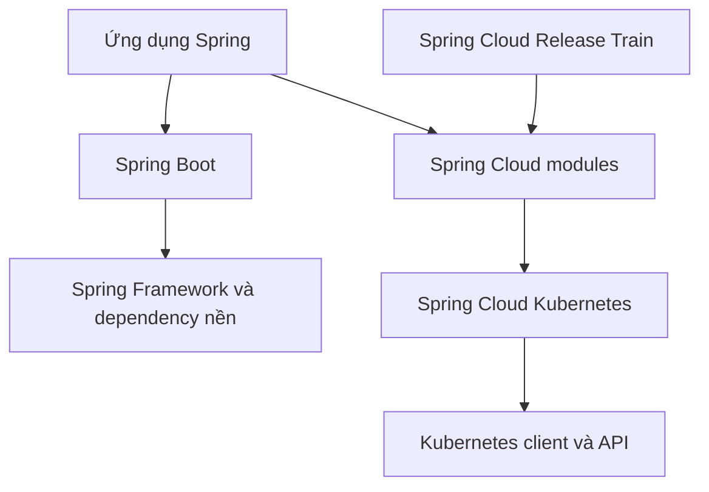
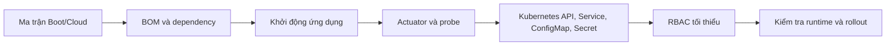

# Chọn Spring Boot và Spring Cloud Release Train tương thích

## 1. Vì sao phải chọn theo ma trận?

Một dự án `SPRING_CLOUD_KUBERNETES` thường dùng nhiều lớp dependency: Spring Boot, Spring Framework, Spring Cloud, Spring Cloud Kubernetes, Kubernetes client và các starter cho discovery, ConfigMap, Secret, LoadBalancer hoặc Configuration Watcher. Các lớp này không nên được chọn độc lập bằng cách lấy phiên bản mới nhất của từng thư viện.

Spring Boot cung cấp nền tảng khởi động và dependency management cho ứng dụng Spring. Spring Cloud bổ sung các abstraction phân tán như discovery, load balancing và configuration. Spring Cloud Kubernetes kết nối các abstraction đó với Kubernetes. Release Train của Spring Cloud gom các dự án Spring Cloud theo một dòng tương thích với một hoặc một số dòng Spring Boot.



Mục tiêu của việc chọn phiên bản là tạo một tập dependency mà các module hỗ trợ nhau, plugin build xử lý được và ứng dụng có thể nâng cấp có kiểm soát. Một bộ dependency biên dịch thành công vẫn cần được kiểm tra ở runtime, vì lỗi có thể xuất hiện khi auto-configuration khởi động, khi gọi Kubernetes API hoặc khi refresh cấu hình.

## 2. Ba khái niệm cần phân biệt

### Spring Boot

Spring Boot cung cấp cơ chế khởi động ứng dụng, auto-configuration, externalized configuration, Actuator và dependency management. Dòng Boot quyết định nhiều phiên bản Spring Framework, logging, JSON, server HTTP và thư viện nền mà ứng dụng sử dụng.

### Spring Cloud Release Train

Release Train là dòng phiên bản của Spring Cloud. Tên train không nên được hiểu là một dependency duy nhất để thêm vào ứng dụng. Thông thường ứng dụng import một BOM của Spring Cloud để các module Spring Cloud dùng các phiên bản tương thích trong cùng train.

### Spring Cloud Kubernetes

Spring Cloud Kubernetes là nhóm module tích hợp với Kubernetes. Nó có thể cung cấp discovery, ConfigMap, Secret, Spring Cloud LoadBalancer hoặc Configuration Watcher tùy thành phần và phiên bản. Không phải mọi tính năng đều cần bật trong mọi ứng dụng.

Release Train không thay thế Spring Boot parent. Boot và Cloud cần được chọn theo bảng tương thích chính thức của dòng dự án đang sử dụng, sau đó mới chọn phiên bản Spring Cloud Kubernetes được hỗ trợ trong dòng Cloud đó.

## 3. Nguyên tắc chọn phiên bản

Quy trình an toàn có thể bắt đầu từ phiên bản Spring Boot mà tổ chức cho phép dùng, hoặc từ một dòng Spring Cloud yêu cầu bởi nền tảng. Sau đó:

1. Xác định dòng Spring Boot và phiên bản patch muốn dùng.
2. Tra bảng tương thích của Spring Cloud để chọn Release Train phù hợp.
3. Kiểm tra tài liệu của Spring Cloud Kubernetes cho dòng Spring Boot và Spring Cloud đó.
4. Chọn một phiên bản patch ổn định trong dòng đã được hỗ trợ.
5. Import BOM đúng chỗ và khai báo starter cần thiết.
6. Kiểm tra dependency tree để phát hiện module bị kéo lệch phiên bản.
7. Chạy test khởi động, test tích hợp và kiểm tra hành vi với Kubernetes.

Không nên chọn theo tên train gần đây nhất nếu nó không hỗ trợ dòng Boot của dự án. Cũng không nên tự suy luận rằng hai số phiên bản giống nhau nghĩa là tương thích.

## 4. Bảng tương thích là nguồn quyết định

Spring Cloud công bố bảng tương thích giữa Release Train và Spring Boot. Bảng đó là điểm bắt đầu để loại các tổ hợp không được hỗ trợ. Với mỗi dòng cụ thể, đọc thêm hướng dẫn của Spring Cloud Kubernetes vì module tích hợp có thể có yêu cầu riêng, thay đổi starter hoặc thay đổi cách cấu hình.

| Quyết định | Câu hỏi cần trả lời |
| --- | --- |
| Chọn Boot | Dòng Boot nào phù hợp JDK, container base image và policy bảo mật? |
| Chọn Release Train | Train nào hỗ trợ đúng dòng Boot đó? |
| Chọn Spring Cloud Kubernetes | Module và phiên bản nào thuộc ma trận đã chọn? |
| Chọn Kubernetes client | Client nào được starter quản lý và có tương thích API cluster? |
| Chọn patch | Bản patch nào đã qua kiểm tra bảo mật và regression của tổ chức? |

Khi dùng thông tin từ một bài blog hoặc một repository mẫu, cần đối chiếu với tài liệu phát hành hiện hành của Spring. Ví dụ mã mẫu có thể pin một phiên bản cũ vì mục đích minh họa, trong khi dự án mới cần dòng được hỗ trợ khác.

## 5. Maven: dùng BOM để giữ một mặt bằng phiên bản

Với Maven, có thể import BOM của Spring Cloud trong `dependencyManagement` để các module Spring Cloud dùng phiên bản đã được train quản lý. Giá trị version trong ví dụ là placeholder; thay bằng dòng đã được xác nhận từ ma trận tương thích của dự án.

```xml
<properties>
    <java.version>17</java.version>
    <spring-boot.version>BOOT_VERSION</spring-boot.version>
    <spring-cloud.version>CLOUD_TRAIN_VERSION</spring-cloud.version>
</properties>

<parent>
    <groupId>org.springframework.boot</groupId>
    <artifactId>spring-boot-starter-parent</artifactId>
    <version>${spring-boot.version}</version>
    <relativePath/>
</parent>

<dependencyManagement>
    <dependencies>
        <dependency>
            <groupId>org.springframework.cloud</groupId>
            <artifactId>spring-cloud-dependencies</artifactId>
            <version>${spring-cloud.version}</version>
            <type>pom</type>
            <scope>import</scope>
        </dependency>
    </dependencies>
</dependencyManagement>
```

Dependency dùng starter thường không cần tự ghi version nếu BOM quản lý nó:

```xml
<dependencies>
    <dependency>
        <groupId>org.springframework.boot</groupId>
        <artifactId>spring-boot-starter-actuator</artifactId>
    </dependency>
    <dependency>
        <groupId>org.springframework.cloud</groupId>
        <artifactId>spring-cloud-starter-kubernetes-client</artifactId>
    </dependency>
    <dependency>
        <groupId>org.springframework.cloud</groupId>
        <artifactId>spring-cloud-starter-loadbalancer</artifactId>
    </dependency>
</dependencies>
```

Tên starter trong ví dụ phải được đối chiếu với tài liệu của dòng phiên bản đã chọn. Không trộn starter của client implementation khác chỉ vì tên có vẻ tương tự. Nếu một dependency cần version riêng, ghi rõ lý do và kiểm tra xung đột với BOM.

## 6. Gradle: platform và enforcedPlatform

Với Gradle, BOM có thể được dùng qua `platform`. `enforcedPlatform` ép các dependency phải theo BOM, nhưng làm giảm khả năng một module bên ngoài chọn phiên bản khác. Chọn cách dùng phù hợp với quy ước của repository và kiểm tra kỹ dependency graph.

```groovy
plugins {
    id 'java'
    id 'org.springframework.boot' version 'BOOT_VERSION'
    id 'io.spring.dependency-management' version 'PLUGIN_VERSION'
}

dependencies {
    implementation platform("org.springframework.cloud:spring-cloud-dependencies:CLOUD_TRAIN_VERSION")
    implementation 'org.springframework.boot:spring-boot-starter-actuator'
    implementation 'org.springframework.cloud:spring-cloud-starter-kubernetes-client'
    implementation 'org.springframework.cloud:spring-cloud-starter-loadbalancer'
}
```

Trong dự án dùng plugin dependency management, cách khai báo có thể khác. Điều cần giữ là một nguồn quản lý phiên bản rõ ràng, không trộn nhiều BOM cùng quản lý một module. Nếu có nhiều platform, ghi rõ thứ tự và lý do vì thứ tự có thể ảnh hưởng version được chọn.

## 7. Chọn JDK và Spring Boot cùng lúc

Spring Boot, plugin build, image runtime và thư viện phải cùng hỗ trợ JDK mà dự án chọn. JDK mới hơn không tự làm mọi phiên bản Boot cũ tương thích. Trước khi nâng JDK, kiểm tra yêu cầu của Boot, Gradle hoặc Maven plugin, base image và thư viện quan trọng.

| Thành phần | Cần kiểm tra |
| --- | --- |
| JDK local và CI | Compiler, toolchain và test runtime |
| JDK trong container | Image runtime có đúng version và architecture không |
| Spring Boot | Dòng Boot hỗ trợ JDK đã chọn không |
| Build plugin | Maven/Gradle plugin có chạy trên JDK đó không |
| Kubernetes image | Startup script, memory flags và certificate store |
| Native hoặc AOT | Plugin và starter có hỗ trợ đường build này không |

Ví dụ, nếu ứng dụng được build bằng JDK 17 nhưng container chạy JDK 11, lỗi có thể chỉ xuất hiện khi Pod khởi động. Đây là vấn đề runtime của image, không phải lỗi discovery hay ConfigMap.

## 8. Chọn module Spring Cloud Kubernetes theo nhu cầu

Phạm vi module `SPRING_CLOUD_KUBERNETES` gồm tích hợp ứng dụng Spring với DiscoveryClient, ConfigMap, Secret, Spring Cloud LoadBalancer và Configuration Watcher. Hãy chọn tối thiểu thành phần đáp ứng nhu cầu thực tế:

| Nhu cầu | Thành phần cần xem xét | Câu hỏi trước khi thêm |
| --- | --- | --- |
| Gọi Service bằng DNS | Spring Boot HTTP client và Service | Có thật sự cần discovery abstraction không? |
| Discovery qua Spring Cloud | Discovery starter phù hợp | Cần đọc tài nguyên nào và quyền gì? |
| Chọn instance phía client | Spring Cloud LoadBalancer | Đích là Service hay Pod? |
| Đọc cấu hình cluster | ConfigMap/Secret integration | Nạp ban đầu hay refresh lúc chạy? |
| Theo dõi đổi cấu hình | Configuration Watcher hoặc cơ chế phù hợp | Bean nào áp dụng thay đổi? |
| Sức khỏe Pod | Actuator và probe Kubernetes | Endpoint và cổng có khớp không? |

Thêm starter không tự tạo Service, Deployment, RBAC hoặc ConfigMap. Những tài nguyên đó vẫn do manifest và quy trình triển khai quản lý. Dependency trong ứng dụng cũng không tự cấp quyền đọc API server.

## 9. Tránh trộn các thế hệ API và client

Spring Cloud Kubernetes có thể cung cấp nhiều cách tích hợp với Kubernetes client tùy dòng phiên bản. Một dự án cần chọn implementation mà tài liệu của dòng đang dùng hỗ trợ, sau đó giữ nhất quán giữa starter, cấu hình và quyền RBAC.

Không nên đồng thời thêm nhiều starter discovery hoặc nhiều client implementation chỉ để thử nghiệm mà không hiểu auto-configuration nào sẽ được kích hoạt. Hậu quả có thể là bean trùng, endpoint khác nhau, dependency tree lớn hoặc lỗi khởi động do điều kiện cấu hình.

Khi đổi implementation, kiểm tra:

- Tên artifact và starter được hỗ trợ trong dòng đã chọn.
- Tên thuộc tính cấu hình và namespace mặc định.
- Cách client xác thực với API server.
- Quyền `get`, `list` hoặc `watch` mà thành phần cần.
- Cách xử lý khi API server tạm thời không truy cập được.
- Tác động tới image size, startup time và log.

## 10. Kiểm tra dependency graph

Build thành công chỉ cho biết compiler và resolver chấp nhận dependency. Cần xem dependency graph để phát hiện hai phiên bản của Spring Framework, Reactor, Jackson, Kubernetes client hoặc module Cloud cùng xuất hiện.

```text
Maven:  mvn dependency:tree
Gradle: ./gradlew dependencies
```

Trong bài này chỉ mô tả lệnh kiểm tra để người học hiểu quy trình; việc chạy build hoặc Gradle không thuộc phạm vi ghi bài. Khi kiểm tra trong dự án thật, lưu lại dependency tree của bản build đã phát hành để so sánh khi nâng cấp.

Các dấu hiệu cần chú ý:

| Dấu hiệu | Rủi ro |
| --- | --- |
| Hai version Spring Framework | NoSuchMethodError hoặc lỗi điều kiện auto-configuration |
| Hai version Kubernetes client | Bean hoặc API không tương thích |
| BOM bị override tùy tiện | Tổ hợp chưa được train kiểm thử |
| Starter kéo cả client không dùng | Image lớn, surface quyền và cấu hình rộng hơn |
| Dependency test khác runtime | Test xanh nhưng container lỗi khi chạy |

Exclusions có thể giải quyết một xung đột cụ thể, nhưng mỗi exclusion cần ghi nguyên nhân và có test hồi quy. Không dùng exclusion để che một tổ hợp version chưa được hiểu.

## 11. Kiểm tra ứng dụng sau khi chọn version

Kiểm tra tối thiểu nên đi qua các lớp sau:

1. Ứng dụng khởi động trong môi trường local hoặc test container.
2. Actuator health trả về trạng thái hợp lệ trên cổng được probe.
3. Cấu hình bắt buộc được bind đúng vào `@ConfigurationProperties`.
4. Discovery hoặc URL Service dùng đúng namespace.
5. Client có quyền RBAC tối thiểu nếu cần Kubernetes API.
6. ConfigMap và Secret được đọc theo đường phân phối đã thiết kế.
7. LoadBalancer xử lý timeout và instance không sẵn sàng.
8. Configuration Watcher chỉ refresh bean có khả năng áp dụng.
9. Log không ghi Secret hoặc token.
10. Rollout và rollback của Deployment hoạt động trong namespace thử nghiệm.



Kiểm tra runtime quan trọng vì cùng một artifact có thể khởi động khác nhau khi có hoặc không có ServiceAccount, khi namespace khác nhau, hoặc khi Kubernetes API trả về dữ liệu khác môi trường local.

## 12. Ví dụ lựa chọn cho order-service

Giả sử `order-service` chỉ gọi `inventory-service` bằng URL ổn định, nhận cấu hình giới hạn đơn hàng qua biến môi trường và dùng Actuator để cung cấp readiness. Phương án ban đầu có thể chỉ cần Spring Boot, HTTP client, Actuator và manifest Kubernetes. Không cần thêm DiscoveryClient, LoadBalancer hoặc Configuration Watcher nếu nhu cầu chưa yêu cầu.

Khi ứng dụng cần mô hình discovery thống nhất giữa nhiều môi trường, nhóm có thể thêm Spring Cloud Kubernetes discovery và LoadBalancer. Trước đó phải xác định Service hay Pod là đích, quyền API cần cấp và hành vi khi discovery tạm thời không hoạt động.

Khi giới hạn đơn hàng cần cập nhật mà không rollout, nhóm cần chọn cơ chế đọc lại ConfigMap, watcher và cách refresh bean. Nếu không chứng minh được refresh an toàn, rollout vẫn là lựa chọn dễ kiểm soát hơn. Phiên bản Spring Cloud Kubernetes được chọn phải hỗ trợ đúng cơ chế này trong ma trận của dự án.

## 13. Nâng cấp phiên bản có kiểm soát

Nâng cấp nên thay đổi một trục chính mỗi lần khi có thể. Ví dụ, trước hết nâng patch trong cùng dòng Boot; sau đó kiểm tra bảo mật và regression; tiếp theo mới chuyển Release Train hoặc Boot minor. Nâng đồng thời JDK, Boot, Cloud, Kubernetes client và image base làm khó xác định nguyên nhân khi lỗi xuất hiện.

Quy trình nâng cấp:

1. Ghi lại Boot, Cloud train, Spring Cloud Kubernetes, JDK và image hiện tại.
2. Đọc ma trận tương thích của đích nâng cấp.
3. So sánh release notes và breaking changes của module đang dùng.
4. Cập nhật BOM và starter cùng một thay đổi có chủ đích.
5. Kiểm tra dependency tree và cảnh báo resolver.
6. Chạy test khởi động, cấu hình, discovery và health.
7. Đóng gói image mới và kiểm tra trong namespace thử nghiệm.
8. Rollout có giới hạn, quan sát readiness và log.
9. Chuẩn bị rollback cả image lẫn cấu hình tương thích.

Không coi rollback image là đủ nếu phiên bản mới đã thay đổi schema, Secret format hoặc tên key ConfigMap. Nâng cấp ứng dụng Spring và nâng cấp manifest Kubernetes cần được xem như một thay đổi liên kết.

## 14. Các lỗi thường gặp

### Lấy version mới nhất của từng module

Các module mới nhất có thể thuộc những dòng Boot khác nhau. Resolver có thể chọn được dependency nhưng runtime không được hỗ trợ. Hãy chọn Boot và Cloud train như một ma trận.

### Ghi version cho mọi starter

Việc tự ghi version riêng cho từng starter có thể override BOM. Chỉ pin riêng khi có lý do rõ ràng và đã kiểm tra dependency tree.

### Nghĩ rằng cùng tên major là tương thích

Tên `spring-cloud-kubernetes` hoặc `spring-cloud-loadbalancer` không đủ để kết luận. Cần xem dòng Boot, Cloud train và tài liệu module.

### Thêm mọi tính năng Spring Cloud Kubernetes

Mỗi starter thêm code, cấu hình, quyền và surface vận hành. Nếu Service DNS đã đáp ứng, discovery API có thể là chi phí không cần thiết.

### Chỉ kiểm tra compile

Dependency có thể compile nhưng lỗi khi auto-configuration khởi tạo, khi đọc ServiceAccount token hoặc khi API Kubernetes trả về resource. Cần test runtime.

### Dùng Spring Cloud Kubernetes để sửa lỗi Deployment

Thư viện tích hợp không thay thế Deployment, Service, probe, scheduler hoặc RBAC. Xác định lớp chịu trách nhiệm trước khi thêm dependency.

## 15. Tự kiểm tra

### Release Train có phải là một starter không?

Không. Release Train là dòng quản lý phiên bản cho các dự án Spring Cloud. Ứng dụng thường import BOM của train rồi chọn các starter cần thiết.

### Có thể chọn Spring Boot trước rồi lấy bất kỳ Cloud train nào không?

Không. Phải dùng bảng tương thích để chọn train hỗ trợ dòng Boot đang dùng.

### BOM có làm dependency luôn đúng runtime không?

Không. BOM giúp quản lý mặt bằng phiên bản được thiết kế tương thích, nhưng ứng dụng vẫn cần kiểm tra startup, Kubernetes API, RBAC, cấu hình và hành vi runtime.

### Ứng dụng gọi Service bằng DNS có bắt buộc dùng DiscoveryClient không?

Không. DNS và Service có thể đủ. DiscoveryClient chỉ nên thêm khi ứng dụng cần abstraction discovery hoặc thành phần Cloud dựa trên nó.

### Khi nào cần Configuration Watcher?

Khi yêu cầu nghiệp vụ cần phát hiện thay đổi cấu hình và áp dụng lúc chạy, đồng thời ứng dụng có cơ chế refresh an toàn. Nếu không, rollout có kiểm soát thường dễ dự đoán hơn.

### Vì sao không nên nâng mọi thứ cùng lúc?

Vì khi lỗi xuất hiện, khó phân biệt nguyên nhân do JDK, Boot, Cloud train, starter, client Kubernetes, image hoặc cấu hình. Nâng theo từng trục giúp rollback và chẩn đoán rõ hơn.

## Kết luận

Chọn Spring Boot và Spring Cloud Release Train là quyết định về một ma trận tương thích, không phải việc ghép các phiên bản mới nhất. Bắt đầu từ dòng Boot và JDK, tra train được hỗ trợ, chọn Spring Cloud Kubernetes phù hợp, import BOM và kiểm tra dependency tree.

Trong phạm vi `SPRING_CLOUD_KUBERNETES`, chỉ thêm discovery, ConfigMap, Secret, LoadBalancer hoặc Configuration Watcher khi nhu cầu triển khai yêu cầu. Sau khi chọn version, phải kiểm tra runtime với namespace, ServiceAccount, RBAC, probe và rollout thật. Cách làm này giữ dependency gọn, quyền rõ và quá trình nâng cấp có thể truy vết.

