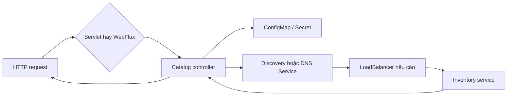
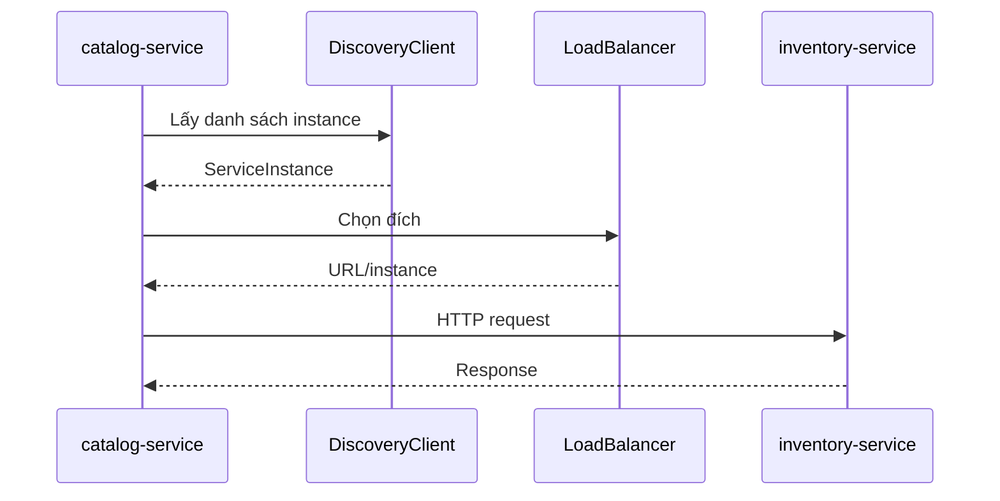
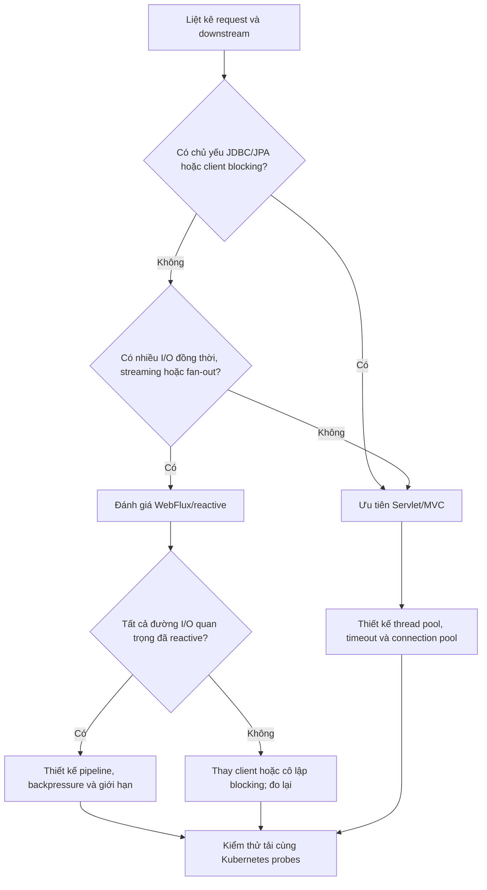

# Chọn mô hình Servlet hoặc reactive theo ứng dụng

Khi bắt đầu một dự án Spring chạy trên Kubernetes, việc chọn Servlet hay reactive ảnh hưởng tới cách ứng dụng xử lý request, gọi dịch vụ, đọc cấu hình, thực hiện health check và sử dụng tài nguyên CPU/memory. Đây là quyết định kiến trúc của ứng dụng, không phải một tùy chọn để đổi sau khi đã thêm vài dependency.

Bài học thuộc chương **Thiết lập dự án** của module **Spring Cloud Kubernetes** (`SPRING_CLOUD_KUBERNETES`). Module hướng tới việc tích hợp Spring với Kubernetes qua `DiscoveryClient`, ConfigMap, Secret, Spring Cloud LoadBalancer và Configuration Watcher; vì thế mô hình xử lý request phải phù hợp với các client và cách vận hành mà dự án thực sự cần.

Mục tiêu không phải chứng minh một mô hình luôn nhanh hơn mô hình kia. Mục tiêu là chọn đúng mô hình cho loại tải, cách gọi downstream, thư viện đang dùng, năng lực nhóm và yêu cầu quan sát. Một ứng dụng MVC dùng thread pool hợp lý có thể là lựa chọn tốt hơn một ứng dụng reactive nhưng vẫn gọi blocking ở mọi tầng. Ngược lại, một gateway có nhiều kết nối chờ I/O có thể hưởng lợi rõ ràng từ reactive.

## 1. Hai mô hình xử lý request

### Servlet/MVC: mỗi request gắn với một luồng trong thời gian xử lý

Mô hình Servlet truyền thống thường dùng Spring MVC với Tomcat hoặc Jetty. Request đi qua một thread của server, gọi controller, service và repository, rồi trả response. Khi thao tác downstream blocking, thread thường chờ kết quả.

```text
HTTP request
  → servlet thread
  → controller
  → client/repository blocking
  → response
```

Mô hình này dễ hiểu, phù hợp với hệ sinh thái JDBC, JPA, thư viện HTTP blocking và phần lớn ứng dụng CRUD. Thread pool, timeout và connection pool vẫn cần thiết; “blocking” không có nghĩa là không thể mở rộng.

### Reactive: request đi qua pipeline bất đồng bộ

Mô hình reactive thường dùng Spring WebFlux với Netty. Controller trả về `Mono<T>` hoặc `Flux<T>`, còn các thao tác I/O reactive đăng ký callback và giải phóng event-loop trong thời gian chờ.

```text
HTTP request
  → event loop
  → pipeline Mono/Flux
  → I/O bất đồng bộ
  → signal hoàn thành/lỗi
  → response
```

Reactive có thể sử dụng ít thread hơn cho nhiều kết nối chờ I/O, nhưng yêu cầu toàn bộ đường đi quan trọng phải tôn trọng mô hình bất đồng bộ. Nếu gọi JDBC blocking, `RestTemplate` blocking hoặc một Kubernetes client blocking ngay trên event-loop, lợi ích sẽ giảm và có thể gây nghẽn các request khác.

## 2. Bảng so sánh để chọn ban đầu

| Tiêu chí | Servlet/MVC | Reactive/WebFlux |
|---|---|---|
| Cách lập trình | Tuần tự, dễ đọc với nhiều nhóm | Pipeline bất đồng bộ, cần quen `Mono`/`Flux` |
| Thư viện blocking | Tích hợp tự nhiên | Cần cô lập trên scheduler phù hợp hoặc thay bằng client reactive |
| JDBC/JPA | Hỗ trợ trực tiếp | Không phải đường đi tự nhiên của event-loop |
| Nhiều kết nối chờ I/O | Cần quản lý thread pool và memory | Có thể hiệu quả với client I/O reactive |
| CPU nặng | Cần giới hạn thread pool | Vẫn phải tách khỏi event-loop; reactive không làm CPU nhanh hơn |
| Debug/stack trace | Thường trực quan | Cần hiểu signal, context và trace bất đồng bộ |
| Tích hợp Kubernetes | Phù hợp với client blocking | Phù hợp khi client và pipeline đều reactive |
| Lộ trình học | Dễ bắt đầu cho CRUD | Phù hợp khi bài toán có yêu cầu backpressure hoặc streaming |

Đừng chọn reactive chỉ vì Kubernetes là bất đồng bộ ở một vài API. Kubernetes không buộc ứng dụng Spring phải dùng WebFlux. Hãy bắt đầu từ đường đi request và các dependency mà dự án sẽ sử dụng.

## 3. Bốn câu hỏi trước khi tạo project

Trước khi chọn starter, hãy trả lời:

1. Ứng dụng chủ yếu làm CRUD với JDBC/JPA hay kết nối tới nhiều dịch vụ qua I/O bất đồng bộ?
2. Các client cần dùng có blocking, reactive hay cả hai?
3. Request có cần streaming, Server-Sent Events, WebSocket hoặc truyền dữ liệu lớn theo luồng không?
4. Nhóm có thể kiểm soát việc không gọi blocking trên event-loop và quan sát latency theo pipeline không?

Nếu câu trả lời chủ yếu là CRUD, JPA và client blocking, Servlet/MVC thường là điểm khởi đầu thực tế. Nếu ứng dụng là gateway, fan-out tới nhiều dịch vụ, có nhiều kết nối chờ I/O hoặc cần streaming, WebFlux đáng được đánh giá.

## 4. Mô hình ứng dụng Spring Cloud Kubernetes

Giả sử `catalog-service` có ba nhiệm vụ:

- đọc `ConfigMap` để lấy kích thước trang và cờ tính năng;
- đọc `Secret` để xác thực với dịch vụ tồn kho;
- gọi `inventory-service` rồi trả dữ liệu cho client.

Luồng dữ liệu cần xem xét:



Cùng một bài toán nghiệp vụ có thể chạy với hai mô hình. Khác biệt nằm ở cách controller, HTTP client, repository, scheduler và health endpoint phối hợp với nhau.

### Ứng dụng MVC

```java
@RestController
class CatalogController {
    private final InventoryClient inventoryClient;

    CatalogController(InventoryClient inventoryClient) {
        this.inventoryClient = inventoryClient;
    }

    @GetMapping("/catalog/{id}")
    CatalogView get(@PathVariable String id) {
        Inventory inventory = inventoryClient.findByProductId(id);
        return CatalogView.from(inventory);
    }
}
```

Trong ví dụ này, `InventoryClient` có thể dùng một HTTP client blocking. Cấu trúc tuần tự dễ đọc: lấy inventory, chuyển thành view, trả response. Cần đặt timeout và xử lý lỗi downstream để một dịch vụ chậm không giữ thread vô thời hạn.

### Ứng dụng WebFlux

```java
@RestController
class ReactiveCatalogController {
    private final ReactiveInventoryClient inventoryClient;

    ReactiveCatalogController(ReactiveInventoryClient inventoryClient) {
        this.inventoryClient = inventoryClient;
    }

    @GetMapping("/catalog/{id}")
    Mono<CatalogView> get(@PathVariable String id) {
        return inventoryClient.findByProductId(id)
                .map(CatalogView::from);
    }
}
```

`ReactiveInventoryClient` cần trả về `Mono` hoặc `Flux` và phải dùng client hỗ trợ bất đồng bộ. Chỉ đổi kiểu trả về của controller từ `CatalogView` sang `Mono<CatalogView>` nhưng vẫn gọi thư viện blocking không tạo ra pipeline reactive đúng.

## 5. Chọn dependency và runtime nhất quán

### Servlet/MVC

Một project MVC thường có web starter dựa trên Spring MVC và server Servlet. Nếu dùng Spring Cloud Kubernetes, hãy thêm đúng starter cho cấu hình, discovery hoặc load balancing mà bài toán cần. Không thêm cả nhóm starter chỉ để “phòng trường hợp cần”.

Đường đi khái quát:

```text
Spring MVC
  + HTTP client blocking
  + JDBC/JPA
  + Kubernetes integration blocking nếu cần
  → servlet thread pool
```

### Reactive/WebFlux

Một project reactive dùng WebFlux và runtime reactive phù hợp. HTTP client, repository và phần gọi dịch vụ nên cùng mô hình bất đồng bộ nếu muốn giữ lợi ích của event-loop.

```text
Spring WebFlux
  + WebClient hoặc client reactive
  + driver reactive nếu cần database
  + Kubernetes integration phù hợp
  → event loop + pipeline
```

Không nên trộn hai web stack chỉ vì một dependency transitively kéo vào starter khác. Hãy kiểm tra runtime thực tế và endpoint được expose. Một ứng dụng cần servlet filter, session hoặc thư viện Servlet đặc thù có thể chọn MVC rõ ràng hơn.

Tên starter và khả năng tương thích thay đổi theo bộ phiên bản Spring Boot/Spring Cloud/Spring Cloud Kubernetes của dự án. Khi tạo project, phải khóa BOM và kiểm tra ma trận tương thích của bộ phiên bản đang dùng; bài học này tập trung vào cách quyết định, không thay thế việc xác nhận dependency cụ thể.

## 6. ConfigMap và Secret trong hai mô hình

ConfigMap và Secret là nguồn dữ liệu Kubernetes, còn cách ứng dụng đọc chúng phụ thuộc cấu hình dự án.

### Nạp lúc khởi động

Nếu cấu hình chỉ cần khi khởi động, cả MVC và WebFlux có thể dùng ConfigMap/Secret dạng volume hoặc nguồn cấu hình được hỗ trợ:

```text
ConfigMap/Secret
  → file hoặc Kubernetes API
  → Spring Environment
  → bean cấu hình
  → controller/client
```

Mô hình xử lý request không tự quyết định cách ConfigMap đi vào `Environment`. Điều cần kiểm tra là nguồn được nạp trước khi bean cần giá trị được tạo, tên thuộc tính đúng, Secret không bị log và Pod có quyền tối thiểu nếu đọc API.

### Cập nhật lúc ứng dụng đang chạy

Nếu ConfigMap đổi sau khi Pod chạy, cần tách ba mốc:

1. Tài nguyên Kubernetes đã có giá trị mới.
2. Ứng dụng hoặc watcher đã phát hiện giá trị mới.
3. Bean/client đang phục vụ request đã sử dụng giá trị mới.

Trong MVC, một bean giữ giá trị đã bind trong constructor cũng không tự thay đổi. Trong WebFlux, việc đưa giá trị mới vào `Mono`/`Flux` cũng không tự thay đổi client đã được tạo. Reactive không giải quyết vòng đời cấu hình; vẫn cần refresh, tái tạo bean hoặc rollout theo chiến lược đã chọn.

### Secret và client kết nối

Nếu Secret chứa token cho `inventory-service`, hãy quyết định token được đọc một lần lúc khởi động hay đọc lại khi xoay vòng. Với MVC hay WebFlux, client giữ credential trong memory có thể cần được tạo lại hoặc dùng một provider tra cứu theo request. Không ghi token ra log để kiểm tra việc cập nhật.

## 7. DiscoveryClient và LoadBalancer trong MVC hoặc reactive

`DiscoveryClient` cung cấp thông tin dịch vụ. Spring Cloud LoadBalancer chọn instance theo cơ chế tích hợp. Hai thành phần có thể được dùng trong ứng dụng MVC hoặc reactive, nhưng client bên trên phải khớp mô hình.



Với MVC, một client blocking có thể thực hiện lời gọi theo kiểu tuần tự. Với WebFlux, hãy dùng client reactive và để pipeline tiếp tục khi response đến. Nếu danh sách discovery được lấy blocking trên event-loop, cần cô lập lời gọi bằng scheduler phù hợp hoặc chọn API reactive.

Một điểm cần phân biệt:

| Lựa chọn | Đường tìm dịch vụ | Khi phù hợp |
|---|---|---|
| DNS của Kubernetes | Client gọi tên Service | Chỉ cần một địa chỉ ổn định trong cluster |
| `DiscoveryClient` | Ứng dụng đọc dữ liệu cluster | Cần danh sách instance hoặc bộ lọc |
| Discovery + LoadBalancer | Ứng dụng vừa khám phá vừa chọn đích | Cần chọn phía client |
| Gateway/mesh | Hạ tầng xử lý routing | Quy tắc routing nằm ngoài bean nghiệp vụ |

Nếu DNS Service đã đáp ứng yêu cầu, không cần thêm discovery chỉ vì ứng dụng dùng WebFlux. Nếu cần discovery, quyền RBAC, cache, timeout và hành vi khi API server tạm thời không truy cập được phải được thiết kế riêng.

## 8. Blocking trong ứng dụng reactive là vấn đề ở đâu?

WebFlux sử dụng event-loop cho nhiều công việc điều phối. Event-loop không nên bị giữ bởi thao tác chờ lâu như JDBC blocking, file I/O blocking, gọi HTTP blocking hoặc Kubernetes client blocking.

Ví dụ không phù hợp:

```java
@GetMapping("/catalog/{id}")
Mono<CatalogView> get(String id) {
    Inventory result = blockingClient.findByProductId(id); // chặn event-loop
    return Mono.just(CatalogView.from(result));
}
```

Nếu chưa thể thay client blocking, có thể cô lập nó trên scheduler phù hợp:

```java
@GetMapping("/catalog/{id}")
Mono<CatalogView> get(String id) {
    return Mono.fromCallable(() -> blockingClient.findByProductId(id))
            .subscribeOn(Schedulers.boundedElastic())
            .map(CatalogView::from);
}
```

Đây là cách giảm tác động lên event-loop, không biến client thành non-blocking. Cần giới hạn concurrency, timeout và theo dõi queue của scheduler. Nếu thao tác blocking là đường đi chính, MVC có thể là lựa chọn đơn giản và dễ dự đoán hơn.

Không gọi `block()` trong controller reactive để biến pipeline thành code tuần tự:

```java
// Tránh trong request path reactive
Inventory inventory = reactiveClient.findByProductId(id).block();
```

`block()` có thể làm hỏng lợi ích của mô hình và gây deadlock hoặc thiếu thread tùy ngữ cảnh. Hãy truyền pipeline bằng `flatMap`, `map`, `zip` và các toán tử phù hợp.

## 9. Backpressure, fan-out và giới hạn tài nguyên

Reactive thường được nhắc đến cùng backpressure: downstream có thể báo lượng dữ liệu mà nó xử lý được. Điều này hữu ích khi stream nhiều phần tử, nhưng không tự bảo vệ ứng dụng khỏi việc tạo quá nhiều request downstream.

Ví dụ một request lấy thông tin từ nhiều sản phẩm:

```java
Flux<Inventory> loadAll(Flux<String> productIds) {
    return productIds
            .flatMap(inventoryClient::findByProductId, 16);
}
```

Giới hạn `16` là ví dụ về concurrency; giá trị thực tế phụ thuộc latency, connection pool, giới hạn của `inventory-service` và SLO. `flatMap` không giới hạn có thể tạo fan-out lớn, làm nghẽn cả client lẫn server.

Ở MVC, giới hạn tương ứng có thể nằm ở thread pool, queue, semaphore hoặc batch. Hai mô hình đều cần giới hạn:

- số kết nối tới downstream;
- số request đồng thời;
- kích thước response và buffer;
- thời gian chờ;
- retry và backoff;
- mức tải tối đa mỗi Pod.

Reactive giúp biểu đạt và phối hợp I/O tốt hơn trong một số tải, nhưng không thay thế rate limit, circuit breaker, timeout hay capacity planning.

## 10. Health endpoint và probe

Kubernetes cần biết Pod có khởi động xong và sẵn sàng nhận lưu lượng chưa. Cả MVC và WebFlux đều có thể expose health endpoint, nhưng cách kiểm tra endpoint phải khớp runtime và cổng thực tế.

```yaml
startupProbe:
  httpGet:
    path: /actuator/health/liveness
    port: 8080
  failureThreshold: 30
  periodSeconds: 10
readinessProbe:
  httpGet:
    path: /actuator/health/readiness
    port: 8080
  periodSeconds: 10
livenessProbe:
  httpGet:
    path: /actuator/health/liveness
    port: 8080
  periodSeconds: 20
```

Đây là manifest minh họa. Endpoint phải được bảo vệ và expose theo chính sách của dự án. Không đưa một dependency chậm vào liveness nếu restart không giải quyết được nguyên nhân. Readiness thường phù hợp hơn khi một dependency tạm thời làm Pod chưa thể phục vụ request.

Health check cũng phải tôn trọng mô hình xử lý. Một health indicator reactive không nên gọi blocking trên event-loop. Một health check MVC có thể gọi client blocking nhưng vẫn cần timeout ngắn để không giữ thread probe quá lâu.

## 11. Timeout, retry và lỗi downstream

`inventory-service` có thể chậm hoặc tạm thời không sẵn sàng. Cách xử lý cần nhất quán với mô hình:

### Trong MVC

Đặt timeout cho HTTP client blocking và giới hạn thread pool. Nếu retry, cần tránh giữ quá nhiều thread trong thời gian chờ. Có thể dùng circuit breaker để ngắt sớm khi downstream liên tục lỗi.

### Trong WebFlux

Đặt timeout trên pipeline và dùng toán tử retry có giới hạn:

```java
Mono<Inventory> find(String id) {
    return webClient.get()
            .uri("/inventory/{id}", id)
            .retrieve()
            .bodyToMono(Inventory.class)
            .timeout(Duration.ofSeconds(2))
            .retryWhen(Retry.backoff(2, Duration.ofMillis(100)));
}
```

Đây là ví dụ khung; chỉ retry lỗi có thể phục hồi và cần tính idempotency. Retry có thể khuếch đại tải khi cả cluster đang quá tải. Reactive không có nghĩa là timeout không cần thiết.

## 12. Chọn mô hình qua các kịch bản

### Kịch bản A: CRUD nội bộ với JPA

`catalog-service` nhận HTTP request, đọc PostgreSQL bằng JPA và gọi một dịch vụ nhỏ bằng client blocking. Nhóm đã quen Spring MVC và không có nhu cầu streaming.

Lựa chọn hợp lý để bắt đầu là Servlet/MVC. Sự đơn giản trong transaction, thread dump, debug và thư viện JPA thường quan trọng hơn việc ép pipeline reactive vào mọi tầng.

### Kịch bản B: API gateway fan-out

Gateway nhận nhiều kết nối đồng thời, gọi nhiều dịch vụ qua HTTP, hợp nhất response và thường phải chờ I/O hơn là chạy CPU. Các client đều hỗ trợ reactive.

WebFlux đáng được đánh giá. Cần thiết kế giới hạn fan-out, timeout, backpressure, connection pool và quan sát event-loop. Nếu một downstream chỉ có client blocking, hãy thay client hoặc cô lập có kiểm soát.

### Kịch bản C: streaming dữ liệu

Ứng dụng trả Server-Sent Events hoặc stream nhiều bản ghi, cần giữ nhiều kết nối mở. Reactive phù hợp hơn khi cả nguồn dữ liệu và response đều có thể stream. Servlet vẫn có thể hỗ trợ một số dạng streaming, nhưng cách quản lý thread và buffer phải được đo đạc.

### Kịch bản D: client Kubernetes blocking là đường chính

Ứng dụng thường xuyên đọc API Kubernetes bằng client blocking, còn request chủ yếu là CRUD. Chọn WebFlux vẫn có thể làm được, nhưng chi phí cô lập blocking và vận hành pipeline phải được chứng minh. MVC có thể giảm độ phức tạp nếu không có yêu cầu reactive rõ ràng.

## 13. Quan sát và kiểm thử theo mô hình

Không đánh giá Servlet hay reactive chỉ bằng một benchmark đơn lẻ. Hãy đo tải giống thực tế:

| Nhóm quan sát | Servlet/MVC | Reactive/WebFlux |
|---|---|---|
| Latency p95/p99 | Chờ thread, pool và downstream | Queue event-loop, pipeline và downstream |
| CPU | Thread context switch và serialization | Event-loop, operator và serialization |
| Memory | Thread stack, request và buffer | Buffer, queue, context và pipeline |
| Tắc nghẽn | Thread pool, connection pool | Event-loop, scheduler, connection pool |
| Lỗi | Thread dump, log request | Signal error, context, trace bất đồng bộ |
| Kubernetes | Readiness, rollout, resource limit | Thêm kiểm tra event-loop và scheduler |

Kiểm thử nên bao gồm:

- downstream trả lời nhanh, chậm và timeout;
- DNS Service đúng tên, sai namespace và không có endpoint;
- `targetPort` sai hoặc ứng dụng bind sai interface;
- ConfigMap đổi trong lúc Pod chạy;
- Secret xoay vòng;
- API Kubernetes trả `Forbidden` hoặc tạm thời không truy cập được;
- readiness chuyển từ ready sang not ready;
- số replica thay đổi trong rollout.

Với WebFlux, kiểm tra event-loop không bị blocking bằng công cụ quan sát phù hợp. Với MVC, quan sát thread pool và thread bị giữ lâu. Cả hai cần trace correlation để nối request ngoài với lời gọi tới `inventory-service`.

## 14. Những lỗi chuyển đổi thường gặp

### Chỉ đổi starter nhưng giữ client blocking

Ứng dụng có thể khởi động được dưới WebFlux nhưng vẫn chặn event-loop. Hãy lập danh sách tất cả điểm I/O và xác định client tương ứng.

### Dùng `block()` để né kiểu reactive

Điều này làm pipeline mất ý nghĩa và có thể tạo nghẽn. Nếu nhóm chưa sẵn sàng với reactive, chọn MVC có thể là quyết định rõ ràng hơn.

### Nghĩ reactive tự cân bằng tải

Reactive là mô hình xử lý bất đồng bộ. Discovery và load balancing vẫn là các tính năng riêng. Có thể dùng WebFlux với DNS Service, hoặc dùng discovery với client phù hợp; hai khái niệm không đồng nhất.

### Dùng retry không giới hạn

Retry trong MVC hay WebFlux đều có thể làm một sự cố nhỏ thành bão request. Luôn giới hạn số lần, backoff, timeout và kiểm tra idempotency.

### Cấu hình probe sai cổng

WebFlux có thể chạy trên cổng khác MVC hoặc ứng dụng có thể dùng cổng cấu hình ngoài. Hãy đối chiếu server port, Service `targetPort` và probe trước khi kết luận Pod không khỏe.

### Bật quá nhiều Spring Cloud Kubernetes module

Một ứng dụng gọi Service qua DNS không nhất thiết cần DiscoveryClient. Một ứng dụng chỉ đọc ConfigMap mount file không nhất thiết cần API configuration client. Mỗi starter kéo thêm cấu hình, quyền, cache và bề mặt vận hành.

## 15. Quy trình quyết định thực tế

Có thể dùng quy trình sau khi tạo project:



Sau khi chọn, ghi lại quyết định trong tài liệu dự án:

- web runtime và server;
- database driver và HTTP client;
- cách đọc ConfigMap/Secret;
- DNS hay `DiscoveryClient`;
- LoadBalancer có được bật không;
- thao tác blocking được phép ở đâu;
- timeout, retry, circuit breaker và giới hạn concurrency;
- readiness/liveness/startup probe;
- metric cần theo dõi.

Quyết định này giúp các dependency mới không âm thầm phá vỡ mô hình đã chọn.

## 16. Kết luận thực hành

Servlet/MVC và reactive đều là lựa chọn hợp lệ cho ứng dụng Spring trên Kubernetes. MVC thường phù hợp với CRUD, JPA và hệ sinh thái blocking quen thuộc. WebFlux đáng cân nhắc cho nhiều kết nối chờ I/O, streaming hoặc fan-out khi toàn bộ đường đi có thể hoạt động bất đồng bộ.

Spring Cloud Kubernetes không yêu cầu một mô hình duy nhất. `ConfigMap`, `Secret`, DNS Service, `DiscoveryClient`, Spring Cloud LoadBalancer và Configuration Watcher cần được ghép vào mô hình request theo nhu cầu cụ thể. Điều quyết định chất lượng triển khai là sự nhất quán giữa runtime, client, RBAC, timeout, probe và cách cập nhật bean.

Hãy chọn mô hình mà nhóm có thể giải thích, đo lường và vận hành. Nếu vẫn chưa có yêu cầu reactive rõ ràng, bắt đầu bằng đường đi đơn giản, đặt giới hạn và quan sát tải thực tế. Nếu bài toán vốn là nhiều I/O đồng thời hoặc streaming, hãy đầu tư reactive từ đầu và giữ event-loop không bị blocking.
