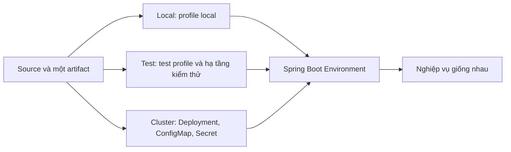

# Tổ chức cấu hình local, kiểm thử và chạy trong cluster

## 1. Cùng một ứng dụng, ba bối cảnh chạy

Ứng dụng Spring trong module `SPRING_CLOUD_KUBERNETES` thường chạy qua ba bối cảnh: local trên máy phát triển, môi trường kiểm thử tự động hoặc namespace dùng cho integration test, và cluster nơi workload được triển khai thật. Mục tiêu không phải làm ba bản ứng dụng khác nhau, mà là giữ một artifact và thay đổi nguồn cấu hình, dependency hạ tầng cùng cách kết nối theo từng môi trường.

Spring Boot cung cấp profile và externalized configuration. Kubernetes cung cấp namespace, Service, ConfigMap, Secret, ServiceAccount và Pod lifecycle. Spring Cloud Kubernetes có thể nối ứng dụng với discovery, ConfigMap, Secret, LoadBalancer hoặc Configuration Watcher khi nhu cầu yêu cầu. Không nên để logic nghiệp vụ biết mình đang chạy local hay trong cluster.



Khác biệt giữa môi trường nên được biểu diễn bằng cấu hình và hạ tầng được kiểm soát. Nếu local cần URL database riêng, đặt URL đó trong nguồn local. Nếu cluster cần DNS Service, đưa DNS vào ConfigMap hoặc biến môi trường. Nếu integration test cần Kubernetes thật, tạo namespace và tài nguyên test riêng thay vì đọc nhầm tài nguyên production.

## 2. Quy tắc cấu hình nền

Spring Boot có thể nhận cấu hình từ nhiều nguồn: file trong artifact, profile, biến môi trường, tham số command line và các nguồn tích hợp khác. Khi nhiều nguồn cùng chứa một key, thứ tự ưu tiên quyết định giá trị hiệu lực. Vì vậy, cần biết key đến từ đâu trước khi sửa một giá trị đang chạy sai.

Nên tách cấu hình thành ba nhóm:

| Nhóm | Ví dụ | Cách quản lý |
| --- | --- | --- |
| Mặc định an toàn | Timeout hợp lý, cổng mặc định, feature tắt | File cấu hình version control |
| Theo môi trường | URL Service, log level, tên profile | Profile, ConfigMap hoặc biến môi trường |
| Nhạy cảm | Password, token, private key | Secret hoặc secret store, không commit vào source |

File mặc định có thể chứa giá trị an toàn cho local:

```yaml
spring:
  application:
    name: order-service
  profiles:
    default: local
server:
  port: 8080
management:
  endpoints:
    web:
      exposure:
        include: health,info
```

Không đặt password thật hoặc token Kubernetes vào file này. Tên ứng dụng nên ổn định giữa các môi trường để log, metrics và discovery có thể nhận diện cùng một service.

## 3. Dùng profile mà không nhân bản ứng dụng

Profile có thể chọn cấu hình phù hợp bối cảnh:

```yaml
# application-local.yml
spring:
  config:
    activate:
      on-profile: local
inventory:
  base-url: http://localhost:18081
logging:
  level:
    root: INFO
```

```yaml
# application-cluster.yml
spring:
  config:
    activate:
      on-profile: cluster
inventory:
  base-url: http://inventory-service:8080
logging:
  level:
    root: INFO
```

Profile `local` có thể dùng URL localhost hoặc container port được expose. Profile `cluster` dùng DNS Service trong namespace. Cùng một bean HTTP client đọc `inventory.base-url`; code nghiệp vụ không cần if-else theo tên môi trường.

Trong Deployment, profile có thể được chọn qua biến môi trường:

```yaml
env:
  - name: SPRING_PROFILES_ACTIVE
    value: cluster
```

Hoặc dùng ConfigMap nếu giá trị cần được quản lý ngoài image. Cần quy ước một nguồn chính để tránh tình trạng file nói `local` nhưng biến môi trường ép sang `cluster` mà người vận hành không nhận ra.

Không nên đặt `spring.profiles.active` cứng trong image production nếu Deployment cần quyết định profile. Ngược lại, nếu mọi Pod trong một workload phải có cùng profile, khai báo tại Deployment hoặc ConfigMap giúp cấu hình có thể quan sát.

## 4. Cấu hình cluster qua ConfigMap và Secret

ConfigMap phù hợp cho dữ liệu không nhạy cảm; Secret dùng cho dữ liệu cần bảo vệ. Một Deployment có thể đưa key vào biến môi trường:

```yaml
apiVersion: v1
kind: ConfigMap
metadata:
  name: order-settings
  namespace: orders-test
data:
  SPRING_PROFILES_ACTIVE: cluster
  INVENTORY_BASE_URL: http://inventory-service:8080
---
apiVersion: apps/v1
kind: Deployment
metadata:
  name: order-service
  namespace: orders-test
spec:
  template:
    spec:
      containers:
        - name: order-service
          image: registry.example.invalid/team/order-service:replace-me
          envFrom:
            - configMapRef:
                name: order-settings
```

Secret có thể được tham chiếu tương tự:

```yaml
env:
  - name: SPRING_DATASOURCE_PASSWORD
    valueFrom:
      secretKeyRef:
        name: order-database
        key: password
```

Biến môi trường thường được đọc khi container khởi động. Đổi ConfigMap hoặc Secret không tự đổi biến môi trường trong tiến trình đang chạy. Nếu muốn nhận giá trị mới, cần rollout Pod hoặc dùng một cơ chế đọc lại và refresh đã được thiết kế, kiểm thử.

Base64 trong manifest không phải mã hóa đầy đủ. Secret vẫn cần RBAC tối thiểu, quản lý lưu trữ và quy trình không log dữ liệu nhạy cảm. ServiceAccount của ứng dụng chỉ nên có quyền cần thiết cho ConfigMap, Secret hoặc discovery mà nó thực sự sử dụng.

## 5. Cấu hình ngoài cluster cho local

Local không nhất thiết phải truy cập Kubernetes API. Nếu mục tiêu chỉ là phát triển nghiệp vụ, dùng profile local với dependency giả lập hoặc container phụ trợ có thể nhanh và ổn định hơn.

Ví dụ local dùng URL rõ ràng:

```yaml
# application-local.yml
inventory:
  base-url: http://localhost:18081
spring:
  datasource:
    url: jdbc:postgresql://localhost:15432/orders
    username: orders_local
```

Credentials local nên lấy từ biến môi trường, file ngoài source hoặc secret manager dành cho máy phát triển. Không sao chép Secret production về máy cá nhân chỉ để làm local run.

Nếu local cần mô phỏng discovery, có thể dùng một registry giả lập hoặc cấu hình URL cố định. Chỉ thêm Spring Cloud Kubernetes discovery vào đường chạy local khi mục tiêu là kiểm thử chính integration đó và môi trường local có Kubernetes API phù hợp.

## 6. Kiểm thử theo tầng

Không phải mọi test đều cần khởi động Kubernetes. Chia test theo mục tiêu giúp phản hồi nhanh và lỗi dễ định vị:

| Tầng test | Kiểm tra | Hạ tầng cần có |
| --- | --- | --- |
| Unit test | Logic thuần, mapper, policy, validation | Không cần cluster |
| Slice test | Một phần Spring context, web hoặc data | Hạ tầng tối thiểu hoặc mock |
| Application test | Boot context, binding và health | Có thể dùng dependency giả lập |
| Integration test | HTTP, database, message broker, config | Container phụ trợ hoặc môi trường test |
| Kubernetes integration | Service, RBAC, ConfigMap, Secret, rollout | Cluster test và namespace riêng |
| Smoke test cluster | Artifact thật sau deploy | Deployment và endpoint test |

Unit test không nên phụ thuộc DNS Kubernetes. Kubernetes integration test mới kiểm tra selector, ServiceAccount, Role, ConfigMap, Secret và hành vi Pod. Nếu một test cần API server nhưng được gắn nhãn như unit test, pipeline sẽ chậm và dễ thất bại do môi trường không phù hợp.

## 7. Kiểm tra binding cấu hình

Với thuộc tính nghiệp vụ, dùng `@ConfigurationProperties` để có kiểu dữ liệu và kiểm tra binding rõ ràng:

```java
@ConfigurationProperties(prefix = "orders")
public record OrderProperties(int maxItems, Duration timeout) {
}
```

Test có thể nạp profile test và xác minh giá trị:

```java
@SpringBootTest
@ActiveProfiles("test")
class OrderPropertiesTest {
    // Xác minh binding và validation của orders.*
}
```

Trong bài viết, đoạn test là khung minh họa. Dự án cần đăng ký `@ConfigurationProperties` bằng cơ chế phù hợp như scan hoặc enable configuration properties. Nếu key không bind được, lỗi nên xuất hiện lúc khởi động thay vì âm thầm dùng giá trị sai.

Profile test nên dùng database, URL và credentials riêng. Không để test tự động đọc `application-local.yml` rồi vô tình gọi dependency đang chạy trên máy developer.

## 8. Kiểm thử HTTP và dependency

Ở tầng application test, có thể kiểm tra controller, validation và error mapping mà không cần Kubernetes. Ở tầng integration, gọi dependency bằng URL do test cung cấp hoặc dùng container phụ trợ. Điều cần xác minh là timeout, retry, lỗi 4xx/5xx và trạng thái degraded, không chỉ đường thành công.

Ví dụ cấu hình timeout theo profile:

```yaml
# application-test.yml
inventory:
  base-url: http://inventory-test
  connect-timeout: 500ms
  read-timeout: 2s
```

```yaml
# application-cluster.yml
inventory:
  base-url: http://inventory-service:8080
  connect-timeout: 1s
  read-timeout: 3s
```

URL khác nhau giữa test và cluster không nên làm thay đổi contract của client. Test nên kiểm tra rằng khi dependency chậm hoặc mất, ứng dụng trả phản hồi phù hợp và không giữ thread vô hạn.

## 9. Kubernetes integration test trong namespace riêng

Khi cần kiểm tra sự tích hợp thật với Kubernetes, dùng namespace dành riêng cho test, ví dụ `orders-it-<run-id>`. Tài nguyên test cần có tên hoặc label để truy vết và dọn dẹp:

```yaml
apiVersion: v1
kind: Namespace
metadata:
  name: orders-it-example
  labels:
    environment: test
    purpose: integration
    owner: commerce-platform
```

Không chạy test bằng namespace production. RoleBinding, Secret và ConfigMap test phải nằm trong phạm vi test. Nếu test cần quyền cluster, ghi rõ lý do và giảm quyền ngay sau khi thiết kế được cách namespaced.

Fixture test cần tạo theo thứ tự hợp lý: namespace, ServiceAccount/RBAC, ConfigMap/Secret, Deployment, Service, rồi chờ Pod ready. Khi test kết thúc, dọn tài nguyên theo label hoặc namespace riêng. Dọn dở dang làm các run sau dùng nhầm Pod hoặc Secret cũ.

## 10. Kiểm thử RBAC và ServiceAccount

Ứng dụng Spring Cloud Kubernetes có thể cần đọc Service, ConfigMap hoặc Secret. Test tích hợp nên kiểm tra quyền đúng thao tác thay vì chỉ kiểm tra Pod có token:

```text
kubectl auth can-i get configmap/order-settings \
  --as=system:serviceaccount:orders-it-example:order-service \
  -n orders-it-example
```

Quyền `get` một resource cụ thể khác với `list` mọi resource. Discovery có thể cần quyền `get`, `list` hoặc `watch` tùy implementation và cách cấu hình. Cấp quyền rộng hơn để test chạy xanh sẽ che lỗi thiết kế và làm production risk tăng.

Test nên bao gồm trường hợp quyền bị thiếu nếu ứng dụng cần xử lý lỗi rõ ràng. Một Pod có thể Running nhưng startup hoặc discovery thất bại vì API trả `403 Forbidden`. Log cần nêu loại tài nguyên và namespace, không in token hoặc Secret.

## 11. Chạy image thật trong cluster

Local run và test JVM không chứng minh image production chạy đúng. Image thật có thể khác JDK, filesystem, user, certificate store, entrypoint hoặc biến môi trường. Smoke test cluster nên dùng chính image được pipeline phát hành.

```yaml
containers:
  - name: order-service
    image: registry.example.invalid/team/order-service:1.4.0
    ports:
      - name: http
        containerPort: 8080
    readinessProbe:
      httpGet:
        path: /actuator/health/readiness
        port: http
    livenessProbe:
      httpGet:
        path: /actuator/health/liveness
        port: http
```

Smoke test cần chờ readiness trước khi gọi endpoint nghiệp vụ. `Running` chỉ cho biết container đang chạy; `Ready` mới là tín hiệu Pod được coi là có thể nhận traffic theo probe.

## 12. Local, test và cluster không nên khác contract

Giữ cùng tên thuộc tính giúp code không phân nhánh theo môi trường:

```yaml
orders:
  max-items: 20
inventory:
  base-url: http://inventory-service:8080
```

Local có thể thay `inventory.base-url` thành localhost; test có thể trỏ tới container hoặc mock server; cluster dùng Service DNS. Bean và controller vẫn đọc `inventory.base-url` như nhau.

Không nên tạo `if (environment == production)` trong nghiệp vụ để đổi cách tính hoặc bỏ validation. Nếu hành vi thực sự cần khác, biểu diễn bằng policy hoặc feature flag có tên, mặc định an toàn và được test trong từng profile.

## 13. Discovery và URL cố định

Trước khi thêm DiscoveryClient, hỏi liệu Service DNS đã đáp ứng chưa. Ứng dụng có thể gọi `http://inventory-service:8080` mà không cần đọc Kubernetes API. Cách này giảm dependency, RBAC và điểm lỗi.

DiscoveryClient và Spring Cloud LoadBalancer phù hợp khi ứng dụng cần abstraction discovery, chọn instance phía client hoặc chính sách lựa chọn riêng. Khi chọn integration này, test cần kiểm tra namespace, quyền, instance không sẵn sàng, timeout và hành vi khi API server tạm thời không truy cập được.

Local không cần giả lập toàn bộ Kubernetes API nếu test chỉ kiểm tra nghiệp vụ gọi inventory. Ngược lại, Kubernetes integration test phải chứng minh discovery thật nếu đó là tính năng cần phát hành.

## 14. Configuration Watcher và thay đổi lúc chạy

Nếu ConfigMap đổi, ứng dụng chỉ nhận giá trị mới khi đường phân phối và cơ chế nạp lại hỗ trợ điều đó. Biến môi trường hiện có không tự đổi. Volume có thể cập nhật file theo cơ chế của Kubernetes, nhưng ứng dụng vẫn phải đọc lại.

Configuration Watcher có thể phát hiện thay đổi và kích hoạt thông báo hoặc refresh theo kiến trúc đã chọn. Test cần xác minh ba bước:

1. Tài nguyên thay đổi được phát hiện.
2. Ứng dụng nhận sự kiện hoặc nguồn cấu hình mới.
3. Bean và trạng thái nội bộ thực sự dùng giá trị mới.

Không coi event watcher thành công là bằng chứng mọi request đã dùng cấu hình mới. Với connection pool, cache hoặc credential, có thể cần khởi tạo lại tài nguyên. Nếu refresh khó chứng minh an toàn, rollout Pod là phương án dễ quan sát hơn.

## 15. Kiểm soát thứ tự cấu hình

Khi cùng một key xuất hiện trong file, profile, biến môi trường và ConfigMap, cần biết nguồn nào có ưu tiên cao hơn. Một cách thực tế là ghi bảng nguồn cấu hình:

| Key | Local | Test | Cluster | Chủ sở hữu |
| --- | --- | --- | --- | --- |
| `spring.application.name` | File mặc định | File mặc định | File mặc định | Source |
| `inventory.base-url` | Profile local | Profile test | ConfigMap/env | Deploy config |
| `orders.max-items` | Test fixture | ConfigMap test | ConfigMap cluster | Product config |
| `db.password` | Env local | Secret test | Secret cluster | Secret manager |

Không sửa file mặc định để chữa một giá trị cluster đang sai nếu giá trị đó thuộc Deployment hoặc ConfigMap. Xác định nguồn hiệu lực trước, sau đó sửa đúng chủ sở hữu.

## 16. CI pipeline và artifact

Pipeline nên tách các bước kiểm tra nhanh khỏi test cần cluster:

```text
compile và unit test
        ↓
application test và dependency test
        ↓
build image một lần
        ↓
deploy image vào namespace test
        ↓
Kubernetes integration và smoke test
        ↓
publish hoặc promote cùng artifact
```

Build image một lần rồi promote digest giúp test và production dùng cùng binary. Nếu mỗi môi trường build lại source, lỗi có thể do artifact khác chứ không phải do cluster.

Thông tin build như commit, image digest và profile dự kiến nên xuất hiện trong metadata hoặc log an toàn. Không đưa token vào annotation hoặc log. Nếu pipeline truyền Secret, dùng cơ chế secret của CI và tránh ghi command line chứa giá trị nhạy cảm.

## 17. Chẩn đoán theo lớp

| Hiện tượng | Kiểm tra trước |
| --- | --- |
| Local chạy, cluster không khởi động | JDK image, profile, env, Secret, RBAC và log startup |
| Pod Running nhưng không Ready | Endpoint Actuator, cổng, readiness và dependency |
| App dùng URL local trong cluster | Profile active, ConfigMap, biến môi trường và thứ tự nguồn |
| Discovery trả rỗng | Namespace, quyền API, selector và implementation |
| ConfigMap đổi nhưng bean không đổi | Đường phân phối, watcher, refresh scope và cache |
| Integration test thất thường | Namespace dùng chung, fixture cũ, readiness và cleanup |
| Test cần quyền admin | Thiết kế fixture và Role đang quá rộng hoặc chưa đúng |

Đừng thêm Spring Cloud Kubernetes để chữa lỗi image, selector, probe hoặc DNS. Đừng tăng quyền RBAC để chữa lỗi key ConfigMap. Xác định lớp chịu trách nhiệm giúp thay đổi nhỏ hơn và dễ rollback.

## 18. Tự kiểm tra

### Có cần một file cấu hình khác nhau cho mỗi môi trường không?

Có thể có profile file khác nhau, nhưng nên giữ cùng tên thuộc tính và contract. Artifact và code nghiệp vụ nên dùng chung; chỉ thay nguồn giá trị hoặc hạ tầng cần thiết.

### Local có bắt buộc chạy Kubernetes không?

Không. Local có thể dùng profile, dependency giả lập hoặc container phụ trợ. Chỉ cần Kubernetes local khi mục tiêu là kiểm thử tích hợp Kubernetes.

### Pod Running có nghĩa smoke test được chưa?

Chưa. Cần chờ readiness và kiểm tra endpoint nghiệp vụ. Container có thể Running nhưng ứng dụng chưa bind cổng, chưa kết nối dependency hoặc readiness đang thất bại.

### ConfigMap đổi có làm biến môi trường đổi không?

Không với container đang chạy. Biến môi trường thường được nạp khi process khởi động; cần rollout hoặc cơ chế refresh khác.

### Khi nào test cần Spring Cloud Kubernetes thật?

Khi tính năng cần phát hành phụ thuộc discovery, đọc ConfigMap/Secret qua Kubernetes API, LoadBalancer tích hợp hoặc Configuration Watcher. Unit và application test không cần khởi động API server cho các tính năng không được kiểm tra.

### Vì sao phải dùng namespace riêng cho integration test?

Để tránh test đọc hoặc sửa tài nguyên của môi trường khác, đồng thời giúp cleanup, RBAC và chẩn đoán có phạm vi rõ ràng.

## Kết luận

Tổ chức cấu hình local, kiểm thử và chạy trong cluster hiệu quả khi một artifact đi qua nhiều môi trường bằng các nguồn cấu hình và hạ tầng được kiểm soát. Spring Boot quản lý profile và binding; Kubernetes quản lý namespace, Service, ConfigMap, Secret, ServiceAccount và Pod; Spring Cloud Kubernetes chỉ được thêm khi yêu cầu tích hợp cần đến nó.

Giữ contract thuộc tính ổn định, phân tầng test, dùng namespace test riêng, kiểm tra RBAC tối thiểu và smoke test image thật. Khi cấu hình hoặc discovery lỗi, chẩn đoán theo đường đi từ nguồn cấu hình tới bean, từ Deployment tới Pod Ready và từ Service tới dependency. Cách này giúp local nhanh, test đáng tin và rollout cluster có thể quan sát.

