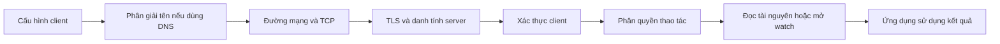

# Ứng dụng không kết nối được Kubernetes API

Trong chương **Chẩn đoán sự cố** của **SPRING_CLOUD_KUBERNETES**, bài học này hướng dẫn tìm nguyên nhân ứng dụng Spring không truy cập được Kubernetes API. Mục tiêu là xác định tầng lỗi bằng bằng chứng từ đúng tiến trình hoặc Pod, rồi sửa đúng cấu hình, đường mạng, chứng chỉ, danh tính hoặc quyền truy cập.

Thông báo “không kết nối được” thường gộp nhiều tình huống khác nhau. Không phân giải được hostname, không thiết lập được TCP, TLS thất bại, token bị từ chối và RBAC không cho phép đọc tài nguyên cần những cách xử lý khác nhau.

Sau bài học, bạn có thể:

- Phân loại lỗi trước khi đổi cấu hình hoặc quyền.
- Kiểm tra endpoint, CA và ServiceAccount của đúng workload.
- Thực hiện một request chẩn đoán không in token hay dữ liệu Secret.
- Phân biệt thành công của công cụ kiểm tra với thành công của Kubernetes client trong ứng dụng.
- Xác minh khôi phục ở đúng thao tác DiscoveryClient, ConfigMap, Secret hoặc Configuration Watcher đang cần dùng.

## 1. Xác định lỗi dừng ở tầng nào

Đường truy cập thông thường:



Các tầng có thể chịu tác động của proxy hoặc service mesh. Dùng sơ đồ để chọn phép kiểm tra tiếp theo, không coi mọi lỗi là vấn đề socket.

| Dấu hiệu | Nhánh điều tra đầu tiên |
| --- | --- |
| `UnknownHostException`, không phân giải được tên | Hostname hiệu lực, DNS và search domain |
| `Connection refused` | Địa chỉ/cổng, endpoint có lắng nghe, proxy hoặc đường chuyển tiếp |
| Connect timeout | Route, NetworkPolicy, firewall, CNI, proxy hoặc control plane |
| Read timeout sau khi kết nối | Thao tác API, proxy, quá tải hoặc timeout của client |
| `SSLHandshakeException`, `PKIX path building failed` | Chuỗi tin cậy, CA và cấu hình TLS thực tế |
| Hostname/SAN không khớp | Host/IP trong URL và danh tính trên chứng chỉ |
| HTTP 401 từ Kubernetes API | Credential thiếu, không hợp lệ, hết hạn hoặc audience không phù hợp |
| HTTP 403 với danh tính đã xác định | Quyền trên verb, API group, resource và namespace |
| HTTP 404 | Đường dẫn, loại tài nguyên, API version hoặc đối tượng không tồn tại |
| HTTP 429 hoặc 5xx | Đã có phản hồi HTTP; điều tra giới hạn tải, server hoặc tầng trung gian |

Một mã HTTP chỉ có ý nghĩa khi biết bên nào trả nó. Proxy doanh nghiệp, gateway hoặc mesh có thể trả 403/502 trước khi request tới API server. Đối chiếu endpoint, peer, certificate và phản hồi đã che dữ liệu để nhận diện đúng bên trả lời.

HTTP 403 cũng không tự chứng minh token của ServiceAccount đã được chấp nhận: request không có credential có thể bị xử lý như danh tính anonymous. Cần xác định danh tính trong lỗi có cấu trúc hoặc audit được phép truy cập.

## 2. Tìm đúng thành phần đang gọi API

Spring Cloud Kubernetes hỗ trợ các implementation discovery sử dụng Fabric8, Kubernetes Java Client và HTTP DiscoveryClient. Với nhánh HTTP, ứng dụng có thể gọi DiscoveryServer, còn DiscoveryServer mới là thành phần gọi Kubernetes API. [DiscoveryClient for Kubernetes](https://docs.spring.io/spring-cloud-kubernetes/reference/discovery-client.html).

Ví dụ:

```text
Nhánh trực tiếp:
orders → Kubernetes client trong orders → Kubernetes API

Nhánh discovery qua HTTP:
orders → DiscoveryServer → Kubernetes API

Nhánh cấu hình qua volume:
Kubernetes/kubelet → file mount → orders

Nhánh cập nhật cấu hình:
Configuration Watcher → Kubernetes API
Configuration Watcher → đường refresh của orders
```

Với nhánh HTTP, thêm RBAC cho ServiceAccount của `orders` không chữa được lỗi quyền của DiscoveryServer. Với watcher, cần phân biệt watcher không đọc được API với watcher đọc được API nhưng không gửi được refresh tới ứng dụng.

Bắt đầu bằng ba câu hỏi:

1. Thành phần nào thực hiện request thất bại?
2. Nó chạy trong Pod, máy phát triển hay hệ thống ngoài cluster?
3. Tính năng đang dùng có thực sự cần truy cập Kubernetes API từ thành phần đó không?

Ứng dụng chỉ đọc Secret/ConfigMap được mount và gọi Service bằng DNS có thể không cần Kubernetes client riêng. Không thêm token hoặc quyền API chỉ để làm mất một lỗi do tính năng không cần thiết được bật.

Ghi đúng phiên bản Spring Boot, Spring Cloud, Spring Cloud Kubernetes và client phụ thuộc. Một lỗi `NoSuchMethodError` hoặc auto-configuration không tạo được client cần được điều tra ở dependency/cấu hình; chưa có bằng chứng để sửa mạng.

## 3. Thu bằng chứng tối thiểu từ workload

Ví dụ thực hành dùng namespace `api-lab`, ứng dụng `orders` và container cùng tên. Chỉ chạy các lệnh với workload thuộc phạm vi được giao.

Trên máy vận hành có kubectl, chọn Pod cụ thể:

```powershell
$ns = 'api-lab'
$podsJson = kubectl -n $ns get pods -l app=orders -o json
if ($LASTEXITCODE -ne 0) {
    throw 'Không đọc được danh sách Pod'
}

$pods = $podsJson | ConvertFrom-Json
$selectedPod = $pods.items |
    Where-Object { -not $_.metadata.deletionTimestamp } |
    Select-Object -First 1

if ($null -eq $selectedPod) {
    throw 'Không có Pod phù hợp'
}

$podName = $selectedPod.metadata.name

[pscustomobject]@{
    Namespace = $ns
    Pod = $podName
    UID = $selectedPod.metadata.uid
    Node = $selectedPod.spec.nodeName
    ServiceAccount = $selectedPod.spec.serviceAccountName
    PodAutomountSetting = $selectedPod.spec.automountServiceAccountToken
}

$selectedPod.spec.containers | Select-Object name, image
```

`PodAutomountSetting` không được đặt không đồng nghĩa chắc chắn token đang có: cần xem ServiceAccount, admission, volume và mount thực tế của container.

Hồ sơ ban đầu nên có:

```text
Thời điểm lỗi và lần hoạt động cuối:
Namespace / Pod UID / container / node:
Image và phiên bản client:
Tính năng thất bại:
Host, port và path đã che thông tin nhạy cảm:
Lớp exception sâu nhất:
HTTP status nếu có:
ServiceAccount và phạm vi tài nguyên cần đọc:
Thay đổi gần nhất về image, policy, token, CA, proxy hoặc cluster:
```

Không thu bằng cách dump toàn bộ environment, kubeconfig, Java system properties hoặc HTTP header. Các nguồn đó có thể chứa token, mật khẩu proxy và khóa riêng.

Cần đọc cause chain, không dừng ở `BeanCreationException`. Ví dụ:

```text
BeanCreationException
  → lỗi tạo nguồn cấu hình
  → lỗi request Kubernetes client
  → SSLHandshakeException
  → lỗi xác minh chuỗi chứng chỉ
```

Đường lỗi này chỉ hướng tới TLS; tăng quyền RBAC chưa giải quyết tầng đang thất bại.

## 4. Kiểm tra endpoint và nguồn cấu hình client

### 4.1. Client đang dùng URL nào?

Xác định scheme, hostname/IP, port và base path hiệu lực. Đặc biệt kiểm tra các trường hợp:

- URL trỏ `localhost` bên trong container.
- Địa chỉ cluster cũ được giữ trong image hoặc cấu hình triển khai.
- Kubeconfig của máy phát triển bị mount vào workload.
- Tham số JVM hoặc biến môi trường ghi đè cấu hình dự kiến.
- Client đi qua proxy ngoài ý muốn.
- Ứng dụng ngoài cluster đang dùng địa chỉ chỉ có ý nghĩa trong cluster.

`localhost` của Pod không phải API server. Cổng 8080 hoặc 443 chỉ có ý nghĩa theo endpoint thực tế; không thay cổng theo phỏng đoán.

Với Fabric8, tài liệu mô tả thứ tự nguồn cấu hình gồm system properties, environment, kubeconfig rồi dữ liệu ServiceAccount/CA được mount. Các biến như `KUBERNETES_MASTER` thuộc cấu hình Fabric8; cần đối chiếu đúng phiên bản và cách ứng dụng tạo client. [Cấu hình Fabric8 Kubernetes Client](https://github.com/fabric8io/kubernetes-client#configuring-the-client).

Kubernetes Java Client có logic dựng client riêng, trong đó có đường in-cluster. Không giả định mọi biến cấu hình Fabric8 sẽ điều khiển implementation khác. [ClientBuilder của Kubernetes Java Client](https://github.com/kubernetes-client/java/blob/master/util/src/main/java/io/kubernetes/client/util/ClientBuilder.java).

Khi code tự truyền cấu hình vào builder, phải kiểm tra cấu hình được truyền đó. Một thứ tự auto-configuration trong tài liệu không bảo đảm code tùy chỉnh đang dùng nó.

### 4.2. Trong Pod và ngoài cluster là hai môi trường khác nhau

Trong Pod, Kubernetes cung cấp địa chỉ API qua các biến dịch vụ và dữ liệu ServiceAccount tại vị trí đã mount. Địa chỉ DNS `kubernetes.default.svc` cũng thường dùng để tìm Service API.

Tuy nhiên, tài liệu Kubernetes lưu ý không bảo đảm mọi cluster có certificate hợp lệ cho hostname DNS này; endpoint phải khớp danh tính server được cấu hình. [Truy cập API từ Pod](https://kubernetes.io/docs/tasks/run-application/access-api-from-pod/).

Ở máy phát triển, kiểm tra endpoint được công bố, VPN/private network, CA và cơ chế đăng nhập tương ứng. Địa chỉ ClusterIP hoặc tên `.svc` không mặc nhiên truy cập được từ laptop.

Không sao chép token của Pod ra máy cá nhân để biến một vấn đề đường mạng thành một luồng credential khó quản lý. Với truy cập ngoài cluster, dùng danh tính và kubeconfig theo cơ chế đã cấp của môi trường.

### 4.3. Chỉ ghi thông tin cấu hình đã chọn

Nếu thêm log chẩn đoán trong ứng dụng, chỉ cho phép các trường như client implementation, endpoint đã loại credential/query nhạy cảm, namespace, đường dẫn CA và loại nguồn credential.

Đường dẫn CA hoặc token giúp xác định cấu hình; nội dung token, key, kubeconfig và URL chứa user/password không được ghi vào log.

## 5. Thực hiện một request chẩn đoán từ đúng container

### 5.1. Chọn ngữ cảnh kiểm tra

Ưu tiên kiểm tra từ container ứng dụng nếu đã có công cụ phù hợp. Một debug container có thể chia sẻ mạng với Pod nhưng không có cùng environment, mount, CA hoặc credential. Một debug Pod mới còn có thể khác label, ServiceAccount, node và policy áp dụng.

Nếu image không có shell hoặc curl, đó là thiếu công cụ chẩn đoán, không phải bằng chứng API lỗi. Dùng công cụ được phê duyệt và ghi rõ phần ngữ cảnh nào giống hoặc khác ứng dụng; không cài tùy tiện vào container đang phục vụ.

Lệnh mở shell minh họa:

```powershell
kubectl -n $ns exec -it $podName -c orders -- sh
```

Các lệnh ở bước tiếp theo chạy trong shell Linux của container, không phải trong PowerShell.

### 5.2. Kiểm tra khả năng đọc file mà không in credential

```sh
sa_dir=/var/run/secrets/kubernetes.io/serviceaccount

test -r "$sa_dir/token" && test -s "$sa_dir/token" &&
  printf 'token_file=readable_nonempty\n'

test -r "$sa_dir/ca.crt" && test -s "$sa_dir/ca.crt" &&
  printf 'ca_file=readable_nonempty\n'
```

Đây là vị trí thông thường. Nếu workload dùng projected volume hoặc cấu hình client ở đường dẫn riêng, kiểm tra đường dẫn thật mà client đọc.

File tồn tại chưa chứng minh token còn hiệu lực hoặc CA đúng. Nó chỉ loại được một nhóm lỗi mount, đường dẫn và permission.

### 5.3. Gửi GET tới một tài nguyên không bí mật đã biết

Điều kiện của phép thử: có ConfigMap `orders` trong `api-lab`, client dự kiến đọc được nó và container có curl hỗ trợ đọc header qua stdin.

Đoạn lệnh dưới không in token, không đặt token vào đối số curl và bỏ phần body phản hồi:

```sh
set +x
set -u

sa_dir=/var/run/secrets/kubernetes.io/serviceaccount
api_host=${KUBERNETES_SERVICE_HOST:-}
api_port=${KUBERNETES_SERVICE_PORT_HTTPS:-443}

if [ -z "$api_host" ]; then
  printf 'missing_api_host\n' >&2
  exit 1
fi

if [ ! -r "$sa_dir/token" ] || [ ! -s "$sa_dir/token" ]; then
  printf 'token_file_unavailable\n' >&2
  exit 1
fi

if [ ! -r "$sa_dir/ca.crt" ] || [ ! -s "$sa_dir/ca.crt" ]; then
  printf 'ca_file_unavailable\n' >&2
  exit 1
fi

case "$api_host" in
  *:*) api_host="[$api_host]" ;;
esac

api_url="https://$api_host:$api_port"
resource_path=/api/v1/namespaces/api-lab/configmaps/orders

{
  printf 'Authorization: Bearer '
  tr -d '\r\n' < "$sa_dir/token"
  printf '\n'
} | curl --disable \
    --silent --show-error \
    --cacert "$sa_dir/ca.crt" \
    --header @- \
    --connect-timeout 3 \
    --max-time 10 \
    --output /dev/null \
    --write-out 'http=%{http_code} peer=%{remote_ip} dns=%{time_namelookup} tcp=%{time_connect} tls=%{time_appconnect} total=%{time_total}\n' \
    "$api_url$resource_path"

probe_rc=$?
printf 'curl_exit=%s\n' "$probe_rc"
```

Các mức timeout là lựa chọn của bài thực hành. Không bật shell tracing, curl verbose hoặc trace khi đang truyền Authorization.

Curl hỗ trợ `--header @-` để nhận header từ stdin, cùng các chỉ số thời gian và mã phản hồi qua `--write-out`. Kiểm tra phiên bản curl trong công cụ thực hành nếu một tùy chọn không được hỗ trợ. [Tài liệu curl](https://curl.se/docs/manpage.html).

Script dùng endpoint in-cluster từ biến dịch vụ, không chứng minh Kubernetes client Java đang dùng cùng endpoint. Nó cũng vẫn có thể chịu cấu hình proxy qua environment; so sánh với đường thực tế của ứng dụng.

### 5.4. Diễn giải kết quả mà không kết luận quá mức

- `http=200` cho request này là bằng chứng request GET đã thành công với ngữ cảnh thử.
- `http=403` đưa điều tra sang danh tính và quyền, hoặc bên trung gian trả lỗi.
- `http=401` cần kiểm tra credential và cơ chế xác thực.
- `http=404` cần kiểm tra namespace, tên đối tượng và path; chưa phải thành công nghiệp vụ.
- `http=000` thường chưa có phản hồi HTTP cuối cùng; đọc lỗi stderr và `curl_exit`.

Không có `--fail` trong ví dụ, nên curl có thể thoát 0 khi server trả 401 hoặc 403. Phải lưu cả mã curl và mã HTTP.

Các mốc thời gian là thời gian tích lũy từ đầu transfer. Nếu đi qua proxy, peer hoặc mốc TCP có thể thuộc kết nối tới proxy. Nếu dùng địa chỉ IP, thời gian DNS thấp không chứng minh DNS của hostname mà Java client đang dùng hoạt động.

Một GET thành công không chứng minh đã được quyền LIST/WATCH, không chứng minh Secret đọc được và không chứng minh luồng cập nhật hoạt động lâu dài.

## 6. Nếu lỗi ở DNS, TCP hoặc đường mạng

### 6.1. DNS chỉ liên quan khi request dùng hostname

Kiểm tra hostname thật của client. Trong container có công cụ tương ứng:

```sh
cat /etc/resolv.conf
getent hosts kubernetes.default.svc
```

Nếu không có getent, dùng công cụ phân giải tên đã được phê duyệt. Nếu client dùng hostname riêng, phải thử hostname đó; phân giải được `kubernetes.default.svc` chưa chứng minh hostname khác hoạt động.

Đối chiếu nameserver, search domain, `dnsPolicy` và `dnsConfig` của Pod. Cluster domain không bắt buộc phải là `cluster.local`; không ghép tên dài theo một giá trị mặc định chưa kiểm chứng. [Chẩn đoán DNS trong Kubernetes](https://kubernetes.io/docs/tasks/administer-cluster/dns-debugging-resolution/).

Nếu probe bằng IP thành công còn client dùng hostname báo UnknownHost, ưu tiên nhánh DNS. Nếu client vốn dùng IP, một lỗi CoreDNS quan sát được có thể là vấn đề riêng, chưa chắc là nguyên nhân request đó thất bại.

### 6.2. Đường mạng phải đi từ đúng Pod tới đúng đích

Từ máy vận hành:

```powershell
kubectl -n $ns get networkpolicy
kubectl -n default get service kubernetes -o wide
```

Đọc policy chọn Pod theo label, các điều kiện egress, port và đích thực tế. API Service có thể công bố một cổng rồi chuyển tiếp tới cổng control plane khác; điều tra đường Service và endpoint theo môi trường.

Không có một manifest allow-list IP/cổng dùng đúng cho mọi cluster. Cách áp dụng policy trước hoặc sau việc viết lại địa chỉ phụ thuộc triển khai mạng/Service. [NetworkPolicy và việc viết lại địa chỉ](https://kubernetes.io/docs/concepts/services-networking/network-policies/#behavior-of-to-and-from-selectors).

Các điểm cần đối chiếu:

- Egress của Pod ứng dụng có bị giới hạn không?
- Nếu dùng DNS, đường tới dịch vụ DNS có được phép không?
- Firewall, security group hoặc mạng private của control plane có cho phép đường truy cập đó không?
- CNI, kube-proxy hoặc cơ chế thay thế có chuyển tiếp Service đúng không?
- Service mesh có chặn egress, yêu cầu quy tắc đích hoặc can thiệp TLS không?
- Lỗi có chỉ xuất hiện trên một node hoặc một nhóm Pod không?

Một policy chỉ cho phép cổng nghiệp vụ 8080 không tự cho phép gọi API trên đường HTTPS. Ngược lại, mở API không sửa được DNS nếu Pod vẫn không được gửi truy vấn tên.

So sánh Pod cùng workload trên các node khác nhau có thể giúp khoanh vùng. Ghi đúng UID, node và thời điểm; một Pod đã bị thay thế không phải cùng đối tượng quan sát.

### 6.3. Proxy và NO_PROXY

Kiểm tra proxy ở môi trường tiến trình, cấu hình JVM và HTTP client thực tế. Đừng in toàn bộ giá trị proxy nếu URL chứa credential.

Nếu request nội bộ đi qua proxy ngoài cluster, có thể nhận timeout, lỗi CONNECT, HTTP 407 hoặc certificate của proxy. Đó không phải cùng đường với request trực tiếp.

Chọn các mục bypass đúng hostname/IP và định dạng mà client hỗ trợ. Một số client không xử lý CIDR hoặc wildcard giống nhau; cấu hình Java `http.nonProxyHosts` cũng không có cùng cú pháp với mọi biến `NO_PROXY`.

Sau sửa, chứng minh request đi theo đường dự kiến. Không dùng `NO_PROXY=*` trên toàn ứng dụng làm cách chữa chung, vì nó thay đổi cả những kết nối khác cần proxy.

## 7. Nếu lỗi ở TLS

TLS phải xác minh được danh tính API server trước khi token được dùng cho thao tác Kubernetes. Một lỗi trust hoặc SAN không được chữa bằng cách cấp thêm quyền.

| Lỗi | Cần đối chiếu |
| --- | --- |
| Không tìm thấy hoặc không đọc được CA file | Mount, đường dẫn cấu hình và user chạy tiến trình |
| Không xây được chuỗi tin cậy | Đúng CA của cluster, intermediate và cấu hình trust của client |
| Hostname/SAN không khớp | Host/IP trong URL và certificate mà đích trình bày |
| Certificate hết hạn hoặc chưa có hiệu lực | Thời gian máy, hạn certificate và quy trình thay cert |
| TLS handshake bị ngắt | Proxy/mesh, giao thức, cipher, certificate và phía server |
| Curl có `--cacert` chạy được nhưng Java PKIX lỗi | CA có thực sự được Java client đang dùng nạp hay không |

Có thể kiểm tra khả năng parse CA bằng công cụ đã có, không cần đọc token:

```sh
openssl x509 -in /var/run/secrets/kubernetes.io/serviceaccount/ca.crt -noout -subject -issuer -dates
```

Lệnh chỉ kiểm tra certificate trong file, chưa chứng minh server đang dùng đúng chuỗi đó. Một bundle có nhiều certificate cũng cần được đánh giá đầy đủ theo cấu hình.

Trong Java, không đồng nhất truststore mặc định của JVM với CA được cấu hình riêng cho Kubernetes client. HTTP client được khởi tạo bằng code tùy chỉnh có thể không dùng file CA mà bạn vừa kiểm tra bằng curl.

Không dùng `trustCerts=true`, tắt hostname verification hoặc curl `-k` làm cấu hình khôi phục. Các thay đổi đó bỏ qua bước xác minh cần thiết và có thể làm một đường sai trông như hoạt động.

Nếu endpoint đã đổi hoặc CA cluster được thay, sửa nguồn cấu hình đúng và xác minh lại sau rollout hoặc tái tạo client theo cơ chế ứng dụng. Đừng chỉ thêm một certificate bất kỳ nhìn thấy trên đường proxy vào truststore để dập lỗi.

## 8. Nếu lỗi ở xác thực ServiceAccount

### 8.1. Kiểm tra danh tính và mount

ServiceAccount của Pod phải đúng với chủ thể đã được cấp quyền. Không chỉ đọc ServiceAccount trong manifest gốc; kiểm tra Pod đang chạy.

Ví dụ PowerShell tiếp nối phần inventory:

```powershell
$saName = $selectedPod.spec.serviceAccountName
kubectl -n $ns get serviceaccount $saName -o "custom-columns=NAME:.metadata.name,AUTOMOUNT:.automountServiceAccountToken"
```

Xem cả cài đặt trên Pod, ServiceAccount và mount thực tế của container. Một volume được khai báo nhưng không mount vào container ứng dụng chưa cung cấp credential cho tiến trình đó.

Nếu `automountServiceAccountToken=false` là chủ ý và ứng dụng không cần gọi API, giải pháp có thể là bỏ tính năng gọi API không cần thiết. Nếu ứng dụng cần API, cấp đúng projected token/mount và đường dẫn client theo thiết kế; không tự động mở rộng mọi workload.

### 8.2. Token tồn tại vẫn có thể không dùng được

Các nguyên nhân HTTP 401 cần xem:

- Client không gửi token hoặc đọc nhầm file.
- Token đã hết hạn.
- Token được cấp cho audience khác, chẳng hạn một dịch vụ ngoài Kubernetes.
- Issuer hoặc cấu hình xác minh không phù hợp.
- Token ràng buộc với Pod/đối tượng không còn hợp lệ.
- Thời gian hệ thống sai.
- Một giá trị token tĩnh ghi đè đường đọc token được xoay vòng.

Projected ServiceAccount token có thời hạn và được kubelet xoay vòng trước khi hết hạn. Ứng dụng cần dùng cơ chế credential tương thích với việc cập nhật đó. [ServiceAccount và token projection](https://kubernetes.io/docs/concepts/security/service-accounts/).

Không chữa lỗi rotation bằng cách tạo token quản trị không hết hạn. Cũng không gửi JWT tới website giải mã hoặc đưa token vào ticket để nhờ phân tích. Khi cần xem claim, xử lý tại môi trường được phép và chỉ chia sẻ kết luận đã che dữ liệu.

### 8.3. Lúc khởi động chạy được, sau một thời gian báo 401

Đây là mẫu lỗi đáng chú ý:

```text
Token trên volume đã được thay
    nhưng client vẫn giữ chuỗi token cũ
    hoặc một override tĩnh vẫn được ưu tiên
    → request sau đó bị từ chối
```

Kiểm tra credential provider thực tế, đường dẫn file và code khởi tạo client. Không kết luận thư viện “không hỗ trợ rotation” chỉ từ tên dependency; đường dựng client và phiên bản cụ thể mới quyết định hành vi.

Nếu restart giúp chạy lại một thời gian, đó là bằng chứng hỗ trợ giả thuyết về trạng thái hoặc credential cache, chưa phải một giải pháp lâu dài. Sau sửa, kiểm tra qua chu kỳ xoay token theo điều kiện môi trường hoặc bằng phép thử có kiểm soát.

## 9. Nếu đã tới API nhưng bị từ chối quyền

### 9.1. Kiểm tra đúng bốn chiều

Quyền cần khớp:

```text
Danh tính:  system:serviceaccount:api-lab:orders
Verb:      get / list / watch ...
API group: "" hoặc discovery.k8s.io ...
Resource:  configmaps / services / endpointslices ...
Phạm vi:   namespace cụ thể hoặc cluster
```

Một GET ConfigMap theo tên có thể thành công nhưng lần LIST ban đầu của informer bị 403. Một Role trong `api-lab` có thể không đáp ứng client được cấu hình LIST trên tất cả namespace.

Bảng tham khảo theo chức năng:

| Chức năng thực tế | Resource cần kiểm tra |
| --- | --- |
| Đọc ConfigMap bằng API | `configmaps`, core API group |
| Đọc Secret bằng API | `secrets`, core API group; chỉ khi chủ ý bật đường đọc này |
| Discovery | `services` cùng `endpoints` hoặc `endpointslices` theo implementation |
| EndpointSlice | API group `discovery.k8s.io`, không phải core group |
| Đọc health/metadata từ Pod | Chỉ kiểm tra/cấp `pods` nếu tính năng thực sự yêu cầu |
| Watcher hoặc leader election | Kiểm tra riêng theo controller và tính năng đang bật |

Chọn verb theo request thật. Không dùng bảng này để cấp tất cả quyền cho mọi ứng dụng.

### 9.2. Xác minh quyền bằng impersonation khi được phép

Tài khoản vận hành cần có quyền impersonate để chạy các ví dụ:

```powershell
kubectl auth can-i get configmap/orders -n api-lab --as=system:serviceaccount:api-lab:orders
kubectl auth can-i list configmaps -n api-lab --as=system:serviceaccount:api-lab:orders
kubectl auth can-i watch configmaps -n api-lab --as=system:serviceaccount:api-lab:orders

kubectl auth can-i list endpointslices.discovery.k8s.io -n api-lab --as=system:serviceaccount:api-lab:orders
```

Nếu hệ thống cấp quyền dựa trên group, việc giả lập cần phản ánh cả group phù hợp và có quyền impersonate tương ứng. Kết quả `can-i` là bằng chứng bổ sung về authorization, không chứng minh đường mạng của Pod hoặc token thực tế hợp lệ.

### 9.3. Ví dụ quyền chỉ cho luồng ConfigMap của bài

Manifest dưới dành cho client cần GET/LIST/WATCH ConfigMap trong `api-lab`; không phải bộ quyền đầy đủ cho discovery hay theo dõi Secret.

```yaml
apiVersion: v1
kind: ServiceAccount
metadata:
  name: orders
  namespace: api-lab
---
apiVersion: rbac.authorization.k8s.io/v1
kind: Role
metadata:
  name: orders-config-reader
  namespace: api-lab
rules:
  - apiGroups: [""]
    resources: ["configmaps"]
    verbs: ["get", "list", "watch"]
---
apiVersion: rbac.authorization.k8s.io/v1
kind: RoleBinding
metadata:
  name: orders-config-reader
  namespace: api-lab
subjects:
  - kind: ServiceAccount
    name: orders
    namespace: api-lab
roleRef:
  apiGroup: rbac.authorization.k8s.io
  kind: Role
  name: orders-config-reader
```

Workload phải thực sự chọn `serviceAccountName: orders`. RoleBinding tới một ServiceAccount đúng tên ở namespace khác không gán quyền cho danh tính của bài.

RBAC dùng các đối tượng Role/ClusterRole và binding để xác định quyền. Nếu giới hạn LIST/WATCH bằng `resourceNames`, request còn phải có field selector phù hợp; không giả định mọi informer tự gửi selector đó. [Kubernetes RBAC](https://kubernetes.io/docs/reference/access-authn-authz/rbac/).

Nếu nhu cầu chỉ ở một namespace, ưu tiên khớp cấu hình client với phạm vi đó. Không đổi thành ClusterRoleBinding quyền rộng chỉ để che một lựa chọn all-namespaces ngoài ý muốn.

Quyền `list` hoặc `watch` trên Secret có thể lộ dữ liệu bí mật cho chủ thể được cấp. Không gộp Secret vào Role ConfigMap vì tiện sửa lỗi.

## 10. Curl thành công nhưng ứng dụng Java vẫn lỗi

Đây là một kết quả có ích: nó thu hẹp điều tra nhưng không loại được mọi khác biệt.

| So sánh | Vì sao có thể khác |
| --- | --- |
| URL của curl và client | Override, kubeconfig, DNS hoặc base path khác |
| Nguồn CA | Curl được truyền `--cacert`, Java client có thể dùng cấu hình khác |
| Credential | Curl đọc token mới từ file, client có thể giữ token tĩnh |
| Proxy | Curl và HTTP client Java có cách lấy cấu hình hoặc bypass khác nhau |
| Danh tính | Shell chạy trong container khác hoặc dùng file khác |
| Namespace và resource | Probe GET một ConfigMap, ứng dụng LIST Service/EndpointSlice ở phạm vi khác |
| Thời gian | Request ngắn thành công, watch bị proxy đóng sau idle timeout |
| Cấu hình client | Bean do Spring tạo khác với client tự dựng trong đoạn test |
| Giao thức/connection pool | TLS, HTTP/2, pool cũ hoặc cấu hình transport khác |

Trình tự tiếp theo:

1. Đối chiếu cấu hình hiệu lực đã che credential.
2. Dùng chính client bean hoặc đường gọi của tính năng đang lỗi để thực hiện một thao tác nhỏ phù hợp.
3. Ghi loại request, namespace, status và cause chain.
4. Kiểm tra request duy trì hoặc watch nếu tính năng cần nó.
5. Xác minh trạng thái của ứng dụng sau thao tác.

Không tạo một client mới bằng cấu hình khác rồi dùng thành công của nó để tuyên bố client đang chạy đã được sửa. Không đóng client bean dùng chung chỉ để kết thúc một phép kiểm tra ngắn.

Thành công của kubectl trên máy quản trị còn ít tương đồng hơn: nó có thể dùng credential quản trị, endpoint ngoài cluster và đường VPN khác. `kubectl proxy` cũng dùng danh tính của chính proxy; nó không kiểm tra trực tiếp token ServiceAccount mà ứng dụng đang dùng.

## 11. Khôi phục có giới hạn và kiểm tra sau sửa

### 11.1. Retry không thay thế sửa nguyên nhân

Dùng backoff, jitter và giới hạn tốc độ cho lỗi tạm thời. Đối với 429, tôn trọng hướng dẫn chờ của server nếu có. Ghi loại lỗi với số lượng nhãn metric có giới hạn để nhận ra vòng thử lại quá dày.

Không retry nóng cùng credential đã bị từ chối hoặc cùng request sai phạm vi. Nếu lỗi cần thay đổi quyền hoặc cấu hình, báo trạng thái cần can thiệp và kiểm tra lại có kiểm soát.

Phân biệt:

- Connect timeout: chưa hoàn tất kết nối theo ngân sách.
- Read timeout: có thể đã kết nối nhưng không nhận dữ liệu đúng hạn.
- Watch kết thúc theo thời lượng được yêu cầu: có thể là hành vi bình thường.
- Watch bị gián đoạn sớm hoặc lặp liên tục: điều tra mạng, proxy, server và client.
- `410 Gone` khi tiếp tục watch: mốc lịch sử không còn được phục vụ; cần xử lý dựng lại nền theo hợp đồng LIST–WATCH, không gọi đó là lỗi TLS hoặc DNS.

Không tăng mọi timeout để làm lỗi ít xuất hiện. Cần biết thao tác nào cần nhanh, thao tác nào là stream dài và tầng trung gian giới hạn thời gian ra sao.

### 11.2. Điều kiện khôi phục ở tính năng thật

Sau mỗi thay đổi, xác minh lại tối thiểu:

1. Đúng Pod và đúng danh tính đang dùng endpoint dự kiến.
2. TLS xác minh đầy đủ, không có cấu hình bỏ qua kiểm tra.
3. Thao tác GET/LIST/WATCH cần thiết hoạt động trong đúng phạm vi.
4. Tính năng Spring sử dụng được kết quả, không chỉ log hết lỗi.
5. Lỗi không trở lại khi client phải mở kết nối mới hoặc credential được xoay vòng.

Các ví dụ kiểm tra đầu cuối:

| Tính năng | Bằng chứng cần thêm sau khi API truy cập được |
| --- | --- |
| DiscoveryClient | Lấy được tập instance mong muốn theo namespace/selector |
| Spring Cloud LoadBalancer | Request thực tế chọn và gọi được instance hợp lệ |
| ConfigMap qua API | Ứng dụng đọc và áp dụng giá trị thử không nhạy cảm |
| Secret qua API | Tài nguyên sử dụng credential xác thực được; không in Secret |
| Configuration Watcher | Controller quan sát thay đổi và ứng dụng đích nhận, áp dụng cập nhật |
| Health/metadata Pod | Dữ liệu được lấy bởi đúng client với phạm vi cần thiết |

API đọc được Service không chứng minh đường dữ liệu từ ứng dụng tới Pod đích hoạt động. Lỗi gọi một service nghiệp vụ sau discovery có thể thuộc một đường mạng khác.

Nếu cấu hình API là bắt buộc khi khởi động, chọn hành vi fail-fast hoặc chờ có giới hạn theo yêu cầu triển khai. Nếu đã có bản dữ liệu hợp lệ, quyết định tiếp tục phục vụ trong ngân sách stale cần được đặt rõ. Không dùng việc liveness liên tục restart mọi replica như cơ chế chữa sự cố API dùng chung.

## 12. Thực hành bằng các tình huống phân biệt

### 12.1. Chuẩn bị môi trường thử

Dùng cluster và namespace riêng, một ứng dụng Spring đã có tính năng đọc ConfigMap qua client được xác định, và quyền vận hành phù hợp.

Nếu namespace và ConfigMap thử chưa tồn tại, người thực hành có thể chuẩn bị:

```powershell
kubectl create namespace api-lab
kubectl -n api-lab create configmap orders --from-literal=demo.message=hello
```

Không chạy các lệnh tạo lại nếu tài nguyên đã có hoặc do controller khác quản lý. Triển khai ứng dụng thử bằng image của bài thực hành, ServiceAccount `orders` và Role phù hợp. Manifest ứng dụng phụ thuộc image và phiên bản đã chọn, không được thay bằng image của một công cụ kiểm tra rồi coi là cùng môi trường.

Với mỗi tình huống, giữ baseline đã hoạt động, thay một yếu tố trên bản thử, thu bằng chứng rồi hoàn tác theo nguồn triển khai. Không thử phá certificate, quyền hoặc policy trên workload đang phục vụ ngoài phạm vi.

### 12.2. Tình huống A: endpoint bị ghi đè

Bằng chứng:

```text
Ứng dụng: Connection refused tới 127.0.0.1:8080
Probe từ cùng container tới endpoint in-cluster: GET ConfigMap thành công
ServiceAccount và quyền GET: phù hợp
```

Giả thuyết ưu tiên là client Java chọn endpoint khác. Kiểm tra override, kubeconfig, fallback hoặc code builder thay vì sửa RBAC.

Sau sửa, xác nhận URL hiệu lực của client ứng dụng trùng đường đã chọn và tính năng thực đọc được ConfigMap. Không kết luận chỉ từ việc một biến môi trường đã được xóa; có thể còn nguồn ưu tiên cao hơn.

### 12.3. Tình huống B: GET được nhưng LIST bị 403

Bằng chứng:

```text
GET /api/v1/namespaces/api-lab/configmaps/orders: 200
Client khởi tạo informer: LIST configmaps bị 403
can-i get: yes
can-i list: no
```

Đường mạng và TLS đã hoạt động cho request thành công. Thiếu quyền LIST là giả thuyết phù hợp với dấu hiệu, miễn là request bị từ chối đến từ đúng danh tính và scope đã đối chiếu.

Sửa Role theo nhu cầu thực hoặc thay cách đọc nguồn nếu thiết kế chỉ cần GET. Nếu tính năng cần watch, kiểm tra cả WATCH. Không cấp cluster-admin để làm cả ba phép kiểm tra thành công.

Sau sửa, thực hiện một thay đổi ConfigMap thử và xác minh client/ứng dụng nhận được cập nhật theo cơ chế đã cấu hình.

### 12.4. Tình huống C: curl được, Java báo PKIX

Bằng chứng:

```text
Curl dùng CA mount: thành công
Java Kubernetes client: PKIX path building failed
Không có phản hồi HTTP của thao tác Java
```

Kiểm tra CA thực tế mà client Java nạp và code tạo HTTP client. Có thể file đúng đang mount nhưng cấu hình không được áp dụng vào bean dùng thật.

Sửa trust theo danh tính cluster dự kiến. Phép kiểm tra đạt phải là Java client hoạt động khi xác minh TLS vẫn bật, không phải sau khi bật trust-all.

### 12.5. Tình huống D: restart chỉ chữa được tạm thời

Bằng chứng:

```text
Khởi động: đọc ConfigMap thành công
Sau một khoảng thời gian: request trả 401
Token projected vẫn tồn tại và được cập nhật
Restart: lại chạy được trong một khoảng thời gian
```

Kiểm tra cơ chế đọc lại token, override tĩnh và vòng đời client. Không dùng lịch restart như kết luận cuối.

Sau sửa, quan sát qua sự kiện rotation có kiểm soát hoặc chu kỳ credential phù hợp với môi trường. Xác nhận chính client đang hoạt động tiếp tục gọi API mà không cần khởi động lại để đọc token mới.

### 12.6. Tình huống E: debug Pod được, ứng dụng timeout

Bằng chứng:

```text
Debug Pod trong api-lab truy cập API được
Pod orders bị connect timeout
Hai Pod khác label, node hoặc trạng thái mesh
```

Kết quả chưa loại được NetworkPolicy hoặc đường node của ứng dụng. Đối chiếu label selector, egress, DNS, proxy và mesh của workload thật.

Phép thử tốt hơn giữ ngữ cảnh mạng sát ứng dụng và ghi rõ khác biệt về credential/mount. Không lấy thành công của debug Pod làm lý do loại bỏ toàn bộ nhánh mạng.

## 13. Runbook chẩn đoán và báo cáo kết quả

Một thứ tự xử lý thực dụng:

1. Xác định tiến trình gọi API và thao tác bị lỗi.
2. Ghi endpoint, identity, scope và cause chain đã che dữ liệu.
3. Thực hiện probe có giới hạn từ ngữ cảnh phù hợp.
4. Chọn nhánh DNS/TCP, TLS, authentication hoặc authorization theo bằng chứng.
5. Sửa một nguyên nhân cụ thể ở nguồn cấu hình có thẩm quyền.
6. Kiểm tra lại bằng client và tính năng đang gặp lỗi.
7. Quan sát đủ để phát hiện lỗi kết nối mới, watch hoặc rotation quay lại.

Mẫu báo cáo:

```text
Workload / namespace / Pod UID / container / node:
Thành phần gọi API và phiên bản client:
Tính năng cùng thao tác thất bại:
Endpoint và namespace đích đã xác minh:
Danh tính dự kiến và danh tính được xác nhận:
Cause chain hoặc HTTP status:

Phép kiểm tra từ Pod:
    đường thực hiện và điểm khác với tiến trình ứng dụng
    curl exit / HTTP status / thời gian
    kết luận có thể rút ra và giới hạn

Nguyên nhân được xác nhận:
Thay đổi cụ thể:
Kết quả client ứng dụng sau sửa:
Kết quả tính năng đầu cuối:
Kết quả khi mở kết nối mới hoặc qua rotation:
Phạm vi chưa được kiểm chứng:
```

Một kết luận tốt là: “Client Fabric8 trong Pod orders bị override endpoint sang loopback. Sau khi sửa nguồn override, client dùng endpoint cluster được xác minh TLS và LIST/WATCH ConfigMap trong api-lab hoạt động; ứng dụng đã nhận thay đổi thử.”

Kết luận “kubectl trên laptop chạy được nên API không lỗi” chưa giải thích được sự cố của Pod. Tương tự, “đã cấp quyền lớn hơn và hết lỗi” chưa xác định đầy đủ nguyên nhân hoặc giới hạn quyền cần giữ lại.

Câu hỏi tự kiểm tra:

- Vì sao 401 và 403 không được xử lý bằng cùng một thay đổi RBAC?
- Vì sao cần biết HTTP response đến từ API server hay proxy?
- Curl GET ConfigMap thành công đã chứng minh informer có quyền WATCH chưa?
- Nếu Java báo PKIX còn curl dùng CA mount thành công, cần so sánh cấu hình nào?
- Một debug container cùng Pod có chắc dùng cùng token và trust với ứng dụng không?
- Vì sao restart giúp tạm thời có thể là dấu hiệu token bị giữ tĩnh?
- Nếu ứng dụng chỉ đọc file mount, trước khi cấp quyền API cần kiểm tra điều gì?
