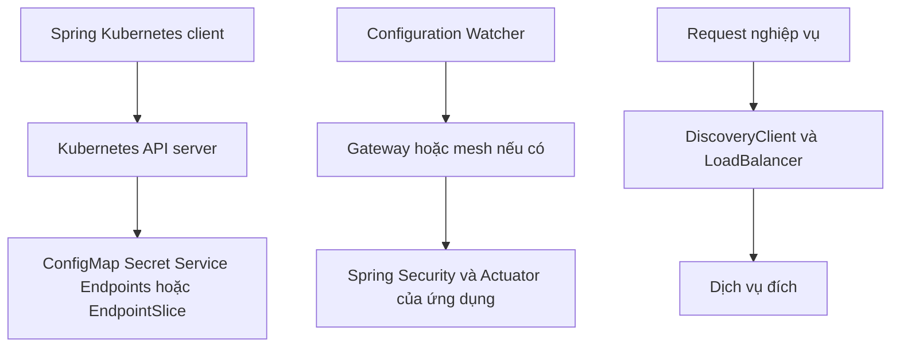

# Lỗi 401, 403, 404 và cách xác định nguyên nhân

Một dòng log ghi `403 Forbidden` chưa đủ để kết luận ứng dụng thiếu RBAC. Mã đó có thể đến từ Kubernetes API, Spring Security, CSRF, gateway hoặc một dịch vụ nghiệp vụ. Tương tự, `404` có thể là sai namespace khi đọc ConfigMap hoặc gọi đúng host nhưng sai cổng quản trị.

Trong chương **Chẩn đoán sự cố** của module **SPRING_CLOUD_KUBERNETES**, bài học này hướng dẫn tìm nguyên nhân bằng cách xác định request, thành phần trả lỗi và danh tính thực sự được sử dụng. Phạm vi gồm ConfigMap/Secret, DiscoveryClient, Spring Cloud LoadBalancer, Configuration Watcher và endpoint quản trị của ứng dụng Spring.

Sau bài học, bạn có thể:

- Phân biệt ý nghĩa của 401, 403, 404 với nguyên nhân cụ thể trong từng lớp.
- Đọc log và phản hồi để xác định Kubernetes API hay ứng dụng đang từ chối.
- Kiểm tra ServiceAccount, namespace, API group, resource và verb đúng với request thật.
- Phân biệt thiếu quyền HTTP, lỗi CSRF và endpoint chưa được cung cấp.
- Chứng minh bản sửa có hiệu lực mà không mở rộng quyền ngoài nhu cầu.

Các ví dụ dùng namespace `apps`, ứng dụng `order-service` và ServiceAccount `order-reader`. Tên và output được rút gọn cho mục đích học tập. Phần Actuator/Security tham chiếu Spring Boot 3.5 và Spring Security 6.5; phần Spring Cloud Kubernetes tham chiếu nhánh 3.3.

## 1. Bắt đầu từ ý nghĩa HTTP, nhưng không dừng ở mã lỗi

| Mã | Ý nghĩa nền tảng | Câu hỏi chẩn đoán đầu tiên |
|---|---|---|
| 401 | Request thiếu credential xác thực hợp lệ cho tài nguyên đích | Ai đang xác thực, credential nào được gửi tới đó? |
| 403 | Máy chủ hiểu request nhưng từ chối thực hiện | Quy tắc nào từ chối thao tác của request này? |
| 404 | Không tìm thấy tài nguyên đích hoặc máy chủ không công bố sự tồn tại của nó | Đúng host, cổng, path, namespace và tài nguyên chưa? |

Theo HTTP, phản hồi 401 gắn với cơ chế challenge qua `WWW-Authenticate`; 403 có thể được che bằng 404 để không tiết lộ tài nguyên. Vì vậy, không diễn giải mọi mã như một bằng chứng tuyệt đối về danh tính hay sự tồn tại. Xem [RFC 9110: HTTP Semantics](https://www.rfc-editor.org/rfc/rfc9110.html).

Một request chưa qua xác thực có thể bị chặn trước khi router kiểm tra path. Do đó, nhận 401 khi gọi một URL không chứng minh endpoint đó tồn tại.

Ngược lại, một hệ thống có authentication entry point hoặc error handler tùy biến có thể trả khác mô hình thông thường. Phải tìm thành phần thực sự sinh response.

### 1.1. Những lỗi không thuộc ba mã này

- DNS không phân giải được, kết nối bị từ chối và TLS handshake lỗi có thể xảy ra trước khi có HTTP response.
- NetworkPolicy ở lớp mạng không tự sinh một trang HTTP 403; proxy/mesh có thể có chính sách HTTP riêng.
- GET vào operation chỉ hỗ trợ POST có thể nhận 405, không nhất thiết 404.
- Một danh sách Kubernetes hợp lệ nhưng không có phần tử thường là phản hồi thành công với danh sách rỗng, không phải 404.
- Không tìm thấy instance cho LoadBalancer không tự đồng nghĩa Kubernetes API trả 404.

Không sửa lỗi kết nối bằng RBAC hoặc sửa lỗi không có instance bằng cách đổi tên một endpoint tùy ý.

## 2. Xác định request nào đang lỗi và ai trả lời

Có ít nhất ba đường gọi cần tách:



Ví dụ:

| Dấu hiệu | Đường lỗi có khả năng liên quan | Nơi cần kiểm tra |
|---|---|---|
| Đọc ConfigMap lúc startup, exception chứa code 401 | Client → Kubernetes API | Credential của client và API server đích |
| Watch informer báo cannot watch/list | Client → Kubernetes API | Danh tính, resource, verb và namespace |
| Watcher gửi POST refresh nhận 403 | Watcher → ứng dụng/proxy | Security policy HTTP, credential và CSRF |
| Gọi qua LoadBalancer nhận 404 | Client → một instance/gateway | Instance được chọn, path và phiên bản API |
| Probe gọi health nhận 404 | Kubelet → địa chỉ probe | Cổng, path, exposure và cấu hình endpoint |

Một request người dùng có thể nhận 500 hoặc 503 trong khi nguyên nhân bên trong là lần gọi Kubernetes API nhận 401. Ghi rõ **mã ngoài** và **mã của chặng con**; không gộp chúng thành một lỗi duy nhất.

### 2.1. Bằng chứng tối thiểu nên thu thập

```text
Thời điểm và mã tương quan
Thành phần phát request
HTTP method
Host hoặc service đích, cổng, path đã loại dữ liệu nhạy cảm
Mã response ở chặng đó
Header/challenge và body lỗi đã làm sạch nếu cần
Danh tính kỳ vọng và danh tính phía nhận quan sát được
Namespace, API group, resource, verb nếu là Kubernetes API
Image/phiên bản Pod để phân biệt nhiều thế hệ
```

Body kiểu Kubernetes `Status` với `reason`, `message` và `code` là một dấu hiệu hữu ích. Trang HTML mặc định của proxy hoặc response JSON của ứng dụng lại gợi ý một lớp khác. Đây là dấu hiệu để đối chiếu với log/audit, không phải nhận diện chắc chắn chỉ bằng hình thức.

Header `Server`, `WWW-Authenticate`, request ID hoặc audit ID cũng có ích, nhưng có thể bị proxy thêm, đổi hoặc bỏ. Không coi một header là bằng chứng duy nhất.

Không thu thập bằng cách in toàn bộ token, cookie, kubeconfig hoặc payload Secret vào log/ticket. Giữ metadata chẩn đoán cần thiết và làm sạch phần chia sẻ.

## 3. Cây quyết định thực hành

```text
1. Có HTTP response thật không?
   Không → kiểm tra DNS, kết nối, TLS, route trước.
   Có   → ghi lại method, đích và mã ở đúng chặng.

2. Ai tạo response?
   Kubernetes API → kiểm tra client identity và thuộc tính Kubernetes request.
   Ứng dụng/proxy → kiểm tra HTTP auth, rule, route và endpoint.
   Chưa rõ        → đối chiếu log từng chặng bằng thời điểm/request ID.

3. Mã nào?
   401 → credential có được gửi và được bên nhận chấp nhận không?
   403 → quy tắc nào từ chối request, ở lớp nào?
   404 → tài nguyên/path nào đang được tìm ở phạm vi nào?

4. Đặt một giả thuyết và một phép kiểm tra phân biệt.
5. Sửa đúng cấu hình hoặc quyền đã được chứng minh là thiếu.
6. Kiểm tra đường hợp lệ và cả đường cần tiếp tục bị từ chối.
```

Một phép kiểm tra tốt phải làm giảm tập nguyên nhân. Ví dụ, người vận hành đọc được ConfigMap chỉ chứng minh tài nguyên có thể tồn tại với quyền của người đó; nó chưa chứng minh ServiceAccount của ứng dụng đọc được.

## 4. Chẩn đoán 401 từ Kubernetes API

Kubernetes xử lý authentication và authorization ở các bước khác nhau. Request không xác thực được có thể nhận 401; request bị authorization từ chối nhận 403. Xem [Controlling Access to the Kubernetes API](https://kubernetes.io/docs/concepts/security/controlling-access/).

### 4.1. Kiểm tra client đang dùng danh tính nào

Trước tiên xác định:

- Pod có dùng đúng `serviceAccountName` không?
- Client lấy credential trong cluster hay từ kubeconfig/cấu hình khác?
- Token được mount đúng đường mà client đang đọc không?
- Một biến môi trường hoặc cấu hình đóng gói có ghi đè client context không?
- Client có đọc được credential được làm mới hay giữ một bản sao cũ trong bộ nhớ?
- API server đích có đúng cluster dự định không?

Lệnh ví dụ để xem tên ServiceAccount mà không in token:

```bash
kubectl -n apps get pod <pod-name> -o jsonpath='{.spec.serviceAccountName}'
kubectl config current-context
```

Lệnh thứ hai cho biết context của `kubectl` đang dùng trên máy người chạy, không phải context của Java client trong Pod. Nó giúp tránh kiểm tra nhầm cluster nhưng không thay thế việc quan sát cấu hình client thật.

Một thử nghiệm chạy bằng tài khoản quản trị không xác nhận credential của Pod. Tương tự, một token mới tạo để thử có thể hoạt động trong khi tiến trình vẫn giữ token cũ; cần phân biệt hai đường.

### 4.2. Kiểm tra vòng đời và nơi token được chấp nhận

Các nguyên nhân cần xem xét:

| Nguyên nhân | Bằng chứng cần tìm |
|---|---|
| Header bearer không được gửi | Cấu hình client/interceptor và log xác thực an toàn phía nhận |
| Token hết hạn hoặc chưa hợp lệ theo thời gian | Thời hạn và đồng hồ liên quan, không chỉ chuỗi token tồn tại |
| Audience không phù hợp | Audience được cấp so với API server đích chấp nhận |
| Token thuộc cluster/issuer khác | Nguồn cấp và endpoint client thực sự gọi |
| Token bị sao chép tĩnh | Lần đọc credential và cơ chế cập nhật của client |
| Credential dùng sai loại | Token của ứng dụng nghiệp vụ bị đưa vào Kubernetes client |

Kubernetes hỗ trợ nhiều cơ chế xác thực và có quy tắc cho ServiceAccount token; xem [Authenticating](https://kubernetes.io/docs/reference/access-authn-authz/authentication/).

Nếu request không có credential được xử lý như anonymous trong cấu hình cụ thể, lỗi có thể xuất hiện là 403 của `system:anonymous`. Vì vậy, nhìn 403 không đủ để kết luận Pod đã được nhận diện đúng ServiceAccount.

Nếu TLS chưa thiết lập được thì chưa phải lỗi bearer token HTTP. Không tắt xác minh TLS để biến một lỗi trust thành một vấn đề xác thực khác.

### 4.3. Hướng sửa có phạm vi

Sửa đúng nguồn credential, cách đọc token được cập nhật hoặc API endpoint. Sau đó kiểm tra lại chính thao tác đang lỗi bằng client thực tế.

Thêm RoleBinding không sửa một token hết hạn. Restart có thể tạm làm client đọc lại credential, nhưng chưa giải quyết nguyên nhân nếu nó tiếp tục giữ bản sao cũ khi token đổi lần sau.

## 5. Chẩn đoán 403 từ Kubernetes API

### 5.1. Đọc đầy đủ thuộc tính request

Một phản hồi rút gọn có thể là:

```json
{
  "kind": "Status",
  "apiVersion": "v1",
  "status": "Failure",
  "reason": "Forbidden",
  "message": "ServiceAccount apps/order-reader cannot list configmaps in namespace apps",
  "code": 403
}
```

Đây là output minh họa đã làm gọn. Khi chẩn đoán thực tế, lấy các thuộc tính request từ message, audit hoặc client log phù hợp:

```text
user      = system:serviceaccount:apps:order-reader
namespace = apps
apiGroup  = ""                  # core API group
resource  = configmaps
verb      = list
```

Khác biệt một trường có thể đổi hoàn toàn kết quả. `get` không thay thế `list`; `list` không thay thế `watch`; quyền ở namespace này không tự áp dụng ở namespace khác.

HTTP GET cũng không luôn tương ứng Kubernetes verb `get`. GET vào collection là `list`, còn request theo dõi sự kiện được đánh giá theo `watch`. Một client chỉ cần một ConfigMap về mặt nghiệp vụ vẫn có thể dùng list/watch tùy implementation.

### 5.2. Kiểm tra quyền theo đúng ServiceAccount

Ví dụ Bash cho người có quyền impersonation phù hợp:

```bash
can_as_reader() {
  kubectl auth can-i "$@" -n apps --as=system:serviceaccount:apps:order-reader --as-group=system:authenticated --as-group=system:serviceaccounts --as-group=system:serviceaccounts:apps
}

can_as_reader get configmap/order-config
can_as_reader list configmaps
can_as_reader watch configmaps
```

Các group được nêu để việc kiểm tra xét cả binding theo group của ServiceAccount, không chỉ tên user. Nếu môi trường có cơ chế khác, cần dùng danh tính/group phù hợp request thật.

`kubectl auth can-i` kiểm tra khả năng authorization cho thao tác được mô tả; xem [tham chiếu lệnh](https://kubernetes.io/docs/reference/kubectl/generated/kubectl_auth/kubectl_auth_can-i/).

Nếu người chạy không có quyền impersonate user/group, chính yêu cầu kiểm tra có thể thất bại. Không diễn giải lỗi đó thành “Role của ứng dụng thiếu quyền”; nhờ người vận hành có phạm vi thích hợp thực hiện phép kiểm tra.

Kết quả `yes` không chứng minh token của tiến trình hợp lệ, tài nguyên tồn tại hoặc client dùng đúng cluster. Nó chỉ là một mảnh bằng chứng cho authorization được hỏi.

### 5.3. Đối chiếu Role và RoleBinding

Kiểm tra:

1. Role có đúng namespace chứa tài nguyên không?
2. Binding tham chiếu đúng Role/ClusterRole nào?
3. Subject có đúng tên ServiceAccount và namespace của nó không?
4. `apiGroups`, `resources` và `verbs` có khớp request không?
5. Có giới hạn tên tài nguyên hoặc điều kiện khác làm thao tác collection không được phép không?
6. Client có đang tìm nhiều namespace hơn nhu cầu không?

Ví dụ sau chỉ phù hợp khi đã xác nhận client cần get/list/watch ConfigMap trong `apps`:

```yaml
apiVersion: rbac.authorization.k8s.io/v1
kind: Role
metadata:
  name: order-config-reader
  namespace: apps
rules:
  - apiGroups: [""]
    resources: ["configmaps"]
    verbs: ["get", "list", "watch"]
---
apiVersion: rbac.authorization.k8s.io/v1
kind: RoleBinding
metadata:
  name: order-config-reader
  namespace: apps
subjects:
  - kind: ServiceAccount
    name: order-reader
    namespace: apps
roleRef:
  apiGroup: rbac.authorization.k8s.io
  kind: Role
  name: order-config-reader
```

Mẫu không cấp quyền đọc Secret hoặc thao tác ghi. Nếu client thực tế chỉ cần một phép đọc hẹp hơn và hỗ trợ cách đọc đó, thiết kế quyền theo nhu cầu ấy thay vì mặc định giữ toàn bộ ba verb.

RoleBinding trong namespace tài nguyên có thể tham chiếu ServiceAccount thuộc namespace khác; khi đó `subjects.namespace` phải là namespace của ServiceAccount, không tự thay bằng namespace đặt RoleBinding.

Các khái niệm resource, subresource, Role và binding được mô tả trong [Using RBAC Authorization](https://kubernetes.io/docs/reference/access-authn-authz/rbac/).

### 5.4. Discovery có thể cần resource khác với cấu hình

Nếu client dùng EndpointSlice, quyền đối với `endpoints` của core API không thay quyền cho `endpointslices` thuộc `discovery.k8s.io`.

Ví dụ phần rule cần đánh giá theo implementation:

```yaml
- apiGroups: ["discovery.k8s.io"]
  resources: ["endpointslices"]
  verbs: ["get", "list", "watch"]
```

Không cấp rule này chỉ vì nhìn thấy một lỗi discovery chung; xác nhận client đang gọi resource đó. Namespace được discovery tìm và API được chọn phụ thuộc cấu hình/version, như mô tả trong [DiscoveryClient for Kubernetes](https://docs.spring.io/spring-cloud-kubernetes/reference/3.3/discovery-client.html).

Nếu thao tác ghi bị 403 dù authorization đã cho phép, còn phải xét admission policy hoặc webhook. Đối với từng trường hợp, tìm thông tin từ chối cụ thể; không quy mọi Forbidden cho RBAC.

## 6. Chẩn đoán 404 từ Kubernetes API

### 6.1. Tách object không có với path API không có

| Dạng 404 | Hướng kiểm tra |
|---|---|
| Không tìm thấy ConfigMap/Secret có tên cụ thể | Tên, namespace, thứ tự tạo tài nguyên và cluster |
| Namespace không tồn tại | Namespace client thực sự dùng và trạng thái triển khai |
| API group/version không được phục vụ | Client/server compatibility và API discovery |
| Sai resource hoặc path tự xây dựng | Đường request thực tế và plural của resource |
| Proxy trước API server trả 404 | Route tới API server, không chỉ object Kubernetes |

Ví dụ kiểm tra bằng quyền người vận hành, chỉ xuất tên tài nguyên:

```bash
kubectl -n apps get configmap order-config -o name
kubectl -n apps get secret order-credentials -o name
kubectl api-resources --api-group=discovery.k8s.io
```

Kết quả tồn tại ở đây không chứng minh ứng dụng đọc được. Phải ghép với danh tính và namespace của client.

Không tạo một Secret rỗng để làm mất 404. Điều đó có thể đổi lỗi “không có nguồn” thành “ứng dụng khởi động với cấu hình không hợp lệ” hoặc chuyển lỗi sang giai đoạn khó quan sát hơn.

### 6.2. Kiểm tra namespace hiệu dụng của Spring Cloud Kubernetes

Nguồn namespace có thể đến từ cấu hình từng source, cấu hình client, tệp ServiceAccount hoặc cơ chế của client. Xem [Namespace resolution nhánh 3.3](https://docs.spring.io/spring-cloud-kubernetes/reference/3.3/property-source-config/namespace-resolution.html).

Ví dụ minh họa nguồn ConfigMap rõ ràng:

```yaml
spring:
  cloud:
    kubernetes:
      config:
        name: order-config
        namespace: apps
```

Đoạn này giả định cơ chế nạp ConfigMap đã được thiết lập đúng với phiên bản. Nếu có `sources` riêng hoặc override ưu tiên cao hơn, kiểm tra toàn bộ cấu hình hiệu dụng của đường nạp.

Một Pod chạy ở `apps` không chứng minh mọi nguồn đều được đọc trong `apps`. Một cấu hình cũ có thể hướng source sang namespace khác.

### 6.3. Phân biệt thiếu object với thiếu khóa

GET ConfigMap thành công nhưng thiếu một key không phải cùng loại lỗi với Kubernetes API trả 404 cho cả ConfigMap. Binding, validation hoặc ứng dụng có thể phát lỗi sau khi API đã trả 200.

Tương tự, khi Secret volume thiếu nguồn hoặc key bắt buộc, triệu chứng có thể nằm ở Events và trạng thái chuẩn bị container trước khi Java chạy. Đừng chỉ tìm exception HTTP trong ứng dụng chưa khởi động.

Một danh sách thành công nhưng rỗng cũng không chứng minh resource API bị thiếu. Với discovery, kiểm tra namespace, selector, tên Service và readiness của tập đích theo thiết kế.

## 7. Chẩn đoán 401 tại ứng dụng hoặc gateway

Đây là miền danh tính khác Kubernetes API. Token ServiceAccount không mặc nhiên là bearer token hợp lệ của ứng dụng nghiệp vụ hoặc management API.

Các câu hỏi cần trả lời:

1. Header `Authorization` có đến đúng thành phần xác thực không?
2. Proxy có loại bỏ, thay thế hoặc xử lý credential trước ứng dụng không?
3. Token có đúng issuer, chữ ký, thời hạn và audience theo policy không?
4. Ứng dụng có dùng đúng authentication mechanism cho endpoint đó không?
5. Có chain/gateway khác chặn request trước chain dự kiến không?

Spring Security Resource Server có cơ chế xác minh JWT và ánh xạ scope sang authority; xem [JWT Resource Server](https://docs.spring.io/spring-security/reference/6.5/servlet/oauth2/resource-server/jwt.html). Đọc payload JWT bằng Base64 chỉ giúp xem claim, không xác minh chữ ký và không chứng minh token đáng tin.

Với Watcher, “được đọc Kubernetes Secret” và “được gọi HTTP refresh” là hai quyền độc lập. Phải hoàn thiện cơ chế gửi credential phía Watcher theo khả năng implementation/version. Không đặt một property token tự nghĩ ra rồi coi tích hợp đã hoạt động.

Một token mới có hiệu lực nhưng Watcher vẫn lỗi có thể do client chưa lấy lại token hoặc chưa gắn nó vào request. Theo dõi request thật của Watcher, không chỉ một lệnh curl thủ công.

## 8. Chẩn đoán 403 tại ứng dụng: quyền, CSRF hay lớp trung gian?

### 8.1. Token hợp lệ nhưng thiếu quyền

Ví dụ policy yêu cầu authority `SCOPE_config.refresh`. Token đã được xác thực nhưng chỉ có scope đọc nghiệp vụ có thể bị từ chối.

Đối chiếu:

```text
Endpoint và HTTP method cần quyền gì?
Claim nào được converter ánh xạ thành authority?
Danh tính sau xác thực có authority nào được phép quan sát an toàn?
Chain nào thực sự khớp request?
Gateway/mesh có policy riêng không?
```

`hasRole` và `hasAuthority` có semantics khác nhau; token có một claim mang tên “role” không tự bảo đảm matcher đang kiểm tra đúng authority. Cần xem converter và policy thực tế.

Không sửa bằng cách cấp mọi scope cho client hoặc đổi mọi rule sang `permitAll`. Cấp đúng thao tác và tập đích mà caller có nhu cầu.

### 8.2. POST bị CSRF từ chối

Nếu GET health hoạt động nhưng POST refresh bị 403, một giả thuyết cần kiểm tra là CSRF. Nó chưa phải kết luận: health có thể được mở riêng, còn refresh vẫn thiếu quyền.

Spring Security bảo vệ unsafe method mặc định; lỗi thiếu hoặc sai CSRF token có thể chặn request trước thao tác endpoint. Xem [CSRF của Spring Security 6.5](https://docs.spring.io/spring-security/reference/6.5/servlet/exploits/csrf.html).

Hướng xử lý phụ thuộc mô hình:

| Mô hình credential | Hướng xem xét |
|---|---|
| Cookie/session hoặc credential trình duyệt tự gửi | Giữ bảo vệ CSRF và thiết kế client gửi token đúng |
| Client máy dùng bearer token trong header, không lấy danh tính từ cookie/session | Có thể thiết kế ngoại lệ CSRF hẹp cho operation tương ứng |
| Mô hình chưa rõ | Xác định cơ chế xác thực trước khi nới rule |

Ngoại lệ CSRF không thay thế authentication và authorization. Không tắt CSRF toàn ứng dụng chỉ để một POST quản trị đi qua.

### 8.3. Gateway hoặc mesh từ chối trước ứng dụng

Nếu không thấy log request ở ứng dụng, kiểm tra policy ở chặng trước: danh tính mTLS, host, method, path và phạm vi route.

Không thấy access log chỉ là một dấu hiệu; ứng dụng cũng có thể chưa bật log cần thiết hoặc log được thu thập chậm. Đối chiếu nhiều nguồn bằng request ID/thời điểm và giữ nguyên endpoint, method, danh tính khi thử.

CORS liên quan tới hành vi trình duyệt, không phải giấy phép HTTP chung. Lỗi preflight và một POST máy chủ bị 403 cần được chẩn đoán theo đúng loại client.

## 9. Chẩn đoán 404 tại Actuator, Watcher hoặc API nghiệp vụ

### 9.1. Kiểm tra cổng, base path và endpoint availability

Ví dụ cấu hình:

```yaml
server:
  port: 8080

management:
  server:
    port: 9090
  endpoints:
    web:
      base-path: /manage
      exposure:
        include:
          - health
          - refresh
```

Nếu endpoint refresh được cung cấp và policy cho phép, đích dự kiến là cổng 9090 với path `/manage/refresh`. Gọi `:8080/actuator/refresh` không kiểm tra đúng đường quản trị trong ví dụ.

Đoạn YAML không tự tạo refresh endpoint khi thiếu thành phần Spring Cloud cung cấp nó, cũng không tự bảo vệ truy cập. Kiểm tra cả dependency, điều kiện auto-configuration và cấu hình availability/access của phiên bản đang dùng.

Spring Boot phân biệt quyền cung cấp endpoint và exposure qua HTTP/JMX; xem [Actuator Endpoints](https://docs.spring.io/spring-boot/3.5/reference/actuator/endpoints.html). Một endpoint bị loại khỏi khả năng cung cấp không xuất hiện chỉ nhờ thêm nó vào danh sách exposure.

Ngoài base path, xem context path, path mapping và rewrite của gateway. Đường request mà ứng dụng nhận có thể khác đường caller gửi.

### 9.2. Service phải chuyển tới đúng cổng

Nếu Service chỉ chuyển tiếp 8080, client gọi Service đó không tự đi tới management port 9090. Kiểm tra `port`, `targetPort`, tên port và địa chỉ mà discovery trả.

Kubernetes Service không tự tạo route HTTP cho `/manage/refresh`. Nếu có HTTP 404, tìm thành phần HTTP phía sau hoặc proxy tạo phản hồi.

Với Watcher, xác minh cổng/path quản trị mà nó tính cho từng instance. Tài liệu [Configuration Watcher](https://docs.spring.io/spring-cloud-kubernetes/reference/3.3/spring-cloud-kubernetes-configuration-watcher.html) mô tả việc gọi refresh và cấu hình đường management không mặc định. Không giả định thông tin discovery cho cổng nghiệp vụ cũng là thông tin management đúng.

### 9.3. Kiểm tra method và phiên bản instance

Refresh qua HTTP dùng POST theo đường tích hợp tương ứng. Thử GET không phải kiểm chứng thao tác refresh thành công; có thể nhận 405 hoặc bị security chặn trước đó.

Nếu chỉ một phần request nhận 404 trong rolling update, ghi lại instance được chọn và phiên bản image. Có thể một thế hệ đã có route mới còn thế hệ cũ chưa có. LoadBalancer chỉ phân phối request, không tự thương lượng phiên bản API.

Nếu gọi trực tiếp một instance thành công nhưng qua gateway thất bại, ưu tiên kiểm tra route/rewrite và policy gateway. Nếu cùng đường qua gateway lúc thành công lúc thất bại, kiểm tra tập backend và cấu hình giữa các replica.

Không dùng port-forward làm bằng chứng đầy đủ rằng mọi route hoặc NetworkPolicy của đường thật đều đúng. Nó chỉ kiểm tra một đường truy cập khác tới đích đã chọn.

## 10. Bộ lệnh thu thập bằng chứng có phạm vi

Các lệnh dưới đây là ví dụ cho người thực hành, không phải yêu cầu chạy trên mọi sự cố.

### 10.1. Trạng thái Pod, Service và log

```bash
kubectl -n apps get pods -l app=order-service -o wide
kubectl -n apps get service order-service -o yaml
kubectl -n apps describe pod <pod-name>
kubectl -n apps logs <pod-name> -c order-service --since=10m --timestamps
kubectl -n apps logs <pod-name> -c order-service --previous --timestamps
```

Chỉ dùng `--previous` khi có lần chạy trước còn được runtime giữ lại. Rà soát đầu ra trước khi chia sẻ vì manifest, Events và log có thể chứa metadata hoặc thông tin nhạy cảm.

Nếu cần xem RBAC, chọn Role/RoleBinding liên quan thay vì dump mọi binding toàn cluster. Nếu cần kiểm tra Secret có tồn tại, ưu tiên metadata/tên, không lấy payload.

### 10.2. Kiểm tra HTTP mà không in body ra kênh chia sẻ

Ví dụ Bash:

```bash
curl --silent --show-error --max-time 5 --cacert "$CA_CERT" --output /dev/null --write-out 'status=%{http_code}' "$ADMIN_URL/manage/health"
curl --silent --show-error --max-time 5 --cacert "$CA_CERT" --header "@$REFRESH_HEADER_FILE" --request POST --output /dev/null --write-out 'status=%{http_code}' "$ADMIN_URL/manage/refresh"
```

`ADMIN_URL` là origin quản trị đúng cổng và HTTPS; tệp header được công cụ credential chuẩn bị trong môi trường thử nghiệm hoặc vận hành có quyền phù hợp. Không đặt token thật vào tài liệu.

Ví dụ không tự theo redirect để tránh che phản hồi ban đầu. Nếu có redirect, kiểm tra riêng đích đến và cách credential được xử lý.

POST refresh là thao tác làm thay đổi trạng thái cấu hình/tài nguyên. Chỉ thử khi được phép trong phạm vi xử lý sự cố, không gọi lặp vô hạn chỉ để quan sát mã.

Khi cần body/header lỗi để phân biệt lớp sinh response, thu thập trong kênh hạn chế và làm sạch trước khi chia sẻ. Không bật `curl -v` hoặc wire logging rồi sao chép nguyên credential vào ticket.

### 10.3. Ghi một phiếu giả thuyết ngắn

```text
Triệu chứng:
    Watcher nhận 404 khi gửi POST refresh.

Bằng chứng:
    Đích là cổng nghiệp vụ 8080.
    Ứng dụng cung cấp management ở 9090 với base path /manage.
    Không có request tương ứng tại listener management.

Giả thuyết:
    Watcher đang dùng thông tin cổng/path không đúng.

Phép kiểm tra:
    Gọi đúng đích quản trị bằng danh tính được phép.
    Đối chiếu log từng listener và URL mà Watcher thực sự sử dụng.

Bản sửa dự kiến:
    Cập nhật cấu hình đường management phù hợp implementation.
```

Cách ghi này giúp tránh sửa RBAC, auth và route cùng lúc mà không biết thay đổi nào giải quyết nguyên nhân.

## 11. Các tình huống thực hành

Thực hiện trong namespace thử nghiệm với credential và dữ liệu giả. Mỗi lượt chỉ thay một yếu tố để giữ khả năng quy kết nguyên nhân.

### Tình huống A: Kubernetes client nhận 401 sau một thời gian chạy

**Thiết lập:** client thử nghiệm dùng credential có vòng đời hữu hạn và cố tình giữ bản sao tĩnh.

**Quan sát cần có:** lỗi ở chặng gọi Kubernetes API, không chỉ response ngoài gateway.

**Kiểm tra:** ServiceAccount, API server đích, thời hạn credential, lần đọc lại credential và hành vi sau khi client được cập nhật đúng.

**Kết luận mong muốn:** chứng minh lỗi xác thực do cách sử dụng credential. Một RoleBinding mới không phải bản sửa cho token cũ hết hiệu lực.

Không cần và không nên thao tác token thật của một workload dùng chung để tạo lỗi.

### Tình huống B: get được ConfigMap nhưng informer nhận 403

**Thiết lập:** ServiceAccount có quyền get nhưng thiếu verb mà client thực tế dùng để list/watch.

**Kiểm tra:** message Forbidden nêu verb, phép `auth can-i` cùng danh tính/group và request thật của client.

**Bản sửa:** bổ sung đúng verb trong đúng namespace nếu tính năng cần nó, hoặc chọn cách đọc hẹp hơn được implementation hỗ trợ.

**Xác nhận:** informer hoạt động nhưng quyền đọc Secret/ghi tài nguyên ngoài nhu cầu vẫn không được cấp.

### Tình huống C: Watcher có token nhưng POST refresh nhận 403

**Thiết lập:** mô hình bảo mật kiểm thử có thể phân biệt token thiếu scope với request thiếu CSRF token trong mô hình session.

**Kiểm tra:** authentication đã thành công chưa, authority nào được xét và thành phần nào phát AccessDenied.

**Kết luận mong muốn:** không coi mọi 403 là một lỗi. Bản sửa scope khác bản sửa CSRF và đều khác Kubernetes RBAC.

Giữ kiểm tra từ chối đối với caller không có quyền sau khi sửa đường hợp lệ.

### Tình huống D: ConfigMap tồn tại nhưng client nhận 404

**Thiết lập:** tài nguyên ở `apps`, còn source cấu hình ứng dụng trỏ namespace thử nghiệm khác.

**Kiểm tra:** namespace trong request lỗi, namespace hiệu dụng của source và cluster đang dùng.

**Bản sửa:** sửa đúng phạm vi nguồn, không tạo thêm một bản ConfigMap tùy tiện ở mọi namespace để che lỗi.

**Xác nhận:** ứng dụng đọc đúng revision mong muốn và không vô tình dùng cấu hình của môi trường khác.

### Tình huống E: Refresh 404 do sai cổng/path

**Thiết lập:** management ở 9090 với base path `/manage`, caller dùng đường mặc định trên 8080.

**Kiểm tra:** URL cuối mà caller tạo, Service targetPort, listener nhận request và exposure.

**Bản sửa:** cập nhật đúng đích; giữ policy xác thực và phân quyền.

**Xác nhận:** POST hợp lệ đi tới endpoint thật, caller trái phép vẫn bị chặn, revision/hành vi sau refresh được quan sát theo cơ chế của ứng dụng.

## 12. Đánh giá bản sửa và đóng sự cố

Không chỉ nhìn mã 2xx. Xác nhận tác vụ ban đầu đã đạt mục tiêu:

| Tác vụ | Bằng chứng sau sửa |
|---|---|
| Nạp ConfigMap/Secret | Đúng nguồn, đúng namespace và cấu hình hiệu dụng hợp lệ |
| Discovery | Tập instance đúng phạm vi và trạng thái mong muốn |
| LoadBalancer | Chọn đúng loại đích, gọi đúng route và xử lý lỗi theo policy |
| Watcher refresh | Đúng instance nhận và áp dụng revision cần thiết |
| Probe | Đúng cổng/path, đủ thông tin sức khỏe mà không lộ dữ liệu |

Giữ cả kiểm tra âm: user thiếu quyền vẫn bị từ chối, namespace ngoài phạm vi không được mở rộng, Secret không liên quan không được đọc và endpoint nhạy cảm không bị cung cấp ngoài chủ ý.

Ghi nguyên nhân gốc ở dạng cụ thể:

```text
Không đủ: 403 do cấu hình sai.

Đủ rõ:
ServiceAccount apps/order-reader chỉ có get configmaps.
Client dùng list để khởi tạo theo dõi trong apps.
Đã cấp list/watch theo tính năng cần dùng và kiểm tra giới hạn quyền khác.
```

Tránh các bản sửa làm mất khả năng bảo vệ: cấp `cluster-admin`, mở mọi namespace, cho phép mọi request hoặc tắt TLS/CSRF không phân biệt mô hình. Chọn thay đổi tối thiểu được bằng chứng hỗ trợ.

Nếu ứng dụng chỉ cần đọc tệp mount hoặc gọi qua Kubernetes Service/DNS, đánh giá lại việc bật thêm API discovery, Secret API hoặc Watcher có thật sự cần không. Giảm tính năng ngoài nhu cầu có thể loại bỏ cả đường lỗi lẫn quyền truy cập phải quản lý.

Một chẩn đoán hoàn chỉnh nối được bốn điểm: request thực tế, thành phần trả lỗi, danh tính/quy tắc được áp dụng và bằng chứng sau sửa. Mã 401, 403 hay 404 là điểm bắt đầu để tìm chuỗi đó, không phải tên nguyên nhân gốc.
