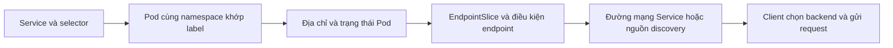

# Service không có endpoint do selector hoặc readiness

Trong chương **Chẩn đoán sự cố** của module **SPRING_CLOUD_KUBERNETES**, bài học này xử lý tình huống Service tồn tại nhưng không có backend sẵn sàng để nhận request. Hai nguyên nhân thường gặp là selector của Service không chọn đúng Pod và Pod được chọn chưa đạt readiness.

Cần xác định “không có endpoint” đang được quan sát ở đâu: không có địa chỉ trong EndpointSlice, có địa chỉ nhưng chưa ready, hay DiscoveryClient của ứng dụng không trả instance. Các tình huống này có cách xử lý khác nhau; tăng retry hoặc sửa cấu hình LoadBalancer trước khi phân biệt chúng có thể làm chậm việc tìm nguyên nhân.

## 1. Tình huống và mục tiêu chẩn đoán

Giả sử `checkout` gọi dịch vụ `inventory` trong namespace `shop`. Kubernetes đã có Service `inventory` và ba Pod của Deployment cùng tên. Request từ `checkout` thất bại; log ở một tầng gọi cho biết không tìm được instance hoặc không kết nối được backend.

Có hai lỗi cấu hình trong tình huống thực hành:

- Service chọn label `app=inventory`, nhưng Pod chỉ có `app.kubernetes.io/name=inventory`.
- Readiness probe gọi `/actuator/health/ready`, trong khi ứng dụng cung cấp `/actuator/health/readiness`.

Sau khi sửa selector, hệ thống vẫn có thể chưa phục hồi vì lỗi readiness thứ hai còn tồn tại. Đây là lý do cần đi hết chuỗi kiểm chứng thay vì dừng ngay khi tìm thấy một sai khác.

Sau bài học, bạn có thể:

1. Phân biệt Service, Pod được chọn, địa chỉ EndpointSlice và instance mà Spring nhận được.
2. Đối chiếu selector với label của Pod trong đúng namespace.
3. Đọc readiness, probe failure, trạng thái container và readiness gate.
4. Sửa đúng nguồn cấu hình và xác nhận request đi được qua đường gọi thực tế.

Các manifest và lệnh là ví dụ cho lab hoặc môi trường đã được giao quyền phù hợp. Bài không giả định rằng mọi lỗi từ Service đều trả một HTTP status giống nhau: ingress, gateway, client và cơ chế mạng có thể biểu hiện khác nhau.

## 2. Hiểu chuỗi chọn backend và các điểm quan sát

Đối với Service thông thường có selector:



EndpointSlice controller theo dõi những Pod phù hợp với selector và cập nhật tập EndpointSlice tương ứng. Tên Service không tự chọn Deployment cùng tên; quan hệ chọn Pod nằm ở selector. [Kubernetes: Service](https://kubernetes.io/docs/concepts/services-networking/service/).

| Quan sát | Có thể kết luận gì? | Chưa kết luận được gì? |
| --- | --- | --- |
| Service có ClusterIP | Object và địa chỉ Service đã được cấp | Có Pod phù hợp hoặc backend ready |
| DNS phân giải được Service | Đường phân giải tên có kết quả | Kết nối tới backend sẽ thành công |
| Pod có phase `Running` | Pod đã ở giai đoạn chạy theo vòng đời | Mọi container và điều kiện readiness đã đạt |
| EndpointSlice có địa chỉ | Có endpoint được biểu diễn trong slice | Endpoint đủ điều kiện nhận traffic |
| `DiscoveryClient.getInstances()` rỗng | Client không có instance trong tập trả về | Kubernetes chắc chắn không có địa chỉ backend |
| Pod Ready và endpoint ready | Có backend phù hợp ở lớp trạng thái đã xem | Cổng ứng dụng, policy mạng và request nghiệp vụ chắc chắn đúng |

DNS của Service thường vẫn có thể phân giải dù backend không sẵn sàng; headless Service có cách công bố địa chỉ khác và cần được xét riêng. [Kubernetes: DNS for Services and Pods](https://kubernetes.io/docs/concepts/services-networking/dns-pod-service/).

### Ba tình trạng cần gọi tên chính xác

1. **Không chọn được Pod:** selector không khớp, sai namespace hoặc workload chưa tạo được Pod.
2. **Có Pod/địa chỉ nhưng không có backend ready:** probe, container, readiness gate hoặc vòng đời đang chặn việc nhận traffic.
3. **Kubernetes có backend ready nhưng client không dùng được:** namespace discovery, filter, RBAC, cache, lựa chọn API, cổng hoặc đường mạng cần được xem tiếp.

Không coi một log “no instances” là bằng chứng duy nhất để chọn nhánh thứ nhất.

## 3. Thu thập bằng chứng ban đầu bằng lệnh chỉ đọc

### 3.1. Xác nhận đúng Service và namespace

```powershell
kubectl get service inventory -n shop -o yaml
kubectl get pods -n shop --show-labels
kubectl get deployments,replicasets -n shop
kubectl get endpointslices -n shop -l kubernetes.io/service-name=inventory
```

Ghi lại thời điểm và revision triển khai khi có rollout đang diễn ra. Kết quả lấy ở những thời điểm khác nhau có thể mô tả những Pod khác nhau.

Nếu bị từ chối quyền truy vấn, đó là giới hạn của phép quan sát, không phải bằng chứng tài nguyên không tồn tại. Không cấp quyền quản trị cho runtime chỉ để chạy một đợt chẩn đoán.

Tài liệu Kubernetes khuyến nghị đối chiếu định nghĩa Service, Pod được selector chọn và EndpointSlice khi debug Service. [Kubernetes: Debug Services](https://kubernetes.io/docs/tasks/debug/debug-application/debug-service/).

### 3.2. Dùng chính selector live để tìm Pod

Script PowerShell tránh việc tự gõ lại một selector khác với cấu hình thực tế:

```powershell
$targetNamespace = 'shop'
$targetService = 'inventory'
$serviceSnapshot = kubectl get service $targetService -n $targetNamespace -o json
if ($LASTEXITCODE -ne 0) {
    throw 'Không đọc được Service; chưa thể kết luận về selector.'
}
$serviceObject = $serviceSnapshot | ConvertFrom-Json
if ($null -eq $serviceObject.spec.selector) {
    throw 'Service không có selector; cần xác định loại Service và controller quản lý backend.'
}
$selectorParts = @(
    foreach ($entry in $serviceObject.spec.selector.PSObject.Properties) {
        '{0}={1}' -f $entry.Name, $entry.Value
    }
)
if ($selectorParts.Count -eq 0) {
    throw 'Không có selector để thực hiện phép kiểm tra chọn Pod.'
}
$selectorText = $selectorParts -join ','
Write-Output ('Selector của Service: {0}' -f $selectorText)
kubectl get pods -n $targetNamespace -l $selectorText -o wide --show-labels
```

Service selector chọn Pod trong namespace của Service; một Pod có cùng label ở namespace khác không trở thành backend theo cơ chế selector này. Những cặp key/value trong selector phải cùng được đáp ứng.

Nếu Service không có selector hoặc là `ExternalName`, không tự thêm selector để biến nó thành mẫu thông thường. Xác định đó có phải thiết kế dùng backend ngoài cluster, EndpointSlice do thành phần khác quản lý hoặc bí danh DNS hay không.

### 3.3. Phân nhánh từ kết quả

| Kết quả truy vấn theo selector | Bước tiếp theo |
| --- | --- |
| Không có Pod | Kiểm tra label, namespace, replica mong muốn và trạng thái tạo Pod |
| Có Pod nhưng chưa có PodIP | Kiểm tra scheduling, khởi tạo mạng/container và sự kiện Pod |
| Có PodIP nhưng Ready=False | Đi vào nhánh readiness và vòng đời container |
| Có PodIP, Ready=True nhưng slice không phản ánh | Kiểm tra port mapping, Service/controller, owner/managed-by và độ trễ đồng bộ |
| Slice có backend ready nhưng client rỗng/lỗi | Đi vào nhánh Spring discovery hoặc mạng sau discovery |

## 4. Nhánh selector: sửa quan hệ chọn Pod, không sửa tên cho giống nhau

### 4.1. So sánh đúng trường metadata

Pod template của Deployment trong tình huống:

```yaml
spec:
  selector:
    matchLabels:
      app.kubernetes.io/name: inventory
  template:
    metadata:
      labels:
        app.kubernetes.io/name: inventory
```

Service đang sai:

```yaml
spec:
  selector:
    app: inventory
```

Hai key `app` và `app.kubernetes.io/name` khác nhau. Kubernetes không suy luận rằng chúng cùng nghĩa. Label ở `Deployment.metadata.labels` hoặc `Service.metadata.labels` cũng không thay label nằm trên Pod.

Diff mong muốn của Service:

```diff
 spec:
   selector:
-    app: inventory
+    app.kubernetes.io/name: inventory
```

Cần bỏ key cũ khi nó không còn thuộc hợp đồng, không chỉ thêm key mới. Nếu cả hai key cùng còn trong selector, Pod phải đáp ứng cả hai và tập backend vẫn có thể rỗng.

### 4.2. Những sai khác selector dễ bị bỏ sót

| Sai khác | Ví dụ |
| --- | --- |
| Sai key | `app` khác `app.kubernetes.io/name` |
| Sai value | `inventory-api` khác `inventory` |
| Selector quá hẹp | Còn `version=v1` trong khi Pod mới mang `version=v2` |
| Nhầm vị trí | Label chỉ ở metadata Deployment, không ở Pod template |
| Sai namespace | Service ở `shop`, Pod ở `inventory-system` |
| Nhầm instance của chart | Service chọn instance release cũ |
| Workload chưa có Pod | Replica bằng 0, scheduling lỗi hoặc rollout chưa tạo được container |

Không bỏ mọi selector để “chọn rộng hơn”. Chọn nhầm Pod có thể đưa traffic sang ứng dụng hoặc phiên bản khác. Với Deployment đang tồn tại, cũng không tự sửa selector quản lý Deployment chỉ để khớp một Service; đây là một hợp đồng riêng có ràng buộc cập nhật.

### 4.3. Kiểm chứng sau sửa selector

Sửa ở manifest/chart/nguồn GitOps đang quản lý Service, rồi đọc lại Service live và chạy lại đúng selector. Xác nhận tập Pod được chọn đúng về tên ứng dụng, phiên bản và namespace.

Sau đó kiểm tra EndpointSlice và readiness. Trong tình huống xuyên suốt, selector đã đúng nhưng các Pod vẫn trả 404 ở readiness probe, nên mới chỉ xử lý xong một nguyên nhân.

## 5. Đọc EndpointSlice: có địa chỉ chưa đồng nghĩa có backend ready

### 5.1. Xem tất cả slice của đúng Service

```powershell
kubectl get endpointslices -n shop -l kubernetes.io/service-name=inventory -o yaml
```

Một Service có thể có nhiều EndpointSlice, gồm những nhóm cổng hoặc loại địa chỉ khác nhau. Không chỉ mở slice đầu tiên rồi kết luận toàn Service. Cột địa chỉ trong output dạng bảng cũng không trình bày đầy đủ điều kiện của từng endpoint. [Kubernetes: EndpointSlices](https://kubernetes.io/docs/concepts/services-networking/endpoint-slices/).

Ví dụ trích nội dung quan sát, không phải manifest cần áp dụng:

```yaml
addressType: IPv4
ports:
  - name: http
    protocol: TCP
    port: 8080
endpoints:
  - addresses:
      - 10.42.1.17
    conditions:
      ready: false
      serving: false
      terminating: false
    targetRef:
      kind: Pod
      namespace: shop
      name: inventory-example-a
```

Địa chỉ `10.42.1.17` đã xuất hiện. Điều cần chẩn đoán lúc này là endpoint chưa ready, không phải hoàn toàn không có địa chỉ.

### 5.2. Ý nghĩa các điều kiện

| Điều kiện | Cách đọc trong trường hợp Pod backend |
| --- | --- |
| `ready` | Trạng thái sẵn sàng được công bố để consumer chọn endpoint |
| `serving` | Khả năng phục vụ; giúp diễn giải cả lúc endpoint đang kết thúc |
| `terminating` | Endpoint đang thuộc vòng đời kết thúc |

Trong hoạt động thông thường, `ready` liên hệ với khả năng phục vụ và việc không đang terminating. Có ngoại lệ khi Service bật `publishNotReadyAddresses`; khi đó không được dùng riêng `ready=true` để suy ra Pod đã qua probe. [Kubernetes: EndpointSlice conditions](https://kubernetes.io/docs/concepts/services-networking/endpoint-slices/#conditions).

Trường bị lược bỏ không tương đương giá trị `false`: định nghĩa API chỉ dẫn diễn giải `ready` hoặc `serving` vắng mặt như `true`, còn `terminating` vắng mặt như `false`. Khi chẩn đoán, giữ rõ sự khác nhau giữa dữ liệu raw và cách consumer diễn giải. [Kubernetes API: EndpointConditions](https://github.com/kubernetes/api/blob/master/discovery/v1/types.go).

Khi rollout hoặc shutdown, cần đọc cả `deletionTimestamp` của Pod và các điều kiện endpoint. Không kết luận controller sai chỉ vì một Pod vừa được quan sát Ready nhưng endpoint đã chuyển trạng thái trong lúc kết thúc.

### 5.3. Bảng quan sát bằng PowerShell

```powershell
$targetNamespace = 'shop'
$targetService = 'inventory'
$sliceSnapshot = kubectl get endpointslices -n $targetNamespace -l "kubernetes.io/service-name=$targetService" -o json
if ($LASTEXITCODE -ne 0) {
    throw 'Không đọc được EndpointSlice; chưa thể kết luận tập backend.'
}
$sliceObjects = @(($sliceSnapshot | ConvertFrom-Json).items)
$endpointRows = @(
    foreach ($slice in $sliceObjects) {
        if ($null -eq $slice) { continue }
        $ports = @(
            foreach ($port in @($slice.ports)) {
                if ($null -eq $port) { continue }
                '{0}:{1}' -f $port.name, $port.port
            }
        ) -join ','
        foreach ($endpoint in @($slice.endpoints)) {
            if ($null -eq $endpoint) { continue }
            [pscustomobject]@{
                Slice = $slice.metadata.name
                AddressType = $slice.addressType
                Pod = $endpoint.targetRef.name
                Addresses = $endpoint.addresses -join ','
                Ports = $ports
                Ready = if ($null -eq $endpoint.conditions.ready) {
                    '<unset>'
                } else { $endpoint.conditions.ready }
                Serving = if ($null -eq $endpoint.conditions.serving) {
                    '<unset>'
                } else { $endpoint.conditions.serving }
                Terminating = if ($null -eq $endpoint.conditions.terminating) {
                    '<unset>'
                } else { $endpoint.conditions.terminating }
            }
        }
    }
)
Write-Output ('Số slice: {0}; số hàng endpoint: {1}' -f $sliceObjects.Count, $endpointRows.Count)
$endpointRows | Format-Table -AutoSize
```

Bảng này là ảnh chụp tại một thời điểm. Số hàng không luôn bằng số replica mong muốn: cần đối chiếu loại địa chỉ, targetRef và trạng thái rollout. `<unset>` được giữ nguyên để người đọc thấy dữ liệu thực tế, không bị ép thành `false` bởi script.

### 5.4. Tách những kết quả thường bị gộp chung

| Dữ liệu quan sát | Hướng điều tra |
| --- | --- |
| Không có slice hoặc slice không có endpoint | Selector, PodIP, cổng có tên, loại Service và controller quản lý |
| Có endpoint nhưng tất cả `ready=false` | Probe, container, readiness gate hoặc terminating |
| Có endpoint ready nhưng cổng không đúng | `port`, `targetPort`, named port và cổng ứng dụng đang nghe |
| Có endpoint ready đúng Pod/cổng nhưng client không thấy | Discovery namespace, filter, API/RBAC và cache |
| Có endpoint ready và client chọn được nhưng kết nối lỗi | Đường mạng, listener, protocol và xử lý request |

Không chỉnh sửa thủ công EndpointSlice do controller quản lý để “điền địa chỉ”. Hãy sửa selector, trạng thái Pod hoặc cấu hình nguồn; controller sẽ cập nhật lại dữ liệu theo quan hệ thực tế.

## 6. Nhánh readiness: tìm điều kiện nào đang chặn Pod

### 6.1. Running khác Ready

```powershell
kubectl get pods -n shop -l app.kubernetes.io/name=inventory -o wide
kubectl describe pod inventory-example-a -n shop
kubectl logs inventory-example-a -n shop -c app --since=15m
kubectl logs inventory-example-a -n shop -c app --previous
```

Thay tên Pod/container bằng đối tượng thực tế. `--previous` chỉ hữu ích khi có lần chạy container trước để đọc; không có log trước không chứng minh ứng dụng khỏe.

Trong `describe`, đọc Conditions, trạng thái từng container, restart count, probe hiện hành và Events. Pod có nhiều container có thể bị giữ NotReady bởi sidecar hoặc điều kiện tùy biến dù container Spring chính đã hoạt động.

`readinessGates` bổ sung điều kiện vào việc đánh giá Pod Ready; nếu điều kiện được yêu cầu chưa xuất hiện hoặc chưa đạt, Pod có thể chưa Ready dù các container báo ready. [Kubernetes: Pod readiness](https://kubernetes.io/docs/concepts/workloads/pods/pod-lifecycle/#pod-readiness).

### 6.2. Phân biệt lỗi probe với lỗi trước khi probe có thể chạy

| Quan sát | Nguyên nhân cần xét |
| --- | --- |
| `FailedScheduling` | Thiếu tài nguyên, constraint hoặc điều kiện scheduling |
| `ImagePullBackOff` | Image/registry/credential kéo image |
| `FailedMount` hoặc lỗi key cấu hình | ConfigMap, Secret, key và đường mount |
| `CrashLoopBackOff`, exit code, OOMKilled | Lỗi khởi động, cấu hình hoặc giới hạn tài nguyên |
| Probe báo 404 | Sai path, context path, base path hoặc endpoint chưa được cấu hình |
| Probe báo 401/403 | Security/filter/proxy chặn đường probe |
| Probe báo connection refused | Sai cổng, listener chưa mở, sai bind address hoặc tiến trình chưa chạy |
| Probe timeout | Quá tải, CPU, khởi tạo chậm, listener hoặc đường truy cập |
| Probe trả trạng thái health không đạt | Availability hoặc health indicator được chọn đang không đạt |
| Container ready nhưng Pod Ready=False | Readiness gate, container khác hoặc vòng đời Pod |

Không chữa lỗi mount Secret bằng cách mở selector của Service. Không chữa một cổng probe sai bằng cách tăng giới hạn retry của client gọi nghiệp vụ.

### 6.3. Readiness, liveness và startup có mục đích riêng

| Loại probe | Câu hỏi vận hành | Phản ứng điển hình khi không đạt |
| --- | --- | --- |
| Readiness | Tiến trình này có nên nhận traffic lúc này không? | Giữ container chạy nhưng không công bố như backend sẵn sàng theo đường thông thường |
| Liveness | Tiến trình có đang mắc lỗi mà restart có thể giải quyết không? | Có thể restart container sau ngưỡng thất bại |
| Startup | Ứng dụng đã hoàn thành giai đoạn khởi động được cho phép chưa? | Bảo vệ khởi động chậm; thất bại quá ngưỡng có thể dẫn tới restart |

Kubernetes phân biệt các probe này và cho phép dùng startup probe để trì hoãn các kiểm tra readiness/liveness cho đến khi startup thành công. Readiness thất bại không tự là một yêu cầu restart container. [Kubernetes: Configure probes](https://kubernetes.io/docs/tasks/configure-pod-container/configure-liveness-readiness-startup-probes/).

Trong tình huống, Events có thể ghi thông báo minh họa:

```text
Readiness probe failed: HTTP probe failed with statuscode: 404
```

Kết hợp probe đang gọi `/actuator/health/ready` với path thực tế của ứng dụng để xác nhận lỗi cấu hình, thay vì diễn giải 404 này là một lỗi nghiệp vụ bên trong health indicator.

## 7. Mẫu cấu hình đúng cho ứng dụng Spring Boot

Giả định image đã có Spring Boot web application và Actuator, chạy HTTP trên 8080, không có context path tùy biến và cung cấp đường probe theo cấu hình dưới. Chọn dependency/JDK theo BOM của dự án; image trong manifest chỉ là tham chiếu minh họa cần thay bằng bản đã chuẩn bị.

### 7.1. Cấu hình ứng dụng

```yaml
server:
  port: 8080
management:
  endpoint:
    health:
      probes:
        enabled: true
```

Spring Boot cung cấp các health group liveness và readiness với đường dẫn tương ứng `/actuator/health/liveness` và `/actuator/health/readiness`. Cổng probe phải trùng nơi các endpoint đó thực sự được phục vụ. [Spring Boot: Kubernetes Probes](https://docs.spring.io/spring-boot/reference/actuator/endpoints.html#actuator.endpoints.kubernetes-probes).

### 7.2. Deployment và Service sau khi sửa

```yaml
apiVersion: apps/v1
kind: Deployment
metadata:
  name: inventory
  namespace: shop
spec:
  replicas: 3
  selector:
    matchLabels:
      app.kubernetes.io/name: inventory
  template:
    metadata:
      labels:
        app.kubernetes.io/name: inventory
    spec:
      containers:
        - name: app
          image: registry.example.internal/inventory:1.0.0
          ports:
            - name: http
              containerPort: 8080
          startupProbe:
            httpGet:
              path: /actuator/health/liveness
              port: http
            periodSeconds: 5
            timeoutSeconds: 2
            failureThreshold: 30
          readinessProbe:
            httpGet:
              path: /actuator/health/readiness
              port: http
            periodSeconds: 5
            timeoutSeconds: 2
            failureThreshold: 2
          livenessProbe:
            httpGet:
              path: /actuator/health/liveness
              port: http
            periodSeconds: 10
            timeoutSeconds: 2
            failureThreshold: 3
---
apiVersion: v1
kind: Service
metadata:
  name: inventory
  namespace: shop
  labels:
    app.kubernetes.io/name: inventory
spec:
  selector:
    app.kubernetes.io/name: inventory
  ports:
    - name: http
      protocol: TCP
      port: 80
      targetPort: http
```

Service nhận ở cổng 80 và chuyển tới named port `http` của Pod, tương ứng 8080 trong mẫu. Probe đi trực tiếp tới cổng của container theo cấu hình, không phải cổng 80 của Service.

`containerPort: 8080` mô tả cổng; nó không tự làm tiến trình Java mở listener. Cần xác nhận `server.port`, địa chỉ bind và protocol có hiệu lực khớp với manifest.

`30 × 5 giây` là ngân sách startup danh nghĩa khoảng 150 giây của mẫu, không phải giá trị mặc định hay số phù hợp cho mọi ứng dụng. Chọn các ngưỡng từ thời gian khởi động và đặc tính tải đã đo, rồi kiểm chứng hành vi thực tế.

### 7.3. Cổng management riêng và probe bị chặn

Nếu ứng dụng dùng cổng management riêng, cần kiểm tra đúng port/path và tránh trạng thái management xanh nhưng listener nghiệp vụ hỏng. Spring Boot có tùy chọn `management.endpoint.health.probes.add-additional-paths=true` để đưa `/livez` và `/readyz` ra cổng chính khi phù hợp với release được chọn. [Spring Boot: probe paths](https://docs.spring.io/spring-boot/reference/actuator/endpoints.html#actuator.endpoints.kubernetes-probes).

Nếu security hoặc proxy chặn probe, sửa chính sách cho đúng đường health cần thiết. Không mở toàn bộ endpoint quản trị hoặc bỏ xác thực của ứng dụng chỉ để chữa một phản hồi 401.

Không cấu hình phép kiểm tra phụ thuộc vòng vào chính Service đang chờ Pod ready. Đường probe cần phản ánh khả năng của instance, thay vì phải đi qua một tập backend vốn chỉ được mở sau khi probe thành công.

## 8. Kubernetes đã có backend ready nhưng Spring vẫn không thấy instance

Chỉ vào nhánh này sau khi đã đọc được EndpointSlice đúng Service, đúng Pod/cổng và các điều kiện tương ứng. Nếu không có backend ready thật, sửa filter hoặc tăng retry của client sẽ không tạo ra một backend có khả năng phục vụ.

### 8.1. Xác định ứng dụng đang gọi qua đường nào

| Đường gọi | Nơi chọn đích |
| --- | --- |
| HTTP client thường gọi DNS Service | DNS và cơ chế mạng của Kubernetes Service |
| `@LoadBalanced` client dùng DiscoveryClient | Danh sách instance và chuỗi supplier/filter/cache phía Spring |
| Spring Cloud Kubernetes LoadBalancer ở chế độ `POD` | Dựa vào instance do DiscoveryClient cung cấp |
| Spring Cloud Kubernetes LoadBalancer ở chế độ `SERVICE` | Chọn Service; đường tới backend vẫn phụ thuộc cơ chế Service |

Spring Cloud Kubernetes mô tả hai chế độ `POD` và `SERVICE` cho tích hợp LoadBalancer. Đổi sang `SERVICE` không sửa selector hoặc biến Pod chưa ready thành ứng dụng sẵn sàng. [Spring Cloud Kubernetes: LoadBalancer](https://docs.spring.io/spring-cloud-kubernetes/reference/load-balancer.html).

Một URL như `http://inventory` có thể được client thường phân giải bằng DNS hoặc được filter của client có LoadBalancer diễn giải thành service id. Cần xem đúng bean/client đang sử dụng, không chỉ nhìn chuỗi URL.

### 8.2. Đối chiếu phạm vi và dữ liệu discovery

| Điểm kiểm tra | Sai khác có thể xảy ra |
| --- | --- |
| Namespace | Client chỉ tìm namespace khác với `shop` |
| Service id | Tên client gọi khác tên Service được discovery trả về |
| Label/filter của discovery | Service tồn tại nhưng bị loại khỏi tập được chọn |
| API dùng lấy endpoint | Client dùng Endpoints cũ trong khi người vận hành chỉ xem EndpointSlice, hoặc ngược lại |
| RBAC và credential | Client bị 401/403, lỗi LIST/WATCH hoặc lỗi khởi tạo cache |
| Cache và watch | Dữ liệu chưa hội tụ, watch/reconnect lỗi hoặc cache cũ |
| Cổng/protocol của instance | Chọn nhầm management port, HTTP/HTTPS hoặc cổng không phục vụ nghiệp vụ |
| Filter phía LoadBalancer | Danh sách discovery có instance nhưng tầng sau lọc hết |

Ví dụ phạm vi discovery cho release hỗ trợ các thuộc tính này:

```yaml
spring:
  cloud:
    kubernetes:
      discovery:
        all-namespaces: false
        namespaces:
          - shop
        use-endpoint-slices: true
        include-not-ready-addresses: false
```

Đối chiếu đúng starter, client và BOM trước khi áp dụng. Thuộc tính `use-endpoint-slices` chọn đường EndpointSlice thay cho Endpoints trong implementation hỗ trợ; quyền API phải tương ứng với lựa chọn đó. [Spring Cloud Kubernetes: Common application properties](https://docs.spring.io/spring-cloud-kubernetes/reference/appendix.html).

Endpoints là API cũ đã được Kubernetes đánh dấu deprecated từ v1.33. Nếu client hiện tại vẫn dùng API này, có thể xem nó để đối chiếu đúng dữ liệu client đọc, nhưng không coi kết quả của hai API luôn là cùng một giao diện. [Kubernetes: Endpoints deprecated](https://kubernetes.io/docs/concepts/services-networking/service/#endpoints-deprecated).

```powershell
kubectl get endpoints inventory -n shop -o yaml
```

Một lỗi quyền đọc API của `checkout` không làm EndpointSlice trong cluster tự biến mất. Nếu người vận hành thấy slice đúng nhưng client bị Forbidden, sửa đúng quyền của client; không sửa selector của `inventory` để chữa lỗi 403.

### 8.3. Không sửa triệu chứng bằng cách bỏ qua readiness

`spring.cloud.kubernetes.discovery.include-not-ready-addresses=true` có thể cho phép discovery đưa vào các địa chỉ chưa ready; tài liệu nêu nhu cầu như quan sát sức khỏe instance. Cờ này không sửa probe hoặc chứng minh instance đã đủ điều kiện nhận request nghiệp vụ. [Spring Cloud Kubernetes: DiscoveryClient](https://docs.spring.io/spring-cloud-kubernetes/reference/discovery-client.html).

Tương tự, `Service.spec.publishNotReadyAddresses=true` thay đổi cách công bố backend và làm `ready` của EndpointSlice được xử lý khác với trường hợp thông thường. Nó có thể phục vụ một thiết kế bootstrap/peer discovery có chủ đích, không phải cách chữa nhanh cho mọi Service rỗng.

Cũng không kỳ vọng việc đổi `spring.application.name`, thêm annotation discovery hoặc restart mọi client sẽ sửa selector Kubernetes. Chỉ tác động ở lớp thực sự có sai khác.

## 9. Liên hệ với ConfigMap, Secret và các trạng thái sức khỏe

Một thay đổi cấu hình có thể làm Pod chưa ready dù Service không thay đổi:

| Thay đổi hoặc lỗi | Bằng chứng cần tìm |
| --- | --- |
| `server.port` bị ghi đè | Cổng listener trong log/config có hiệu lực khác probe và targetPort |
| Path/context của Actuator đổi | Probe gọi path cũ và nhận 404 |
| Management chuyển sang cổng riêng | Probe trỏ cổng nghiệp vụ nhưng health chỉ được mở ở cổng management |
| Secret/key không có hoặc credential không hợp lệ | Lỗi mount, binding, khởi tạo hoặc kết nối theo luồng ứng dụng |
| Nguồn cấu hình không nạp được | Startup/validation failure hoặc Pod dùng giá trị khác dự kiến |
| Refresh áp dụng không đồng nhất | Các replica có phiên bản cấu hình và readiness khác nhau |
| Health group kéo theo dependency dùng chung | Nhiều Pod đồng thời bị loại khi dependency đó gặp sự cố |

Đọc phiên bản cấu hình, property không nhạy cảm và lỗi đủ để chẩn đoán; không in Secret, toàn bộ Environment hoặc credential vào log hỗ trợ.

Không dùng health tổng hợp làm readiness/liveness mà chưa xem các indicator bên trong. Spring Boot mặc định không thêm các health indicator bên ngoài vào hai nhóm probe chuyên biệt; việc đưa một dependency vào readiness cần là quyết định nghiệp vụ. Liveness không nên phụ thuộc vào tình trạng của một hệ thống dùng chung mà restart instance không giải quyết được. [Spring Boot: Checking External State With Kubernetes Probes](https://docs.spring.io/spring-boot/reference/actuator/endpoints.html#actuator.endpoints.kubernetes-probes.external-state).

Nếu tất cả instance đều phụ thuộc cùng một cơ sở dữ liệu và đồng thời bị loại, cần đánh giá ứng dụng còn có thể phục vụ an toàn phần chức năng nào. Không tự bỏ kiểm tra hoặc ép `Ready=True` mà không hiểu hợp đồng phục vụ; cũng không tạo vòng restart hàng loạt chỉ vì dependency ngoài đang chậm.

## 10. Phân biệt lỗi endpoint với lỗi cổng và mạng

Sau khi endpoint đã ready, còn cần kiểm tra request thực tế:

| Tình huống | Dấu hiệu phân biệt |
| --- | --- |
| Service `port` và cổng client không khớp | Client gọi cổng không được Service cung cấp |
| Named `targetPort` không có trên Pod | Không ánh xạ được cổng backend như dự định |
| Numeric `targetPort` sai | Endpoint có thể vẫn có địa chỉ nhưng kết nối vào cổng sai thất bại |
| Ứng dụng chỉ bind loopback | Một phép thử localhost thành công nhưng đường tới PodIP không tương đương |
| HTTP gọi vào listener HTTPS hoặc ngược lại | Có backend nhưng protocol không khớp |
| NetworkPolicy/CNI/service proxy | Backend có dữ liệu đúng nhưng đường mạng từ nguồn gọi không tới được |
| Ingress/gateway cấu hình khác | Request qua ingress lỗi trong khi một đường nội bộ đã thành công |

Không phải mọi timeout đều do endpoint rỗng. Nếu dữ liệu selector/readiness đã đúng, chuyển sang kiểm tra cổng, listener và đường mạng theo bằng chứng. [Kubernetes: Debug Services](https://kubernetes.io/docs/tasks/debug/debug-application/debug-service/).

### Phép thử trực tiếp vào một Pod có giới hạn rõ ràng

Khi được cấp quyền port-forward, có thể dùng một cửa sổ terminal:

```powershell
kubectl port-forward -n shop pod/inventory-example-a 18080:8080
```

Ở cửa sổ khác:

```powershell
curl.exe --max-time 5 --include http://127.0.0.1:18080/actuator/health/readiness
```

Phép thử này có thể giúp phân biệt 404, lỗi security hoặc health không đạt tại instance đã chọn. Nó đi qua tunnel của API server, không kiểm chứng toàn bộ đường kubelet tới PodIP hoặc đường Service mà `checkout` sử dụng.

Một kết quả thành công qua port-forward không đủ để kết luận NetworkPolicy, bind address hoặc Service routing đều đúng. Sau đó phải kiểm tra từ đúng nguồn gọi trong cluster bằng công cụ chẩn đoán đã được chuẩn bị; image ứng dụng tối giản có thể không có `curl` và không cần cài thêm công cụ vào container chỉ để vượt qua giới hạn đó.

## 11. Thực hành hai lỗi liên tiếp trong môi trường lab

### 11.1. Chuẩn bị

Dùng namespace thử nghiệm, image Spring Boot có Actuator và một client kiểm tra nội bộ đã chuẩn bị. Giữ nguồn quản lý manifest và quyền quan sát phù hợp. Các giá trị trong bài là ví dụ, không phải tập manifest cần áp dụng trực tiếp vào production.

Bắt đầu từ mẫu đúng ở phần 7, rồi tạo một revision lab có hai sai khác:

1. Service chọn `app=inventory` trong khi Pod có `app.kubernetes.io/name=inventory`.
2. Readiness probe gọi `/actuator/health/ready` thay cho `/actuator/health/readiness`.

Thay đổi cần được ghi lại trong nguồn quản lý của lab để biết chính xác revision đang quan sát.

### 11.2. Quan sát từng giai đoạn

| Giai đoạn | Selector chọn Pod? | Trạng thái dự kiến cần kiểm chứng | Kết luận |
| --- | --- | --- | --- |
| Hai lỗi đang tồn tại | Không | Không có địa chỉ backend phù hợp; Pod còn lỗi readiness riêng | Chưa thể chỉ tăng retry phía client |
| Chỉ sửa selector | Có | Có thể thấy địa chỉ nhưng `ready=false`; probe vẫn 404 | Đã sửa quan hệ chọn Pod, chưa sửa khả năng nhận traffic |
| Sửa thêm path readiness | Có | Probe đạt, Pod Ready, endpoint được công bố phù hợp | Tiếp tục kiểm tra đường gọi thực tế |
| Kubernetes đúng nhưng client lọc sai namespace | Có | Endpoint ready trong `shop`, client vẫn không có instance mong muốn | Chuyển sang nhánh discovery |
| Sửa phạm vi client nếu đã xác nhận sai | Có | Danh sách instance và request nghiệp vụ phục hồi | Có đủ bằng chứng qua các lớp liên quan |

Kết quả cần được đọc từ cluster thật của lab thay vì coi bảng là một cam kết về thời điểm cập nhật tức thì. Controller, probe và client có các vòng đồng bộ riêng.

### 11.3. Thêm các phép phân biệt có ích

Thực hiện từng thay đổi độc lập rồi khôi phục bản đúng:

- Thêm một selector phiên bản không khớp để thấy tác động của điều kiện AND.
- Đổi cổng probe sang một cổng không có listener để phân biệt connection refused với 404.
- Tạo một lần khởi động chậm có kiểm soát để đánh giá startup probe.
- Xem một Pod có sidecar/readiness gate trong môi trường hỗ trợ để thấy `Running` chưa đủ.
- Giữ endpoint ready nhưng đổi numeric targetPort trong lab để thấy lỗi kết nối không đồng nghĩa lỗi readiness.

Không ép sẵn sàng, sửa thủ công slice do controller quản lý hoặc mở mọi quyền API để làm cho phép thử có vẻ thành công. Sau mỗi lần, xác nhận cả trạng thái phục hồi và request nghiệp vụ hợp lệ.

## 12. Tiêu chí đóng sự cố và quy trình chẩn đoán nhanh

### 12.1. Bằng chứng để xác nhận đã phục hồi

1. Service live ở đúng namespace và selector chọn đúng tập Pod.
2. Những replica cần phục vụ đạt Pod Ready; lỗi probe đã được giải thích và khắc phục.
3. Tất cả EndpointSlice liên quan thể hiện địa chỉ, cổng và điều kiện phù hợp; Pod đang terminating được hiểu đúng vòng đời.
4. Client Spring nhận và chọn được tập instance mong muốn nếu đang dùng discovery phía client.
5. Request từ nguồn gọi thực tế đi qua cổng/protocol đúng và đạt chức năng nghiệp vụ.
6. Rollout hoặc việc tạo Pod mới vẫn đạt, không chỉ những kết nối/cache tồn tại từ trước.
7. Không cần bỏ qua readiness, mở quyền quá mức hoặc giữ một bản sửa live đối nghịch với desired state để duy trì kết quả.

Không cần số hàng endpoint luôn bằng một con số replica đơn giản trong mọi giai đoạn. Cần giải thích được các địa chỉ, phiên bản và trạng thái đang có, đồng thời đạt số instance phục vụ theo mục tiêu vận hành.

### 12.2. Trình tự quyết định ngắn

```text
Service có đúng tên/namespace và đúng loại thiết kế không?
  → Có selector: selector live chọn đúng Pod không?
  → Có Pod được chọn: PodIP và Pod Ready thế nào?
  → EndpointSlice: không có địa chỉ, chưa ready hay đã ready?
  → Chưa ready: probe, container, readiness gate hoặc terminating?
  → Đã ready: cổng/listener, dữ liệu discovery và đường mạng có khớp không?
  → Sau sửa: nguồn gọi thật và vòng đời Pod mới có tiếp tục thành công không?
```

Nếu selector/Pod đúng mà slice vẫn không hội tụ sau khoảng theo dõi phù hợp, kiểm tra owner, `endpointslice.kubernetes.io/managed-by`, sự kiện liên quan và controller với người quản trị nền tảng. Không giả định mọi slice đều do cùng một controller tạo.

Một ghi nhận sự cố hữu ích cần nêu rõ triệu chứng, điểm quan sát, nguyên nhân đã chứng minh, thay đổi đã thực hiện và phép kiểm chứng sau cùng. Với tình huống trong bài: lỗi selector làm mất tập Pod được chọn; sau khi sửa, lỗi path readiness vẫn giữ backend ở trạng thái chưa ready; chỉ khi xử lý cả hai và xác nhận đường gọi từ `checkout` mới có thể đóng sự cố.
