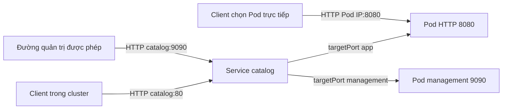
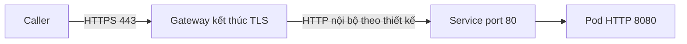

# Chọn sai địa chỉ, cổng hoặc giao thức

Một Service có tên đúng và một danh sách instance không rỗng vẫn chưa đủ để gọi được ứng dụng. Client có thể ghép Pod IP với cổng Service, chọn cổng quản trị thay cổng nghiệp vụ hoặc dùng HTTPS tới một listener chỉ hiểu HTTP.

Trong chương **Chẩn đoán sự cố** của module **SPRING_CLOUD_KUBERNETES**, bài học này hướng dẫn đối chiếu đích gọi thực tế với DNS, Service, EndpointSlice và listener của ứng dụng Spring. Phạm vi bao gồm DiscoveryClient, Spring Cloud LoadBalancer, Configuration Watcher, cấu hình địa chỉ từ ConfigMap/Secret và đường probe sức khỏe Pod.

Sau bài học, bạn có thể:

- Phân biệt địa chỉ Service, Pod, gateway và loopback.
- Ghép đúng loại địa chỉ với cổng tương ứng.
- Tách HTTP/HTTPS khỏi giao thức vận chuyển TCP.
- Kiểm tra cổng được DiscoveryClient hoặc LoadBalancer lựa chọn.
- Xác định vị trí kết thúc TLS và lỗi định danh chứng thư.
- Chẩn đoán đường nghiệp vụ và đường quản trị bằng bằng chứng từ đúng client.

Ví dụ sử dụng Spring Boot 3.5 và tài liệu Spring Cloud Kubernetes 3.3. Namespace, địa chỉ IP và hostname đều mang tính minh họa. `cluster.local` chỉ là domain dùng trong ví dụ; cụm thực tế có thể cấu hình domain khác.

## 1. Mô tả đích gọi bằng một bộ thông tin đầy đủ

Không ghi một sự cố chỉ là “gọi catalog bị lỗi”. Ghi ít nhất:

```text
scheme       = http hoặc https
logical name = catalog
host         = hostname hoặc IP sau bước chọn đích
port         = cổng của địa chỉ đó
path         = đường mà server thực sự nhận
method       = GET, POST, ...
source       = Pod/client nào đang gọi
route        = qua Service, Pod trực tiếp, gateway hay proxy
TLS identity = hostname/danh tính cần được xác minh nếu có
```

Ví dụ hai đích dưới đây có thể cùng dẫn đến một ứng dụng nhưng qua hai đường khác nhau:

```text
http://catalog.apps.svc.cluster.local:80/api/items
http://10.42.1.17:8080/api/items
```

Không được hoán đổi cổng chỉ vì hai đích cùng liên quan tới `catalog`:

```text
http://10.42.1.17:80/api/items
```

Đích cuối có thể sai nếu Pod chỉ lắng nghe 8080 và cổng 80 là cổng của Service.

Nếu thêm gateway, đích bên ngoài lại có thể khác cả host, scheme và path:

```text
https://api.example.test/catalog/api/items
```

Cần biết gateway chuyển tiếp tới đâu và có rewrite path hay không. Không dùng URL bên ngoài để suy ra trực tiếp giao thức của listener trong Pod.

## 2. Dựng một topology chuẩn để đối chiếu

Giả sử ứng dụng catalog có:

| Thành phần | Giá trị minh họa |
|---|---|
| Namespace | `apps` |
| Service | `catalog` |
| Listener nghiệp vụ trong Pod | HTTP trên 8080 |
| Listener quản trị trong Pod | HTTP trên 9090 |
| Base path quản trị | `/manage` |
| Service port nghiệp vụ | 80 → Pod 8080 |
| Service port quản trị | 9090 → Pod 9090 |

**Cấu hình Spring Boot:**

```yaml
server:
  port: 8080

management:
  server:
    port: 9090
  endpoints:
    web:
      base-path: /manage
      exposure:
        include:
          - health
          - refresh
```

Ứng dụng phải có thành phần cung cấp endpoint tương ứng và chính sách truy cập thích hợp. Đoạn cấu hình này chỉ minh họa vị trí listener/path, không tự thiết lập authentication, TLS hoặc giới hạn mạng.

**Phần khai báo port trong container của Pod:**

```yaml
ports:
  - name: app
    containerPort: 8080
  - name: management
    containerPort: 9090
```

`containerPort` mô tả port của container; nó không làm một tiến trình tự mở socket. Listener thực tế phải do ứng dụng tạo trên đúng địa chỉ bind và đúng cổng.

**Service minh họa:**

```yaml
apiVersion: v1
kind: Service
metadata:
  name: catalog
  namespace: apps
  labels:
    primary-port-name: http
spec:
  selector:
    app: catalog
  ports:
    - name: http
      protocol: TCP
      port: 80
      targetPort: app
    - name: management
      protocol: TCP
      port: 9090
      targetPort: management
```

Service này phải chọn đúng Pod có label `app: catalog`. Hai `targetPort` kiểu tên được đối chiếu với named port trong Pod.



Trong môi trường thật, có thể tách Service quản trị để áp dụng policy rõ hơn. Dù chọn một hay nhiều Service, cần ngăn đường quản trị bị công khai ngoài chủ ý.

## 3. Hiểu port và targetPort theo địa chỉ đang dùng

| Đường gọi | Cổng cần dùng trong ví dụ | Lý do |
|---|---:|---|
| DNS/ClusterIP của Service catalog cho nghiệp vụ | 80 | Đây là port Service cung cấp |
| Pod IP trực tiếp cho nghiệp vụ | 8080 | Không đi qua phép chuyển port của Service |
| DNS/ClusterIP cho management | 9090 | Service có port quản trị 9090 |
| Pod IP trực tiếp cho management | 9090 | Listener quản trị của Pod |
| HTTP probe trực tiếp vào Pod | Port listener được chọn | Không tự dùng Service port 80 |

Kubernetes cho phép `port` và `targetPort` khác nhau, đồng thời hỗ trợ named port; xem [Service](https://kubernetes.io/docs/concepts/services-networking/service/).

Với Service có selector, EndpointSlice cho biết tập địa chỉ backend và port tương ứng. Đừng chỉ xem Service rồi giả định endpoint đã được tạo đúng.

Nếu dùng `targetPort: app` nhưng một thế hệ Pod thiếu named port đó hoặc ánh xạ sang giá trị không mong muốn, kiểm tra EndpointSlice thực tế và Pod template. Một rollout có thể đang trộn nhiều cấu hình port.

Tương tự, `targetPort: 8080` không có nghĩa Java đang nghe 8080. Một biến môi trường hoặc tham số startup có thể làm listener đổi sang 8081 trong khi manifest vẫn mô tả cấu hình cũ.

## 4. Chọn đúng loại địa chỉ và phạm vi DNS

### 4.1. Tên ngắn phụ thuộc namespace của caller

Tên `catalog` trong một Pod thuộc namespace khác có thể tìm Service cùng tên ở namespace của caller, hoặc không phân giải được như mong đợi.

Để kiểm tra rõ đích trong ví dụ, dùng:

```text
catalog.apps.svc.cluster.local
```

DNS thông thường của Service và headless Service có hành vi khác nhau; tham khảo [DNS for Services and Pods](https://kubernetes.io/docs/concepts/services-networking/dns-pod-service/).

Tên đầy đủ giúp giảm nhầm namespace, nhưng vẫn cần đúng cluster domain, cấu hình DNS của Pod và môi trường thực thi. Một hostname nội bộ cluster thường không dùng được nguyên trạng từ máy bên ngoài nếu không có đường DNS/mạng tương ứng.

### 4.2. Loopback không đại diện cho Service

`localhost` hoặc `127.0.0.1` là network namespace hiện tại. Các container trong cùng Pod chia sẻ mạng nên có thể dùng loopback cho listener cùng Pod; một Pod khác không đi tới ứng dụng catalog bằng localhost của nó.

Nếu curl bên trong Pod server tới localhost thành công nhưng từ Pod client thất bại, kiểm tra địa chỉ bind. Ứng dụng chỉ nghe `127.0.0.1:8080` không tự nhận kết nối tới Pod IP.

Không đổi Service targetPort để chữa một listener bind sai địa chỉ. Xác minh cấu hình server và yêu cầu mạng của ứng dụng trước.

### 4.3. Headless Service không tạo phép chuyển port qua ClusterIP

Với headless Service, DNS có thể trả địa chỉ Pod trực tiếp. Không mang giả định “Service 80 chuyển sang Pod 8080” của topology ClusterIP thông thường sang đường đó.

Kiểm tra port thực tế từ cơ chế discovery/SRV hoặc endpoint được dùng. Việc phân giải được nhiều Pod IP chưa cho biết nên kết nối port nào.

Không đổi sang headless chỉ để tránh một lỗi Service mà chưa xem consumer có hiểu cách chọn endpoint và port tương ứng không.

### 4.4. Địa chỉ bên ngoài và ExternalName

Một `ExternalName` có thể dẫn tới tên DNS bên ngoài, không phải Pod trong cluster. Các giả định về targetPort, readiness hoặc đường mạng nội bộ cần được xem lại theo loại đích.

Khi chuyển host từ Service DNS sang một hostname khác, xét cả HTTP Host và TLS identity. Địa chỉ trả về từ discovery không tự bảo đảm chứng thư của phía nhận phù hợp với tên mới.

## 5. Kiểm tra cổng mà DiscoveryClient thực sự trả về

### 5.1. Nhiều port cần có lựa chọn rõ ràng

Trong Spring Cloud Kubernetes 3.3, lựa chọn port của discovery có xét label `primary-port-name`, cấu hình `spring.cloud.kubernetes.discovery.primary-port-name` và các bước fallback. Xem [DiscoveryClient for Kubernetes](https://docs.spring.io/spring-cloud-kubernetes/reference/3.3/discovery-client.html).

Ví dụ Service đã đặt:

```yaml
metadata:
  labels:
    primary-port-name: http
```

Một cấu hình client có thể nêu port name:

```yaml
spring:
  cloud:
    kubernetes:
      discovery:
        namespaces:
          - apps
        primary-port-name: http
```

Label trên Service và property của client không phải hai nguồn có thể bỏ qua thứ tự ưu tiên. Đối chiếu quy tắc của đúng implementation/version khi chúng mâu thuẫn.

Tên port `http` trong ví dụ là port name của Service/endpoint cần chọn. Không nhầm nó với named `targetPort` là `app` của container.

Đừng sửa lỗi bằng cách đảo thứ tự danh sách port rồi dựa vào fallback “phần tử đầu”. Thay đổi manifest, thư viện hoặc controller có thể làm giả định đó không còn đúng.

### 5.2. Quan sát ServiceInstance thay vì chỉ xem danh sách tên

Đoạn chẩn đoán rút gọn, chạy có kiểm soát trong kênh nội bộ:

```java
for (ServiceInstance instance : discoveryClient.getInstances("catalog")) {
    log.info(
        "service={} host={} port={} secure={} uri={}",
        instance.getServiceId(),
        instance.getHost(),
        instance.getPort(),
        instance.isSecure(),
        instance.getUri()
    );
}
```

`ServiceInstance` thuộc Spring Cloud Client Discovery; `discoveryClient` và `log` ở đây là các đối tượng đã được inject/khởi tạo trong ứng dụng.

Không dump toàn bộ metadata, token hoặc cấu hình client. Host/IP là metadata nội bộ và chỉ nên ghi trong phạm vi quan sát phù hợp.

Đối chiếu bộ `host/port/secure` với listener thật. Với đường Pod trực tiếp của topology mẫu, đích nghiệp vụ cần tới Pod IP và port backend 8080. Nếu client trả Pod IP nhưng port 80 hoặc 9090, cần tìm quy tắc, metadata hoặc khác biệt implementation làm tạo ra bộ đó.

Danh sách candidate chưa chứng minh instance nào đã nhận một request. Ghi thêm đích cuối được LoadBalancer/HTTP client sử dụng, ở mức instrumentation không chứa header hoặc query nhạy cảm.

## 6. Phân biệt LoadBalancer mode POD và SERVICE

Các starter Kubernetes LoadBalancer có chế độ `POD` và `SERVICE`; xem [LoadBalancer for Kubernetes](https://docs.spring.io/spring-cloud-kubernetes/reference/3.3/load-balancer.html).

| Chế độ | Cách cần suy luận về đích |
|---|---|
| POD | Dùng các instance từ DiscoveryClient; đối chiếu địa chỉ/port backend |
| SERVICE | Chọn Kubernetes Service và dựng đích theo DNS/port Service |

Ví dụ cho POD:

```yaml
spring:
  cloud:
    kubernetes:
      loadbalancer:
        mode: POD
      discovery:
        primary-port-name: http
```

Ví dụ thay thế cho SERVICE:

```yaml
spring:
  cloud:
    kubernetes:
      loadbalancer:
        mode: SERVICE
        port-name: http
        cluster-domain: cluster.local
```

Đây là hai lựa chọn thay thế trong ví dụ, không phải hai đoạn phải ghép rồi kỳ vọng cùng có hiệu lực.

`discovery.primary-port-name` và `loadbalancer.port-name` phục vụ những bước lựa chọn khác nhau. Kiểm tra bean/starter thực tế và mode đang dùng trước khi đổi property.

Với URL logical như `http://catalog/api/items` trên client `@LoadBalanced`, hostname là service ID để bộ chọn đích xử lý. Với WebClient thông thường gọi `http://catalog.apps.svc.cluster.local:80/api/items`, DNS của môi trường xử lý hostname.

Không mặc định một URL có tên Service sẽ dùng Spring Cloud LoadBalancer nếu client chưa được cấu hình tương ứng. Ngược lại, đừng đưa một URL DNS đầy đủ vào client coi host là logical service ID mà chưa biết nó sẽ tra cứu tên đó ra sao.

Chuyển mode có thể thay đổi đường mạng, nơi chọn backend và cách TLS được áp dụng. Nó cần kiểm chứng, không phải một nút chữa mọi lỗi kết nối.

## 7. Tách TCP, HTTP và HTTPS

### 7.1. Port number và tên port không bật TLS

Trong Service, `protocol: TCP` nói về giao thức vận chuyển. Cả HTTP và HTTPS đều có thể chạy trên TCP.

Các trường hợp sau không tương đương:

```text
TCP port 443 đang mở
HTTP trên port 443
HTTPS trên port 443
HTTPS trên port 8443
```

Gắn tên `https`, port 443 hoặc metadata `secured` không làm ứng dụng tự tạo TLS listener. `appProtocol` là thông tin gợi ý cho implementation, không phải thao tác bật mã hóa tại server.

Một số quy tắc discovery suy ra secure từ metadata/tên hoặc số port. Vì vậy, thông tin không phản ánh listener có thể khiến client dùng sai scheme. Phải làm nhất quán cấu hình client, metadata và giao thức thực tế.

### 7.2. HTTPS gọi vào HTTP

Ví dụ server chỉ hiểu HTTP trên 8080 nhưng client dùng:

```text
https://10.42.1.17:8080/api/items
```

Client có thể báo lỗi TLS như không nhận diện bản ghi SSL, sai phiên bản giao thức hoặc kết nối bị đóng. Nội dung lỗi thay đổi theo client/server, nên phải xác minh listener thay vì suy từ một chuỗi lỗi duy nhất.

Tăng timeout không biến một HTTP listener thành HTTPS. Sửa scheme/route hoặc cấu hình TLS đúng theo thiết kế.

### 7.3. HTTP gọi vào TLS

Nếu server yêu cầu TLS trên 8443 nhưng client gửi HTTP rõ:

```text
http://10.42.1.17:8443/api/items
```

Có thể nhận reset, phản hồi báo cần TLS hoặc lỗi giao thức khác. Dù TCP kết nối được, request chưa đi qua đúng lớp giao thức.

Cổng 443 chuyển tiếp tới 8443 chỉ có nghĩa TLS hoạt động nếu listener hoặc proxy tương ứng thực sự xử lý TLS. Service chuyển TCP không tự chuyển HTTP thành HTTPS hoặc ngược lại.

### 7.4. HTTP/2 và gRPC cần thêm điều kiện tương thích

Đúng scheme chưa đủ cho mọi client. gRPC, HTTP/2 có TLS và h2c cần listener/proxy hỗ trợ đúng mô hình. Một server trả HTTP/1.1 hợp lệ không chứng minh đường gRPC hoạt động.

Chỉ thêm cấu hình HTTP/2 khi ứng dụng có nhu cầu và đã xác định chặng nào cần nó; không dùng như phép thử ngẫu nhiên cho một lỗi TCP hoặc port mapping.

## 8. Xác định nơi kết thúc TLS và danh tính cần xác minh

### 8.1. TLS ở gateway khác TLS trong Pod

Một topology thường gặp:



Client bên ngoài dùng HTTPS không chứng minh Pod cũng phải nhận HTTPS. Nếu yêu cầu bảo mật đòi mã hóa tới backend, cần cấu hình một chặng TLS/mTLS tương ứng, không chỉ đổi label discovery.

Ingress có vai trò routing và có thể kết thúc TLS theo cấu hình/controller; xem [Ingress](https://kubernetes.io/docs/concepts/services-networking/ingress/). Hành vi upstream cụ thể cần kiểm tra ở implementation đang dùng.

Tương tự, mesh có thể bảo vệ kênh giữa proxy trong khi ứng dụng nói HTTP với proxy cục bộ. Kiểm tra từng chặng và policy thực tế trước khi buộc Java client tự mở một lớp TLS không phù hợp.

### 8.2. Trust chain và hostname là hai kiểm tra khác nhau

Khi đã dùng đúng TLS listener, vẫn có thể gặp:

| Dấu hiệu | Hướng kiểm tra |
|---|---|
| Không xây dựng được chuỗi trust | CA/trust store và chứng thư trung gian |
| Hostname không khớp | Tên trong URL so với SAN của chứng thư |
| Chứng thư hết hạn hoặc chưa có hiệu lực | Thời hạn và đồng hồ liên quan |
| Server yêu cầu client certificate | mTLS, danh tính client và cấu hình key material |
| SNI dẫn đến sai chứng thư/backend | Hostname được gửi trong TLS handshake và route |

Nếu chứng thư chứa DNS của Service nhưng client chuyển sang Pod IP, kiểm tra hostname có thể thất bại dù CA đúng. Thêm CA không giải quyết việc tên trong URL không thuộc danh tính chứng thư.

Không tắt hostname verification hoặc đặt trust-all để làm phép thử thành một bản sửa production. Sửa đường định danh, chứng thư hoặc cơ chế chọn đích theo kiến trúc.

### 8.3. Kiểm tra một IP nhưng giữ đúng hostname TLS

Ví dụ riêng cho backend TLS trên 8443, có chứng thư phù hợp với hostname trong URL:

```bash
curl --silent --show-error --connect-timeout 2 --max-time 5 --cacert "$CA_CERT" --resolve catalog.apps.svc.cluster.local:8443:10.42.1.17 --output /dev/null --write-out 'status=%{http_code}' https://catalog.apps.svc.cluster.local:8443/api/items
```

`--resolve` thay kết quả tra địa chỉ cho cặp host/port đó, trong khi URL vẫn dùng hostname để xử lý HTTP/TLS. Xem [curl manual](https://curl.se/docs/manpage.html).

Ví dụ này không áp dụng nguyên trạng cho topology HTTP 8080 ở phần đầu. Nó là phép kiểm tra một TLS backend đã được thiết lập riêng.

Không dùng `https://PodIP` rồi chỉ thêm header `Host` và cho rằng đã giữ nguyên danh tính TLS; header HTTP không tự thay hostname/SNI được kiểm tra trong bước TLS.

Phép thử thành công giúp phân biệt lỗi DNS/chọn IP với lỗi TLS, nhưng không phải lý do ghim Pod IP động vào cấu hình production.

## 9. Tách cổng quản trị của Watcher và probes khỏi cổng nghiệp vụ

### 9.1. Watcher phải biết đích quản trị thực tế

Với topology mẫu, refresh nằm ở:

```text
http://<địa-chỉ-instance>:9090/manage/refresh
```

Nếu Watcher lấy port nghiệp vụ từ discovery và dùng path mặc định, nó có thể gọi HTTP 8080 với `/actuator/refresh` rồi nhận 404.

Spring Cloud Kubernetes 3.3 mô tả annotation management và các property của Watcher cho port/path khác mặc định; xem [Configuration Watcher](https://docs.spring.io/spring-cloud-kubernetes/reference/3.3/spring-cloud-kubernetes-configuration-watcher.html).

Ví dụ phần metadata Service:

```yaml
metadata:
  annotations:
    boot.spring.io/actuator: "http://:9090/manage"
```

Đây là dạng thông tin dành cho framework theo cơ chế được tài liệu mô tả, không phải URL đầy đủ để đưa nguyên vào curl. Phải kiểm tra URL cuối mà đúng phiên bản Watcher tạo, gồm operation refresh.

Thông tin management cần phù hợp từng ứng dụng. Một giá trị global cho Watcher có thể sai nếu các ứng dụng đích dùng cổng/path khác nhau.

Sau khi sửa đúng URL, caller vẫn cần authentication, authorization và đường mạng được phép. Chuyển từ 404 sang 401 không có nghĩa bản sửa URL vô ích; nó có thể cho thấy request đã tới lớp xác thực đúng và cần tiếp tục hoàn thiện credential.

### 9.2. Probe thành công chưa chứng minh cổng nghiệp vụ hoạt động

Một probe gọi 9090 có thể thành công trong khi listener 8080 bind sai hoặc không nhận được kết nối. Theo dõi sức khỏe cần phản ánh khả năng phục vụ thực tế theo thiết kế.

Spring Boot cho phép tách management port/base path; xem [Monitoring and Management Over HTTP](https://docs.spring.io/spring-boot/3.5/reference/actuator/monitoring.html). Kiểm tra cả cấu hình SSL riêng của management nếu có.

Với probe trực tiếp vào Pod, dùng port listener/named container port tương ứng. Không đặt port 80 của Service vào probe chỉ vì client nghiệp vụ gọi Service trên 80.

Nếu thêm path probe trên cổng chính để kiểm tra đường phục vụ, cập nhật policy bảo mật và cấu hình probe theo đúng path mới. Không mở toàn bộ Actuator ra ngoài để chữa một probe sai cổng.

## 10. Thu thập bằng chứng theo thứ tự

### 10.1. So sánh Service, endpoint và Pod

Ví dụ Bash cho người thực hành:

```bash
kubectl -n apps get service catalog -o yaml
kubectl -n apps get endpointslices -l kubernetes.io/service-name=catalog -o yaml
kubectl -n apps get pods -l app=catalog -o wide
kubectl -n apps logs <catalog-pod> -c catalog --since=10m --timestamps
```

EndpointSlice chứa địa chỉ, port và điều kiện liên quan tới backend; xem [EndpointSlices](https://kubernetes.io/docs/concepts/services-networking/endpoint-slices/).

Đối chiếu theo từng bộ:

```text
Service selector → Pod được chọn
Service port name → EndpointSlice port name
Service targetPort → port backend đã được phân giải
Endpoint address → Pod hoặc loại đích thực tế
Điều kiện endpoint → trạng thái phục vụ theo cấu hình
```

Nếu một EndpointSlice không có địa chỉ phù hợp, đừng bắt đầu bằng cách thay scheme HTTP/HTTPS. Trước hết xác định selector, readiness và việc controller quản lý endpoint.

Nếu client đọc legacy Endpoints, kiểm tra cả dữ liệu mà implementation đó sử dụng thay vì chỉ một API khác. Quyền đọc resource tương ứng cũng cần phù hợp; lỗi 403 khi truy vấn chưa chứng minh địa chỉ đích sai.

### 10.2. Kiểm tra từ đúng nguồn gọi

Nếu container client có công cụ phù hợp:

```bash
kubectl -n apps exec <client-pod> -c order-service -- getent hosts catalog.apps.svc.cluster.local
kubectl -n apps exec <client-pod> -c order-service -- curl --silent --show-error --connect-timeout 2 --max-time 5 --output /dev/null --write-out 'status=%{http_code}' http://catalog.apps.svc.cluster.local:80/api/items
kubectl -n apps exec <client-pod> -c order-service -- curl --silent --show-error --connect-timeout 2 --max-time 5 --output /dev/null --write-out 'status=%{http_code}' http://10.42.1.17:8080/api/items
```

Các lệnh HTTP trên chỉ dành cho topology lab rõ giao thức và không gửi credential thật. Trong môi trường yêu cầu TLS hoặc mTLS, dùng đường bảo vệ phù hợp thay vì hạ cấp để thử.

Image có thể không chứa `getent` hoặc curl. Dùng công cụ chẩn đoán đã được phê duyệt với phạm vi mạng phù hợp, hoặc dữ liệu runtime/trace của client. Một Pod debug ở namespace khác có thể có policy, DNS và proxy khác, nên không tự đại diện cho caller.

Lệnh thành công từ máy cá nhân cũng không chứng minh đường từ Pod hoạt động.

### 10.3. Kiểm tra listener thực tế

Nếu có công cụ trong môi trường thử nghiệm:

```bash
kubectl -n apps exec <catalog-pod> -c catalog -- ss -lnt
```

Đối chiếu với log startup của server. Phân biệt `127.0.0.1`, địa chỉ interface, địa chỉ bind mọi interface và cách môi trường xử lý IPv4/IPv6.

Nếu không có công cụ socket, đừng cài thêm vào container production tùy tiện chỉ để tiếp tục bài kiểm tra. Dùng cách quan sát phù hợp với quy trình môi trường.

### 10.4. Ghi đích cuối của client và xét proxy

Kiểm tra việc chọn instance, scheme và URI sau các filter/rewrite. Với địa chỉ IPv6, dùng cơ chế dựng URI đúng thay vì nối chuỗi host/port làm mất dấu ngoặc cần thiết.

Xem các thiết lập proxy có hiệu lực ở HTTP client. Một số client dùng biến môi trường, một số dùng system properties hoặc cấu hình riêng; không giả định `NO_PROXY` được mọi thư viện hiểu giống nhau.

Địa chỉ remote trong curl/socket có thể là proxy hoặc Service IP, không phải Pod cuối. Khi có trung gian, cần log/trace tương ứng để xác định backend thực sự.

Hướng dẫn [Debug Services](https://kubernetes.io/docs/tasks/debug/debug-application/debug-service/) của Kubernetes cung cấp quy trình kiểm tra Service và backend. Dùng các phép kiểm tra theo giả thuyết, không dump toàn bộ cấu hình/log vào một kênh chia sẻ.

## 11. Diễn giải triệu chứng để chọn phép thử tiếp theo

| Triệu chứng | Giả thuyết cần phân biệt | Phép kiểm tra có ích |
|---|---|---|
| DNS không phân giải | Sai tên/namespace/domain hoặc DNS của caller | Tra từ caller và xem tên đầy đủ mong muốn |
| Connection refused | Không có listener hoặc có thành phần chủ động từ chối | Port backend, bind address, listener và policy liên quan |
| Connect timeout | Route, NetworkPolicy, endpoint hoặc đích không tới được | Cùng nguồn gọi, so sánh Service và Pod theo topology |
| Lỗi TLS với dữ liệu không đúng định dạng | HTTPS vào listener HTTP hoặc chặng proxy không đúng | Xác nhận scheme ở từng chặng |
| Lỗi trust chain | CA/chứng thư trung gian không phù hợp | Chứng thư phía nhận và trust store client |
| Lỗi hostname/SAN | URL dùng tên/IP không thuộc chứng thư | Tên trong URL, SNI và định danh chứng thư |
| 404 ở mọi request nghiệp vụ | Chọn cổng quản trị, sai path hoặc sai ứng dụng | Listener nhận request và URI cuối |
| 401/403 | Đã có thành phần HTTP từ chối theo policy | Danh tính và lớp sinh response, không đổi port ngẫu nhiên |
| Lúc thành công lúc lỗi | Các replica khác port/protocol hoặc cache giữ đích cũ | Correlate request với từng instance/version |

Đây là bảng định hướng, không phải ánh xạ một triệu chứng với duy nhất một nguyên nhân. Một timeout có thể do thiếu tài nguyên, proxy hoặc queue; cần bằng chứng bổ sung trước khi sửa.

Nếu đã xác định đích đúng nhưng không kết nối được do mạng, không tiếp tục đổi metadata discovery để né vấn đề. Chuyển sang xử lý đúng lớp lỗi.

## 12. Kiểm tra cấu hình hiệu dụng từ ConfigMap/Secret

Một URL đúng trong ConfigMap chưa chứng minh client đang dùng nó. Kiểm tra:

- Property mà code/client thực sự đọc.
- Profile đang hoạt động.
- Biến môi trường, system property và tham số dòng lệnh có ghi đè không.
- Cơ chế import/bootstrap phù hợp với phiên bản.
- Giá trị chỉ đọc lúc tạo bean hay có hỗ trợ cập nhật.
- Pod hiện tại được tạo trước hay sau lần thay đổi.

Nếu URL được đưa vào biến môi trường của tiến trình, sửa ConfigMap/Secret không tự đổi biến đó trong tiến trình đang chạy. Nếu giá trị ở volume thay đổi, vẫn cần cơ chế ứng dụng đọc và áp dụng lại.

Không log nguyên đối tượng cấu hình để tìm URL nếu nó còn chứa credential. Chỉ ghi phần đã duyệt như scheme, host, port và route template; bỏ userinfo, token và query nhạy cảm.

Nếu sửa metadata/service nhưng client có cache, xác định khi nào cache và kết nối được cập nhật. Một restart làm lỗi tạm biến mất chưa chứng minh nguyên nhân đã được xử lý nếu lần thay đổi sau lại giữ đích cũ.

## 13. Các bài thực hành phân biệt nguyên nhân

Dùng namespace thử nghiệm với dữ liệu giả. Chuẩn bị ứng dụng catalog có endpoint chỉ đọc, hai listener như topology mẫu và một client có thể quan sát URI đích an toàn.

### Tình huống A: Ghép Pod IP với Service port

Cho client thử Pod IP port 80, trong khi listener nghiệp vụ ở 8080.

**Bằng chứng cần có:** Service 80 → targetPort 8080, EndpointSlice/backend phù hợp và listener không ở port 80.

**Bản sửa:** dùng Service DNS với port 80 hoặc Pod IP với port 8080 theo chiến lược đã chọn. Không hardcode Pod IP động để thay đường discovery production.

### Tình huống B: Chọn cổng quản trị trong discovery

Trong môi trường thử nghiệm, cấu hình primary port trỏ nhầm `management`. Client gọi `/api/items` nhưng tới 9090.

**Bằng chứng cần có:** ServiceInstance/URI cuối trỏ cổng quản trị; request xuất hiện ở listener đó.

**Bản sửa:** đặt port name nghiệp vụ đúng ở nguồn lựa chọn tương ứng. Kiểm tra các consumer khác vì metadata Service có thể được nhiều ứng dụng sử dụng.

### Tình huống C: Metadata nói HTTPS nhưng listener là HTTP

Tạo sự không nhất quán trong lab giữa thông tin secure và listener plaintext.

**Bằng chứng cần có:** scheme cuối là HTTPS, backend thực tế không có TLS ở cổng đó.

**Bản sửa:** làm metadata, client và listener thống nhất với kiến trúc. Nếu yêu cầu TLS, triển khai TLS đúng; không chữa bằng trust-all hoặc tắt kiểm tra chứng thư.

### Tình huống D: TLS đúng nhưng hostname sai

Dùng backend TLS có chứng thư DNS, rồi gọi trực tiếp bằng Pod IP không nằm trong SAN.

**Bằng chứng cần có:** kết nối tới đúng TLS listener nhưng kiểm tra danh tính thất bại.

**Bản sửa:** giữ danh tính DNS phù hợp hoặc thiết kế lại cơ chế định danh/chứng thư. Dùng phép thử giữ hostname để phân biệt với lỗi trust, không biến mapping chẩn đoán thành cấu hình cố định.

### Tình huống E: Watcher dùng cổng/path mặc định

Ứng dụng management ở 9090, base path `/manage`, còn Watcher gửi tới cổng nghiệp vụ với `/actuator/refresh`.

**Bằng chứng cần có:** URL cuối của Watcher, listener nhận request và cấu hình management hiệu dụng.

**Bản sửa:** điều chỉnh thông tin management theo implementation, rồi xác minh POST được cấp quyền thật sự áp dụng cấu hình tới tập Pod mục tiêu.

### Tình huống F: Cùng tên Service ở hai namespace

Caller dùng tên ngắn hoặc discovery tìm quá rộng nên tới `catalog` khác môi trường.

**Bằng chứng cần có:** namespace của ServiceInstance/DNS đích và instance thực tế trả response.

**Bản sửa:** giới hạn namespace và tên đích theo nhu cầu. Không mở mọi namespace hoặc thêm RBAC rộng để che sai phạm vi.

## 14. Xác nhận bản sửa bằng cả kết nối và hành vi

Một bản sửa cần đạt những điều kiện tương ứng với đường gọi:

| Mục tiêu | Bằng chứng |
|---|---|
| Địa chỉ đúng | Đúng Service/namespace hoặc instance được chọn |
| Port đúng | Khớp Service port hoặc backend listener theo loại địa chỉ |
| Giao thức đúng | HTTP/TLS và protocol ứng dụng tương thích ở từng chặng |
| TLS đúng | Trust và danh tính phù hợp, không bỏ qua kiểm tra |
| Operation đúng | Method/path đến đúng endpoint và thực hiện đúng chức năng |
| Rollout ổn định | Các replica hiện tại và Pod được tạo lại đều có cấu hình đúng |
| Quản trị an toàn | Management không bị mở ngoài chủ ý, caller trái phép vẫn bị từ chối |

Một HTTP 200 có thể tới nhầm ứng dụng hoặc endpoint health khác. Kiểm tra response/hành vi an toàn có thể nhận diện đúng dịch vụ và phiên bản, không chỉ status.

Với refresh, kiểm tra revision hoặc hành vi đã áp dụng trên đủ instance; một request qua Service chỉ phản ánh backend được chọn cho request đó.

Nếu Service DNS và cơ chế định tuyến Kubernetes đã đáp ứng nhu cầu, có thể không cần thêm client-side discovery/load balancing. Nếu cần metadata hoặc chọn instance phía client, giữ tính năng đó nhưng quan sát rõ đích cuối nó tạo.

Nguyên nhân gốc nên được mô tả bằng một bộ thông tin cụ thể: client nào đã chọn host nào, port nào, scheme nào và vì sao bộ đó không khớp listener hoặc danh tính đích. Khi xác định được bộ này, bản sửa sẽ nằm đúng ở nguồn cấu hình, Service, discovery, TLS hoặc đường quản trị cần thay đổi.
