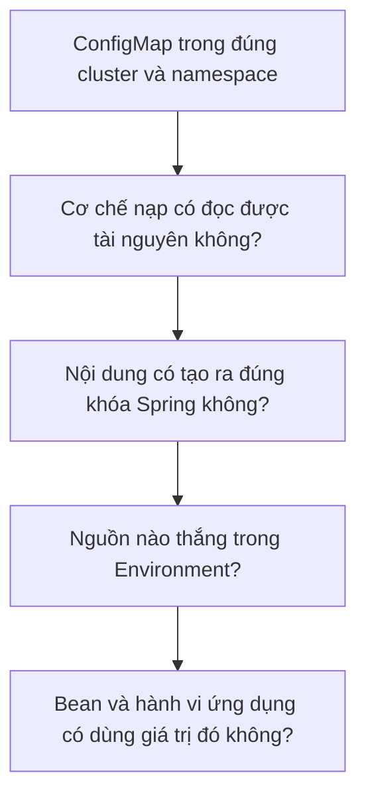

# ConfigMap không được nạp hoặc bị nguồn khác ghi đè

Trong chương **Chẩn đoán sự cố** của **SPRING_CLOUD_KUBERNETES**, bài này giải quyết tình huống ConfigMap đã có trên Kubernetes nhưng ứng dụng Spring vẫn dùng giá trị mặc định, giá trị của môi trường khác hoặc giá trị cũ.

Mục tiêu là xác định được **giá trị nào đang có hiệu lực, nguồn nào cung cấp nó và vì sao nguồn mong muốn không thắng**. Sau bài học, bạn có thể:

- Phân biệt lỗi tìm/đọc ConfigMap với lỗi ánh xạ khóa và lỗi thứ tự ưu tiên.
- Kiểm tra đúng namespace, ServiceAccount, RBAC và cơ chế nạp cấu hình.
- Tạo lại tình huống biến môi trường ghi đè ConfigMap rồi chứng minh cách sửa.
- Phân biệt nạp lúc khởi động với cập nhật cấu hình khi ứng dụng đang chạy.

Ví dụ dùng Spring Boot 3.5 và Spring Cloud Kubernetes 3.3 với cơ chế **Config Data**. Dự án cần dùng BOM Spring Cloud tương thích với Spring Boot; các đoạn dependency dưới đây không tự quản lý phiên bản. Khi áp dụng cho nhánh khác, đối chiếu tài liệu đúng phiên bản, nhất là cấu hình bootstrap và reload.

## 1. Chia sự cố thành bốn lớp

Đừng bắt đầu bằng cách sửa tất cả ConfigMap hoặc khởi động lại cả namespace. Hãy lần theo một khóa không nhạy cảm, chẳng hạn `demo.banner`.



| Lớp | Bằng chứng cần có | Ví dụ nguyên nhân |
| --- | --- | --- |
| Tìm và đọc | Tên tài nguyên, namespace, log gọi API, quyền của Pod | Sai tên, sai namespace, thiếu starter config, thiếu quyền |
| Chuyển thành thuộc tính | Khóa thực tế xuất hiện trong nguồn cấu hình | Sai tên tệp nhúng, YAML sai cấu trúc, thêm prefix |
| Chọn giá trị | Nguồn thắng và các nguồn cùng chứa khóa | Biến môi trường, tham số JVM, CLI hoặc ConfigMap khác |
| Áp dụng vào ứng dụng | Giá trị trong bean và kết quả xử lý | Bean giữ giá trị cũ, thiếu refresh, đang gọi Pod khác |

`kubectl get configmap` thành công chỉ chứng minh tài khoản đang chạy kubectl đọc được đối tượng. Nó chưa chứng minh ứng dụng đã nạp đối tượng đó.

## 2. Xác định đường đi của cấu hình trước khi kiểm tra

Một ConfigMap có thể đi vào ứng dụng qua nhiều đường. Cùng một nội dung nhưng đường đi khác nhau sẽ tạo ra nguồn cấu hình và hành vi cập nhật khác nhau.

| Đường đi | Dấu hiệu trong cấu hình triển khai | Điểm cần kiểm tra |
| --- | --- | --- |
| Spring Cloud Kubernetes đọc API | Starter config và `spring.config.import: "kubernetes:"` | Tên, namespace, API, ServiceAccount và RBAC |
| Kubernetes đưa thành biến môi trường | `env[].valueFrom.configMapKeyRef` hoặc `envFrom` | Tên biến, ánh xạ sang khóa Spring và thời điểm tạo container |
| Kubernetes mount thành tệp | `volumes[].configMap`, `volumeMounts` | Đường dẫn mount và cấu hình để Spring Boot đọc tệp |

Mount tệp không tự tạo ra một nguồn Spring Cloud Kubernetes. Với tệp `/etc/app-config/application.yaml`, có thể để Boot đọc bằng `spring.config.import: "file:/etc/app-config/application.yaml"`. Nếu mỗi tệp chỉ chứa một giá trị, dùng mô hình `configtree:/etc/app-config/` phù hợp hơn; không dùng config tree để mong Boot tự phân tích một tệp YAML nhiều thuộc tính. Xem [cơ chế import và configuration tree của Spring Boot](https://docs.spring.io/spring-boot/3.5/reference/features/external-config.html).

Nếu chỉ cần mount tệp và khởi động lại khi cấu hình thay đổi, hãy cân nhắc dùng khả năng của Kubernetes và Spring Boot. DiscoveryClient, Spring Cloud LoadBalancer và Configuration Watcher không phải điều kiện để đọc ConfigMap lúc khởi động.

## 3. Dựng cấu hình đối chứng bằng Config Data

Ví dụ dưới đây dùng:

- Namespace: `learning`.
- Ứng dụng và Deployment: `catalog-service`.
- Container: `app`.
- ConfigMap: `catalog-service`.
- ServiceAccount: `catalog-config-reader`.
- Khóa kiểm tra: `demo.banner`.

### 3.1. Dependency và cấu hình khởi động

Trong ứng dụng Spring Boot có dependency management phù hợp, thêm:

```xml
<dependency>
    <groupId>org.springframework.boot</groupId>
    <artifactId>spring-boot-starter-web</artifactId>
</dependency>
<dependency>
    <groupId>org.springframework.cloud</groupId>
    <artifactId>spring-cloud-starter-kubernetes-fabric8-config</artifactId>
</dependency>
```

Starter discovery không thay cho starter config. Ví dụ chọn Fabric8; không thêm đồng thời starter config của Kubernetes Java Client chỉ để thử sửa sự cố. Danh sách starter và nhu cầu quyền tương ứng có trong [tài liệu ServiceAccount của Spring Cloud Kubernetes](https://docs.spring.io/spring-cloud-kubernetes/reference/3.3/security-service-accounts.html).

Đặt cấu hình tìm nguồn trong `application.yaml` đóng gói cùng ứng dụng:

```yaml
spring:
  application:
    name: catalog-service
  config:
    import: "kubernetes:"
  cloud:
    kubernetes:
      config:
        enabled: true
        enable-api: true
        name: catalog-service
        namespace: learning
        include-profile-specific-sources: false
        fail-fast: true
      secrets:
        enabled: false

demo:
  banner: from-jar
```

`from-jar` là dấu hiệu đối chứng khi chẩn đoán. Việc tắt nguồn theo profile giúp bài thực hành chỉ có một ConfigMap cần xét; ứng dụng thực tế có thể chủ động bật lại.

Thông tin để tìm ConfigMap phải có sẵn **trước lúc** đọc ConfigMap: trong cấu hình đóng gói, biến môi trường hoặc tham số khởi động. Không đặt `spring.config.import` chỉ trong chính ConfigMap rồi chờ ứng dụng tự tìm ra nó.

Với cấu hình này, chọn Config Data và bỏ cơ chế bootstrap cũ nếu dự án đang bật nó. Không kết hợp `spring-cloud-starter-bootstrap` hoặc `spring.cloud.bootstrap.enabled=true` với đường nạp `spring.config.import`. Đây là giới hạn được nêu trong [tài liệu PropertySource của nhánh 3.3](https://docs.spring.io/spring-cloud-kubernetes/reference/3.3/property-source-config.html).

`fail-fast: true` giúp đưa lỗi nạp nguồn ra thời điểm khởi động. Nó không thay thế kiểm tra bắt buộc đối với từng khóa nghiệp vụ. Ứng dụng cần validation riêng nếu thiếu cấu hình phải được coi là lỗi.

### 3.2. Tài nguyên Kubernetes của bài thực hành

Lưu manifest dưới đây trong môi trường thực hành của bạn. Thay `IMAGE_DA_BUILD` bằng image chứa đúng ứng dụng ở phần 3.3 và cấu hình trên; đây là chỗ giữ chỗ, không phải image có sẵn.

```yaml
apiVersion: v1
kind: Namespace
metadata:
  name: learning
---
apiVersion: v1
kind: ServiceAccount
metadata:
  name: catalog-config-reader
  namespace: learning
---
apiVersion: rbac.authorization.k8s.io/v1
kind: Role
metadata:
  name: catalog-config-reader
  namespace: learning
rules:
  - apiGroups: [""]
    resources: ["configmaps"]
    verbs: ["get", "list"]
---
apiVersion: rbac.authorization.k8s.io/v1
kind: RoleBinding
metadata:
  name: catalog-config-reader
  namespace: learning
subjects:
  - kind: ServiceAccount
    name: catalog-config-reader
    namespace: learning
roleRef:
  apiGroup: rbac.authorization.k8s.io
  kind: Role
  name: catalog-config-reader
---
apiVersion: v1
kind: ConfigMap
metadata:
  name: catalog-service
  namespace: learning
data:
  application.yaml: |-
    demo:
      banner: from-configmap-v1
---
apiVersion: apps/v1
kind: Deployment
metadata:
  name: catalog-service
  namespace: learning
spec:
  replicas: 1
  selector:
    matchLabels:
      app: catalog-service
  template:
    metadata:
      labels:
        app: catalog-service
    spec:
      serviceAccountName: catalog-config-reader
      containers:
        - name: app
          image: IMAGE_DA_BUILD
          ports:
            - containerPort: 8080
          readinessProbe:
            httpGet:
              path: /demo/banner
              port: 8080
            initialDelaySeconds: 5
            periodSeconds: 5
```

Role này chỉ phục vụ đọc ConfigMap trong namespace `learning`; không cấp quyền Secret, sửa tài nguyên hoặc đọc toàn cluster. `list` được giữ cho đường đọc bằng client có sử dụng truy vấn danh sách. Nếu hệ thống dùng watch, cần xác định thành phần thực hiện watch và cấp quyền tương ứng cho chính thành phần đó. Cấu trúc Role/RoleBinding được mô tả trong [tài liệu RBAC của Kubernetes](https://kubernetes.io/docs/reference/access-authn-authz/rbac/).

Readiness probe ở đây chỉ phục vụ bản demo. HTTP 200 chứng minh ứng dụng trả lời được, chưa chứng minh `demo.banner` đến từ đúng nguồn; phải kiểm tra cả nội dung trả về.

### 3.3. Ứng dụng quan sát một khóa an toàn

Lớp dưới đây vừa cung cấp endpoint kiểm tra, vừa in các nguồn chứa `demo.banner` khi khởi động. Đặt lớp trong package gốc của ứng dụng hoặc dùng trực tiếp làm lớp chạy chính.

```java
package vn.example.k8sconfig;

import java.util.Arrays;

import org.springframework.boot.ApplicationRunner;
import org.springframework.boot.SpringApplication;
import org.springframework.boot.autoconfigure.SpringBootApplication;
import org.springframework.context.annotation.Bean;
import org.springframework.core.env.ConfigurableEnvironment;
import org.springframework.core.env.PropertySource;
import org.springframework.web.bind.annotation.GetMapping;
import org.springframework.web.bind.annotation.RestController;

@SpringBootApplication
@RestController
public class ConfigMapDemoApplication {

    private final ConfigurableEnvironment environment;

    public ConfigMapDemoApplication(ConfigurableEnvironment environment) {
        this.environment = environment;
    }

    public static void main(String[] args) {
        SpringApplication.run(ConfigMapDemoApplication.class, args);
    }

    @GetMapping("/demo/banner")
    public String banner() {
        return environment.getProperty("demo.banner", "<missing>");
    }

    @Bean
    ApplicationRunner reportConfig(ConfigurableEnvironment env) {
        return args -> {
            String key = "demo.banner";
            System.out.println("activeProfiles="
                    + Arrays.toString(env.getActiveProfiles()));
            System.out.println("effective " + key + "=" + env.getProperty(key));

            for (PropertySource<?> source : env.getPropertySources()) {
                if ("configurationProperties".equals(source.getName())) {
                    continue;
                }
                if (source.getProperty(key) != null) {
                    System.out.println("candidate source=" + source.getName());
                }
            }
        };
    }
}
```

Chương trình chỉ in giá trị của khóa demo đã biết và tên các nguồn ứng viên. Nguồn tổng hợp `configurationProperties` được bỏ qua để tránh coi lớp thích nghi phục vụ binding là một nguồn dữ liệu độc lập. Các nguồn ứng viên còn lại được in theo thứ tự đang có trong `Environment`; không sửa thứ tự đó khi chẩn đoán. API truy cập danh sách nguồn được mô tả tại [ConfigurableEnvironment](https://docs.spring.io/spring-framework/docs/current/javadoc-api/org/springframework/core/env/ConfigurableEnvironment.html).

Endpoint đọc `Environment` mỗi lần gọi, nên thuận tiện để phân biệt dữ liệu nguồn với giá trị bean đã giữ từ lúc tạo. Chỉ dùng endpoint demo cho dữ liệu không nhạy cảm và bỏ phần chẩn đoán sau thực hành.

### 3.4. Xác nhận kết quả ban đầu

Các lệnh trong bài dùng PowerShell ở máy có kubectl. Sau khi áp dụng manifest đã thay image:

```powershell
kubectl -n learning rollout status deployment/catalog-service
kubectl -n learning get pods -l app=catalog-service -o wide

$podName = kubectl -n learning get pods -l app=catalog-service -o jsonpath='{.items[0].metadata.name}'
kubectl -n learning logs $podName -c app --tail=200
kubectl -n learning port-forward pod/$podName 18080:8080
```

Giữ terminal port-forward mở. Trong terminal thứ hai:

```powershell
Invoke-RestMethod 'http://127.0.0.1:18080/demo/banner'
```

Kết quả mong đợi là `from-configmap-v1`. Log phải có giá trị hiệu lực này và một nguồn Kubernetes tương ứng. Tên chính xác của nguồn có thể thay đổi giữa các client và phiên bản; không viết quy trình phụ thuộc vào một chuỗi tên nguồn cố định.

## 4. Thu thập bằng chứng từ đúng Pod

Trong hệ thống đang gặp sự cố, ghi lại cluster context, namespace và Pod trước khi sửa:

```powershell
kubectl config current-context
kubectl -n learning get deployment catalog-service -o wide
kubectl -n learning get pods -l app=catalog-service -o wide
kubectl -n learning get configmap catalog-service -o yaml
```

Với ConfigMap chứa nhiều thông tin, chỉ lấy metadata và đúng khóa cần kiểm tra:

```powershell
kubectl -n learning get configmap catalog-service -o jsonpath='{.metadata.resourceVersion}'
kubectl -n learning get configmap catalog-service -o go-template='{{ index .data "application.yaml" }}'
```

Không suy luận từ bản manifest trong Git rằng Pod hiện tại đã nhận đúng bản đó. Đối chiếu cả trạng thái Deployment mong muốn và Pod thực tế:

```powershell
kubectl -n learning get deployment catalog-service -o yaml
kubectl -n learning get pod $podName -o yaml
kubectl -n learning get pod $podName -o jsonpath='{.spec.serviceAccountName}'
kubectl -n learning logs $podName -c app --tail=200
```

Chú ý các mục `command`, `args`, `env`, `envFrom`, `volumeMounts`, `volumes` và `serviceAccountName`. Không chia sẻ nguyên bản đầu ra nếu manifest chứa thông tin nhạy cảm trong biến môi trường.

Nếu container đã khởi động lại:

```powershell
kubectl -n learning logs $podName -c app --previous --tail=200
kubectl -n learning describe pod $podName
```

`--previous` chỉ có ích khi còn log của lần chạy container trước. Sự kiện Pod thường giúp tìm lỗi mount hoặc container không khởi động; lỗi Spring đọc API thường phải tìm trong log ứng dụng.

## 5. Nhánh A: ConfigMap chưa đi vào Environment

### 5.1. Kiểm tra tên và namespace trước

Trong ví dụ, tên cần đọc được cố định bằng `spring.cloud.kubernetes.config.name`. Nếu không cấu hình tên riêng, kiểm tra `spring.application.name`; đừng mặc định tên Kubernetes Deployment hay Service sẽ tự trở thành tên ConfigMap.

Namespace của nguồn có thể được cấu hình ở từng mục `sources` hoặc cấu hình chung. Khi không chỉ định, việc phân giải namespace còn phụ thuộc cấu hình client và thông tin ServiceAccount trong Pod. Đọc ConfigMap ở namespace khác cũng cần quyền ở namespace đích. Xem [thứ tự phân giải namespace](https://docs.spring.io/spring-cloud-kubernetes/reference/3.3/property-source-config/namespace-resolution.html).

Lập bảng đối chiếu cho ca đang xử lý:

| Đại lượng | Ví dụ mong muốn | Cần xác minh tại đâu |
| --- | --- | --- |
| Cluster | Cluster thử nghiệm hiện tại | Context kubectl và nơi Pod thực sự chạy |
| Namespace nguồn | `learning` | Cấu hình hiệu lực dùng để khởi tạo client/nguồn |
| Tên ConfigMap | `catalog-service` | `config.name` hoặc từng mục `config.sources` |
| Tên ứng dụng | `catalog-service` | Cấu hình khởi động, không suy từ tên Deployment |
| Profile | Không có trong lab cơ bản | Log active profiles của Pod |
| ServiceAccount | `catalog-config-reader` | `spec.serviceAccountName` của Pod |

### 5.2. Kiểm tra quyền bằng danh tính ứng dụng

```powershell
kubectl auth can-i get configmaps/catalog-service -n learning --as=system:serviceaccount:learning:catalog-config-reader
kubectl auth can-i list configmaps -n learning --as=system:serviceaccount:learning:catalog-config-reader
```

Lệnh dùng impersonation; tài khoản chạy kubectl cần được phép thực hiện việc đó. Nếu API từ chối impersonation, kết quả chưa trả lời được quyền của ServiceAccount. Nhờ người quản trị kiểm tra bằng danh tính phù hợp thay vì kết luận ngay ứng dụng thiếu quyền. Xem [kubectl auth can-i](https://kubernetes.io/docs/reference/kubectl/generated/kubectl_auth/kubectl_auth_can-i/).

Đọc lỗi trước khi đổi Role:

| Dấu hiệu | Hướng điều tra |
| --- | --- |
| `403 Forbidden` | Danh tính đã được nhận nhưng thiếu quyền cho verb, resource hoặc namespace đang gọi |
| `401 Unauthorized` | Token/chứng thực không được chấp nhận |
| `404 Not Found` khi đọc tên cụ thể | Đối chiếu tên và namespace; xem có đang gọi đúng cluster không |
| Timeout, lỗi DNS hoặc TLS | Kết nối Pod tới API server, CA, endpoint và chính sách mạng |
| Không thấy hoạt động nạp Kubernetes | Starter, import, cờ enabled và điều kiện kích hoạt |

Đừng cấp `cluster-admin` để làm mất lỗi 403. Hãy xác định yêu cầu thực tế trong log, chẳng hạn client đang `list configmaps` trong `learning`, rồi sửa đúng Role và RoleBinding.

Với đường đọc API, kiểm tra thêm việc mount thông tin ServiceAccount và cấu hình `automountServiceAccountToken`. Với đường mount ConfigMap do kubelet cung cấp, ứng dụng không cần quyền API chỉ để đọc tệp đã mount; hai trường hợp này không có cùng nhu cầu RBAC.

### 5.3. Kiểm tra cơ chế nạp và thông báo lỗi khởi động

Nếu tên và quyền đều đúng, đối chiếu cấu hình có hiệu lực:

- Dependency config có thật sự nằm trong artifact/image đang chạy không?
- `spring.config.import` có chứa `"kubernetes:"` trong đường nạp được chọn không?
- `spring.cloud.kubernetes.enabled`, `config.enabled` hoặc `config.enable-api` có bị tắt ở nguồn khác không?
- Ứng dụng có đang trộn bootstrap cũ với Config Data không?
- Log có cảnh báo đọc nguồn thất bại nhưng ứng dụng vẫn tiếp tục dùng mặc định không?

Có thể bật tạm logger sau khi tái hiện trong môi trường chẩn đoán:

```yaml
logging:
  level:
    org.springframework.boot.context.config: TRACE
    org.springframework.cloud.kubernetes: DEBUG
```

Đặt cấu hình logger ở nguồn ứng dụng chắc chắn đọc được. Không đặt nó duy nhất trong ConfigMap đang không nạp được. Mức TRACE/DEBUG có thể tạo nhiều log; chỉ giữ trong khoảng điều tra và kiểm tra thông tin trước khi chia sẻ.

Đừng coi `optional:kubernetes:` và `fail-fast` là cùng một cơ chế. `optional:` liên quan đến cách Config Data xử lý location tùy chọn; `config.fail-fast` điều khiển hành vi khi nạp nguồn Kubernetes gặp lỗi. Không dùng việc “ứng dụng vẫn chạy” làm bằng chứng nguồn đã nạp thành công.

## 6. Nhánh B: đọc được tài nguyên nhưng không có đúng khóa

### 6.1. Phân biệt khóa trực tiếp với tệp nhúng

Hai cách biểu diễn sau đều hướng tới thuộc tính `demo.banner`.

Dạng khóa trực tiếp:

```yaml
data:
  demo.banner: "from-flat-key"
```

Dạng tệp nhúng:

```yaml
data:
  application.yaml: |-
    demo:
      banner: from-embedded-yaml
```

Với dạng thứ hai, có hai lớp YAML: manifest Kubernetes và tài liệu YAML nằm trong chuỗi `application.yaml`. Manifest áp dụng thành công chưa chứng minh tài liệu bên trong hợp lệ hoặc tạo ra đúng khóa.

Kiểm tra các lỗi nhỏ nhưng thường gặp:

| Nội dung quan sát | Cần đối chiếu |
| --- | --- |
| `demo.baner` | Sai chính tả so với `demo.banner` |
| `demoBanner` ở gốc YAML | Không cùng cấu trúc với `demo.banner` |
| `banner` bị thụt sang nhánh khác | Khóa sau khi phân tích khác dự kiến |
| Tệp nhúng có tên tùy ý giữa nhiều mục `data` | Không mặc định mọi khóa kết thúc bằng `.yaml` đều được phân tích |
| `data` chứa số/boolean trực tiếp | Giá trị `data` của ConfigMap phải là chuỗi; đặt trong dấu nháy |
| Dùng `envFrom` với một mục `application.yaml` | Không có bước tự phân tích YAML thành từng biến môi trường nghiệp vụ |

Trong đường nạp Spring Cloud Kubernetes, cần kiểm tra quy tắc tên tệp theo tên ứng dụng, tệp `application.*`, profile và trường hợp đặc biệt chỉ có một khóa dạng tệp. Để giảm biến số, ví dụ dùng duy nhất `application.yaml` như phần 3. Quy tắc xử lý được nêu tại [ConfigMap PropertySource 3.3](https://docs.spring.io/spring-cloud-kubernetes/reference/3.3/property-source-config/configmap-propertysource.html).

### 6.2. Kiểm tra prefix và profile

Cấu hình dưới đây chủ động đổi tên thuộc tính sau khi nạp:

```yaml
spring:
  cloud:
    kubernetes:
      config:
        sources:
          - name: catalog-service
            namespace: learning
            explicit-prefix: catalog
```

Khi đó, khóa cần tìm là `catalog.demo.banner`. Nếu code vẫn đọc `demo.banner`, việc nhận giá trị mặc định có thể là đúng theo cấu hình prefix. Tương tự, kiểm tra `use-name-as-prefix` khi gặp một nhóm thuộc tính có tên ConfigMap đứng trước.

Đối với profile, tách hai câu hỏi:

1. Tài liệu nhúng theo profile có được chọn không?
2. Có ConfigMap riêng theo profile được đưa vào danh sách nguồn không?

Đó là hai cơ chế khác nhau. Trong ca thực tế, ghi lại active profiles và mọi nguồn liên quan. Trong bài thực hành, `include-profile-specific-sources: false` chỉ nhằm loại nguồn ConfigMap bổ sung theo profile; không dùng cờ đó như một cách tắt toàn bộ hành vi profile của Spring Boot.

## 7. Nhánh C: ConfigMap đã nạp nhưng nguồn khác thắng

### 7.1. Đọc thứ tự ưu tiên tại đúng tầng

Với đường Config Data trong bài, các nguồn thường gặp có thứ tự ưu tiên giảm dần:

| Ưu tiên tương đối | Nguồn | Ví dụ cùng khóa |
| --- | --- | --- |
| Cao hơn | Tham số ứng dụng | `--demo.banner=from-cli` |
| Tiếp theo | `SPRING_APPLICATION_JSON` | JSON chứa `demo.banner` |
| Tiếp theo | Java system property | `-Ddemo.banner=from-jvm` |
| Tiếp theo | Biến môi trường hệ điều hành | `DEMO_BANNER=from-env` |
| Thấp hơn các nguồn trên | Config Data | Tài liệu đóng gói, tệp ngoài và các import |

Đây là phần trích lọc phục vụ chẩn đoán ứng dụng thông thường; test, servlet container và nguồn tự thêm có thể làm bức tranh khác đi. Đối chiếu [thứ tự PropertySource của Spring Boot](https://docs.spring.io/spring-boot/reference/features/external-config.html) và dữ liệu thực tế của Pod.

Trong Config Data, nguồn import có thể ghi đè tài liệu khai báo import; nhiều import còn có quan hệ thứ tự riêng. Vì vậy, không dùng câu “ConfigMap luôn thắng application.yaml” cho mọi cách bố trí. Cần biết ConfigMap được đưa vào ở đâu và còn tài liệu nào được xử lý với ưu tiên cao hơn. [Tài liệu Kubernetes PropertySource hiện hành](https://docs.spring.io/spring-cloud-kubernetes/reference/property-source-config.html) giải thích quan hệ này với Config Data.

Một số nơi dễ bỏ sót khi tìm nguồn ghi đè:

- `env` hoặc `envFrom` của container, kể cả giá trị được đưa từ ConfigMap khác.
- `JAVA_TOOL_OPTIONS`, `JDK_JAVA_OPTIONS`, script entrypoint và tham số `-D`.
- `args` chứa `--demo.banner=...`.
- `SPRING_APPLICATION_JSON`.
- Tệp cấu hình ngoài image, Config Server hoặc một import khác.
- `EnvironmentPostProcessor` hoặc code tự thêm `PropertySource`.

`JAVA_OPTS` chỉ có tác dụng nếu script chạy Java sử dụng nó; đừng mặc định JVM tự đọc mọi biến có chữ JAVA.

Nếu cần kiểm tra môi trường container, chỉ đọc biến liên quan và chỉ khi image có công cụ đó:

```powershell
kubectl -n learning exec $podName -c app -- printenv DEMO_BANNER
```

Image tối giản có thể không có `printenv`. Khi đó dùng manifest Pod và công cụ chẩn đoán được phép; lỗi thiếu executable không chứng minh biến không tồn tại. Cũng không coi `kubectl exec -- env` là danh sách đầy đủ nguồn Spring: tham số JVM, CLI, Config Data và nguồn tự thêm nằm ngoài kết quả đó.

### 7.2. Kiểm tra xung đột ngay trong ConfigMap và giữa các nguồn

Ví dụ cố ý tạo xung đột:

```yaml
apiVersion: v1
kind: ConfigMap
metadata:
  name: catalog-service
  namespace: learning
data:
  application.yaml: |-
    demo:
      banner: from-embedded-yaml
  demo.banner: "from-flat-key"
```

Trong cách xử lý của nhánh 3.3, khóa trực tiếp có thể ghi đè giá trị cùng khóa trong tài liệu nhúng. Hãy tránh duy trì cùng một thuộc tính ở cả hai dạng. Khi có nhiều nguồn:

```yaml
spring:
  cloud:
    kubernetes:
      config:
        namespace: learning
        sources:
          - name: catalog-common
          - name: catalog-service
```

Với danh sách nguồn được đặt tên và thứ tự này, nguồn phía sau có thể ghi đè khóa trùng từ nguồn phía trước. Không mở rộng giả định đó thành một thứ tự ổn định cho các ConfigMap được tìm bằng label. Khi lựa chọn bằng label, hãy tránh khóa trùng hoặc dùng prefix rõ ràng.

Nếu đồng thời bật nguồn ConfigMap và Secret, cũng phải xem quan hệ của hai nguồn. Nhánh 3.3 mô tả ConfigMap có ưu tiên cao hơn Secret khi cùng chứa một khóa; đó không phải lý do đưa dữ liệu bí mật vào ConfigMap. Xem [Order of ConfigMaps and Secrets](https://docs.spring.io/spring-cloud-kubernetes/reference/3.3/property-source-config/order_of_configMaps_and_secrets.html). Lab tắt nguồn Secret để giữ phạm vi kiểm tra rõ ràng.

### 7.3. Dùng Actuator nếu hệ thống đã có kênh chẩn đoán được bảo vệ

Với ứng dụng đã cài Actuator và cho phép truy cập endpoint phù hợp:

- `GET /actuator/env/demo.banner`: xem thông tin nguồn của khóa cụ thể.
- `GET /actuator/configprops`: đối chiếu bean `@ConfigurationProperties` đã bind.

Nguồn và origin giúp giải thích cấu hình, còn giá trị trả về có thể đã bị che. Chuỗi `******` không có nghĩa thuộc tính bị thiếu. Cũng cần phân biệt endpoint không được expose, yêu cầu chưa được xác thực và thuộc tính thật sự không tồn tại.

Không bật hiển thị toàn bộ giá trị chỉ để kiểm tra một khóa. Endpoint, quyền truy cập và sanitization được mô tả trong [tài liệu Actuator endpoints](https://docs.spring.io/spring-boot/3.5/reference/actuator/endpoints.html); cấu trúc phản hồi theo khóa có trong [API của env endpoint](https://docs.spring.io/spring-boot/3.5/api/rest/actuator/env.html).

Trong lab không có Actuator, endpoint `/demo/banner` và log của phần 3 vẫn đủ chứng minh tình huống ghi đè.

## 8. Thực hành: biến môi trường ghi đè ConfigMap

Chỉ chạy các lệnh thay đổi dưới đây trên Deployment thực hành của phần 3. Dừng phiên port-forward cũ trước khi thay Pod.

### 8.1. Tạo nguồn ghi đè có chủ đích

```powershell
kubectl -n learning set env deployment/catalog-service DEMO_BANNER=from-env
kubectl -n learning rollout status deployment/catalog-service
kubectl -n learning get pods -l app=catalog-service -o wide
```

Sau khi rollout hoàn tất, lấy tên Pod mới. Với lab một replica, dùng:

```powershell
$podName = kubectl -n learning get pods -l app=catalog-service --field-selector=status.phase=Running -o jsonpath='{.items[0].metadata.name}'
kubectl -n learning logs $podName -c app --tail=200
kubectl -n learning port-forward pod/$podName 18080:8080
```

Nếu còn Pod cũ đang kết thúc, kiểm tra tuổi Pod và ReplicaSet trước khi chọn; trong hệ thống nhiều replica phải chọn rõ Pod, không mặc định phần tử đầu tiên là bản mới.

Gọi lại endpoint ở terminal thứ hai:

```powershell
Invoke-RestMethod 'http://127.0.0.1:18080/demo/banner'
```

Kết quả mong đợi:

- Endpoint trả `from-env`.
- ConfigMap vẫn chứa `from-configmap-v1`.
- Log ghi nhận `systemEnvironment` cùng nguồn Kubernetes trong các ứng viên chứa khóa.

Kết luận có bằng chứng là **ConfigMap đã được nạp nhưng biến môi trường có ưu tiên cao hơn**. Việc sửa nội dung ConfigMap nhiều lần sẽ không loại bỏ nguồn thắng này.

### 8.2. Gỡ đúng nguồn ghi đè

Dừng port-forward, gỡ biến khỏi template của Deployment rồi chờ rollout:

```powershell
kubectl -n learning set env deployment/catalog-service DEMO_BANNER-
kubectl -n learning rollout status deployment/catalog-service
kubectl -n learning get pods -l app=catalog-service -o wide
```

Chọn Pod mới và mở lại port-forward như trên. Endpoint phải trở lại `from-configmap-v1`.

Nếu triển khai bằng Helm hoặc GitOps, sửa cả nguồn khai báo tạo ra biến này. Thay đổi trực tiếp qua kubectl có thể bị lần đồng bộ tiếp theo ghi đè. Đây là lý do cần kiểm tra cả Pod thực tế và cấu hình triển khai được quản lý.

## 9. Nhánh D: ConfigMap đã đổi nhưng ứng dụng vẫn dùng giá trị cũ

Đây là câu hỏi về **thời điểm cập nhật**, khác với việc lần đầu không đọc được nguồn.

| Cách sử dụng | Sau khi sửa ConfigMap | Việc cần xác minh tiếp |
| --- | --- | --- |
| `env` hoặc `envFrom` | Môi trường container hiện tại giữ giá trị cũ | Tạo lại Pod để nhận biến mới |
| Volume ConfigMap thông thường | Tệp được cập nhật theo cơ chế đồng bộ của kubelet | Tệp thực tế và bước đọc lại của ứng dụng |
| Mount bằng `subPath` | Mount đó không nhận cập nhật ConfigMap | Thiết kế mount hoặc tạo lại Pod |
| Spring Cloud Kubernetes đọc API lúc khởi động | Không suy ra có refresh chỉ từ việc nạp thành công | Cơ chế refresh/restart đã cấu hình |
| Nguồn đã refresh nhưng bean giữ bản sao | Có thể tồn tại khác biệt giữa Environment và bean | Binding, vòng đời bean và tài nguyên được tạo trước đó |

Các quy tắc cập nhật env, volume và `subPath` được Kubernetes mô tả trong [ConfigMaps](https://kubernetes.io/docs/concepts/configuration/configmap/). Tệp trên đĩa đã mới không đủ chứng minh Spring đã đọc lại tệp.

Configuration Watcher là thành phần bổ sung để phát hiện thay đổi và kích hoạt luồng cập nhật đã thiết lập. Nếu dùng nó, kiểm tra namespace được theo dõi, label chọn tài nguyên, ánh xạ ứng dụng, quyền của Watcher và đường gọi refresh/Bus. Watcher không làm biến mất thứ tự ưu tiên: biến môi trường `DEMO_BANNER` vẫn có thể thắng sau refresh. Xem [Configuration Watcher 3.3](https://docs.spring.io/spring-cloud-kubernetes/reference/3.3/spring-cloud-kubernetes-configuration-watcher.html).

Khi điều tra giá trị cũ, phân biệt:

1. Giá trị mới đã có trong đối tượng ConfigMap chưa?
2. Tệp hoặc nguồn Spring đã nhận bản mới chưa?
3. `Environment` trả về gì?
4. Bean và tài nguyên phụ thuộc đang giữ giá trị nào?
5. Request có đi vào đúng Pod đã kiểm tra không?

Một trường `@Value` được gán khi bean tạo ra không tự được tính lại chỉ vì file thay đổi. Bean cấu hình, cache, thread pool hoặc client kết nối có thể cần cách cập nhật riêng. Không áp dụng một lệnh refresh cho mọi tài nguyên mà chưa biết vòng đời của chúng.

Để tạo đối chứng trong lab **không cấu hình Watcher**, sửa banner trong ConfigMap thành `from-configmap-v2`, sau đó tạo lại Pod bằng rollout có kiểm soát:

```powershell
kubectl -n learning rollout restart deployment/catalog-service
kubectl -n learning rollout status deployment/catalog-service
kubectl -n learning get pods -l app=catalog-service -o wide
```

Dừng port-forward cũ, chọn Pod mới và kiểm tra lại endpoint/log. Nếu biến môi trường đã được gỡ và ConfigMap mới đã được đọc, kết quả mong đợi là `from-configmap-v2`.

Khởi động lại là phép đối chứng và một lựa chọn triển khai khi phù hợp. Nó không thay thế việc xác định nguyên nhân nếu hệ thống được thiết kế phải tự cập nhật.

## 10. Bảng xử lý nhanh theo bằng chứng

| Quan sát | Kết luận tạm thời | Bước tiếp theo có mục tiêu |
| --- | --- | --- |
| kubectl đọc được ConfigMap, ứng dụng báo 403 | Quyền của người vận hành khác quyền Pod | Xem ServiceAccount và RoleBinding ở namespace nguồn |
| Pod báo thiếu tệp cấu hình | Đường đọc mount đang lỗi | So đường mount với đường import, không bắt đầu từ RBAC ứng dụng |
| Không có nguồn Kubernetes trong log chẩn đoán | Có thể chưa kích hoạt đường nạp | Kiểm tra image, starter, import và cờ enabled |
| Nguồn Kubernetes có nhưng không chứa khóa | Tên khóa hoặc cách phân tích cần kiểm tra | Xem tệp nhúng, prefix, profile và danh sách sources |
| Nguồn ConfigMap có khóa, `systemEnvironment` cũng có | Có cạnh tranh nguồn | Kiểm tra biến môi trường và giá trị hiệu lực |
| API ConfigMap mới, ứng dụng vẫn cũ | Chưa chứng minh luồng cập nhật hoạt động | Kiểm tra env/volume/API, refresh và vòng đời bean |
| Một số request mới, một số cũ | Có thể các Pod khác phiên bản cấu hình | Kiểm tra từng Pod và quá trình rollout |
| Tắt fail-fast thì Pod chạy được | Lỗi nạp có thể đang bị che | Xem lại lỗi gốc; không coi Running là xác nhận cấu hình |
| Sửa bằng kubectl rồi lỗi quay lại | Nguồn khai báo có thể ghi đè thay đổi trực tiếp | Kiểm tra Helm/GitOps hoặc controller quản lý |

## 11. Tiêu chí kết thúc điều tra

Một ca chỉ nên được đóng khi có đủ bằng chứng cho chuỗi nguyên nhân và cách sửa:

- Đã xác nhận đúng cluster, namespace, Pod, image và ServiceAccount.
- Đã biết ứng dụng dùng API, biến môi trường hay tệp mount để nhận cấu hình.
- Đã xác định đúng tên ConfigMap, khóa sau khi phân tích và active profiles liên quan.
- Đã chỉ ra nguồn cung cấp giá trị hiệu lực; nếu có ghi đè, đã chỉ ra nguồn thắng.
- Đã sửa nơi khai báo tạo ra vấn đề và kiểm tra trên Pod sau thay đổi.
- Đã kiểm tra hành vi ứng dụng, thay vì chỉ dựa vào trạng thái Running/Ready.
- Đã xác nhận cách áp dụng lần đổi cấu hình tiếp theo: refresh hay rollout.
- Đã gỡ phần chẩn đoán tạm và giữ quyền đọc phù hợp với tính năng thực sự dùng.

Ví dụ biên bản ngắn cho ca thực hành:

> Pod mới của catalog-service trong namespace learning nạp được ConfigMap catalog-service. Giá trị demo.banner ban đầu là from-env vì Deployment khai báo DEMO_BANNER. Sau khi gỡ biến ở nguồn triển khai và rollout, endpoint của Pod mới trả from-configmap-v1. Không cần thay RBAC hoặc bổ sung Watcher để giải quyết nguyên nhân ghi đè này.

Bằng chứng quan trọng nhất là đường đi từ **đối tượng Kubernetes → nguồn Spring → giá trị hiệu lực → hành vi trên đúng Pod**. Chuỗi đó giúp chọn đúng tính năng Spring Cloud Kubernetes cần dùng và sửa đúng nơi tạo ra sự cố.
