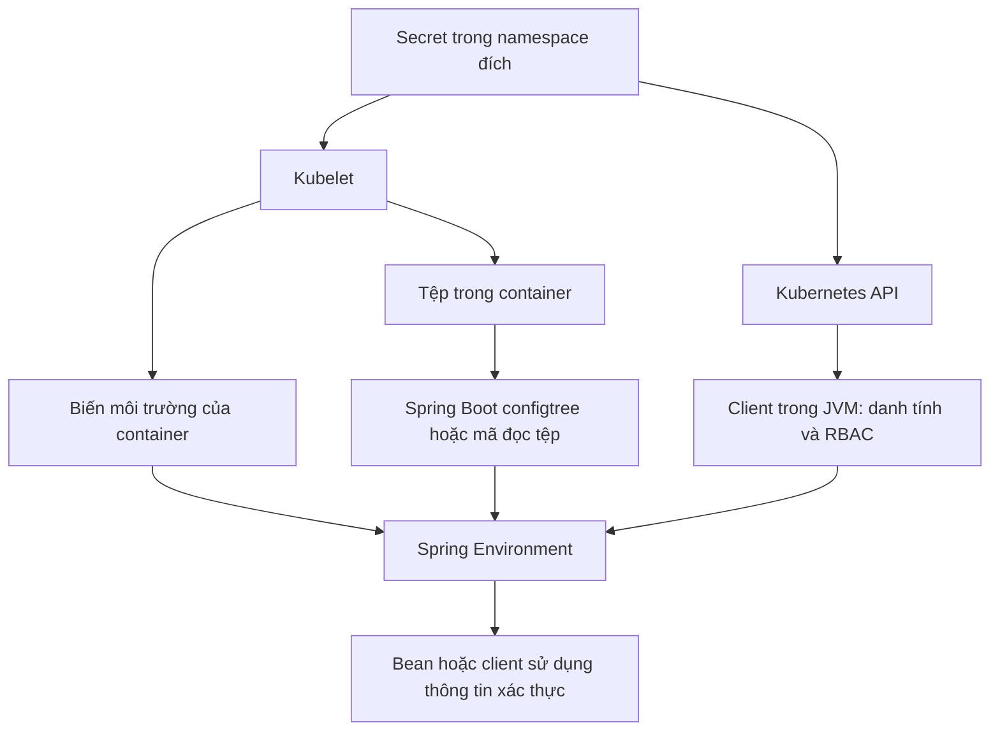

# Secret không được đọc do cấu hình, mount hoặc quyền

Trong chương **Chẩn đoán sự cố** của module **SPRING_CLOUD_KUBERNETES**, bài này hướng dẫn tìm nguyên nhân khi ứng dụng Spring thiếu thông tin xác thực, Pod không khởi động được hoặc vẫn dùng Secret cũ sau khi cập nhật.

Mục tiêu là xác định dữ liệu bị gián đoạn ở đâu: đối tượng Secret, cấu hình Pod, tệp hoặc biến môi trường trong container, Kubernetes API, hay quá trình nạp thuộc tính của Spring. Sau bài học, bạn có thể sửa đúng lớp lỗi, kiểm chứng kết quả và lựa chọn phần Spring Cloud Kubernetes thực sự cần.

Ví dụ dùng namespace `learning`, ứng dụng `orders-api`, Secret `orders-db` và hai thuộc tính `db.username`, `db.password`. Phần tích hợp API lấy **Spring Cloud Kubernetes 3.3.x với Fabric8** làm mốc; quản lý dependency bằng Spring Cloud BOM tương thích với Spring Boot của dự án. Với phiên bản khác, tra tài liệu đúng nhánh trước khi áp dụng tên thuộc tính hoặc giá trị mặc định. [Danh sách thuộc tính 3.3](https://docs.spring.io/spring-cloud-kubernetes/reference/3.3/appendix.html)

## 1. Xác định đường đi của Secret trước khi sửa

Một Secret tồn tại trong cluster chưa chứng minh ứng dụng đã nhận được nó. Có ba đường đi phổ biến:

| Cách nhận | Thành phần đưa dữ liệu vào ứng dụng | Cách Spring sử dụng | ServiceAccount ứng dụng cần quyền API đọc Secret? |
| --- | --- | --- | --- |
| Volume Secret | Kubelet chiếu Secret thành tệp trong container | Đọc tệp hoặc import `configtree:` | Không, nếu ứng dụng chỉ đọc volume |
| `secretKeyRef` trong `env` | Kubernetes thiết lập biến môi trường khi container khởi động | Spring đọc biến môi trường | Không, nếu ứng dụng chỉ đọc biến môi trường |
| Spring Cloud Kubernetes gọi API | Kubernetes client trong JVM | Secret trở thành `PropertySource` | Có |

Hai hàng đầu vẫn phụ thuộc quyền và khả năng truy cập của hạ tầng Kubernetes, nhưng không dùng danh tính API của JVM để tải Secret. Cấp thêm Role cho ứng dụng không sửa được đường dẫn mount sai. Ngược lại, mount thành công không chứng minh client trong JVM có quyền gọi API.



Hãy ghi lại đường đi dự kiến của từng thuộc tính. Nếu `db.password` đồng thời đến từ volume, biến môi trường và API, việc xác định nguồn đang có hiệu lực sẽ khó hơn.

## 2. Phân loại triệu chứng bằng bằng chứng

| Bằng chứng quan sát được | Lớp nên kiểm tra trước | Hành động tiếp theo |
| --- | --- | --- |
| Event `FailedMount`, thông báo không tìm thấy Secret | Secret hoặc cấu hình volume | So sánh namespace, `secretName`, `items[].key` |
| `CreateContainerConfigError`, thiếu key được tham chiếu | Cấu hình container | Kiểm tra `secretKeyRef.name`, `key` và Secret đích |
| Tệp tồn tại nhưng `Permission denied` | Quyền hệ điều hành | Kiểm tra UID, GID, mode và quyền đi qua thư mục |
| Client JVM nhận HTTP 403 `Forbidden` | Phân quyền API | Đọc danh tính, verb, resource và namespace trong lỗi |
| Client JVM nhận HTTP 401 `Unauthorized` | Xác thực API | Kiểm tra nguồn token, thời hạn, audience và cấu hình client |
| `Could not resolve placeholder` | Spring chưa có thuộc tính | Kiểm tra import, profile, tên key và nguồn thuộc tính |
| Ứng dụng chạy nhưng đăng nhập cơ sở dữ liệu thất bại | Giá trị có hiệu lực hoặc hệ thống đích | Kiểm tra nguồn ghi đè, dữ liệu có ký tự thừa và tài khoản phía cơ sở dữ liệu |
| Đã đổi Secret nhưng ứng dụng vẫn dùng giá trị cũ | Chuỗi cập nhật | Phân biệt cập nhật tệp, Spring Environment và tài nguyên đang mở |

Bảng giúp chọn điểm bắt đầu; một triệu chứng có thể có nhiều nguyên nhân. Đọc thông báo cụ thể trước khi thay đổi cấu hình. Kubernetes ghi Event khi không lấy được Secret bắt buộc; Secret hoặc key bắt buộc bị thiếu có thể ngăn container khởi động. [Ràng buộc sử dụng Secret](https://kubernetes.io/docs/concepts/configuration/secret/#using-a-secret)

## 3. Thu thập thông tin mà không in giá trị bí mật

Các lệnh `bash` trong bài dùng Bash, chẳng hạn WSL hoặc máy quản trị Linux; lệnh chạy trong container giả định container Linux có công cụ tương ứng.

### 3.1. Xác nhận cluster, namespace và Pod đang lỗi

```bash
kubectl config current-context
kubectl get pods -n learning -l app=orders-api
```

Chọn đúng Pod từ kết quả, rồi thay tên mẫu dưới đây:

```bash
POD=orders-api-xxxxxxxxxx-yyyyy

kubectl describe pod "$POD" -n learning
kubectl logs "$POD" -n learning -c app --tail=100
kubectl logs "$POD" -n learning -c app --previous --tail=100
```

`--previous` chỉ có ích khi container đã chạy rồi thoát. Nếu lỗi xảy ra trước khi tiến trình Java được tạo, Event thường có giá trị hơn log ứng dụng. Khi chia sẻ bằng chứng, lọc thông tin nhạy cảm trong log hoặc phần biến môi trường khai báo trực tiếp.

### 3.2. Kiểm tra Secret mà không xuất trường data

```bash
kubectl get secret orders-db -n learning -o custom-columns=NAME:.metadata.name,NAMESPACE:.metadata.namespace,TYPE:.type,VERSION:.metadata.resourceVersion

kubectl get secret orders-db -n learning -o go-template='{{range $key, $value := .data}}{{printf "%s\n" $key}}{{end}}'
```

Lệnh thứ hai chỉ in tên key; mong đợi có `db.username` và `db.password`. Kết quả cho biết đối tượng và key tồn tại, chưa chứng minh giá trị đúng hoặc ứng dụng đọc được.

Không dùng `kubectl get secret ... -o yaml`, `cat` tệp Secret hoặc `printenv` toàn bộ để đưa bằng chứng vào ticket. Base64 trong `data` có thể giải mã; đó không phải cơ chế che giấu an toàn. [Thực hành bảo vệ Secret](https://kubernetes.io/docs/concepts/security/secrets-good-practices/)

### 3.3. Kiểm tra Pod thực tế

```bash
kubectl get pod "$POD" -n learning -o jsonpath='{.metadata.namespace}{"\n"}{.spec.serviceAccountName}{"\n"}'

kubectl get pod "$POD" -n learning -o jsonpath='{range .spec.containers[*]}{.name}{" => "}{range .volumeMounts[*]}{.name}{": "}{.mountPath}{"; "}{end}{"\n"}{end}'
```

Đối chiếu với container `app`, không chỉ với một sidecar. Pod cũ có thể chưa nhận mẫu Deployment mới; admission controller cũng có thể bổ sung cấu hình. Ghi lại tên Pod và thời điểm khởi động để không kiểm tra nhầm phiên bản.

## 4. Nhánh mount: kiểm tra từ Secret đến tệp và Spring

### 4.1. Mẫu dữ liệu dùng trong bài thực hành

Các giá trị dưới đây là dữ liệu giả cho môi trường học. Giả định namespace `learning` đã tồn tại.

```yaml
apiVersion: v1
kind: Secret
metadata:
  name: orders-db
  namespace: learning
type: Opaque
stringData:
  db.username: lesson-user
  db.password: lesson-password-v1
```

`stringData` nhận chuỗi và được API server chuyển thành dữ liệu Secret; nếu dùng `data`, giá trị phải có định dạng Base64. Tránh mã hóa hai lần hoặc tạo tệp nguồn có newline ngoài ý muốn. Hai trường hợp đó có thể tạo ra dữ liệu hợp lệ về định dạng nhưng sai thông tin xác thực.

### 4.2. Deployment đọc volume bằng configtree

Ví dụ sau là một phương án độc lập với phương án gọi API ở mục 6. Thay image mẫu bằng image ứng dụng của bạn. Image phải có Spring Boot hỗ trợ Config Data và mã sử dụng hai thuộc tính `db.*`.

```yaml
apiVersion: v1
kind: ServiceAccount
metadata:
  name: orders-api
  namespace: learning
---
apiVersion: apps/v1
kind: Deployment
metadata:
  name: orders-api
  namespace: learning
spec:
  replicas: 1
  selector:
    matchLabels:
      app: orders-api
  template:
    metadata:
      labels:
        app: orders-api
    spec:
      serviceAccountName: orders-api
      automountServiceAccountToken: false
      securityContext:
        runAsNonRoot: true
        runAsUser: 10001
        runAsGroup: 10001
        fsGroup: 10001
      containers:
        - name: app
          image: registry.example.com/learning/orders-api:1.0.0
          env:
            - name: SPRING_CONFIG_IMPORT
              value: "configtree:/etc/orders-secrets/"
            - name: SPRING_CLOUD_KUBERNETES_CONFIG_ENABLED
              value: "false"
            - name: SPRING_CLOUD_KUBERNETES_SECRETS_ENABLED
              value: "false"
            - name: SPRING_CLOUD_KUBERNETES_DISCOVERY_ENABLED
              value: "false"
          volumeMounts:
            - name: database-credentials
              mountPath: /etc/orders-secrets
              readOnly: true
      volumes:
        - name: database-credentials
          secret:
            secretName: orders-db
            optional: false
            defaultMode: 0440
            items:
              - key: db.username
                path: db.username
              - key: db.password
                path: db.password
```

Trong phương án này, Spring Boot nạp `configtree:`; Secret PropertySource của Spring Cloud Kubernetes được tắt. Với ứng dụng chỉ cần volume, dependency Spring Cloud Kubernetes cũng có thể không cần thiết.

Mỗi tệp dưới thư mục import trở thành một thuộc tính: tệp `db.password` cung cấp `db.password`. Nếu dùng `items[].path: password`, tên thuộc tính tương ứng sẽ là `password`. File chứa cả tài liệu YAML cần cơ chế import file, không mặc nhiên trở thành nhiều thuộc tính chỉ vì dùng `configtree:`. [Configuration trees của Spring Boot](https://docs.spring.io/spring-boot/3.5/reference/features/external-config.html#features.external-config.files.configtree)

Không thêm `optional:` để che lỗi thiếu cấu hình bắt buộc. Việc một thư mục import tồn tại cũng chưa chứng minh mọi key nghiệp vụ đều có mặt; ứng dụng vẫn cần kiểm tra đầu vào.

### 4.3. Kiểm tra quyền và khả năng đọc trong container

```bash
kubectl exec "$POD" -n learning -c app -- id

kubectl exec "$POD" -n learning -c app -- sh -c 'for key in db.username db.password; do if [ -r "/etc/orders-secrets/$key" ] && [ -s "/etc/orders-secrets/$key" ]; then printf "%s: READABLE_NONEMPTY\n" "$key"; else printf "%s: MISSING_UNREADABLE_OR_EMPTY\n" "$key"; fi; done'
```

Kết quả mong đợi là hai dòng `READABLE_NONEMPTY`. Nếu image không có shell, dùng phương tiện kiểm tra được hỗ trợ hoặc kiểm tra từ mã ứng dụng; thiếu `sh` không phải bằng chứng mount thất bại.

Khi lỗi quyền xuất hiện:

- Xác nhận UID/GID của tiến trình Java và nhóm có thể đọc tệp.
- Đối chiếu `defaultMode`, quyền trên tệp đích và quyền đi qua các thư mục cha.
- Với volume Secret chuẩn, dùng Pod `fsGroup` phù hợp khi cần cấp quyền đọc theo nhóm; với CSI, kiểm tra khả năng của driver.
- Không dùng chạy root hay `chmod 777` làm cách sửa mặc định.

`0440` trong YAML là biểu diễn bát phân, tương đương số thập phân `288` khi viết JSON. [Quyền truy cập tệp Secret](https://kubernetes.io/docs/tasks/inject-data-application/distribute-credentials-secure/#set-posix-permissions-for-secret-keys)

`fsGroup` được cấu hình ở cấp Pod. Riêng `fsGroupChangePolicy` không có tác dụng đối với volume `secret`, `configMap` và `emptyDir`; không dùng thuộc tính đó để chữa lỗi quyền của Secret chuẩn. [Security context và quyền volume](https://kubernetes.io/docs/tasks/configure-pod-container/security-context/#configure-volume-permission-and-ownership-change-policy-for-pods)

## 5. Nhánh biến môi trường: key đúng nhưng ánh xạ sai

Nếu chọn biến môi trường, ánh xạ rõ từng key thay vì giả định tên key trong Secret tự trở thành tên thuộc tính Spring mong đợi. Đoạn sau nằm trong container `app`:

```yaml
env:
  - name: DB_USERNAME
    valueFrom:
      secretKeyRef:
        name: orders-db
        key: db.username
        optional: false
  - name: DB_PASSWORD
    valueFrom:
      secretKeyRef:
        name: orders-db
        key: db.password
        optional: false
```

Spring có thể tra `db.username` và `db.password` từ các biến tương ứng. Nếu ứng dụng dùng `spring.datasource.password`, bạn cần ánh xạ sang `SPRING_DATASOURCE_PASSWORD` hoặc khai báo quan hệ thuộc tính phù hợp.

Các điểm thường bị bỏ sót là `secretKeyRef` đặt trong nhầm container, sai namespace của Pod, hoặc sử dụng một tên biến mà ứng dụng không đọc. Khi đổi sang phương án này, bỏ import `configtree:` nếu không còn volume.

Biến môi trường lấy từ Secret được thiết lập khi container khởi động; sửa Secret không thay thế biến môi trường của tiến trình đang chạy. Cần tạo lại container/Pod bằng quy trình rollout phù hợp. [Secret trong biến môi trường](https://kubernetes.io/docs/tasks/inject-data-application/distribute-credentials-secure/#define-container-environment-variables-using-secret-data)

## 6. Nhánh API: cấu hình Spring Cloud Kubernetes

### 6.1. Đủ dependency và kích hoạt nạp thuộc tính

Với ví dụ Fabric8 3.3.x, sử dụng starter cấu hình được BOM của dự án quản lý:

```xml
<dependency>
    <groupId>org.springframework.cloud</groupId>
    <artifactId>spring-cloud-starter-kubernetes-fabric8-config</artifactId>
</dependency>
```

Starter DiscoveryClient không thay thế starter cấu hình. Chọn một họ client; không trộn starter Fabric8 và Kubernetes Java Client trong cùng ứng dụng. [Các starter của Spring Cloud Kubernetes](https://docs.spring.io/spring-cloud-kubernetes/reference/3.3/getting-started.html)

Đặt cấu hình khởi động sau trong `application.yaml` của ứng dụng dùng API:

```yaml
spring:
  application:
    name: orders-api
  config:
    import: "kubernetes:"
  cloud:
    kubernetes:
      discovery:
        enabled: false
      config:
        enabled: false
      secrets:
        enabled: true
        enable-api: true
        name: orders-db
        namespace: learning
        fail-fast: true
        retry:
          enabled: false
```

Mẫu chỉ bật nguồn Secret để thu hẹp phạm vi chẩn đoán; ConfigMap và DiscoveryClient được tắt. Không cần bật Spring Cloud LoadBalancer để đọc Secret.

`spring.config.import: "kubernetes:"` dùng cơ chế Config Data. Với nhánh này, không kết hợp thêm legacy bootstrap bằng `spring-cloud-starter-bootstrap` hoặc `spring.cloud.bootstrap.enabled=true`. Cấu hình chọn nguồn phải có sẵn trước khi đọc nguồn, không thể chỉ nằm trong chính Secret đang cần tìm. [Kubernetes PropertySource và bootstrap](https://docs.spring.io/spring-cloud-kubernetes/reference/3.3/property-source-config.html)

### 6.2. Kiểm tra từng điều kiện của Secret PropertySource

| Cấu hình trong ví dụ 3.3.x | Điều cần xác nhận |
| --- | --- |
| `secrets.enabled: true` | Secret PropertySource được bật |
| `secrets.enable-api: true` | Cho phép lấy Secret qua API; trong 3.3.x mặc định này là `false` |
| `secrets.name: orders-db` | Tên Secret khác tên ứng dụng nên được khai báo rõ |
| `secrets.namespace: learning` | Đúng namespace lưu Secret |
| `secrets.sources`, nếu có | Không có mục cấu hình cũ trỏ sang nguồn khác |
| `secrets.fail-fast: true` | Lỗi tải nguồn được đưa ra sớm |
| `secrets.retry.enabled: false` | Tắt retry trong ví dụ để quan sát lỗi trực tiếp |

Khi không đặt tên riêng, cơ chế chọn Secret có thể dùng `spring.application.name`; đừng suy ra `orders-api` sẽ tự tìm `orders-db`. `fail-fast` xử lý lỗi tải nguồn, không thay thế kiểm tra mọi key bắt buộc hoặc kiểm tra đăng nhập hệ thống đích. Các thuộc tính legacy như `secrets.paths` phải được đối chiếu đúng phiên bản; ví dụ mount của bài dùng `configtree:`. [Secret PropertySource 3.3](https://docs.spring.io/spring-cloud-kubernetes/reference/3.3/property-source-config/secrets-propertysource.html)

Khai báo namespace tường minh giúp loại bỏ một biến số. Nếu không khai báo, Spring Cloud Kubernetes có quá trình phân giải qua cấu hình client và thông tin namespace của ServiceAccount; không nên mặc định rằng kết quả luôn là namespace đang chọn trong terminal. [Phân giải namespace](https://docs.spring.io/spring-cloud-kubernetes/reference/3.3/property-source-config/namespace-resolution.html)

### 6.3. Bảo đảm Pod không còn cấu hình của phương án mount

Khi chuyển từ mục 4 sang API, thay cấu hình mẫu Pod tương ứng:

- Dùng `serviceAccountName: orders-api` và cho phép mount token, chẳng hạn `automountServiceAccountToken: true`.
- Bỏ `SPRING_CONFIG_IMPORT=configtree:...` để cấu hình `kubernetes:` trong ứng dụng có hiệu lực.
- Bỏ biến `SPRING_CLOUD_KUBERNETES_SECRETS_ENABLED=false` của phương án mount.
- Bỏ volume và volumeMount không còn sử dụng, rồi rollout để có Pod mới.

Nếu token tự động bị tắt, cần một cơ chế xác thực khác được cấu hình rõ. Không chép token quản trị từ máy cá nhân vào image. Cấu hình in-cluster thường dùng token ServiceAccount được chiếu vào Pod; danh tính người chạy `kubectl` trên máy cá nhân là một danh tính khác. [ServiceAccount trong Kubernetes](https://kubernetes.io/docs/concepts/security/service-accounts/)

## 7. Kiểm tra RBAC theo danh tính thực của ứng dụng

### 7.1. Kiểm tra get và list độc lập

Giả sử Pod thực tế chạy với ServiceAccount `orders-api` trong namespace `learning`:

```bash
kubectl auth can-i get secrets/orders-db -n learning --as=system:serviceaccount:learning:orders-api

kubectl auth can-i list secrets -n learning --as=system:serviceaccount:learning:orders-api
```

Người chạy lệnh cần quyền impersonation để dùng `--as`. Nếu chính thao tác giả danh bị từ chối, kết quả chưa nói lên quyền đọc Secret của ứng dụng. Trong hệ thống cấp quyền qua nhóm ServiceAccount, cần kiểm tra thêm ngữ cảnh nhóm tương ứng hoặc nhờ quản trị viên xác minh đầy đủ. [Lệnh kubectl auth can-i](https://kubernetes.io/docs/reference/kubectl/generated/kubectl_auth/kubectl_auth_can-i/)

Một lần `get` trả `yes` không chứng minh `list` được phép. Dựa vào verb xuất hiện trong lỗi và hành vi client đúng phiên bản. Chỉ kiểm tra `watch` nếu thành phần thực sự theo dõi thay đổi; không gán lỗi của Configuration Watcher cho quyền của JVM ứng dụng.

### 7.2. Ví dụ quyền theo namespace cho phương án API

ServiceAccount ở mục 4 có thể dùng lại. Ví dụ Role sau cho phép đọc Secret theo `get` và `list`, phù hợp một client có thực hiện cả hai thao tác trong namespace thực hành:

```yaml
apiVersion: rbac.authorization.k8s.io/v1
kind: Role
metadata:
  name: orders-secret-reader
  namespace: learning
rules:
  - apiGroups: [""]
    resources: ["secrets"]
    verbs: ["get", "list"]
---
apiVersion: rbac.authorization.k8s.io/v1
kind: RoleBinding
metadata:
  name: orders-secret-reader-binding
  namespace: learning
subjects:
  - kind: ServiceAccount
    name: orders-api
    namespace: learning
roleRef:
  apiGroup: rbac.authorization.k8s.io
  kind: Role
  name: orders-secret-reader
```

Đây là quyền đọc Secret trong **toàn namespace**, không chỉ `orders-db`. `list` có thể trả dữ liệu Secret; bộ lọc label của ứng dụng không phải ranh giới bảo mật.

Nếu client chỉ dùng named `get`, có thể giới hạn bằng `resourceNames: ["orders-db"]` và chỉ giữ `get`. Không áp dụng máy móc cho client còn gọi `list` hoặc `watch`: quy tắc `resourceNames` có yêu cầu riêng đối với truy vấn đó. RoleBinding cần nằm trong namespace chứa tài nguyên đích; danh tính ServiceAccount trong `subjects` phải đúng namespace của tài khoản. [Ngữ nghĩa RBAC và resourceNames](https://kubernetes.io/docs/reference/access-authn-authz/rbac/#referring-to-resources)

Không cấp `cluster-admin` để xử lý một lỗi đọc cấu hình. Nếu cấu trúc client buộc phải đọc rộng hơn mức tổ chức cho phép, cân nhắc dùng volume thay cho API. Quyền cho ConfigMap, Secret và tài nguyên DiscoveryClient phụ thuộc các tính năng thực sự bật. [Quyền theo thành phần Spring Cloud Kubernetes](https://docs.spring.io/spring-cloud-kubernetes/reference/3.3/security-service-accounts.html)

### 7.3. Không nhầm lỗi xác thực với lỗi kết nối

Với 401, kiểm tra nguồn credential và cấu hình client. Với 403, lấy danh tính và verb trong phản hồi để kiểm tra phân quyền. Với timeout, DNS hoặc TLS, kiểm tra đường mạng đến API server và CA trước khi sửa Role.

`kubectl auth can-i` chạy trên máy quản trị chỉ xác minh một điều kiện phân quyền; nó không kiểm chứng đường mạng, token hoặc truststore mà JVM trong Pod đang dùng. Tương tự, cấu hình client trỏ sai cluster có thể khiến ứng dụng tìm sai Secret dù namespace và tên giống nhau.

## 8. Tệp hoặc API đã đúng nhưng Spring vẫn thiếu thuộc tính

### 8.1. So sánh hợp đồng tên thuộc tính

Viết ra một dòng đối chiếu cho mỗi thuộc tính:

```text
Ứng dụng cần: db.password

Volume:
Secret key db.password
  -> items.path db.password
  -> /etc/orders-secrets/db.password
  -> import configtree:/etc/orders-secrets/
  -> Spring property db.password

API:
Secret orders-db / namespace learning
  -> data key db.password
  -> Secret PropertySource
  -> Spring property db.password
```

Nếu mã đọc `spring.datasource.password` nhưng nguồn chỉ cung cấp `db.password`, cần khai báo ánh xạ rõ. Đừng sửa mật khẩu để giải quyết một lỗi tên thuộc tính.

### 8.2. Tìm nguồn ghi đè

Trong Config Data, một biến môi trường, Java system property hoặc đối số dòng lệnh có thể ghi đè giá trị từ nguồn import. Kiểm tra đặc biệt các biến `DB_PASSWORD`, `SPRING_CONFIG_IMPORT`, cấu hình theo profile và đối số khởi động.

Ví dụ: Secret API đã tải thành công, nhưng Pod còn `DB_PASSWORD` từ lần triển khai trước. Khi đó sửa Secret vẫn không thay đổi nguồn đang thắng. Hãy xác định **tên nguồn và tên key**, không in giá trị để so sánh. [Thứ tự PropertySource của Spring Boot](https://docs.spring.io/spring-boot/3.5/reference/features/external-config.html#features.external-config)

Nếu dùng Actuator để tra nguồn, giới hạn truy cập và giữ giá trị được che. Không công khai `env`, `configprops` hoặc bật hiển thị toàn bộ giá trị chỉ để gỡ lỗi. [Actuator và dữ liệu nhạy cảm](https://docs.spring.io/spring-boot/3.5/reference/actuator/endpoints.html#actuator.endpoints.sanitization)

### 8.3. Kiểm tra thuộc tính bắt buộc mà không log nội dung

Có thể thêm kiểm tra khởi động vào lớp cấu hình Spring hiện có. Đoạn minh họa sau chỉ báo tên key thiếu, áp dụng được cho cả ba đường nhận dữ liệu:

```java
import org.springframework.boot.ApplicationRunner;
import org.springframework.context.annotation.Bean;
import org.springframework.core.env.Environment;
import org.springframework.util.StringUtils;

@Bean
ApplicationRunner requireDatabaseCredentials(Environment environment) {
    return args -> {
        for (String key : new String[] {"db.username", "db.password"}) {
            if (!StringUtils.hasText(environment.getProperty(key))) {
                throw new IllegalStateException(
                    "Thiếu thuộc tính bắt buộc: " + key
                );
            }
        }
    };
}
```

Đặt bean trong một lớp `@Configuration` hoặc lớp ứng dụng được Spring quét. Kiểm tra này phát hiện thiếu/rỗng khi khởi động; nó không kiểm tra mật khẩu có đăng nhập được và không tự chạy lại sau mỗi lần refresh.

Với cấu hình bind có validation, cần xem xét thông báo lỗi để tránh log cả giá trị bị từ chối. Khi cần xác nhận nguồn, chỉ xuất tên PropertySource, trạng thái có/không và mã phiên bản không nhạy cảm.

## 9. Secret đã cập nhật nhưng ứng dụng vẫn dùng dữ liệu cũ

Phân biệt ba mốc:

1. Secret trên API server có phiên bản mới.
2. Dữ liệu mà tiến trình nhìn thấy đã đổi.
3. Bean, connection pool hoặc client đã chuyển sang dùng dữ liệu mới.

`resourceVersion` thay đổi chỉ xác nhận mốc đầu tiên. Volume Secret chuẩn được cập nhật theo cơ chế nhất quán cuối cùng; cần chờ lan truyền. Mount bằng `subPath` không nhận cập nhật tự động của Secret. [Cập nhật volume Secret](https://kubernetes.io/docs/concepts/configuration/secret/#using-secrets-as-files-from-a-pod)

Không suy ra Spring Boot sẽ tự bind lại bean chỉ vì tệp dưới `configtree:` đã đổi. Connection pool cũng có thể giữ credential hoặc kết nối cũ sau khi Environment đổi.

Trong bài thực hành, lựa chọn dễ kiểm chứng là rollout sau khi cập nhật Secret:

```bash
kubectl rollout restart deployment/orders-api -n learning
kubectl rollout status deployment/orders-api -n learning
kubectl get pods -n learning -l app=orders-api
```

Sau đó kiểm tra Pod mới, thuộc tính bắt buộc và một thao tác xác thực nghiệp vụ. Trong production, thiết kế thời gian chồng lấn giữa credential cũ và mới để tránh thu hồi sớm khi còn Pod hoặc kết nối cũ.

### Khi có Configuration Watcher

Chẩn đoán Watcher như một thành phần riêng: namespace theo dõi, ServiceAccount của Watcher, quyền đọc/theo dõi và đường gửi thông báo đến ứng dụng.

Với nhánh 3.3, kiểm tra label `spring.cloud.kubernetes.secret: "true"`. Nếu Secret tên `orders-db` nhưng ứng dụng tên `orders-api`, kiểm tra annotation ánh xạ ứng dụng, chẳng hạn `spring.cloud.kubernetes.secret.apps: "orders-api"`. Xác nhận đích HTTP refresh hoặc Spring Cloud Bus thực sự nhận sự kiện. Với volume, thời điểm refresh phải tính đến độ trễ chiếu dữ liệu. [Cấu hình và định tuyến của Configuration Watcher](https://docs.spring.io/spring-cloud-kubernetes/reference/3.3/spring-cloud-kubernetes-configuration-watcher.html)

Nhận thông báo refresh vẫn chưa chứng minh bean hay pool có thể thay credential an toàn. Cơ chế `spring.cloud.kubernetes.reload.*` chạy trong ứng dụng đã deprecated; tránh dùng nó làm mặc định cho thiết kế mới. [Trạng thái PropertySource Reload](https://docs.spring.io/spring-cloud-kubernetes/reference/3.3/property-source-config/propertysource-reload.html)

## 10. Bài thực hành: gây từng lỗi và ghi bằng chứng

Dùng dữ liệu giả trong namespace học tập. Chọn phương án mount hoặc API, xác nhận chạy được trước, rồi chỉ thay một điều kiện mỗi lần. Các tình huống dưới đây là bài tập dự kiến, không phải kết quả đã chạy sẵn.

| Lần thử | Thay đổi có chủ đích | Bằng chứng mong đợi | Cách khôi phục |
| --- | --- | --- | --- |
| 1 | Trong volume, đổi `secretName` thành tên không tồn tại | Event mount thất bại, chưa có log Java hữu ích | Trả đúng tên Secret |
| 2 | Đổi `items[].key` thành key không tồn tại | Event chỉ ra key bắt buộc bị thiếu | Trả đúng key |
| 3 | Mount đúng nhưng bỏ import `configtree:` | Tệp đọc được, kiểm tra thuộc tính báo thiếu | Khôi phục import |
| 4 | Với API 3.3.x, đặt `enable-api: false` | Không có thuộc tính từ Secret API | Bật lại đọc API |
| 5 | Với API, bỏ RoleBinding của bài | Log 403 có danh tính và thao tác bị từ chối | Khôi phục RoleBinding |
| 6 | Thêm `DB_PASSWORD` chứa dữ liệu giả khác | Nguồn có hiệu lực là môi trường | Bỏ nguồn ghi đè |
| 7 | Đổi Secret khi dùng biến môi trường | Pod cũ chưa nhận biến mới | Rollout và kiểm tra Pod mới |

Sau mỗi lần, ghi: triệu chứng, giả thuyết, bằng chứng trước sửa, thay đổi đã thực hiện và bằng chứng sau sửa. Không ghi giá trị Secret. Nếu đã sửa nhiều lớp cùng lúc, khôi phục trạng thái chạy được rồi thử lại từng thay đổi để xác định quan hệ nhân quả.

## 11. Điều kiện xác nhận đã xử lý xong

Một lần `kubectl get secret` thành công chưa đủ để đóng sự cố. Chỉ xác nhận hoàn tất khi:

- Đã xác định đường nhận Secret và đúng Pod/container đang kiểm tra.
- Secret, namespace và các key khớp với cấu hình sử dụng.
- Với mount: tiến trình ứng dụng đọc được tệp; với API: đúng danh tính, quyền và kết nối.
- Spring có đủ thuộc tính cần dùng, không bị nguồn ngoài dự kiến ghi đè.
- Ứng dụng thực hiện được thao tác cần thông tin xác thực; readiness phản ánh khả năng phục vụ theo thiết kế.
- Quy trình cập nhật đã được kiểm chứng trên Pod mới hoặc cơ chế refresh thực tế.
- Đã loại bỏ cấu hình debug tạm và các quyền không còn cần thiết.

Ghi nguyên nhân gốc theo chuỗi cụ thể, chẳng hạn: “Deployment đặt import configtree nhưng `items.path` tạo tệp `password`; mã ứng dụng cần `db.password`; sửa tên tệp và rollout giúp kiểm tra khởi động cùng thao tác đăng nhập thành công.” Cách ghi này giúp người sau tái hiện được lỗi và biết chính xác bằng chứng nào xác nhận bản sửa.
