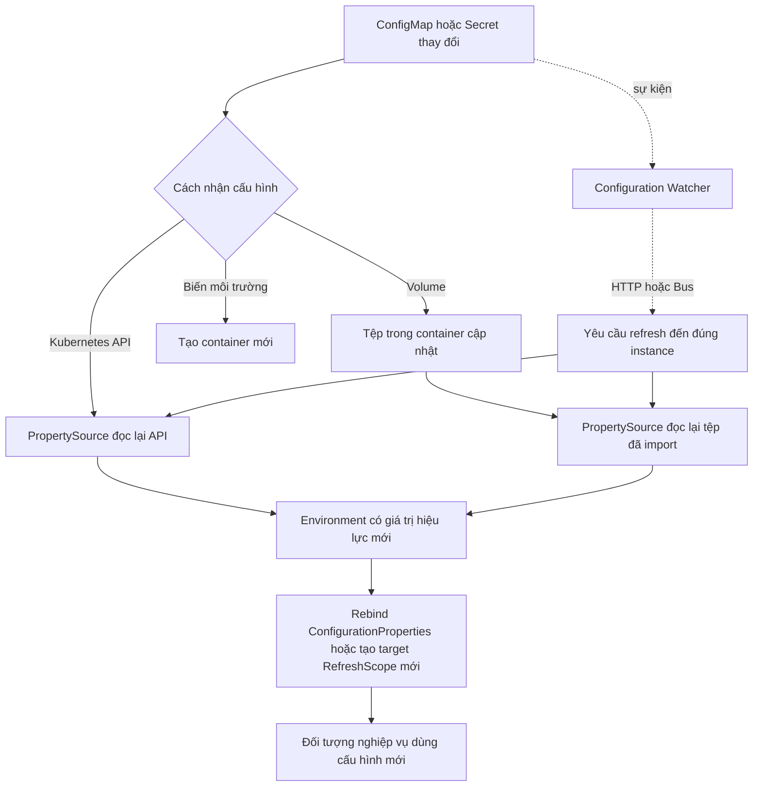

# Thay đổi cấu hình đã có nhưng bean vẫn giữ giá trị cũ

Trong chương **Chẩn đoán sự cố** của **SPRING_CLOUD_KUBERNETES**, bài này xử lý tình huống ConfigMap hoặc Secret đã thay đổi nhưng ứng dụng Spring vẫn thực hiện hành vi cũ. Mục tiêu là xác định cập nhật bị dừng ở đâu, sửa cách quản lý bean và chứng minh các Pod đã nhận cấu hình mong muốn.

Ví dụ dùng dịch vụ `order-api` trong namespace `learning` và cấu hình không nhạy cảm. Các thuộc tính cấu hình được minh họa theo Spring Cloud Kubernetes 3.3, Spring Cloud Commons 4.3 và ứng dụng JVM thông thường. Khi áp dụng, dùng Spring Cloud BOM phù hợp với phiên bản Spring Boot của dự án và đối chiếu tài liệu cùng dòng phiên bản. Các lệnh thay đổi tài nguyên trong bài dành cho môi trường lab.

## 1. Dữ liệu mới chưa có nghĩa đối tượng đã được cập nhật

Hai luồng cần hoạt động đồng thời: luồng đưa dữ liệu mới vào ứng dụng và luồng thông báo ứng dụng thực hiện refresh.



| Lớp quan sát | Câu hỏi | Bằng chứng |
| --- | --- | --- |
| Kubernetes | Đúng resource và namespace đã chứa giá trị mới chưa? | Nội dung key, tên resource, `resourceVersion` |
| Container | Tệp mount hoặc môi trường chứa gì? | Đường dẫn mount thực tế, cách khai báo env |
| Spring `Environment` | Property hiệu lực trên Pod này là gì? | Đọc đúng key qua `Environment` |
| Bean cấu hình | Đã bind lại hoặc tạo target mới chưa? | Getter hoặc snapshot của bean |
| Nghiệp vụ | Client, cache, task dùng phiên bản nào? | Một thao tác có kết quả quan sát được |
| Toàn bộ replicas | Mọi Pod đang phục vụ đã cập nhật chưa? | Revision theo từng tên Pod |

`resourceVersion` thay đổi chỉ chứng minh Kubernetes resource đã được cập nhật. Nó không phải revision nghiệp vụ và không chứng minh bean đã đổi. Gọi `Environment.getProperty(...)` mỗi lần cũng không tự gọi Kubernetes API; thao tác đó đọc môi trường Spring đang giữ trong tiến trình.

### Ba cách nhận cấu hình cần cách cập nhật khác nhau

| Cách nhận | Điều cần có trước khi bean có thể đổi |
| --- | --- |
| Spring Cloud Kubernetes đọc API | Nguồn đúng, đủ quyền và có luồng refresh hoạt động |
| Mount ConfigMap/Secret thành volume | Tệp mới đã đến container, được Spring import và đọc lại |
| `env`, `envFrom`, `configMapKeyRef`, `secretKeyRef` | Container mới được tạo với giá trị mới |

ConfigMap qua biến môi trường không cập nhật giá trị trong container đang chạy. Volume được cập nhật theo cơ chế nhất quán cuối cùng; mount bằng `subPath` không nhận cập nhật ConfigMap tự động. Xác định cách nhận dữ liệu trước khi sửa annotation của bean. [Tài liệu Kubernetes về ConfigMap](https://kubernetes.io/docs/concepts/configuration/configmap/).

## 2. Tái hiện lỗi trên một Pod

### 2.1. Khai báo nguồn rõ ràng

Giả sử namespace `learning` đã tồn tại. ConfigMap mẫu:

```yaml
apiVersion: v1
kind: ConfigMap
metadata:
  name: order-api
  namespace: learning
  labels:
    spring.cloud.kubernetes.config: "true"
data:
  application.yaml: |-
    demo:
      message: "Xử lý đơn hàng thông thường"
      revision: "v1"
```

Ứng dụng cần Spring Web, Actuator và một starter cấu hình Kubernetes. Ví dụ chọn Kubernetes Java Client; không thêm đồng thời starter Fabric8 tương đương chỉ để thử sửa lỗi:

```xml
<dependency>
    <groupId>org.springframework.boot</groupId>
    <artifactId>spring-boot-starter-web</artifactId>
</dependency>
<dependency>
    <groupId>org.springframework.boot</groupId>
    <artifactId>spring-boot-starter-actuator</artifactId>
</dependency>
<dependency>
    <groupId>org.springframework.cloud</groupId>
    <artifactId>spring-cloud-starter-kubernetes-client-config</artifactId>
</dependency>
```

Đây là các dependency bổ sung vào dự án Spring Boot có sẵn, dùng version do BOM quản lý, không phải một `pom.xml` hoàn chỉnh. Cấu hình khởi động:

```yaml
spring:
  application:
    name: order-api
  config:
    import: "kubernetes:"
  cloud:
    kubernetes:
      config:
        namespace: learning
        sources:
          - name: order-api
        fail-fast: true

management:
  endpoints:
    web:
      exposure:
        include: health,info,refresh
```

`kubernetes:` là Config Data import cho nguồn Kubernetes. Không bật đồng thời bootstrap cũ cho cùng việc nạp cấu hình. [Tài liệu Kubernetes PropertySource](https://docs.spring.io/spring-cloud-kubernetes/reference/3.3/property-source-config.html).

Tên, namespace, profile, prefix và thứ tự các nguồn ảnh hưởng đến property thực sự được nạp. Nhãn dành cho Watcher không thay thế khai báo nguồn của ứng dụng. [Tài liệu ConfigMap PropertySource](https://docs.spring.io/spring-cloud-kubernetes/reference/3.3/property-source-config/configmap-propertysource.html).

Ứng dụng phải dùng ServiceAccount có quyền đọc phù hợp; ví dụ RBAC nằm ở mục 5.2. Namespace cố định ở đây phục vụ lab một namespace; triển khai nhiều môi trường cần truyền namespace theo thiết kế hệ thống.

### 2.2. Bean cố tình giữ giá trị lúc khởi tạo

Đặt các lớp dưới đây trong package được `@SpringBootApplication` quét, chẳng hạn `com.example.orders`:

```java
package com.example.orders;

import org.springframework.beans.factory.annotation.Value;
import org.springframework.stereotype.Component;

@Component
public class MessagePolicy {
    private final String message;
    private final String revision;

    public MessagePolicy(
            @Value("${demo.message}") String message,
            @Value("${demo.revision}") String revision) {
        this.message = message;
        this.revision = revision;
    }

    public Snapshot snapshot() {
        return new Snapshot(message, revision);
    }

    public record Snapshot(String message, String revision) {
    }
}
```

Constructor nhận hai giá trị khi Spring tạo bean singleton. Hai field `final` không tự được gán lại khi nguồn cấu hình đổi. Field `@Value` có thể gán lại cũng không biến singleton thông thường thành đối tượng tự theo dõi Kubernetes.

Endpoint thực hành đối chiếu bean với `Environment` trên cùng Pod:

```java
package com.example.orders;

import java.util.Map;

import org.springframework.core.env.Environment;
import org.springframework.web.bind.annotation.GetMapping;
import org.springframework.web.bind.annotation.RestController;

@RestController
public class ConfigSnapshotController {
    private final Environment environment;
    private final MessagePolicy policy;

    public ConfigSnapshotController(Environment environment, MessagePolicy policy) {
        this.environment = environment;
        this.policy = policy;
    }

    @GetMapping("/internal/config-snapshot")
    public Map<String, String> snapshot() {
        MessagePolicy.Snapshot bean = policy.snapshot();
        return Map.of(
                "pod", environment.getProperty("HOSTNAME", "local"),
                "environmentMessage", environment.getProperty("demo.message", "<missing>"),
                "environmentRevision", environment.getProperty("demo.revision", "<missing>"),
                "beanMessage", bean.message(),
                "beanRevision", bean.revision());
    }
}
```

Endpoint này chỉ quan sát property không nhạy cảm trong lab. Khi đưa ý tưởng vào vận hành, bảo vệ bằng xác thực, phân quyền và giới hạn mạng. Nếu chỉ revision đã đủ, không trả cả thông điệp. Không dùng cùng mẫu để trả password, token hay toàn bộ cấu hình.

### 2.3. Ghim phép đo vào đúng Pod

Các lệnh dùng PowerShell và `curl.exe` để tránh nhầm alias của shell:

```powershell
kubectl -n learning get pods -l app=order-api -o wide
$podName = '<tên-Pod-vừa-chọn>'
kubectl -n learning get pod $podName -o jsonpath='{.spec.serviceAccountName}'
kubectl -n learning get configmap order-api -o yaml
kubectl -n learning port-forward "pod/$podName" 18080:8080
```

Thay placeholder bằng tên Pod thật. Giữ port-forward ở một terminal; chạy HTTP trong terminal khác. Ví dụ giả định app và Actuator cùng cổng `8080`. Nếu tách management port, forward đúng cổng để gọi refresh.

```powershell
curl.exe --fail-with-body -sS http://127.0.0.1:18080/internal/config-snapshot
```

Lúc đầu, `environmentRevision` và `beanRevision` đều phải là `v1`. Nếu chưa đạt, sửa việc nạp ban đầu trước; chưa thể kết luận về refresh.

Trong lab, sửa `demo.message` và `demo.revision` bên trong `data.application.yaml` thành thông điệp mới và `v2`:

```powershell
kubectl -n learning edit configmap order-api
kubectl -n learning get configmap order-api -o yaml
curl.exe -i -X POST http://127.0.0.1:18080/actuator/refresh
curl.exe --fail-with-body -sS http://127.0.0.1:18080/internal/config-snapshot
```

Giả sử chưa có refresh từ nguồn khác, API và quyền đọc hoạt động, kết quả mong đợi sau POST:

```json
{
  "pod": "order-api-7c88d8d9b6-example",
  "environmentMessage": "Đang ưu tiên xử lý đơn hàng",
  "environmentRevision": "v2",
  "beanMessage": "Xử lý đơn hàng thông thường",
  "beanRevision": "v1"
}
```

Dữ liệu đã đến `Environment`, nhưng `MessagePolicy` giữ snapshot cũ. Nếu cả `Environment` vẫn là `v1`, đi theo nhánh kiểm tra nguồn ở mục 4.

Khi có Spring Security, POST phải dùng cơ chế xác thực đã cấu hình. Port-forward tạo đường kết nối, không bỏ qua bảo mật HTTP.

## 3. Sửa theo cách bean sử dụng cấu hình

### 3.1. Tạo lại bean bằng `@RefreshScope`

Thêm import và annotation vào chính lớp `MessagePolicy` đã có:

```java
import org.springframework.cloud.context.config.annotation.RefreshScope;

@Component
@RefreshScope
public class MessagePolicy {
    // Giữ nguyên constructor, field và phương thức của phiên bản ở trên.
}
```

Đây là phần sửa trên lớp cũ, không tạo thêm lớp cùng tên. Cần build và triển khai mã mới một lần để annotation có hiệu lực; sau đó mới kiểm tra đổi cấu hình không restart.

Refresh scope inject một proxy. Refresh loại bỏ target đã giữ trong scope; lần gọi phương thức tiếp theo tạo target từ cấu hình mới. Vì thế field `final` của target mới vẫn nhận giá trị mới. Annotation trên lớp `@Configuration` không tự làm mọi bean bên trong trở thành refresh scoped. [Tài liệu Spring Cloud Context về Refresh Scope](https://docs.spring.io/spring-cloud-commons/reference/4.3/spring-cloud-commons/application-context-services.html#_refresh_scope).

Nếu đăng ký bằng factory method, đặt scope trên định nghĩa bean cần tạo lại:

```java
@Configuration(proxyBeanMethods = false)
public class PolicyConfiguration {
    @Bean
    @RefreshScope
    MessagePolicy messagePolicy(
            @Value("${demo.message}") String message,
            @Value("${demo.revision}") String revision) {
        return new MessagePolicy(message, revision);
    }
}
```

Cách này thay cho đăng ký `@Component`: bỏ `@Component` khỏi `MessagePolicy` để tránh hai bean. Các import tương ứng là `Configuration`, `Bean`, `Value` và `RefreshScope` của Spring.

Khi dùng scoped proxy:

- Gọi bean do Spring inject; đối tượng tự tạo bằng `new` không được scope quản lý.
- Với proxy dựa trên class mặc định, tránh lớp hoặc phương thức cần intercept mang `final`.
- Không lấy target khỏi proxy rồi giữ lâu dài.
- Gom thao tác cần nhất quán vào một lần gọi qua proxy, tránh đọc từ hai target trong lúc refresh.

Đây là các ràng buộc thuộc cơ chế scoped proxy. [Tài liệu Spring Framework về bean scope](https://docs.spring.io/spring-framework/reference/core/beans/factory-scopes.html).

### 3.2. Bind lại dữ liệu bằng `@ConfigurationProperties`

Khi có nhiều thuộc tính cùng nhóm, dùng một bean cấu hình có setter:

```java
package com.example.orders;

import org.springframework.boot.context.properties.ConfigurationProperties;
import org.springframework.stereotype.Component;

@Component
@ConfigurationProperties(prefix = "demo")
public class DemoProperties {
    private String message = "Chưa cấu hình";
    private String revision = "local";

    public String getMessage() {
        return message;
    }

    public void setMessage(String message) {
        this.message = message;
    }

    public String getRevision() {
        return revision;
    }

    public void setRevision(String revision) {
        this.revision = revision;
    }
}
```

`ConfigurationPropertiesRebinder` của Spring Cloud phản ứng với `EnvironmentChangeEvent` để bind lại những bean phù hợp. Annotation thôi chưa đủ: cần Spring Cloud Context, dữ liệu mới trong `Environment` và sự kiện cập nhật. [Mã nguồn ConfigurationPropertiesRebinder](https://raw.githubusercontent.com/spring-cloud/spring-cloud-commons/v4.3.0/spring-cloud-context/src/main/java/org/springframework/cloud/context/properties/ConfigurationPropertiesRebinder.java).

Consumer giữ tham chiếu rồi đọc lúc cần:

```java
@Service
public class OrderNoticeService {
    private final DemoProperties properties;

    public OrderNoticeService(DemoProperties properties) {
        this.properties = properties;
    }

    public String messageForNewOrder() {
        return properties.getMessage();
    }
}
```

`Service` là `org.springframework.stereotype.Service`. Một chuỗi getter trên bean mutable không phải giao dịch nguyên tử. Nếu nhiều trường phải luôn nhất quán, thiết kế snapshot có validation rồi thay toàn bộ đối tượng tại ranh giới phù hợp, hoặc chọn rollout.

### 3.3. Sửa consumer đang giữ bản sao

Đây là lỗi vẫn còn dù `DemoProperties` đã đổi:

```java
@Service
public class CachedNoticeService {
    private final String cachedMessage;

    public CachedNoticeService(DemoProperties properties) {
        this.cachedMessage = properties.getMessage();
    }

    public String messageForNewOrder() {
        return cachedMessage;
    }
}
```

`cachedMessage` là chuỗi độc lập được sao chép khi constructor chạy. Rebind đối tượng nguồn không sửa field này. Có thể:

1. Giữ tham chiếu đến `DemoProperties`, gọi getter khi sử dụng.
2. Cho consumer tham gia refresh scope nếu vòng đời và tài nguyên cho phép.
3. Thay snapshot/client theo cơ chế có kiểm soát hoặc cập nhật bằng rollout.

`final DemoProperties properties` giữ tham chiếu đến đối tượng có thể cập nhật; `final String cachedMessage` giữ giá trị đã chụp. Cache, lambda, scheduled task và SDK client cũng có thể chụp giá trị như vậy.

Ví dụ `new Client(properties.getTimeout())` thường chốt timeout khi tạo client. Getter của properties đổi không tự cấu hình lại client. Cần xác định API và vòng đời thật của thư viện trước khi tái tạo hoặc cập nhật tài nguyên.

## 4. Chẩn đoán theo kết quả trên cùng một instance

| Kết quả sau refresh | Hướng điều tra |
| --- | --- |
| Kubernetes có `v2`, `Environment` vẫn `v1` | Nguồn nạp, namespace, key, profile, quyền đọc, tệp mount, nguồn có độ ưu tiên cao hơn |
| `Environment` có `v2`, bean vẫn `v1` | Singleton `@Value`, thiếu scope/rebind, bean ngoài Spring, lỗi bind hoặc loại bean không hỗ trợ refresh |
| Bean cấu hình có `v2`, hành vi vẫn cũ | Bản sao trong consumer, cache hoặc client được tạo từ cấu hình cũ |
| Refresh thủ công được, tự động không được | Watcher, discovery, nhãn, namespace, RBAC, đường HTTP/Bus |
| Các request trả revision khác nhau | Chưa cập nhật đủ replicas hoặc các tuyến đi tới đối tượng khác nhau |

### 4.1. Khi `Environment` vẫn giữ giá trị cũ

Kiểm tra theo thứ tự:

1. **Đúng đối tượng:** namespace, tên ConfigMap/Secret, tên ứng dụng và `sources` khớp nhau.
2. **Đúng key:** YAML được parse thành `demo.message` chưa; có prefix làm đổi tên key không?
3. **Đúng profile:** profile đang active có nạp thêm nguồn ghi đè giá trị chung không?
4. **Đúng cơ chế nhận:** ứng dụng đọc API, import tệp hay dùng env? Đừng kiểm tra tệp mount cho ứng dụng chỉ đọc API.
5. **Đúng nguồn thắng:** có nhiều nguồn cùng chứa key đó không?
6. **Đủ quyền và không có lỗi nạp:** xem log của đúng ứng dụng tại thời điểm POST.

Trong cách nạp Config Data, `DEMO_MESSAGE` từ môi trường, Java system property hoặc command-line argument có thể thắng cấu hình đã import. Refresh cùng nguồn không loại bỏ override đó. Kiểm tra nguồn gốc property thay vì sửa ConfigMap nhiều lần. [Tài liệu Spring Boot về thứ tự cấu hình](https://docs.spring.io/spring-boot/3.5/reference/features/external-config.html).

`/actuator/env/demo.message` giúp kiểm tra nguồn property; `/actuator/configprops` giúp quan sát bean cấu hình. Chỉ dùng khi đã được expose và bảo vệ phù hợp. Giá trị bị che là hành vi có thể có của Actuator; không bật hiển thị mọi giá trị chỉ để xem một revision không nhạy cảm. [Tài liệu Actuator endpoints](https://docs.spring.io/spring-boot/3.5/reference/actuator/endpoints.html).

### 4.2. Khi endpoint refresh không hoạt động

`/actuator/refresh` do Spring Cloud cung cấp; chỉ thêm Actuator của Spring Boot chưa bảo đảm endpoint tồn tại. Ví dụ dùng starter Kubernetes Config để tích hợp phần cấu hình với Spring Cloud Context.

| Hiện tượng | Kiểm tra cụ thể |
| --- | --- |
| `404` | Classpath, endpoint được phép hoạt động và được expose chưa, đúng management port/base path không? |
| `405` | Đã dùng POST thay vì GET chưa? |
| `401` hoặc `403` | Xác thực, quyền HTTP, CSRF; phân biệt với lỗi RBAC từ Kubernetes API trong log |
| Timeout hoặc connection refused | Port-forward, địa chỉ, cổng, TLS, NetworkPolicy và tình trạng Pod |
| `5xx` | Log lỗi đọc nguồn, parse, validation, bind hoặc tạo bean |
| `2xx` và danh sách key | Tiếp tục kiểm tra bean và hành vi; các key chưa chứng minh nghiệp vụ đã đổi |
| `2xx` và `[]` | Không có key được báo thay đổi trong lần gọi này; có thể lần refresh trước đã chạy, nguồn chưa mới hoặc đang đọc nguồn khác |

Không diễn giải `[]` thành bằng chứng refresh scope không chạy. Trong đường chuẩn, `ContextRefresher.refresh()` cập nhật môi trường rồi gọi `refreshAll()`; giá trị trả về là tập key phát hiện thay đổi. [Mã nguồn ContextRefresher](https://raw.githubusercontent.com/spring-cloud/spring-cloud-commons/v4.3.0/spring-cloud-context/src/main/java/org/springframework/cloud/context/refresh/ContextRefresher.java). Endpoint trả tập key này, không trả danh sách bean đã cập nhật thành công. [Mã nguồn RefreshEndpoint](https://raw.githubusercontent.com/spring-cloud/spring-cloud-commons/v4.3.0/spring-cloud-context/src/main/java/org/springframework/cloud/endpoint/RefreshEndpoint.java).

### 4.3. Khi dùng volume

Nếu ứng dụng thực sự mount tệp cấu hình không nhạy cảm tại `/etc/app-config/application.yaml`:

```powershell
kubectl -n learning exec $podName -- cat /etc/app-config/application.yaml
```

Lệnh cần container có `cat` và đường dẫn đúng. Với image tối giản, dùng phương thức quan sát được đội vận hành hỗ trợ; lỗi thiếu executable không chứng minh tệp không tồn tại.

Tệp phải được Spring nạp, chẳng hạn import `file:/etc/app-config/application.yaml`. Nếu dùng `configtree:/etc/app-config/`, cấu trúc thư mục phải phù hợp với cách ánh xạ tệp thành property; nó không tự parse mọi YAML thành cây cấu hình lồng nhau. [Tài liệu Spring Boot về configuration trees](https://docs.spring.io/spring-boot/3.5/reference/features/external-config.html#features.external-config.files.configtree).

Một giả thuyết cần kiểm chứng là Watcher nhận sự kiện trước khi kubelet cập nhật tệp. Refresh lúc đó vẫn đọc bản cũ. Chờ đến khi tệp đã đổi rồi refresh thủ công để kiểm tra giả thuyết này. Nếu đúng, đo độ trễ và điều chỉnh `spring.cloud.kubernetes.configuration.watcher.refreshDelay` ở Watcher; khoảng đợi cố định không bảo đảm mọi node luôn cập nhật kịp.

Nếu nhận cấu hình qua env, tạo container mới bằng rollout có kiểm soát. Thêm `@RefreshScope` không biến env đã chụp khi container được tạo thành nguồn động.

## 5. Refresh thủ công được nhưng Watcher không cập nhật

### 5.1. Kiểm tra đường thông báo

Với Watcher dòng 3.3, resource cần nhãn `spring.cloud.kubernetes.config: "true"` hoặc `spring.cloud.kubernetes.secret: "true"`. HTTP Watcher tìm instance qua DiscoveryClient, mặc định theo tên resource, rồi gọi refresh. Đường Bus cần broker và cấu hình Bus tương ứng. [Tài liệu Configuration Watcher 3.3](https://docs.spring.io/spring-cloud-kubernetes/reference/3.3/spring-cloud-kubernetes-configuration-watcher.html).

Trong lab, dùng cùng tên `order-api` cho ConfigMap, `spring.application.name` và Service để giảm biến số. Service cần selector chọn đúng Pod và port trỏ tới ứng dụng đang chạy. Khi cách chọn đích cơ bản đã hoạt động mới thêm quy tắc định tuyến khác được phiên bản hỗ trợ.

Lần theo các bằng chứng:

1. Watcher đang chạy và theo dõi namespace nào?
2. Nó quan sát thay đổi của đúng resource chưa?
3. Nó tìm được những instance nào?
4. Nó gửi đến địa chỉ, cổng và đường dẫn nào?
5. Mỗi ứng dụng có nhận POST hoặc sự kiện Bus không?
6. Sau sự kiện, revision của `Environment` và bean tại từng Pod là gì?

Ví dụ quan sát, giả sử Deployment Watcher có tên `config-watcher`:

```powershell
kubectl -n learning get deployment config-watcher
kubectl -n learning logs deployment/config-watcher --since=10m
kubectl -n learning logs $podName --since=10m
kubectl -n learning get service order-api -o yaml
kubectl -n learning get endpointslices -l kubernetes.io/service-name=order-api
```

Đối chiếu timestamp hai phía. Nếu cần, bật debug logger của Watcher theo package đúng phiên bản trong thời gian điều tra. Ghi nhận tên resource, đích và kết quả gửi; tránh ghi nội dung Secret.

Nếu management port hoặc Actuator base path khác mặc định, cấu hình metadata/thuộc tính Watcher tương ứng và kiểm tra URL thực tế. Gọi được API nghiệp vụ qua Service chưa chứng minh Watcher gọi được management endpoint.

### 5.2. Tách quyền ứng dụng với quyền Watcher

Ứng dụng đọc cấu hình và Watcher là hai chủ thể. Refresh thủ công thành công chưa chứng minh ServiceAccount của Watcher có quyền watch hoặc discovery.

Ví dụ RBAC cho **ứng dụng chỉ đọc ConfigMap** trong namespace lab:

```yaml
apiVersion: v1
kind: ServiceAccount
metadata:
  name: order-api
  namespace: learning
---
apiVersion: rbac.authorization.k8s.io/v1
kind: Role
metadata:
  name: order-api-config-reader
  namespace: learning
rules:
  - apiGroups: [""]
    resources: ["configmaps"]
    verbs: ["get", "list"]
---
apiVersion: rbac.authorization.k8s.io/v1
kind: RoleBinding
metadata:
  name: order-api-config-reader
  namespace: learning
subjects:
  - kind: ServiceAccount
    name: order-api
    namespace: learning
roleRef:
  apiGroup: rbac.authorization.k8s.io
  kind: Role
  name: order-api-config-reader
```

Deployment ứng dụng phải đặt `spec.template.spec.serviceAccountName: order-api`. Bộ quyền này không bao gồm Secret và không phải bộ quyền đầy đủ cho mọi kiểu discovery/reload.

Watcher cần `get`, `list`, `watch` cho nguồn theo dõi; discovery có thể cần quyền trên `services`, `pods`, `endpoints` hoặc `endpointslices` tùy implementation. `endpointslices` thuộc group `discovery.k8s.io`, các resource còn lại vừa nêu thuộc core group. Chọn quyền theo client thực tế và giới hạn namespace, không cấp `cluster-admin` để chữa lỗi đọc cấu hình. [Tài liệu Kubernetes RBAC](https://kubernetes.io/docs/reference/access-authn-authz/rbac/).

Kiểm tra riêng từng chủ thể:

```powershell
kubectl auth can-i get configmap/order-api --as=system:serviceaccount:learning:order-api -n learning
kubectl auth can-i list configmaps --as=system:serviceaccount:learning:order-api -n learning
kubectl auth can-i watch configmaps --as=system:serviceaccount:learning:config-watcher -n learning
kubectl auth can-i list services --as=system:serviceaccount:learning:config-watcher -n learning
kubectl auth can-i list endpointslices.discovery.k8s.io --as=system:serviceaccount:learning:config-watcher -n learning
```

`config-watcher` ở đây là tên ServiceAccount giả định, cần thay theo Deployment thật. `--as` yêu cầu người thực hiện có quyền impersonate; lỗi impersonation không phải bằng chứng ServiceAccount đích thiếu quyền đọc. Đọc toàn bộ thông báo lỗi.

Kubernetes RBAC điều khiển quyền gọi Kubernetes API; nó không tự cấp quyền HTTP Actuator. HTTP còn phụ thuộc xác thực và đường mạng của ứng dụng.

### 5.3. Kiểm tra tất cả replicas

Một HTTP request thông thường qua Kubernetes Service hoặc Spring Cloud LoadBalancer thường chỉ đến một instance. DiscoveryClient, LoadBalancer và Watcher làm các phần việc khác nhau; bật discovery/load balancing không tự phát tán thay đổi cấu hình.

Dùng port-forward từng Pod hoặc cách định tuyến xác định instance để lấy snapshot. Với Watcher HTTP, kiểm tra các đích đã resolve; với Bus, kiểm tra từng replica thực sự nhận sự kiện.

Pod `Ready` chỉ phản ánh các probe đã khai báo. Nếu probe không kiểm tra revision cấu hình, trạng thái đó không chứng minh ứng dụng đã dùng revision mới.

## 6. Khi cần rollout hoặc quản lý vòng đời riêng

| Trường hợp | Hướng xử lý |
| --- | --- |
| Cấu hình qua env | Tạo container mới sau khi nguồn đổi |
| Mount bằng `subPath` | Đổi cách mount hoặc thay Pod theo quy trình |
| Cấu hình immutable/constructor binding | Xác minh hỗ trợ; dùng mô hình bind lại được hoặc thay toàn bộ snapshot có chủ đích |
| Pool, executor, SDK client giữ trạng thái | Dùng API cập nhật được thư viện hỗ trợ hoặc thay tài nguyên kèm đóng tài nguyên cũ |
| Nhiều giá trị phải đổi như một đơn vị | Snapshot nhất quán, validation và chiến lược chuyển phiên bản |
| AOT/native image | Chọn cấu hình lúc khởi động hoặc rollout theo giới hạn stack |

Theo Commons 4.3, `@ConfigurationProperties` dạng Java record không hỗ trợ refresh, `HikariDataSource` mặc định thuộc nhóm không refresh được và refresh context không hỗ trợ AOT/native image. Đừng áp một annotation cho mọi loại tài nguyên. [Giới hạn refresh trong Spring Cloud Context](https://docs.spring.io/spring-cloud-commons/reference/4.3/spring-cloud-commons/application-context-services.html).

Với Secret, cần xét cả cách phân phối và client/kết nối đang mở. Không log credential; dùng revision không nhạy cảm và kết quả xác thực của kết nối mới để kiểm chứng. Secret mount theo `subPath` cũng không tự nhận cập nhật. [Tài liệu Kubernetes về Secret](https://kubernetes.io/docs/concepts/configuration/secret/).

Khi cần rollout trong lab:

```powershell
kubectl -n learning rollout restart deployment/order-api
kubectl -n learning rollout status deployment/order-api
```

Nếu mục tiêu là điều tra, ghi nhận bằng chứng trước khi restart. Restart làm hết lỗi cho thấy trạng thái được nạp lại lúc khởi động; vẫn cần xác định nó nằm ở env, bean, cache hay client.

Xóa key cần một phép thử riêng. Đừng giả định bỏ property rồi refresh sẽ đưa mọi field về mặc định. Với cờ nghiệp vụ cần tắt, giá trị tường minh như `false` dễ kiểm chứng hơn xóa key.

Ứng dụng cũ có thể dùng `spring.cloud.kubernetes.reload.enabled`. Phân biệt reload trong ứng dụng với Watcher triển khai riêng. PropertySource Reload cũ đã bị deprecated từ release train 2020.0; không bật nhiều cơ chế khi chưa xác định đường đang hoạt động. [Tài liệu PropertySource Reload](https://docs.spring.io/spring-cloud-kubernetes/reference/3.3/property-source-config/propertysource-reload.html).

## 7. Bài thực hành kiểm chứng

Dùng namespace lab và `demo.revision` không nhạy cảm:

1. **Chứng minh lỗi:** với `MessagePolicy` singleton ban đầu, đổi ConfigMap sang `v2`, refresh thủ công một Pod, ghi nhận `environmentRevision=v2` nhưng `beanRevision=v1`.
2. **Triển khai cách sửa:** thêm `@RefreshScope`, build và triển khai mã mới một lần. Xác nhận ứng dụng nạp revision hiện có.
3. **Kiểm tra thủ công:** đổi cả message và revision sang `v3`; POST refresh rồi lấy snapshot trên cùng Pod. Hai revision phải là `v3`, thông điệp tương ứng và Pod không cần thay thế cho lần đổi cấu hình này.
4. **Kiểm tra tự động:** với Watcher đã triển khai đúng, đổi sang `v4` và không POST thủ công. Theo dõi log và snapshot đến khi mọi Pod phục vụ đều dùng `v4` trong thời hạn đã thống nhất của lab.
5. **Tạo lỗi consumer:** trong biến thể dùng `DemoProperties`, giữ bản sao chuỗi trong constructor. Xác nhận bean cấu hình đổi nhưng chuỗi cũ còn nguyên; sửa consumer để đọc lúc sử dụng hoặc được tái tạo phù hợp.
6. **So sánh env:** với biến thể nhận qua env, đổi nguồn và quan sát refresh không thay env của container đang chạy. Rollout rồi xác nhận container mới có revision mới.

Nếu tự động refresh đã bật từ đầu và không bắt được trạng thái bước 1, tái hiện trong bản triển khai lab riêng chưa nhận thông báo tự động. Không tắt Watcher dùng chung cho một phép thử cá nhân.

Mẫu kết quả mong đợi, không phải số liệu đã đo:

| Pod | Revision nguồn | Revision Environment | Revision bean | Hành vi đúng | Thay Pod cho lần đổi này |
| --- | --- | --- | --- | --- | --- |
| Pod A | v4 | v4 | v4 | Có | Không, nếu dùng refresh được hỗ trợ |
| Pod B | v4 | v4 | v4 | Có | Không, nếu dùng refresh được hỗ trợ |

Lặp lại thay đổi thêm một lần để phát hiện cơ chế chỉ chạy được ở lần đầu. Ghi nhận thêm tên Pod/UID, thời điểm cập nhật và lỗi sau refresh khi cần chứng minh ứng dụng không bị thay thế ngoài dự kiến.

## 8. Tiêu chí hoàn tất điều tra

Chỉ đóng sự cố khi đã có bằng chứng:

- Xác định đúng nguồn, namespace, cách nhận dữ liệu và property đang thắng.
- Chỉ ra lớp giữ giá trị cũ: container, `Environment`, bean, consumer hay replica khác.
- Cách sửa phù hợp vòng đời đối tượng, kể cả giải phóng tài nguyên khi thay client/pool.
- Mọi Pod cần phục vụ có revision và hành vi mong muốn qua đường cập nhật đã chọn.
- Đã kiểm tra readiness và lỗi sau cập nhật; không dùng `Ready` thay bằng chứng revision.
- Endpoint chẩn đoán và debug log được thu hẹp theo nhu cầu vận hành sau điều tra.

Nếu hệ thống chỉ cần cấu hình mới ở lần triển khai kế tiếp, rollout có kiểm soát có thể đã đáp ứng đủ. Chỉ giữ Watcher, Bus hoặc tính năng Spring Cloud Kubernetes khác khi chúng giải quyết yêu cầu vận hành cụ thể và có cách kiểm chứng hiệu quả.
