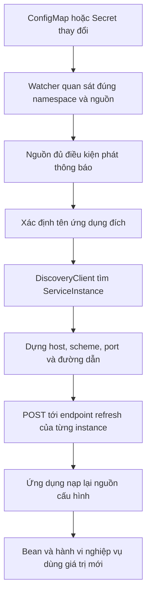

# Configuration Watcher không tìm đúng ứng dụng hoặc endpoint

## Mục tiêu và phạm vi

Trong chương **Chẩn đoán sự cố** của module **SPRING_CLOUD_KUBERNETES**, bài này hướng dẫn tìm điểm đứt khi Configuration Watcher nhận thay đổi ConfigMap hoặc Secret nhưng không làm mới đúng ứng dụng. Sau bài học, bạn có thể xác định tên đích, kiểm tra những instance DiscoveryClient trả về, dựng lại URL refresh và phân biệt lỗi Kubernetes API với lỗi HTTP của ứng dụng.

Ví dụ sử dụng cơ chế **HTTP** của Spring Cloud Kubernetes **3.3.x**, đối chiếu mã nguồn tag **v3.3.3**. Đây là mốc để đọc cấu hình trong bài, không phải yêu cầu nâng hoặc hạ phiên bản hệ thống. Khi dùng nhánh khác, đối chiếu tài liệu đúng phiên bản image Watcher và BOM Spring Cloud của ứng dụng; không ghép mặc định của các nhánh vào cùng một cấu hình.

Bạn cần biết Service, Pod, ConfigMap, Secret và cách đọc log bằng `kubectl`. Các lệnh là hướng dẫn cho phòng thực hành, chưa được thực thi trên cluster nào. Những manifest dưới đây dùng namespace `shop`; namespace này phải tồn tại trước khi triển khai.

## 1. Chẩn đoán theo đường đi của một lần refresh

Một sự cố thường được mô tả là “sửa cấu hình mà ứng dụng không đổi”. Mô tả đó chưa cho biết lỗi thuộc Watcher, discovery, endpoint hay chính cách ứng dụng đọc cấu hình.



Đọc sơ đồ từ trên xuống và dừng ở cạnh đầu tiên chưa có bằng chứng:

| Câu hỏi | Bằng chứng cần có |
| --- | --- |
| Watcher có quan sát thay đổi không? | Log theo thời điểm sửa nguồn, đúng namespace và tên tài nguyên |
| Thay đổi có được chọn để phát thông báo không? | Label, annotation và bộ lọc informer đúng với bản đang chạy |
| Tên đích được giải thành gì? | Tên nguồn mặc định hoặc danh sách trong annotation `*.apps` |
| Có instance nào cho tên đích không? | Service tồn tại, backend sẵn sàng, phạm vi discovery và RBAC đúng |
| Watcher gọi địa chỉ nào? | URL thực trong DEBUG log, gồm cả cổng và đường dẫn |
| HTTP có thành công không? | Kết quả từng request hoặc lỗi kết nối tương ứng |
| Cấu hình có hiệu lực không? | Một giá trị kiểm chứng trên từng Pod, sau khi nguồn mới đã sẵn sàng |

“Pod Watcher đang Running”, “Service truy cập được” và “HTTP trả 200” là ba quan sát ở những tầng khác nhau. Mỗi quan sát chỉ xác nhận phần đường đi mà nó thực sự kiểm tra.

Trong cơ chế HTTP, Watcher cần phát thông báo tới các instance được discovery. Một lần gọi qua Service có cân bằng tải chỉ chạm một backend cho mỗi request; kết quả đó không chứng minh mọi replica đã refresh. Thêm Spring Cloud LoadBalancer vào ứng dụng cũng không tự sửa tên đích hoặc URL do Watcher dựng.

## 2. Phân biệt các loại tên trước khi sửa cấu hình

Dùng tình huống nhất quán sau trong toàn bài:

| Thành phần | Giá trị ví dụ | Vai trò |
| --- | --- | --- |
| Namespace | `shop` | Phạm vi của tài nguyên và phân quyền |
| Deployment Watcher | `config-watcher` | Chạy controller phát thông báo |
| ServiceAccount Watcher | `config-watcher` | Danh tính gọi Kubernetes API |
| ConfigMap | `orders-runtime` | Chứa dữ liệu cấu hình |
| Kubernetes Service của ứng dụng | `orders-api` | Service ID cần tìm trong discovery HTTP |
| Deployment của ứng dụng | `orders-api` | Quản lý các replica |
| Nhãn Pod | `app: orders-api` | Được Service selector chọn |
| `spring.application.name` | `orders-domain` | Tên logic trong ứng dụng Spring |
| Cổng nghiệp vụ | `8080` | Phục vụ request của ứng dụng |
| Cổng quản trị | `9091` | Phục vụ Actuator |
| Đường dẫn gốc Actuator | `/manage` | Endpoint refresh là `/manage/refresh` |

Các tên được cố ý tách biệt để nhìn rõ phép ánh xạ. Trong discovery Kubernetes, `getServices()` trả tên Service; tên Deployment hay giá trị `spring.application.name` không tự đổi Service ID. Vì vậy, annotation dành cho HTTP trong ví dụ phải trỏ tới `orders-api`. [DiscoveryClient 3.3](https://docs.spring.io/spring-cloud-kubernetes/reference/3.3/discovery-client.html)

### 2.1. Khai báo nguồn được theo dõi và tên đích

```yaml
apiVersion: v1
kind: ConfigMap
metadata:
  name: orders-runtime
  namespace: shop
  labels:
    spring.cloud.kubernetes.config: "true"
  annotations:
    spring.cloud.kubernetes.configmap.apps: "orders-api"
data:
  application.yaml: |
    lesson:
      revision: "r1"
    orders:
      banner: "Đơn hàng đang được tiếp nhận"
```

Trong mốc 3.3.x của bài, label `spring.cloud.kubernetes.config: "true"` cho phép thay đổi ConfigMap này phát thông báo; annotation `spring.cloud.kubernetes.configmap.apps` chỉ rõ tên đích. Thiếu annotation, tên nguồn `orders-runtime` được dùng làm tên đích. Với Secret, cặp tương ứng là `spring.cloud.kubernetes.secret` và `spring.cloud.kubernetes.secret.apps`. [Configuration Watcher 3.3](https://docs.spring.io/spring-cloud-kubernetes/reference/3.3/spring-cloud-kubernetes-configuration-watcher.html#_monitoring_configmaps_and_secrets)

Đặt thông tin điều khiển đúng vị trí:

- `metadata.labels`: điều kiện chọn nguồn.
- `metadata.annotations`: thông tin ánh xạ ứng dụng.
- `data` hoặc `stringData`: giá trị mà ứng dụng tiêu thụ.

Viết `spring.cloud.kubernetes.configmap.apps` vào `data.application.yaml` không tạo annotation trên ConfigMap. Gắn annotation đó lên Deployment hoặc Pod cũng không thay cho annotation trên nguồn.

Với cấu hình dùng chung, giá trị annotation có thể là danh sách như `"orders-api,billing-api"`. Với ConfigMap theo profile, chẳng hạn `orders-runtime-prod`, cần chỉ rõ Service đích thay vì kỳ vọng hậu tố `-prod` được tự bỏ.

### 2.2. Hai việc độc lập: được thông báo và thực sự đọc nguồn

Annotation chỉ chọn ứng dụng được thông báo. Nó không cấu hình nguồn dữ liệu cho ứng dụng.

Nếu `orders-api` đọc ConfigMap `orders-defaults`, việc nhận refresh do `orders-runtime` thay đổi vẫn có thể cho HTTP thành công nhưng giá trị nghiệp vụ không đổi. Trong ví dụ này, ứng dụng phải mount và import chính `orders-runtime`. Nếu ứng dụng đọc qua Kubernetes API, kiểm tra cấu hình `config.sources` hoặc tên nguồn tương ứng thay vì kiểm tra volume.

Đối với Secret, chỉ đọc metadata và trạng thái quan sát cần thiết khi chẩn đoán ánh xạ; không đưa nội dung Secret vào log hoặc ảnh chụp sự cố.

## 3. Bật khả năng quan sát và xác nhận phạm vi Watcher

### 3.1. Cấu hình Watcher cho phòng thực hành

Đây là Deployment controller riêng, cùng namespace với ứng dụng:

```yaml
apiVersion: apps/v1
kind: Deployment
metadata:
  name: config-watcher
  namespace: shop
spec:
  replicas: 1
  selector:
    matchLabels:
      app: config-watcher
  template:
    metadata:
      labels:
        app: config-watcher
    spec:
      serviceAccountName: config-watcher
      containers:
        - name: watcher
          image: springcloud/spring-cloud-kubernetes-configuration-watcher:3.3.3
          ports:
            - name: http
              containerPort: 8888
          env:
            - name: SPRING_CLOUD_KUBERNETES_RELOAD_NAMESPACES_0
              value: "shop"
            - name: SPRING_CLOUD_KUBERNETES_DISCOVERY_NAMESPACES_0
              value: "shop"
            - name: SPRING_CLOUD_KUBERNETES_CONFIGURATION_WATCHER_REFRESHDELAY
              value: "15000"
            - name: LOGGING_LEVEL_ORG_SPRINGFRAMEWORK_CLOUD_KUBERNETES_CONFIGURATION_WATCHER
              value: "DEBUG"
            - name: LOGGING_LEVEL_ORG_SPRINGFRAMEWORK_CLOUD_KUBERNETES_CLIENT_CONFIG_RELOAD
              value: "DEBUG"
            - name: LOGGING_LEVEL_ORG_SPRINGFRAMEWORK_CLOUD_KUBERNETES_COMMONS_CONFIG_RELOAD
              value: "DEBUG"
          readinessProbe:
            httpGet:
              port: http
              path: /actuator/health/readiness
          livenessProbe:
            httpGet:
              port: http
              path: /actuator/health/liveness
```

`reload.namespaces` là phạm vi quan sát nguồn; `discovery.namespaces` là phạm vi tìm Service và instance. Kiểm tra cả hai ở **Watcher**. Sửa `spring.cloud.kubernetes.discovery.namespaces` trong ứng dụng đích không thay đổi discovery của controller.

Giá trị `15000` là độ trễ minh họa cho lab, tính bằng mili giây; chỉ dùng khi thời gian cập nhật volume của lab đã được quan sát là phù hợp. Tag v3.3.3 khai báo mặc định `refreshDelay` là `120000` ms. Khi chưa cấu hình lại, chờ vài giây rồi kết luận “Watcher không hoạt động” là quá sớm. [Thuộc tính Watcher v3.3.3](https://github.com/spring-cloud/spring-cloud-kubernetes/blob/v3.3.3/spring-cloud-kubernetes-controllers/spring-cloud-kubernetes-configuration-watcher/src/main/java/org/springframework/cloud/kubernetes/configuration/watcher/ConfigurationWatcherConfigurationProperties.java)

Manifest này phục vụ chẩn đoán một controller. Nó không xác nhận cơ chế HA của phiên bản khác. Sau khi điều tra xong, hạ mức log theo quy định vận hành.

### 3.2. Thu log có mốc thời gian

Các ví dụ thao tác trên máy điều khiển dùng PowerShell:

```powershell
kubectl -n shop get deployment config-watcher -o yaml
kubectl -n shop get pods -l app=config-watcher -o wide
kubectl -n shop logs deployment/config-watcher --since=15m --timestamps=true
kubectl -n shop get configmap orders-runtime -o yaml
```

Nếu Watcher bị restart, lấy thêm log container trước:

```powershell
$WatcherPod = kubectl -n shop get pods -l app=config-watcher -o 'jsonpath={.items[0].metadata.name}'
kubectl -n shop logs $WatcherPod -c watcher --previous --timestamps=true
```

Lệnh `--previous` chỉ có dữ liệu khi container có lần chạy trước. Nếu có nhiều replica Watcher, thu log từ từng Pod và kiểm tra cơ chế điều phối của phiên bản triển khai.

Ghi lại thời điểm cập nhật, `metadata.resourceVersion` mới của nguồn, tên đích và URL trong log. Không giả định mọi dòng log đều chứa resourceVersion hoặc dùng cùng câu chữ giữa các phiên bản.

Với v3.3.3, DEBUG log có dòng chứa `Sending refresh request for`, tên đích và URI. Nếu thấy dòng đó, đường đi đã tới giai đoạn tạo HTTP request. Nếu chưa thấy, quay lại phạm vi nguồn, điều kiện chọn, thời gian delay và discovery; chưa cần sửa endpoint ngay. [HttpRefreshTrigger v3.3.3](https://github.com/spring-cloud/spring-cloud-kubernetes/blob/v3.3.3/spring-cloud-kubernetes-controllers/spring-cloud-kubernetes-configuration-watcher/src/main/java/org/springframework/cloud/kubernetes/configuration/watcher/HttpRefreshTrigger.java)

### 3.3. Phân biệt label phát thông báo và bộ lọc informer

Trong nhánh 3.3, nếu bật `SPRING_CLOUD_KUBERNETES_CONFIG_INFORMER_ENABLED=TRUE`, phải xét thêm label `spring.cloud.kubernetes.config.informer.enabled: "true"`. Nguồn có label phát thông báo nhưng bị loại ở bước informer vẫn không đi tới bước phát request. [Cấu hình bộ lọc Watcher 3.3](https://docs.spring.io/spring-cloud-kubernetes/reference/3.3/spring-cloud-kubernetes-configuration-watcher.html)

Không sao chép quy tắc mặc định về Secret hoặc label selector từ nhánh mới hơn vào lab này. Kiểm tra đúng cấu hình hiệu lực của image đang chạy, nhất là khi image đã được tùy biến.

## 4. Discovery không trả đúng instance: kiểm tra Service, sức khỏe Pod và RBAC

### 4.1. Service phải chọn đúng Pod

```powershell
kubectl -n shop get service orders-api -o yaml
kubectl -n shop get pods -l app=orders-api -o wide --show-labels
kubectl -n shop get endpoints orders-api -o yaml
kubectl -n shop get endpointslices -l kubernetes.io/service-name=orders-api -o yaml
```

Đối chiếu trực tiếp `spec.selector` của Service với label trên **Pod template** của Deployment. Label ở `metadata.labels` của Deployment không tự trở thành label của Pod.

Với từng địa chỉ backend, kiểm tra:

1. Pod thuộc workload dự kiến, không phải một Deployment khác vô tình dùng chung label.
2. Pod có địa chỉ và đang Ready.
3. Port của backend tương ứng với listener thực tế.
4. Backend đó nằm trong phạm vi mà discovery của Watcher đọc.

Service tồn tại nhưng selector sai có thể cho danh sách endpoint rỗng. Pod Running nhưng chưa Ready cũng chưa đủ điều kiện để được chọn như một backend sẵn sàng. Hướng kiểm tra selector và địa chỉ Pod được trình bày trong [Kubernetes: Debug Services](https://kubernetes.io/docs/tasks/debug/debug-application/debug-service/#does-the-service-have-any-endpointslices).

Trong mốc 3.3, thuộc tính `discovery.include-not-ready-addresses` mặc định là `false`. Không bật nó chỉ để làm mất triệu chứng discovery rỗng; cần tìm nguyên nhân readiness thất bại trước. [Thuộc tính discovery 3.3](https://docs.spring.io/spring-cloud-kubernetes/reference/3.3/appendix.html)

Nếu cần xem sức khỏe sâu hơn:

```powershell
$OrderPod = kubectl -n shop get pods -l app=orders-api -o 'jsonpath={.items[0].metadata.name}'
kubectl -n shop describe pod $OrderPod
kubectl -n shop logs $OrderPod --since=10m --timestamps=true
```

Đọc lỗi probe, restart và lỗi khởi động ứng dụng. Một probe gọi nhầm cổng hoặc nhầm base path có thể làm Pod bị loại khỏi discovery dù tiến trình Java vẫn chạy.

### 4.2. RBAC phải thuộc ServiceAccount thực sự của Watcher

```powershell
kubectl -n shop get deployment config-watcher -o 'jsonpath={.spec.template.spec.serviceAccountName}'
kubectl auth can-i list configmaps -n shop --as=system:serviceaccount:shop:config-watcher
kubectl auth can-i watch configmaps -n shop --as=system:serviceaccount:shop:config-watcher
kubectl auth can-i list services -n shop --as=system:serviceaccount:shop:config-watcher
kubectl auth can-i list endpoints -n shop --as=system:serviceaccount:shop:config-watcher
kubectl auth can-i watch endpoints -n shop --as=system:serviceaccount:shop:config-watcher
kubectl auth can-i list pods -n shop --as=system:serviceaccount:shop:config-watcher
```

Các lệnh `--as` yêu cầu tài khoản điều tra được phép impersonate danh tính đó. Lỗi cấm impersonation không có nghĩa Watcher thiếu quyền đọc nguồn. Khi không có quyền kiểm tra thay danh tính, nhờ quản trị viên chạy phép kiểm tra tương ứng. [kubectl auth can-i](https://kubernetes.io/docs/reference/kubectl/generated/kubectl_auth/kubectl_auth_can-i/)

Ví dụ phân quyền cho controller stock 3.3.3, có quan sát cả ConfigMap và Secret, dùng Endpoints trong namespace `shop`:

```yaml
apiVersion: v1
kind: ServiceAccount
metadata:
  name: config-watcher
  namespace: shop
---
apiVersion: rbac.authorization.k8s.io/v1
kind: Role
metadata:
  name: config-watcher-reader
  namespace: shop
rules:
  - apiGroups: [""]
    resources: ["configmaps", "secrets", "services", "endpoints", "pods"]
    verbs: ["get", "list", "watch"]
---
apiVersion: rbac.authorization.k8s.io/v1
kind: RoleBinding
metadata:
  name: config-watcher-reader
  namespace: shop
subjects:
  - kind: ServiceAccount
    name: config-watcher
    namespace: shop
roleRef:
  apiGroup: rbac.authorization.k8s.io
  kind: Role
  name: config-watcher-reader
```

Image stock ở mốc này bật theo dõi Secret trong cấu hình đóng gói, nên ví dụ có quyền đọc `secrets`. Nếu thiết kế chỉ dùng ConfigMap, cần tắt phần theo dõi Secret phù hợp phiên bản rồi thu hẹp quyền theo chức năng thực sự dùng. [Cấu hình đóng gói v3.3.3](https://github.com/spring-cloud/spring-cloud-kubernetes/blob/v3.3.3/spring-cloud-kubernetes-controllers/spring-cloud-kubernetes-configuration-watcher/src/main/resources/application.yml)

Với controller đặt ở `ops` và nguồn ở `shop`, Role cùng RoleBinding đọc nguồn vẫn đặt ở `shop`, còn `subjects[].namespace` là `ops`. Bổ sung quyền cho từng namespace cần đọc, kể cả nguồn cấu hình của chính controller nếu controller import từ Kubernetes API. Chọn `all-namespaces=true` không tự cấp quyền cho ServiceAccount.

Nếu bật `spring.cloud.kubernetes.discovery.use-endpoint-slices=true`, bổ sung quyền tương ứng với tài nguyên discovery thực sự được dùng:

```yaml
- apiGroups: ["discovery.k8s.io"]
  resources: ["endpointslices"]
  verbs: ["get", "list", "watch"]
```

Đây là một phần tử bổ sung trong `rules` của Role, không phải manifest độc lập. Kiểm tra cả `list` và `watch` cho `endpointslices.discovery.k8s.io`. Trong 3.3, lựa chọn dùng EndpointSlice mặc định là `false`; quyền đọc Endpoints không bao gồm EndpointSlice. [Danh mục thuộc tính 3.3](https://docs.spring.io/spring-cloud-kubernetes/reference/3.3/appendix.html)

### 4.3. Khi tài nguyên tồn tại mà discovery vẫn rỗng hoặc tìm nhầm

Kiểm tra `discovery.service-labels`, `discovery.filter`, namespace và trạng thái khởi tạo cache trên **Watcher**. Một bộ lọc hợp lệ về cú pháp vẫn có thể loại hết Service đích.

Nếu quan sát nhiều namespace có Service cùng tên, không giả định tên đơn như `orders-api` chỉ đại diện môi trường mong muốn. Thu hẹp phạm vi hoặc tách controller theo môi trường; kiểm tra namespace của từng instance trong thông tin discovery và đối chiếu host thực tế.

Việc truy cập được tên DNS `orders-api.shop.svc` chỉ cho thấy một đường truy cập Service hoạt động từ nơi thử. Watcher còn phụ thuộc Kubernetes API và cache discovery; DNS thành công không thay cho các bằng chứng đó.

## 5. Dựng lại URL refresh thay vì đoán theo cấu hình Ingress

### 5.1. Quy tắc URL của bản v3.3.3

Với chiến lược refresh, có thể đọc cách dựng URL theo ba bước:

1. Lấy host và scheme từ `ServiceInstance`.
2. Nếu metadata instance có khóa `boot.spring.io/actuator`, lấy port và đường dẫn gốc từ URI trong annotation đó.
3. Nếu không có khóa này, dùng `configuration.watcher.actuatorPort` nếu đã đặt; nếu chưa, dùng port instance. Đường dẫn gốc lấy từ `configuration.watcher.actuatorPath`. Sau cùng nối `/refresh`.

Vì annotation được xét trước cấu hình chung, sửa port chung của Watcher có thể không có tác dụng với Service còn giữ annotation cũ. Ở tag này, host và scheme vẫn lấy từ instance; phần host hoặc scheme viết trong annotation không thay thế chúng. [Cách dựng URI trong HttpRefreshTrigger v3.3.3](https://github.com/spring-cloud/spring-cloud-kubernetes/blob/v3.3.3/spring-cloud-kubernetes-controllers/spring-cloud-kubernetes-configuration-watcher/src/main/java/org/springframework/cloud/kubernetes/configuration/watcher/HttpRefreshTrigger.java)

Ví dụ Service đúng với tình huống đang xét:

```yaml
apiVersion: v1
kind: Service
metadata:
  name: orders-api
  namespace: shop
  annotations:
    boot.spring.io/actuator: "http://:9091/manage"
spec:
  selector:
    app: orders-api
  ports:
    - name: http
      port: 80
      targetPort: http
```

Nếu instance có host `10.42.1.21` và scheme `http`, URL dự kiến là:

```text
POST http://10.42.1.21:9091/manage/refresh
```

Địa chỉ IP này chỉ minh họa; phải thay bằng IP thực trong log. Cổng `9091` là listener quản trị của Pod, không phải Service port `80`. Trong cách gọi trực tiếp này, Service không bắt buộc khai báo thêm port quản trị để Watcher kết nối tới Pod IP; listener và chính sách mạng vẫn phải cho phép kết nối.

Annotation cần nằm trên **Service** được discovery. Nếu nó có trên Service nhưng không xuất hiện khi dựng URL, kiểm tra `spring.cloud.kubernetes.discovery.metadata.add-annotations` và `metadata.annotations-prefix` trên Watcher. Tắt đưa annotation vào metadata hoặc đổi prefix có thể làm khóa mà Watcher tìm không còn đúng. [Thuộc tính metadata discovery 3.3](https://docs.spring.io/spring-cloud-kubernetes/reference/3.3/appendix.html)

Không điền `http://:9091/manage/refresh` vào annotation của ví dụ này: Watcher còn nối hậu tố chiến lược, dẫn tới đường dẫn `/manage/refresh/refresh`. Cũng không dùng URL Ingress như `/orders/manage` nếu đường dẫn đó chỉ tồn tại do reverse proxy rewrite.

### 5.2. Cấu hình chung khi các ứng dụng dùng cùng quy ước quản trị

Có thể đặt trên **Watcher**:

```yaml
spring:
  cloud:
    kubernetes:
      configuration:
        watcher:
          actuatorPath: /manage
          actuatorPort: 9091
```

Đây là phần cấu hình của controller, không phải cấu hình ứng dụng nghiệp vụ. Chỉ chọn một quy ước rõ ràng: dùng cấu hình chung cho tập ứng dụng đồng nhất, hoặc annotation từng Service khi cổng và đường dẫn khác nhau. Khi chuyển sang cấu hình chung, kiểm tra và xử lý annotation cũ có độ ưu tiên cao hơn.

Với Service nhiều port, đặt tên port rõ ràng và kiểm tra lựa chọn `primary-port-name` thay vì dựa vào thứ tự trong danh sách. Dù cấu hình nhìn hợp lý, URL thực trong log vẫn là bằng chứng cuối cùng về địa chỉ Watcher đã chọn.

### 5.3. Đường dẫn hiệu lực của Spring Boot

Ứng dụng mẫu cấu hình:

```yaml
server:
  port: 8080
spring:
  application:
    name: orders-domain
  config:
    import: "file:/etc/app-config/application.yaml"
management:
  server:
    port: 9091
  endpoints:
    web:
      base-path: /manage
      exposure:
        include: health,refresh
  endpoint:
    health:
      probes:
        enabled: true
```

Trong ví dụ không có management base path bổ sung hoặc remap endpoint, nên refresh nằm ở `9091/manage/refresh`. Khi dùng cổng quản trị riêng, xét `management.server.base-path`; khi dùng chung cổng, xét context path của ứng dụng. Cần tính cả `management.endpoints.web.path-mapping` nếu dự án đổi tên endpoint. [Spring Boot 3.5: Monitoring over HTTP](https://docs.spring.io/spring-boot/3.5/reference/actuator/monitoring.html)

Mở `health` không đồng nghĩa đã mở `refresh`. HTTP exposure, sự tồn tại của endpoint và quyền gọi endpoint là các điều kiện riêng. Cấu hình exclude hoặc giới hạn access toàn cục của bản Spring Boot đang dùng có thể làm endpoint không khả dụng dù đã ghi trong include. [Spring Boot 3.5: Endpoints](https://docs.spring.io/spring-boot/3.5/reference/actuator/endpoints.html)

## 6. Endpoint có thật, có tới được và có cho phép POST không?

### 6.1. Đảm bảo ứng dụng có Spring Cloud Context

`refresh` là chức năng Spring Cloud; thêm riêng Actuator vào một ứng dụng Spring Boot thuần không bảo đảm có endpoint này. Với ứng dụng Spring Boot đã có lớp `@SpringBootApplication`, phần dependency tối thiểu cho ví dụ dùng volume là:

```xml
<dependencies>
    <dependency>
        <groupId>org.springframework.boot</groupId>
        <artifactId>spring-boot-starter-web</artifactId>
    </dependency>
    <dependency>
        <groupId>org.springframework.boot</groupId>
        <artifactId>spring-boot-starter-actuator</artifactId>
    </dependency>
    <dependency>
        <groupId>org.springframework.cloud</groupId>
        <artifactId>spring-cloud-starter</artifactId>
    </dependency>
</dependencies>
```

Đoạn XML giả định dự án quản lý phiên bản Boot và Spring Cloud bằng parent/BOM tương thích. Không chọn độc lập phiên bản thư viện chỉ để khớp một đoạn ví dụ.

Ứng dụng này đọc file volume nên không cần starter Kubernetes discovery hoặc quyền đọc Kubernetes API chỉ để nhận HTTP refresh. Watcher có DiscoveryClient riêng. Đây là cách chọn tính năng theo nhu cầu triển khai: để controller quan sát Kubernetes, còn ứng dụng nhận thông báo và nạp lại file.

### 6.2. Đọc phản hồi HTTP theo đúng tầng

| Dấu hiệu | Hướng điều tra tiếp |
| --- | --- |
| Không có request trong log sau khoảng chờ phù hợp | Quan sát nguồn, bộ lọc, tên đích, discovery và RBAC |
| HTTP 404 | URL sai, endpoint không tồn tại hoặc không được expose; cũng kiểm tra phản hồi từ proxy |
| HTTP 405 | Phương thức hoặc mapping không đúng; refresh cần POST |
| HTTP 401 | Thiếu hoặc sai thông tin xác thực của ứng dụng/proxy |
| HTTP 403 | Quyền HTTP, CSRF hoặc chính sách service mesh; xác định thành phần trả lỗi |
| HTTP 301/302 hoặc trang HTML đăng nhập | Request có thể bị chuyển hướng; chưa phải bằng chứng endpoint refresh chạy |
| HTTP 5xx | Đọc log ứng dụng và proxy theo cùng thời điểm; có thể lỗi khi nạp hoặc bind cấu hình |
| Connection refused | Sai port, listener chưa chạy hoặc không bind địa chỉ mà Pod khác truy cập được |
| Timeout | Xem NetworkPolicy, đường mạng Pod, egress, ingress và mesh |
| Lỗi TLS | Đối chiếu scheme thực, trust/certificate và chính sách mTLS |
| HTTP 2xx nhưng hành vi cũ | Kiểm tra nguồn được nạp, thời điểm volume cập nhật và bean tiêu thụ giá trị |

Đọc host của lỗi để tránh nhầm hai trường hợp đều có chữ Forbidden: `403` từ Kubernetes API khi list/watch là chuyện RBAC; `403` từ `PodIP:9091/manage/refresh` là chuyện HTTP của ứng dụng hoặc proxy. Cấp thêm Role Kubernetes không tự mở quyền Actuator.

ServiceAccount token dùng gọi Kubernetes API cũng không tự trở thành thông tin xác thực cho Actuator. Với ứng dụng yêu cầu xác thực, kiểm tra khả năng cấu hình HTTP client của đúng bản Watcher hoặc cơ chế tích hợp mà hệ thống đã chọn. Không giả định controller stock tự gửi header riêng của dự án.

Nếu Spring Security chặn POST do CSRF, xử lý hẹp cho luồng máy gọi endpoint quản trị và giữ chính sách xác thực tương ứng. Không dùng việc tắt toàn bộ bảo vệ ứng dụng như một phép sửa tên đích.

### 6.3. Thử từ hai vị trí để khoanh vùng

**Thử trực tiếp listener qua port-forward** giúp xác định ứng dụng có endpoint hay không:

```powershell
$OrderPod = kubectl -n shop get pods -l app=orders-api -o 'jsonpath={.items[0].metadata.name}'
kubectl -n shop port-forward pod/$OrderPod 19091:9091 18080:8080
```

Giữ terminal đó mở. Trong terminal PowerShell khác:

```powershell
curl.exe -i --connect-timeout 3 --max-time 10 http://localhost:19091/manage/health
curl.exe -i --connect-timeout 3 --max-time 10 -X POST http://localhost:19091/manage/refresh
```

Nếu ứng dụng có xác thực, phép thử phải dùng danh tính phù hợp. Cặp lệnh trên dành cho cấu hình lab chưa bật Spring Security; endpoint quản trị của lab chỉ được thử qua các đường nội bộ đã thiết lập.

**Thử từ network namespace của Watcher** giúp kiểm tra đường gọi mà controller cần. Nếu container Watcher không có curl, có thể dùng ephemeral debug container với image công cụ đã được môi trường cho phép. Ví dụ sau dùng một tag curl cố định cho lab:

```powershell
$WatcherPod = kubectl -n shop get pods -l app=config-watcher -o 'jsonpath={.items[0].metadata.name}'
kubectl -n shop debug -it pod/$WatcherPod --image=curlimages/curl:8.12.1 --target=watcher -- sh
```

Trong shell debug, thay IP minh họa bằng IP thực đã ghi nhận:

```sh
curl -i --connect-timeout 3 --max-time 10 -X POST http://10.42.1.21:9091/manage/refresh
```

Việc thêm debug container cần quyền tương ứng của cluster. Cùng network namespace giúp kiểm tra đường mạng gần với Watcher; khi có service mesh hoặc chính sách theo tiến trình/UID, cần đối chiếu thêm danh tính và đường proxy của request thực.

Diễn giải kết quả:

- Port-forward thất bại với 404: ưu tiên sửa endpoint hoặc đường dẫn ứng dụng.
- Port-forward thành công, gọi từ Watcher timeout: ưu tiên kiểm tra đường mạng và listener.
- Cả hai thành công, Watcher vẫn gọi sai: so sánh URI của controller với URI vừa thử.
- Chỉ một số IP thất bại: điều tra theo Pod hoặc node, không kết luận cấu hình chung đã đúng.

Đặt `management.server.address=127.0.0.1` trên cổng quản trị riêng có thể khiến thử tại localhost trong Pod thành công nhưng Pod khác không tới được. Cấu hình bind địa chỉ cần phù hợp với đường gọi giữa các Pod. [Spring Boot: Management server address](https://docs.spring.io/spring-boot/3.5/reference/actuator/monitoring.html#actuator.monitoring.customizing-management-server-address)

Một debug Pod độc lập có label hoặc namespace khác chỉ là phép thử tham khảo nếu NetworkPolicy chọn theo những thuộc tính đó. Tương tự, port-forward không chứng minh đường kết nối Pod tới Pod hoạt động.

## 7. HTTP đã thành công: xác minh nguồn cấu hình và từng replica

### 7.1. Mount đúng nguồn để ứng dụng có dữ liệu mới

Ví dụ Deployment cho ứng dụng mẫu:

```yaml
apiVersion: apps/v1
kind: Deployment
metadata:
  name: orders-api
  namespace: shop
spec:
  replicas: 2
  selector:
    matchLabels:
      app: orders-api
  template:
    metadata:
      labels:
        app: orders-api
    spec:
      containers:
        - name: app
          image: registry.example.com/learning/orders-api:lab
          ports:
            - name: http
              containerPort: 8080
            - name: management
              containerPort: 9091
          volumeMounts:
            - name: runtime-config
              mountPath: /etc/app-config
              readOnly: true
          readinessProbe:
            httpGet:
              port: management
              path: /manage/health/readiness
          livenessProbe:
            httpGet:
              port: management
              path: /manage/health/liveness
      volumes:
        - name: runtime-config
          configMap:
            name: orders-runtime
```

Thay image `registry.example.com/learning/orders-api:lab` bằng image bạn đã build từ ứng dụng lab, chứa cấu hình và các lớp Java trong bài. Đó là tên minh họa, không phải image công khai để tải về.

Đường mount phải khớp `spring.config.import`. ConfigMap nằm cùng namespace với Pod ứng dụng. Đường dẫn import trong ví dụ không dùng `optional:`, để việc thiếu file cấu hình làm lỗi khởi động được nhìn thấy sớm.

Có ba cách tiêu thụ cấu hình cần phân biệt:

| Cách lấy dữ liệu | Ý nghĩa với lần refresh |
| --- | --- |
| File ConfigMap/Secret được mount | Chờ nội dung file mới tới Pod rồi mới đánh giá refresh |
| Biến môi trường từ ConfigMap/Secret | Giá trị trong tiến trình đang chạy không tự cập nhật theo tài nguyên |
| PropertySource đọc Kubernetes API | Ứng dụng phải đọc đúng nguồn và có quyền API cần thiết |

Với ConfigMap volume, cập nhật được lan truyền theo thời gian; mount bằng `subPath` không nhận cập nhật ConfigMap. Biến môi trường từ ConfigMap cần Pod được khởi động lại để nhận giá trị mới. Vì vậy, tăng số lần POST không sửa được một nguồn môi trường vẫn giữ giá trị cũ. [Kubernetes: Mounted ConfigMaps](https://kubernetes.io/docs/concepts/configuration/configmap/#mounted-configmaps-are-updated-automatically)

Trong lab dùng dữ liệu không nhạy cảm, nếu image có công cụ `cat`, có thể kiểm tra:

```powershell
kubectl -n shop exec $OrderPod -c app -- cat /etc/app-config/application.yaml
```

Image tối giản có thể không có `cat`; khi đó dùng công cụ chẩn đoán được môi trường hỗ trợ. Không nhầm lỗi thiếu công cụ với lỗi mount.

Đo khoảng từ lúc sửa ConfigMap tới khi file trên từng Pod đổi, rồi chọn `refreshDelay` với biên phù hợp. Delay cố định không xác nhận tất cả Pod đã nhận file. Nếu thông báo tới trước khi file mới có mặt, ứng dụng có thể refresh từ dữ liệu cũ và không có lần cập nhật nguồn tiếp theo để kích hoạt lại.

### 7.2. Tạo điểm quan sát dùng dữ liệu không nhạy cảm

Ứng dụng lab có thể dùng bean sau để kiểm tra giá trị sau refresh. Đặt các lớp trong package được ứng dụng quét; ở đây dùng `example.orders`.

```java
package example.orders;

import java.util.Map;

import org.springframework.beans.factory.annotation.Value;
import org.springframework.cloud.context.config.annotation.RefreshScope;
import org.springframework.stereotype.Component;

@Component
@RefreshScope
public class OrdersView {

    private final String revision;
    private final String banner;

    public OrdersView(
            @Value("${lesson.revision:unset}") String revision,
            @Value("${orders.banner:unset}") String banner) {
        this.revision = revision;
        this.banner = banner;
    }

    public Map<String, String> snapshot() {
        return Map.of(
                "pod", System.getenv().getOrDefault("HOSTNAME", "local"),
                "revision", revision,
                "banner", banner);
    }
}
```

```java
package example.orders;

import java.util.Map;

import org.springframework.web.bind.annotation.GetMapping;
import org.springframework.web.bind.annotation.RestController;

@RestController
public class OrdersDebugController {

    private final OrdersView view;

    public OrdersDebugController(OrdersView view) {
        this.view = view;
    }

    @GetMapping("/internal/config-revision")
    public Map<String, String> configurationRevision() {
        return view.snapshot();
    }
}
```

Đây là endpoint quan sát riêng của lab, chứa phiên bản và thông điệp giả lập. Khi tích hợp vào hệ thống thật, dùng điểm quan sát nội bộ và giá trị kiểm chứng phù hợp.

`@RefreshScope` cho phép làm mất hiệu lực đối tượng đích để lần sử dụng tiếp theo tạo lại nó. Chỉ đưa `@Value` vào một singleton thông thường không làm trường đã inject tự thay đổi. Việc refresh cũng có giới hạn theo loại bean; không suy ra mọi DataSource hoặc đối tượng bất biến đều được tái tạo an toàn. [Spring Cloud Context: Refresh Scope](https://docs.spring.io/spring-cloud-commons/reference/spring-cloud-commons/application-context-services.html#_refresh_scope)

Nếu Environment đã thấy giá trị mới mà hành vi vẫn cũ, tìm nơi lưu bản sao, cache nghiệp vụ hoặc bean không tham gia refresh. Nếu Environment vẫn cũ, xem nguồn import, profile và độ ưu tiên property source; chẳng hạn `ORDERS_BANNER` được đặt từ trước có thể ghi đè giá trị trong file.

### 7.3. Thử luồng tự động và luồng thủ công riêng biệt

Để kiểm tra **luồng tự động**, giữ các tài nguyên và Watcher như trên, rồi:

1. Xác nhận hai Pod Ready và điểm quan sát trên từng Pod trả `revision=r1`.
2. Thu log Watcher có timestamp; ghi lại danh sách Pod và IP.
3. Dùng `kubectl -n shop edit configmap orders-runtime`, chỉ đổi `lesson.revision` thành `r2` và nội dung banner.
4. Theo dõi thời gian file cập nhật và khoảng delay đã cấu hình.
5. Tìm request cùng kết quả cho từng instance trong log.
6. Gọi lại điểm quan sát trên từng Pod, kỳ vọng `revision=r2`.
7. Đối chiếu Pod UID và số lần restart để xác nhận đây là refresh trên các Pod đang chạy.

Để gọi điểm quan sát, dùng port-forward Pod ở phần trước và terminal khác:

```powershell
curl.exe -sS http://localhost:18080/internal/config-revision
```

Dừng port-forward, chọn Pod kế tiếp và lặp lại. Không gọi nhiều lần qua một Service rồi mặc nhiên cho rằng đã kiểm tra đủ hai replica.

Bảng ghi nhận kết quả có thể như sau; đây là dữ liệu minh họa:

| Pod | File đã có r2 | URL refresh đúng | Kết quả HTTP | Điểm quan sát |
| --- | --- | --- | --- | --- |
| `orders-api-…-a` | Có | Có | 200 | r2 |
| `orders-api-…-b` | Có | Sai port | Connection refused | r1 |

Bảng này cho thấy lỗi phân phối thông báo tới một instance. Nó cung cấp hướng điều tra cụ thể hơn mô tả “lúc được, lúc không”.

Dùng **luồng thủ công** để khoanh vùng sau khi đã ghi nhận kết quả tự động: đợi file của một Pod có r2, POST trực tiếp tới đúng Pod, rồi đọc điểm quan sát của chính Pod đó. Nếu lúc này r2 có hiệu lực, tập trung vào đường thông báo hoặc thứ tự thời gian. Nếu vẫn r1, tập trung vào ứng dụng và nguồn dữ liệu.

Không POST thủ công trước khi kết luận phép thử tự động: thao tác đó có thể che khuất việc Watcher chưa từng gửi request thành công. Phản hồi refresh dạng danh sách khóa, kể cả `[]`, cũng không thay thế phép đo hành vi trên từng replica.

## 8. Ba tình huống lỗi và cách chứng minh đã sửa

### Tình huống A: sửa nhầm tên ứng dụng

**Quan sát:** ConfigMap `orders-runtime` có label đúng; log quan sát được thay đổi nhưng không có request tới `orders-api`. Service và hai Pod vẫn khỏe.

**Khoanh vùng:** nguồn thiếu annotation `spring.cloud.kubernetes.configmap.apps`. Tên mặc định `orders-runtime` không khớp Service ID `orders-api`. Việc đổi `spring.application.name` của ứng dụng thành `orders-runtime` không sửa Service mà discovery đang tìm.

**Sửa trong lab:**

```powershell
kubectl -n shop annotate configmap orders-runtime spring.cloud.kubernetes.configmap.apps=orders-api --overwrite
```

Sau khi metadata ổn định, tạo một lần thay đổi dữ liệu kiểm chứng mới và chờ đủ thời gian. Xác nhận request tới IP của hai Pod, rồi xác nhận revision mới trên cả hai.

### Tình huống B: tìm được instance nhưng nhận 404

**Quan sát:** log cho thấy `POST http://PodIP:9091/manage/refresh/refresh`; ứng dụng có `/manage/refresh`.

**Khoanh vùng:** annotation `boot.spring.io/actuator` chứa cả hậu tố `/refresh`. Thêm endpoint exposure sẽ không sửa phần đường dẫn lặp này.

**Sửa trong lab:**

```powershell
kubectl -n shop annotate service orders-api boot.spring.io/actuator=http://:9091/manage --overwrite
```

Tạo thay đổi dữ liệu mới và kiểm tra URL không còn hậu tố lặp. Thành công được xác nhận bằng HTTP của request mới và giá trị revision trên từng Pod.

Nếu log vẫn dùng URL cũ, kiểm tra instance metadata, cache discovery và Service thực sự được chọn trước khi thay thêm cấu hình.

### Tình huống C: URL đúng, HTTP 200, giá trị không đổi

**Quan sát:** hai request đều trả 200 nhưng điểm quan sát vẫn r1.

**Khoanh vùng theo dữ liệu:**

- File vẫn r1: kiểm tra nguồn mount, cơ chế lan truyền và `subPath`.
- File đã r2 nhưng request tới trước lúc file đổi: điều chỉnh thứ tự và delay dựa trên thời gian đo.
- File đã r2 trước request nhưng Environment còn r1: kiểm tra import, profile và nguồn ghi đè.
- Environment đã r2 nhưng nghiệp vụ còn r1: kiểm tra bean, cache và khả năng refresh của thành phần đó.

Không chuyển sang chiến lược shutdown chỉ để làm mất triệu chứng. Nếu thành phần không hỗ trợ thay đổi nóng và hệ thống chọn rollout có kiểm soát, hãy triển khai theo quyết định vận hành đó, đồng thời ghi rõ cơ chế cập nhật đang sử dụng.

## 9. Tiêu chí kết thúc một lần xử lý sự cố

Một lần xử lý có đủ bằng chứng khi xác nhận được:

- Nguồn thay đổi, namespace và điều kiện chọn nguồn đã rõ.
- Tên ứng dụng đích khớp Service ID mong muốn.
- Watcher có quyền và chỉ discovery phạm vi cần thiết.
- Danh sách instance phù hợp với các Pod sẵn sàng.
- Scheme, host, port và đường dẫn trong request thực đúng.
- Mọi instance cần cập nhật đã nhận thông báo thành công hoặc có nguyên nhân riêng được ghi nhận.
- Giá trị kiểm chứng mới có hiệu lực trên từng Pod sau khi nguồn mới sẵn sàng.

Có thể ghi kết quả điều tra bằng một bản ghi ngắn:

```text
Nguồn: shop/orders-runtime, resourceVersion=<giá trị đã ghi nhận>
Đích HTTP: orders-api
Phạm vi Watcher / discovery: shop / shop
Phiên bản controller: <image tag hoặc digest thực tế>
Thay đổi kiểm chứng: r1 -> r2
Instance dự kiến / nhận thông báo / có hiệu lực: 2 / 2 / 2
Nguyên nhân: <cạnh bị đứt trong chuỗi chẩn đoán>
Thay đổi đã áp dụng: <trường cấu hình cụ thể>
Bằng chứng: <mốc thời gian log và kết quả từng Pod>
```

Khi ứng dụng chỉ cần cấu hình lúc khởi động và đã có quy trình rollout phù hợp, cân nhắc vận hành bằng quy trình đó. Khi cần cập nhật nóng, lựa chọn Configuration Watcher phải đi cùng nguồn có thể nạp lại, thành phần hỗ trợ refresh và cách kiểm chứng hiệu lực. DiscoveryClient phục vụ controller, còn Spring Cloud LoadBalancer chỉ cần khi ứng dụng có nhu cầu cân bằng tải ở phía client; các chức năng đó có mục đích riêng trong một triển khai.

Nếu hệ thống dùng profile `bus-amqp` hoặc `bus-kafka`, đường thông báo chuyển sang Spring Cloud Bus. Khi đó, kiểm tra broker, binding và việc nhận sự kiện thay cho giả định Watcher sẽ POST tới các Pod. Bài này tập trung vào cơ chế HTTP để giữ đường chẩn đoán nhất quán. [Cơ chế messaging của Configuration Watcher 3.3](https://docs.spring.io/spring-cloud-kubernetes/reference/3.3/spring-cloud-kubernetes-configuration-watcher.html#_messaging_implementation)
