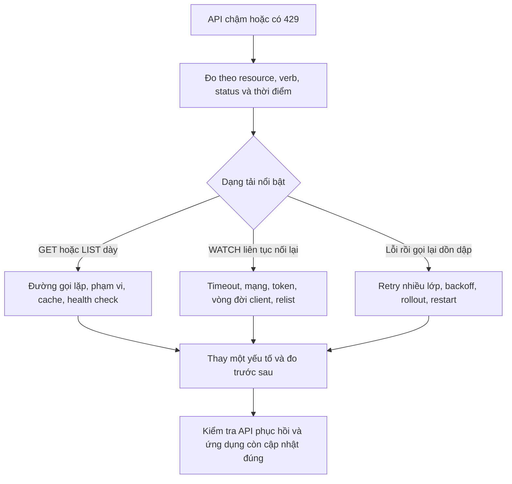

# API server bị quá tải vì truy vấn, watch hoặc retry

Trong chương **Chẩn đoán sự cố** của **SPRING_CLOUD_KUBERNETES**, bài này xử lý tình huống tích hợp discovery hoặc cấu hình tạo quá nhiều tải lên Kubernetes API server. Mục tiêu là xác định nguồn tải, chọn biện pháp giảm đúng loại công việc và kiểm chứng ứng dụng vẫn cập nhật cấu hình, endpoint và trạng thái Pod đúng yêu cầu.

Ví dụ dùng `order-api` trong namespace `sck-lab`, một Configuration Watcher triển khai riêng và nhiều replica ứng dụng. Thuộc tính Spring được minh họa theo Spring Cloud Kubernetes 3.3 và Spring Cloud Commons 4.3; metric phải đối chiếu phiên bản Kubernetes đang chạy. Các số đo trong ví dụ là dữ liệu giả để giải thích phương pháp, không phải ngưỡng năng lực chung hoặc kết quả đã đo trên cluster thực tế.

## 1. Xác định loại tải trước khi đổi cấu hình

Cụm từ “API server quá tải” có thể xuất hiện cùng nhiều hiện tượng:

| Hiện tượng | Giả thuyết cần kiểm chứng |
| --- | --- |
| GET/LIST tăng theo lưu lượng nghiệp vụ | Đường request đang gọi discovery/config qua API quá thường xuyên |
| LIST trả nhiều dữ liệu, latency và CPU tăng | Phạm vi resource quá rộng, collection lớn hoặc nhiều lần nạp lại |
| Nhiều watch đang mở nhưng ổn định | Có thể là số stream dự kiến theo replica và resource, chưa đủ kết luận lỗi |
| WATCH mở/đóng và LIST lặp liên tục | Reconnect, timeout, vòng đời client hoặc xử lý resourceVersion có vấn đề |
| Request lỗi tăng ngay sau rollout | Khởi động đồng loạt, nhiều cache cùng nạp và retry cùng nhịp |
| `401/403` lặp | Credential/RBAC sai nhưng vẫn bị retry hoặc restart liên tục |
| `429`, hàng đợi hoặc thời gian chờ tăng | API server, APF hoặc một tầng trung gian đang từ chối/hạn chế tải |
| CPU cao nhưng QPS không lớn | Chi phí mỗi request, kích thước response hoặc một nút nghẽn control plane khác |

Không kết luận Spring là nguồn gây quá tải chỉ vì log ứng dụng có timeout. Ứng dụng có thể là nạn nhân của sự cố API server, etcd hoặc mạng. Cần đối chiếu thời điểm, nguồn request và tài nguyên bị truy cập.



### Phân biệt ba loại chi phí

1. **Tần suất request:** số lần GET/LIST/WATCH mới gửi đến API server trong một khoảng thời gian.
2. **Chi phí của request:** lượng object/byte, xử lý và thời gian thực hiện; một LIST lớn có thể đắt hơn nhiều GET nhỏ.
3. **Chi phí duy trì stream:** số watch đang mở, lưu lượng event, bộ nhớ và xử lý ở hai đầu.

Giảm QPS nhưng làm LIST lớn hơn, hoặc giữ QPS thấp nhưng mở stream không được đóng, đều có thể chưa giải quyết sự cố.

## 2. Lập mô hình tải để biết đang tìm điều gì

### 2.1. Truy vấn định kỳ bị nhân theo replica

Với giả định mỗi Pod thực sự gửi `Q` request API mỗi chu kỳ `T` giây:

```text
R_periodic ≈ N × Q / T
```

Trong đó `N` là số Pod tham gia. Nếu 60 Pod, mỗi Pod gửi bốn request mỗi ba giây thì tải nền xấp xỉ:

```text
60 × 4 / 3 = 80 request/giây
```

Đây là mô hình khi đã xác nhận các lời gọi tạo request mạng. Một lần `getInstances()` có thể đọc cache, gọi API hoặc gây nhiều request tùy client/implementation. Không thay số lần gọi Java trực tiếp vào công thức khi chưa đo.

Cần tính thêm phân trang, GET metadata, health check và các client khác trong cùng tiến trình. Truy vấn tất cả namespace có thể dùng một request collection rộng thay vì một request cho từng namespace; vì thế số namespace không luôn nhân tuyến tính với QPS, nhưng có thể tăng lượng dữ liệu và chi phí lọc.

### 2.2. Số stream watch dự kiến

Một ước lượng theo cấu trúc client có thể là:

```text
W ≈ N × C × R × S
```

- `C`: số client/informer độc lập theo dõi cùng phạm vi trong mỗi Pod.
- `R`: số loại resource được theo dõi.
- `S`: số phạm vi stream thực tế cho mỗi resource, chẳng hạn nhiều namespace riêng.

Ví dụ 60 Pod, mỗi Pod có một bộ theo dõi bốn resource và một stream cho mỗi resource, có thể có khoảng 240 stream. Con số này không có nghĩa 240 request mới mỗi giây. Nếu stream ổn định thì chi phí khác hoàn toàn vòng nối lại 240 stream liên tục.

Nếu mọi stream cần hai trang LIST ban đầu rồi mở WATCH, một lượt khởi động đồng loạt có thể tạo khoảng `60 × 4 × (2 + 1) = 720` request khởi tạo theo các giả định trên. Client hoặc Kubernetes mới có thể dùng cơ chế khởi tạo khác; xác nhận thực tế từ telemetry.

### 2.3. Retry nhiều lớp tạo hệ số khuếch đại

Giả sử ba lớp độc lập đều cho tối đa ba lần thực hiện, tính cả lần đầu, và lớp ngoài chạy lại toàn bộ lớp trong khi lỗi:

```text
A_max = 3 × 3 × 3 = 27 lần thử ở lớp trong cùng
```

Đó là cận theo cấu trúc giả định, không phải mặc định của Spring Cloud Kubernetes. Kiểm kê retry ở mã ứng dụng, Spring Retry/resilience, HTTP SDK và lịch restart của container. Restart còn có thể mở lại một vòng nạp cấu hình và discovery từ đầu.

Mỗi cơ chế riêng có vẻ hợp lý nhưng tổng thể vẫn có thể gây vòng khuếch đại: API chậm → timeout → retry → tải tăng → API chậm hơn.

## 3. Thu thập bằng chứng mà không tạo thêm một vòng polling

### 3.1. Ghi nhận phạm vi sự cố

Lưu tối thiểu:

- Khoảng thời gian và mốc rollout/scale/thay cấu hình gần nhất.
- Số replica, số restart, họ client và version SDK đã resolve.
- Namespace/resource đang đọc, có `all-namespaces` hay không.
- Thành phần hoạt động: DiscoveryClient, LoadBalancer, ConfigMap/Secret loader, Watcher, reload cũ hoặc mã tự viết.
- Cơ chế cache, polling, heartbeat, watch, timeout và retry ở từng lớp.
- Bằng chứng API server, log ứng dụng và kết quả nghiệp vụ trong cùng khoảng thời gian.

Không dùng tên artifact làm bằng chứng duy nhất về implementation active. Một ứng dụng còn có thể tự tạo client khác, context con hoặc scheduler riêng.

### 3.2. Một vài lệnh đọc có mục tiêu

Ví dụ PowerShell; thay context bằng context thật trước khi dùng:

```powershell
$clusterContext = '<context-can-dieu-tra>'
$appNamespace = 'sck-lab'
kubectl --context $clusterContext -n $appNamespace get deployment order-api
kubectl --context $clusterContext -n $appNamespace get pods -l app=order-api -o wide
kubectl --context $clusterContext -n $appNamespace logs deployment/order-api --since=10m --tail=200
```

`logs deployment/...` không bảo đảm thu được log của mọi replica. Chọn một vài Pod đại diện và đối chiếu thời điểm, đặc biệt Pod mới khởi động hoặc restart nhiều. Nếu Watcher được đặt tên `config-watcher`:

```powershell
kubectl --context $clusterContext -n $appNamespace get deployment config-watcher
kubectl --context $clusterContext -n $appNamespace logs deployment/config-watcher --since=10m --tail=200
```

Khi được cấp quyền vận hành phù hợp, một lần kiểm tra readiness control plane có thể hỗ trợ phân loại:

```powershell
kubectl --context $clusterContext get --raw='/readyz?verbose'
```

Không biến các lệnh này thành vòng lặp toàn cluster mỗi giây. Dùng hệ thống metrics/audit đã có, lấy mẫu log trong thời gian ngắn và hạn chế body dữ liệu. Không log token, Authorization header hay nội dung Secret.

### 3.3. Dùng audit để quy nguồn request

Các trường hữu ích gồm username, userAgent, sourceIPs, verb, requestURI, objectRef, responseStatus và thời điểm/stage. Username ServiceAccount cho biết danh tính API; userAgent giúp nhận diện loại client, nhưng có thể giống nhau giữa nhiều ứng dụng. sourceIP có thể qua NAT hoặc proxy nên không luôn trỏ một-một tới Pod.

Với watch, nhiều audit stage có thể thuộc cùng một request. Khi đếm request, chọn stage phù hợp hoặc gom theo `auditID` để không đếm mỗi stage như một request mới. [Tài liệu Kubernetes Auditing](https://kubernetes.io/docs/tasks/debug/debug-cluster/audit/).

Những câu hỏi cần giải quyết từ audit là: client nào gửi LIST nhiều nhất, có `watch=true/1` không, có cùng resourceVersion lỗi bị lặp lại không, và burst có khớp startup/restart hay thay đổi cấu hình không.

## 4. Đọc metrics API server theo đúng loại phép đo

Các ví dụ PromQL giả sử `job="apiserver"`. Thay bằng nhãn scrape của môi trường, thêm bộ lọc cluster nếu hệ thống thu nhiều cluster và tránh cộng trùng cùng một target từ nhiều job. Một truy vấn không có dữ liệu không có nghĩa API không nhận tải.

### 4.1. Request rate theo resource, verb và status

```promql
sum by (resource, verb, code) (
  rate(apiserver_request_total{
    job="apiserver",
    resource=~"services|pods|endpoints|endpointslices|configmaps|secrets"
  }[5m])
)
```

So riêng GET, LIST và các verb watch thực tế có trong metric. Không lấy một counter để suy số watch đang mở. Các metric API server tiêu chuẩn này không có sẵn nhãn ServiceAccount hay namespace cho mọi phép phân nhóm; dùng audit để bổ sung quy nguồn.

### 4.2. Độ trễ LIST và số request dài đang hoạt động

```promql
histogram_quantile(
  0.99,
  sum by (le, resource) (
    rate(apiserver_request_duration_seconds_bucket{
      job="apiserver",
      verb="LIST",
      resource=~"services|pods|endpoints|endpointslices|configmaps|secrets"
    }[5m])
  )
)
```

```promql
sum by (resource, verb) (
  apiserver_longrunning_requests{
    job="apiserver",
    resource=~"services|pods|endpoints|endpointslices|configmaps|secrets"
  }
)
```

P99 ở đây đo phân bố độ trễ LIST theo cửa sổ và lượng mẫu hiện có. Watch sống lâu không được diễn giải như một request đọc thông thường có latency xấu. Gauge long-running hỗ trợ quan sát stream nhưng không bao phủ mọi kiểu request; kiểm tra nhãn/ý nghĩa metric đúng phiên bản. [Kubernetes Metrics Reference](https://kubernetes.io/docs/reference/instrumentation/metrics/).

### 4.3. Hàng đợi và từ chối từ API Priority and Fairness

```promql
sum by (flow_schema, priority_level, reason) (
  rate(apiserver_flowcontrol_rejected_requests_total{job="apiserver"}[5m])
)
```

```promql
sum by (flow_schema, priority_level) (
  apiserver_flowcontrol_current_inqueue_requests{job="apiserver"}
)
```

APF có thể xếp hàng hoặc từ chối request khi vượt khả năng đồng thời của priority level. HTTP `429` không tự chứng minh toàn bộ control plane đã hết CPU; cần xem nguồn response và metric APF tương ứng. Đối chiếu thêm thời gian chờ hàng đợi, CPU/bộ nhớ API server và trạng thái etcd qua hệ thống vận hành. [Tài liệu API Priority and Fairness](https://kubernetes.io/docs/concepts/cluster-administration/flow-control/).

Không tăng mức ưu tiên hoặc giới hạn đồng thời của ứng dụng ngay từ đầu. Cần xác định công việc dư thừa trước; tăng concurrency có thể chuyển áp lực sang storage hoặc ảnh hưởng các luồng điều khiển khác.

## 5. Nhánh truy vấn: tìm polling, health check và phạm vi quá rộng

### 5.1. Những vị trí dễ gọi API lặp

| Vị trí | Kiểm tra |
| --- | --- |
| Request nghiệp vụ | Có gọi `getServices()`/`getInstances()` hoặc đọc ConfigMap API mỗi request không? |
| Scheduler tự viết | Chu kỳ, số task, khởi tạo nhiều lần, tác vụ chạy chồng khi lần trước chưa xong |
| Health indicator | Có liệt kê service mỗi lần một hệ thống giám sát gọi health không? |
| Catalog heartbeat | Tần suất, số replica và resource bị truy vấn mỗi nhịp |
| LoadBalancer supplier | Có cache hiệu lực không, có gọi lại discovery theo từng lần chọn instance không? |
| Nhiều context/client | Client singleton thật sự hay bị tạo lại theo request/refresh? |

Một mẫu cần xem lại trong mã tự viết:

```java
@Scheduled(fixedRate = 1000)
public void scanCatalog() {
    discoveryClient.getServices().forEach(discoveryClient::getInstances);
}
```

Chi phí không chỉ là một lời gọi Java mỗi giây. Với nhiều service và replica, nếu implementation có request mạng tương ứng, phép quét có thể tạo nhiều GET/LIST. Thay đổi phải xuất phát từ nhu cầu: lấy đúng service cần gọi, dùng cache/informer phù hợp hoặc bỏ lịch quét không có consumer.

### 5.2. Thu hẹp namespace và chọn resource có chủ đích

Ví dụ fragment cấu hình, hợp nhất vào cấu hình hiện có:

```yaml
spring:
  cloud:
    kubernetes:
      discovery:
        all-namespaces: false
        namespaces:
          - sck-lab
        service-labels:
          discoverable: "true"
```

Service cần được chọn phải có label tương ứng. Nhãn Service khác với nhãn Pod. Trước khi thu hẹp, kiểm kê các service đích thật sự cần để không loại bỏ một phụ thuộc hợp lệ.

Đừng coi mọi bộ lọc là giảm tải ở server. Bộ lọc SpEL có thể chạy sau khi dữ liệu được lấy về; kiểm tra requestURI và kết quả đo. Giảm số object trả về cũng không bảo đảm chi phí truy vấn server giảm đúng cùng tỉ lệ. [Tài liệu discovery và phạm vi namespace](https://docs.spring.io/spring-cloud-kubernetes/reference/3.3/discovery-client.html).

### 5.3. Kiểm tra health indicator có gọi discovery

Spring Cloud Commons có `DiscoveryClientHealthIndicator`, có thể gọi `getServices()` khi kiểm tra sức khỏe. Nếu một hệ thống gọi health dày trên mọi Pod, nó có thể tạo tải ngoài dự kiến. Fragment sau chuyển indicator sang đường `probe()` thay cho truy vấn danh sách service trực tiếp:

```yaml
spring:
  cloud:
    discovery:
      client:
        health-indicator:
          use-services-query: false
```

`probe()` vẫn phụ thuộc implementation và có thể tiếp tục truy cập API. Vì vậy, phải đo trước/sau; không coi property này là công tắc bảo đảm không còn request Kubernetes. [Tài liệu health indicator của Spring Cloud Commons](https://docs.spring.io/spring-cloud-commons/reference/4.3/spring-cloud-commons/common-abstractions.html#_health_indicators).

Với Kubernetes probe, chọn nhóm sức khỏe phù hợp. Không biến API server tạm chậm thành liveness failure làm mọi container restart rồi nạp lại toàn bộ dữ liệu. Nếu readiness phụ thuộc dữ liệu discovery còn đủ mới, xác định ngưỡng stale và quan sát riêng tuổi cache thay vì một truy vấn collection lớn trong mỗi probe.

### 5.4. Catalog heartbeat không đồng nghĩa stream Kubernetes WATCH

Trong tài liệu Spring Cloud Kubernetes 3.3, catalog watch có nhịp heartbeat được điều chỉnh bằng `spring.cloud.kubernetes.discovery.catalog-services-watch-delay`, đơn vị millisecond. Với đường này đang hoạt động và yêu cầu cập nhật cho phép, có thể thử khoảng dài hơn:

```yaml
spring:
  cloud:
    kubernetes:
      discovery:
        catalog-services-watch-delay: 60000
```

Đo số request mạng thực tế của mỗi nhịp; không suy ra từ chữ “watch” rằng đó là một kết nối dài chỉ truyền thay đổi. Property này không chỉnh mọi informer, Configuration Watcher hay reconnect của SDK. [Tài liệu catalog watch](https://docs.spring.io/spring-cloud-kubernetes/reference/3.3/discovery-client.html).

Nếu tăng chu kỳ, kiểm chứng thời gian endpoint mới được sử dụng và endpoint cũ được loại bỏ. Một cấu hình giảm tải nhưng vượt yêu cầu hội tụ vẫn chưa đạt mục tiêu.

### 5.5. Dùng cache đúng tầng và có giới hạn độ cũ

Nếu supplier của LoadBalancer đang gọi discovery qua mạng quá thường xuyên và chưa có cache phù hợp, fragment thử nghiệm có thể là:

```yaml
spring:
  cloud:
    loadbalancer:
      cache:
        enabled: true
        ttl: 10s
```

`10s` là giá trị minh họa để đo trong lab, không phải TTL tốt cho mọi hệ thống. Xác nhận supplier thực sự dùng cache. Nếu DiscoveryClient đã cache, thêm một lớp nữa có thể làm dữ liệu cũ tồn tại lâu hơn; cấu hình Caffeine riêng cũng có thể thay cách áp TTL. [Tài liệu LoadBalancer caching](https://docs.spring.io/spring-cloud-commons/reference/4.3/spring-cloud-commons/loadbalancer.html#_spring_cloud_loadbalancer_caching).

Cache phải có chính sách khi hết hạn và khi refresh thất bại. Có thể dùng dữ liệu gần nhất trong giới hạn đã chấp nhận cho một số loại discovery; không giữ IP Pod hoặc credential vô hạn chỉ để QPS thấp. Ghi nhận tuổi dữ liệu và lần cập nhật thành công cuối cùng.

Một điểm đồng bộ cần xem là nhiều request cùng thấy cache hết hạn rồi cùng đi nạp lại. Cơ chế chỉ cho một lần nạp cho cùng key tại một thời điểm, nếu phù hợp, giúp giảm tải dồn; nó vẫn cần timeout, hủy tác vụ và xử lý lỗi rõ ràng.

## 6. Nhánh watch: tìm vòng nối lại và nạp lại collection

### 6.1. Nhận diện watch ổn định và watch bị churn

| Dấu vết | Cách diễn giải cần kiểm tra |
| --- | --- |
| Stream mở lâu, event có khi resource đổi | Có thể là hoạt động bình thường |
| Stream bị đóng theo cùng chu kỳ ngắn | Read timeout, proxy/mesh/LB timeout hoặc vòng đời client |
| Mỗi lần đóng lại có LIST lớn | Đường khởi tạo lại cache hoặc relist đang lặp |
| Số stream tăng mãi khi số Pod cố định | Client/informer bị tạo nhiều lần hoặc không được đóng |
| Nối lại cùng lúc trên nhiều Pod | Sự kiện mạng chung, rollout đồng loạt hoặc thiếu jitter |
| Log `401/403` trước mỗi lần nối lại | Credential hoặc RBAC, không chỉ kết nối thiếu ổn định |
| Log/event `410 Gone` lặp với cùng trạng thái | Xử lý resourceVersion hoặc nạp lại dữ liệu cần xem |

Theo dõi số lần tạo client, mở watch, đóng watch và nguyên nhân nếu SDK/telemetry cho phép. Không bật log body event Secret để lấy các số liệu này.

### 6.2. Tách timeout request thông thường với watch dài hạn

Connect timeout giới hạn việc thiết lập kết nối. Read/request timeout giới hạn hoạt động đọc hoặc thời gian request theo ngữ nghĩa HTTP client. Watch lại là stream có thể không có event trong một khoảng dài.

Nếu một timeout ngắn dành cho GET bị áp lên watch, client có thể liên tục đóng/mở stream và nạp lại dữ liệu. Kiểm tra cả SDK, proxy, service mesh và load balancer trước API server. Đừng chỉ tăng mọi timeout thành vô hạn: điều đó có thể che kết nối chết và giữ tài nguyên quá lâu.

Với Fabric8 và Kubernetes Java Client, thuộc tính, đơn vị và đường tạo client có thể khác nhau theo version. Đối chiếu configuration metadata và code auto-configuration thật sự active; không thêm một thuộc tính QPS/timeout tưởng tượng rồi cho rằng nó đã có hiệu lực. [Phụ lục cấu hình Spring Cloud Kubernetes](https://docs.spring.io/spring-cloud-kubernetes/reference/3.3/appendix.html).

### 6.3. Xử lý resourceVersion và `410 Gone`

Server không giữ lịch sử mọi resourceVersion mãi mãi. Khi version không còn được phục vụ, client cần đồng bộ lại trạng thái theo cơ chế của SDK thay vì lặp lại vô hạn cùng request cũ.

Một phản hồi lỗi còn có thể xuất hiện như event `ERROR` trong stream đã mở với HTTP `200`. Vì vậy, chỉ nhìn counter HTTP `410` không đủ để loại trừ lỗi resourceVersion. Đối chiếu log/event xử lý của client và số lần relist.

Một lần `410` và đồng bộ lại đúng cách không tự chứng minh sự cố. Điều cần sửa là vòng lặp thất bại, relist quá rộng hoặc nhiều client cùng đồng bộ lại không kiểm soát. Giữ nguyên ngữ nghĩa snapshot của API; không tự tăng resourceVersion như một số đếm nghiệp vụ. [Tài liệu Kubernetes API về resourceVersion](https://kubernetes.io/docs/reference/using-api/api-concepts/#resource-versions).

### 6.4. Dùng lại informer/client theo vòng đời thích hợp

Một request nghiệp vụ không nên tự tạo client và mở watch mới rồi bỏ quên. Ưu tiên vòng đời được framework quản lý; nếu tự tạo, đóng stream, executor và HTTP client đúng lúc theo API của thư viện.

Trong cùng tiến trình, xem khả năng dùng chung informer cho cùng resource/phạm vi nếu implementation hỗ trợ. Không chia sẻ client mutable tùy tiện giữa tenant hoặc danh tính khác nhau chỉ để giảm số kết nối.

Cũng cần phân biệt resync callback từ cache với LIST qua mạng: một chu kỳ “resync” không luôn tạo request mới. Đo request thật trước khi điều chỉnh một khoảng resync để giảm QPS.

## 7. Nhánh retry: chặn vòng khuếch đại

### 7.1. Phân loại lỗi trước khi thử lại

| Tình trạng | Chính sách cần xem xét |
| --- | --- |
| `429` | Đọc nguồn response, tôn trọng `Retry-After` hợp lệ, backoff và giới hạn ngân sách |
| Timeout/lỗi mạng tạm thời | Retry có giới hạn, hủy được, kiểm tra nguyên nhân và tình trạng tải |
| `5xx` phù hợp với lỗi tạm thời | Retry chọn lọc trong giới hạn deadline, không mặc định mọi `5xx` đều giống nhau |
| `401` | Xem credential/audience/hết hạn và cơ chế refresh token; không gửi dồn cùng credential lỗi |
| `403` | Sửa RBAC/chủ thể/phạm vi; tránh vòng retry nhanh không thay đổi điều kiện |
| `404` | Kiểm tra tên, namespace và API; retry chỉ khi quy trình thực sự dự kiến object sẽ xuất hiện |
| `410` ở watch | Đồng bộ lại đúng cơ chế, không lặp nguyên trạng thái đã hết hiệu lực |
| Lỗi parse/validation cấu hình | Sửa dữ liệu; thử lại dày không làm dữ liệu trở nên hợp lệ |

Một SDK có thể tiếp tục kiểm tra lại có backoff để phục hồi khi điều kiện bên ngoài thay đổi. Vấn đề cần loại bỏ là retry dồn dập, không phân loại, không có giới hạn tài nguyên hoặc liên tục kéo lại toàn bộ collection.

### 7.2. Backoff, jitter và ngân sách retry

Mẫu chính sách ở mức thuật toán:

```text
sau lần thất bại k:
  cap = min(max_backoff, initial_backoff × 2^k)
  cooldown = khoảng chờ từ Retry-After hợp lệ, nếu có
  delay = cooldown + random(0, cap)

  nếu lỗi không thuộc nhóm được thử lại: dừng đường thử lại phù hợp
  nếu hết số lần thử, deadline hoặc ngân sách retry: dừng
  nếu bị hủy hoặc interrupt: truyền tín hiệu hủy lên
  chờ delay theo cơ chế không chặn luồng xử lý quan trọng
  thực hiện lần tiếp theo
```

Đây là giả mã chính sách, không phải tên thuộc tính sẵn có của Spring. Với `Retry-After` dài hơn ngân sách còn lại, dừng hoặc hoãn công việc theo thiết kế; không cắt ngắn khoảng đợi server yêu cầu để cố nhét thêm lần thử.

Backoff phân tán thời gian thử lại; giới hạn tốc độ/concurrency đặt trần tài nguyên. Hai cơ chế bổ sung cho nhau. Thêm giới hạn theo Pod cũng cần tính tổng số Pod: mỗi Pod cho phép `r` request/giây thì tổng có thể xấp xỉ `N × r`.

Chọn một tầng làm chủ chính sách retry của một thao tác. Nếu nhiều tầng vẫn cần retry riêng, tính tổng số lần và deadline để tránh nhân hệ số như mục 2.3.

### 7.3. Ví dụ giới hạn retry khi nạp ConfigMap

Đối với đường nạp cấu hình Spring Cloud Kubernetes 3.3 có retry được auto-configure, tài liệu yêu cầu `fail-fast` cùng dependency hỗ trợ. Ví dụ dependency bổ sung, version do BOM quản lý:

```xml
<dependency>
    <groupId>org.springframework.retry</groupId>
    <artifactId>spring-retry</artifactId>
</dependency>
<dependency>
    <groupId>org.springframework.boot</groupId>
    <artifactId>spring-boot-starter-aop</artifactId>
</dependency>
```

Fragment minh họa một giới hạn:

```yaml
spring:
  cloud:
    kubernetes:
      config:
        fail-fast: true
        retry:
          enabled: true
          max-attempts: 3
          initial-interval: 1000
          max-interval: 5000
          multiplier: 2.0
```

Các khoảng interval ở đây tính bằng millisecond; `max-attempts` là tổng số lần thử ở đường retry tương ứng. Kiểm chứng điều kiện auto-configuration và log để biết đường nạp hiện tại thực sự dùng chính sách nào. [Tài liệu ConfigMap retry](https://docs.spring.io/spring-cloud-kubernetes/reference/3.3/property-source-config/configmap-propertysource.html).

Cấu hình này không phải một bộ điều khiển retry chung cho discovery, mọi HTTP request và watch reconnect. Nó cũng không tự thêm phân loại `429/403`, xử lý `Retry-After` hoặc jitter như giả mã trên. Cần đánh giá riêng từng tầng và tránh một vòng retry bên ngoài chạy lại cả chuỗi.

Nếu hết retry làm startup thất bại và Kubernetes tiếp tục restart container, tải theo vòng đời Pod vẫn có thể tiếp tục. Phải xử lý lỗi gốc, giới hạn rollout đồng thời và chính sách probe; chỉ giảm `max-attempts` chưa chặn được toàn bộ vòng lặp.

## 8. Chọn biện pháp giảm tải theo bằng chứng

### 8.1. Ưu tiên trong lúc sự cố đang diễn ra

1. Xác định nguồn tải lớn nhất và chức năng có thể giảm tần suất mà vẫn giữ yêu cầu phục vụ.
2. Tạm ngừng các đợt khởi động đồng loạt hoặc tác vụ quét không thiết yếu theo quy trình vận hành.
3. Sửa lỗi cấu hình/RBAC/credential nếu chúng tạo vòng retry rõ ràng.
4. Thu hẹp phạm vi, sửa vòng đời watch hoặc điều chỉnh cache/chu kỳ dựa trên dấu vết đo được.
5. Theo dõi API cùng nghiệp vụ sau từng thay đổi; mở rộng dần khi kết quả đạt.

Nếu rollout là nguồn burst và quy trình cho phép tạm dừng Deployment đang cập nhật, lệnh có thể là:

```powershell
kubectl --context $clusterContext -n $appNamespace rollout pause deployment/order-api
```

Pause không dừng các Pod đã chạy, không hủy mọi tác vụ khởi động đang diễn ra và không chặn retry bên trong chúng. Khi đã xử lý điều kiện gây lỗi, tiếp tục theo kế hoạch:

```powershell
kubectl --context $clusterContext -n $appNamespace rollout resume deployment/order-api
```

Không restart toàn bộ ứng dụng để “xóa lỗi” trước khi thu bằng chứng. Việc đó có thể đồng thời tạo thêm nạp cấu hình, list và watch mới.

### 8.2. Tránh trùng cơ chế theo dõi cấu hình

Kiểm kê reload trong ứng dụng, Configuration Watcher riêng, polling tự viết và pipeline rollout. Bật nhiều cơ chế có thể làm một thay đổi gây nhiều lần refresh và đọc lại nguồn trên mọi replica.

PropertySource Reload cũ của Spring Cloud Kubernetes đã bị deprecated từ release train 2020.0; đây không phải lý do thêm Watcher mà vẫn giữ nguyên mọi lịch cũ. Chọn cơ chế theo yêu cầu cập nhật và kiểm chứng migration. [Tài liệu PropertySource Reload](https://docs.spring.io/spring-cloud-kubernetes/reference/3.3/property-source-config/propertysource-reload.html).

Watcher riêng có thể giảm việc mỗi ứng dụng tự theo dõi nguồn cấu hình, nhưng vẫn phải tính fan-out: một thay đổi có thể gửi refresh đến nhiều instance, và mỗi instance lại đọc nguồn. Nhiều replica Watcher cũng không tự đồng nghĩa chỉ một replica xử lý sự kiện; kiểm tra HA/điều phối của đúng release thay vì tự đoán.

Giới hạn namespace/resource theo dõi và gộp các lần cập nhật liên tiếp nếu tính năng cho phép. Trong tài liệu Watcher 3.3, nhãn điều kiện phát thông báo và bộ lọc informer là hai ý khác nhau; giảm số thông báo chưa chắc giảm lượng dữ liệu đã watch. [Tài liệu Configuration Watcher](https://docs.spring.io/spring-cloud-kubernetes/reference/3.3/spring-cloud-kubernetes-configuration-watcher.html).

### 8.3. Chọn tính năng thật sự cần

Nếu chỉ cần gọi tên Kubernetes Service bằng DNS và nhận cấu hình ở lần triển khai tiếp theo, có thể bỏ discovery API hoặc watch không cần thiết. Nếu cần cân bằng tải theo Pod, metadata động hoặc refresh nóng, giữ tính năng đó nhưng đặt giới hạn và đo được độ hội tụ.

Đưa discovery qua một thành phần tập trung có thể giảm số client trực tiếp tới Kubernetes API, nhưng tạo một thành phần cần HA, năng lực và khả năng phục hồi riêng. Nó không tự làm chi phí biến mất.

## 9. Ví dụ điều tra từ giả thuyết đến cách sửa

Giả sử sau một đợt mở rộng lên 60 replica, API server xuất hiện nhiều LIST và một số `429`. Các request chủ yếu dùng ServiceAccount của `order-api`. Log có timeout và retry.

Các giả thuyết ban đầu:

| Giả thuyết | Phép kiểm chứng |
| --- | --- |
| Lưu lượng nghiệp vụ trực tiếp tạo LIST | So request API với business RPS; đo trên Pod nhàn rỗi |
| Lịch quét nền quá dày | Tạm thay một lịch trong canary, xem số request theo chu kỳ |
| Watch bị đóng liên tục | Đo mở/đóng stream, LIST sau mỗi lần nối lại và timeout |
| Startup burst | Đối chiếu thời điểm Pod mới với request API và retry |

Audit cho thấy chu kỳ ba giây ngay cả trên Pod không nhận request nghiệp vụ. Kiểm tra phát hiện scheduler tự quét service cùng một heartbeat khác; ứng dụng còn tìm tất cả namespace. Dấu vết này hỗ trợ giả thuyết truy vấn nền, không hỗ trợ kết luận business request là nguồn chính.

Cách sửa được thử riêng: bỏ lịch không có consumer, thu hẹp namespace hợp lệ, điều chỉnh cache/heartbeat cần thiết và phân tán đợt rollout. Sau mỗi bước, tiếp tục đo endpoint mới/cũ và revision cấu hình.

Bảng sau hoàn toàn giả định để minh họa cách ghi kết quả:

| Chỉ số cùng điều kiện thử | Trước | Sau |
| --- | --- | --- |
| Request API quy về danh tính thử | 80/giây | 8/giây |
| Tỷ lệ `429` trong cửa sổ đo | 4% | 0% quan sát được |
| P99 thời gian hội tụ discovery | 2 giây | 9 giây |
| Số Pod phục vụ có revision đúng | Đủ | Đủ |

Nếu hợp đồng lab cho phép hội tụ dưới 15 giây, kết quả độ trễ giả định này có thể đạt; nếu yêu cầu dưới năm giây thì chưa đạt. Không chọn cấu hình chỉ vì QPS giảm. “Không quan sát `429`” cũng phải đi kèm độ dài cửa sổ và số mẫu.

## 10. Thực hành kiểm chứng có giới hạn

Thực hiện trên cluster lab hoặc canary đã có telemetry, không cố làm quá tải control plane để tái hiện triệu chứng.

1. **Đường cơ sở:** giữ số replica và tải nghiệp vụ ổn định, ghi request theo verb/resource, latency, lỗi và số stream.
2. **Nhân replica có kiểm soát:** thử từ hai lên bốn replica nếu tài nguyên và giới hạn lab cho phép. Đo tải nền khi không có request nghiệp vụ để tìm phần nhân theo Pod.
3. **Một thay đổi cấu hình:** thử thu hẹp namespace hoặc tăng chu kỳ của đúng lịch đã xác định. Giữ những yếu tố khác ổn định.
4. **Một thay đổi endpoint:** thêm hoặc thay một backend trong lab; đo thời gian mọi replica tìm ra tập endpoint mới và gọi nghiệp vụ lại được.
5. **Một thay đổi revision:** cập nhật ConfigMap không nhạy cảm theo cơ chế đã chọn; kiểm tra từng Pod, bean và hành vi thực tế.
6. **Lỗi có kiểm soát:** dùng test double/proxy lab để trả lỗi tạm thời hoặc `429` có khoảng chờ. Quan sát giới hạn lần thử, deadline, jitter và phục hồi; không cần tạo `429` bằng cách bắn request dồn vào API thật.
7. **Vòng đời:** thử một lần restart hoặc gián đoạn watch được kiểm soát để bảo đảm giải pháp không chỉ giảm tải trong trạng thái đã warm cache.

Đặt trước giới hạn thời gian, replica và lưu lượng; dừng phép thử nếu control plane hoặc nghiệp vụ vượt ngưỡng lab. Không chạy một script LIST toàn cluster trong vòng lặp không giới hạn làm công cụ đo.

Sau thay đổi, mở lại port-forward theo Pod cụ thể nếu cần chẩn đoán từng replica. Một request qua Service thường chỉ quan sát một instance; nó không chứng minh mọi cache đã hội tụ.

## 11. Điều kiện đóng sự cố

Chỉ kết luận hoàn tất khi có bằng chứng ở cả hai phía:

| Phía API/control plane | Phía ứng dụng |
| --- | --- |
| Nguồn request đã được quy về đúng thành phần | Tập endpoint và đường gọi dịch vụ đúng |
| QPS/chi phí LIST hoặc churn watch giảm có giải thích | Thời gian hội tụ nằm trong yêu cầu |
| Hàng đợi, latency và `429` ở mức chấp nhận trong cửa sổ đo | ConfigMap/Secret cập nhật qua đúng vòng đời đã thiết kế |
| Không còn retry burst lặp với lỗi cố định | Các replica phục hồi sau restart hoặc gián đoạn |
| Tải được kiểm tra ở quy mô replica dự kiến | Không giữ dữ liệu cũ vô hạn để che việc đồng bộ hỏng |

Báo cáo nên chứa bộ phiên bản, phạm vi namespace/resource, số replica, thay đổi cụ thể, cửa sổ đo, request budget và giới hạn còn lại. Với Secret, chỉ ghi revision hoặc kết quả sử dụng credential phù hợp, không ghi giá trị bí mật.

Giữ APF và các cơ chế bảo vệ của control plane trong vai trò hạn chế tác động giữa các luồng. Mục tiêu của tích hợp Spring Cloud Kubernetes là cung cấp discovery và cấu hình cần thiết với tải kiểm soát được; giảm metric bằng cách làm ứng dụng mất khả năng cập nhật chưa giải quyết được sự cố.
