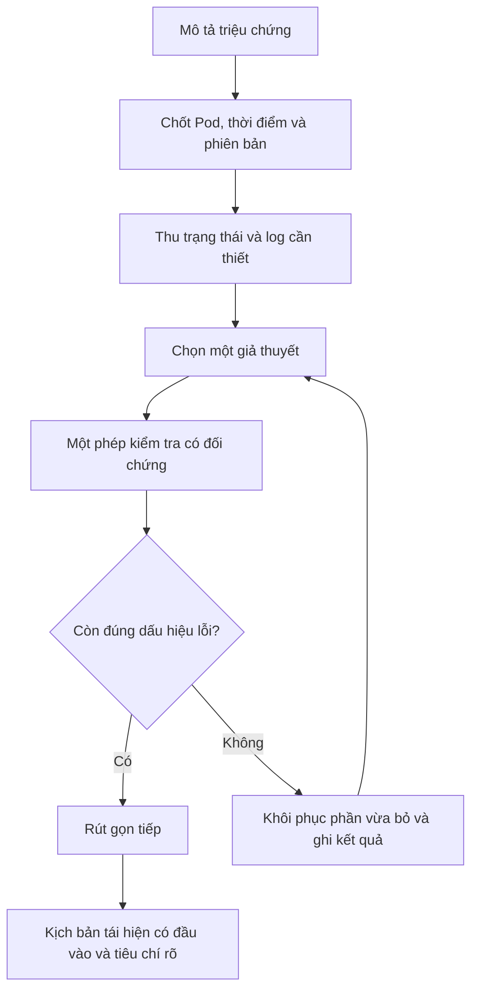

# Quy trình thu thập bằng chứng và tạo kịch bản tái hiện tối thiểu

Trong chương **Chẩn đoán sự cố** của **SPRING_CLOUD_KUBERNETES**, bài này hướng dẫn biến một mô tả như “không thấy dịch vụ”, “ConfigMap không đổi” hoặc “Pod thỉnh thoảng lỗi” thành một hồ sơ có thể kiểm tra và một kịch bản người khác chạy lại được.

Quy trình áp dụng cho DiscoveryClient, ConfigMap, Secret, Spring Cloud LoadBalancer, Configuration Watcher, RBAC và sức khỏe Pod. Không cần bật tất cả tính năng để điều tra một lỗi; hãy giữ đúng những thành phần tham gia đường lỗi.

Sau bài học, bạn có thể:

- Ghi nhận triệu chứng, phạm vi và thời điểm mà không trộn với giả thuyết.
- Thu thập trạng thái Kubernetes và trạng thái Spring từ đúng Pod/container.
- Chọn phép kiểm tra có thể loại trừ hoặc củng cố một giả thuyết.
- Rút gọn ứng dụng và manifest mà vẫn giữ nguyên dấu hiệu lỗi.
- Chuẩn bị bộ tái hiện đã loại dữ liệu nhạy cảm, có bước lỗi, đối chứng và khôi phục.

## 1. Bắt đầu bằng câu hỏi có thể kiểm chứng

Một mô tả tốt có bốn phần: **kích hoạt, mong đợi, thực tế và phạm vi**.

| Mô tả chưa đủ | Mô tả có thể điều tra |
| --- | --- |
| Discovery bị lỗi | Sau khi backend B không Ready, caller C vẫn chọn IP của B trong các request mới sau thời hạn quan sát |
| ConfigMap không nạp | Khi Pod P khởi động với ServiceAccount S, ứng dụng không đọc được ConfigMap X trong namespace N và log có lỗi 403 |
| Refresh không hoạt động | Sau khi nguồn đổi từ r1 sang r2 và POST refresh vào Pod A, Environment là r2 nhưng bean xử lý vẫn dùng r1 |
| API server chậm | Trong khoảng thời gian T, request đọc API từ caller có latency/lỗi đã đo; đường nghiệp vụ đối chứng vẫn được kiểm tra riêng |

Tách ba loại phát biểu trong ghi chép:

- **Quan sát:** dữ liệu đã lấy được, có nguồn và thời điểm.
- **Giả thuyết:** cách giải thích đang cần kiểm tra.
- **Kết luận:** cách giải thích đã được bằng chứng đối chứng hỗ trợ trong phạm vi cụ thể.

Ví dụ:

```text
Quan sát: log của Pod UID P1 ghi 403 khi list configmaps trong namespace learning.
Giả thuyết: ServiceAccount của Pod chưa có quyền list tại namespace này.
Kiểm tra: đối chiếu danh tính, RoleBinding và quyền của chính ServiceAccount.
Kết luận dự kiến: chỉ bổ sung binding đúng phạm vi làm lần khởi động mới đọc được nguồn.
```

Không đổi “có 403” thành “thư viện bị lỗi RBAC” trước khi kiểm tra verb, resource, namespace và danh tính thực tế.

## 2. Chuẩn bị một hồ sơ sự cố ngắn

Ghi các trường sau trước khi thay đổi trạng thái đang lỗi:

| Nhóm | Nội dung cần có |
| --- | --- |
| Nhận diện | Mã ca điều tra, người ghi nhận, cluster context và namespace |
| Triệu chứng | Request/thao tác kích hoạt, expected và actual |
| Thời gian | Khoảng UTC bắt đầu/kết thúc, tần suất, lần tốt gần nhất |
| Phạm vi | Mọi Pod hay một Pod, một namespace hay nhiều namespace |
| Phiên bản | Java, Spring Boot, Spring Cloud BOM, Spring Cloud Kubernetes, Kubernetes client đã resolve |
| Artifact | Commit/release ID, image và digest/imageID đang chạy |
| Cấu hình | Profile, nguồn nạp, tên nguồn, namespace và revision không nhạy cảm |
| Quyền | ServiceAccount, Role/RoleBinding liên quan |
| Thay đổi gần nhất | Image, ConfigMap, Secret reference, quyền, selector, Watcher hoặc probe |
| Mức tái hiện | Luôn xảy ra hay tỷ lệ trên số lần thử đã ghi nhận |
| Phục hồi | Biện pháp tạm thời đã dùng và trạng thái trước/sau |

Version trong BOM khai báo và version thực tế được resolve có thể khác do override hoặc dependency khác. Hồ sơ cần cả thông tin build và artifact đang chạy; không suy version thư viện từ tên image.

Trong môi trường build của dự án Maven, có thể lấy danh sách dependency liên quan bằng:

```powershell
java -version
.\mvnw.cmd dependency:tree '-Dincludes=org.springframework.boot:*,org.springframework.cloud:*,io.fabric8:*,io.kubernetes:*'
```

Đây là ví dụ dành cho người chuẩn bị bộ tái hiện. Với công cụ build khác, lấy báo cáo resolve tương đương; không chỉ chép một đoạn dependency khai báo.

Ghi rõ client Fabric8, Kubernetes Java Client hay DiscoveryClient qua server trung gian. Một thay đổi loại client có thể thay đổi cách lookup/cache/watch và làm phép so sánh không còn cùng điều kiện.

## 3. Thu thập bằng chứng trước khi làm mất trạng thái lỗi

Khởi động lại, refresh, đổi quyền hoặc sửa ConfigMap đều có thể làm triệu chứng biến mất. Khi cần khôi phục dịch vụ gấp, ưu tiên giảm tác động, đồng thời ghi lại tối thiểu Pod UID, thời điểm, log và thao tác đã thực hiện.

Một vòng điều tra có thể đi theo sơ đồ:



Thu thập nên có giới hạn theo Pod, thời gian và loại tài nguyên. Không bắt đầu bằng việc xuất mọi Secret, toàn bộ môi trường container hoặc mọi log của cluster.

### 3.1. Chốt cluster và Pod cụ thể

Các lệnh ví dụ dùng PowerShell; thay giá trị mẫu bằng môi trường đang điều tra:

```powershell
$ns = 'learning'
$podName = 'TEN_POD_CAN_DIEU_TRA'
$containerName = 'app'

(Get-Date).ToUniversalTime().ToString('o')
kubectl config current-context
kubectl -n $ns get pod $podName -o wide
kubectl -n $ns get pod $podName -o custom-columns='NAME:.metadata.name,UID:.metadata.uid,SA:.spec.serviceAccountName,NODE:.spec.nodeName,IMAGE:.spec.containers[*].image,IMAGEID:.status.containerStatuses[*].imageID,RESTARTS:.status.containerStatuses[*].restartCount'
```

Nếu Pod có nhiều container, các mảng trong custom columns cần đối chiếu theo tên container. Không gộp log sidecar với lỗi của ứng dụng rồi suy rằng chúng đến từ cùng tiến trình.

Pod name có thể xuất hiện trong nhiều ghi chép, nhưng Pod UID mới xác định đúng đối tượng đang xem. Pod mới sau rollout không phải lần chạy trước chỉ vì ứng dụng và nhãn giống nhau.

### 3.2. Lấy log theo cửa sổ thời gian

```powershell
kubectl -n $ns logs $podName -c $containerName --since=15m --timestamps=true --tail=1000
```

Nếu đã có một mốc UTC cụ thể, dùng `--since-time` với RFC 3339 thay cho `--since`:

```powershell
$sinceUtc = 'MOC_UTC_RFC3339_DA_CHON'
kubectl -n $ns logs $podName -c $containerName --since-time=$sinceUtc --timestamps=true --tail=1000
```

Thay chỗ giữ chỗ bằng giá trị thật, ví dụ định dạng `2026-11-25T03:00:00Z`. Không dùng đồng thời hai cách chọn thời gian trong cùng lệnh.

Nếu container đã restart và còn log lần trước:

```powershell
kubectl -n $ns logs $podName -c $containerName --previous --timestamps=true --tail=1000
```

`--previous` không phải kho lịch sử mọi lần chạy. Log và sự kiện có giới hạn lưu giữ; không có đầu ra không chứng minh chưa từng có lỗi. Các tùy chọn được mô tả trong [kubectl logs](https://kubernetes.io/docs/reference/kubectl/generated/kubectl_logs/).

Giữ cả chuỗi nguyên nhân exception và vài dòng trước/sau thao tác lỗi. Chỉ lấy dòng chứa ERROR thường làm mất service ID, namespace, lần retry hoặc lỗi gốc.

### 3.3. Xem trạng thái container và sự kiện đúng đối tượng

```powershell
kubectl -n $ns describe pod $podName

$podUid = kubectl -n $ns get pod $podName -o jsonpath='{.metadata.uid}'
kubectl -n $ns get events --field-selector "involvedObject.uid=$podUid" --sort-by=.metadata.creationTimestamp
```

`describe` có thể chứa giá trị cấu hình hoặc thông tin nội bộ; xem xét trước khi đưa vào gói chia sẻ.

Phân biệt các tầng lỗi:

| Bằng chứng | Hướng điều tra |
| --- | --- |
| ImagePullBackOff | Artifact/registry trước khi điều tra logic Spring |
| Lỗi mount/tham chiếu nguồn | Cấu hình Pod và tài nguyên được kubelet cung cấp |
| Container chạy rồi thoát | Exit reason, log khởi động và exception |
| Pod Running nhưng không Ready | Probe, trạng thái ứng dụng và điều kiện phục vụ |
| 403 trong log client Kubernetes | Danh tính và quyền của request API |
| HTTP nghiệp vụ lỗi khi Pod Ready | Đường xử lý thực tế; probe có thể chưa bao phủ điều kiện đó |

Hướng dẫn [Debug Running Pods](https://kubernetes.io/docs/tasks/debug/debug-application/debug-running-pod/) giúp phân biệt thông tin trạng thái, log và các cách quan sát khi image thiếu công cụ.

Một debug Pod mới không mặc nhiên có cùng ServiceAccount, nhãn NetworkPolicy, DNS hoặc đường mạng của Pod lỗi. Kết quả từ môi trường đó là đối chứng, không tự thay thế bằng chứng của Pod gốc.

## 4. Thu bằng chứng theo đường tích hợp đang lỗi

### 4.1. ConfigMap và Secret: đi từ nguồn đến hành vi

Cần nối được chuỗi:

```text
Tài nguyên Kubernetes
→ đường nạp API/env/volume
→ PropertySource và Environment
→ bean đã bind hoặc giá trị đã giữ
→ request nghiệp vụ trên đúng Pod
```

| Cần biết | Bằng chứng phù hợp |
| --- | --- |
| Nguồn có tồn tại đúng chỗ | Metadata, tên và namespace |
| Pod có đọc được nguồn | Log API và quyền của ServiceAccount |
| Dữ liệu tạo ra đúng khóa | Cấu trúc/key đã rút gọn, không nhạy cảm |
| Nguồn nào thắng | PropertySource/origin của khóa cụ thể |
| Cập nhật đã áp dụng chưa | Revision trong Environment, bean và kết quả xử lý |
| Các replica có giống nhau | Cùng phép kiểm tra trên từng Pod |

Đừng coi ConfigMap trên API có giá trị mới là bằng chứng bean đã đổi. Cũng không coi tệp mount đã mới là bằng chứng Spring đã đọc lại.

Với Actuator đã có kênh chẩn đoán được bảo vệ, có thể xem `/actuator/env/<property>` và `/actuator/configprops`. Giá trị có thể bị che; chuỗi che không đồng nghĩa thuộc tính thiếu. Không bật hiển thị mọi giá trị chỉ để điều tra một khóa. Xem [Actuator endpoints](https://docs.spring.io/spring-boot/3.5/reference/actuator/endpoints.html).

Nếu cùng khóa đến từ env, CLI, JVM hoặc một import khác, ghi nguồn hiệu lực thay vì chỉ so hai ConfigMap. Thứ tự nguồn được giải thích trong [Externalized Configuration](https://docs.spring.io/spring-boot/3.5/reference/features/external-config.html).

Với Secret, ưu tiên dùng giá trị giả cùng định dạng trong bộ tái hiện. Lưu tên khóa và quan hệ tham chiếu cần thiết, không lấy token/password thật làm dữ liệu mẫu.

### 4.2. DiscoveryClient và LoadBalancer: so ba tập khác nhau

Ba tập cần đối chiếu là:

1. Backend mà Kubernetes mô tả là đủ điều kiện phục vụ.
2. Instance mà DiscoveryClient/supplier đang trả về.
3. Backend thực sự nhận request.

Ví dụ:

```powershell
$serviceName = 'inventory'
kubectl -n $ns get service $serviceName -o yaml
kubectl -n $ns get endpointslice -l "kubernetes.io/service-name=$serviceName" -o yaml
```

Kiểm tra selector, port/targetPort, namespace và condition của endpoint. Có địa chỉ trong EndpointSlice chưa có nghĩa địa chỉ đó được coi là Ready. Xem [EndpointSlices](https://kubernetes.io/docs/concepts/services-networking/endpoint-slices/).

Trong ứng dụng, quan sát service ID, host, port và kết quả request theo cùng thời điểm. Ghi rõ chế độ POD/SERVICE, HTTP client nào gắn LoadBalancer, cache và retry đang dùng.

Lấy một danh sách instance đúng chưa chứng minh request đã tới đúng backend. Ngược lại, một request thành công qua DNS/Service chưa chứng minh DiscoveryClient của Spring đang cập nhật. Phạm vi và cách lookup được mô tả trong [DiscoveryClient 3.3](https://docs.spring.io/spring-cloud-kubernetes/reference/3.3/discovery-client.html).

### 4.3. Configuration Watcher: theo toàn bộ chuỗi thông báo

Thu các mốc riêng:

```text
Nguồn thay đổi
→ Watcher nhận sự kiện
→ nguồn vượt điều kiện lọc
→ xác định ứng dụng/instance
→ gửi HTTP hoặc Bus
→ ứng dụng đọc lại dữ liệu
→ bean và hành vi có revision mới
```

Bằng chứng cần có ở cả controller và ứng dụng đích. Ghi namespace, nhãn/annotation liên quan, phiên bản Watcher, HTTP/Bus, port/path management và từng Pod nhận cập nhật.

“Watcher đã gửi POST” chưa chứng minh mọi replica đã áp dụng. Với đường mount, phải đối chiếu thời điểm tệp mới đến và thời điểm refresh; với đường API, kiểm tra lỗi đọc lại nguồn. Xem [Configuration Watcher 3.3](https://docs.spring.io/spring-cloud-kubernetes/reference/3.3/spring-cloud-kubernetes-configuration-watcher.html).

### 4.4. RBAC: dùng đúng danh tính và request

Ví dụ kiểm tra một ServiceAccount:

```powershell
kubectl auth can-i get configmaps/sample-config -n learning --as=system:serviceaccount:learning:sample-reader
kubectl auth can-i list configmaps -n learning --as=system:serviceaccount:learning:sample-reader
```

Tài khoản chạy kubectl cần được phép impersonate danh tính đó. Lỗi impersonation không trả lời được quyền của ứng dụng. Nếu quyền thực tế dựa trên group, việc kiểm tra cũng cần phản ánh group liên quan và quyền impersonation phù hợp.

Giữ lại verb, resource và namespace từ lỗi gốc. Quyền get một tên không tự chứng minh có quyền list/watch. Mặt khác, một check được phép không tự chứng minh TLS, token mount hoặc đường mạng đều đúng. Xem [kubectl auth can-i](https://kubernetes.io/docs/reference/kubectl/generated/kubectl_auth/kubectl_auth_can-i/).

## 5. Dựng timeline và bảng giả thuyết

### 5.1. Timeline ngắn hơn một khối log dài

| Mốc | Quan sát | Nguồn bằng chứng |
| --- | --- | --- |
| T0 | Release mới được triển khai | Release ID và Pod template |
| T1 | Pod UID P1 khởi động bằng SA S | Metadata Pod |
| T2 | Request đọc ConfigMap bị từ chối | Log có timestamp và nguyên nhân gốc |
| T3 | Lần chạy container kết thúc | Trạng thái container/log |
| T4 | Bổ sung binding trong môi trường thử | Lệnh/manifest và thời điểm thao tác |
| T5 | Pod mới đọc được marker | Log và endpoint demo |

Bảng này là mẫu minh họa. Dùng timestamp thật từ ca đang xử lý và ghi rõ các đồng hồ có thể lệch nhau. Không dùng thứ tự dòng của hai luồng log độc lập làm bằng chứng duy nhất cho quan hệ trước–sau.

### 5.2. Mỗi phép thử phải trả lời một câu hỏi

| Giả thuyết | Bằng chứng hiện có | Kiểm tra có mục tiêu | Điều làm giả thuyết yếu đi |
| --- | --- | --- | --- |
| Thiếu quyền đọc nguồn | 403 đúng namespace | Chỉ thêm quyền cần thiết trong lab rồi khởi động cùng image | Vẫn lỗi cùng nguyên nhân dù quyền đã xác nhận |
| Sai namespace | Log và metadata khác namespace mong đợi | Giữ dữ liệu và image, sửa đúng namespace | Request đã tới đúng namespace từ đầu |
| Bị env ghi đè | Cùng khóa có trong system environment | Gỡ riêng env override ở lab | Giá trị hiệu lực vẫn do nguồn khác |
| Instance còn cũ | Request tới backend đã bị loại | So endpoint, discovery và đích theo thời gian | Đường gọi thực tế không dùng supplier đang kiểm tra |
| Refresh đến trước dữ liệu mới | Mốc thông báo sớm hơn dữ liệu | Đọc lại sau khi nguồn đã xác nhận mới | Bean vẫn cũ vì không có vòng đời refresh phù hợp |

Không cùng lúc đổi namespace, BOM, client và RBAC rồi kết luận một trong số đó là nguyên nhân. Nếu phải thực hiện nhiều thay đổi để khôi phục dịch vụ, ghi chúng thành biện pháp phục hồi; bước chứng minh nguyên nhân cần tách riêng khi có môi trường phù hợp.

## 6. Chọn định nghĩa lỗi trước khi rút gọn

Kịch bản tối thiểu phải giữ **cùng dấu hiệu lỗi cần nghiên cứu**, không chỉ giữ trạng thái “chạy không được”.

Ví dụ tiêu chí của một ca RBAC:

```text
Giữ lỗi S:
- Đúng image và cấu hình nạp nguồn.
- Ứng dụng khởi động bằng ServiceAccount thử nghiệm.
- Kubernetes API từ chối đọc configmaps ở namespace đã chốt với 403.
- Exception gốc dẫn tới khởi động thất bại.

Không được coi là S:
- ImagePullBackOff.
- YAML không hợp lệ.
- Không có starter xử lý kubernetes:.
- Thiếu ConfigMap dẫn tới một nguyên nhân khác.
- Java không chạy do sai phiên bản.
```

Với lỗi phân tán, tiêu chí còn cần số replica, trình tự thao tác, cửa sổ thời gian, cache/retry và điều kiện mạng. Giảm còn một Pod có thể làm mất chính lỗi chỉ xảy ra khi các replica khác trạng thái.

Một kịch bản ngắn hơn nhưng không giữ điều kiện kích hoạt chưa phải bản tái hiện tốt hơn.

## 7. Rút gọn có kiểm soát

### 7.1. Giữ bản gốc, rút gọn ở môi trường thử

Từ trạng thái đã thu bằng chứng, tạo một dự án/namespace thử riêng. Giữ phiên bản, kiểu client và đường nạp liên quan cho lượt đầu. Dùng dữ liệu giả nhưng cùng cấu trúc cần thiết.

Một thứ tự rút gọn thường hữu ích:

1. Thay dữ liệu nghiệp vụ bằng một marker không nhạy cảm.
2. Bỏ UI, database và integration không nằm trên đường kích hoạt.
3. Bỏ dependency không tham gia lỗi.
4. Bỏ controller/service không cần để kích hoạt hoặc quan sát.
5. Bỏ tài nguyên Kubernetes không tham gia quan hệ đang kiểm tra.
6. Giảm cấu hình, giữ các giá trị ảnh hưởng namespace, danh tính, profile và thời điểm.
7. Chốt một lệnh hoặc chuỗi thao tác ngắn có kết quả expected/actual rõ.

Mỗi lần bỏ một phần, chạy lại cùng tiêu chí S. Nếu lỗi biến mất hoặc chuyển thành nguyên nhân khác, khôi phục phần vừa bỏ và ghi kết quả.

Nếu dự án lớn, có thể bỏ từng nhóm thành phần để khoanh vùng nhanh hơn, rồi giảm tiếp bên trong nhóm cần giữ. Không coi việc lỗi biến mất sau khi bỏ một nhóm là bằng chứng mọi thành phần trong nhóm đều cần thiết.

### 7.2. Giữ điều kiện thời gian và trạng thái khi chúng quan trọng

| Lỗi cần tái hiện | Điều không được bỏ quá sớm |
| --- | --- |
| Refresh một Pod, Pod khác chưa đổi | Ít nhất hai replica và bước gọi đúng từng Pod |
| Lookup dùng trạng thái cũ khi API lỗi | Trình tự warm-up, tạo lỗi, thay endpoint và khôi phục |
| Tệp mount cập nhật chậm | Đường mount thực tế và mốc đọc lại nguồn |
| Race khi rollout | Sự cùng tồn tại bản cũ/mới và cách định tuyến |
| Lỗi chọn port | Service có tập port giống điều kiện kích hoạt |
| RBAC cross-namespace | Quan hệ namespace của Pod, nguồn và binding |

Khi số lần tái hiện thay đổi, ghi cả số lần thử và khoảng quan sát. “Không thấy lỗi trong một lần chạy” chỉ là một quan sát, không đủ để phủ định lỗi thỉnh thoảng.

### 7.3. Giữ đường gọi giống đường lỗi

Nếu lỗi ở đường Spring Cloud LoadBalancer, một lệnh HTTP trực tiếp tới Pod chỉ giúp kiểm tra backend; nó chưa tái hiện lookup/chọn instance.

Nếu lỗi ở quyền API, đọc tệp đã mount không kiểm tra cùng quyền của ứng dụng. Nếu lỗi ở Watcher, một lần refresh thủ công thành công chỉ xác nhận chặng áp dụng, chưa xác nhận chặng phát hiện/thông báo.

Kịch bản tối thiểu cần giữ đúng đường cần nghiên cứu, dù những đường đối chứng vẫn có ích để loại trừ nguyên nhân.

## 8. Ví dụ đầy đủ: tái hiện lỗi quyền đọc ConfigMap

Ví dụ này là tình huống mô phỏng để học phương pháp, không phải kết luận về một dự án hiện tại.

**Câu hỏi:** Với cùng image và dữ liệu ConfigMap, việc bổ sung đúng RoleBinding có làm lỗi 403 khi đọc nguồn biến mất không?

**Biến thay đổi chính:** Binding cấp quyền đọc ConfigMap cho ServiceAccount thử nghiệm.

**Điều kiện giữ nguyên:** Image, namespace, tên nguồn, nội dung marker, cơ chế nạp và kiểu khởi động mới.

### 8.1. Nền phiên bản và dependency

Ví dụ dùng Java 21, Spring Boot 3.5, Spring Cloud 2025.0 và Spring Cloud Kubernetes 3.3 làm nền minh họa. Ghi bản patch/BOM đã resolve vào bộ tái hiện. Khi điều tra lỗi chỉ xuất hiện ở một phiên bản cụ thể, giữ chính phiên bản đó trước khi thử nâng cấp.

Trong dự án Spring Boot có dependency management tương thích, chỉ cần:

```xml
<dependency>
    <groupId>org.springframework.boot</groupId>
    <artifactId>spring-boot-starter-web</artifactId>
</dependency>
<dependency>
    <groupId>org.springframework.cloud</groupId>
    <artifactId>spring-cloud-starter-kubernetes-fabric8-config</artifactId>
</dependency>
```

Không cần database, DiscoveryClient, LoadBalancer, Watcher hoặc một Service Kubernetes để tái hiện ca quyền đọc cấu hình lúc khởi động.

### 8.2. Mã ứng dụng

Đặt lớp sau trong `ConfigEvidenceApplication.java`:

```java
package vn.example.evidence;

import java.util.Map;

import org.springframework.boot.ApplicationRunner;
import org.springframework.boot.SpringApplication;
import org.springframework.boot.autoconfigure.SpringBootApplication;
import org.springframework.context.annotation.Bean;
import org.springframework.core.env.Environment;
import org.springframework.web.bind.annotation.GetMapping;
import org.springframework.web.bind.annotation.RestController;

@SpringBootApplication
@RestController
public class ConfigEvidenceApplication {
    private final Environment environment;

    public ConfigEvidenceApplication(Environment environment) {
        this.environment = environment;
    }

    public static void main(String[] args) {
        SpringApplication.run(ConfigEvidenceApplication.class, args);
    }

    @Bean
    ApplicationRunner verifyMarker(Environment env) {
        return args -> System.out.println(
                "demo.marker=" + env.getRequiredProperty("demo.marker"));
    }

    @GetMapping("/lab/marker")
    public Map<String, String> marker() {
        return Map.of(
                "marker", environment.getRequiredProperty("demo.marker"));
    }
}
```

Chỉ có một khóa giả `demo.marker` được in/đọc. Không thay nó bằng giá trị Secret thật trong bài kiểm chứng.

### 8.3. Cấu hình đóng gói

```yaml
spring:
  application:
    name: config-evidence
  config:
    import: "kubernetes:"
  cloud:
    kubernetes:
      config:
        enabled: true
        enable-api: true
        name: evidence-config
        namespace: sck-evidence-lab
        include-profile-specific-sources: false
        fail-fast: true
        retry:
          enabled: false
      secrets:
        enabled: false
      reload:
        enabled: false

server:
  port: 8080
```

Config Data là đường nạp duy nhất của ví dụ. Không đồng thời thêm bootstrap cũ. Cơ chế lựa chọn đường nạp được mô tả trong [PropertySource implementations 3.3](https://docs.spring.io/spring-cloud-kubernetes/reference/3.3/property-source-config.html).

`fail-fast` làm lỗi nạp nguồn xuất hiện lúc khởi động; kiểm tra `getRequiredProperty` còn giúp phát hiện thiếu khóa demo. Hai việc này kiểm tra các điều kiện khác nhau.

Build một image cố định chứa đúng mã và cấu hình trên. Dùng cùng tag bất biến hoặc digest cho mọi lượt A/B/A; không rebuild giữa các lượt vì bạn sẽ thêm một biến thay đổi.

### 8.4. Manifest A: có nguồn nhưng chưa có binding đọc

Lưu manifest sau thành `repro-base.yaml` trong dự án thực hành. Thay `IMAGE_REPRO_DA_BUILD` bằng image vừa chuẩn bị.

```yaml
apiVersion: v1
kind: Namespace
metadata:
  name: sck-evidence-lab
---
apiVersion: v1
kind: ServiceAccount
metadata:
  name: evidence-reader
  namespace: sck-evidence-lab
---
apiVersion: v1
kind: ConfigMap
metadata:
  name: evidence-config
  namespace: sck-evidence-lab
data:
  demo.marker: "repro-ok"
---
apiVersion: apps/v1
kind: Deployment
metadata:
  name: config-evidence
  namespace: sck-evidence-lab
spec:
  replicas: 1
  strategy:
    type: Recreate
  selector:
    matchLabels:
      app: config-evidence
  template:
    metadata:
      labels:
        app: config-evidence
    spec:
      serviceAccountName: evidence-reader
      containers:
        - name: app
          image: IMAGE_REPRO_DA_BUILD
          ports:
            - name: http
              containerPort: 8080
          readinessProbe:
            httpGet:
              path: /lab/marker
              port: http
            periodSeconds: 5
```

Recreate được chọn để đơn giản hóa phép thử một replica trong namespace lab. Đây không phải chiến lược đề xuất cho một dịch vụ production cần duy trì khả năng phục vụ khi rollout.

Điều kiện ban đầu là ServiceAccount này không được cấp quyền đọc nguồn qua binding nào khác. Nếu cluster có quyền kế thừa/global cho danh tính thử nghiệm, “không có RoleBinding trong manifest” chưa đủ để tạo lỗi. Không sửa quyền toàn cluster để ép lỗi; chọn môi trường/danh tính thử nghiệm phù hợp.

### 8.5. Lượt A: thu bằng chứng lỗi

```powershell
kubectl apply -f .\repro-base.yaml
kubectl -n sck-evidence-lab get configmap evidence-config -o yaml
kubectl -n sck-evidence-lab get pods -l app=config-evidence -o wide
```

Đợi ứng dụng thực hiện lần khởi động rồi chọn rõ Pod:

```powershell
$reproPod = 'TEN_POD_A_DA_CHON'
kubectl -n sck-evidence-lab get pod $reproPod -o jsonpath='{.metadata.uid}'
kubectl -n sck-evidence-lab get pod $reproPod -o jsonpath='{.spec.serviceAccountName}'
kubectl -n sck-evidence-lab logs $reproPod -c app --timestamps=true --tail=200
```

Nếu cần log lần container trước:

```powershell
kubectl -n sck-evidence-lab logs $reproPod -c app --previous --timestamps=true --tail=200
```

Bằng chứng cần tìm là lỗi 403 đọc `configmaps` trong `sck-evidence-lab` bằng danh tính `evidence-reader`. Log chính xác có thể khác theo client, nhưng resource, namespace, principal và nguyên nhân phải phù hợp.

Đọc được ConfigMap bằng kubectl chỉ xác nhận quyền tài khoản của người vận hành. Đối chiếu thêm khi được phép impersonation:

```powershell
kubectl auth can-i get configmaps/evidence-config -n sck-evidence-lab --as=system:serviceaccount:sck-evidence-lab:evidence-reader
kubectl auth can-i list configmaps -n sck-evidence-lab --as=system:serviceaccount:sck-evidence-lab:evidence-reader
```

Nếu thực tế là ImagePullBackOff, lỗi import hoặc thiếu marker vì nguyên nhân khác, đánh dấu **chưa tái hiện được S**. Không ghi lượt đó thành công chỉ vì Pod chưa Ready.

### 8.6. Manifest B: chỉ bổ sung quyền cần dùng

Lưu thành `repro-access.yaml`:

```yaml
apiVersion: rbac.authorization.k8s.io/v1
kind: Role
metadata:
  name: evidence-config-reader
  namespace: sck-evidence-lab
rules:
  - apiGroups: [""]
    resources: ["configmaps"]
    verbs: ["get", "list"]
---
apiVersion: rbac.authorization.k8s.io/v1
kind: RoleBinding
metadata:
  name: evidence-config-reader
  namespace: sck-evidence-lab
subjects:
  - kind: ServiceAccount
    name: evidence-reader
    namespace: sck-evidence-lab
roleRef:
  apiGroup: rbac.authorization.k8s.io
  kind: Role
  name: evidence-config-reader
```

Role cấp quyền đọc trong namespace lab, không cấp quyền sửa nguồn, đọc Secret hay toàn cluster. `list` có mặt để hỗ trợ đường đọc client có truy vấn danh sách. Xác định verb thật từ bằng chứng thay vì cấp cluster-admin. Tài liệu [ServiceAccount và quyền của Spring Cloud Kubernetes](https://docs.spring.io/spring-cloud-kubernetes/reference/3.3/security-service-accounts.html) nêu nhu cầu quyền theo tính năng.

Lưu bằng chứng lượt A trước khi tiếp tục:

```powershell
kubectl apply -f .\repro-access.yaml
kubectl -n sck-evidence-lab rollout restart deployment/config-evidence
kubectl -n sck-evidence-lab rollout status deployment/config-evidence --timeout=180s
kubectl -n sck-evidence-lab get pods -l app=config-evidence -o wide
```

Chọn Pod mới sau khi rollout hoàn tất và đọc log. Kỳ vọng có `demo.marker=repro-ok`, Pod Ready và image không thay đổi so với lượt A.

Mở port-forward tới đúng Pod mới:

```powershell
$reproPod = 'TEN_POD_B_DA_CHON'
kubectl -n sck-evidence-lab port-forward pod/$reproPod 18080:8080
```

Ở terminal khác:

```powershell
Invoke-RestMethod 'http://127.0.0.1:18080/lab/marker'
```

Kỳ vọng nhận:

```json
{
  "marker": "repro-ok"
}
```

### 8.7. Lượt A lần hai: kiểm tra quan hệ nhân quả

Dừng port-forward, giữ nguyên image và ConfigMap, gỡ đúng binding của lab rồi tạo một lần khởi động mới:

```powershell
kubectl -n sck-evidence-lab delete rolebinding evidence-config-reader
kubectl -n sck-evidence-lab rollout restart deployment/config-evidence
kubectl -n sck-evidence-lab get pods -l app=config-evidence -o wide
```

Chọn Pod mới và thu lại log theo cách lượt A. Kỳ vọng lỗi 403 cùng resource/namespace/principal trở lại. Role còn tồn tại nhưng không có binding tương ứng không tự cấp quyền cho ServiceAccount.

Việc khởi động mới được thực hiện ở cả các lượt chuyển trạng thái để kiểm tra cùng đường nạp lúc startup. Không mong ứng dụng đã nạp cấu hình tự mất marker ngay khi binding bị gỡ.

Bảng kết quả dự kiến:

| Lượt | Binding | Image/dữ liệu | Kết quả cần chứng minh |
| --- | --- | --- | --- |
| A1 | Không có quyền hiệu lực phù hợp | Giữ nguyên | 403 khi đọc ConfigMap |
| B | Có binding đọc đúng namespace | Giữ nguyên | Khởi động được, marker đúng |
| A2 | Gỡ binding thử nghiệm | Giữ nguyên | 403 cùng nguyên nhân trở lại |

A/B/A củng cố kết luận về quan hệ quyền đọc và lỗi trong ví dụ. Nó chưa tự chứng minh mọi sự cố cấu hình của một hệ thống đều có cùng nguyên nhân, cũng chưa chứng minh thư viện có bug.

### 8.8. Khôi phục hoặc dọn lab

Muốn để lab ở trạng thái chạy tốt, apply lại `repro-access.yaml`, restart và xác nhận marker như lượt B.

Nếu namespace được tạo riêng cho bài và không chứa tài nguyên cần giữ, dừng port-forward rồi dọn:

```powershell
kubectl -n sck-evidence-lab get deployment,configmap,serviceaccount,role,rolebinding
kubectl delete namespace sck-evidence-lab
```

Nếu dùng namespace chung, chỉ dọn tài nguyên của ví dụ theo quy trình môi trường. Không xóa namespace chung.

## 9. Đóng gói bộ tái hiện để người khác chạy được

Một cấu trúc chia sẻ có thể gồm:

```text
repro/
  README.md
  pom.xml
  src/main/java/...
  src/main/resources/application.yaml
  manifests/repro-base.yaml
  manifests/repro-access.yaml
  evidence/environment.txt
  evidence/timeline.txt
  evidence/failing-log-redacted.txt
  evidence/control-result.txt
```

Đây là cấu trúc mẫu cho bộ tái hiện, không có nghĩa phải mang toàn bộ repo nghiệp vụ vào gói chia sẻ.

README cần trả lời:

1. Kịch bản kiểm tra điều gì và giữ dấu hiệu lỗi nào?
2. Cần Java, dependency, image và môi trường Kubernetes nào?
3. Quyền của người chạy và của ứng dụng là gì?
4. Các chỗ giữ chỗ cần điền, cách build và cách đưa image vào cluster?
5. Lệnh tạo trạng thái đầu, kích hoạt lỗi và thu kết quả?
6. Expected/actual cụ thể, gồm cả ví dụ lỗi gốc?
7. Bước đối chứng thay đúng biến nào?
8. Cách khôi phục và dọn tài nguyên?
9. Điều kiện nào làm lượt thử không hợp lệ?
10. Phần nào mới là giả thuyết hoặc chưa được tái hiện ổn định?

Dùng lệnh sao chép được, ghi rõ terminal nào đang giữ port-forward và terminal nào chạy lệnh điều khiển. Chỗ giữ chỗ phải được đánh dấu; không dùng tên registry/image ví dụ như thể đó là artifact đã có thật.

### 9.1. Loại dữ liệu nhạy cảm nhưng giữ quan hệ gây lỗi

Loại bỏ hoặc thay bằng dữ liệu giả đối với:

- Token, kubeconfig credential, password, private key và Secret payload.
- Authorization header, cookie phiên và thông tin kết nối có credential.
- Dữ liệu khách hàng hoặc nội dung request nghiệp vụ không cần thiết.
- Tên/địa chỉ nội bộ không cần cho việc tái hiện.

Giữ nguyên hoặc thay nhất quán những quan hệ quan trọng:

| Quan hệ | Điều cần bảo toàn |
| --- | --- |
| Namespace | Pod, nguồn và RoleBinding vẫn thể hiện đúng cùng/khác namespace |
| Tên nguồn | Tên ConfigMap/Secret và cấu hình tham chiếu vẫn khớp theo cách kích hoạt |
| Nhãn/selector | Quan hệ chọn nguồn, Service hoặc Watcher không bị đổi nghĩa |
| Khóa cấu hình | Giữ tên/kiểu/cấu trúc cần cho binding và precedence |
| Danh tính | ServiceAccount và subject của binding có cùng quan hệ như ca lỗi |
| Thứ tự thao tác | Warm-up, cập nhật, lỗi và phục hồi vẫn theo trình tự cần thiết |

Một regex/filter dựa trên tên có thể mất điều kiện kích hoạt nếu đổi tên tùy tiện. Sau khi làm sạch dữ liệu, cần kiểm tra lại bộ chia sẻ còn giữ dấu hiệu S trong môi trường thử. Không công bố gói chia sẻ chỉ vì bản gốc nội bộ đã tái hiện được.

### 9.2. Tách bản xuất để điều tra khỏi manifest dùng để apply

Bản xuất trạng thái thật có thể chứa UID, status, managed fields và thông tin nhạy cảm; manifest tái hiện cần là đầu vào gọn, có chủ đích.

Không áp dụng lại nguyên một bản xuất từ production sang namespace thử mà chưa xem owner reference, volume, quyền, địa chỉ ngoài và tác vụ nền. Mục tiêu là một môi trường độc lập, có thể tạo và dọn được, không có đường phụ tiếp tục tác động hệ thống thật.

## 10. Tiêu chí một kịch bản tái hiện đạt yêu cầu

| Tiêu chí | Cách kiểm tra |
| --- | --- |
| Đúng lỗi | Dấu hiệu S và nguyên nhân gốc giống điều cần nghiên cứu |
| Đủ đầu vào | Phiên bản, cấu hình, manifest và trình tự thao tác được nêu rõ |
| Độc lập | Không phụ thuộc Secret thật hoặc trạng thái ngầm chưa mô tả |
| Có phạm vi | Namespace, quyền và tài nguyên tác động rõ ràng |
| Có đối chứng | Một thay đổi có mục tiêu làm kết quả khác theo dự đoán |
| Có thể lặp lại | Ghi số lần thử, kết quả và cách reset |
| Có quan sát | Người chạy biết lấy log/trạng thái nào để đánh giá |
| Có khôi phục | Có bước trả tài nguyên về trạng thái biết trước hoặc dọn lab |
| Không quá rút gọn | Còn giữ số replica, thời gian, cache và điều kiện cần cho lỗi |
| Có giới hạn | Nêu rõ phần chưa biết, không suy rộng từ một lần chạy |

Với lỗi không ổn định, ghi tỷ lệ và điều kiện thay vì cam kết “luôn tái hiện”. Một phép thử nhỏ có thể chưa đủ tạo đúng lịch chạy, tải hoặc trạng thái mạng của hệ thống gốc.

Với lỗi đã được giải thích bằng cấu hình, bộ tái hiện vẫn hữu ích để kiểm chứng cách sửa và tránh lặp lại. Nếu nghi lỗi thư viện, đối chiếu thêm tài liệu/issue của đúng version và thử thay phiên bản như một biến độc lập sau khi đã chốt bản tái hiện gốc.

## 11. Mẫu báo cáo cuối cùng

```text
Tiêu đề: Startup bị từ chối đọc ConfigMap bằng ServiceAccount thử nghiệm

Triệu chứng:
- Ứng dụng không khởi động được.
- Exception gốc là 403 khi đọc configmaps trong namespace đã chốt.

Môi trường:
- Phiên bản Java/Boot/Cloud/Kubernetes client thực tế.
- Image digest, namespace và ServiceAccount.
- Config Data, nguồn evidence-config, fail-fast bật.

Bằng chứng:
- Metadata Pod UID và image của từng lượt.
- Log A1/A2 có cùng principal/resource/namespace và lỗi gốc.
- Lượt B đọc được marker repro-ok.
- Timeline thao tác và kiểm tra quyền phù hợp.

Tái hiện:
- Tạo tài nguyên nền chưa có binding.
- Thu lỗi A1.
- Thêm binding đọc, khởi động mới, xác nhận B.
- Gỡ binding, khởi động mới, xác nhận A2.

Kết luận:
- Trong phạm vi ví dụ, quyền đọc được cấp qua binding là điều kiện phân biệt.
- Cách sửa dùng quyền đọc cần thiết trong namespace nguồn.

Giới hạn:
- Không đại diện cho mọi lỗi ConfigMap hoặc mọi phiên bản client.
- Cần nêu các điều kiện/chạy lặp chưa kiểm chứng trong ca thật.

Khôi phục:
- Khôi phục binding và kiểm tra marker, hoặc dọn namespace riêng của lab.
```

Điền bằng dữ liệu đã thu thật; không chép các kết quả dự kiến thành kết quả đã chạy. Bằng chứng “mong đợi thấy” và bằng chứng “đã quan sát” phải được phân biệt trong mọi báo cáo.

## 12. Khi nào có thể kết thúc điều tra?

Có thể đóng ca khi đã xác định được hành vi lỗi, điều kiện kích hoạt, phạm vi tác động và cách xử lý được kiểm chứng theo tiêu chí của hệ thống. Nếu chưa đủ, báo rõ phần nào đã biết và phép kiểm tra tiếp theo sẽ giải quyết câu hỏi gì.

Một kết quả hữu ích cần nối được:

**Triệu chứng cụ thể → bằng chứng đúng đối tượng/thời điểm → giả thuyết có thể kiểm tra → kịch bản giữ nguyên lỗi → đối chứng và khôi phục.**

Chuỗi này giúp phân biệt lỗi quyền, đường nạp cấu hình, discovery, vòng đời bean hoặc điều phối cập nhật. Nó cũng giúp lựa chọn những tính năng Spring Cloud Kubernetes thật sự cần cho cách triển khai, thay vì thêm thành phần mới để che một nguyên nhân chưa rõ.
