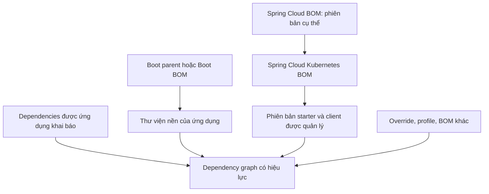

# Đọc ma trận Spring Boot, Spring Cloud và Spring Cloud Kubernetes

Trong chương **Tương thích và nâng cấp** của module Spring Cloud Kubernetes (`SPRING_CLOUD_KUBERNETES`), bài học này hướng dẫn xác định một bộ phiên bản có căn cứ trước khi thêm dependency hoặc nâng cấp ứng dụng. Bộ phiên bản ấy ảnh hưởng trực tiếp tới DiscoveryClient, việc đọc ConfigMap/Secret, Spring Cloud LoadBalancer, Configuration Watcher và các client gọi Kubernetes API.

Mục tiêu không phải ghi nhớ một bảng số cố định. Bạn cần biết tìm đúng nguồn, đọc điều kiện của từng hàng, đưa lựa chọn vào công cụ build và kiểm tra phiên bản thực sự được sử dụng.

Sau bài học, bạn có thể:

- Phân biệt phiên bản Spring Boot, Spring Cloud release train và Spring Cloud Kubernetes.
- Tra từ dòng Spring Boot tới release train phù hợp, rồi tới phiên bản thành phần do BOM quản lý.
- Phát hiện dependency bị ghi đè, hai họ Kubernetes client bị trộn hoặc tài liệu không đúng phiên bản.
- Phân biệt tương thích thư viện, vòng đời hỗ trợ và khả năng chạy trên cluster thực tế.

## 1. Ba sản phẩm sử dụng ba hệ phiên bản

Giả sử một tài liệu ghi:

```text
Spring Boot:             4.0.0
Spring Cloud BOM:        2025.1.0
Spring Cloud Kubernetes: 5.0.0
```

Ba con số không cần giống nhau:

| Thành phần | Vai trò | Nơi thường khai báo hoặc tra cứu |
| --- | --- | --- |
| Spring Boot | Nền tảng ứng dụng, auto-configuration và quản lý nhiều thư viện phổ biến | Boot parent, Boot BOM hoặc cấu hình plugin và dependency management |
| Spring Cloud release train | Tập hợp phiên bản các dự án Spring Cloud được phối hợp phát hành | BOM `spring-cloud-dependencies` |
| Spring Cloud Kubernetes | Tích hợp Spring với Kubernetes qua các tính năng được chọn | Phiên bản được train BOM quản lý và dependency tree của ứng dụng |
| Kubernetes Java client | Thư viện HTTP/API được một implementation sử dụng | Dependency bắc cầu, BOM thành phần và tài liệu client |
| Kubernetes cluster | Nền tảng chạy workload và phục vụ Kubernetes API | Thông tin cluster; không phải phiên bản dependency Spring |

Spring Cloud release train dùng dạng năm như `2025.1`; `2025.1.0` là một bản phát hành cụ thể của train đó. Đừng đọc `2025` như số major tương ứng với Spring Boot. Trong cùng một train, các dự án thành phần cũng có thể mang số phiên bản khác nhau. [Supported Versions — Spring Cloud](https://github.com/spring-cloud/spring-cloud-release/wiki/Supported-Versions)

Một ví dụ dễ gây nhầm là Spring Cloud Kubernetes chuyển từ dòng 3.3.x sang 5.0.x khi tham gia train 2025.1, bỏ qua dòng 4.0.x để đồng bộ cách đánh số với các thành phần liên quan. Không được tự suy ra rằng Boot 4 phải đi với Spring Cloud Kubernetes 4. [Thông báo Spring Cloud 2025.1.0](https://spring.io/blog/2025/11/25/spring-cloud-2025-1-0-aka-oakwood-has-been-released/)

## 2. Dùng đúng nguồn cho từng câu hỏi

Không có một trang duy nhất trả lời đầy đủ mọi quan hệ tương thích.

| Câu hỏi | Nguồn nên mở |
| --- | --- |
| Dòng Spring Boot này đi với thế hệ dự án Spring nào? | [Spring Generations](https://spring.io/projects/generations/) |
| Spring Cloud train nào hỗ trợ dòng Boot này, có điều kiện service release không? | [Trang Spring Cloud](https://spring.io/projects/spring-cloud/) và release notes của train |
| Một Cloud BOM cụ thể quản lý Spring Cloud Kubernetes phiên bản nào? | POM của BOM đúng phiên bản, release notes và dependency management có hiệu lực |
| Starter và property của Spring Cloud Kubernetes được dùng như thế nào? | Reference documentation chọn đúng dòng phiên bản |
| Cần Java, Maven, Gradle và nền tảng web nào? | System Requirements và migration guide của đúng Spring Boot |
| Dòng phiên bản còn được bảo trì hay không? | Phần Support của dự án và chính sách hỗ trợ áp dụng |
| Client gọi được API của cluster nào? | Tài liệu Kubernetes client, API mà tính năng sử dụng và thử nghiệm trên cluster đích |

Trang wiki Supported Versions có bảng hữu ích để tra các thành phần và lịch sử, nhưng chính trang này hướng người đọc tới Spring Generations cho thông tin tương thích chính thức. Hãy dùng nó cùng nguồn hiện hành, không coi một bản chụp wiki là cam kết hỗ trợ vĩnh viễn.

Trong reference documentation, kiểm tra nhãn phiên bản ở đầu trang. URL không gắn phiên bản có thể chuyển sang dòng mới; ví dụ về property của 5.x không tự động áp dụng được cho ứng dụng 3.x.

## 3. Đọc một hàng của ma trận theo đúng chiều

### 3.1. Bảng trích để luyện cách đọc

Các hàng dưới đây được đối chiếu ngày **25-11-2026**. Đây là phần trích cho mục đích học, không phải danh sách đầy đủ mọi train hay khuyến nghị chọn phiên bản mới nhất:

| Spring Cloud train | Dòng Spring Boot liên quan | Dòng Spring Cloud Kubernetes |
| --- | --- | --- |
| 2025.1.x — Oakwood | 4.0.x; hỗ trợ thêm 4.1.x từ Cloud 2025.1.2 | 5.0.x |
| 2025.0.x — Northfields | 3.5.x | 3.3.x |
| 2024.0.x — Moorgate | 3.4.x | 3.2.x |

Cột Boot và điều kiện service release cần đối chiếu tại [Spring Cloud](https://spring.io/projects/spring-cloud/); cột Kubernetes được tra theo [bảng thành phần của Spring Cloud](https://github.com/spring-cloud/spring-cloud-release/wiki/Supported-Versions). Các hàng cũ giúp nhận diện hệ thống đang vận hành; việc xuất hiện trong bảng không khẳng định chúng còn hỗ trợ OSS tại thời điểm bạn đọc.

### 3.2. Dòng phiên bản chưa phải phiên bản build

`2025.1.x` mô tả một dòng, không phải giá trị để chép nguyên vào `<version>`. Build cần một phiên bản cụ thể như `2025.1.0` hoặc một service release đã được xác nhận phù hợp.

Tương tự, hàng `Spring Cloud Kubernetes 5.0.x` không có nghĩa bạn được tùy ý ghép mọi patch Kubernetes 5.0 với mọi patch của train. Với một BOM cụ thể, trước hết sử dụng bộ phiên bản mà BOM đó quản lý; nếu ghi đè, bạn đang tạo một tổ hợp cần đánh giá riêng.

### 3.3. Đọc cả điều kiện phía sau tên dòng

Từ hàng đầu tiên, không được suy ra:

```text
Boot 4.1.x + Cloud 2025.1.0 chắc chắn là cặp được hỗ trợ.
```

Điều kiện “từ 2025.1.2” có ý nghĩa: phạm vi hỗ trợ được bổ sung ở một service release cụ thể. Khi chọn patch cũ hơn mốc đó, phải đọc lại release notes và cơ chế kiểm tra tương thích của chính patch đã chọn.

Đây là lý do việc tìm thấy cả hai số trong cùng một hàng vẫn chưa đủ. Một quyết định tốt cần ghi lại **dòng**, **phiên bản cụ thể** và **điều kiện áp dụng**.

## 4. Quy trình tra từ yêu cầu tới bộ dependency

Giả sử dịch vụ `orders` cần DiscoveryClient và đọc ConfigMap qua Kubernetes API.

### Bước 1: xác định ràng buộc nền tảng

Ghi lại:

- Spring Boot đang dùng hoặc dòng đích mà tổ chức cho phép.
- JDK của máy build, CI và image chạy ứng dụng.
- Công cụ build và wrapper đang dùng.
- Cluster đích, các API được sử dụng và tính năng Spring Cloud Kubernetes thực sự cần.

Nếu yêu cầu cố định Boot 3.5.x, hãy bắt đầu tra từ Boot 3.5.x. Đừng chọn Spring Cloud Kubernetes mới nhất trước rồi ép các phần còn lại đi theo.

### Bước 2: tìm train khớp dòng Boot

Tra nguồn chính thức, đọc các chú thích và mốc service release. Sau đó kiểm tra vòng đời hỗ trợ. Một cặp từng tương thích có thể không còn là lựa chọn phù hợp cho triển khai mới.

### Bước 3: chọn Cloud BOM cụ thể

Chốt một bản GA thuộc train phù hợp. Đọc release notes của bản đó và các thay đổi liên quan kể từ phiên bản đang chạy. Không thay `2025.1.x` bằng giá trị suy đoán hoặc dùng `SNAPSHOT` chỉ vì thấy nó trên trang tài liệu.

### Bước 4: tra phiên bản thành phần do BOM quản lý

Tại tag `v2025.1.0`, POM `spring-cloud-dependencies` đặt `spring-cloud-kubernetes.version=5.0.0` và import BOM `spring-cloud-kubernetes-dependencies` tương ứng. Đây là bằng chứng cụ thể cho mối liên hệ train → thành phần. [POM Spring Cloud BOM 2025.1.0](https://raw.githubusercontent.com/spring-cloud/spring-cloud-release/v2025.1.0/spring-cloud-dependencies/pom.xml)

### Bước 5: kiểm tra dependency được resolve

Đọc effective POM và dependency tree sau khi khai báo. Phải phát hiện được parent của tổ chức, profile, BOM khác hoặc `<version>` viết tay đã làm kết quả khác với dự kiến.

### Bước 6: kiểm tra hành vi trên môi trường đích

Khởi động thành công mới xác nhận một phần. Với `orders`, cần kiểm tra discovery, cấu hình, quyền API và khả năng phục vụ request; chỉ kiểm tra tính năng mà dịch vụ thực sự sử dụng.

## 5. Đọc BOM: quản lý phiên bản khác với thêm tính năng

BOM, viết đầy đủ là Bill of Materials, là nơi tập trung quản lý phiên bản dependency. Import BOM không tự đưa mọi thư viện trong danh sách vào classpath. Ứng dụng vẫn phải khai báo dependency cần dùng. [Dependency Mechanism — Maven](https://maven.apache.org/guides/introduction/introduction-to-dependency-mechanism.html)

Quan hệ thường gặp:



Hai điểm cần phân biệt:

1. **Spring Cloud BOM không chọn thay Spring Boot cho ứng dụng.** Bạn vẫn khai báo Boot parent hoặc cơ chế quản lý Boot phù hợp.
2. **Dependency management không thay thế việc quản lý build plugin.** Nếu không kế thừa Boot parent, cần cấu hình plugin và các mặc định build mà dự án yêu cầu.

Boot parent cung cấp dependency management cùng nhiều mặc định build; import Boot BOM đơn thuần không mang lại toàn bộ các mặc định đó. [Using the Maven Plugin — Spring Boot](https://docs.spring.io/spring-boot/maven-plugin/using.html)

Ngay cả khi thấy một property tên `spring-boot.version` trong mã nguồn Cloud BOM, đừng suy rằng consumer đã được chọn Boot. Cần đọc vai trò thực tế của property và cấu hình có hiệu lực của ứng dụng.

## 6. Ví dụ Maven: khai báo bộ phiên bản theo train

Ví dụ sau dùng **mốc GA lịch sử** Boot 4.0.0 + Cloud 2025.1.0 để minh họa cách đọc và kiểm chứng BOM. Đây không phải đề xuất sử dụng patch cũ cho production; khi triển khai, chọn patch còn được hỗ trợ và đối chiếu nguồn tại thời điểm quyết định.

Khung POM này minh họa dependency management cho một ứng dụng chọn Kubernetes Java Client:

```xml
<project xmlns="http://maven.apache.org/POM/4.0.0"
         xmlns:xsi="http://www.w3.org/2001/XMLSchema-instance"
         xsi:schemaLocation="http://maven.apache.org/POM/4.0.0
                             https://maven.apache.org/xsd/maven-4.0.0.xsd">
    <modelVersion>4.0.0</modelVersion>

    <parent>
        <groupId>org.springframework.boot</groupId>
        <artifactId>spring-boot-starter-parent</artifactId>
        <version>4.0.0</version>
        <relativePath/>
    </parent>

    <groupId>vn.example</groupId>
    <artifactId>orders</artifactId>
    <version>1.0.0</version>

    <properties>
        <java.version>17</java.version>
        <spring-cloud.version>2025.1.0</spring-cloud.version>
    </properties>

    <dependencyManagement>
        <dependencies>
            <dependency>
                <groupId>org.springframework.cloud</groupId>
                <artifactId>spring-cloud-dependencies</artifactId>
                <version>${spring-cloud.version}</version>
                <type>pom</type>
                <scope>import</scope>
            </dependency>
        </dependencies>
    </dependencyManagement>

    <dependencies>
        <dependency>
            <groupId>org.springframework.boot</groupId>
            <artifactId>spring-boot-starter</artifactId>
        </dependency>
        <dependency>
            <groupId>org.springframework.cloud</groupId>
            <artifactId>spring-cloud-starter-kubernetes-client</artifactId>
        </dependency>
    </dependencies>
</project>
```

Những điều cần đọc từ ví dụ:

- Boot được chọn bởi parent, còn Cloud được chọn bởi BOM.
- Starter Kubernetes không có `<version>` riêng vì phiên bản đã được quản lý.
- Starter discovery được thêm vào `dependencies`; chỉ import BOM chưa bật discovery.
- Chưa có starter Config trong ví dụ. Khi cần đọc ConfigMap/Secret qua PropertySource, thêm `spring-cloud-starter-kubernetes-client-config` theo đúng họ client.

Tên và phạm vi starter cần tra ở [Starters — Spring Cloud Kubernetes 5.0](https://docs.spring.io/spring-cloud-kubernetes/reference/5.0/getting-started.html). POM trên chưa chứa mã ứng dụng, cấu hình kết nối API hay manifest RBAC; nó minh họa riêng cách khai báo bộ phiên bản.

Không cần import thêm một Kubernetes BOM với phiên bản tự chọn nếu train BOM đã quản lý đúng bộ mà ứng dụng sử dụng. Một BOM khác hoặc `<version>` trực tiếp có thể ghi đè kết quả; thứ tự và phạm vi quản lý cần xem trong effective POM.

## 7. Đối chiếu khai báo với phiên bản thực sự có hiệu lực

Các lệnh PowerShell dưới đây dành cho dự án Maven của người học có Maven Wrapper. Nếu dùng lệnh `mvn` đã cài sẵn, thay tiền tố tương ứng. Không cần có cluster để đọc dependency graph.

### 7.1. Kiểm tra Java và giá trị khai báo

```powershell
java -version
.\mvnw.cmd -version
.\mvnw.cmd help:evaluate "-Dexpression=project.parent.version" -q -DforceStdout
.\mvnw.cmd help:evaluate "-Dexpression=spring-cloud.version" -q -DforceStdout
```

Với POM ở phần 6, hai biểu thức cuối dự kiến lần lượt cho `4.0.0` và `2025.1.0`. Nếu dự án dùng parent nội bộ, `project.parent.version` là phiên bản parent đó, không tự đồng nghĩa với phiên bản Boot.

Đọc `mvn -version` để biết JDK thực sự chạy Maven. Giá trị `java.version=17` không chứng minh image runtime cũng dùng Java phù hợp.

### 7.2. Đọc effective POM

```powershell
.\mvnw.cmd help:effective-pom -Dverbose
```

Tìm nguồn quản lý của starter Kubernetes, Spring Cloud Commons và các thư viện client liên quan. Nếu có nhiều profile, dùng cùng profile và tham số như CI tạo artifact, vì kết quả có thể khác khi profile khác nhau.

Không yêu cầu imported BOM phải xuất hiện như một JAR trong dependency tree. BOM là dữ liệu phục vụ dependency management; hãy kiểm tra nó trong cấu hình có hiệu lực và các phiên bản mà nó quản lý.

### 7.3. Đọc dependency tree

```powershell
.\mvnw.cmd dependency:tree "-Dincludes=org.springframework.cloud:*" -Dverbose
.\mvnw.cmd dependency:tree "-Dincludes=io.kubernetes:*,io.fabric8:*" -Dverbose
```

Đầu ra cần tìm gồm:

- Phiên bản starter thực sự được chọn.
- Các module Kubernetes và Cloud Commons đi cùng.
- Họ client xuất hiện trong runtime graph.
- Dependency bị thay thế hoặc bị loại do xung đột.

Tại mốc GA đang minh họa, Kubernetes BOM 5.0.0 quản lý Kubernetes Java Client 24.0.0 và Fabric8 7.4.0. Đây là các số độc lập, không phải tên phiên bản cluster. [POM Spring Cloud Kubernetes BOM 5.0.0](https://raw.githubusercontent.com/spring-cloud/spring-cloud-kubernetes/v5.0.0/spring-cloud-kubernetes-dependencies/pom.xml)

Một dependency graph có một phiên bản duy nhất cho mỗi artifact vẫn có thể sai tổ hợp. Ví dụ, starter Kubernetes bị ghim sang dòng khác trong khi Commons giữ theo train cũ. Vì vậy, “không còn conflict” chưa đồng nghĩa “đúng ma trận”.

## 8. Chọn một họ Kubernetes client và đúng tập tính năng

Spring Cloud Kubernetes có starter dùng Fabric8 và starter dùng Kubernetes Java Client. Tài liệu yêu cầu chọn một họ, không trộn hai họ starter trong cùng ứng dụng. [Starters — Spring Cloud Kubernetes](https://docs.spring.io/spring-cloud-kubernetes/reference/getting-started.html)

Với dịch vụ `orders`, có thể lập danh sách nhu cầu trước:

| Nhu cầu | Câu hỏi cần trả lời khi chọn dependency hoặc thành phần |
| --- | --- |
| DiscoveryClient | Có cần lấy danh sách instance qua Spring abstraction không? Chọn implementation nào? |
| ConfigMap/Secret PropertySource | Ứng dụng đọc API hay chỉ đọc file mount/biến môi trường? |
| Spring Cloud LoadBalancer | Có cần client chọn instance hay Kubernetes Service DNS đã đáp ứng? |
| Configuration Watcher | Có cần thông báo refresh không? Controller chạy riêng với image và cấu hình nào? |
| Health của Pod | Cần Boot Actuator và probe nào? Có đang vô tình kéo phụ thuộc ngoài vào liveness không? |

Không thêm starter `-all` chỉ để “đủ thư viện cho chắc”. Dependency ít hơn giúp nhìn rõ tính năng, phạm vi quyền RBAC và các hành vi auto-configuration cần kiểm tra.

Controller Configuration Watcher được triển khai bằng image riêng không tự đổi phiên bản vì bạn sửa Cloud BOM trong ứng dụng. Ghi lại cả phiên bản thư viện ứng dụng lẫn image controller và cách chúng giao tiếp. Đối chiếu hướng dẫn của dòng đang dùng thay vì mặc định chúng được nâng cấp cùng nhau.

## 9. Ma trận Spring không thay thế ma trận client và cluster

Ba phép kiểm tra sau độc lập về phạm vi:

| Quan hệ | Điều cần xác nhận |
| --- | --- |
| Boot ↔ Cloud ↔ Spring Cloud Kubernetes | Bộ thư viện và thế hệ nền tảng được phối hợp |
| Kubernetes client ↔ Kubernetes API | Client hỗ trợ API và hành vi cần dùng trên cluster đích |
| Workload ↔ cluster thực tế | Token, CA, DNS, mạng, namespace, RBAC và tài nguyên được phép truy cập |

Tên `Spring Cloud Kubernetes 5.0.0` không mang nghĩa yêu cầu “Kubernetes 5.0”. Tương tự, Kubernetes Java Client 24.0.0 không mang nghĩa cluster phải là 1.24.

Nếu dùng Kubernetes Java Client, tra [tài liệu client chính thức](https://github.com/kubernetes-client/java#compatibility). Nếu dùng Fabric8, tra [tài liệu Fabric8](https://github.com/fabric8io/kubernetes-client#compatibility-with-kubernetes). Đọc chú giải ma trận và phạm vi của API mà ứng dụng cần; không thay các bảng này bằng quy tắc version skew dành riêng cho `kubectl`.

Ví dụ, discovery có thể truy vấn Endpoints hoặc EndpointSlice tùy implementation và cấu hình. Bộ dependency đúng không cấp thêm quyền `list` hoặc `watch` cho ServiceAccount. Một lỗi 403 cần điều tra quyền truy cập; nó không tự chứng minh Boot và Cloud không tương thích.

Thử nghiệm tích hợp nên bao phủ hành vi sử dụng thực tế: đọc đúng ConfigMap trong namespace đích, xử lý Secret theo thiết kế, khám phá instance sẵn sàng và nhận cập nhật cấu hình nếu tính năng đó được bật.

## 10. Compatibility verifier là một tín hiệu có phạm vi

Spring Cloud có cơ chế kiểm tra phiên bản Boot trên classpath so với yêu cầu của Cloud. Nếu không phù hợp, ứng dụng có thể dừng khởi động với thông báo rằng Boot không tương thích với release train. [Spring Cloud Compatibility Verification](https://docs.spring.io/spring-cloud-commons/reference/5.0/spring-cloud-commons/common-abstractions.html#spring-cloud-compatibility-verification)

Khi gặp lỗi đó:

1. Ghi lại Boot thực sự được resolve, Cloud BOM và Cloud Commons đang có trên classpath.
2. Tra ma trận và điều kiện của đúng service release.
3. Tìm override, parent hoặc profile khiến kết quả lệch khỏi bộ dự kiến.
4. Điều chỉnh bộ phiên bản về tổ hợp có căn cứ rồi kiểm tra lại.

Không xem việc đặt `spring.cloud.compatibility-verifier.enabled=false` hoặc sửa danh sách phiên bản được chấp nhận là cách làm hai thư viện tương thích. Các tùy chọn đó thay đổi hàng rào kiểm tra, không sửa API hoặc dependency graph.

Ngược lại, verifier không báo lỗi cũng chưa chứng minh:

- Mọi thư viện bên thứ ba đều phù hợp.
- ConfigMap import, Secret binding hoặc refresh hoạt động đúng.
- Kubernetes client gọi được các API cần dùng.
- RBAC và đường mạng của Pod đúng.
- Watcher, load balancing và health probe có hành vi mong muốn.

Phân loại lỗi giúp chọn phép kiểm tra tiếp theo:

| Dấu hiệu | Điều tra đầu tiên |
| --- | --- |
| Verifier báo Boot không phù hợp | Cặp Boot/Cloud và dependency có hiệu lực |
| `NoSuchMethodError`, `NoClassDefFoundError` | Version bị ghi đè, thay đổi API hoặc dependency thiếu |
| Thiếu PropertySource hoặc discovery bean | Starter, auto-configuration, property và thay đổi giữa các dòng |
| Kubernetes API trả 403 | Identity, verb, resource và namespace |
| API không tồn tại hoặc model không phù hợp | API đích và khả năng client |
| Probe thất bại sau nâng cấp | Cổng, path, security, startup và cấu hình health |

## 11. Tương thích kỹ thuật khác với thời hạn hỗ trợ

Cần trả lời riêng ba câu hỏi:

1. **Bộ phiên bản có nằm trong phạm vi tương thích được công bố không?**
2. **Dòng đó còn được bảo trì theo loại hỗ trợ bạn sử dụng không?**
3. **Artifact cụ thể có đáp ứng yêu cầu bảo mật và vận hành của hệ thống không?**

`GA` hoặc `stable` mô tả trạng thái phát hành, không đảm bảo một dòng vẫn được bảo trì nhiều năm sau. Một bản vá mới hơn trong dòng đã chọn cũng không chứng minh mọi thư viện bị override đã được cập nhật cùng nó.

Khi lập kế hoạch triển khai, kiểm tra trang Support của Spring Cloud, Spring Boot và các thành phần liên quan; phân biệt OSS với hỗ trợ thương mại theo điều kiện áp dụng. Các ký hiệu như dấu sao hoặc gạch ngang trong bảng lịch sử cần đọc cùng chú giải. Không suy thời hạn hỗ trợ chỉ từ năm trong tên train.

Nâng từ Boot 3 sang Boot 4 còn có yêu cầu nền tảng và thay đổi API. Chẳng hạn, migration guide Boot 4.0 nêu nền tảng Spring Framework 7 và Jakarta EE 11 cùng các thay đổi loại bỏ API đã deprecated. Có một hàng tương thích không loại bỏ phần việc migration ứng dụng. [Spring Boot 4.0 Migration Guide](https://github.com/spring-projects/spring-boot/wiki/Spring-Boot-4.0-Migration-Guide)

Với JDK và công cụ build, tra [System Requirements của Boot 4.0](https://docs.spring.io/spring-boot/4.0/system-requirements.html) khi làm việc với dòng đó; không bê nguyên giới hạn JDK, Maven hay Gradle của một dòng cũ sang dòng mới.

## 12. Ba bài tập đọc ma trận

### Bài tập A: đổi riêng starter Kubernetes

Một ứng dụng dùng:

```text
Boot:                  3.5.x
Cloud train:           2025.0.x
Kubernetes starter:    bị ghi đè thành 5.0.x
```

**Nhận định:** không có căn cứ coi đây là tổ hợp của train 2025.0. Bảng trích cho biết train này quản lý dòng Kubernetes 3.3.x.

**Cách xử lý:** tra BOM cụ thể, bỏ override nếu không có lý do và xác minh graph. Nếu mục tiêu là chuyển sang Kubernetes 5.0.x, lập kế hoạch với dòng Boot/Cloud phù hợp và đánh giá migration, không đổi riêng số starter.

### Bài tập B: đọc thiếu điều kiện service release

Nhóm dự định dùng Boot 4.1.x với Cloud 2025.1.0 vì thấy “4.1.x” ở hàng “2025.1.x”.

**Nhận định:** đã bỏ qua điều kiện “từ 2025.1.2”.

**Cách xử lý:** chọn bản Cloud đáp ứng mốc hỗ trợ, tra BOM và release notes của bản cụ thể, rồi kiểm tra dependency thực tế. Không chỉ đổi nhãn trong tài liệu thiết kế.

### Bài tập C: ma trận đúng nhưng đọc cấu hình bị 403

Dependency graph khớp BOM; ứng dụng khởi động rồi nhận 403 khi đọc ConfigMap.

**Nhận định:** chưa có bằng chứng cần đổi phiên bản.

**Cách xử lý:** xác định ServiceAccount của Pod, namespace và verb/resource mà client gọi; đối chiếu Role/RoleBinding. Ma trận thư viện không thay thế việc phân quyền.

## 13. Ghi lại quyết định sao cho người khác kiểm chứng được

Một ghi chú quyết định nên chứa phiên bản cụ thể và nguồn chứng minh. Ví dụ học tập:

```text
Mục tiêu: hiểu bộ dependency của mốc GA 2025.1.0
Spring Boot: 4.0.0
Spring Cloud BOM: 2025.1.0
Spring Cloud Kubernetes: 5.0.0, do BOM quản lý
Họ client: Kubernetes Java Client
Starter sử dụng: discovery; bổ sung Config chỉ khi cần
Override phiên bản: không có trong ví dụ
Nguồn: bảng Boot/Cloud + POM BOM tại tag v2025.1.0
Kiểm tra tiếp: support, JDK/runtime, graph và tích hợp trên cluster đích
Kết luận phạm vi: minh họa cấu trúc dependency, chưa phải chấp thuận production
```

Với hệ thống thật, bổ sung patch đã chọn, ngày tra nguồn, image watcher nếu có, phiên bản cluster và kết quả kiểm tra chức năng. Ghi rõ override có chủ ý cùng lý do, thay vì để nó ẩn trong một module con hoặc profile.

Bạn đọc đúng ma trận khi có thể giải thích được chuỗi **Boot → Cloud train → BOM cụ thể → Spring Cloud Kubernetes và client được resolve**, đồng thời chỉ ra những điều chuỗi đó chưa chứng minh về hỗ trợ, quyền truy cập và hành vi chạy trên Kubernetes.
