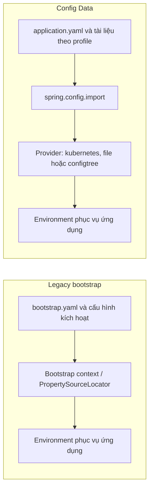

# Chuyển từ bootstrap sang Config Data khi phù hợp

Trong chương **Tương thích và nâng cấp** của module **SPRING_CLOUD_KUBERNETES**, bài này trình bày cách chuyển cơ chế nạp cấu hình từ legacy bootstrap sang Config Data mà vẫn kiểm soát được nguồn dữ liệu, profile, thứ tự ghi đè và hành vi khi tải thất bại.

Mục tiêu không dừng ở việc bỏ `bootstrap.yaml`. Sau thay đổi, ứng dụng phải lấy đúng ConfigMap hoặc Secret, bind đúng thuộc tính, khởi động theo chính sách đã chọn và tiếp tục vận hành với các tính năng DiscoveryClient, Spring Cloud LoadBalancer hoặc Configuration Watcher đang thực sự sử dụng.

Ví dụ API trong bài chọn **Spring Cloud Kubernetes 3.3.x với Fabric8** làm mốc. Dependency phải do Spring Cloud BOM tương thích với Spring Boot của dự án quản lý. Đây là phạm vi minh họa; trước khi áp dụng trên nhánh khác, kiểm tra tài liệu đúng phiên bản, đặc biệt các thuộc tính đọc API, profile và retry.

## 1. Khi nào việc chuyển đổi phù hợp?

Spring Boot đưa cơ chế xử lý Config Data cùng `spring.config.import` vào từ phiên bản 2.4. Tuy nhiên, khả năng của Spring Boot và khả năng hỗ trợ của từng integration là hai điều phải kiểm tra riêng. Chỉ thấy Boot có `spring.config.import` chưa đủ để kết luận một starter Kubernetes cũ hiểu tiền tố `kubernetes:`. [Hướng dẫn chuyển đổi Config Data của Spring Boot](https://github.com/spring-projects/spring-boot/wiki/Spring-Boot-Config-Data-Migration-Guide)

| Tình huống của ứng dụng | Hướng xử lý hợp lý |
| --- | --- |
| Bộ Boot, Cloud và Kubernetes hiện tại hỗ trợ Config Data, không có extension bootstrap đặc thù | Có thể lập kế hoạch chuyển và kiểm chứng hành vi |
| Muốn kiểm soát rõ nguồn import theo môi trường hoặc thứ tự giữa nhiều nguồn | Config Data là lựa chọn đáng xem xét |
| Đang dùng `PropertySourceLocator` tự viết hoặc bean chỉ được tạo trong bootstrap context | Đánh giá và chuyển extension trước khi bỏ bootstrap |
| Đang bị khóa ở một release train cũ chưa hỗ trợ cơ chế cần dùng | Giữ phương án đang được hỗ trợ, lập lộ trình tương thích riêng |
| Chỉ cần đọc cấu hình đã mount thành tệp | Cân nhắc import file hoặc `configtree:`, có thể không cần API Kubernetes |
| Chưa có bằng chứng về giá trị và nguồn đang có hiệu lực | Ghi nhận trạng thái trước chuyển để có căn cứ so sánh |

Không nên đồng thời đổi release train, đổi họ Kubernetes client, thay quyền RBAC và đổi cơ chế nạp cấu hình nếu có thể tách các thay đổi. Mỗi lần thay một trục giúp tìm nguyên nhân khi hành vi lệch.

Nếu quyết định giữ bootstrap tạm thời, ghi rõ lý do, phiên bản đang dùng, điều kiện cần giải quyết và cách kiểm chứng lần chuyển sau. “Ứng dụng đang chạy” không cho biết những ràng buộc nào đang ngăn migration.

## 2. Hiểu hai cơ chế trước khi di chuyển tệp

### Legacy bootstrap

Trong mô hình Spring Cloud bootstrap, một context khởi động sớm tham gia lấy các `PropertySource` bên ngoài trước khi cấu hình chính được sử dụng đầy đủ. `bootstrap.yaml` cung cấp thông tin phục vụ giai đoạn đó.

Cần phân biệt nội dung của `bootstrap.yaml` với các thuộc tính từ nguồn từ xa do bootstrap tải về. Chúng không mặc nhiên có cùng độ ưu tiên. Extension dựa vào context hoặc locator của cơ chế này cần được đánh giá riêng khi migration. [Bootstrap và phân cấp ApplicationContext](https://docs.spring.io/spring-cloud-commons/reference/spring-cloud-commons/application-context-services.html)

### Config Data

Với Config Data, ứng dụng khai báo nguồn thông qua `spring.config.import` trong cấu hình được Spring Boot xử lý, thường là `application.yaml` hoặc tài liệu được kích hoạt theo môi trường. Provider tương ứng phân giải vị trí và tải dữ liệu để đưa vào `Environment`.



Spring Cloud Kubernetes yêu cầu **chọn một cơ chế**: không vừa kích hoạt legacy bootstrap vừa dùng `spring.config.import` để tải cấu hình Kubernetes. Với nhánh 3.3, legacy có thể được kích hoạt bởi `spring-cloud-starter-bootstrap` hoặc `spring.cloud.bootstrap.enabled=true`. [Cơ chế PropertySource của Spring Cloud Kubernetes](https://docs.spring.io/spring-cloud-kubernetes/reference/3.3/property-source-config.html)

Vì vậy, chỉ thêm dòng import rồi giữ nguyên toàn bộ bootstrap chưa tạo thành một migration hoàn chỉnh. Cũng không thể chỉ đổi tên tệp rồi giả định thời điểm nạp và thứ tự ghi đè được giữ nguyên.

## 3. Ghi lại hợp đồng cấu hình trước khi sửa

Lập một bảng nhỏ cho ứng dụng đang chạy. Đây là dữ liệu đầu vào cho kiểm thử sau chuyển:

| Nhóm thông tin | Nội dung cần ghi |
| --- | --- |
| Bộ phiên bản | Java, Spring Boot, Spring Cloud BOM, Spring Cloud Kubernetes và họ client |
| Cách kích hoạt bootstrap | Dependency trực tiếp hoặc bắc cầu, biến môi trường, system property, đối số khởi động |
| Định danh ứng dụng | `spring.application.name`, namespace, ConfigMap và Secret được chọn |
| Các nguồn mở rộng | `sources`, label selector, prefix, tài nguyên theo profile và thứ tự dự kiến |
| Cách nhận dữ liệu | API, volume, file YAML, configuration tree hoặc biến môi trường |
| Thuộc tính quan trọng | Tên key, kiểu dữ liệu, nguồn có hiệu lực và giá trị mẫu không nhạy cảm |
| Chính sách lỗi | Khi thiếu nguồn, thiếu key, API trả lỗi hoặc chậm phản hồi |
| Hành vi sau khởi động | Refresh, Watcher, bean cần cập nhật và tài nguyên giữ cấu hình cũ |

Đối chiếu cả artifact triển khai và cấu hình runtime. Một dependency bootstrap có thể đến từ starter nội bộ; một biến `SPRING_CONFIG_IMPORT` có thể được thêm bởi Helm chart; một tham số `-Dspring.cloud.bootstrap.enabled=true` có thể nằm trong script khởi động.

Không chép giá trị Secret vào bảng. Với thông tin xác thực, lưu tên key, nguồn dự kiến và bằng chứng đăng nhập thành công. Với thuộc tính thử nghiệm như `sample.banner`, có thể dùng giá trị rõ ràng để phân biệt từng nguồn.

Nếu có `BootstrapConfiguration`, `PropertySourceLocator` hoặc cơ chế giải mã riêng, liệt kê hành vi mà chúng cung cấp. Chúng không tự chuyển thành Config Data chỉ vì file cấu hình được đổi chỗ.

## 4. Ví dụ chuyển một ứng dụng đọc ConfigMap qua API

Ví dụ dùng:

- Ứng dụng `orders-api`, namespace `learning`.
- ConfigMap `orders-api`.
- Profile `k8s` để bật import khi triển khai lên Kubernetes.
- Ba thuộc tính thử nghiệm: `sample.banner`, `sample.limit`, `sample.remote-marker`.
- Secret API và DiscoveryClient được tắt trong ví dụ tối thiểu.

Trong dự án thật, giữ các tính năng discovery hoặc cân bằng tải mà ứng dụng cần; không sao chép thao tác tắt chúng nếu ngoài phạm vi migration.

### 4.1. Trạng thái trước chuyển

Giả định ứng dụng đang bật legacy bootstrap và có `bootstrap.yaml` như sau:

```yaml
spring:
  application:
    name: orders-api
  cloud:
    kubernetes:
      config:
        enabled: true
        enable-api: true
        name: orders-api
        namespace: learning
        include-profile-specific-sources: false
        fail-fast: true
        retry:
          enabled: false
      secrets:
        enabled: false
```

Ví dụ chủ động tắt tìm tài nguyên bổ sung theo profile để cô lập một ConfigMap. Nếu hệ thống hiện tại cần các tài nguyên đó, ghi nhận và bảo toàn quy tắc chọn nguồn thay vì áp dụng giá trị này máy móc.

### 4.2. Giữ đúng starter cung cấp provider

Với Fabric8, starter cấu hình của ví dụ là:

```xml
<dependency>
    <groupId>org.springframework.cloud</groupId>
    <artifactId>spring-cloud-starter-kubernetes-fabric8-config</artifactId>
</dependency>
```

Starter cấu hình cung cấp tích hợp ConfigMap/Secret; starter DiscoveryClient không thay thế nó. Chỉ dùng một họ client, không kết hợp starter Fabric8 và Kubernetes Java Client. [Các starter Kubernetes](https://docs.spring.io/spring-cloud-kubernetes/reference/3.3/getting-started.html)

Bỏ `spring-cloud-starter-bootstrap` nếu không còn thành phần nào cần nó, đồng thời kiểm tra dependency bắc cầu. Loại bỏ các cờ bật bootstrap trong môi trường và script chạy. Nếu cần vô hiệu hóa tường minh trong giai đoạn chuyển, đặt `SPRING_CLOUD_BOOTSTRAP_ENABLED=false` ở cấu hình khởi động sớm; không chỉ trông chờ một giá trị trong file được nạp muộn.

### 4.3. Cấu hình chung sau chuyển

Đặt trong `application.yaml`:

```yaml
spring:
  application:
    name: orders-api
  cloud:
    kubernetes:
      config:
        enabled: false
      secrets:
        enabled: false
      discovery:
        enabled: false

sample:
  banner: from-jar
  limit: 5
```

Cấu hình chung không khai báo import Kubernetes, giúp môi trường local không vô tình tải nguồn từ cluster. Hai giá trị `sample.*` là mặc định của ví dụ, không phải giá trị thay thế an toàn cho thông tin xác thực hoặc cấu hình nghiệp vụ bắt buộc.

### 4.4. Cấu hình dành cho Kubernetes

Đặt trong `application-k8s.yaml`:

```yaml
spring:
  config:
    import: "kubernetes:"
  cloud:
    kubernetes:
      config:
        enabled: true
        enable-api: true
        name: orders-api
        namespace: learning
        include-profile-specific-sources: false
        fail-fast: true
        retry:
          enabled: false
```

Trong cấu hình container, kích hoạt profile:

```yaml
env:
  - name: SPRING_PROFILES_ACTIVE
    value: "k8s"
  - name: SPRING_CLOUD_BOOTSTRAP_ENABLED
    value: "false"
```

Đây là đoạn `env` nằm trong container của Deployment, không phải một manifest độc lập. Pod phải dùng ServiceAccount được cấp quyền phù hợp để đọc ConfigMap qua API.

Để chạy local với cấu hình ví dụ, có thể dùng:

```bash
java -jar orders-api.jar --spring.profiles.active=local
```

Lệnh chỉ minh họa cách chạy artifact đã được build. Profile `local` không tự nạp `application-k8s.yaml`; cần bảo đảm môi trường chạy không còn một import Kubernetes bên ngoài ghi đè vào.

### 4.5. ConfigMap phục vụ kiểm chứng

Giả định namespace `learning` đã tồn tại:

```yaml
apiVersion: v1
kind: ConfigMap
metadata:
  name: orders-api
  namespace: learning
data:
  sample.banner: "from-configmap"
  sample.limit: "25"
  sample.remote-marker: "orders-config-v1"
```

Các giá trị `data` được viết thành chuỗi. ConfigMap không dùng để chứa mật khẩu hoặc token. [Đặc điểm ConfigMap](https://kubernetes.io/docs/concepts/configuration/configmap/)

Tên nguồn được chọn bằng cấu hình Spring Cloud Kubernetes, chẳng hạn `config.name` hoặc `config.sources`. Không tự suy ra cú pháp `kubernetes:orders-api` hay `kubernetes:learning/orders-api` để chọn tài nguyên; ví dụ dùng đúng vị trí import `kubernetes:` và khai báo tên, namespace bằng thuộc tính của provider.

Trong ví dụ, `include-profile-specific-sources: false` tránh truy vấn thêm ConfigMap theo profile. Mặc định và các tùy chọn khác phải được đối chiếu theo phiên bản. [Thuộc tính cấu hình 3.3](https://docs.spring.io/spring-cloud-kubernetes/reference/3.3/appendix.html)

### 4.6. Kết thúc việc di chuyển cấu hình cũ

Sau khi tất cả thuộc tính cần thiết đã được chuyển sang nơi được nạp đúng thời điểm:

1. Bỏ file bootstrap không còn dùng khỏi tài nguyên ứng dụng và cấu hình mount liên quan.
2. Kiểm tra không còn cờ bật legacy bootstrap trong môi trường triển khai.
3. Xác nhận artifact mới thực sự chứa `application-k8s.yaml`.
4. Kiểm tra cấu hình Pod mới, không chỉ file manifest trong mã nguồn.

Một `bootstrap.yaml` còn nằm trong JAR không tự chứng minh nó được nạp, nhưng để lại cấu hình không còn hiệu lực dễ khiến lần sửa sau tác động nhầm nơi. Ngược lại, nếu file đó được import tường minh như file thường, nó vẫn có thể tham gia Config Data; hãy xét đường nạp thực tế.

## 5. Kiểm chứng thứ tự ưu tiên thay vì giả định giữ nguyên

Đây là một rủi ro chính của migration: ứng dụng khởi động được nhưng giá trị có hiệu lực đã đổi.

Với Config Data, dữ liệu được import có ưu tiên cao hơn tài liệu khai báo import. Khi một danh sách import có nhiều vị trí, vị trí khai báo sau có ưu tiên cao hơn vị trí trước. Các nguồn như biến môi trường, system property và đối số dòng lệnh vẫn có thể ghi đè dữ liệu import. [Thứ tự PropertySource của Kubernetes Config Data](https://docs.spring.io/spring-cloud-kubernetes/reference/property-source-config.html#_property_source_precedence)

Trong ví dụ, nếu không có nguồn khác, profile `k8s` phải nhận `sample.banner=from-configmap` và `sample.limit=25`. Khi thêm biến môi trường:

```yaml
env:
  - name: SPRING_PROFILES_ACTIVE
    value: "k8s"
  - name: SAMPLE_BANNER
    value: "from-env"
```

Giá trị banner dự kiến chuyển thành `from-env`, còn limit vẫn là `25`. Nếu thêm đối số `--sample.banner=from-cli` trong lần thử khác, đối số đó dự kiến thắng biến môi trường.

| Điều kiện kiểm tra | sample.banner dự kiến | sample.limit dự kiến |
| --- | --- | --- |
| Local, không có import hoặc ghi đè ngoài | `from-jar` | `5` |
| Kubernetes, ConfigMap hợp lệ | `from-configmap` | `25` |
| Kubernetes và `SAMPLE_BANNER=from-env` | `from-env` | `25` |
| Như trên, thêm đối số `--sample.banner=from-cli` | `from-cli` | `25` |

Đây là các kết quả kỳ vọng của cấu hình mẫu, chưa phải bằng chứng đã chạy trong môi trường của bạn. Hãy so sánh cả giá trị và nguồn có hiệu lực.

Nếu ứng dụng import thêm Config Server, file hoặc configuration tree, ghi rõ thứ tự của chúng trong cùng phạm vi cấu hình. Không kết luận nguồn luôn thắng chỉ vì nó nằm trong Secret, trong cluster hay được khai báo ở dòng cuối của một file.

Khi đồng thời bật ConfigMap và Secret PropertySource, còn có quy tắc ưu tiên bên trong provider. Với nhánh 3.3 được dùng trong bài, tài liệu quy định ConfigMap thắng Secret khi trùng key. Tránh lưu một key nhạy cảm đồng thời trong cả hai nguồn rồi trông chờ Secret tự có ưu tiên cao hơn. [Thứ tự ConfigMap và Secret](https://docs.spring.io/spring-cloud-kubernetes/reference/3.3/property-source-config/order_of_configMaps_and_secrets.html)

## 6. Xử lý profile và namespace đúng thời điểm

### 6.1. Profile chọn tài liệu cấu hình trước khi import

Trong ví dụ, `k8s` có vai trò bật `application-k8s.yaml`. Đặt profile từ bên ngoài như `SPRING_PROFILES_ACTIVE=k8s` giúp ý định này rõ ràng.

Không đặt `spring.profiles.active` bên trong chính file theo profile hoặc tài liệu được kích hoạt bằng `spring.config.activate.on-profile`. Spring Boot có giới hạn đối với các khai báo đó. Cũng không trông chờ một ConfigMap chưa được tìm thấy tự kích hoạt profile cần để ứng dụng biết cách tìm nó. [Quy tắc profile của Spring Boot](https://docs.spring.io/spring-boot/3.5/reference/features/profiles.html)

Một phương án khác là dùng tài liệu được kích hoạt bởi `spring.config.activate.on-cloud-platform: kubernetes`. Nếu chọn cách đó, kiểm tra phát hiện nền tảng trong môi trường chạy thật và các cờ ghi đè. Không dùng đồng thời nhiều chiến lược kích hoạt chỉ để “chắc chắn”, vì sẽ khó xác định tài liệu nào có hiệu lực.

### 6.2. Phân biệt ba loại cấu hình theo profile

Các khái niệm sau liên quan nhưng khác nhau:

- `application-k8s.yaml` của ứng dụng: do Spring Boot chọn dựa trên active profile.
- ConfigMap bổ sung, ví dụ `orders-api-prod`: do quy tắc chọn nguồn của Spring Cloud Kubernetes quyết định.
- Tài liệu hoặc key YAML theo profile bên trong một ConfigMap: do provider xử lý nội dung nguồn.

Nếu hệ thống đang dùng nguồn theo profile, kiểm thử đúng tên tài nguyên, tập profile và prefix trước/sau migration. Không mặc định rằng chọn profile `prod` luôn có cùng tác động với mọi cách lưu ConfigMap. [Cách chọn và xử lý ConfigMap](https://docs.spring.io/spring-cloud-kubernetes/reference/3.3/property-source-config/configmap-propertysource.html)

### 6.3. Namespace cần sẵn có trước lần đọc nguồn

Ví dụ đặt `namespace: learning` để giảm biến số. Khi triển khai nhiều namespace, có thể cấp namespace của Pod qua Downward API rồi bind vào cấu hình provider, thay vì hardcode theo môi trường.

Dù dùng cách nào, giá trị chọn namespace phải có sẵn trước khi tải nguồn. Không chỉ đặt nó trong chính ConfigMap mà client còn chưa biết phải tìm ở đâu. Cấu hình namespace tường minh, namespace của client và tệp namespace ServiceAccount có vai trò trong quá trình phân giải; namespace đang chọn trên máy quản trị không tự quyết định namespace của JVM trong Pod. [Phân giải namespace](https://docs.spring.io/spring-cloud-kubernetes/reference/3.3/property-source-config/namespace-resolution.html)

## 7. API, file mount và configuration tree là các lựa chọn khác nhau

Migration là thời điểm phù hợp để xác nhận ứng dụng có thật sự cần gọi API hay không.

| Dạng nguồn | Ví dụ import | Điều kiện cần |
| --- | --- | --- |
| ConfigMap/Secret qua Spring Cloud Kubernetes | `kubernetes:` | Provider đúng dependency, định danh nguồn, credential và RBAC |
| Một file YAML đã mount | `file:/etc/orders/application.yaml` | File được mount và tiến trình đọc được |
| Mỗi thuộc tính nằm trong một file | `configtree:/etc/orders-secrets/` | Thư mục và tên file đúng hợp đồng thuộc tính |
| Biến môi trường đã được container nhận | Không cần import riêng cho biến môi trường | Tên biến ánh xạ đúng tên thuộc tính |

Với `configtree:`, tên tệp và cây thư mục tạo thành tên thuộc tính; nội dung tệp là giá trị. Một file chứa cả tài liệu YAML cần được import như file YAML, không tự biến thành nhiều key vì đặt trong thư mục configuration tree.

Tiền tố `optional:` của Spring Boot cho phép một vị trí được hỗ trợ có thể thiếu, chẳng hạn `optional:file:./local-overrides.yaml`. Nó không có nghĩa mọi lỗi xác thực, phân quyền hoặc dữ liệu không hợp lệ đều được bỏ qua. Chỉ dùng tùy chọn này khi việc thiếu nguồn là một phần thiết kế. [Import file và configuration tree](https://docs.spring.io/spring-boot/3.5/reference/features/external-config.html)

Nếu chọn đọc Secret qua API trên nhánh 3.3, bật rõ Secret PropertySource và `spring.cloud.kubernetes.secrets.enable-api=true`, đồng thời giữ quyền trong phạm vi cần thiết. Nếu Secret đã được mount, không bật đọc API chỉ để hoàn thành migration. [Secret PropertySource](https://docs.spring.io/spring-cloud-kubernetes/reference/3.3/property-source-config/secrets-propertysource.html)

Đổi bootstrap sang Config Data không thay thế xác thực với API server. Tương tự, đổi sang file mount không tự chuyển cấu hình định tuyến dịch vụ hoặc cân bằng tải; kiểm tra từng tính năng ứng dụng đang dùng.

## 8. Giữ chính sách lỗi và thời gian khởi động có chủ đích

Ba câu hỏi cần có câu trả lời riêng:

1. Nếu vị trí hoặc nguồn không tồn tại, ứng dụng có được phép chạy không?
2. Nếu tải nguồn bị lỗi, ứng dụng thất bại ngay hay retry có giới hạn?
3. Nếu nguồn có tồn tại nhưng thiếu key hoặc sai kiểu, ứng dụng phát hiện ở đâu?

Trong mẫu, `config.fail-fast=true` và `config.retry.enabled=false` giúp quan sát lỗi tải trực tiếp. Tuy nhiên, không suy ra mọi trường hợp không có ConfigMap hoặc thiếu thuộc tính đều tạo cùng loại exception. Hãy kiểm chứng provider đúng phiên bản và thêm validation cho hợp đồng nghiệp vụ.

Nếu hệ thống cần retry, giữ giới hạn số lần, backoff và các dependency retry mà nhánh phiên bản yêu cầu. Tính ngân sách khởi động gồm thời gian gọi API và tổng thời gian chờ; đối chiếu với startup probe và thời hạn rollout. Không tăng retry vô hạn để che lỗi 403 hoặc namespace sai.

### Kiểm tra cấu hình bắt buộc bằng dữ liệu thử nghiệm

Đặt bean sau trong một lớp cấu hình được Spring quét. Nó chỉ chạy khi profile `k8s` bật:

```java
import org.springframework.boot.ApplicationRunner;
import org.springframework.context.annotation.Bean;
import org.springframework.context.annotation.Profile;
import org.springframework.core.env.Environment;
import org.springframework.util.StringUtils;

@Bean
@Profile("k8s")
ApplicationRunner verifyImportedConfiguration(Environment environment) {
    return args -> {
        String marker = environment.getProperty("sample.remote-marker");
        Integer limit = environment.getProperty("sample.limit", Integer.class);

        if (!StringUtils.hasText(marker)) {
            throw new IllegalStateException(
                "Thiếu thuộc tính bắt buộc: sample.remote-marker"
            );
        }

        if (limit == null || limit <= 0) {
            throw new IllegalStateException(
                "sample.limit phải là số nguyên dương"
            );
        }
    };
}
```

Mặc định trong JAR không có marker, nên ví dụ phát hiện được trường hợp ứng dụng âm thầm dùng toàn bộ cấu hình local. Marker là công cụ chẩn đoán, không phải bằng chứng bảo mật về nguồn; một nguồn khác vẫn có thể cung cấp cùng key. Cần kiểm tra provenance khi xác nhận migration.

Trong ứng dụng thật, kiểm tra các key nghiệp vụ bắt buộc và bảo đảm lỗi không làm lộ Secret. Việc bean đã bind thành công cũng chưa xác nhận connection pool hoặc client ngoài hệ thống đã hoạt động.

## 9. Kiểm chứng migration bằng ma trận hành vi

Các kiểm tra dưới đây là hướng dẫn thực hành, không phải kết quả đã chạy sẵn.

| Ca kiểm tra | Bằng chứng cần thu thập |
| --- | --- |
| Local không có cluster | Ứng dụng dùng cấu hình local, không cố tải Kubernetes ngoài thiết kế |
| Pod với ConfigMap hợp lệ | Đúng banner, limit, marker và nguồn tương ứng |
| Biến môi trường ghi đè | Kết quả đúng quy tắc ưu tiên đã chấp thuận |
| Nguồn bắt buộc không được tải | Ứng dụng thất bại theo chính sách, không phục vụ bằng mặc định sai |
| API trả 403 | Thấy danh tính, verb và tài nguyên bị từ chối; không sửa bằng bật lại bootstrap |
| Cấu hình sai kiểu | Validation hoặc binding phát hiện trước khi phục vụ |
| Có nhiều profile | Tập nguồn và giá trị có hiệu lực đúng hợp đồng trước/sau |
| Không còn bootstrap legacy | Dependency, cờ runtime và đường nạp đã được xác minh |
| Có Watcher hoặc refresh | Đọc cấu hình mới và cập nhật tài nguyên đúng thiết kế |

Có thể bắt đầu thu thập bằng các lệnh sau trong môi trường học:

```bash
kubectl get configmap orders-api -n learning
kubectl get pods -n learning -l app=orders-api
kubectl logs deployment/orders-api -n learning -c app --tail=100
```

Nếu có nhiều Pod, chọn từng Pod cụ thể để tránh chỉ nhìn log của một replica. Kiểm tra ServiceAccount thực tế và các quyền `get`, `list` phù hợp với client. Chỉ cần `watch` khi thành phần thực sự theo dõi; quyền cho DiscoveryClient hoặc Watcher cần được đánh giá theo chức năng của chúng. [Quyền theo thành phần Kubernetes](https://docs.spring.io/spring-cloud-kubernetes/reference/3.3/security-service-accounts.html)

Để kiểm tra nguồn thuộc tính, có thể dùng công cụ chẩn đoán nội bộ hoặc Actuator được bảo vệ. Giữ việc che giá trị và giới hạn truy cập; không công khai `env` hay `configprops` để xác nhận một migration. [Actuator và dữ liệu nhạy cảm](https://docs.spring.io/spring-boot/3.5/reference/actuator/endpoints.html#actuator.endpoints.sanitization)

### Đọc cấu hình lúc khởi động khác với cập nhật khi đang chạy

Dòng import không tự bật theo dõi Kubernetes hoặc tự refresh mọi bean. Nếu hệ thống có Configuration Watcher, kiểm tra riêng namespace, label, quyền của Watcher, đích nhận sự kiện và khả năng cập nhật của bean.

Với cấu hình qua volume, dữ liệu được chiếu vào tệp có độ trễ; việc refresh phải phối hợp với thời điểm tệp đã đổi. Connection pool hoặc client giữ credential có thể cần quy trình thay thế riêng. [Configuration Watcher](https://docs.spring.io/spring-cloud-kubernetes/reference/3.3/spring-cloud-kubernetes-configuration-watcher.html)

Không kết luận migration đạt chỉ vì ứng dụng đọc đúng lần đầu nếu hợp đồng vận hành còn yêu cầu cập nhật cấu hình khi đang chạy.

## 10. Những lỗi thường gặp sau khi chuyển

| Triệu chứng | Giả thuyết nên kiểm tra | Cách xử lý |
| --- | --- | --- |
| Không phân giải được vị trí `kubernetes:` | Thiếu provider, sai starter hoặc phiên bản không tương thích | Kiểm tra bộ dependency và tài liệu đúng nhánh |
| Chạy được nhưng chỉ nhận mặc định trong JAR | File theo profile không được chọn, import bị ghi đè hoặc nguồn không được tải | Kiểm tra active profiles, import có hiệu lực và marker |
| Vẫn đọc cấu hình cũ | Còn bootstrap, Pod cũ hoặc cấu hình môi trường ghi đè | Kiểm tra artifact cùng runtime của Pod mới |
| Hành vi khác giữa local và cluster | Biến môi trường, credential hoặc namespace khác nhau | So sánh hợp đồng đầu vào giữa hai môi trường |
| Cùng một key nhận giá trị khác sau migration | Quy tắc ưu tiên hoặc tập nguồn đã đổi | Xác định nguồn thắng và kiểm thử giá trị xung đột |
| 403 khi khởi động | ServiceAccount thiếu quyền thao tác mà client đang dùng | Sửa đúng quyền và namespace, giữ phạm vi hẹp |
| Profile không hợp lệ hoặc báo cấu hình profile sai chỗ | Đặt active profile trong tài liệu theo profile | Chuyển khai báo sang đầu vào được hỗ trợ |
| Bean tùy biến không còn được tạo | Extension chỉ được đăng ký ở bootstrap context | Chuyển extension sang cơ chế phù hợp và kiểm chứng riêng |
| Đổi ConfigMap nhưng bean không đổi | Chưa có quy trình refresh hoặc bean không hỗ trợ cập nhật | Kiểm tra cập nhật runtime hoặc dùng rollout theo thiết kế |

Một từ “bootstrap” trong tên lớp hoặc log không đủ chứng minh legacy bootstrap đang bật: các cơ chế nội bộ khác cũng có thể dùng thuật ngữ này. Dựa vào dependency, cờ kích hoạt và nguồn thực tế đã tham gia nạp cấu hình.

## 11. Rollout và rollback có thể kiểm chứng

Trước rollout, lưu lại artifact cũ cùng cấu hình triển khai, tên hoặc phiên bản ConfigMap/Secret và các cờ runtime tương ứng. Bản cũ phải có khả năng chạy lại với bộ cấu hình đã ghi nhận.

Trình tự triển khai đề xuất:

1. Xác nhận bộ phiên bản và chọn đúng một cơ chế nạp cấu hình.
2. Chạy các ca local và môi trường thử nghiệm với dữ liệu không nhạy cảm.
3. Triển khai một nhóm Pod canary bằng artifact và cấu hình mới.
4. Kiểm tra cấu hình có hiệu lực, readiness, lỗi khởi động và hành vi nghiệp vụ.
5. Mở rộng rollout khi các điều kiện đạt; theo dõi thêm chu kỳ refresh nếu hệ thống có yêu cầu đó.

Đặt tiêu chí dừng cụ thể, chẳng hạn Pod mới thiếu cấu hình bắt buộc, thời gian khởi động vượt ngân sách hoặc tỷ lệ lỗi tăng. Không dùng việc bật lại bootstrap trên artifact đang import Kubernetes như thao tác cứu tạm.

Khi rollback, khôi phục bộ artifact và cấu hình tương thích với nhau. `kubectl rollout undo` khôi phục lịch sử Deployment, không tự trả lại nội dung ConfigMap hoặc Secret đã bị sửa tại chỗ. Nếu dùng tài nguyên cấu hình được đặt tên theo phiên bản, bảo đảm Deployment cũ còn tham chiếu tới phiên bản tồn tại.

Một lần rollback cần được kiểm chứng bằng chính các thuộc tính và thao tác nghiệp vụ đã dùng để đánh giá rollout. Pod trở lại trạng thái Running chưa đủ xác nhận cấu hình đúng.

## 12. Bài thực hành và điều kiện hoàn thành

Thực hiện trên namespace học tập với ConfigMap mẫu:

1. Ghi lại banner, limit, marker và nguồn trước chuyển trong cấu hình bootstrap.
2. Chuyển sang cặp `application.yaml` và `application-k8s.yaml`, loại bỏ kích hoạt bootstrap.
3. Kiểm tra local và Kubernetes theo bảng giá trị kỳ vọng.
4. Thêm rồi bỏ `SAMPLE_BANNER` để xác nhận nguồn ghi đè.
5. Làm cho nguồn không tải được, xác nhận ứng dụng không phục vụ bằng mặc định ngoài thiết kế.
6. Nếu dùng nguồn theo profile hoặc refresh, thử thêm một ca đúng hợp đồng của hệ thống.
7. Khôi phục artifact và cấu hình cũ để kiểm chứng rollback.

Báo cáo bài thực hành bằng bốn cột: điều kiện đầu vào, kết quả kỳ vọng, kết quả quan sát và nguồn bằng chứng. Phân biệt rõ kiểm tra đã thực hiện với kiểm tra còn dự kiến.

Chỉ xác nhận migration hoàn tất khi đã có bằng chứng cho các điều kiện sau:

- Bộ Boot, Cloud, Kubernetes và client hỗ trợ phương án được chọn.
- Ứng dụng dùng một cơ chế nạp cấu hình, các cờ hoặc file legacy không còn gây nhầm lẫn.
- Tên ứng dụng, namespace, nguồn, prefix và profile khớp hợp đồng.
- Các thuộc tính quan trọng có đúng giá trị, đúng kiểu và nguồn có hiệu lực.
- Thiếu nguồn, lỗi API và cấu hình không hợp lệ được xử lý đúng chính sách.
- RBAC, khả năng phục vụ của Pod và các tính năng Kubernetes đang dùng vẫn đáp ứng yêu cầu.
- Quy trình cập nhật cấu hình và rollback đã được kiểm chứng trong phạm vi vận hành cần thiết.
