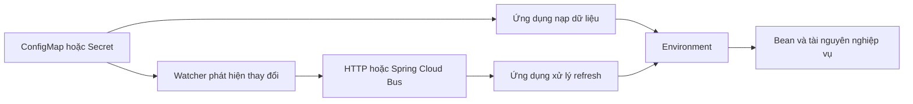

# Rà soát cơ chế reload cũ và phương án Configuration Watcher

Trong chương **Tương thích và nâng cấp** của **SPRING_CLOUD_KUBERNETES**, bài này hướng dẫn rà soát một ứng dụng đang tự theo dõi ConfigMap/Secret để reload cấu hình, rồi lựa chọn cách chuyển sang Configuration Watcher hoặc triển khai cấu hình bằng rollout.

Mục tiêu của việc chuyển đổi là giữ đúng hành vi nghiệp vụ khi cấu hình thay đổi, đồng thời làm rõ thành phần nào cần quyền Kubernetes, thành phần nào phát thông báo và bean nào thật sự được cập nhật. Việc ứng dụng vẫn khởi động sau khi nâng dependency chưa chứng minh cơ chế cập nhật cấu hình còn hoạt động.

Sau bài học, bạn có thể:

- Nhận diện cơ chế reload cũ, chế độ phát hiện thay đổi và mức tác động của nó.
- Tách đường nạp cấu hình khỏi đường thông báo thay đổi.
- Đánh giá HTTP, Spring Cloud Bus và rollout theo yêu cầu vận hành.
- Thiết kế chuyển đổi có kiểm chứng, giới hạn phạm vi ảnh hưởng và có đường quay lại.

## 1. Xác định phiên bản và ý nghĩa của deprecated

Tài liệu Spring Cloud Kubernetes ghi cơ chế **PropertySource Reload** đã bị đánh dấu deprecated từ release train **2020.0** và giới thiệu Configuration Watcher như phương án thay thế. Deprecated không tự động có nghĩa là tính năng đã bị xóa khỏi mọi phiên bản sau đó. Xem [PropertySource Reload của nhánh 3.3](https://docs.spring.io/spring-cloud-kubernetes/reference/3.3/property-source-config/propertysource-reload.html).

Trước khi thay cấu hình, ghi nhận:

| Thành phần | Thông tin cần chốt |
| --- | --- |
| Ứng dụng | Spring Boot, Spring Cloud release train/BOM, Spring Cloud Kubernetes thực tế đã resolve |
| Kubernetes client | Fabric8, Kubernetes Java Client hoặc thành phần discovery từ xa |
| Runtime | JVM thông thường hay có AOT/native image |
| Controller | Phiên bản và image digest của Configuration Watcher |
| Kubernetes | API discovery đang dùng, cơ chế mount, NetworkPolicy và quyền được cấp |
| Cơ chế nạp | Config Data, bootstrap cũ, API trực tiếp, tệp mount hoặc biến môi trường |
| Cơ chế cập nhật | Reload tích hợp, refresh qua HTTP/Bus, restart context, shutdown hoặc rollout |

Các ví dụ Configuration Watcher trong bài bám vào **nhánh 3.3**, dùng để minh họa việc chuyển đổi trên một nền phiên bản đã chốt. Không coi nhánh này là khuyến nghị chọn bản mới nhất. Với phiên bản đích khác, đối chiếu tài liệu và cấu hình image của chính phiên bản đó; không sao chép lẫn mặc định giữa các nhánh.

Đặc biệt, cấu hình của **ứng dụng đích** và cấu hình của **controller Watcher** là hai cấu hình khác nhau. Image Watcher 3.3.3 vẫn sử dụng một số thuộc tính thuộc nhóm `spring.cloud.kubernetes.reload` trong nội bộ. Điều đó không có nghĩa ứng dụng đích phải tiếp tục tự reload. Có thể kiểm tra trực tiếp [application.yml của controller tại tag v3.3.3](https://raw.githubusercontent.com/spring-cloud/spring-cloud-kubernetes/v3.3.3/spring-cloud-kubernetes-controllers/spring-cloud-kubernetes-configuration-watcher/src/main/resources/application.yml).

## 2. Rà soát cơ chế cũ theo hành vi thực tế

### 2.1. Nhận diện cấu hình trong ứng dụng

Ví dụ thường gặp của reload tích hợp:

```yaml
spring:
  cloud:
    kubernetes:
      reload:
        enabled: true
        mode: event
        strategy: refresh
        monitoring-config-maps: true
        monitoring-secrets: false
        namespaces:
          - learning
```

Không chỉ tìm trong tệp cấu hình đóng gói. Giá trị có thể đến từ biến môi trường của Deployment, Helm values, ConfigMap nền, tham số JVM hoặc tham số dòng lệnh. Khi rà soát một hệ thống, cần thu thập cả cấu hình khai báo và cấu hình hiệu lực của Pod.

Phân biệt hai chiều độc lập:

| Chiều | Lựa chọn cũ | Câu hỏi vận hành |
| --- | --- | --- |
| Phát hiện thay đổi | `event` | Mỗi replica có đang giữ watch tới API server không? |
| Phát hiện thay đổi | `polling` | Chu kỳ kiểm tra là bao lâu, nguồn được kiểm tra là API hay tệp? |
| Áp dụng thay đổi | `refresh` | Bean nào được bind lại hoặc tạo lại? |
| Áp dụng thay đổi | `restart_context` | ApplicationContext có được khởi động lại và tài nguyên có đóng đúng không? |
| Áp dụng thay đổi | `shutdown` | Tiến trình có thoát và container có khởi động lại đúng kỳ vọng không? |

Chuyển từ `event` sang `polling` chỉ thay cách phát hiện; nó không tự mở rộng tập bean có thể cập nhật. Tương tự, `refresh` không đồng nghĩa mọi tài nguyên Java trong tiến trình được tạo lại.

### 2.2. Lập hồ sơ cho từng ứng dụng

Hồ sơ ngắn dưới đây giúp tránh thay đổi theo một mẫu chung cho toàn hệ thống:

| Mục | Ví dụ ghi nhận |
| --- | --- |
| Ứng dụng/namespace | `catalog-service / learning` |
| Nguồn đang nạp | `catalog-common`, `catalog-service`, nguồn theo profile prod |
| Cách nạp | Kubernetes API qua starter config |
| Cách phát hiện cũ | Event trong mỗi replica |
| Chiến lược cũ | Refresh |
| Replica | 3 |
| Khóa được phép đổi động | Banner, cờ giao diện |
| Khóa cần quy trình riêng | URL cơ sở dữ liệu, TLS, cấu hình consumer |
| Bean bị ảnh hưởng | Bean cấu hình, client, cache hoặc pool liên quan |
| Bằng chứng thành công | Cả 3 Pod trả revision cấu hình mới |
| Phương án quay lại | Khôi phục dữ liệu đã biết tốt và cơ chế phát hiện trước đó |

Đồng thời kiểm tra quyền `get/list/watch`, các endpoint `refresh/restart/shutdown`, scheduler tự viết và controller bên ngoài đang theo dõi cùng nguồn. Một hệ thống có thể vô tình có nhiều tác nhân cùng phát refresh.

### 2.3. Các thuộc tính cũ cần có quyết định xử lý

| Thuộc tính trong ứng dụng | Cần quyết định khi chuyển đổi |
| --- | --- |
| `reload.enabled` | Tắt đường tự theo dõi khi ứng dụng chuyển hẳn sang nhận thông báo ngoài |
| `reload.mode` | Không chuyển nguyên giá trị sang một thuộc tính Watcher có ý nghĩa khác |
| `reload.period` | Không nhầm với độ trễ chờ volume cập nhật |
| `reload.strategy` | Ánh xạ theo hành vi cần giữ, không chỉ theo tên |
| `reload.monitoring-config-maps/secrets` | Xác định loại nguồn controller được phép theo dõi |
| `reload.namespaces` | Chốt namespace của Watcher và namespace của discovery riêng |
| `reload.enable-reload-filtering` | Rà lại quy tắc lọc nguồn của phiên bản Watcher đích |

Không sửa chính các thuộc tính điều khiển reload bên trong nguồn đang được reload rồi kỳ vọng chúng luôn tái cấu hình an toàn ở runtime. Tài liệu nhánh 3.3 cũng lưu ý việc xóa khóa hoặc xóa ConfigMap không bảo đảm khôi phục trạng thái bean như trước khi reload. Xem [namespace, label filtering và lưu ý của reload cũ](https://docs.spring.io/spring-cloud-kubernetes/reference/3.3/property-source-config/namespace-label-filtering.html).

## 3. Tách ba trách nhiệm trước khi chọn phương án mới



Ba trách nhiệm là:

1. **Nạp dữ liệu:** ứng dụng đọc ConfigMap/Secret qua API hoặc đọc tệp đã mount.
2. **Phát hiện và thông báo:** Watcher nhận thay đổi rồi tìm các ứng dụng cần thông báo.
3. **Áp dụng:** ứng dụng đọc lại nguồn, xử lý refresh và cập nhật các bean phù hợp.

Watcher không thay thế starter config nếu ứng dụng vẫn dùng starter đó để đọc API. Ngược lại, ứng dụng chỉ đọc tệp mount bằng Spring Boot không nhất thiết cần starter Kubernetes config hay DiscoveryClient riêng.

Cũng không cần thêm Spring Cloud LoadBalancer chỉ để nhận refresh. HTTP Watcher sử dụng discovery để tìm các instance đích; chức năng đó thuộc controller và đường discovery đã cấu hình. Đây là lý do phải lựa chọn đúng những tính năng Spring Cloud Kubernetes cần cho cách triển khai, thay vì thêm toàn bộ starter.

## 4. Chọn HTTP, Bus hay rollout

| Phương án | Phù hợp khi | Điều kiện chính | Điểm cần đánh giá |
| --- | --- | --- | --- |
| Watcher gửi HTTP refresh | Muốn đổi một số cấu hình động, số ứng dụng vừa phải | Discovery đúng, management endpoint tới được từng instance | Xác thực, đường mạng, port/path và Pod chưa Ready |
| Watcher gửi sự kiện qua Bus | Hệ thống đã vận hành Spring Cloud Bus/broker | Watcher và ứng dụng cùng có cấu hình Bus phù hợp | Phạm vi broadcast, broker, phân phối lại và quan sát từng instance |
| Rollout từ cấu hình đã kiểm soát | Cần tái tạo tiến trình hoặc không cần cập nhật nóng | Quy trình triển khai và readiness phù hợp | Thời gian áp dụng, sức chứa và cách quay lại |
| Giữ cơ chế cũ trong giai đoạn ngắn | Chưa đủ bằng chứng để chuyển an toàn | Còn tương thích và đã có kiểm chứng | Chốt người phụ trách, phạm vi và mốc xử lý tiếp |

### 4.1. HTTP refresh không phải một lần gọi qua Service là đủ

HTTP implementation của Watcher dùng DiscoveryClient để tìm các instance, rồi thông báo tới endpoint refresh của chúng. Tên Service Kubernetes và thông tin instance có vai trò trong việc định tuyến. Xem [DiscoveryClient của nhánh 3.3](https://docs.spring.io/spring-cloud-kubernetes/reference/3.3/discovery-client.html).

Nếu tự gọi một lần vào địa chỉ Service được cân bằng tải, request có thể chỉ tới một Pod. Bằng chứng “một request trả 200” không chứng minh cả cụm replica đã nhận cấu hình mới.

### 4.2. Bus không phải ranh giới cô lập namespace

Trong nhánh 3.3, Watcher hỗ trợ profile `bus-amqp` hoặc `bus-kafka`. Ứng dụng đích cũng cần thành phần Spring Cloud Bus và cấu hình broker tương ứng; đổi profile của Watcher không tự cài Bus vào ứng dụng.

Khi dùng sự kiện phân phối rộng, phải xác định mọi ứng dụng nối vào cùng hạ tầng Bus có thể bị ảnh hưởng. Không dùng namespace Kubernetes như bằng chứng duy nhất về phạm vi nhận sự kiện. Quyết định kênh, quyền và cách định tuyến cần được kiểm chứng trên phiên bản đang dùng.

### 4.3. Không ánh xạ máy móc restart_context sang shutdown

`restart_context` của cơ chế cũ và chiến lược `shutdown` của Watcher không có cùng vòng đời. Shutdown nhằm dừng ứng dụng để Kubernetes khởi động lại container; đó không phải một lần rolling update do Deployment điều phối.

Nếu nhiều replica cùng nhận shutdown, có thể đồng thời mất nhiều instance sẵn sàng. Không kỳ vọng `maxUnavailable` của rolling update tự điều tiết mọi lệnh shutdown gửi từ ứng dụng. Với thay đổi cần tái tạo toàn bộ tiến trình, hãy xem xét rollout có kiểm soát. [Tài liệu Deployment](https://kubernetes.io/docs/concepts/workloads/controllers/deployment/) mô tả cơ chế điều phối rolling update.

## 5. Xác nhận bean có thể cập nhật trước khi triển khai Watcher

Tách ba dấu hiệu:

- Endpoint refresh nhận request thành công.
- Nguồn trong `Environment` đã có giá trị mới.
- Bean và hành vi nghiệp vụ đã sử dụng giá trị mới.

Các dấu hiệu này không tự suy ra lẫn nhau. Ví dụ một bean singleton đã chép timeout vào trường riêng khi tạo sẽ không tự đổi chỉ vì có tệp mới trên đĩa.

| Loại cấu hình/tài nguyên | Cách đánh giá |
| --- | --- |
| Bean `@ConfigurationProperties` | Kiểm tra khả năng bind lại của đúng kiểu bean và phiên bản |
| Bean `@RefreshScope` | Kiểm tra proxy, tái tạo khi gọi lại và đóng tài nguyên của target cũ |
| Giá trị `@Value` trong singleton thông thường | Không mặc định được inject lại |
| Static field, cache tự viết | Cần thiết kế cập nhật/invalidate riêng |
| Pool, consumer, scheduler hoặc TLS context | Kiểm tra vòng đời, tài nguyên đang dùng và tính nhất quán |
| AOT/native image | Đối chiếu giới hạn refresh của đúng nhánh |

Spring Cloud Commons 4.3 nêu các giới hạn như record gắn `@ConfigurationProperties` không refresh được, HikariDataSource thuộc nhóm không refresh mặc định và Context Refresh không được hỗ trợ với Spring AOT/native image. Đây là các điều kiện cần kiểm tra khi nâng cấp, không phải lý do gắn `@RefreshScope` lên mọi lớp. Xem [Spring Cloud Context 4.3](https://docs.spring.io/spring-cloud-commons/reference/4.3/spring-cloud-commons/application-context-services.html).

Với cấu hình phải thay đổi nguyên khối, hãy dùng một revision và một bản chụp cấu hình nhất quán trong một thao tác nghiệp vụ. Refresh nhiều bean không tạo ra giao dịch nguyên tử cho toàn bộ ứng dụng.

## 6. Mô hình thực hành: mount tệp và HTTP Watcher

Bài thực hành dùng một ứng dụng nhỏ trong namespace `learning`:

| Thành phần | Tên/đường dẫn |
| --- | --- |
| Ứng dụng, Deployment và Service | `catalog-refresh-demo` |
| ConfigMap | `catalog-live-settings` |
| Tệp mount | `/etc/catalog-config/application.yaml` |
| Cổng nghiệp vụ | `8080` |
| Cổng management | `9090` |
| Controller | `config-watcher` |
| Dữ liệu kiểm chứng | `demo.banner` và `demo.config-revision` |

Đây là lab trên JVM, dùng Spring Boot 3.5, Spring Cloud Commons 4.3 và Watcher 3.3 trên một nền dependency tương thích. Namespace cần được chuẩn bị trước. Các đoạn manifest cần ghép vào môi trường thực hành của bạn; các image giữ chỗ phải được thay bằng image đã build/chốt phiên bản.

Ứng dụng dùng tệp mount, nên chỉ cần khả năng web, Actuator và Spring Cloud Context:

```xml
<dependency>
    <groupId>org.springframework.boot</groupId>
    <artifactId>spring-boot-starter-web</artifactId>
</dependency>
<dependency>
    <groupId>org.springframework.boot</groupId>
    <artifactId>spring-boot-starter-actuator</artifactId>
</dependency>
<dependency>
    <groupId>org.springframework.cloud</groupId>
    <artifactId>spring-cloud-starter</artifactId>
</dependency>
```

Phiên bản dependency do BOM của dự án quản lý. Không cần starter config của cả Fabric8 lẫn Kubernetes Java Client cho riêng đường đọc tệp này.

### 6.1. Cấu hình đóng gói của ứng dụng

```yaml
spring:
  application:
    name: catalog-refresh-demo
  config:
    import: "file:/etc/catalog-config/application.yaml"

server:
  port: 8080

management:
  server:
    port: 9090
  endpoints:
    web:
      exposure:
        include: health,refresh
  endpoint:
    health:
      probes:
        enabled: true
```

Không dùng `optional:` trong lab để việc thiếu tệp bắt buộc lộ ra ngay lúc khởi động. Tệp import chứa dữ liệu nghiệp vụ; cấu hình đường nạp, management và controller đặt ở nơi không phụ thuộc vào việc refresh chính nó.

Nếu đang chuyển một ứng dụng vẫn giữ dependency Kubernetes để đọc API, tắt đường reload trong **ứng dụng đích** bằng cấu hình khởi động phù hợp, chẳng hạn:

```yaml
spring:
  cloud:
    kubernetes:
      reload:
        enabled: false
```

Ghép vào cây YAML hiện có, không tạo hai khóa gốc `spring`. Đoạn này không phải cấu hình để tắt controller Watcher. Với lab chỉ dùng mount tệp và không có dependency Kubernetes, không có bộ reload Kubernetes trong ứng dụng để tắt.

### 6.2. ConfigMap có nhãn chọn nguồn và ánh xạ ứng dụng

```yaml
apiVersion: v1
kind: ConfigMap
metadata:
  name: catalog-live-settings
  namespace: learning
  labels:
    spring.cloud.kubernetes.config: "true"
    spring.cloud.kubernetes.config.informer.enabled: "true"
  annotations:
    spring.cloud.kubernetes.configmap.apps: "catalog-refresh-demo"
data:
  application.yaml: |-
    demo:
      banner: "Danh mục phiên bản một"
      config-revision: "r1"
```

Có ba vai trò cần đọc riêng:

- Nhãn `spring.cloud.kubernetes.config` chọn nguồn phát thông báo.
- Nhãn `spring.cloud.kubernetes.config.informer.enabled` dùng khi bật bộ lọc informer của Watcher 3.3.
- Annotation `spring.cloud.kubernetes.configmap.apps` ánh xạ nguồn này tới ứng dụng đích.

Tên ConfigMap cố ý khác tên Service, nên annotation làm cho quan hệ đó rõ ràng. Với nguồn dùng chung hoặc theo profile, khai báo các ứng dụng cần nhận thông báo; đừng kỳ vọng tên có hậu tố profile luôn tự được quy về đúng Service.

Hai lớp label filtering và quy tắc ánh xạ ở đây theo [tài liệu Watcher 3.3](https://docs.spring.io/spring-cloud-kubernetes/reference/3.3/spring-cloud-kubernetes-configuration-watcher.html). Không mặc định các nhãn hoặc mặc định của nhánh mới hơn giống hoàn toàn.

### 6.3. Bean có thể refresh và endpoint kiểm chứng

Lớp chạy chính:

```java
package vn.example.configwatcher;

import org.springframework.boot.SpringApplication;
import org.springframework.boot.autoconfigure.SpringBootApplication;

@SpringBootApplication
public class WatcherDemoApplication {
    public static void main(String[] args) {
        SpringApplication.run(WatcherDemoApplication.class, args);
    }
}
```

Bean chỉ chứa cấu hình demo; cả hai giá trị được lấy từ cùng target của refresh scope:

```java
package vn.example.configwatcher;

import java.util.Map;

import org.springframework.beans.factory.annotation.Value;
import org.springframework.cloud.context.config.annotation.RefreshScope;
import org.springframework.stereotype.Component;

@Component
@RefreshScope
public class BannerView {
    private final String banner;
    private final String revision;
    private final String pod;

    public BannerView(
            @Value("${demo.banner}") String banner,
            @Value("${demo.config-revision}") String revision,
            @Value("${HOSTNAME:local}") String pod) {
        this.banner = banner;
        this.revision = revision;
        this.pod = pod;
    }

    public Map<String, String> snapshot() {
        return Map.of(
                "pod", pod,
                "configRevision", revision,
                "banner", banner);
    }
}
```

Controller dùng bean qua proxy, không giữ một bản sao banner từ lúc khởi động:

```java
package vn.example.configwatcher;

import java.util.Map;

import org.springframework.web.bind.annotation.GetMapping;
import org.springframework.web.bind.annotation.RestController;

@RestController
public class BannerController {
    private final BannerView bannerView;

    public BannerController(BannerView bannerView) {
        this.bannerView = bannerView;
    }

    @GetMapping("/demo/banner")
    public Map<String, String> banner() {
        return bannerView.snapshot();
    }
}
```

Endpoint chỉ trả cấu hình demo không nhạy cảm. Revision nghiệp vụ này phục vụ quan sát; nó không phải `metadata.resourceVersion` của Kubernetes và không được dùng như một phép so sánh số giữa các tài nguyên.

### 6.4. Deployment và Service của ứng dụng

Thay `APP_IMAGE_DA_BUILD` bằng image của ứng dụng ở trên:

```yaml
apiVersion: apps/v1
kind: Deployment
metadata:
  name: catalog-refresh-demo
  namespace: learning
spec:
  replicas: 2
  selector:
    matchLabels:
      app: catalog-refresh-demo
  template:
    metadata:
      labels:
        app: catalog-refresh-demo
    spec:
      automountServiceAccountToken: false
      containers:
        - name: app
          image: APP_IMAGE_DA_BUILD
          ports:
            - name: http
              containerPort: 8080
            - name: management
              containerPort: 9090
          volumeMounts:
            - name: live-settings
              mountPath: /etc/catalog-config
              readOnly: true
          readinessProbe:
            httpGet:
              path: /actuator/health/readiness
              port: management
            initialDelaySeconds: 5
            periodSeconds: 5
      volumes:
        - name: live-settings
          configMap:
            name: catalog-live-settings
---
apiVersion: v1
kind: Service
metadata:
  name: catalog-refresh-demo
  namespace: learning
  annotations:
    boot.spring.io/actuator: "http://:9090/actuator"
spec:
  selector:
    app: catalog-refresh-demo
  ports:
    - name: http
      port: 8080
      targetPort: http
```

Mount cả thư mục và không dùng `subPath` để tệp có đường nhận cập nhật. Ứng dụng không gọi Kubernetes API nên không cần token ServiceAccount cho riêng bài thực hành này. Kubelet vẫn chịu trách nhiệm cung cấp volume.

Service chỉ khai báo cổng nghiệp vụ; annotation cung cấp đường management mà Watcher cần gọi tới instance. Cổng 9090 vẫn phải tới được ở Pod và được giới hạn bằng cơ chế mạng/xác thực phù hợp. Không đặt management server chỉ nghe loopback nếu controller phải gọi từ Pod khác.

### 6.5. Quyền và cấu hình controller

Lab chỉ theo dõi ConfigMap, dùng discovery qua Endpoints và đặt Watcher cùng namespace. Manifest dưới đây để controller ở **0 replica** trước khi kiểm tra riêng đường refresh:

```yaml
apiVersion: v1
kind: ServiceAccount
metadata:
  name: config-watcher
  namespace: learning
---
apiVersion: rbac.authorization.k8s.io/v1
kind: Role
metadata:
  name: config-watcher
  namespace: learning
rules:
  - apiGroups: [""]
    resources: ["configmaps", "pods", "services", "endpoints"]
    verbs: ["get", "list", "watch"]
---
apiVersion: rbac.authorization.k8s.io/v1
kind: RoleBinding
metadata:
  name: config-watcher
  namespace: learning
subjects:
  - kind: ServiceAccount
    name: config-watcher
    namespace: learning
roleRef:
  apiGroup: rbac.authorization.k8s.io
  kind: Role
  name: config-watcher
---
apiVersion: apps/v1
kind: Deployment
metadata:
  name: config-watcher
  namespace: learning
spec:
  replicas: 0
  selector:
    matchLabels:
      app: config-watcher
  template:
    metadata:
      labels:
        app: config-watcher
    spec:
      serviceAccountName: config-watcher
      containers:
        - name: watcher
          image: springcloud/spring-cloud-kubernetes-configuration-watcher:3.3.3
          ports:
            - name: management
              containerPort: 8888
          env:
            - name: SPRING_CLOUD_KUBERNETES_RELOAD_NAMESPACES_0
              value: "learning"
            - name: SPRING_CLOUD_KUBERNETES_DISCOVERY_NAMESPACES_0
              value: "learning"
            - name: SPRING_CLOUD_KUBERNETES_CONFIG_INFORMER_ENABLED
              value: "TRUE"
            - name: SPRING_CLOUD_KUBERNETES_RELOAD_MONITORINGSECRETS
              value: "false"
            - name: SPRING_CLOUD_KUBERNETES_SECRETS_ENABLED
              value: "false"
            - name: SPRING_CLOUD_KUBERNETES_CONFIGURATION_WATCHER_REFRESHSTRATEGY
              value: "refresh"
            - name: SPRING_CLOUD_KUBERNETES_CONFIGURATION_WATCHER_REFRESHDELAY
              value: "10000"
          readinessProbe:
            httpGet:
              path: /actuator/health/readiness
              port: management
          livenessProbe:
            httpGet:
              path: /actuator/health/liveness
              port: management
```

Image tag được dùng như ví dụ cố định theo tài liệu 3.3.3; trước triển khai thực tế cần kiểm tra registry của môi trường và chốt digest đã kiểm chứng. Không dùng `latest` để thay cho việc xác định phiên bản controller.

Hai biến liên quan Secret tắt cả việc theo dõi Secret của đường reload và nguồn Secret không dùng trong lab. Vì vậy Role không cấp quyền đọc Secret. Khi mở rộng bài thực hành sang Secret, cần xem lại cả quyền controller, cách ứng dụng nạp Secret và vòng đời tài nguyên đang sử dụng thông tin đó.

Namespace của nguồn thay đổi và namespace của discovery được khai báo riêng. Cho controller thấy ConfigMap trong một namespace chưa chắc làm nó tìm được Service đích trong namespace khác. Nếu chuyển sang EndpointSlice, cần bổ sung quyền đúng API group `discovery.k8s.io` theo client/phiên bản; Role trên dành cho lựa chọn Endpoints của lab.

### 6.6. Giới hạn truy cập management trong lab

Với CNI có thực thi NetworkPolicy, có thể giới hạn cổng 9090 của Pod ứng dụng cho Pod Watcher trong cùng namespace:

```yaml
apiVersion: networking.k8s.io/v1
kind: NetworkPolicy
metadata:
  name: catalog-refresh-demo-ingress
  namespace: learning
spec:
  podSelector:
    matchLabels:
      app: catalog-refresh-demo
  policyTypes:
    - Ingress
  ingress:
    - ports:
        - protocol: TCP
          port: 8080
    - from:
        - podSelector:
            matchLabels:
              app: config-watcher
      ports:
        - protocol: TCP
          port: 9090
```

Rule đầu giữ cổng nghiệp vụ 8080 mở theo phạm vi mạng hiện có; rule thứ hai giới hạn management 9090. NetworkPolicy là kiểm soát mạng, không thay thế xác thực endpoint. Các policy khác cũng có thể bổ sung quyền truy cập, nên phải kiểm tra tổng thể.

Ví dụ không cấu hình Spring Security để tập trung vào luồng chuyển đổi trong môi trường lab cô lập. Trong hệ thống đã bảo vệ management, Watcher phải gọi với danh tính được chấp nhận; exposure endpoint không tự cấu hình credential cho controller. Nếu gặp 401/403 từ management, sửa luồng xác thực được hỗ trợ thay vì mở toàn bộ Actuator. Tham khảo [quyền truy cập và exposure endpoint của Spring Boot](https://docs.spring.io/spring-boot/3.5/reference/actuator/endpoints.html).

## 7. Kiểm chứng riêng từng chặng

Các lệnh dưới đây dùng PowerShell tại máy có kubectl, dành cho tài nguyên lab đã tạo. Không áp dụng trực tiếp vào Deployment nghiệp vụ mà chưa chuẩn bị phạm vi chuyển đổi.

### 7.1. Chứng minh đường nạp và refresh của ứng dụng trước

Với Watcher còn ở 0 replica:

```powershell
kubectl -n learning rollout status deployment/catalog-refresh-demo
kubectl -n learning get pods -l app=catalog-refresh-demo -o wide
```

Chọn rõ một Pod đang Ready từ danh sách, rồi mở hai cổng tới chính Pod đó:

```powershell
$podName = 'TEN_POD_DA_CHON'
kubectl -n learning port-forward pod/$podName 18080:8080 19090:9090
```

Ở terminal khác:

```powershell
Invoke-RestMethod 'http://127.0.0.1:18080/demo/banner'
```

Ban đầu phải thấy revision `r1` và banner phiên bản một. Tiếp theo sửa ConfigMap trong lab:

```powershell
kubectl -n learning edit configmap catalog-live-settings
```

Giữ nguyên metadata, đổi dữ liệu thành:

```yaml
demo:
  banner: "Danh mục phiên bản hai"
  config-revision: "r2"
```

Đợi đến khi **tệp trong đúng Pod** đã có `r2`. Nếu image có `cat`, có thể kiểm tra:

```powershell
kubectl -n learning exec $podName -c app -- cat /etc/catalog-config/application.yaml
```

Nếu image tối giản không có công cụ này, dùng phương tiện quan sát được phép trong môi trường; lỗi thiếu `cat` không chứng minh volume không cập nhật.

Trước khi refresh, endpoint có thể vẫn trả `r1` vì target của `BannerView` đã được tạo. Sau khi xác nhận tệp đã mới, gọi:

```powershell
Invoke-RestMethod -Method Post -Uri 'http://127.0.0.1:19090/actuator/refresh'
Invoke-RestMethod 'http://127.0.0.1:18080/demo/banner'
```

Kỳ vọng endpoint của Pod đã chọn chuyển sang `r2` mà container không cần restart. Đây là bằng chứng cho đường đọc lại tệp và vòng đời bean, chưa phải bằng chứng Watcher hoạt động.

Nếu có nhiều Pod, refresh thủ công Pod này không có nghĩa Pod khác cũng đã đổi. Với management có xác thực, request kiểm tra cần credential phù hợp.

### 7.2. Bật Watcher và kiểm tra thông báo tự động

```powershell
kubectl -n learning scale deployment/config-watcher --replicas=1
kubectl -n learning rollout status deployment/config-watcher
kubectl -n learning logs deployment/config-watcher -c watcher --tail=200
```

Sau khi controller Ready, sửa hai giá trị demo trong ConfigMap thành banner phiên bản ba và revision `r3`. Giữ nhãn và annotation. Theo dõi:

1. Watcher có nhận thay đổi của đúng ConfigMap không?
2. Tên ứng dụng được ánh xạ có đúng `catalog-refresh-demo` không?
3. Discovery có thấy đủ instance đang Ready không?
4. Request có tới đúng cổng 9090 và đường `/actuator/refresh` không?
5. Từng Pod có trả `r3` không?

Mở port-forward lần lượt tới **từng Pod** để kiểm tra `/demo/banner`; dừng phiên cũ trước khi dùng lại cùng cổng. Ghi nhận tên Pod, revision trả về và restart count. Không dùng một chuỗi request qua Service làm bằng chứng chắc chắn đã kiểm tra đủ replica.

Kỳ vọng của lab refresh là các Pod đã được thông báo đều trả `r3` sau quá trình hội tụ, còn restart count không tăng do refresh. Độ trễ có thể khác nhau; nếu quá thời gian chấp nhận của hệ thống, cần điều tra từng chặng.

### 7.3. Hiểu đúng refresh delay

Đường mount có hai tiến trình diễn ra song song:

- Watcher nhận sự kiện từ API.
- Kubelet đồng bộ nội dung ConfigMap vào tệp trong Pod.

Ví dụ minh họa:

| Thời điểm | Sự kiện |
| --- | --- |
| 0 giây | ConfigMap được sửa |
| 1 giây | Watcher nhận thay đổi |
| 11 giây | Watcher gửi refresh sau delay 10 giây |
| 15 giây | Tệp trong một Pod mới nhận nội dung mới |

Trong ví dụ này, refresh ở giây 11 có thể đọc lại dữ liệu cũ. Con số 10.000 ms trong manifest là giá trị thử nghiệm, không phải bảo đảm đồng bộ của Kubernetes.

Cần đo thời gian truyền dữ liệu ở cluster thực tế, chọn độ trễ phù hợp và quan sát revision sau refresh. Không giả định Watcher sẽ luôn tự thử lại đúng lúc tệp cập nhật muộn. Với yêu cầu áp dụng nghiêm ngặt, thiết kế cơ chế kiểm tra/hòa giải riêng hoặc dùng rollout từ nguồn cấu hình đã chốt.

Kubernetes mô tả volume cập nhật theo cơ chế đồng bộ, còn env của container không tự cập nhật và mount `subPath` không nhận thay đổi ConfigMap. Xem [ConfigMaps](https://kubernetes.io/docs/concepts/configuration/configmap/).

## 8. Những tình huống phải đưa vào kế hoạch chuyển đổi

| Tình huống | Bằng chứng cần kiểm tra |
| --- | --- |
| Thay một giá trị được phép đổi động | Environment, bean và endpoint nghiệp vụ hội tụ về revision mới |
| Nguồn không được chọn bằng nhãn | Không có thông báo ngoài phạm vi thiết kế |
| ConfigMap dùng chung | Đúng các ứng dụng được ánh xạ nhận thay đổi |
| Nguồn có profile | Đúng ứng dụng nhận sự kiện và đúng dữ liệu của profile được nạp |
| Một Pod tạm không Ready | Khi trở lại, Pod không bị bỏ lại với cấu hình cũ ngoài dự kiến |
| Watcher tạm dừng | Ứng dụng vẫn phục vụ cấu hình đang có; quy trình bù cập nhật được xác định |
| API/broker/management mất kết nối | Có bằng chứng lỗi, phạm vi ảnh hưởng và cách phục hồi |
| Tệp cập nhật chậm hơn refresh delay | Phát hiện được việc thông báo đã gửi nhưng dữ liệu còn cũ |
| Khóa bị xóa hoặc ConfigMap bị xóa | Không mặc định bean quay về giá trị mặc định |
| Biến môi trường ghi đè khóa đang đổi | Phân biệt thông báo thành công với giá trị hiệu lực không đổi |
| Hai thay đổi liên tiếp | Xác định trạng thái cuối và khả năng hội tụ, không dựa vào exactly-once |
| Quay về dữ liệu đã biết tốt | Từng Pod xác nhận dữ liệu đúng bằng revision mới của lần khôi phục |

Không dùng dữ liệu Secret thật để thử đầu ra chẩn đoán. Với xoay Secret, thành công còn phụ thuộc hệ thống đích có chấp nhận thông tin mới và client có tạo lại kết nối đúng cách; một sự kiện refresh chưa đủ để kết luận xoay credential thành công.

Readiness và revision cấu hình trả lời hai câu hỏi khác nhau. Pod Ready chứng minh điều kiện sẵn sàng đã khai báo, chưa chắc chứng minh Pod đang dùng revision cấu hình mong muốn. Nếu revision là điều kiện phục vụ, phải thiết kế tiêu chí đó vào ứng dụng hoặc quy trình triển khai.

## 9. Chuyển đổi theo từng giai đoạn

### Giai đoạn 1: chốt trạng thái nền

Ghi lại phiên bản, dữ liệu, quyền, chiến lược cũ, danh sách nguồn và hành vi của từng replica. Chọn trước các khóa được phép cập nhật nóng và các khóa bắt buộc phải rollout.

Không gộp việc thay client Kubernetes, đổi major Spring Boot, đổi bootstrap sang Config Data và đổi cơ chế reload thành một bước duy nhất nếu không có lý do rõ ràng. Tách các thay đổi giúp tìm nguyên nhân khi hành vi khác đi.

### Giai đoạn 2: chứng minh khả năng áp dụng của ứng dụng

Trong môi trường thử nghiệm, xác nhận đường nạp cấu hình và refresh thủ công trước. Nếu ứng dụng dùng bootstrap cũ hoặc custom PropertySource, kiểm tra lại chính đường đó sau refresh; đừng coi lab mount tệp là bằng chứng cho mọi cách nạp khác.

Nếu bean không hỗ trợ refresh theo nhu cầu, chuyển quyết định sang tái tạo tài nguyên hoặc rollout. Không triển khai Watcher để che một vấn đề vòng đời bean chưa được giải quyết.

### Giai đoạn 3: giới hạn Watcher vào một tập nhỏ

Chọn namespace, nguồn và nhóm ứng dụng thử nghiệm riêng. Với ứng dụng cũ có nhiều replica, ưu tiên Deployment/Service thử nghiệm tách biệt nếu không thể cô lập thông báo tới nhóm thử.

Một annotation trỏ tới cùng Service có thể tác động mọi instance của Service đó. Việc chỉ tắt reload cũ trên một Pod không tự tạo ra một canary an toàn nếu Watcher vẫn gửi tới toàn bộ các Pod dùng chung Service.

### Giai đoạn 4: chuyển quyền sở hữu việc phát hiện thay đổi

Tại thời điểm chuyển:

1. Ngừng các thay đổi dữ liệu cấu hình trong khoảng chuyển giao đã thống nhất.
2. Tắt reload tích hợp ở toàn bộ ứng dụng thuộc nhóm chuyển, hoặc đổi cấu hình khởi động rồi rollout nếu cần.
3. Xác nhận các Pod mới không còn tự giữ cơ chế phát hiện cũ.
4. Bật định tuyến Watcher cho nhóm đó.
5. Tạo một lần đổi cấu hình demo và kiểm tra đủ replica.
6. Gỡ quyền watch khỏi ứng dụng nếu quyền đó chỉ phục vụ reload cũ.

Nếu ứng dụng vẫn đọc API lúc khởi động/refresh, giữ quyền đọc cần thiết. Nếu ứng dụng còn DiscoveryClient hoặc tính năng watch khác, rà lại theo tính năng trước khi thu hẹp quyền.

Mục tiêu là một chủ thể chịu trách nhiệm phát hiện cho một nhóm nguồn/ứng dụng. Không coi hai cơ chế chạy song song là bảo đảm HA; chúng có thể gây refresh lặp hoặc nhiều lệnh shutdown.

### Giai đoạn 5: mở rộng và dọn cấu hình cũ

Sau khi kết quả của nhóm thử đạt yêu cầu:

- Mở rộng theo nhóm có đặc điểm cấu hình giống nhau.
- Xóa các thuộc tính reload cũ không còn dùng trong ứng dụng.
- Gỡ endpoint `restart/shutdown` nếu không còn thuộc phương án vận hành.
- Cập nhật quyền, dashboard, cảnh báo và hướng dẫn xử lý khi revision bị lệch.
- Chốt cách vận hành Watcher khi cần HA theo đúng phiên bản.

Lab dùng một replica Watcher để đơn giản hóa việc kiểm chứng. Khi cần nhiều replica controller, kiểm tra cơ chế bầu chọn/điều phối của phiên bản đích; không giả định tăng replicas sẽ tự tạo ra exactly-once hoặc không có sự kiện lặp.

## 10. Quay lại có kiểm soát

Tách hai loại quay lại:

| Loại | Nội dung khôi phục |
| --- | --- |
| Dữ liệu | Banner, giới hạn hoặc cấu hình nghiệp vụ đã biết tốt |
| Cơ chế | Controller, endpoint, dependency và cách phát hiện cũ |

Nếu chỉ dữ liệu mới có vấn đề, có thể khôi phục nội dung trước với một revision nghiệp vụ mới để ghi nhận lần khôi phục. Ví dụ sau `r3`, phát hành `r4` mang giá trị banner đã biết tốt; như vậy không nhầm lần áp dụng mới với bản cũ chưa được cập nhật.

Nếu phải quay lại cơ chế:

1. Ngăn Watcher gửi thông báo tới nhóm ứng dụng cần quay lại.
2. Xác nhận không còn luồng refresh/shutdown ngoài ý muốn cho nhóm này.
3. Khôi phục cấu hình khởi động hoặc image đã kiểm chứng.
4. Bật lại đúng cơ chế cũ cùng quyền cần thiết.
5. Khôi phục dữ liệu đã biết tốt và xác nhận trên từng Pod.

Với controller dùng chung, không scale toàn bộ Watcher về 0 chỉ để xử lý một ứng dụng mà chưa đánh giá các ứng dụng còn lại. Dùng quy tắc chọn nguồn/định tuyến phù hợp, và kiểm tra hành vi khi thay chính metadata lựa chọn.

Rollback Deployment không tự khôi phục nội dung ConfigMap đang tồn tại. Phải quản lý cả phiên bản ứng dụng và phiên bản dữ liệu cấu hình; nếu không, image cũ có thể vẫn đọc cấu hình mới không tương thích.

## 11. Dấu hiệu lỗi và hướng xử lý

| Dấu hiệu | Kiểm tra đầu tiên |
| --- | --- |
| Ứng dụng mới khởi động được nhưng không tự cập nhật | Cơ chế phát hiện và đường refresh có được triển khai đầy đủ không |
| Watcher không thấy thay đổi | Namespace, informer, nhãn và quyền list/watch |
| Nhận sự kiện nhưng không tìm thấy đích | Annotation apps, tên Service và phạm vi discovery |
| HTTP 404 | Port/path management, exposure và endpoint có thật sự tồn tại không |
| HTTP 401/403 | Xác thực/ủy quyền management, không nhầm với RBAC Kubernetes |
| Có POST thành công nhưng endpoint vẫn cũ | Tệp chưa mới, nguồn ưu tiên cao hơn hoặc bean chưa hỗ trợ refresh |
| Chỉ một số Pod có revision mới | Danh sách instance, trạng thái Ready và việc thông báo tới từng Pod |
| Refresh liên tục hoặc nhiều lần restart | Nhiều tác nhân, phạm vi nguồn quá rộng hoặc thay đổi cấu hình gây vòng lặp |
| Thiếu quyền Secret dù không dùng Secret | Mặc định image, cờ theo dõi và nguồn Secret còn bật |
| Tắt một cờ reload làm controller ngừng hoạt động | Cờ đã được đặt nhầm vào Watcher thay vì ứng dụng đích |

Có thể bật DEBUG ngắn hạn cho các package Watcher và config reload được tài liệu phiên bản đích chỉ ra. Ghi log tên nguồn, tên ứng dụng, Pod, kết quả gửi và revision; tránh ghi toàn bộ giá trị cấu hình. Tên thuộc tính trong [phụ lục cấu hình 3.3](https://docs.spring.io/spring-cloud-kubernetes/reference/3.3/appendix.html) hỗ trợ đối chiếu nhưng không thay việc kiểm tra dependency/image thực tế.

## 12. Tiêu chí hoàn tất nâng cấp

Một chuyển đổi được coi là đạt mục tiêu khi:

- Đã xác định cơ chế cũ và tình trạng hỗ trợ của phiên bản đang dùng/đích.
- Đã có quyết định refresh hay rollout cho từng nhóm cấu hình quan trọng.
- Đường nạp dữ liệu và đường thông báo được chứng minh độc lập.
- Namespace, nhãn, ánh xạ ứng dụng, discovery và management endpoint thống nhất.
- Từng replica hội tụ về revision mới trong thời gian chấp nhận được.
- Đã xử lý trường hợp volume chậm, Pod bỏ lỡ thông báo và dữ liệu không hợp lệ.
- Quyền ứng dụng và controller đúng với chức năng còn sử dụng.
- Không còn hai cơ chế cùng phát hiện ngoài chủ đích.
- Có quy trình khôi phục cả dữ liệu lẫn cơ chế và đã kiểm chứng ở môi trường thử.

Kết quả của việc rà soát có thể là HTTP Watcher, Bus hoặc rollout. Lựa chọn đúng là lựa chọn giữ được hành vi cần thiết, quan sát được sự hội tụ cấu hình và kiểm soát được tác động lên sức khỏe Pod khi nâng cấp.
