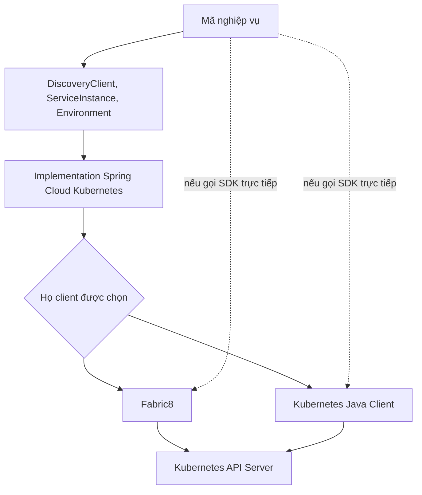

# Đánh giá thay đổi khi đổi Fabric8 và Kubernetes Java Client

Trong chương **Tương thích và nâng cấp** của **SPRING_CLOUD_KUBERNETES**, bài này hướng dẫn đánh giá tác động khi chuyển giữa hai họ client dùng để tích hợp ứng dụng Spring với Kubernetes. Phạm vi bao gồm DiscoveryClient, nguồn ConfigMap/Secret, Spring Cloud LoadBalancer, Configuration Watcher, quyền RBAC và khả năng theo dõi thay đổi Pod.

Mục tiêu là lập được một phương án chuyển có bằng chứng: biết dependency nào phải đổi, phần mã nào phụ thuộc SDK, hành vi nào phải đo lại và khi nào cần quay về bản cũ. Biên dịch thành công hoặc Pod ở trạng thái `Ready` chưa đủ để xác nhận chuyển client thành công.

Ví dụ dùng dịch vụ `order-api` trong namespace lab `learning`. Tên starter và thuộc tính được minh họa theo tài liệu Spring Cloud Kubernetes 3.3; ví dụ về auto-configuration chỉ rõ tag `v3.3.3`. Đây là mốc tham chiếu để giải thích cơ chế, không phải khuyến nghị mọi dự án chọn dòng phiên bản đó. Mã Java minh họa dùng Java 17 trở lên. Khi áp dụng, đối chiếu tài liệu với đúng Spring Boot, Spring Cloud BOM, Spring Cloud Kubernetes và SDK đã resolve của dự án.

## 1. Xác định chính xác thứ đang được thay

### 1.1. Hai thư viện cùng gọi Kubernetes API, nhưng không dùng chung API Java

| Thành phần | Fabric8 | Kubernetes Java Client |
| --- | --- | --- |
| Nhóm thư viện thường thấy | `io.fabric8` | `io.kubernetes` |
| Kiểu client phổ biến | `io.fabric8.kubernetes.client.KubernetesClient` | `io.kubernetes.client.openapi.ApiClient`, các API như `CoreV1Api` |
| Model Service | `io.fabric8.kubernetes.api.model.Service` | `io.kubernetes.client.openapi.models.V1Service` |
| Phong cách gọi thường gặp | Fluent DSL | Các lớp API/model được sinh và tiện ích của client |
| Điểm tích hợp với Spring | Các starter họ `fabric8` | Các starter họ `client` |

Fabric8 cung cấp fluent DSL cho Kubernetes/OpenShift; Kubernetes Java Client là một dự án client Java của Kubernetes. Cần phân biệt thư viện này với `java.net.http.HttpClient` của JDK. [Dự án Fabric8](https://github.com/fabric8io/kubernetes-client), [dự án Kubernetes Java Client](https://github.com/kubernetes-client/java).

Không thể thay import `Service` thành `V1Service` rồi mặc định mọi thao tác, exception, serializer và lifecycle giữ nguyên. Ngược lại, nếu mã nghiệp vụ chỉ dùng abstraction Spring như `DiscoveryClient`, phần mã đó có thể ít thay đổi hơn nhiều.



Các nhánh gọi SDK trực tiếp làm phạm vi chuyển lớn hơn. Abstraction Spring giảm mức phụ thuộc vào kiểu Java của SDK; nó không loại bỏ yêu cầu kiểm tra kết quả discovery, cấu hình và cập nhật động.

### 1.2. Tách các thay đổi độc lập

Đổi Fabric8 sang Kubernetes Java Client là đổi implementation tích hợp. Nâng Spring Boot, đổi release train Spring Cloud, nâng cluster, chuyển Endpoints sang EndpointSlice hoặc đổi bootstrap sang Config Data là các thay đổi khác.

Nếu phải thực hiện nhiều thay đổi trong cùng đợt phát hành, ghi rõ từng thay đổi và bằng chứng tương ứng. Khi có thể, giữ nguyên các trục còn lại trong lần chuyển client đầu tiên để dễ giải thích sai khác.

Hướng chuyển ngược từ Kubernetes Java Client về Fabric8 cần cùng quy trình. Client đích mới là đối tượng cần kiểm tra lại; không có hướng chuyển nào mặc nhiên ít rủi ro cho mọi ứng dụng.

## 2. Lập đường cơ sở trước khi sửa dependency

### 2.1. Ghi nhận các lớp tương thích

| Lớp | Cần ghi lại | Vì sao cần |
| --- | --- | --- |
| JVM và Spring Boot | Version build/runtime, image nền | Giới hạn Java, HTTP/TLS và thư viện nền |
| Spring Cloud | Release train, BOM đang import | Bộ version tích hợp do Spring quản lý |
| Spring Cloud Kubernetes | Version thật của từng module | Auto-configuration và tính năng phụ thuộc release |
| SDK Kubernetes | Version resolve của Fabric8 hoặc `client-java` | API Java, serializer, transport và hành vi client |
| Kubernetes cluster | Version server, API/resource đang dùng | Tính sẵn có của API, quyền và dữ liệu trả về |

Dùng bảng hỗ trợ Spring Cloud để chọn release train phù hợp với Spring Boot. Không suy ra rằng SDK chạy với cluster thì tổ hợp Spring của ứng dụng cũng đã được hỗ trợ. [Spring Cloud Supported Versions](https://github.com/spring-cloud/spring-cloud-release/wiki/Supported-Versions).

Kubernetes Java Client có quy tắc version và bảng tương thích riêng. Con số major của client không phải con số minor của cluster để so trực tiếp. [Versioning and Compatibility của Kubernetes Java Client](https://github.com/kubernetes-client/java/wiki/2.-Versioning-and-Compatibility).

Đối với Fabric8, đọc tài liệu và hướng dẫn migration đúng version đang chuyển. Một đợt nâng SDK có thể đổi HTTP implementation hoặc API Java, dù không đổi họ client. [Hướng dẫn migration của Fabric8](https://github.com/fabric8io/kubernetes-client/blob/main/doc/MIGRATION-v7.md).

Không tự ghi đè version SDK chỉ để lấy số phiên bản lớn nhất. Nếu có yêu cầu cập nhật bảo mật, đánh giá bản vá, release notes và khả năng tương thích của cả bộ dependency; lưu rõ mọi override cùng kết quả kiểm chứng.

### 2.2. Kiểm kê tính năng thực sự dùng

Với `order-api`, lập bảng trước khi chuyển:

| Câu hỏi | Ví dụ bằng chứng cần lấy |
| --- | --- |
| Có gọi DiscoveryClient không? | Nơi gọi `getServices()`/`getInstances()`, service ID cần tìm |
| Gọi đích bằng cách nào? | DNS Kubernetes, LoadBalancer mode POD/SERVICE, URL cố định |
| Cấu hình đến từ đâu? | Kubernetes API, volume import hay env |
| Có dùng Secret qua API không? | Cờ bật, nguồn, ServiceAccount và phạm vi quyền |
| Ai phát hiện cập nhật? | Configuration Watcher riêng, reload cũ hay pipeline rollout |
| Có tự tạo client không? | Bean client, builder, customizer, SDK được inject trực tiếp |
| Có thao tác ngoài phạm vi cấu hình/discovery không? | CRD, OpenShift resource, leader election hoặc thao tác ghi riêng |
| Đo trạng thái cập nhật bằng gì? | Revision cấu hình, tập endpoint, timestamp, lỗi và độ trễ |

Nếu ứng dụng chỉ gọi Service bằng DNS và đọc tệp cấu hình mount khi khởi động, có thể không cần SDK Kubernetes trong ứng dụng. Spring Cloud Kubernetes cung cấp các tích hợp hữu ích, nhưng không phải điều kiện bắt buộc để chạy Spring Boot trên Kubernetes. [Giới thiệu Spring Cloud Kubernetes](https://docs.spring.io/spring-cloud-kubernetes/reference/3.3/index.html).

### 2.3. Các lệnh kiểm kê mẫu

Các lệnh sau là hướng dẫn cho người học chạy trong dự án Maven của mình, không phải một phần tự động của bài. Với PowerShell:

```powershell
.\mvnw.cmd dependency:tree
.\mvnw.cmd dependency:tree '-Dincludes=org.springframework.cloud:*,io.fabric8:*,io.kubernetes:*'
rg -n 'io\.fabric8|io\.kubernetes|KubernetesClient|CoreV1Api|ApiClient|V1Service|ApiException|KubernetesClientException' src
rg -n 'spring-cloud-starter-kubernetes|io.fabric8|io.kubernetes' pom.xml
```

Dùng lệnh tương ứng của hệ build thực tế nếu không có Maven wrapper. Xem cả dependency trực tiếp và bắc cầu từ thư viện nội bộ. Bản lọc giúp tìm họ client; cây đầy đủ cần thiết để đánh giá HTTP transport, logging, JSON và các thư viện liên quan.

Các lệnh tìm kiếm là bước phát hiện ứng viên. Kết quả không có import SDK chưa loại trừ dependency bắc cầu, cấu hình reflection, test fixture hay một bean custom trong thư viện dùng chung.

## 3. Thay dependency theo tính năng và chỉ giữ một họ starter

Tài liệu Spring Cloud Kubernetes 3.3 yêu cầu chọn một họ client; không kết hợp starter Fabric8 với starter Kubernetes Java Client trong cùng ứng dụng. Điều này cũng áp dụng khi một starter bị kéo vào gián tiếp. [Tài liệu Starters](https://docs.spring.io/spring-cloud-kubernetes/reference/3.3/getting-started.html).

| Tính năng | Fabric8 | Kubernetes Java Client |
| --- | --- | --- |
| DiscoveryClient | `spring-cloud-starter-kubernetes-fabric8` | `spring-cloud-starter-kubernetes-client` |
| ConfigMap/Secret PropertySource | `spring-cloud-starter-kubernetes-fabric8-config` | `spring-cloud-starter-kubernetes-client-config` |
| Spring Cloud LoadBalancer tích hợp Kubernetes | `spring-cloud-starter-kubernetes-fabric8-loadbalancer` | `spring-cloud-starter-kubernetes-client-loadbalancer` |
| Gói tổng hợp | `spring-cloud-starter-kubernetes-fabric8-all` | `spring-cloud-starter-kubernetes-client-all` |

Các starter đều thuộc group `org.springframework.cloud`. LoadBalancer có cặp starter riêng được mô tả trong [tài liệu LoadBalancer](https://docs.spring.io/spring-cloud-kubernetes/reference/3.3/load-balancer.html). Với module chuyên biệt khác, kiểm tra hỗ trợ của đúng release; không suy tên artifact bằng phép thay chuỗi.

Giả sử ứng dụng đang khai báo ba starter Fabric8 cho discovery, config và load balancing. Sau khi bỏ chúng, bộ dependency đích minh họa là:

```xml
<dependency>
    <groupId>org.springframework.cloud</groupId>
    <artifactId>spring-cloud-starter-kubernetes-client</artifactId>
</dependency>
<dependency>
    <groupId>org.springframework.cloud</groupId>
    <artifactId>spring-cloud-starter-kubernetes-client-config</artifactId>
</dependency>
<dependency>
    <groupId>org.springframework.cloud</groupId>
    <artifactId>spring-cloud-starter-kubernetes-client-loadbalancer</artifactId>
</dependency>
```

Đây là phần dependency minh họa, không phải `pom.xml` hoàn chỉnh. Version lấy từ BOM đã chọn. Nếu ứng dụng chỉ dùng config, chỉ chọn starter config cần thiết; không thêm discovery hoặc gói `-all` chỉ để quá trình chuyển dễ bắt đầu.

Sau khi đổi:

1. Kiểm tra lại dependency resolve và packaged artifact của ứng dụng.
2. Tìm starter cũ còn bị kéo qua thư viện nội bộ; sửa dependency tại nguồn hoặc exclusion có phạm vi rõ ràng.
3. Xác nhận các bean/auto-configuration thực sự hoạt động bằng log khởi động hoặc báo cáo điều kiện của Spring Boot.
4. Phân biệt SDK cũ còn trên classpath với implementation cũ đang active; cả hai đều cần giải thích trong hồ sơ chuyển.

Không xóa mọi artifact của họ cũ một cách mù quáng nếu ứng dụng còn chức năng riêng phụ thuộc nó. Khi đó phải xử lý phần chức năng ấy hoặc tổ chức lại ranh giới tích hợp; giữ cả hai họ Spring starter không phải phương án chuyển được hỗ trợ theo hướng dẫn trên.

## 4. Phân loại mã cần giữ, sửa hoặc cô lập

### 4.1. Ưu tiên abstraction Spring khi nó đáp ứng yêu cầu

Ví dụ này chỉ dùng `DiscoveryClient` và `ServiceInstance`, nên không import model của hai SDK:

```java
package com.example.orders;

import java.util.Comparator;
import java.util.List;

import org.springframework.cloud.client.discovery.DiscoveryClient;
import org.springframework.stereotype.Service;

@Service
public class EndpointCatalog {
    private final DiscoveryClient discoveryClient;

    public EndpointCatalog(DiscoveryClient discoveryClient) {
        this.discoveryClient = discoveryClient;
    }

    public List<Endpoint> find(String serviceId) {
        return discoveryClient.getInstances(serviceId).stream()
                .map(instance -> new Endpoint(
                        instance.getServiceId(),
                        instance.getHost(),
                        instance.getPort(),
                        instance.isSecure()))
                .distinct()
                .sorted(Comparator.comparing(Endpoint::host)
                        .thenComparingInt(Endpoint::port)
                        .thenComparing(Endpoint::secure))
                .toList();
    }

    public record Endpoint(String serviceId, String host, int port, boolean secure) {
    }
}
```

Đặt lớp trong package được ứng dụng quét. Kết quả phù hợp để so tập endpoint trong lab; nó không thay thế logic cân bằng tải. Việc sort ở đây chỉ chuẩn hóa thứ tự phục vụ đối chiếu, không bảo đảm hai lần discovery nhìn cùng trạng thái cluster.

Giữ nguyên lớp này khi đổi starter nếu contract ứng dụng vẫn phù hợp. Sau đó kiểm tra service ID, host, port, secure flag và metadata cần dùng. Không so bằng tên class implementation hoặc mặc định thứ tự danh sách là một contract ổn định.

### 4.2. Mã gọi SDK trực tiếp cần migration riêng

| Dấu vết trong ứng dụng | Việc cần đánh giá |
| --- | --- |
| Inject `KubernetesClient` hoặc `CoreV1Api` | Đổi kiểu, cách tạo bean và thao tác tương ứng |
| Trả model SDK từ API nội bộ | Mapping sang DTO của ứng dụng, ảnh hưởng JSON schema |
| Bắt exception SDK | Mapping mã HTTP, loại lỗi, retry và lỗi không có HTTP response |
| Tự tạo watcher/informer | Khởi tạo, reconnect, cache, callback và shutdown |
| Tự tạo HTTP transport | Proxy, timeout, TLS, connection pool và đóng tài nguyên |
| Dùng OpenShift extension hoặc CRD | Tính năng và model tương ứng ở thư viện đích |

Một ranh giới nội bộ có thể dùng:

```java
package com.example.orders;

import java.util.Map;

public interface ApplicationConfigReader {
    Map<String, String> read(String namespace, String name);
}
```

Mỗi implementation chuyển kết quả SDK thành map không thay đổi được, thống nhất cách diễn giải `not found`, `forbidden`, timeout và lỗi parse. Interface này chỉ là thiết kế ranh giới; không tự cài lại việc nạp ConfigMap nếu Spring Cloud Kubernetes đã đáp ứng đủ nhu cầu.

Ví dụ, không chuyển mọi lỗi SDK thành map rỗng: cấu hình không tồn tại và không có quyền đọc là hai tình trạng vận hành khác nhau. Nếu ứng dụng có thao tác ghi, đánh giá thêm patch type, xung đột `resourceVersion` và tính an toàn khi retry; không áp chính sách retry của thao tác đọc một cách máy móc.

## 5. Đánh giá cấu hình kết nối và auto-configuration

### 5.1. Phân biệt property có tên chung với property được áp dụng thật

Một YAML cũ có thể chứa:

```yaml
spring:
  cloud:
    kubernetes:
      client:
        namespace: learning
        connection-timeout: 3s
        request-timeout: 10s
```

Không thể chỉ nhìn prefix `spring.cloud.kubernetes.client` để kết luận hai thư viện thực thi giống nhau. Với tag `v3.3.3`:

- Đường Fabric8 tạo `Config` từ cấu hình nền rồi áp các giá trị được khai báo rõ, gồm namespace, timeout, TLS và proxy. [Mã nguồn Fabric8AutoConfiguration](https://github.com/spring-cloud/spring-cloud-kubernetes/blob/v3.3.3/spring-cloud-kubernetes-fabric8-autoconfig/src/main/java/org/springframework/cloud/kubernetes/fabric8/Fabric8AutoConfiguration.java).
- Bean `ApiClient` của đường Kubernetes Java Client gọi tiện ích tạo client và đặt user agent từ môi trường; không có cùng chuỗi ánh xạ mọi thuộc tính như đường Fabric8. [Mã nguồn KubernetesClientAutoConfiguration](https://github.com/spring-cloud/spring-cloud-kubernetes/blob/v3.3.3/spring-cloud-kubernetes-client-autoconfig/src/main/java/org/springframework/cloud/kubernetes/client/KubernetesClientAutoConfiguration.java).
- Tiện ích đó thử cấu hình trong cluster trước, rồi cấu hình chuẩn nếu việc tạo client trong cluster thất bại. Nó cũng có đường tạo client riêng cho informer, đặt read timeout bằng `0`. [Mã nguồn KubernetesClientUtils](https://github.com/spring-cloud/spring-cloud-kubernetes/blob/v3.3.3/spring-cloud-kubernetes-client-autoconfig/src/main/java/org/springframework/cloud/kubernetes/client/KubernetesClientUtils.java).

Đây là ví dụ cụ thể cho một release, không phải kết luận rằng toàn bộ property bị bỏ qua ở mọi Kubernetes Java Client. Namespace còn có cơ chế giải quyết ở tầng Spring Cloud Kubernetes. Khi nâng sang release khác, đọc đúng code/documentation của release đó và đo hành vi thực tế.

Nếu tự khai báo bean client để thay auto-configuration, kiểm tra cả giai đoạn bootstrap/Config Data và discovery sau khi context chính khởi động. Một client custom trong context chính chưa chắc được dùng để đọc cấu hình sớm hoặc tạo informer riêng.

### 5.2. Bảng đối chiếu cấu hình cần hoàn thành

| Hạng mục | Câu hỏi cần trả lời trước và sau |
| --- | --- |
| API server | Client thật đang gọi địa chỉ nào, có đúng cluster không? |
| Xác thực | ServiceAccount, kubeconfig hay credential plugin nào được dùng? |
| CA/TLS | CA lấy từ đâu, chứng chỉ được kiểm tra thế nào? |
| Namespace | Nguồn cấu hình nào quyết định namespace ở mỗi tính năng? |
| Proxy | Có proxy/no-proxy cho địa chỉ API trong cluster không? |
| Timeout | Đơn vị, connection timeout, read/request timeout và watch dài hạn là gì? |
| Retry | Lỗi nào được retry, mức backoff và giới hạn ra sao? |
| Token | Credential hết hạn được cập nhật bằng cơ chế nào? |
| Lifecycle | Ai sở hữu HTTP client, informer, thread và thao tác đóng? |

Trong lab, thử cả trong Pod và ngoài cluster nếu dự án thực sự hỗ trợ hai môi trường. `kubectl` chạy được trên máy phát triển chưa chứng minh SDK trong Pod chọn cùng credential hoặc cùng namespace.

Không tắt kiểm tra TLS để làm phép chuyển vượt qua bài thử. Lỗi chứng chỉ cần được giải thích bằng CA, hostname và cấu hình trust của client thật.

### 5.3. Namespace phải được kiểm chứng riêng

Có thể khai báo namespace theo nguồn ConfigMap/Secret hoặc theo cơ chế namespace chung. Spring Cloud Kubernetes còn xét namespace từ property, tệp ServiceAccount và khả năng cung cấp namespace của client. Vì vậy, không dựa vào một biến môi trường đặc thù Fabric8 khi chuyển mà chưa kiểm tra đường client đích. [Tài liệu namespace resolution](https://docs.spring.io/spring-cloud-kubernetes/reference/3.3/property-source-config/namespace-resolution.html).

Để giảm khác biệt vô tình trong lab, khai báo rõ phạm vi đang thử:

```yaml
spring:
  application:
    name: order-api
  config:
    import: "kubernetes:"
  cloud:
    kubernetes:
      config:
        namespace: learning
        sources:
          - name: order-api
      discovery:
        all-namespaces: false
        namespaces:
          - learning
        primary-port-name: http
```

Đoạn trên minh họa phạm vi nguồn và discovery, không cấu hình mọi tính năng. Không đổi từ một namespace sang `all-namespaces` để che lỗi namespace khi chuyển client.

## 6. Giữ contract discovery và load balancing

### 6.1. Đối chiếu dữ liệu và bộ lọc

Trên cùng một tập backend ổn định, so sánh tập service ID, host, port, secure flag và metadata mà ứng dụng thật sự sử dụng. Sau đó tạo thay đổi Pod trong lab để đo thời gian hội tụ.

Một điểm phụ thuộc model dễ bị bỏ sót là `spring.cloud.kubernetes.discovery.filter`: SpEL được đánh giá trên model Service của client đang dùng. Cùng một đường thuộc tính đơn giản có thể hoạt động ở cả hai, nhưng biểu thức có method, kiểu class hoặc cấu trúc model riêng phải được xem lại. [Tài liệu DiscoveryClient](https://docs.spring.io/spring-cloud-kubernetes/reference/3.3/discovery-client.html).

Ưu tiên service label selector khi nó diễn đạt đủ yêu cầu, đồng thời giữ nguyên ý nghĩa lọc. Với Service mẫu:

```yaml
metadata:
  labels:
    discoverable: "true"
```

Cấu hình lọc tương ứng:

```yaml
spring:
  cloud:
    kubernetes:
      discovery:
        service-labels:
          discoverable: "true"
```

Label nằm trên **Service**, không tự thay bằng label trên Pod. Bài thử phải có cả Service khớp và không khớp để phát hiện lọc quá rộng hoặc quá hẹp.

### 6.2. Endpoints và EndpointSlice là lựa chọn riêng

Ghi rõ implementation đang đọc resource nào. Nếu cấu hình dùng EndpointSlice, kiểm tra API `discovery.k8s.io` và quyền đọc tương ứng. EndpointSlice chia endpoint của Service thành nhiều resource; không lấy một slice đầu tiên làm toàn bộ kết quả. [Tài liệu Kubernetes EndpointSlices](https://kubernetes.io/docs/concepts/services-networking/endpoint-slices/).

Nếu mục tiêu ban đầu chỉ là đổi client, giữ nguyên lựa chọn Endpoints/EndpointSlice đang hoạt động. Một lần chuyển đồng thời cả hai cần thêm bài thử về resource, RBAC và dữ liệu endpoint; không quy mọi sai khác cho SDK.

### 6.3. Giữ nguyên đường gọi của LoadBalancer

Kiểm tra mode POD/SERVICE, tên port, HTTP/HTTPS và namespace của service đích. Chuyển từ chọn instance sang gọi DNS Service làm thay đổi đường đi của request, dù cùng tên đích trong mã. Khi đánh giá đổi client, giữ lựa chọn này rõ ràng thay vì dựa vào default. [Cơ chế LoadBalancer cho Kubernetes](https://docs.spring.io/spring-cloud-kubernetes/reference/3.3/load-balancer.html).

Với Service nhiều port, xác nhận port nghiệp vụ được chọn và không trỏ nhầm management port. Nếu ứng dụng dùng metadata để định tuyến theo vùng hoặc nhãn, kiểm tra dữ liệu đó trong `ServiceInstance`, không chỉ đếm số instance.

Để thử cập nhật Pod, đo xem backend mới xuất hiện, backend ngừng phục vụ được loại bỏ và request thực tế thành công. Không yêu cầu mọi request phân bố đều tuyệt đối trong một mẫu nhỏ; kiểm tra theo thuật toán và hành vi hệ thống đã chọn.

## 7. Giữ contract cấu hình và refresh

### 7.1. Khởi động thành công chưa đủ

Giữ nguyên tên ứng dụng, nguồn ConfigMap/Secret, namespace, profile, prefix, thứ tự override và cơ chế fail-fast/retry cần thiết. Với Config Data, dùng `spring.config.import: "kubernetes:"`; không đồng thời bật bootstrap cũ cho cùng cơ chế nạp. [Tài liệu Kubernetes PropertySource](https://docs.spring.io/spring-cloud-kubernetes/reference/3.3/property-source-config.html).

Dùng một revision không nhạy cảm để đối chiếu. Ví dụ ConfigMap:

```yaml
apiVersion: v1
kind: ConfigMap
metadata:
  name: order-api
  namespace: learning
  labels:
    spring.cloud.kubernetes.config: "true"
data:
  application.yaml: |-
    demo:
      revision: "migration-v1"
      message: "Thông báo trước khi chuyển client"
```

Kiểm tra giá trị hiệu lực ở `Environment`, bean cấu hình và một hành vi nghiệp vụ. Nếu chỉ endpoint chẩn đoán đọc `Environment`, kết quả mới chưa chứng minh singleton hoặc SDK client trong ứng dụng đã đổi.

Với Secret, kiểm tra riêng cơ chế API/volume/env đang dùng, cờ bật đọc API và quyền. Không log credential để so hai bản. Nếu có adapter SDK trực tiếp, xem representation dữ liệu của model đích để tránh giải mã hoặc encode hai lần; kiểm tra kết quả xác thực bằng credential giả trong lab.

### 7.2. Phân biệt client của ứng dụng và Configuration Watcher

Configuration Watcher là thành phần triển khai riêng có đường HTTP hoặc Spring Cloud Bus để thông báo refresh. Đổi dependency trong `order-api` không tự thay image hoặc client nằm trong Watcher. [Tài liệu Configuration Watcher](https://docs.spring.io/spring-cloud-kubernetes/reference/3.3/spring-cloud-kubernetes-configuration-watcher.html).

Phép kiểm chứng cần quan sát toàn bộ chuỗi:

```text
Cấu hình thay đổi
  -> Watcher quan sát đúng resource
  -> Thông báo đến từng instance cần cập nhật
  -> Ứng dụng đọc lại nguồn
  -> Bean/client dùng giá trị mới
  -> Hành vi nghiệp vụ phản ánh revision mới
```

Nếu refresh thủ công được nhưng tự động không được, xem đường thông báo và discovery của Watcher. Nếu thông báo đã đến mà `Environment` không đổi, xem nguồn nạp và client của ứng dụng. Nếu `Environment` đổi nhưng nghiệp vụ vẫn cũ, xem rebind, refresh scope, cache và tài nguyên đã giữ snapshot.

Với cấu hình qua env, một lần POST refresh không thay env của container đang chạy; kế hoạch phải giữ cơ chế rollout phù hợp. Với volume, cần tính thời gian tệp được cập nhật trước khi ứng dụng đọc lại. Đây là khác biệt của cách phân phối cấu hình, không tự biến mất khi đổi SDK.

## 8. RBAC và khả năng phục hồi phải được thử bằng danh tính thật

### 8.1. Giữ phạm vi quyền rõ ràng

Các tích hợp cần quyền đọc các resource mà chúng sử dụng. Discovery thường liên quan services, pods và endpoints; ConfigMap/Secret có phạm vi riêng. Nếu dùng EndpointSlice thì bổ sung đúng API group. [Tài liệu bảo mật Spring Cloud Kubernetes](https://docs.spring.io/spring-cloud-kubernetes/reference/3.3/security-service-accounts.html).

Cùng ServiceAccount vẫn có thể chạy thành công ở client cũ và lỗi ở client mới nếu đường truy cập đổi từ GET theo tên sang LIST/WATCH hoặc phạm vi namespace đổi. Điều này cần bằng chứng từ log hoặc audit được phép truy cập; không nên mặc định client mới luôn cần nhiều quyền hơn.

Ví dụ kiểm tra, giả sử Pod dùng ServiceAccount `order-api`:

```powershell
kubectl -n learning get pods -l app=order-api -o wide
kubectl -n learning get pod '<tên-Pod>' -o jsonpath='{.spec.serviceAccountName}'
kubectl auth can-i list services --as=system:serviceaccount:learning:order-api -n learning
kubectl auth can-i watch endpoints --as=system:serviceaccount:learning:order-api -n learning
kubectl auth can-i watch endpointslices.discovery.k8s.io --as=system:serviceaccount:learning:order-api -n learning
kubectl auth can-i get configmap/order-api --as=system:serviceaccount:learning:order-api -n learning
kubectl auth can-i list configmaps --as=system:serviceaccount:learning:order-api -n learning
```

Thay placeholder bằng tên Pod thật và chỉ kiểm tra resource cần dùng. `--as` yêu cầu người chạy có quyền impersonate; lỗi impersonation không phải kết luận về quyền của ServiceAccount đích. Role/RoleBinding giới hạn namespace phù hợp thường là cơ sở tốt cho bài thử. [Tài liệu Kubernetes RBAC](https://kubernetes.io/docs/reference/access-authn-authz/rbac/).

Không cấp quyền đọc Secret cho cả namespace nếu tính năng không cần. Quyền Kubernetes API cũng không thay thế quyền HTTP để gọi Actuator hoặc quyền nhận sự kiện từ broker.

### 8.2. Kiểm tra sau lỗi, không chỉ lần kết nối đầu

Trong lab có kiểm soát, mô phỏng API server tạm thời không truy cập được rồi khôi phục; sau đó thay đổi một backend hoặc revision cấu hình. Đo ứng dụng có lấy lại trạng thái đúng trong giới hạn đã đặt không.

Watch có thể kết thúc; client cần nối lại hoặc list lại theo cơ chế của nó. Với `resourceVersion` quá cũ, Kubernetes có thể trả `410 Gone`, đòi hỏi xử lý đồng bộ lại. Không giả định một kết nối watch sống mãi, không coi resourceVersion là số nghiệp vụ tăng đều. [Kubernetes API Concepts](https://kubernetes.io/docs/reference/using-api/api-concepts/).

Nếu token có thời hạn được sử dụng, thêm phép thử đủ dài để đi qua vòng thay/refresh token hoặc dùng cơ chế mô phỏng được môi trường hỗ trợ. Kết quả chạy vài phút lúc startup chưa chứng minh credential rotation hoạt động.

Không yêu cầu callback nhận đúng một lần cho mọi cập nhật trung gian nếu contract thực tế chỉ là hội tụ về trạng thái mới nhất. Kiểm tra trạng thái cuối, thời gian hội tụ và tính an toàn khi callback được lặp lại nếu ứng dụng có xử lý riêng.

## 9. Ma trận kiểm chứng cho bản cũ và bản mới

Xác định trước dữ liệu thử, ngưỡng chấp nhận và cách quan sát. Các ngưỡng phải phù hợp môi trường; không coi giá trị ví dụ của tài liệu khác là bảo đảm của client.

| Kịch bản | Bằng chứng cần so | Điều kiện đạt |
| --- | --- | --- |
| Khởi động | Dependency resolve, auto-configuration, log nguồn cấu hình | Đúng họ client, đúng cluster, không có lỗi khởi tạo bị che |
| Namespace và selector | Có resource khớp/không khớp | Chỉ tìm đúng phạm vi dự kiến |
| Discovery ổn định | Tập host/port/secure/metadata cần dùng | Contract tương đương trên cùng backend ổn định |
| Backend thay đổi | Thêm/bớt Pod, thay readiness | Hội tụ về tập endpoint mong muốn trong ngưỡng |
| Gọi dịch vụ | Request thực tế ở mode đã chọn | Đúng port, protocol và kết quả nghiệp vụ |
| ConfigMap ban đầu | Revision và nguồn hiệu lực | Giá trị đúng sau override |
| Cập nhật cấu hình | Revision ở Environment, bean, hành vi, từng Pod | Đúng revision và hành vi theo cơ chế đã chọn |
| Secret nếu dùng | Kết quả kết nối/xác thực bằng dữ liệu lab | Đúng credential, không lộ dữ liệu |
| Thiếu quyền | Lỗi có resource, namespace, verb phù hợp | Phân biệt `403` với nguồn không tồn tại |
| Mất API rồi khôi phục | Trạng thái sau một thay đổi mới | Tự hội tụ lại theo ngưỡng chấp nhận |
| Credential rotation nếu có | Kết quả trước và sau vòng thay token | Tiếp tục truy cập theo thiết kế |
| Shutdown và rollout | Thread, kết nối, lỗi lúc dừng, readiness | Dừng đúng hạn, không rò tài nguyên hoặc mất phục vụ ngoài ngưỡng |

Đối với hiệu năng, giữ cùng resource limit, số Pod, số resource theo dõi và tải request. So startup time, CPU, bộ nhớ, thread, số request đến API server và độ trễ cập nhật. Chỉ kết luận từ phép đo; không mặc định một thư viện nhanh hơn hoặc nhẹ hơn cho mọi workload.

Mock test hữu ích cho mapping và xử lý lỗi adapter, nhưng mock server của Fabric8 không tự kiểm tra implementation Kubernetes Java Client. Tạo fixture dùng được cho client đích và giữ bài thử trên cluster lab cho xác thực, RBAC, watch và mạng thực tế.

## 10. Bài thực hành chuyển Fabric8 sang Kubernetes Java Client

### 10.1. Chuẩn bị hai bản ứng dụng độc lập

Giả sử `inventory-api` là backend ổn định trong namespace `learning`. Chuẩn bị hai Deployment của `order-api`: bản baseline dùng Fabric8 và bản candidate dùng Kubernetes Java Client. Cả hai dùng cùng nguồn cấu hình, ServiceAccount, selector discovery và tập backend khi so sánh.

Dùng label riêng như `track: baseline` và `track: candidate` để quan sát. Giữ lưu lượng phục vụ và cơ chế thử nghiệm có chủ đích; không vô tình trộn candidate vào Service đang phục vụ chỉ vì dùng cùng label `app`.

Có thể thêm probe sau vào ứng dụng lab để quan sát revision trong Environment và endpoint từ lớp `EndpointCatalog` ở mục 4:

```java
package com.example.orders;

import java.util.List;

import org.springframework.core.env.Environment;
import org.springframework.web.bind.annotation.GetMapping;
import org.springframework.web.bind.annotation.PathVariable;
import org.springframework.web.bind.annotation.RestController;

@RestController
public class MigrationProbeController {
    private final EndpointCatalog catalog;
    private final Environment environment;

    public MigrationProbeController(EndpointCatalog catalog, Environment environment) {
        this.catalog = catalog;
        this.environment = environment;
    }

    @GetMapping("/internal/client-migration/{serviceId}")
    public Probe inspect(@PathVariable("serviceId") String serviceId) {
        return new Probe(
                environment.getProperty("demo.revision", "<missing>"),
                catalog.find(serviceId));
    }

    public record Probe(String configRevision, List<EndpointCatalog.Endpoint> endpoints) {
    }
}
```

Probe công bố địa chỉ nội bộ nên chỉ dùng trong phạm vi lab hoặc được bảo vệ theo chính sách của hệ thống. Nó không chứng minh bean nghiệp vụ đã refresh và không cho biết chắc implementation nào đang active; hai điểm đó cần bằng chứng riêng.

### 10.2. Chạy đối chiếu

Chọn Pod thật:

```powershell
kubectl -n learning get pods -l app=order-api,track=baseline -o wide
kubectl -n learning get pods -l app=order-api,track=candidate -o wide
```

Trong hai terminal riêng, thay placeholder và giữ mỗi port-forward đang chạy:

```powershell
kubectl -n learning port-forward 'pod/<baseline-Pod>' 18080:8080
```

```powershell
kubectl -n learning port-forward 'pod/<candidate-Pod>' 18081:8080
```

Ở terminal thứ ba:

```powershell
curl.exe --fail-with-body -sS http://127.0.0.1:18080/internal/client-migration/inventory-api
curl.exe --fail-with-body -sS http://127.0.0.1:18081/internal/client-migration/inventory-api
```

Nếu ứng dụng dùng xác thực, bổ sung cơ chế được cấu hình; port-forward không bỏ qua Spring Security. Cổng ví dụ giả định web app ở `8080`.

Thực hiện tuần tự:

1. Chụp kết quả hai bản khi backend ổn định; so tập endpoint và revision.
2. Thêm hoặc loại một backend trong lab; đo thời gian hai bản hội tụ.
3. Đổi `demo.revision` sang `migration-v2`, giữ nguyên cơ chế Watcher/rollout đang đánh giá; đo cập nhật từng Pod và kiểm tra hành vi nghiệp vụ.
4. Thử một lỗi quyền được thiết kế trước hoặc một giai đoạn gián đoạn API trong lab; khôi phục rồi tạo thay đổi mới để kiểm tra phục hồi.
5. Ghi kết quả tài nguyên và log lỗi. Lặp lại phần quan trọng sau một lần restart/rollout.

Nếu candidate trả tập endpoint rỗng trong khi baseline đúng, kiểm tra lần lượt implementation active, cluster đích, namespace, selector, resource API và quyền. Chỉ sửa những điểm có bằng chứng; không bật mọi namespace và thêm quyền rộng trong cùng một bước.

Nếu hướng chuyển là về Fabric8, hoán đổi baseline/candidate và starter đích, giữ nguyên dữ liệu và tiêu chí. Đánh giá lại cấu hình native cũ, adapter, exception và transport theo đường Fabric8.

## 11. Quyết định phát hành và quay lui

Hồ sơ chuyển tối thiểu cần có:

- Bộ version đã resolve, dependency thay đổi và các override còn lại.
- Danh sách chức năng giữ nguyên, sửa mã, bỏ hoặc chưa hỗ trợ ở client đích.
- Các khác biệt cấu hình đã được ánh xạ tới hành vi thật.
- Kết quả ma trận kiểm chứng, ngưỡng và các điểm chưa xác định.
- Image baseline/candidate cùng cấu hình triển khai đủ để tái lập.
- Điều kiện dừng mở rộng và cách quay lui.

Quay lui khi candidate không đạt contract đã chấp nhận, chẳng hạn mất discovery, đọc sai namespace, refresh không hội tụ, lỗi credential hoặc gây tải API vượt ngưỡng. Khôi phục đúng image và cấu hình baseline theo quy trình triển khai của hệ thống; không chỉ đổi lại một artifact trong mã nguồn đang chạy.

Quay lui ứng dụng không tự quay lại nội dung ConfigMap, Secret hoặc thay đổi RBAC đã triển khai riêng. Giữ cấu hình tương thích cho hai bản trong cửa sổ chuyển hoặc chuẩn bị bước phục hồi tương ứng. Nếu đã phát sinh thao tác ghi ngoài ứng dụng, đánh giá riêng khả năng hoàn tác.

Chọn client theo nhu cầu cụ thể: tính năng cần dùng, mức phụ thuộc SDK hiện có, khả năng vận hành và bằng chứng kiểm chứng. Nếu chỉ cần DNS Service và cấu hình lúc khởi động, có thể giảm số tính năng Spring Cloud Kubernetes phải duy trì thay vì chuyển toàn bộ gói tích hợp.
