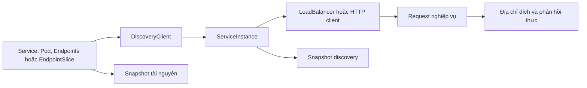

# Đối chiếu hành vi DiscoveryClient và lựa chọn cổng sau nâng cấp

## Mục tiêu và bối cảnh

Trong chương **Tương thích và nâng cấp** của module **SPRING_CLOUD_KUBERNETES**, bài này hướng dẫn xác minh ứng dụng vẫn discovery đúng backend và gọi đúng cổng sau khi thay đổi Spring Boot, Spring Cloud, Spring Cloud Kubernetes hoặc manifest triển khai. Bạn sẽ đối chiếu dữ liệu Kubernetes, kết quả `ServiceInstance` và request nghiệp vụ thực tế để xác định thay đổi nào có ý nghĩa.

Một bản nâng cấp có thể khởi động thành công, Pod Ready, `getServices()` vẫn chứa tên cần tìm, nhưng client lại gửi request vào cổng quản trị. Do đó, tiêu chí tương thích cần bao gồm **địa chỉ, cổng, giao thức và hành vi của request**, thay vì chỉ số lượng service.

Các ví dụ Java sử dụng Java 17 trở lên. Lab giả định namespace `demo` đã tồn tại và có các ứng dụng Spring Boot để tích hợp những đoạn mã trong bài.

Bài dùng mã nguồn Spring Cloud Kubernetes **v3.3.3** làm mốc giải thích thuật toán và đối chiếu phần chọn cổng với **v3.2.3**. Hai tag là mốc tham khảo, không phải đề xuất một lộ trình nâng cấp cho mọi dự án. Khi thực hành, chọn bộ Boot, Cloud và Kubernetes client đã được dự án xác nhận tương thích. Các lệnh và kết quả dưới đây là hướng dẫn cùng dữ liệu minh họa, chưa được chạy trên cluster của bạn.

## 1. Xác định hợp đồng cần giữ trước khi nâng cấp

Với một consumer gọi `catalog-api`, hợp đồng discovery nên trả lời được:

- Tên được tra cứu là Kubernetes Service nào, trong namespace nào?
- Instance trả về có thuộc các Pod backend dự kiến không?
- Cổng được chọn là cổng nghiệp vụ hay cổng quản trị?
- `secure`, `scheme` và URI có phù hợp listener thực không?
- Instance chưa sẵn sàng có bị loại theo yêu cầu không?
- Consumer sử dụng đúng dữ liệu này để gọi nghiệp vụ hay còn một lớp biến đổi khác?

Có thể mô tả hợp đồng bằng bộ dữ liệu:

```text
serviceId + namespace + host + port + secure + scheme
```

Thêm metadata thực sự được consumer sử dụng. `instanceId`, thứ tự danh sách hoặc Pod IP có thể đổi khi rollout; chúng cần được giải thích theo vòng đời tài nguyên, không dùng phép so sánh chuỗi tuyệt đối cho mọi tình huống.

### 1.1. Ghi nhận các thành phần thay đổi

| Thành phần | Trước nâng cấp | Sau nâng cấp | Điều cần đối chiếu |
| --- | --- | --- | --- |
| Spring Boot, Spring Cloud BOM | Phiên bản thực | Phiên bản mục tiêu | Bộ dependency được hỗ trợ |
| Spring Cloud Kubernetes | Phiên bản đã resolve | Phiên bản đã resolve | Không chỉ nhìn version khai báo trực tiếp |
| Kubernetes client | Fabric8, Java client hoặc HTTP | Loại và phiên bản thực | Tránh vô tình đổi implementation |
| API discovery | Blocking hoặc reactive | Loại thực được consumer gọi | Không dùng kết quả blocking để chứng minh thay cho reactive |
| DiscoveryServer, nếu có | Image và cấu hình | Image và cấu hình | Phân biệt thay đổi server với client HTTP |
| LoadBalancer | Mode và cấu hình cổng | Mode và cấu hình cổng | `POD` và `SERVICE` chọn địa chỉ khác nhau |
| Helm chart hoặc manifest | Service, Pod, RBAC | Manifest đã render | Tên port, label, selector, readiness |
| Nguồn cấu hình | File, ConfigMap, Secret, env | Giá trị hiệu lực | Một khóa có thể bị ghi đè từ nguồn khác |
| Kubernetes | Phiên bản, API đang đọc | Phiên bản, API đang đọc | Endpoints hoặc EndpointSlice |

Không đồng thời đổi client, mode cân bằng tải, tên port và RBAC rồi gán mọi khác biệt cho version thư viện. Nếu phải triển khai cùng lúc, giữ đủ dữ liệu để tách từng nguyên nhân khi điều tra.

### 1.2. So sánh ba tầng thay vì một kết quả cuối



Nếu tài nguyên giống nhau nhưng `ServiceInstance` khác, xem implementation và cấu hình discovery. Nếu `ServiceInstance` giống nhau nhưng request khác, xem LoadBalancer, HTTP client hoặc proxy. Nếu Service và backend đã đổi, trước hết xác định đó có phải thay đổi chủ ý của bản triển khai không.

## 2. Phân biệt cổng Service và cổng backend

Dùng môi trường lab sau:

| Thành phần | Giá trị |
| --- | --- |
| Namespace | `demo` |
| Service backend | `catalog-api` |
| Nhãn Pod backend | `app: catalog-api` |
| Listener nghiệp vụ của Pod | `8081`, HTTP |
| Listener quản trị của Pod | `9091`, HTTP |
| Service port nghiệp vụ | `80`, tên `web` |
| Service port quản trị | `9000`, tên `ops` |
| Consumer trước và sau nâng cấp | `checkout-before`, `checkout-after` |

Ví dụ Service:

```yaml
apiVersion: v1
kind: Service
metadata:
  name: catalog-api
  namespace: demo
  labels:
    primary-port-name: web
spec:
  selector:
    app: catalog-api
  ports:
    - name: web
      port: 80
      targetPort: api
      protocol: TCP
    - name: ops
      port: 9000
      targetPort: management
      protocol: TCP
```

Phần port trong container backend tương ứng:

```yaml
ports:
  - name: api
    containerPort: 8081
  - name: management
    containerPort: 9091
```

Với Spring Boot, ứng dụng backend của lab lắng nghe theo cấu hình:

```yaml
server:
  port: 8081
management:
  server:
    port: 9091
```

Khai báo `containerPort` không làm ứng dụng tự mở listener. `targetPort: api` tham chiếu tên port của Pod; `primary-port-name: web` lại tham chiếu tên port mà discovery dùng, trong tình huống này là tên phía Service/backend endpoint. Hai tên `api` và `web` có vai trò khác nhau. Kubernetes cho phép ánh xạ Service port sang target port như vậy. [Kubernetes Service](https://kubernetes.io/docs/concepts/services-networking/service/#defining-a-service)

Với các Pod có listener đúng như trên, backend endpoint dự kiến chứa ánh xạ:

```text
web -> 8081
ops -> 9091
```

Khi đi qua Service DNS, địa chỉ nghiệp vụ là `catalog-api.demo.svc:80`. Khi discovery trả Pod IP và chọn `web`, cổng nghiệp vụ là `8081`. Không ghép Pod IP với `80` chỉ vì manifest Service có `port: 80`.

Ở đường Endpoints của Fabric8 v3.3.3, mã nguồn lấy map port từ endpoint subset rồi tạo `ServiceInstance`. Vì thế phải kiểm tra cổng backend mà API cung cấp, không suy `getPort()` luôn bằng Service port. [KubernetesDiscoveryClient v3.3.3](https://github.com/spring-cloud/spring-cloud-kubernetes/blob/v3.3.3/spring-cloud-kubernetes-fabric8-discovery/src/main/java/org/springframework/cloud/kubernetes/fabric8/discovery/KubernetesDiscoveryClient.java)

Với named target port và các Pod đang rollout, giá trị được phân giải có thể khác giữa các nhóm backend nếu container port thay đổi. Luôn đối chiếu từng instance với endpoint tương ứng; không ép mọi instance về một hằng số chỉ dựa vào tên Service.

## 3. Thuật toán chọn cổng: điều phải kiểm tra ở đúng phiên bản

### 3.1. Quy tắc của hàm chọn port trong v3.3.3

Bảng này mô tả `DiscoveryClientUtils.endpointsPort(...)` trên **map port ứng viên** mà implementation đưa vào:

| Điều kiện | Kết quả |
| --- | --- |
| Không có port ứng viên | Trả số port `0`; chưa có địa chỉ nghiệp vụ hợp lệ để gọi |
| Chỉ một port | Chọn port duy nhất |
| Nhiều port, tên ưu tiên khớp | Chọn tên từ label `primary-port-name`, hoặc từ property nếu không có label |
| Tên ưu tiên không khớp | Thử tên `https` |
| Chưa chọn được | Thử tên `http` |
| Vẫn không chọn được | Cảnh báo rồi lấy một phần tử từ map |

Label được đọc từ **Service**, không phải label của Deployment hay Pod. Tên trong `spring.cloud.kubernetes.discovery.primary-port-name` là tên port, không phải số `8081`. Quy tắc này được xác nhận trong [DiscoveryClientUtils v3.3.3](https://github.com/spring-cloud/spring-cloud-kubernetes/blob/v3.3.3/spring-cloud-kubernetes-commons/src/main/java/org/springframework/cloud/kubernetes/commons/discovery/DiscoveryClientUtils.java).

“Lấy phần tử đầu” trong map không phải cam kết chọn phần tử đầu bạn nhìn thấy trong YAML. Không dùng thứ tự port như một hợp đồng triển khai.

### 3.2. Label sai có thể che cấu hình đúng

Giả sử Service có:

```yaml
metadata:
  labels:
    primary-port-name: admin
```

Consumer có:

```yaml
spring:
  cloud:
    kubernetes:
      discovery:
        primary-port-name: web
```

Map backend chỉ có `web` và `ops`. Trong mốc mã nguồn của bài, label `admin` đã được chọn làm tên ưu tiên, nên property `web` không được thử lại như một lựa chọn dự phòng. Thuật toán tiếp tục tìm `https`, rồi `http`, cuối cùng mới fallback.

Đây là lý do “đã đặt property nhưng port không đổi” cần kiểm tra cả label trên Service. Khi chỉ còn một port ứng viên, nhánh port duy nhất lại chạy trước phần ưu tiên tên. Một lỗi tên có thể bị che khi Service còn một port, rồi lộ ra khi chart bổ sung port quản trị.

Có hai cách khai báo chủ ý cho ví dụ:

- Đặt `metadata.labels.primary-port-name: web` trên Service nếu mọi consumer discovery nên dùng cổng nghiệp vụ này.
- Không đặt label đó và cấu hình `discovery.primary-port-name: web` ở consumer cần quy ước riêng.

Nếu hai consumer cần hai bề mặt API khác nhau mà label toàn Service gây xung đột, cân nhắc tách Service nghiệp vụ và Service quản trị. Khi đó mỗi Service có hợp đồng cổng rõ ràng.

### 3.3. Đối chiếu cũ và mới bằng bằng chứng

Ở hai tag **v3.2.3** và **v3.3.3**, phần chọn cổng được xem trong bài đều dùng nhánh port duy nhất, tên ưu tiên, `https`, `http` và fallback. Vì vậy, không thể dùng riêng sự thay đổi version giữa hai mốc này để khẳng định thuật toán đã đảo thứ tự chọn cổng. [Mã nguồn v3.2.3](https://github.com/spring-cloud/spring-cloud-kubernetes/blob/v3.2.3/spring-cloud-kubernetes-commons/src/main/java/org/springframework/cloud/kubernetes/commons/discovery/DiscoveryClientUtils.java)

Kết luận này chỉ áp dụng cho phần thuật toán đã đối chiếu. Nó không chứng minh toàn bộ hai bản tương thích, không thay thế việc kiểm tra backend dữ liệu, kiểu client, metadata hoặc đường gọi thực tế.

Với cặp version khác, xem release notes và mã nguồn đúng tag của dự án, rồi kiểm tra trên đầu vào đại diện. Nếu chưa có bằng chứng, ghi “kết quả quan sát thay đổi” thay vì “thư viện mới luôn chọn port đầu tiên”.

## 4. Số port đúng chưa đủ: kiểm tra secure, scheme và metadata

### 4.1. Secure là kết quả suy luận, không phải phép thử TLS

Trong resolver v3.3.3, instance được đánh dấu secure nếu có một điều kiện phù hợp: label `secured` mang giá trị truthy, annotation tương tự, số port nằm trong danh sách secure đã cấu hình, hoặc tên port là `https`. Resolver không thử bắt tay TLS với listener. [ServicePortSecureResolver v3.3.3](https://github.com/spring-cloud/spring-cloud-kubernetes/blob/v3.3.3/spring-cloud-kubernetes-commons/src/main/java/org/springframework/cloud/kubernetes/commons/discovery/ServicePortSecureResolver.java)

Một hệ quả dễ bỏ sót: trong resolver này, `secured: "false"` không phải lệnh chặn mọi điều kiện còn lại. Port `8443` vẫn có thể được xem là secure do danh sách known secure ports.

Bởi vậy, cần so sánh đồng thời:

```text
host: 10.42.2.17
port: 8081
secure: false
scheme: http
uri: http://10.42.2.17:8081
```

Đây là dữ liệu minh họa của lab HTTP. Nếu chỉ đổi tên port thành `https` nhưng ứng dụng vẫn phục vụ HTTP thuần, request có thể lỗi TLS dù số port đúng. Nếu TLS được kết thúc ở Ingress, điều đó cũng không tự chứng minh listener tại Pod IP dùng HTTPS.

### 4.2. Metadata không đồng nhất với port được chọn

Metadata có thể chứa nhiều port như `port.web` và `port.ops`; điều đó không có nghĩa consumer phải tự chọn một khóa bất kỳ thay cho `ServiceInstance.getPort()`.

Sau nâng cấp, kiểm tra những khóa mà code thực sự đọc:

| Thay đổi | Ảnh hưởng có thể có |
| --- | --- |
| Đổi `metadata.ports-prefix` | Code tìm `port.web` có thể không thấy khóa cũ |
| Tắt `metadata.add-annotations` | Consumer phụ thuộc annotation mất thông tin |
| Đổi labels/annotations prefix | Tên khóa metadata thay đổi |
| Thêm metadata của Pod | Dữ liệu nhiều hơn, chưa chắc đường gọi đổi |
| Đổi `instanceId` khi Pod được tạo lại | Khác biệt vòng đời, cần đối chiếu với Pod thực |

Mốc 3.3 có các thuộc tính điều khiển metadata, namespace, readiness và lựa chọn EndpointSlice trong [danh mục thuộc tính](https://docs.spring.io/spring-cloud-kubernetes/reference/3.3/appendix.html). Chụp giá trị hiệu lực cho các khóa liên quan; không suy rằng một file cấu hình có mặt là giá trị trong đó chắc chắn đang được dùng.

Nếu ConfigMap hoặc Secret cung cấp cấu hình discovery, hãy ghi nhận nguồn nào đang thắng khi có env hoặc tham số dòng lệnh ghi đè. Chỉ thu thập các giá trị kỹ thuật cần đối chiếu, không đưa nội dung Secret vào bản ghi nâng cấp.

## 5. Xác định client và đường cân bằng tải thực sự được dùng

### 5.1. Client trực tiếp và HTTP DiscoveryClient

Spring Cloud Kubernetes có các lựa chọn Fabric8, Kubernetes Java client và HTTP DiscoveryClient đi qua DiscoveryServer. Với HTTP DiscoveryClient, phạm vi truy vấn Kubernetes và phép xử lý dữ liệu nằm ở phía server; thay property namespace ở client HTTP không tương đương thay cấu hình server. [Các implementation discovery](https://docs.spring.io/spring-cloud-kubernetes/reference/3.3/discovery-client.html)

Ghi lại class bean thực tế cùng danh sách implementation có mặt. Một `CompositeDiscoveryClient` hoặc một starter discovery khác có thể tham gia kết quả. Việc ứng dụng inject được interface `DiscoveryClient` không chứng minh chỉ có đúng implementation Kubernetes mong muốn.

Nếu nâng cấp HTTP client và DiscoveryServer ở hai đợt, cần kiểm tra tổ hợp cũ/mới trong cửa sổ chuyển tiếp. Đối chiếu dữ liệu do server trả với dữ liệu ứng dụng nhận; DiscoveryServer có endpoint `/apps/{name}` để xem instance theo Service. [DiscoveryServer](https://docs.spring.io/spring-cloud-kubernetes/reference/spring-cloud-kubernetes-discoveryserver.html#_endpoints)

Đối với ứng dụng reactive, kiểm tra đường `ReactiveDiscoveryClient` mà luồng request đang dùng. Snapshot lấy từ interface blocking chỉ là bằng chứng cho interface đó.

### 5.2. LoadBalancer POD và SERVICE không có cùng phép chọn cổng

| Đường gọi | Nguồn chọn địa chỉ | Cổng của lab |
| --- | --- | --- |
| Kubernetes DNS trực tiếp | Service DNS và port ghi trong URL | `catalog-api.demo.svc:80` |
| LoadBalancer mode `POD` | Instance do DiscoveryClient cung cấp | Pod IP với `8081` |
| LoadBalancer mode `SERVICE` | Service và quy tắc port của LoadBalancer | Service DNS với `80` |

Trong mốc 3.3, mode `POD` sử dụng DiscoveryClient. Mode `SERVICE` chọn từ Service ports và dùng `spring.cloud.kubernetes.loadbalancer.port-name` khi Service có nhiều port; giá trị mặc định là `http`. Nếu không khớp, có nhánh lấy port đầu, nên vẫn cần cấu hình rõ. [LoadBalancer 3.3](https://docs.spring.io/spring-cloud-kubernetes/reference/3.3/load-balancer.html)

Với ví dụ tên port `web`, cấu hình cho đường SERVICE có thể là:

```yaml
spring:
  cloud:
    kubernetes:
      loadbalancer:
        mode: SERVICE
        port-name: web
```

Còn đường POD cần phép chọn discovery đúng:

```yaml
spring:
  cloud:
    kubernetes:
      discovery:
        primary-port-name: web
      loadbalancer:
        mode: POD
```

Đây là hai cấu hình thay thế cho hai đường gọi. `discovery.primary-port-name` không thay thế `loadbalancer.port-name` của SERVICE mode. Không mặc định label `primary-port-name` giải quyết mọi cơ chế gọi trong ứng dụng.

Nếu chỉ cần gọi qua Kubernetes Service DNS và không cần hành vi ở phía client, có thể giữ đường DNS trực tiếp. Không cần bổ sung một lớp LoadBalancer chỉ để xử lý việc Service có nhiều port.

## 6. Chụp đầu vào Kubernetes và kiểm tra quyền trước khi so sánh

### 6.1. Thu dữ liệu trong cùng khoảng thời gian

Các lệnh trên máy điều khiển dùng PowerShell:

```powershell
kubectl -n demo get service catalog-api -o yaml
kubectl -n demo get pods -l app=catalog-api -o wide --show-labels
kubectl -n demo get endpoints catalog-api -o yaml
kubectl -n demo get endpointslices -l kubernetes.io/service-name=catalog-api -o yaml
kubectl -n demo get deployment checkout-before -o 'jsonpath={.spec.template.spec.containers[*].image}'
kubectl -n demo get deployment checkout-after -o 'jsonpath={.spec.template.spec.containers[*].image}'
```

Ghi nhận thời điểm lấy dữ liệu, image digest thực tế của các Pod và resourceVersion của tài nguyên liên quan. Nếu chart mới làm Service đổi tên hoặc đổi port, lưu cả bản đầu vào trước và sau để phép so sánh có ngữ cảnh.

Với EndpointSlice, xem `ports[].name`, `ports[].port`, địa chỉ, namespace và các điều kiện endpoint. Khi target port có tên được phân giải thành các số khác nhau giữa Pod, endpoint có thể được phân nhóm thành các slice khác nhau. Không lấy port của một slice rồi áp cho toàn bộ địa chỉ trong các slice khác. [Kubernetes EndpointSlices](https://kubernetes.io/docs/concepts/services-networking/endpoint-slices/)

Kiểm tra readiness trước khi kết luận số instance bị mất sau nâng cấp. Pod Running chưa chứng minh Pod Ready; một probe mới gọi sai port có thể làm backend biến mất khỏi tập ứng viên.

### 6.2. Phân biệt thiếu quyền với chọn sai cổng

```powershell
kubectl -n demo get deployment checkout-before -o 'jsonpath={.spec.template.spec.serviceAccountName}'
kubectl -n demo get deployment checkout-after -o 'jsonpath={.spec.template.spec.serviceAccountName}'
kubectl auth can-i list services -n demo --as=system:serviceaccount:demo:checkout-discovery
kubectl auth can-i watch endpoints -n demo --as=system:serviceaccount:demo:checkout-discovery
kubectl auth can-i list endpointslices.discovery.k8s.io -n demo --as=system:serviceaccount:demo:checkout-discovery
kubectl auth can-i watch endpointslices.discovery.k8s.io -n demo --as=system:serviceaccount:demo:checkout-discovery
```

Thay `checkout-discovery` bằng ServiceAccount thực đã xác nhận; nếu hai consumer dùng hai tài khoản thì kiểm tra riêng. Người chạy `--as` phải có quyền impersonation tương ứng. Với HTTP DiscoveryClient, kiểm tra quyền Kubernetes của **DiscoveryServer**, không mặc định kiểm tra tài khoản consumer là đủ.

Một Role cho đường discovery Endpoints có thể gồm:

```yaml
apiVersion: rbac.authorization.k8s.io/v1
kind: Role
metadata:
  name: checkout-discovery-reader
  namespace: demo
rules:
  - apiGroups: [""]
    resources: ["services", "endpoints", "pods"]
    verbs: ["get", "list", "watch"]
```

Role cần RoleBinding tới đúng ServiceAccount. Nếu implementation và phiên bản đang dùng hỗ trợ và được cấu hình đọc EndpointSlice, bổ sung phần tử sau vào `rules`:

```yaml
- apiGroups: ["discovery.k8s.io"]
  resources: ["endpointslices"]
  verbs: ["get", "list", "watch"]
```

Quyền Endpoints không bao gồm EndpointSlice. Ngược lại, cluster có EndpointSlice không chứng minh một client đã chuyển sang đọc API đó. Trong mốc 3.3, thuộc tính `discovery.use-endpoint-slices` mặc định là `false`; cần kiểm tra implementation thực sự tiêu thụ thuộc tính này thay vì suy từ tên khóa.

Discovery không cần quyền đọc Secret chỉ để liệt kê Service và backend. Nếu ứng dụng còn nạp cấu hình qua API, xác định quyền cho chức năng đó riêng theo nguồn thực sự đọc.

## 7. Tạo snapshot ServiceInstance có thể đối chiếu

### 7.1. Điểm quan sát dành cho lab

Đoạn Java dưới đây dùng Spring MVC và interface blocking. Dự án cần dependency web cùng **một** starter discovery phù hợp, quản lý version bằng bộ BOM đã chọn. Ví dụ với Fabric8, starter discovery là `spring-cloud-starter-kubernetes-fabric8`; không thêm cả starter Java client chỉ để làm phép so sánh.

Đặt controller trong package mà ứng dụng quét và bật profile `discovery-compare` ở cả hai consumer lab. Profile này là điều kiện bổ sung bên cạnh các profile vốn có của dự án.

```java
package example.checkout;

import java.util.Comparator;
import java.util.List;
import java.util.Map;
import java.util.Objects;
import java.util.TreeMap;

import org.springframework.cloud.client.ServiceInstance;
import org.springframework.cloud.client.discovery.DiscoveryClient;
import org.springframework.context.annotation.Profile;
import org.springframework.core.env.Environment;
import org.springframework.web.bind.annotation.GetMapping;
import org.springframework.web.bind.annotation.RestController;

@RestController
@Profile("discovery-compare")
public class DiscoverySnapshotController {

    private static final String SERVICE_ID = "catalog-api";

    private static final List<String> SETTINGS = List.of(
            "spring.cloud.kubernetes.discovery.primary-port-name",
            "spring.cloud.kubernetes.discovery.include-not-ready-addresses",
            "spring.cloud.kubernetes.discovery.use-endpoint-slices",
            "spring.cloud.kubernetes.loadbalancer.mode",
            "spring.cloud.kubernetes.loadbalancer.port-name");

    private static final List<String> METADATA_KEYS = List.of(
            "k8s_namespace", "type", "primary-port-name", "secured",
            "port.web", "port.ops", "port.http", "port.https");

    private final DiscoveryClient selectedClient;
    private final List<DiscoveryClient> availableClients;
    private final Environment environment;

    public DiscoverySnapshotController(
            DiscoveryClient selectedClient,
            List<DiscoveryClient> availableClients,
            Environment environment) {
        this.selectedClient = selectedClient;
        this.availableClients = availableClients;
        this.environment = environment;
    }

    @GetMapping("/internal/discovery/catalog-api")
    public DiscoverySnapshot snapshot() {
        Map<String, String> declaredSettings = new TreeMap<>();
        for (String key : SETTINGS) {
            declaredSettings.put(key,
                    environment.getProperty(key, "<unset>"));
        }

        List<InstanceView> instances = selectedClient
                .getInstances(SERVICE_ID)
                .stream()
                .map(this::view)
                .sorted(Comparator.comparing(InstanceView::namespace)
                        .thenComparing(InstanceView::host)
                        .thenComparingInt(InstanceView::port)
                        .thenComparing(InstanceView::scheme))
                .toList();

        return new DiscoverySnapshot(
                selectedClient.getClass().getName(),
                selectedClient.description(),
                availableClients.stream()
                        .map(client -> client.getClass().getName())
                        .distinct()
                        .sorted()
                        .toList(),
                declaredSettings,
                instances);
    }

    private InstanceView view(ServiceInstance instance) {
        Map<String, String> metadata = instance.getMetadata() == null
                ? Map.of() : instance.getMetadata();
        Map<String, String> selectedMetadata = new TreeMap<>();
        for (String key : METADATA_KEYS) {
            if (metadata.containsKey(key)) {
                selectedMetadata.put(key, metadata.get(key));
            }
        }

        return new InstanceView(
                instance.getServiceId(),
                Objects.toString(instance.getInstanceId(), ""),
                metadata.getOrDefault("k8s_namespace", ""),
                instance.getHost(),
                instance.getPort(),
                instance.isSecure(),
                Objects.toString(instance.getScheme(), ""),
                safeUri(instance),
                selectedMetadata);
    }

    private String safeUri(ServiceInstance instance) {
        try {
            return Objects.toString(instance.getUri(), "");
        }
        catch (RuntimeException ex) {
            return "<unavailable:" + ex.getClass().getSimpleName() + ">";
        }
    }

    public record DiscoverySnapshot(
            String selectedClient,
            String description,
            List<String> availableClients,
            Map<String, String> declaredSettings,
            List<InstanceView> instances) {
    }

    public record InstanceView(
            String serviceId,
            String instanceId,
            String namespace,
            String host,
            int port,
            boolean secure,
            String scheme,
            String uri,
            Map<String, String> metadata) {
    }
}
```

Controller chỉ đưa ra một nhóm metadata và khóa cấu hình được chọn sẵn. Nếu hệ thống đổi prefix hoặc dùng metadata khác, điều chỉnh danh sách theo hợp đồng cần kiểm tra.

`declaredSettings` là giá trị nhìn thấy qua `Environment`. `<unset>` không khẳng định tính năng bị tắt hoặc giá trị mặc định bằng rỗng: default còn có thể được khai báo trong lớp properties của thư viện. Đối chiếu default đúng version cùng kết quả instance thực.

Nếu có proxy hoặc composite, class được chụp có thể là lớp bao. Dùng thêm thông tin các bean, điều kiện auto-configuration và log khởi động để xác định implementation bên trong. Điểm quan sát cần nằm trên đúng consumer/Pod cần kiểm chứng; không đo một service khác rồi áp kết quả cho toàn bộ hệ thống.

### 7.2. Lấy hai snapshot trên cùng bộ backend

Trong hai terminal riêng, mở đường truy cập tới hai consumer lab:

```powershell
kubectl -n demo port-forward deployment/checkout-before 18080:8080
```

```powershell
kubectl -n demo port-forward deployment/checkout-after 18081:8080
```

Trong terminal PowerShell thứ ba:

```powershell
$Before = Invoke-RestMethod -Uri 'http://localhost:18080/internal/discovery/catalog-api'
$After = Invoke-RestMethod -Uri 'http://localhost:18081/internal/discovery/catalog-api'

$Before.selectedClient
$After.selectedClient
$Before.instances | Format-Table serviceId, namespace, host, port, secure, scheme
$After.instances | Format-Table serviceId, namespace, host, port, secure, scheme
```

Chờ cả hai bản khởi tạo discovery/cache theo cơ chế của chúng, rồi lấy dữ liệu trong khoảng hệ backend ổn định. Nếu endpoint nội bộ yêu cầu xác thực, dùng danh tính phù hợp với lab.

Hai consumer nên có cùng namespace được discovery, bộ lọc, quyền và dữ liệu nguồn. Nếu một trong các yếu tố này là đối tượng thử nghiệm, ghi rõ nó là biến đang thay đổi.

### 7.3. Chuẩn hóa phần dữ liệu có ý nghĩa

Khi backend không rollout giữa hai lần lấy dữ liệu, có thể so sánh tập sau:

```powershell
function Get-DiscoveryContractRows {
    param($Snapshot)

    @($Snapshot.instances | ForEach-Object {
        '{0}|{1}|{2}|{3}|{4}|{5}' -f $_.serviceId, $_.namespace, $_.host, $_.port, $_.secure, $_.scheme
    } | Sort-Object)
}

$BeforeRows = @(Get-DiscoveryContractRows -Snapshot $Before)
$AfterRows = @(Get-DiscoveryContractRows -Snapshot $After)

if ($BeforeRows.Count -eq 0 -or $AfterRows.Count -eq 0) {
    throw 'Lab đang kỳ vọng backend sẵn sàng; cần điều tra snapshot rỗng.'
}

Compare-Object -ReferenceObject $BeforeRows -DifferenceObject $AfterRows
```

Không có khác biệt ở đây chỉ có nghĩa tập trường được chọn bằng nhau trong hai snapshot. Chưa có bằng chứng request HTTP đi đúng đường hoặc metadata khác không ảnh hưởng consumer.

Nếu backend đã rollout, ánh xạ địa chỉ về Pod UID/workload tương ứng trước khi đánh giá. Không đơn giản bỏ trường host để làm kết quả “giống nhau”: cách đó có thể che việc chọn nhầm Pod hoặc namespace.

Ví dụ đối chiếu minh họa:

| Trường | Trước | Sau | Đánh giá |
| --- | --- | --- | --- |
| Service ID | catalog-api | catalog-api | Giữ nguyên |
| Namespace | demo | demo | Giữ nguyên |
| Host | 10.42.2.17 | 10.42.2.17 | Cùng backend |
| Port | 8081 | 9091 | Sai bề mặt phục vụ |
| Secure | false | false | Không có thay đổi TLS |
| URI | http://10.42.2.17:8081 | http://10.42.2.17:9091 | Cần điều tra lựa chọn cổng |

Các IP trên chỉ minh họa. Không hard-code chúng làm expected value lâu dài.

### 7.4. Đối chiếu với kỳ vọng độc lập

Hai bản có cùng kết quả chưa chứng minh cả hai đúng. Với hợp đồng HTTP của lab, có thể kiểm tra cổng và giao thức ở cả hai:

```powershell
foreach ($Snapshot in @($Before, $After)) {
    if (@($Snapshot.instances).Count -eq 0) {
        throw 'Không có instance cho lab đang kỳ vọng backend Ready.'
    }

    foreach ($Instance in $Snapshot.instances) {
        if ($Instance.serviceId -ne 'catalog-api' -or
            $Instance.namespace -ne 'demo' -or
            $Instance.port -ne 8081 -or
            $Instance.secure -ne $false -or
            $Instance.scheme -ne 'http') {
            throw 'Instance không đáp ứng hợp đồng discovery của lab.'
        }
    }
}
```

Bổ sung kiểm tra host thuộc tập endpoint Ready của workload dự kiến ở cùng thời điểm. Trong trường hợp rollout có target port thay đổi, thay hằng số `8081` bằng phép đối chiếu endpoint theo instance; không dùng đoạn kiểm tra đơn giản này cho mọi kiến trúc.

## 8. Kiểm tra đường gọi thực và tác động tới Configuration Watcher

### 8.1. Dùng phản hồi nghiệp vụ có dấu nhận diện

Backend lab có thể cung cấp endpoint:

```java
package example.catalog;

import java.util.Map;

import org.springframework.web.bind.annotation.GetMapping;
import org.springframework.web.bind.annotation.RestController;

@RestController
public class CatalogProbeController {

    @GetMapping("/api/catalog/ping")
    public Map<String, String> ping() {
        return Map.of(
                "component", "catalog",
                "surface", "business",
                "pod", System.getenv().getOrDefault("HOSTNAME", "local"));
    }
}
```

Đặt lớp trong package được ứng dụng backend quét. Chạy backend với listener nghiệp vụ và quản trị tách biệt như phần 2.

Từ consumer, gọi `/api/catalog/ping` qua HTTP client và cơ chế cân bằng tải **mà ứng dụng thực sự sử dụng**. Kiểm tra:

1. Địa chỉ cuối mà client kết nối có đúng loại Pod IP hoặc Service DNS theo mode không?
2. Port và giao thức có khớp snapshot hoặc quy tắc SERVICE mode không?
3. Phản hồi có `component=catalog` và `surface=business` không?
4. Pod trả lời có thuộc workload dự kiến không?
5. Có lỗi, timeout hoặc chuyển hướng bị che bởi retry không?

Gọi `/actuator/health` và thấy 200 không thay cho phép thử này. Cổng quản trị cũng có thể trả health thành công trong khi đường nghiệp vụ bị chọn sai. Khi có service mesh hoặc TLS termination, ghi rõ đoạn kết nối nào được quan sát và cơ chế nào quyết định giao thức.

Nếu chỉ một consumer được thử qua port-forward, tiếp tục kiểm tra các Pod consumer còn lại trong đợt canary. Cấu hình hoặc cache không đồng nhất giữa replica có thể gây lỗi gián đoạn.

### 8.2. Watcher cũng là một consumer của thông tin discovery

Configuration Watcher có thể tìm đúng Service nhưng dựng URL refresh với cổng không mong muốn nếu thông tin discovery thay đổi. Với endpoint quản trị riêng của lab, Service có thể công bố:

```yaml
metadata:
  annotations:
    boot.spring.io/actuator: "http://:9091/actuator"
```

Đây là phần bổ sung vào metadata của Service backend, với giả định Actuator dùng base path mặc định `/actuator`. Ở mốc 3.3, Watcher đọc thông tin quản trị để dựng URL và nối endpoint chiến lược; không điền thêm `/refresh` vào base path này. [Configuration Watcher 3.3](https://docs.spring.io/spring-cloud-kubernetes/reference/3.3/spring-cloud-kubernetes-configuration-watcher.html#_non_default_management_port_and_actuator_path)

Sau nâng cấp, kiểm tra log URL thực của Watcher và khả năng gọi quản trị trên từng Pod. Nếu ứng dụng có cấu hình nóng, tạo một thay đổi không nhạy cảm trong ConfigMap rồi xác nhận phiên bản cấu hình mới có hiệu lực. Với Secret, dùng dấu nhận diện hoặc kết quả hành vi phù hợp thay cho in giá trị nhạy cảm.

Phép thử refresh và phép thử gọi nghiệp vụ là hai bằng chứng khác nhau. Cả hai đều cần giữ đúng bề mặt phục vụ khi cùng hệ thống sử dụng chúng.

## 9. Ma trận thử nghiệm có giá trị cho nâng cấp

Không cần tạo mọi tổ hợp có thể có. Chọn các nhánh mà hệ thống đang dùng và các nhánh có thay đổi trong bản phát hành:

| Ca thử | Kỳ vọng cần ghi trước | Lỗi có thể phát hiện |
| --- | --- | --- |
| Một port backend | Chọn đúng port duy nhất | So nhầm Service port với target port |
| Nhiều port, label hợp lệ | Chọn tên từ Service label | Label bị mất hoặc gắn nhầm tài nguyên |
| Nhiều port, không label, property hợp lệ | Chọn tên theo cấu hình consumer | Property đổi nguồn hoặc bị ghi đè |
| Label trỏ tên không tồn tại | Phát hiện cấu hình không đáp ứng hợp đồng | Fallback âm thầm che lỗi |
| Có cả `http` và `https`, không ưu tiên rõ | So với quy tắc đúng tag và TLS thật | Chọn đúng số nhưng sai giao thức |
| Hai namespace có cùng tên Service | Chỉ thấy phạm vi được cho phép | Lẫn môi trường hoặc tăng số instance |
| Pod chưa Ready hoặc đang rời hệ thống | Tập ứng viên theo chính sách đã chọn | Thay đổi readiness hoặc xử lý endpoint |
| Chuyển Endpoints sang EndpointSlice | Đúng dữ liệu, RBAC và port từng nhóm | Cache rỗng, API không có quyền |
| POD so với SERVICE, nếu đổi mode | Địa chỉ/cổng đúng cho từng mode | Dùng nhầm property chọn cổng |
| Metadata có prefix tùy biến | Consumer đọc đúng khóa | Thay đổi dữ liệu dù URI vẫn đúng |

Một ca cấu hình sai phải được đánh giá bằng hợp đồng của dự án. Thư viện có thể chọn fallback và tiếp tục chạy; hệ thống kiểm chứng vẫn nên báo không đạt nếu cổng đó không phải bề mặt mong muốn.

Khi dùng HTTP DiscoveryClient, thêm các tổ hợp client/server cũ và mới cần tồn tại trong cửa sổ triển khai. Khi dùng reactive, thực hiện các ca liên quan qua đường reactive thực tế.

## 10. Ba ví dụ điều tra sau nâng cấp

### 10.1. Chart thêm cổng quản trị, consumer bắt đầu chọn 9091

**Bằng chứng:** trước đây Service chỉ có một port; chart mới thêm `ops`. Label `primary-port-name` bị bỏ trong manifest đã render. Hai tên port là `web` và `ops`, còn consumer không đặt tên ưu tiên.

**Giải thích:** đầu vào đi từ nhánh một port sang nhánh nhiều port không có lựa chọn rõ. Nếu snapshot sau nâng cấp cho 9091, đó là kết quả quan sát của lần chạy, không phải cam kết fallback luôn chọn cổng quản trị.

**Sửa theo hợp đồng lab:**

```powershell
kubectl -n demo label service catalog-api primary-port-name=web --overwrite
```

Đưa thay đổi tương ứng vào nguồn manifest/chart của môi trường thực hành để lần triển khai tiếp theo giữ được quy ước. Sau khi dữ liệu discovery cập nhật, xác nhận `port=8081`, `scheme=http` và request nghiệp vụ trả đúng dấu nhận diện ở cả hai bản.

### 10.2. Port giữ nguyên nhưng client bắt đầu dùng HTTPS

**Bằng chứng:** snapshot trước và sau cùng số port, nhưng `secure` đổi thành true; Service đã được thêm label `secured`, đổi tên port hoặc thay danh sách known secure ports qua nguồn cấu hình mới.

**Giải thích:** số port chưa mô tả hết hợp đồng. TLS kết thúc ở một proxy phía trước cũng không làm listener HTTP của Pod tự chuyển thành TLS.

**Hướng xử lý:** xác nhận kiến trúc TLS mong muốn, rồi sửa tên port, metadata hoặc cấu hình suy luận tương ứng. Kiểm tra cả snapshot và một kết nối nghiệp vụ. Không tắt kiểm tra chứng chỉ để che việc chọn sai scheme.

### 10.3. Snapshot mới rỗng sau khi chuyển nguồn endpoint

**Bằng chứng:** Pod backend Ready và Service đúng, nhưng log client mới có lỗi list/watch `endpointslices.discovery.k8s.io`. ServiceAccount chỉ có quyền đối với `endpoints`.

**Giải thích:** đây là vấn đề nguồn dữ liệu và quyền, chưa có dữ liệu port để so sánh. Tăng timeout kết nối tới backend không sửa được lỗi quyền đọc API.

**Hướng xử lý:** cấp quyền đúng phạm vi cho implementation đã chọn, hoặc giữ đường API cũ nếu kế hoạch chuyển đổi chưa hoàn tất. Đợi cache được nạp, lấy lại snapshot, rồi mới kiểm tra hợp đồng cổng. Không bật discovery toàn cluster để thử khắc phục một quyền còn thiếu trong namespace.

## 11. Thứ tự triển khai và điều kiện chấp nhận

Một lộ trình dễ kiểm chứng gồm:

1. **Chốt hợp đồng trên bản hiện tại:** xác định Service ID, namespace, port, scheme và tập backend hợp lệ.
2. **Loại cấu hình mơ hồ:** đặt quy ước tên port và ưu tiên rõ, xác minh bản hiện tại vẫn chạy đúng.
3. **Chạy canary của bộ dependency mới:** giữ đầu vào Kubernetes ổn định để đo thay đổi từ thư viện và cấu hình của consumer.
4. **Triển khai thay đổi hạ tầng liên quan:** đổi chart, API discovery hoặc RBAC theo từng phần đã có kỳ vọng.
5. **Kiểm tra giai đoạn chạy song song:** cả consumer cũ và mới đều phải gọi được backend trong cửa sổ chuyển tiếp.
6. **Mở rộng rollout:** theo dõi lỗi, độ trễ, readiness, tập instance và đường gọi quản trị nếu sử dụng Watcher.

Nếu buộc đổi port hoặc tên trong cùng đợt, chuẩn bị giai đoạn tương thích để bản cũ và bản mới còn hoạt động. Lưu ý Service dùng chung là một đầu vào chung: quay lại image consumer không tự hoàn nguyên Service, ConfigMap hoặc RBAC đã thay đổi.

Điều kiện chấp nhận nên có đủ bằng chứng:

- Phiên bản và implementation đã được nhận diện bằng dữ liệu runtime hoặc bản build đáng tin cậy.
- Snapshot được đối chiếu với hợp đồng độc lập và tài nguyên Kubernetes tương ứng.
- Cổng nghiệp vụ, cổng quản trị, `secure` và `scheme` phù hợp kiến trúc.
- Phạm vi namespace, bộ lọc và quyền API không bị mở rộng ngoài nhu cầu.
- Request nghiệp vụ thành công qua đường client thật trên các replica canary.
- Cập nhật cấu hình qua Watcher vẫn có hiệu lực nếu hệ thống dùng chức năng này.
- Khác biệt được giải thích rõ; rollback bao quát những tài nguyên đã thay đổi.

Có thể ghi kết quả ngắn gọn theo mẫu:

```text
Consumer / backend: checkout / catalog-api
Bộ phiên bản trước / sau: <Boot, Cloud BOM, SCK, client thực>
Implementation và API discovery: <class, blocking/reactive, Endpoints/Slice>
Nguồn cấu hình được đối chiếu: <các khóa kỹ thuật cần thiết>
Hợp đồng: demo + backend hợp lệ + 8081 + HTTP
Mode và quy tắc cổng: <POD hoặc SERVICE, tên ưu tiên>
Snapshot: <tương đương hoặc khác biệt đã được giải thích>
Request nghiệp vụ: <địa chỉ đích và dấu nhận diện phản hồi>
Watcher, nếu dùng: <URL refresh và kết quả hiệu lực cấu hình>
Kết luận: <đạt hoặc không đạt, bằng chứng còn thiếu>
```

Mục đích của việc đối chiếu là giữ những hành vi mà triển khai cần: gọi đúng backend, đúng bề mặt phục vụ và đúng giao thức. Khi các bằng chứng đó rõ ràng, khác biệt về thứ tự danh sách hoặc dữ liệu vòng đời có thể được đánh giá đúng mức, còn thay đổi cổng và phạm vi discovery sẽ không bị che bởi một lần khởi động thành công.
