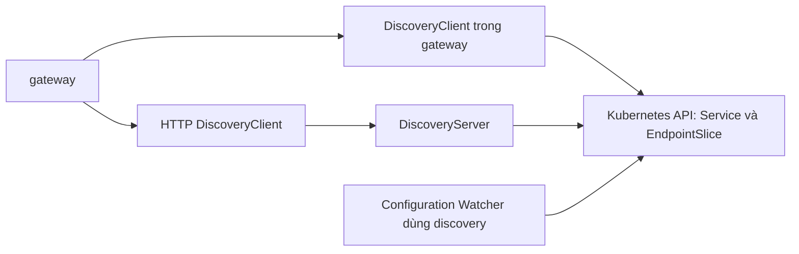

# Rà soát thay đổi trên Endpoints và EndpointSlice

Trong chương **Tương thích và nâng cấp** của module Spring Cloud Kubernetes (`SPRING_CLOUD_KUBERNETES`), bài học này hướng dẫn rà soát những thay đổi khi ứng dụng hoặc cluster chuyển từ Endpoints sang EndpointSlice. Mục tiêu là giữ đúng tập instance phục vụ cho DiscoveryClient, Spring Cloud LoadBalancer và các thành phần tìm instance để cập nhật cấu hình.

Tình huống xuyên suốt: ứng dụng `gateway` khám phá dịch vụ `orders` trong namespace `sck-lab`. Nhóm chuẩn bị nâng cấp và muốn chuyển discovery sang EndpointSlice mà không làm thiếu backend, chọn sai port hoặc gửi request vào instance chưa sẵn sàng.

Sau bài học, bạn cần có thể:

- Phân biệt thay đổi trạng thái hỗ trợ API với thay đổi cấu trúc dữ liệu.
- Kiểm kê thành phần còn đọc Endpoints, gồm cả script và controller chạy riêng.
- Kiểm tra cấu hình Spring Cloud Kubernetes, ServiceAccount và quyền đọc EndpointSlice.
- Xác minh discovery theo nhiều slice, readiness, port và vòng đời endpoint.
- Lập điều kiện chuyển đổi, quan sát và quay lui có căn cứ.

Các lệnh minh họa dùng PowerShell. Chúng dành cho môi trường học hoặc môi trường mà bạn có quyền thao tác tương ứng; bài không giả định có sẵn một cluster hoặc image ứng dụng được dựng từ tài liệu này.

## 1. Hiểu mốc thay đổi trước khi lên kế hoạch

`Endpoints` thuộc core API `v1`; `EndpointSlice` thuộc `discovery.k8s.io/v1`. EndpointSlice cung cấp mô hình phân chia dữ liệu endpoint và đã đạt GA từ Kubernetes 1.21. Endpoints được đánh dấu deprecated từ Kubernetes 1.33. Deprecated không đồng nghĩa API bị gỡ ngay trong bản nâng cấp tiếp theo. [Chuyển từ Endpoints sang EndpointSlice — Kubernetes](https://kubernetes.io/blog/2025/04/24/endpoints-deprecation/)

Cần phân biệt ba việc:

| Việc thay đổi | Câu hỏi cần trả lời |
| --- | --- |
| Cluster công bố API | Cluster đích có phục vụ đúng group/version mà client gọi không? |
| Client chọn nguồn dữ liệu | Phiên bản và cấu hình Spring Cloud Kubernetes đang đọc Endpoints hay EndpointSlice? |
| Client diễn giải dữ liệu | Việc hợp nhất slice, lọc trạng thái và chọn port có đúng nhu cầu không? |

Một bẫy khác là EndpointSlice vẫn tồn tại nhưng client gọi phiên bản API cũ. Kubernetes ngừng phục vụ `discovery.k8s.io/v1beta1` từ 1.25; hướng chuyển là `discovery.k8s.io/v1`. Vì vậy, chỉ thấy chữ “EndpointSlice” trong dependency hoặc manifest chưa đủ chứng minh tương thích. [Deprecated API Migration Guide — Kubernetes](https://kubernetes.io/docs/reference/using-api/deprecation-guide/#endpointslice-v125)

Không tự ghi một mốc “Endpoints chắc chắn bị xóa ở phiên bản X” nếu chưa có công bố tương ứng. Hãy kiểm tra release notes của cluster đích và hành vi client thực tế.

## 2. Khác biệt quan trọng nằm ở mô hình dữ liệu

| Khía cạnh | Endpoints | EndpointSlice |
| --- | --- | --- |
| API | Core `v1` | `discovery.k8s.io/v1` |
| Quan hệ với Service thông thường | Một object cùng tên Service | Có thể có nhiều object cùng liên kết với Service |
| Cách tìm | Theo namespace và tên Service | Theo namespace và label `kubernetes.io/service-name` |
| Địa chỉ và port | Nằm trong các `subsets` | Mỗi slice có `addressType`, danh sách `ports` và `endpoints` |
| Trạng thái | `addresses`, `notReadyAddresses` | `conditions.ready`, `serving`, `terminating` |
| Việc cần làm ở consumer | Đọc các subset thích hợp | Hợp nhất mọi slice phù hợp và loại trùng endpoint |

Endpoints truyền thống có thể bị cắt dữ liệu khi Service có quá nhiều backend. Với hơn 1.000 endpoint, object có thể chỉ giữ tối đa 1.000 và được gắn annotation `endpoints.kubernetes.io/over-capacity: truncated`. Một client chỉ đọc object đó sẽ không nhìn thấy toàn bộ backend. [Over-capacity Endpoints — Kubernetes](https://kubernetes.io/docs/concepts/services-networking/service/#over-capacity-endpoints)

EndpointSlice chia dữ liệu thành nhiều object. Controller mặc định nhắm tới tối đa 100 endpoint mỗi slice; không nên lấy số slice nhân 100 để suy số Pod. Slice có thể chưa đầy hoặc bị tách theo họ địa chỉ và tập port. [EndpointSlices — Kubernetes](https://kubernetes.io/docs/concepts/services-networking/endpoint-slices/)

### Ví dụ đọc dữ liệu

Giả sử Service có cổng 80 và chuyển tiếp tới port có tên `http` trên Pod:

```yaml
apiVersion: v1
kind: Service
metadata:
  name: orders
  namespace: sck-lab
spec:
  selector:
    app: orders
  ports:
    - name: http
      port: 80
      targetPort: http
```

Các Pod phía sau Service khai báo port `http` là 8080. Dữ liệu Endpoints rút gọn có thể như sau:

```yaml
apiVersion: v1
kind: Endpoints
metadata:
  name: orders
  namespace: sck-lab
subsets:
  - addresses:
      - ip: 10.244.1.10
    notReadyAddresses:
      - ip: 10.244.2.20
    ports:
      - name: http
        port: 8080
        protocol: TCP
```

Dưới đây là hai slice minh họa, đã lược bớt endpoint và metadata:

```yaml
apiVersion: discovery.k8s.io/v1
kind: EndpointSlice
metadata:
  name: orders-abc12
  namespace: sck-lab
  labels:
    kubernetes.io/service-name: orders
addressType: IPv4
ports:
  - name: http
    port: 8080
    protocol: TCP
endpoints:
  - addresses:
      - 10.244.1.10
    conditions:
      ready: true
      serving: true
      terminating: false
---
apiVersion: discovery.k8s.io/v1
kind: EndpointSlice
metadata:
  name: orders-def34
  namespace: sck-lab
  labels:
    kubernetes.io/service-name: orders
addressType: IPv4
ports:
  - name: http
    port: 8080
    protocol: TCP
endpoints:
  - addresses:
      - 10.244.2.20
    conditions:
      ready: false
      serving: false
      terminating: false
```

Đây là ví dụ quan sát cấu trúc, không phải manifest để áp dụng đè lên slice do controller quản lý. Tên hậu tố do controller tạo có thể thay đổi; không lập trình theo tên cố định `orders-abc12`.

Với chính sách chỉ chọn endpoint sẵn sàng, danh sách discovery mong đợi trong ví dụ là `10.244.1.10:8080`. Khi gọi thẳng Pod IP, port cần dùng là target port đã được ghi trong slice; không tự lấy Service port 80 ghép với Pod IP.

## 3. Kiểm kê mọi consumer trước khi bật cờ

Nâng cấp một ứng dụng không tự nâng cấp những thành phần khác cùng đọc endpoint.

| Thành phần | Nội dung cần rà soát |
| --- | --- |
| Ứng dụng dùng DiscoveryClient trực tiếp | Phiên bản, họ client, namespace, cờ chọn API và RBAC |
| Spring Cloud LoadBalancer | Có lấy danh sách Pod từ DiscoveryClient hay gọi qua Service? |
| DiscoveryServer | Đây có phải nơi thực sự gọi Kubernetes API thay cho HTTP client không? |
| Configuration Watcher | Cơ chế refresh có dùng discovery để tìm instance không? |
| Script vận hành | Có đọc `.subsets.addresses` hoặc giả định tên endpoint bằng tên Service không? |
| Thư viện/controller tự viết | Có hard-code URL core API, model Endpoints hoặc watch object cũ không? |
| Dashboard và cảnh báo | Số liệu có dựa trên một object Endpoints hoặc số slice thô không? |

Vẽ đường gọi thực tế trước khi phân quyền:



Sơ đồ biểu diễn những cách triển khai có thể gặp; không bắt buộc một ứng dụng dùng đồng thời cả hai đường discovery. ServiceAccount cần quyền mới nằm ở tiến trình thực sự gọi API.

Đối với HTTP DiscoveryClient, việc cấu hình namespace và các tùy chọn phía server phải được kiểm tra trên DiscoveryServer. Chỉ đổi cấu hình trong `gateway` không chứng minh image server đã chuyển sang EndpointSlice. [DiscoveryClient for Kubernetes — Spring Cloud Kubernetes 5.0](https://docs.spring.io/spring-cloud-kubernetes/reference/5.0/discovery-client.html)

## 4. Xác nhận hỗ trợ trong Spring Cloud Kubernetes

Ở các dòng được đối chiếu trong bài, thuộc tính chọn EndpointSlice là:

```properties
spring.cloud.kubernetes.discovery.use-endpoint-slices=true
```

Reference của Spring Cloud Kubernetes 5.0 mô tả mặc định là `false`, đồng thời yêu cầu cluster hỗ trợ API và cấp quyền phù hợp. Không giả định nâng Kubernetes hoặc nâng dependency tự làm thuộc tính này chuyển sang `true`. [Cấu hình EndpointSlice trong DiscoveryClient](https://docs.spring.io/spring-cloud-kubernetes/reference/5.0/discovery-client.html)

Thuộc tính cũng có trong mã nguồn `KubernetesDiscoveryProperties` tại tag 3.3.0 và 5.0.0. Đây là các mốc kiểm chứng cụ thể, không phải tuyên bố rằng mọi phiên bản cũ đều hỗ trợ giống nhau. [Nguồn 3.3.0](https://raw.githubusercontent.com/spring-cloud/spring-cloud-kubernetes/v3.3.0/spring-cloud-kubernetes-commons/src/main/java/org/springframework/cloud/kubernetes/commons/discovery/KubernetesDiscoveryProperties.java), [nguồn 5.0.0](https://raw.githubusercontent.com/spring-cloud/spring-cloud-kubernetes/v5.0.0/spring-cloud-kubernetes-commons/src/main/java/org/springframework/cloud/kubernetes/commons/discovery/KubernetesDiscoveryProperties.java)

Ví dụ cấu hình discovery giới hạn trong namespace lab:

```yaml
spring:
  cloud:
    kubernetes:
      discovery:
        all-namespaces: false
        namespaces:
          - sck-lab
        use-endpoint-slices: true
        include-not-ready-addresses: false
        primary-port-name: http
```

Trước khi áp dụng, kiểm tra:

- Bộ Spring Boot, Cloud train và Kubernetes starter đã tương thích.
- Chỉ dùng họ starter/client phù hợp với thiết kế hiện tại.
- Thuộc tính có hiệu lực trên tiến trình đọc API, không bị profile hay biến môi trường ghi đè.
- Kubernetes client của bản đang chạy dùng `discovery.k8s.io/v1`.
- Mọi namespace được cấu hình đều có quyền đọc tương ứng.

Thay đổi nguồn discovery có thể cần tạo lại client, informer hoặc cache. Hãy triển khai bằng một lần startup/rollout có kiểm soát; không mặc định gọi `/actuator/refresh` sẽ chuyển được toàn bộ cơ chế đang chạy.

## 5. Cấp quyền đúng API group

Quyền đọc core `endpoints` không tự cho phép đọc `endpointslices` trong `discovery.k8s.io`. RBAC phân biệt API group và resource. RoleBinding áp dụng quyền trong namespace của nó. [Using RBAC Authorization — Kubernetes](https://kubernetes.io/docs/reference/access-authn-authz/rbac/)

Ví dụ dưới đây **bổ sung** quyền EndpointSlice cho ServiceAccount `gateway` đã tồn tại:

```yaml
apiVersion: rbac.authorization.k8s.io/v1
kind: Role
metadata:
  name: endpoint-slice-reader
  namespace: sck-lab
rules:
  - apiGroups:
      - discovery.k8s.io
    resources:
      - endpointslices
    verbs:
      - get
      - list
      - watch
---
apiVersion: rbac.authorization.k8s.io/v1
kind: RoleBinding
metadata:
  name: gateway-endpoint-slice-reader
  namespace: sck-lab
subjects:
  - kind: ServiceAccount
    name: gateway
    namespace: sck-lab
roleRef:
  apiGroup: rbac.authorization.k8s.io
  kind: Role
  name: endpoint-slice-reader
```

Đây không phải toàn bộ quyền discovery: ứng dụng vẫn có thể cần đọc Service và các tài nguyên khác theo tính năng đã bật. Giữ lại những rule cần thiết, không thay toàn bộ Role cũ bằng duy nhất rule mới.

Các điểm thường sai:

- Viết `apiGroups: [""]` cho EndpointSlice.
- Cấp `get` nhưng client dùng `list/watch` để xây và cập nhật cache.
- Gắn RoleBinding cho ServiceAccount của backend `orders` trong khi `gateway` mới là consumer.
- Bật khám phá nhiều namespace nhưng chỉ phân quyền một namespace.
- Dùng tên Service như `resourceNames: ["orders"]` rồi cho rằng đã cấp quyền đọc mọi slice của Service đó.

Tên slice không cố định và list/watch có yêu cầu riêng khi giới hạn theo tên. Label lọc Service cũng không tự biến thành giới hạn quyền của Role. Điều chỉnh quyền theo cơ chế truy vấn thực tế thay vì cấp `cluster-admin`.

## 6. Quan sát cluster bằng danh tính đúng

### 6.1. Xem API và dữ liệu hiện có

```powershell
kubectl config current-context
kubectl version -o yaml
kubectl api-resources --api-group=discovery.k8s.io

$ns = 'sck-lab'
$serviceName = 'orders'

kubectl -n $ns get service $serviceName -o yaml
kubectl -n $ns get endpoints $serviceName -o yaml
kubectl -n $ns get endpointslices.discovery.k8s.io -l "kubernetes.io/service-name=$serviceName" -o yaml
```

Việc đọc Endpoints trong giai đoạn kiểm kê có thể phát sinh cảnh báo deprecation trên cluster mới. Dùng nó để xác định consumer cũ, không coi việc tắt cảnh báo là đã hoàn tất chuyển đổi.

Hãy kiểm tra label Service, namespace, `addressType`, từng tập port và điều kiện endpoint. EndpointSlice của Service nằm trong cùng namespace; chỉ trùng tên Service ở namespace khác không tạo ra cùng một tập backend.

### 6.2. Kiểm tra ServiceAccount của consumer

```powershell
kubectl -n $ns get pods -l app=gateway

# Thay bằng tên Pod consumer thực tế.
$consumerPodName = 'gateway-6b7c8d9f5c-abcde'
$consumerPod = kubectl -n $ns get pod $consumerPodName -o json | ConvertFrom-Json
$saName = $consumerPod.spec.serviceAccountName
$saIdentity = "system:serviceaccount:" + $ns + ":" + $saName

kubectl auth can-i list endpointslices.discovery.k8s.io -n $ns --as=$saIdentity
kubectl auth can-i watch endpointslices.discovery.k8s.io -n $ns --as=$saIdentity
kubectl auth can-i list services -n $ns --as=$saIdentity
```

`--as` yêu cầu người chạy có quyền impersonation. Nếu bị từ chối impersonate, chưa thể suy ra quyền của ServiceAccount. Kết quả `kubectl get` bằng tài khoản quản trị cũng không thay thế phép kiểm tra của consumer.

Sau đó kiểm tra log ứng dụng, lỗi khởi tạo cache và API request/audit nếu môi trường có cung cấp. Bằng chứng cần cho thấy tiến trình gọi đường dẫn `/apis/discovery.k8s.io/v1/...`, không chỉ thấy thuộc tính đã được ghi trong ConfigMap.

## 7. Rà soát cách diễn giải dữ liệu

### 7.1. Hợp nhất mọi slice và loại trùng

Một Service có thể có nhiều slice, và một endpoint có thể tạm xuất hiện trong nhiều slice do cập nhật đến watch/cache ở các thời điểm khác nhau. Consumer cần tạo tập network endpoint đầy đủ, không lấy phần tử đầu tiên của danh sách slice. [Duplicate Endpoints — Kubernetes](https://kubernetes.io/docs/concepts/services-networking/endpoint-slices/#duplicate-endpoints)

Khi có mã tự viết, rà soát các giả định:

- Có dùng tên Service để `get` một EndpointSlice duy nhất không?
- Có đọc hết mọi slice cùng label Service trong namespace đích không?
- Có xử lý thêm, sửa, xóa slice và việc cache phải đồng bộ lại không?
- Có phân biệt địa chỉ, port và protocol khi loại trùng không?
- Có giữ lại dữ liệu của slice đã bị xóa không?

Đừng loại trùng chỉ bằng tên Pod: một đích có thể có nhiều port, nhiều họ địa chỉ hoặc không có `targetRef` tới Pod. Cũng đừng dùng tên slice làm định danh instance bền vững.

### 7.2. Readiness và quá trình kết thúc

| Condition | Ý nghĩa cần xem xét |
| --- | --- |
| `ready` | Endpoint có phù hợp cho luồng traffic thông thường theo hợp đồng API không? |
| `serving` | Endpoint còn có thể phục vụ; hữu ích khi xem xét draining |
| `terminating` | Endpoint đang trong quá trình kết thúc |

Condition là dữ liệu có thể thiếu; không ép một giá trị không xuất hiện thành `false` một cách tùy tiện. Đọc ngữ nghĩa nullable và kiểm tra cách phiên bản client xử lý nó. [EndpointSlice API Reference](https://kubernetes.io/docs/reference/kubernetes-api/discovery/endpoint-slice-v1/)

Trong trường hợp thông thường, `ready` tương ứng với đang phục vụ và chưa terminating. Service có `publishNotReadyAddresses: true` là ngoại lệ quan trọng: không được suy sức khỏe ứng dụng chỉ từ `ready=true`. [EndpointSlice Conditions — Kubernetes](https://kubernetes.io/docs/concepts/services-networking/endpoint-slices/#conditions)

Readiness thay đổi không có nghĩa JVM đã dừng. Ngược lại, endpoint terminating có thể vẫn phục vụ request đang xử lý. Việc chuyển API discovery không tự tạo ra cơ chế graceful shutdown hay connection draining; phải xác minh hành vi của client và ứng dụng. [Pod and Endpoint Termination Flow — Kubernetes](https://kubernetes.io/docs/tutorials/services/pods-and-endpoint-termination-flow/)

### 7.3. Chọn đúng port, họ địa chỉ và topology

Rà soát các Service có nhiều cổng, chẳng hạn `http`, `https` và management. Đừng lấy cổng đầu tiên rồi coi đó là cổng nghiệp vụ. Với client có cấu hình primary port, kiểm tra tên đó tồn tại và khớp mục đích gọi.

Mỗi slice có `addressType`; Service dual-stack có thể có dữ liệu IPv4 và IPv6. Hai địa chỉ không nhất thiết đại diện cho hai Pod khác nhau. Client còn cần khả năng kết nối trên họ địa chỉ được chọn.

Topology, zone hoặc hints có thể xuất hiện trong dữ liệu. Việc một thư viện đọc EndpointSlice không tự chứng minh nó thực thi toàn bộ chính sách phân phối traffic của Kubernetes. Khi client gọi trực tiếp Pod IP, hãy kiểm tra thuật toán chọn instance thực tế.

## 8. Xác minh danh sách mà DiscoveryClient thực sự trả về

Danh sách từ `kubectl` là dữ liệu đầu vào; cần quan sát thêm kết quả sau lọc, chọn port và cache của ứng dụng.

Trong ứng dụng lab có Spring Web và DiscoveryClient, có thể bổ sung một controller chẩn đoán:

```java
package vn.example.platform;

import java.util.List;
import org.springframework.cloud.client.discovery.DiscoveryClient;
import org.springframework.web.bind.annotation.GetMapping;
import org.springframework.web.bind.annotation.PathVariable;
import org.springframework.web.bind.annotation.RequestMapping;
import org.springframework.web.bind.annotation.RestController;

@RestController
@RequestMapping("/internal/discovery")
public class DiscoveryInspectionController {
    private final DiscoveryClient discoveryClient;

    public DiscoveryInspectionController(DiscoveryClient discoveryClient) {
        this.discoveryClient = discoveryClient;
    }

    @GetMapping("/{serviceId}")
    public List<InstanceView> instances(
            @PathVariable("serviceId") String serviceId) {
        return discoveryClient.getInstances(serviceId).stream()
                .map(instance -> new InstanceView(
                        instance.getServiceId(),
                        instance.getHost(),
                        instance.getPort(),
                        instance.isSecure()))
                .toList();
    }

    public record InstanceView(
            String serviceId, String host, int port, boolean secure) {
    }
}
```

Endpoint chẩn đoán này dành cho lab hoặc mạng vận hành được bảo vệ, vì nó cho thấy địa chỉ nội bộ. Ví dụ dùng API Java 17 trở lên; đặt class trong package được Spring quét.

Ở terminal thứ nhất:

```powershell
kubectl -n $ns port-forward pod/$consumerPodName 18080:8080
```

Ở terminal thứ hai:

```powershell
curl.exe --max-time 5 http://127.0.0.1:18080/internal/discovery/orders
```

Với dữ liệu mẫu ở phần 2 và chính sách chỉ lấy endpoint sẵn sàng, kết quả mong đợi có host `10.244.1.10`, port `8080`, không có `10.244.2.20`. Đối chiếu theo tập địa chỉ/port đã chuẩn hóa, không so thứ tự JSON.

Quan sát nhiều lần trong thời gian dài hơn độ trễ controller, watch và cache phía client. Hai snapshot chụp vào các thời điểm khác nhau khi rollout đang diễn ra có thể khác nhau mà không phải lỗi.

## 9. Kiểm tra LoadBalancer và Configuration Watcher

### LoadBalancer

Spring Cloud Kubernetes LoadBalancer có đường chọn Pod qua DiscoveryClient và đường dùng Service. Khi dùng chế độ `POD`, thay đổi nguồn discovery có thể đổi trực tiếp tập địa chỉ đích. Khi dùng `SERVICE`, điểm lựa chọn và đường đi traffic khác; kiểm thử cần bám đúng chế độ. [LoadBalancer for Kubernetes](https://docs.spring.io/spring-cloud-kubernetes/reference/load-balancer.html)

Kiểm tra request nghiệp vụ qua đúng client có load balancing. Việc gọi Service DNS thành công chưa chứng minh đường gọi trực tiếp Pod IP từ DiscoveryClient cũng đúng. Ngược lại, không cần đưa discovery vào ứng dụng chỉ để chuyển backend API mà hạ tầng Service đang tự quản lý.

### Configuration Watcher

Với cách refresh HTTP có dùng DiscoveryClient, watcher cần tìm đúng các instance của ứng dụng rồi gửi thông báo. Rà soát phiên bản image, thuộc tính discovery và ServiceAccount của chính watcher hoặc server mà nó phụ thuộc. [Configuration Watcher — Spring Cloud Kubernetes 5.0](https://docs.spring.io/spring-cloud-kubernetes/reference/5.0/spring-cloud-kubernetes-configuration-watcher.html)

Phép thử phù hợp là thay đổi một cấu hình không nhạy cảm, chẳng hạn `demo.message`, rồi xác minh các instance đủ điều kiện đều nhận giá trị mới. Không chỉ thấy ConfigMap đã đổi là coi việc tìm và refresh instance thành công.

Việc đọc ConfigMap/Secret thuộc đường cấu hình riêng; chuyển EndpointSlice không tự cấp quyền đọc chúng và cũng không thay đổi cơ chế cập nhật file mount.

## 10. Service không có selector cần rà soát riêng

Với Service có selector, controller thường tự tạo và cập nhật endpoint từ Pod. Với Service không có selector, có thể chính script hoặc controller của tổ chức là bên xuất bản endpoint.

EndpointSlice mirroring từ Endpoints cũ cũng được đánh dấu deprecated từ Kubernetes 1.33. Vì vậy, chỉ chuyển consumer sang EndpointSlice nhưng vẫn phụ thuộc publisher tạo Endpoints rồi trông chờ mirroring chưa hoàn tất quá trình chuyển đổi. [EndpointSlice Mirroring — Kubernetes](https://kubernetes.io/docs/concepts/services-networking/endpoint-slices/#endpointslice-mirroring)

Ví dụ một Service bên ngoài hệ Pod và slice được quản lý trực tiếp:

```yaml
apiVersion: v1
kind: Service
metadata:
  name: inventory-external
  namespace: sck-lab
spec:
  ports:
    - name: http
      port: 80
      targetPort: 8080
---
apiVersion: discovery.k8s.io/v1
kind: EndpointSlice
metadata:
  name: inventory-external-v4
  namespace: sck-lab
  labels:
    kubernetes.io/service-name: inventory-external
    endpointslice.kubernetes.io/managed-by: learning-platform
addressType: IPv4
ports:
  - name: http
    port: 8080
    protocol: TCP
endpoints:
  - addresses:
      - 192.0.2.10
    conditions:
      ready: true
```

`192.0.2.10` là địa chỉ minh họa, cần thay bằng backend hợp lệ và có thể định tuyến. Việc đặt `ready: true` thủ công là một tuyên bố của publisher; Kubernetes không tự thực hiện readiness probe cho backend bên ngoài này.

Cần xác định rõ ai cập nhật địa chỉ, condition và vòng đời slice. Kiểm tra label liên kết Service, port, địa chỉ và quyền ghi của publisher. Tránh để publisher cũ, mirroring và publisher mới tạo những tập dữ liệu không nhất quán cho cùng Service.

## 11. Kịch bản kiểm thử khi nâng cấp

Không cần thử mọi tính năng Kubernetes; ưu tiên những giả định mà hệ thống đang có.

| Kịch bản | Điều cần chứng minh |
| --- | --- |
| Service nhỏ, một slice | Discovery trả đúng host và target port |
| Service có nhiều slice | Không thiếu backend do chỉ đọc slice đầu |
| Một Pod không Ready | Client áp dụng đúng chính sách chọn instance |
| Scale tăng rồi giảm | Địa chỉ mới xuất hiện, địa chỉ cũ được loại khỏi cache |
| Rolling update | Tập instance thay đổi trong giới hạn chấp nhận; không giữ đích đã kết thúc quá lâu |
| Service nhiều port | Không chọn management port hoặc nhầm Service port với Pod port |
| Dual-stack nếu sử dụng | Đúng họ địa chỉ và khả năng kết nối; không đếm địa chỉ thành số Pod |
| Selectorless Service nếu sử dụng | Publisher mới và consumer thống nhất dữ liệu |
| Watcher refresh nếu sử dụng | Các instance cần thiết đều được tìm thấy và cập nhật |
| Client mất rồi khôi phục watch | Cache trở về đúng trạng thái; lỗi quyền không bị che khuất |

Trong lab đã có workload hoạt động, có thể quan sát thay đổi theo thời gian:

```powershell
kubectl -n $ns get endpointslices.discovery.k8s.io -l "kubernetes.io/service-name=$serviceName" -w
```

Ở terminal khác, thực hiện scale hoặc rollout đã lên kế hoạch, đồng thời gọi endpoint chẩn đoán và request nghiệp vụ. Không mở rộng workload lên hàng nghìn Pod chỉ để tạo nhiều slice; dùng môi trường kiểm thử phù hợp với tài nguyên hiện có.

Điều cần so là tập backend đủ điều kiện và hành vi phục vụ, không phải số slice, thứ tự instance hay tỷ lệ request bằng nhau tuyệt đối. Kết nối được tái sử dụng và cache LoadBalancer có thể làm phân bố request khác mong đợi đơn giản.

## 12. Chuyển đổi theo từng giai đoạn và chuẩn bị quay lui

### Giai đoạn 1: ghi nhận trạng thái ban đầu

Lưu trong hồ sơ triển khai các thông tin:

- Phiên bản ứng dụng, Spring Cloud Kubernetes, client và cluster.
- Consumer/publisher liên quan, kể cả image DiscoveryServer và watcher.
- Namespace, ServiceAccount, quyền cũ và cấu hình discovery có hiệu lực.
- Tập backend bình thường, độ trễ cập nhật và mức lỗi hiện tại.

### Giai đoạn 2: bổ sung điều kiện để đọc EndpointSlice

Cấp quyền mới trước khi triển khai consumer mới. Giữ quyền Endpoints cho những consumer cũ còn hoạt động. Kiểm tra API group/version và dữ liệu slice trước khi bật cờ ở một nhóm canary.

### Giai đoạn 3: kiểm chứng canary

Xác nhận nguồn API thực sự được dùng, cache khởi tạo được, danh sách instance đúng và request nghiệp vụ ổn định. Thử thay đổi readiness, scale hoặc rollout phù hợp với hệ thống.

### Giai đoạn 4: mở rộng và loại bỏ phụ thuộc cũ

Chuyển các consumer còn lại, sửa script và publisher selectorless nếu có. Sau khi hết phụ thuộc, mới thu hồi quyền hoặc cấu hình cũ không còn cần.

Đừng xóa Endpoints hay slice do controller quản lý để “ép thử” trong production. Xác minh bằng cấu hình, log/API audit và kết quả discovery; bài thử lỗi cần môi trường có kiểm soát.

### Điều kiện quay lui

Quay về cấu hình đọc Endpoints chỉ khả thi khi API cũ và dữ liệu cũ vẫn tồn tại, đầy đủ, cùng quyền đọc cần thiết. Nếu Endpoints đang bị truncated hoặc publisher không còn tạo dữ liệu cũ, đây không phải đường quay lui tương đương.

Một lần quay lui cần khôi phục đúng image/cấu hình của consumer và xem xét server/watcher liên quan. Không chỉ đổi cờ ở một ứng dụng rồi coi toàn bộ hệ thống đã trở về trạng thái trước.

## 13. Chẩn đoán các lỗi thường gặp

| Hiện tượng | Giả thuyết cần kiểm tra trước |
| --- | --- |
| 403 khi list/watch EndpointSlice | Sai API group, thiếu verb, sai RoleBinding hoặc sai namespace |
| API trả 404/không tìm thấy resource | Client gọi API version không được phục vụ hoặc dùng sai đường dẫn |
| Service tồn tại nhưng discovery rỗng | Label, namespace, cache, readiness, filter hoặc primary port |
| Chỉ thấy một phần backend | Chỉ đọc một slice, loại trùng sai hoặc còn dùng Endpoints bị truncated |
| Backend đã kết thúc vẫn nhận request | Watch/cache không cập nhật, cache LoadBalancer hoặc chính sách connection reuse |
| Gọi DNS Service được nhưng gọi từ client thất bại | Khác đường dữ liệu, sai Pod port, họ địa chỉ hoặc quyền discovery |
| Chỉ một phần instance nhận refresh | Discovery của watcher/server, lọc instance hoặc đường gọi refresh |
| Snapshot đổi dù số Pod không đổi | Repacking slice, chuyển trạng thái, đổi port hoặc thay đổi họ địa chỉ |

Kết quả rà soát cần trả lời được bốn câu hỏi: **ai xuất bản endpoint, ai đọc API nào, consumer chọn đích theo quy tắc gì, và bằng chứng nào cho thấy tập đích vẫn đúng khi workload thay đổi**. Đó là cơ sở để nâng cấp an toàn hơn việc chỉ đổi tên tài nguyên trong một lệnh `kubectl`.
